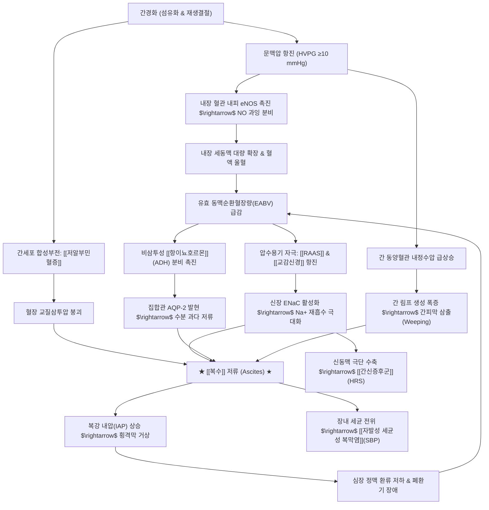

# 🩺 [[복수]] (Ascites / 腹水, ICD-10 K76.7 / R18)

> **핵심 3줄 요약 (Key Summary)**:
> - 📍 **병소 부위 & 병태생리**: [[간경화]]로 인한 간내 혈관 저항 증가 및 [[문맥 고혈압]](HVPG ≥ 10 mmHg)과 [[저알부민혈증]](혈청 알부민 감소로 인한 교질삼투압 저하), 내장 혈관 확장에 따른 유효 동맥순환혈장량(EABV) 감소가 촉발하는 질환. [[RAAS]](레닌-안지오텐신-알도스테론계), [[교감신경]]계 및 비삼투성 [[항이뇨호르몬]](ADH)의 폭발적 활성화로 신장 세뇨관의 나트륨·수분 재흡수가 영구 촉진되고, 간 림프액 생성이 정상의 30배까지 폭증하여 복막강(Peritoneal cavity) 내에 체액이 수 리터 이상 병적으로 저류됨.
> - 🚩 **전형적 임상 양상 & 3대 징후**: 단기간의 가파른 체중 증가 및 팽팽한 복부 팽만, 측복부 타진 시 이동성 탁음(Shifting dullness) 및 수액파동(Fluid wave), 횡격막 압박에 의한 호흡곤란(기좌호흡) 및 복압 상승으로 인한 제대탈장, 양측 하지 함요 부종, 간성 흉수.
> - 🛠️ **핵심 감별 & 한·양방 치료 전략**: 진단적 복부천자를 통한 혈청-복수 알부민 농도차(SAAG ≥ 1.1 g/dL 문맥압 항진성 vs < 1.1 g/dL 비문맥압 항진성 복막암종·결핵) 감별, 복수 총단백 및 다핵호중구(PMN ≥ 250/mm³ 시 자발성 세균성 복막염 확진). 치료는 철저한 저염식(1일 나트륨 2g/88mEq 제한), 이뇨제(스피로놀락톤 + 푸로세미드 100:40 비율 단계적 증량), 5L 이상 대량 복수 천자(LVP) 시 알부민 1L당 6~8g 정맥 투여 필수. 한의학에서는 고창(鼓脹)·수종(水腫)으로 보아 비신양허(脾腎陽虛), 간비어혈(肝脾瘀血), 습열내온(濕熱內蘊) 변증 하에 온보비신·활혈화어·완만이수([[실비음]], [[오령산]], [[진무탕]], [[분심기음]], [[인진호탕]])를 구사하며 준하축수약 남용 엄금.
> - <font color="#fa7e7e">⚠️ **응급 의뢰 레드플래그**: 복수 천자액 호중구(PMN) ≥ 250/mm³(자발성 세균성 복막염 SBP 의심 발열·복부 반발통), 급성 핍뇨 및 혈청 크레아티닌 급상승([[간신증후군]] HRS), 식도정맥류 파열 대량 토혈, 지남력 상실 및 의식 혼탁([[간성뇌증]]) 발생 시 즉시 상급병원 응급실로 전원.</font>

---

## 📌 목차
1. [질환 개요 & 병태생리 (Disease Overview)](#1-질환-개요--병태생리-disease-overview)
2. [병태생리 메커니즘 & 대사·장기부전 악순환 네트워크](#2-병태생리-메커니즘--대사장기부전-악순환-네트워크)
3. [임상 증상 & 환자 소견 (Clinical Presentation)](#3-임상-증상--환자-소견-clinical-presentation)
4. [감별 진단 매트릭스 (Differential Diagnosis)](#4-감별-진단-매트릭스-differential-diagnosis)
5. [한의 통합 치료 프로토콜 (침·약침·한약)](#5-한의-통합-치료-프로토콜-침약침한약)
6. [양방 치료 & 병용·의뢰 기준 (Conventional Treatment & Referral)](#6-양방-치료--병용의뢰-기준-conventional-treatment--referral)
7. [식이·생활습관 & 자가관리 티칭 가이드](#7-식이생활습관--자가관리-티칭-가이드)
8. [💡 진료실 핵심 필기 & 임상 노하우](#8--진료실-핵심-필기--임상-노하우)
9. [출처 및 학술 참고 문헌 (References)](#9-출처-및-학술-참고-문헌-references)

---

## 1. 질환 개요 & 병태생리 (Disease Overview)

* **질환 정의 및 임상적 의의**:
  * [[복수]](Ascites)는 복막강(Peritoneal cavity) 내에 체액이 병적으로 과다하게 축적되는 임상 증후군입니다. 정상 성인의 복막강에는 장간막과 내장 장기 간의 물리적 마찰을 줄이기 위해 약 25~50 mL의 장액이 생리적으로 존재하지만, 간·심장·신장·복막 질환으로 인해 체액의 생성량이 림프관 및 복막 모세혈관의 흡수 능력을 초과하면 수 리터에서 십여 리터 이상 고이게 됩니다.
  * 전체 복수 원인의 약 80~85%는 [[간경화]](간경변증, Liver Cirrhosis)에 의한 간경변성 복수(Cirrhotic ascites)이며, 이는 보상성(Compensated) 간경변이 비대상성(Decompensated) 단계로 비가역적 전환되었음을 알리는 가장 중요한 임상 이정표입니다.
  * 보상성 간경변 환자에서 10년 이내에 복수가 발생할 누적 확률은 약 50%에 달하며, 일단 복수가 발현되면 환자의 1년 사망률은 약 15~20%, 5년 생존율은 30~50% 수준으로 급감하므로 즉각적이고 정밀한 한·양방 통합 관리가 요구됩니다.

* **관련 장기 및 조직 구조**:
  * **주 이환 장기 — 간(Liver) 실질 및 간혈관계**:
    * 정상 간 실질이 광범위한 결절(Regenerative nodules)과 치밀한 섬유화 조직으로 대체되면서 간내 미세혈관상(Microvascular bed)이 왜곡됩니다.
    * 굴모양혈관(동양혈관, Hepatic Sinusoids)의 내피세포 창문(Fenestrae)이 소실되는 '동양혈관 모세혈관화(Capillarization of sinusoids)'가 발생하고, 디세강(Space of Disse) 내 세포외 기질(ECM) 축적으로 인해 간내 혈류 저항이 급증하여 간정맥압력차(HVPG, Hepatic Venous Pressure Gradient)가 정상(1~5 mmHg)을 훨씬 초과하여 10 mmHg 이상으로 상승하는 [[문맥 고혈압]](Portal Hypertension)이 고착화됩니다.
  * **복막강 (Peritoneal Cavity) 및 복막 모세혈관망**:
    * 복막은 약 1.7 m²에 달하는 넓은 표면적을 가진 반투과성 생체막으로, 벽측 복막(Parietal peritoneum)과 장측 복막(Visceral peritoneum)으로 구성됩니다.
    * 간표면의 글리슨 피막(Glisson's capsule)과 장간막 모세혈관에서 정수압 상승과 교질삼투압 저하로 인해 혈장 여과액이 지속적으로 유출됩니다.
  * **간 림프관계 및 디세강**:
    * 간 동양혈관 내 정수압이 상승함에 따라 디세강 내로 수액 여과가 폭증하여 간 림프액 생성이 정상의 최대 30배까지 증가합니다.
    * 이 양이 흉관(Thoracic duct)의 최대 수송 배액 용량을 초과하면, 간 피막 표면에서 투명하고 단백질이 풍부한 림프액이 복강 내로 직접 땀처럼 스며 나오는 현상(Weeping of hepatic lymph)이 발생합니다.
  * **연관 조절계 및 신경내분비축**:
    * **[[RAAS]] 축**: 신포탈 혈류 저하 및 유효 순환 혈장량 감소로 레닌 분비 촉진 → 안지오텐신 II 생성 → 부신피질에서 [[알도스테론]] 분비 급증 → 원위세뇨관 및 집합관에서 나트륨 재흡수 촉진.
    * **비삼투성 [[항이뇨호르몬]](ADH/Vasopressin) 분비**: 시상하부-뇌하수체 후엽 경로 활성화로 집합관의 아쿠아포린-2(AQP-2) 발현 증가 → 유리수(Free water) 과잉 재흡수 및 희석성 저나트륨혈증 유발.
    * **[[교감신경]]계(SNS)**: 신동맥 및 전신 혈관 수축 반사 유도, 사구체여과율(GFR) 저하.

---

## 2. 병태생리 메커니즘 & 대사·장기부전 악순환 네트워크

### 1) 말초 동맥 혈관 확장 학설 (Peripheral Arterial Vasodilation Hypothesis)
간경변성 복수의 형성을 설명하는 가장 핵심적인 기전은 '말초 동맥 혈관 확장설'입니다.

```
========================================================================================
                      [ 간경변성 복수 발생의 핵심 병태생리 흐름도 ]
========================================================================================

  [ 간경변증: 광범위 섬유화 & 재생결절 ]
                │
                ├─────────────────────────────────────────┐
                ▼                                         ▼
   [ 간내 혈관 저항 급증 (HVPG ≥10 mmHg) ]     [ 간세포 합성 부전: 저알부민혈증 ]
                │                                         │
                ├───────────────────────┐                 │
                ▼                       ▼                 ▼
   [ 내장 순환 전단응력 증가 ]   [ 동양혈관 정수압 상승 ] [ 혈장 교질삼투압 급락 ]
                │                       │                 │ (스탈링 법칙 불균형)
                ▼                       ▼                 │
   [ eNOS 활성화: 산화질소(NO) 대량 방출 ] [ 간 림프액 생성 30배 폭증 ]   │
                │                       │                 │
                ▼                       │ (흉관 배액 한계 초과)   │
   [ 내장 세동맥 대량 확장 & 혈액 울혈 ]  ▼                 │
                │              [ 간 표면 피막 림프액 누출 ] │
                ▼                       │                 │
   [ 유효 동맥순환혈액량 (EABV) 격감 ]     │                 │
                │                       │                 │
                ▼                       │                 │
   [ 경동맥동·대동맥궁 압수용기 탈억제 ]    │                 │
                │                       │                 │
                ├───────────────────────┼─────────────────┘
                ▼                       │
   [ 전신 신경체액성 보상계 폭발적 활성화 ]│
    ├─ 1. RAAS 과활성화 (알도스테론 급증)│
    ├─ 2. 교감신경계(SNS) 긴장도 항진    │
    └─ 3. 비삼투성 바소프레신(ADH) 분비  │
                │                       │
                ▼                       │
   [ 신장 세뇨관 Na+ 재흡수 & 수분 저류 ] │
                │                       │
                └───────────────────────┼─────────────────┐
                                        │                 │
                                        ▼                 ▼
                              ★ 복막강 내 수액 축적 ★  [ 하지 함요 부종 ]
                                 ([[복수]], Ascites)
```

1. **문맥 고혈압과 내장 혈관 확장**:
   - 간경화로 인해 문맥압이 상승하면(HVPG ≥ 10 mmHg), 문맥계를 통과하지 못한 혈류가 측부 순환로로 우회하고 내장 혈관 내피세포에 강력한 전단응력(Shear stress)을 가합니다.
   - 내피세포형 산화질소 합성효소(eNOS)가 상향 조절되어 강력한 혈관확장 물질인 산화질소(NO), 프로스타사이클린, 일산화탄소(CO)가 대량 유리됩니다.
   - 이로 인해 장간막 세동맥이 비정상적으로 확장되고 막대한 양의 혈액이 내장 정맥총에 저류됩니다.
2. **유효 동맥순환혈장량(EABV) 감소와 신경호르몬계 과활성화**:
   - 내장 순환계로의 혈액 쏠림 현상으로 인해 중추 및 전신 순환계를 순환하는 **유효 동맥순환혈장량(Effective Arterial Blood Volume, EABV)**이 격감합니다.
   - 대동맥궁과 경동맥동의 압수용기(Baroreceptors)가 이를 혈액 손실 또는 극심한 탈수로 인지하여 방어 기전을 가동합니다.
   - [[RAAS]](레닌-안지오텐신-알도스테론계)와 [[교감신경]]계가 폭발적으로 흥분하고, 뇌하수체 후엽에서 [[항이뇨호르몬]](ADH, Arginine Vasopressin)이 비삼투성 기전으로 분비됩니다.
3. **신장의 불응성 나트륨·수분 저류**:
   - 알도스테론은 원위곡세뇨관 및 피질 집합관의 주세포(Principal cells)에 작용하여 상피성 나트륨 통로(ENaC)와 Na+/K+-ATPase 펌프를 활성화시켜 나트륨 재흡수를 극대화합니다.
   - 신장은 소변으로 배출해야 할 나트륨을 거의 전량 재흡수(소변 나트륨 농도 < 10~20 mEq/L)하며, 바소프레신은 수분 통로(Aquaporin-2)를 집합관 내강막에 삽입하여 자유 수분을 체내로 끌어들입니다.

### 2) 동양혈관 정수압 상승, 저알부민혈증 및 스탈링 법칙 (Starling Forces)
* **모세혈관 정수압 상승**: 간내 혈관 저항 증가로 간 동양혈관 내부의 미세혈관 정수압(Hydrostatic pressure)이 비정상적으로 치솟습니다.
* **혈장 교질삼투압 저하**: 간세포 손상으로 간의 일일 알부민 합성 능력이 정상(12~14g/일)의 절반 이하로 급감하여 혈청 알부민 수치가 3.0 g/dL 미만(중증 시 2.0 g/dL 미만)으로 떨어지는 [[저알부민혈증]]이 발생합니다. 혈장 교질삼투압(Oncotic pressure)이 급락하여 혈관 내 수분을 붙잡아 두는 능력이 붕괴됩니다.
* **스탈링 법칙의 붕괴**: 여과압($\Delta P - \sigma \Delta \pi$)이 극단적으로 상승하여 체액이 혈관 밖으로 쏟아져 나오며, 간 림프액 생성 속도가 림프 배액관의 수송 능력을 초과하여 간 피막 표면에서 복강 내로 직접 흘러넘칩니다.

### 3) 대사·장기부전 악순환 네트워크


---

## 3. 임상 증상 & 환자 소견 (Clinical Presentation)

### 1) 주소증 및 신체 증상
* **복부 팽만 및 중심성 체중 급증**:
  * 환자는 "바지나 치마 치수가 갑자기 맞지 않고 허리둘레가 급격히 늘어났다", "배가 풍선처럼 팽팽하게 불러오고 더부룩하다"고 호소합니다.
  * 사지(팔, 다리)는 근육 소모(Sarcopenia)와 영양실조로 앙상하게 마르는데 반해 복부만 거대하게 솟아오르는 전형적인 '개구리 배(Frog belly)' 형태의 중심성 비만을 보입니다.
  * 단기간(수일~수주)에 수 kg에서 10 kg 이상의 체중 급증이 관찰됩니다.
* **복압 상승에 따른 이차적 압박 증상**:
  * **호흡곤란(Dyspnea)**: 거대한 복수가 횡격막을 상방으로 강하게 밀어 올려 흉곽 용적을 축소시키며, 특히 누웠을 때 호흡곤란이 악화되는 기좌호흡(Orthopnea) 및 운동 시 호흡곤란을 유발합니다.
  * **조기 만복감 및 소화장애**: 위장관이 복수에 의해 외부에서 압박을 받아 소량의 음식물 섭취에도 속이 꽉 찬 느낌, 오심, 트림, 식욕 부진이 발생합니다.
  * **제대탈장(Umbilical Hernia)**: 팽창된 복압을 견디지 못하고 배꼽 주변 복벽이 얇아져 밖으로 돌출되며, 감돈(Incarceration) 및 피부 괴사 파열의 위험이 있습니다.
  * **간성 흉수(Hepatic Hydrothorax)**: 횡격막 힘줄 부위의 미세한 선천적·후천적 결손(주로 우측 횡격막)을 통해 음압이 걸리는 흉강 내로 복수가 빨려 들어가 다량의 흉수를 형성합니다.
  * **고환 및 음낭 부종(Scrotal edema)**: 서혜관을 통해 높은 복압과 체액이 전달되어 음낭이 배구공 크기로 비대해질 수 있습니다.

### 2) 객관적 신체 검진 소견 (Physical Examination)
* **이동성 탁음 (Shifting Dullness)**:
  * 앙와위(똑바로 누운 자세)에서 복부 정중앙은 장내 공기로 인해 고창음(Tympanitic sound)이 들리고, 액체가 중력에 의해 고이는 양측 옆구리(측복부)는 둔탁음(Dullness)이 청취됩니다.
  * 경계선을 표시한 후 환자를 측와위(옆으로 누운 자세)로 돌려 눕히면, 복수가 아래쪽으로 쏠리고 장관이 위쪽으로 떠오르면서 이전의 탁음 부위가 고창음으로 바뀌고 아래쪽은 탁음으로 이동합니다.
  * **임상적 유의성**: 약 1,500 mL 이상의 복수가 차 있을 때 70~80%의 민감도를 나타냅니다.
* **수액 파동 검사 (Fluid Wave Test)**:
  * 조수나 환자 자신의 손바닥 가장자리를 복부 정중선(복벽 백선)에 단단히 세워 피하지방층을 통한 잔물결 진동 전달을 물리적으로 차단합니다.
  * 검사자가 한쪽 옆구리를 손가락 끝으로 톡 쳤을 때, 반대편 옆구리에 얹어 둔 검사자의 손바닥에 충격파 액체 파동이 명확히 전해지는지 평가합니다.
  * **임상적 유의성**: 통상 2,000 mL 이상의 대량 복수가 있을 때 뚜렷하게 양성을 보입니다.
* **외래용 진단 영상 — 복부 초음파 (Abdominal Ultrasonography)**:
  * 복부 진찰로 감지하기 어려운 100 mL 미만의 미량 복수까지 모리슨와(Morison's pouch, 간-신장 오목) 및 방광직장와(Pouch of Douglas)에서 고감도로 발견할 수 있는 표준 영상 기법입니다.

### 3) 복수의 임상 병기 분류 (AASLD / EASL 가이드라인)
* **1등급 (Grade 1, 경증 복수)**: 신체 진찰로는 인지되지 않으며 오직 초음파 검사로만 발견되는 상태.
* **2등급 (Grade 2, 중등도 복수)**: 대칭적인 복부 팽만과 이동성 탁음이 명확히 관찰되나 복벽의 긴장도가 극심하지 않은 상태.
* **3등급 (Grade 3, 대량/긴장성 복수, Tense Ascites)**: 현저한 복부 팽만과 함께 복벽 피부가 팽팽하고 반질반질하게 긴장되어 있으며 호흡곤란 및 제대탈장을 동반하는 상태.

---

## 4. 감별 진단 매트릭스 (Differential Diagnosis)

### 1) 진단적 복부천자(Diagnostic Paracentesis) 및 SAAG 개념
신규 발생 복수 환자나 원인 불명의 급격한 복수 악화 환자에서는 반드시 진단적 복부천자를 시행하여 복수액 분석을 진행해야 합니다. 과거의 '여출액(Transudate) vs 삼출액(Exudate)' 분류법은 오류율이 높아 폐기되었으며, 현재는 **혈청-복수 알부민 농도차(SAAG, Serum-Ascites Albumin Gradient)**가 표준 감별 기준입니다.

$$\text{SAAG} = \text{동일 시점 혈청 알부민 (g/dL)} - \text{복수 알부민 (g/dL)}$$

* **SAAG ≥ 1.1 g/dL (고구배, High Gradient)**: 간문맥압 항진증 존재(정확도 97%). 모세혈관 정수압 상승 매개 누출액.
* **SAAG < 1.1 g/dL (저구배, Low Gradient)**: 문맥압 항진증 없음. 복막 자체의 염증, 암 전이로 인한 혈관 투과성 증가 또는 극심한 신증후군.

### 2) 감별 진단 매트릭스

| 감별 질환 | SAAG (g/dL) | 복수 총단백 (g/dL) | 백혈구 및 호중구(PMN) | 핵심 병태생리 및 감별 포인트 |
| :--- | :--- | :--- | :--- | :--- |
| **[[간경화]] 복수** (본 질환) | **≥ 1.1 (고구배)** | **< 2.5 (저단백)** | < 250/mm³ | 간섬유화, HVPG ≥10 mmHg, 정상 알부민 합성 저하 |
| **심인성 복수** (울혈성 [[심부전 hf]]) | **≥ 1.1 (고구배)** | **≥ 2.5 (고단백)** | < 250/mm³ | 우심부전, 중심정맥압(CVP) 상승, 경정맥 노장(JVD), BNP 급상승 |
| **버드-키아리 증후군** | **≥ 1.1 (고구배)** | **≥ 2.5 (고단백)** | < 250/mm³ | 간정맥/하대정맥 혈전성 폐색, 급격한 간종대 및 극심한 우상복부통 |
| **복막 암종증** (악성 복수) | **< 1.1 (저구배)** | **≥ 2.5 (고단백)** | 림프구 우세, 이형세포 | 위·대장·난소암 복막 파종, 복수 세포진 검사 암세포 검출 |
| **결핵성 복막염** | **< 1.1 (저구배)** | **≥ 2.5 (고단백)** | 림프구 우세 (>70%) | 복수 ADA ≥ 30~40 U/L 상승, 결핵균 PCR 양성, 야간 발한 |
| **신인성 복수** ([[신장 증후군]]) | **< 1.1 (저구배)** | **< 2.5 (저단백)** | < 250/mm³ | 사구체 손상, 다량 단백뇨(>3.5g/일), 전신 부종(아나사카), 고지혈증 |
| **췌장성 복수** | **< 1.1 (저구배)** | **≥ 2.5 (고단백)** | 다양함 | 만성 췌장염, 가성낭종 파열, 복수 아밀라아제 수천~수만 IU/L 폭증 |
| **[[자발성 세균성 복막염]](SBP)** | 원인 질환 따름 (대개 ≥1.1) | 대개 < 1.5 g/dL (고위험군) | **PMN ≥ 250/mm³** | 복강 내 천공 없이 발생한 복수 감염, 발열, 복부 압통/반발통 |

---

## 5. 한의 통합 치료 프로토콜 (침·약침·한약)

* **한의 치료의 대원칙: 허실(虛實) 변별 & 건비온신(健脾溫腎) & 활혈소간(活血疏肝) & 완만이수(緩慢利水)**:
  * 한의학에서 간경화 복수는 **고창(鼓脹)**, **단복창(單腹脹)**, **수종(水腫)**의 범주에 속하며, 병소는 간(肝)·비(脾)·신(腎) 3장에 뿌리를 둡니다.
  * 비기(脾氣)가 허손되어 수습(水濕)을 운화하지 못하고(土不制水), 간기(肝氣)가 울결되어 혈맥이 정체되며(氣滯血瘀), 신양(腎陽)이 쇠약해져 수액을 기화(氣化)시키지 못하는 복합 허실협잡(虛實挾雜)의 난치성 병태입니다.
  * ⚠️ **준하축수약(峻下逐水藥) 남용의 절대 금기**: 대황(大黃), 파두(巴豆), 감수(甘遂), 대극(大戟), 원화(芫花) 등 강렬한 사하 약재를 써서 설사로 복수를 빼내려 하면 일시적으로 배는 줄어들 수 있으나, 비위 원기가 파탄 나고 유효 순환 혈류량이 급감하여 치명적인 [[간신증후군]](HRS)이나 [[간성뇌증]](간성혼수)을 초래하므로 절대 금해야 합니다. '보기온양(補氣溫陽)으로 기화(氣化)를 도와 자연스러운 이뇨를 유도'하는 온화한 치법이 정도(正道)입니다.

### 1) 변증별 한약 처방 프로토콜

* **비신양허형 (脾腎陽虛型 — 임상 다발 최빈도 유형)**:
  * **임상 징후**: 복벽이 팽만하나 만지면 부드럽고, 양측 하지 함요 부종, 안색이 창백하거나 거무스레함, 사지 냉증 및 추위를 몹시 탐, 소변 불리, 대변 당설(묽은 변), 혀는 뚱뚱하고 이빨 자국(치흔)이 있으며 태는 백활(白滑), 맥침세무력(沈細無力).
  * **치치 원칙**: 온보비신(溫補脾腎), 화기이수(化氣利水).
  * **대표 방제**: **[[실비음]](實脾飮)** 또는 **[[진무탕]](眞武湯)** 합 **[[오령산]](五苓散)** 가감.
  * **핵심 본초 구성**:
    * 군약: [[포부자]](3~6g, 온양화기, 신양 고무), [[백출]](12~15g), [[복령]](15~20g, 건비삼습).
    * 신약: [[건강]](4~6g, 온중산한), [[택사]](10~15g), [[저령]](10g, 담삼이수).
    * 좌사약: [[목향]](4~6g), [[후박]](6~8g, 행기소창), [[초과]](4g), [[감초]](4g).

* **기체습조 및 간비어혈형 (氣滯濕阻·肝脾瘀血型)**:
  * **임상 징후**: 복벽이 팽팽하고 북처럼 단단함, 가슴과 옆구리가 그득하고 결림(협통), 복벽의 정맥 노장(정맥류), 낯빛이 어둡고 피부에 거미혈관종, 입술과 손톱이 자줏빛, 혀는 암자색에 어혈 반점(어반)이 있음, 맥현삽(弦澁).
  * **치치 원칙**: 소간이기(疏肝理氣), 활혈화어(活血化瘀), 건비이수(健脾利水).
  * **대표 방제**: **[[분심기음]](分心氣飮)** 가감방 또는 조간궤견탕(調肝潰堅湯) 합 소간화어방.
  * **핵심 본초 구성**:
    * 소간이기: [[시호]](6~8g), [[울금]](8~10g), [[향부자]](8g), [[진피]](6g).
    * 활혈화어: [[단삼]](15~20g, 간미세순환 개선 및 간섬유화 억제), [[적작약]](10g), [[당귀]](10g).
    * 연견이수: [[별갑]](15g, 초구, 연견산결), [[복령]](15g), [[택사]](10g), [[차전자]](10g).

* **간담습열형 (肝膽濕熱型 — 간염 악화 및 황달 동반기)**:
  * **임상 징후**: 복부 팽만과 열감, 전신 피부 및 공막 황달, 소변이 붉고 짙음, 입안이 쓰고(구고) 마름, 번조, 변비 또는 뒤가 무직함, 혀는 붉고 황니태(黃膩苔), 맥활수(滑數) 또는 현삭(弦數).
  * **치치 원칙**: 청열이습(淸熱利濕), 소간이담(疏肝利膽).
  * **대표 방제**: **[[인진호탕]](茵蔯蒿湯)** 또는 중만분소환(中滿分消丸) 가감.
  * **핵심 본초 구성**:
    * 청열사화: [[인진호]](20~30g, 담즙 분비 촉진 및 간보호), [[치자]](8~10g), [[황금]](8g).
    * 삼습통림: [[택사]](12g), [[저령]](10g), [[활석]](12g), [[차전자]](10g).
    * 사하배독: [[대황]](2~4g, 후하, 장내 엔도톡신 배출 목적의 미량 조절).

* **간신음허형 (肝腎陰虛型 — 오랜 이뇨제 복용으로 진액 고갈된 만기)**:
  * **임상 징후**: 복수는 차 있으나 몸은 쇠약하게 마름, 얼굴과 뺨이 붉어짐(조열), 손발바닥에 열이 남(오심번열), 구갈이 심하나 물을 많이 마시지 못함, 피부 건조, 혀는 붉고 설태가 벗겨짐(경면설/소태), 맥세삭(細數).
  * **치치 원칙**: 자음보간(滋陰補肝), 온양이수(溫陽利水).
  * **대표 방제**: 일관전(一貫煎) 합 사령탕 가감.
  * **핵심 본초 구성**: [[생지황]](15g), [[사삼]](12g), [[맥문동]](12g), [[구기자]](10g), [[당귀]](10g), [[복령]](15g), [[택사]](10g), [[단삼]](10g).

### 2) 침구 치료 프로토콜 (Acupuncture)
* **선혈 원칙**: 비·신·간 삼장의 기화(氣化) 기능을 살리고 복부 수습 정체를 소통시키는 원위 경혈 중심 배혈.
* **주요 혈자리**:
  * 복부 요혈: **[[수분]](水分)**(이수소종의 최고 요혈), **[[중완]](中脘)**(위경 모혈, 건비화습), **[[기해]](氣海)**, **[[관원]](關元)**(하초 원기 온보).
  * 하지 및 사지 요혈: **[[음릉천]](陰陵泉)**(비경 합혈, 수습 운화), **[[족삼리]](足三里)**(보기건비), **[[삼음교]](三陰交)**(간·비·신 삼음경 교회혈), **[[태충]](太衝)**(소간이기).
  * 배수혈: **[[비수]](脾兪)**, **[[신수]](腎兪)**, **[[간수]](肝兪)**.
* **시술 방법 및 안전 수칙**:
  * **복부 직접 자침 시 주의사항**: 팽팽한 복수와 얇아진 복벽으로 인해 깊은 직침 시 장관 천공 및 세균성 복막염 유발 위험이 있으므로, 수분·기해 등 복부 혈자리는 15~30도 각도로 5~10mm 이내의 사자(斜刺) 또는 피내침을 적용하거나 침 대신 **온구(간접 뜸)** 요법을 적극 활용합니다.
  * 관원, 기해, 신수, 비수에 간접애주구(쑥뜸)를 시행하면 부신피질 호르몬계 조절과 신장 미세혈류 확장을 통해 자연 이뇨를 유도할 수 있습니다.
  * 음릉천과 족삼리에 2~4Hz 저주파 전침을 병용하여 비위 운화 기능을 활성화합니다.

### 3) 약침 치료 (Pharmacopuncture)
* **황련해독탕 약침 / 황기 약침**:
  * 습열이나 복막 미세염증이 동반된 경우 황련해독탕 약침을 배수혈(비수, 간수)에 각 0.1~0.2 cc 주입.
  * 비신양허 및 저알부민 기허 상태에서는 황기 약침 또는 자하거(태반) 약침을 족삼리, 신수에 시술하여 단백 대사 촉진 및 원기 보강 유도.
  * ⚠️ 복강 내 직접 침습 위험이 있는 복부 혈위 약침 시술은 철저히 배제하고 사지 말단 및 배수혈 위주로 안전하게 시술합니다.

---

## 6. 양방 치료 & 병용·의뢰 기준 (Conventional Treatment & Referral)

### 1) 표준 약물 요법 (내과적 약물 치료)
* **염분 제한 (Sodium Restriction)**:
  * 모든 복수 치료의 기본 출발점. 1일 나트륨 섭취량을 2g(88 mEq/일, 소금 환산 약 5g)으로 엄격히 제한합니다.
* **단계적 이뇨제 병용 요법 (Diuretic Therapy)**:
  * 단독 이뇨제보다 **알도스테론 길항제(스피로놀락톤) + 루프 이뇨제(푸로세미드)**의 100:40 비율 병용 요법이 가장 효과적이며 전해질 불균형(고칼륨혈증 vs 저칼륨혈증)을 상쇄합니다.

| 약제 계열 | 대표 약물 | 시작 용량 | 최대 용량 | 작용 기전 및 복용 수칙 |
| :--- | :--- | :--- | :--- | :--- |
| **알도스테론 길항제** | [[스피로놀락톤]] (Spironolactone) | 100 mg/일 (아침 1회) | 400 mg/일 | 원위세뇨관 ENaC 차단, 칼륨 보존성 이뇨, 반감기가 길어 용량 조절은 3~5일 간격 시행 |
| **루프 이뇨제** | [[푸로세미드]] (Furosemide) | 40 mg/일 (아침 1회) | 160 mg/일 | 헨레고리 상행각 Na+-K+-2Cl- 공수송체 억제, 강력하고 신속한 나트륨 배출 유도 |

* **이뇨 반응성 및 체중 감량 모니터링**:
  * 목표 감량 속도: **하지 부종이 동반된 경우 1일 최대 1.0 kg**, **부종이 없는 단순 복수는 1일 최대 0.5 kg**으로 엄격히 제한합니다. 이를 초과하여 급격히 감량하면 혈관 내 탈수로 인해 신부전([[간신증후군]])과 [[간성뇌증]]이 유발됩니다.

### 2) 대량 복수 천자술 (Large-Volume Paracentesis, LVP) 및 알부민 보충
* **적응증**: 호흡곤란, 복벽 긴장, 제대탈장 위험을 동반한 3등급 긴장성 복수(Tense ascites).
* **시술 방법**: 좌하복부 맥버니 반대편(초음파 유도 하)을 통해 수 리터의 복수를 배액.
* **복부천자 후 순환부전(PICD, Paracentesis-Induced Circulatory Dysfunction) 방지**:
  * 복수를 5L 이상 대량 천자할 경우, 복강 내압 급락으로 내장 혈관이 더욱 확장되어 유효 혈류량이 붕괴되고 신부전이 발생하는 PICD가 초래됩니다.
  * **필수 알부민 정맥 투여 규정**: 배액된 **복수 1L당 6~8g의 20% 정맥용 고장성 알부민(Albumin)**을 반드시 정맥 주입해야 합니다 (예: 6L 배액 시 20% 알부민 200~250 mL 투여).

### 3) 난치성 복수 (Refractory Ascites)의 정의 및 중재 시술
* **정의**:
  1. **이뇨제 저항성(Diuretic-resistant)**: 최대 용량의 이뇨제(스피로놀락톤 400mg + 푸로세미드 160mg)와 저염식에도 조절되지 않는 경우.
  2. **이뇨제 불내성(Diuretic-intractable)**: 이뇨제 사용으로 인한 심각한 부작용(신부전, 혈청 크레아티닌 > 2.0 mg/dL, 저나트륨혈증 < 125 mEq/L, 중증 고/저칼륨혈증, 간성뇌증)으로 유효 용량까지 증량할 수 없는 경우.
* **중재적 치료법**:
  * **반복적 대량 복부천자(LVP) + 정맥 알부민 투여**: 2~4주 간격 외래 시행.
  * **경경유간내문맥전신단락술 (TIPS, Transjugular Intrahepatic Portosystemic Shunt)**:
    * 간정맥과 문맥 사이에 인공 스텐트를 삽입하여 문맥압을 직접 낮추는 시술. 복수 재발률을 유의하게 줄이나, 간성뇌증 발생률이 증가하므로 70세 이상 고령, 심한 간기능 부전(총빌리루빈 > 3.0 mg/dL, Child-Pugh 점수 > 11점), 울혈성 심부전 환자에서는 금기.
  * **간이식 (Liver Transplantation)**: 비대상성 간경변 및 난치성 복수의 유일한 근본적 완치법. MELD 점수 평가를 통해 대기 등록 추진.

### 4) 한·양방 병용 판단 및 상호작용
* **병용 가능 및 시너지**:
  * 저용량 양방 이뇨제(스피로놀락톤 50~100mg + 푸로세미드 20~40mg) 복용 상태에서 한방 건비온신·이수삼습 방제([[실비음]], [[오령산]])를 병용하면, 신장 수분 통로(Aquaporin) 조절과 알부민 합성 촉진을 도와 이뇨제 내성을 줄이고 전해질 붕괴 위험을 방어할 수 있습니다.
* **병용 주의 및 금기 약물**:
  * **NSAIDs(비스테로이드성 소염진통제)**: 신장 프로스타글란딘 합성을 억제하여 구심성 신소동맥을 수축시키므로, 신혈류를 급감시켜 급성 신부전 및 이뇨제 불응성을 초래하므로 **절대 복용 금기**.
  * **ACE 억제제 / ARB**: 전신 혈압을 떨어뜨려 유효 혈류량을 악화시키므로 복수 환자에서는 원칙적 중단.
  * **신독성 약물**: 아미노글리코사이드계 항생제, 조영제 등은 신장 손상을 유발하므로 극력 회피.

### 5) 상급병원 즉시 의뢰 기준 (Referral Red Flags)
* **자발성 세균성 복막염(SBP) 의심 징후**:
  * 체온 37.8℃ 이상의 발열, 오한, 전반적 복부 통증 및 반발 압통(Rebound tenderness), 장음 소실.
  * 특별한 복통 없이도 원인 불명의 급격한 [[간성뇌증]](의식 혼탁, 손떨림) 악화 또는 신기능 악화 시.
  * 복수 천자 결과 다핵호중구(PMN) ≥ 250/mm³ 확인 시 즉시 3세대 세팔로스포린(Cefotaxime 2g q8h IV) 투여 의뢰.
* **간신증후군(HRS-AKI) 징후**:
  * 소변량이 하루 400 mL 이하로 급감(핍뇨/무뇨)하고 혈청 크레아티닌이 기저치 대비 0.3 mg/dL 이상 또는 50% 이상 급상승할 때.
* **식도정맥류 파열 출혈**:
  * 토혈(Hematemesis), 흑색변(Melena), 혈압 저하 및 실신 시 119 구급대를 통한 응급 내시경 지혈술 의뢰.

---

## 7. 식이·생활습관 & 자가관리 티칭 가이드

* **철저한 저나트륨 식이 (Sodium Restriction) — 생명줄 관리**:
  * **목표 섭취량**: 순수 나트륨 1일 2,000 mg(2.0 g) 미만, 식염(소금) 환산 시 1일 5g(1티스푼) 미만.
  * **금지 식품**: 국·찌개 국물 전량(국물에 나트륨의 70% 이상 용출), 김치·장아찌·젓갈류, 라면·통조림 등 가공식품, 햄·소시지, 스낵 과자류, 인스턴트 소스.
  * **조리 노하우**: 소금이나 간장 대신 고춧가루, 후추, 마늘, 양파, 식초, 레몬즙, 참기름, 들기름 등을 사용하여 짠맛의 결핍을 풍미와 신맛으로 보완.
* **수분 섭취 조절의 정확한 원칙**:
  * 복수가 있다고 무조건 물을 극단적으로 제한해서는 안 됩니다.
  * **정상 혈청 나트륨(≥ 130 mEq/L) 상태**: 갈증을 느끼지 않을 정도로 하루 1.5L 내외의 정상적인 수분 섭취 허용.
  * **저나트륨혈증(혈청 Na < 125 mEq/L) 상태**: 체내 수분 과다 저류로 인한 희석성 저나트륨혈증이므로 1일 수분 섭취를 1,000 mL(1L) 이하로 엄격히 제한.
* **매일 아침 공복 체중 및 복위(허리둘레) 측정표 작성**:
  * 측정 조건: 매일 아침 기상 직후, 첫 소변을 본 후, 식사 전 공복 상태, 가벼운 속옷 차림으로 체중계에 올라가 기록.
  * 배꼽 높이에서 줄자로 복부 둘레(복위)를 측정하여 기록.
  * 하루에 체중이 1kg 이상 급증하거나, 이뇨제 복용 중 하루 1kg을 초과하여 급격히 빠지면 즉시 진료실에 연락하도록 교육.
* **자세 요법 (Postural Rest & Bed Rest)**:
  * 직립 보행을 하거나 서 있는 자세는 중력에 의해 신장 혈류량을 감소시키고 교감신경계와 RAAS를 항진시킵니다.
  * 식후 및 낮 시간 동안 하루 1~2시간씩 **침상에 편안히 앙와위(누운 자세)로 휴식**을 취하면 신장 관류압이 상승하여 자연 이뇨가 현저히 촉진됩니다.
* **금주 및 절대적 간 보호**:
  * 한 모금의 술도 간세포를 직접 파괴하고 문맥압을 상승시키므로 완벽한 평생 금주 필수.
  * 성분 미상의 즙, 농축 엑기스, 야생 버섯, 미검증 민간요법 차단.

---

## 8. 💡 진료실 핵심 필기 & 임상 노하우

* **진료실 복수 환자 대면 1초 직관 팁**:
  * **목의 혈관(경정맥)을 먼저 보라**: 복수 환자가 내원했을 때 상체를 45도 비스듬히 눕히고 우측 흉쇄유돌근 내측의 내경정맥을 관찰하십시오. 경정맥이 불룩하게 노장되어 턱밑까지 뛰고 있다면(JVD 양성), 간경화가 아니라 **울혈성 심부전**이나 **수축성 심막염**에 의한 심장성 복수입니다.
  * **외래 뇨스틱(Dipstick) 검사의 즉각적 가치**: 복수와 전신 부종이 함께 있는 환자에서 진료실 소변 딥스틱 검사상 단백뇨가 3+~4+로 검출된다면, 간질환보다 사구체 기저막 파괴로 인한 **신증후군(Nephrotic syndrome)**성 복수를 최우선 순위에 두어야 합니다.
  * **복수 천자 결과지 해독 요령**: 검사 결과지를 보면 복잡한 수치에 현혹되지 말고 **SAAG(혈청 알부민 - 복수 알부민)**를 가장 먼저 계산하십시오. 1.1 이상이면 혈관 압력(문맥고혈압/심부전) 문제이고, 1.1 미만이면 복막의 염증(암/결핵)이나 신증후군입니다.

* **"부종·복수 환자에게 이뇨제·사하제만 쓰면 반드시 패착한다"**:
  * 복수 환자를 보고 단순히 물을 빼내겠다는 조급한 마음에 이뇨성 약재나 대황, 파두 계열의 사하제를 투여하면 환자의 복수는 빠지지 않고 기운만 탈진되며, 유효 순환 혈장량이 고갈되어 **간신증후군(HRS)**으로 환자가 사망에 이를 수 있습니다.
  * "양기(陽氣)가 돌아야 수액이 기화되어 소변이 절로 나간다"는 황제내경의 원리에 따라, [[황기]], [[백출]], [[인삼]]으로 비위 원기를 북돋우고 [[포부자]], [[건강]]으로 신장의 양기를 덥혀주면서 [[복령]], [[택사]], [[차전자]]로 완만하게 물길을 터주어야 신장 손상 없이 복수가 안정적으로 감량됩니다.

* **기음양허 및 어혈 환자의 실전 방제 비방**:
  * 환자가 극도로 피로해하고 팔다리는 앙상하게 마르고 얼굴은 거무스레하며 배만 불룩하게 솟아있고 혀에 어혈 반점이 보일 때:
  * 고용량 [[황기]](30~60g)를 군약으로 삼아 혈관 내피세포 기능을 보호하고 교질삼투압 형성을 돕고, [[복령]], [[목방기]], [[적소두]]로 수액을 완만히 배설시키며, 복강 내 미세 염증과 엔도톡신을 제어하는 [[백화사설초]](15~30g)와 미세혈관 저항을 낮추는 [[단삼]](15~20g)을 절묘하게 배합하면 양방 이뇨제에 반응하지 않던 난치성 복수 환자에서 극적인 호전을 경험할 수 있습니다.

* **환자 및 보호자 티칭 스크립트 (소금과의 전쟁)**:
  * *"어르신, 복수는 몸속에 고인 소금이 물을 꽉 붙잡고 놓아주지 않아서 생기는 병입니다. 아무리 좋은 한약과 이뇨제를 드셔도, 오늘 점심에 찌개 국물 한 대접이나 젓갈 한 젓가락을 드시면 그 소금이 몸 안에서 물 수 리터를 다시 끌어안아 배가 터질 듯 불러옵니다. 오늘부터 국물, 김치, 젓갈, 찌개는 입에도 대지 마시고, 매일 아침 일어나자마자 소변보시고 체중계에 올라가 몸무게를 수첩에 적어서 저에게 보여주셔야 합니다."*

---

## 9. 출처 및 학술 참고 문헌 (References)

1. **Xu X, et al. (2024)**. Chinese guidelines on the management of ascites in cirrhosis : Chinese Society of Hepatology, Chinese Medical Association. *Hepatol Int*, 18(4):1047-1080. [PMID: 38980598](https://pubmed.ncbi.nlm.nih.gov/38980598/)
   - **[연구 요약]**: 간경변성 복수의 진단, 병기 판정, 저염식과 이뇨제(스피로놀락톤 및 푸로세미드) 단계별 사용 지침, 난치성 복수 및 자발성 세균성 복막염 관리에 관한 중화의학회 간장병학분회의 최신 임상 실무 가이드라인.

2. **Callum J, et al. (2024)**. Use of Intravenous Albumin: A Guideline From the International Collaboration for Transfusion Medicine Guidelines. *Chest*, 166(4):764-786. [PMID: 38447639](https://pubmed.ncbi.nlm.nih.gov/38447639/)
   - **[연구 요약]**: 대량 복수 천자술(LVP) 시행 시 복부천자 후 순환부전(PICD)을 방지하기 위한 정맥 알부민 투여(배액량 1L당 6~8g)의 강력한 임상적 근거와 자발성 세균성 복막염(SBP) 및 간신증후군 환자에서의 알부민 투여 프로토콜을 규정한 국제 수혈의학 가이드라인.

3. **Biggins SW, et al. (2021)**. Diagnosis, Evaluation, and Management of Ascites, Spontaneous Bacterial Peritonitis and Hepatorenal Syndrome: 2021 Practice Guidance by the American Association for the Study of Liver Diseases. *Hepatology*, 74(2):1014-1048. [PMID: 33942342](https://pubmed.ncbi.nlm.nih.gov/33942342/)

   - **[연구 요약]**: 간경변성 복수의 진단적 복부천자, 혈청 복수 알부민 농도차 평가 기준, 저염식(1일 나트륨 2g) 및 이뇨제 요법, 자발성 세균성 복막염과 간신증후군의 최신 진단 기준 및 환자 관리를 총망라한 미국간학회 공식 진료 지침.

4. **European Association for the Study of the Liver (2018)**. EASL Clinical Practice Guidelines for the management of patients with decompensated cirrhosis. *J Hepatol*, 69(2):406-460. [PMID: 29653741](https://pubmed.ncbi.nlm.nih.gov/29653741/)

   - **[연구 요약]**: 비대상성 간경변 환자의 내장 혈관 확장, 복수 형성 기전, 난치성 복수의 TIPS 시술 및 간이식 평가, 복막염 조기 진단 및 항생제 치료 전략을 집대성한 유럽간학회 가이드라인.

5. **Runyon BA, Montano AA, Akriviadis EA, et al. (1992)**. The serum-ascites albumin gradient is superior to the exudate-transudate concept in the differential diagnosis of ascites. *Ann Intern Med*, 117(3):215-220. [PMID: 1616215](https://pubmed.ncbi.nlm.nih.gov/1616215/)

   - **[연구 요약]**: 고전적인 삼출액과 여출액 구분을 대체하여 혈청 복수 알부민 농도차가 문맥압 항진성 복수를 97%의 높은 정확도로 감별해 냄을 최초로 증명한 랜드마크 연구.

