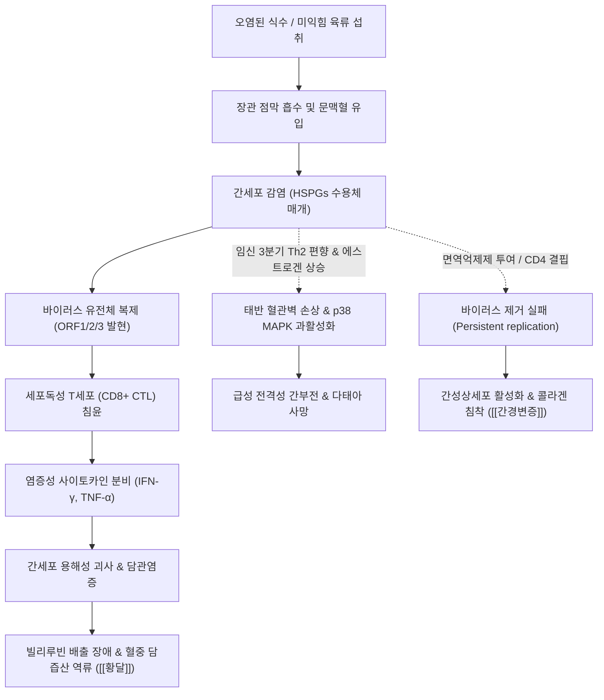

# 🩺 E형 간염 (Hepatitis E / E型 肝炎, ICD-10: B17.2, B18.8 / KCD: B17.2)

> **핵심 3줄 요약 (Key Summary)**:
> - 📍 병소 부위 & 해부·병태생리: 헤페바이러스과(Hepeviridae)의 단일가닥 양성 RNA 바이러스(HEV) 감염에 의한 간세포 손상 및 소엽성 간염. 주로 장-간 순환(Fecal-oral) 또는 동물 유래 인수공통감염(Zoonosis)으로 유입되어 간세포 수용체를 통해 침입, 바이러스 복제 및 숙주 세포독성 T세포(CD8+ CTL) 매개 면역 반응에 의해 간세포 괴사 및 세포자멸사 유발.
> - 🚩 전형적 임상 양상 & 3대 징후: 잠복기(2~8주) 후 돌발하는 **피로·식욕부진·오심/구토, 암갈색 뇨(콜라색 소변) 및 공막/피부 [[황달]], 우상복부 둔통과 간비대**; 대다수 면역 정상 성인에서는 불현성 또는 자가한발성 급성 간염으로 경과하나, **임산부(3삼분기)에서는 모체 사망률 20~25%에 이르는 [[전격성 간부전]]** 발생, **장기이식 및 면역저하자에서는 만성 E형 간염 및 급속한 [[간경변증]] 이행**.
> - 🛠️ 핵심 감별 검사 & 한·양방 다각적 치료 전략: Anti-HEV IgM 항체 및 혈청/대변 HEV RNA RT-PCR 검사로 확진; 양방 치료는 면역 정상 자가한발형은 보존적 지지요법, 면역저하자 만성 HEV는 면역억제제 감량 및 [[리바비린]](Ribavirin) 3개월 경구 투여; 임산부 중증 예방 연구(p38 MAPK 억제제 등); 한의학에서는 습열독성(濕熱毒盛)·역황(疫黃)·태황(胎黃)으로 변증하여 급성기 청열해독·이습퇴황([[인진호탕]], [[청영탕]]), 임산부 합병 시 청열청간·안태([[안태음]] 가미방) 집중 적용.
> - <font color="#fa7e7e">⚠️ 응급 의뢰 레드플래그: 임산부의 황달 출현 또는 간효소치 급상승, PT INR > 1.5로 진행하는 급성 응고장애, 간성뇌증(지남력 상실, 수전증, 기면), 파종성 혈관내 응고([[DIC]]) 징후 확인 시 즉시 3차 상급병원 산과-소화기내과 간이식 중환자실로 응급 전원.</font>

---

## 📌 목차
1. [질환 개요 & 병태생리 (Disease Overview)](#1-질환-개요--병태생리-disease-overview)
2. [병태생리 메커니즘 & 대사·장기부전 악순환 네트워크](#2-병태생리-메커니즘--대사장기부전-악순환-네트워크)
3. [임상 증상 & 환자 소견 (Clinical Presentation)](#3-임상-증상--환자-소견-clinical-presentation)
4. [감별 진단 매트릭스 (Differential Diagnosis)](#4-감별-진단-매트릭스-differential-diagnosis)
5. [한의 통합 치료 프로토콜 (침·약침·한약)](#5-한의-통합-치료-프로토콜-침약침한약)
6. [양방 치료 & 병용·의뢰 기준 (Conventional Treatment & Referral)](#6-양방-치료--병용의뢰-기준-conventional-treatment--referral)
7. [식이·생활습관 & 자가관리 티칭 가이드](#7-식이생활습관--자가관리-티칭-가이드)
8. [💡 진료실 핵심 필기 & 임상 노하우](#8--진료실-핵심-필기--임상-노하우)
9. [출처 및 학술 참고 문헌 (References)](#9-출처-및-학술-참고-문헌-references)

---

## 1. 질환 개요 & 병태생리 (Disease Overview)

### 1) 질환의 정의 및 임상적 중요성
[[e형 간염]](Hepatitis E)은 헤페바이러스과(Hepeviridae)에 속하는 E형 간염 바이러스(Hepatitis E Virus, HEV) 감염에 의해 발생하는 급성 및 만성 간 질환이다.
과거에는 비A비B형 장관 매개성 간염(Enterically transmitted non-A, non-B hepatitis)으로 불렸으며, 주로 개발도상국에서 오염된 식수를 통한 대규모 수인성 유행을 일으키는 질환으로 인식되었다.
그러나 최근 수십 년간 분자역학적 규명을 통해 선진국 및 한국을 포함한 온대 지역에서도 돼지, 멧돼지, 사슴 등 감염된 동물의 덜 익힌 육류나 내장을 섭취함으로써 발생하는 인수공통 감염(Zoonosis) 형태가 광범위하게 확인되었다.

임상적으로 HEV 감염은 일반적인 면역 정상인에서는 대부분 자가한발성(Self-limiting)의 경미한 급성 간염으로 회복되지만, 특정 취약군에서 매우 치명적인 결과를 초래한다:
1. **임산부(Pregnant women)**: 특히 임신 3분기(Third trimester)에 감염될 경우 급성 간부전([[급성 간부전]]) 및 [[전격성 간부전]](Fulminant hepatic failure)으로 진행하여 **모체 사망률이 20~25%**에 이르고, 유산, 사산, 조산 및 신생아 사망률이 50%를 상회한다.
2. **면역저하자(Immunocompromised hosts)**: 고형 장기이식(신장, 간, 심장 등) 수혜자, 혈액암 환자, 인체면역결핍바이러스([[HIV]]) 감염 환자에서 바이러스가 자연 제거되지 못하고 6개월 이상 지속되어 **만성 E형 간염(Chronic Hepatitis E)**으로 이행하며, 불과 2~5년 이내에 급속한 간섬유화 및 [[간경변증]]으로 진행한다.

### 2) 바이러스학적 구조 및 표현형
HEV는 직경 약 27~34 nm 크기의 비외피형 20면체 캡시드로 구성된 단일가닥 양극성 RNA 바이러스((+)ssRNA, 약 7.2 kb)이다.
- **이중 표현형(Dual Phenotype)**:
  - **대변 배출형(Non-enveloped HEV)**: 담즙과 분변을 통해 배출되는 바이러스는 외피가 없는 순수 단백질 캡시드 상태로, 환경 저항성(위산, 담즙산, 건조, 열)이 극도로 강하여 수인성 전파를 매개한다.
  - **혈액 순환형(Quasi-enveloped HEV, eHEV)**: 간세포에서 혈액으로 방출될 때는 숙주 세포막 지질과 다포체(Multivesicular bodies) 유래 막으로 둘러싸인 준외피(Quasi-envelope) 형태를 띤다. 이로 인해 순환 중 숙주의 중화 항체 공격을 회피하여 전신 장기로 전파된다.

### 3) 4대 주요 유전자형(Genotypes)과 전파 양식
사람에게 감염을 일으키는 Orthohepevirus A 종은 크게 4가지 주요 유전자형(Genotypes 1~4)으로 분류되며, 유전자형에 따라 전파 경로, 호발 지역, 임상 경과가 판이하게 갈린다:

| 유전자형 | 숙주 범위 | 주 전파 양식 | 주요 유행 지역 | 임상적 특이점 |
| :--- | :--- | :--- | :--- | :--- |
| **Genotype 1** | 오직 인간 (Human-only) | 수인성 분변-구강 (Waterborne fecal-oral) | 아시아, 아프리카 (개발도상국) | 대규모 집단 유행, **임산부 치명률 극대화(20~25%)**, 만성화 없음 |
| **Genotype 2** | 오직 인간 (Human-only) | 수인성 분변-구강 (Waterborne fecal-oral) | 멕시코, 서아프리카 | 산발적 유행, 임산부 중증 위험, 만성화 없음 |
| **Genotype 3** | 인수공통 (돼지, 멧돼지, 사슴, 사람) | 오염 육류/간 섭취 (식품 매개 인수공통) | 전 세계 (한국, 일본, 유럽, 북미) | 고령 남성 호발, **면역저하자에서 만성 간염 및 간경변 이행** |
| **Genotype 4** | 인수공통 (돼지, 멧돼지, 양, 사람) | 오염 육류/간 섭취 (식품 매개 인수공통) | 동아시아 (한국, 중국, 일본, 대만) | 산발적 급성 간염, 중증 급성 간염 비율 높음, 만성화 가능 |

*참고: 최근 낙타류(Camelids)를 자연 숙주로 하는 Genotype 7, 8이 중동 및 아프리카에서 확인되었으며, 낙타 고기나 우유를 섭취한 면역저하자에서 만성 간염을 일으킨 사례가 보고되었다.*

### 4) 관련 장기 및 표적 조직
- **주 이환 장기**: [[간]](Liver) — 간세포(Hepatocyte)가 주된 복제 장소이며, 소엽 중심성 괴사 및 담즙정체가 일어난다.
- **간외 감염 및 표적 장기**: 태반([[태반]]), 신장(사구체 기저막), 신경계(말초신경, 중추신경계 축삭), 골수.

---

## 2. 병태생리 메커니즘 & 대사·장기부전 악순환 네트워크

```
[경구 감염: 오염된 식수(Genotype 1/2) 또는 덜 익힌 돼지간/육류(Genotype 3/4)]
                                │
                                ▼
               [위장관 상피 침투 및 장-간 순환 유입]
                                │
                                ▼
       [간세포 수용체(HSPGs) 결합 및 엔도시토시스 바이러스 침입]
                                │
                                ▼
        [바이러스 복제: ORF1(복제효소), ORF2(캡시드), ORF3(방출단백)]
                                │
                                ▼
      ┌─────────────────────────┴─────────────────────────┐
      │                                                   │
      ▼                                                   ▼
[1. 면역 정상 성인 (대다수)]              [2. 특이 고위험군 면역 부전/이상]
 - 바이러스 직접 독성은 경미함              │
 - 숙주 CD8+ CTL & NK 세포 활성화           ├─────────────────────────┐
 - IFN-γ, TNF-α 분비로 바이러스 제거         ▼                         ▼
 - 일시적 간세포 괴사 & 담즙정체    [임산부 (특히 3삼분기)]   [장기이식/면역저하자]
      │                              │                         │
      ▼                              ▼                         ▼
[2~6주 내 자가한발성 회복]     Th2 편향 면역 + 호르몬 수치 급변   T세포 면역 감시 부전
                             태반 미세순환 감염 & 괴사   바이러스 6개월 이상 지속
                             p38 MAPK 경로 과활성화     간성상세포(HSC) 지속 자극
                                     │                         │
                                     ▼                         ▼
                           [전격성 간부전 & DIC]      [만성 간염 ──► 조기 간경변증]
                           (모체 사망률 20~25%)       (2~5년 내 문맥압항진증)
```



### 1) 분자 바이러스학 및 간세포 손상 메커니즘
HEV 유전체는 3개의 중첩된 개방형 해독틀(Open Reading Frames, ORFs)을 포함한다:
1. **ORF1**: 비구조 다단백질(Non-structural polyprotein)을 암호화하며, 메틸트랜스퍼라아제(Methyltransferase), 헬리카아제(Helicase), RNA 의존성 RNA 중합효소(RdRp), 파파인 유사 시스테인 프로테아제(PCP)를 포함하여 바이러스 복제를 전담한다.
2. **ORF2**: 바이러스 캡시드(Capsid) 단백질을 형성하며, 숙주 면역 항체 반응의 주된 표적이자 중화 항체의 결합 부위이다.
3. **ORF3**: 바이러스 방출 및 숙주 신호전달계를 교란하는 인산화 단백질로, 간세포 내 다포체와의 상호작용을 통해 바이러스의 준외피(Quasi-envelope) 획득 및 출아(Budding)를 촉진한다.

**간세포 괴사의 면역 매개성 특성**:
HEV 자체는 배양 간세포에서 강한 직접 세포독성(Cytopathic effect)을 나타내지 않는다. 간 조직 손상의 본태는 바이러스 항원을 인식한 숙주의 **항원 특이 세포독성 T림프구(CD8+ CTL)** 및 자연살해세포(NK cell)의 침윤과 이들이 방출하는 퍼포린(Perforin), 그랜자임(Granzyme) B, 인터페론-감마(IFN-γ), 종양괴사인자-알파(TNF-α)에 의한 간세포 세포자멸사(Apoptosis) 및 풍선양 변성(Ballooning degeneration), 용해성 괴사(Lytic necrosis)이다.

### 2) 임산부에서의 전격성 간부전 기전
임신, 특히 제3삼분기(Third trimester)의 HEV 감염(주로 Genotype 1)이 치명적인 전격성 간부전으로 진행하는 기전은 다인자적이다:
1. **면역학적 불균형(Th1/Th2 Shift)**:
   - 태아 거부반응을 억제하기 위해 임신 후기에는 세포매개성 Th1 면역이 억제되고 체액성 Th2 면역이 우세해진다. 이로 인해 초기 HEV 제거에 필수적인 세포독성 T세포 반응이 저하되어 바이러스의 폭발적 증식이 일어난다.
2. **호르몬 환경의 수용체 조절**:
   - 고농도의 에스트로겐(Estrogen)과 프로게스테론(Progesterone)은 간세포 및 태반 트로포블라스트(Trophoblast)의 바이러스 결합 수용체 발현을 상향 조절하고, 바이러스 복제를 직접 자극한다.
3. **태반 감염 및 p38 MAPK 신호경로 활성화**:
   - HEV는 모체-태아 계면의 모체 탈락막(Decidua) 및 태아 융모막(Villous trophoblast)을 직접 감염시켜 괴사성 융모막염을 유발한다.
   - 이때 숙주 세포의 **p38 미토겐 활성화 단백질 키나아제(p38 MAPK) 경로**가 비정상적으로 과활성화되어 광범위한 태반 혈관 내피 손상, 태반 박리, 염증성 사이토카인 폭풍, 파종성 혈관내 응고([[DIC]])를 초래하며, 급격한 간세포 허혈과 괴사가 중첩되어 전격성 간부전을 유발한다.

### 3) 면역저하자에서의 만성 E형 간염 및 급속 간섬유화
- 장기이식 수혜자(면역억제제 타크롤리무스, 사이클로스포린 복용), 혈액암 항암화학요법 환자, HIV 감염자에서는 T세포 면역 감시 부전으로 감염 후 6개월 이상 바이러스 혈증(Viremia)과 대변 내 배출이 지속된다.
- 지속적인 바이러스 복제는 간내 쿠퍼세포(Kupffer cell)와 성숙 간세포를 지속적으로 자극하여 TGF-β1, PDGF 등 섬유화 촉진 인자를 분비하게 만든다.
- 이로 인해 간성상세포(Hepatic Stellate Cell, HSC)가 근섬유아세포로 지속 활성화되어 제1형 콜라겐을 대량 축적함으로써, 일반적인 B형/C형 만성 간염이 20~30년에 걸쳐 진행하는 간경변증을 불과 **2~5년 이내에 완성**시킨다.

---

## 3. 임상 증상 & 환자 소견 (Clinical Presentation)

### 1) 전형적 급성 E형 간염의 경과
잠복기는 2주에서 8주(평균 40일)로, 전형적인 바이러스성 간염의 임상 경과(전구기, 황달기, 회복기)를 밟는다:

```
[잠복기: 15~60일] ──► [전구기: 3~10일] ──► [황달기: 1~4주] ──► [회복기: 2~6주]
 - 무증상              - 인플루엔자 유사 증상    - 암갈색 소변 (콜라색)    - 피로 서서히 해소
 - 바이러스 증식        - 극심한 피로, 무기력     - 공막/피부 황달          - 간효소 정상화
 - 대변 배출 시작      - 발열, 오한, 두통       - 회백색 대변 (Acholism) - 황달 소실
                       - 오심, 식욕부진, 구토    - 피부 소양증 (가려움)
                       - 우상복부 불쾌감         - 간비대 & 압통
```

1. **전구기(Prodromal phase, 3~10일)**:
   - 감기 몸살로 오인하기 쉬운 비특이적 전신 증상이 돌발한다.
   - 피로감, 쇠약감, 미열 또는 중등도 발열(37.5~38.5°C), 근육통, 관절통.
   - 소화기 증상: 식욕 부진(Anorexia), 오심, 구토, 상복부 팽만감, 둔한 우상복부 통증.
2. **황달기(Icteric phase, 1~4주)**:
   - 황달이 출현하면서 발열은 오히려 소실되는 경우가 흔하다.
   - **소변 색의 변화**: 가장 먼저 나타나는 객관적 징후로, 소변이 짙은 갈색(Dark tea color or Cola color)으로 변한다.
   - **피부 및 공막 황달**: 안구 결막 황달([[황달]])이 먼저 관찰되고 전신 피부로 파급된다.
   - **회백색 변(Pale/Clay-colored stool)**: 담즙 분비 장애로 대변의 유색소(Stercobilin)가 결핍된다.
   - **피부 소양증(Pruritus)**: 담즙산염의 혈중 축적으로 극심한 가려움증을 호소한다.
   - 진찰 소견: 우상복부 간종대(Hepatomegaly, 환자의 50~70%) 및 압통, 비종대(Splenomegaly, 10~15%).
3. **회복기(Convalescent phase, 2~6주)**:
   - 황달과 소양증이 소실되고 간기능 검사 수치가 정상화된다.

### 2) 특이 임상 양상
1. **임산부의 전격성 간부전 징후**:
   - 급속히 악화되는 황달과 함께 지남력 상실, 수면 주기 역전, 날개치기 떨림(Asterixis) 등의 간성뇌증(Hepatic encephalopathy) 발현.
   - 파종성 혈관내 응고([[DIC]])로 인한 비출혈, 치은 출혈, 자반증, 질 출혈 및 태반 조기 박리.
2. **면역저하자의 만성 E형 간염 징후**:
   - 전형적인 황달 없이 무증상이거나 경미한 피로감만 호소하는 경우가 많아 진단이 지연되기 쉽다.
   - 간효소치(ALT/AST)가 100~300 IU/L 범위에서 경도~중등도로 지속 상승한다.
3. **간외 신경학적·신장학적 합병증**:
   - **신경학적 침범(약 5~10%)**: 길랑-바레 증후군(Guillain-Barré syndrome, 급성 상행성 이완성 마비), 신경통성 근위축증(Parsonage-Turner syndrome, 어깨 및 상지 격통 후 마비), 급성 횡단성 척수염, 뇌염.
   - **신장 침범**: 막증식성 사구체신염(MPGN) 및 막성 신병증으로 인한 단백뇨, 혈뇨, 신기능 저하.
   - **혈액학적 침범**: 혈소판감소증, 재생불량성 빈혈, 특히 G6PD 결핍증 환자에서의 급격한 용혈성 빈혈.

### 3) 객관적 검사 소견 (Laboratory Findings)
- **혈청 생화학 검사**:
  - 간세포 효소(ALT, AST): 정상 상한치의 10~100배 이상(1,000~3,000 IU/L 이상) 급상승. ALT가 AST보다 높게 상승하는 것이 일반적이다.
  - 혈청 총 빌리루빈(Total Bilirubin): 5~20 mg/dL 이상 상승하며, 주로 포합(직접) 빌리루빈이 70% 이상을 차지한다.
  - 담도계 효소(ALP, GGT): 2~5배 동반 상승.
  - 프로트롬빈 시간(PT/INR): 정상 간염에서는 정상 유지되나, **PT INR > 1.5로 연장될 경우 전격성 간부전의 강력한 조기 경고 징후**이다.
- **혈청학적 및 분자생물학적 진단**:
  - **Anti-HEV IgM**: 급성 감염의 1차 표준 지표. 증상 발현 직후 양전되어 3~6개월간 지속된다. (민감도 및 특이도 90% 이상).
  - **Anti-HEV IgG**: 감염 2~4주 후 출현하여 수년간 지속되며, 기왕 감염 및 면역 획득을 반영한다. (단, 4배 이상 역가 상승 시 급성 감염 시사).
  - **HEV RNA RT-PCR**: 혈청 및 대변에서 검출.
    - *면역저하자 필수*: 면역저하 환자는 항체 생성 능력이 결핍되어 Anti-HEV IgM이 위음성(False-negative)으로 나타날 수 있으므로, **혈청 HEV RNA 검사가 유일한 확진 수단**이다.
    - 대변 HEV RNA는 혈청보다 수일~수주 더 오래 양성으로 유지된다.

---

## 4. 감별 진단 매트릭스 (Differential Diagnosis)

| 감별 질환 | 전형적 역학 및 병력 | 임상적 감별 포인트 | 확진 검사 및 혈청학적 지표 |
| :--- | :--- | :--- | :--- |
| [[e형 간염]] (본 질환) | 유행지 여행력, 덜 익힌 돼지·멧돼지 육류 섭취력, 임산부 및 면역저하자 | 급성 간염 양상, 임산부 전격성 간부전 빈발, 면역저하자 만성화 | Anti-HEV IgM 양성, 혈청/대변 HEV RNA RT-PCR 양성 |
| [[a형 간염]] | 소아·청년층 호발, 조개류(굴 등) 섭취력, 수인성 전파 | 급성 간염 증상 흡사하나 임산부 치명률 높지 않음, 만성화 절대 없음 | Anti-HAV IgM 양성 |
| [[급성 b형 간염]] | 혈액, 성접촉, 수직 감염, 주사기 재사용력 | 관절통, 두드러기 등 혈청병양 전구증상 빈발 | HBsAg 양성, Anti-HBc IgM 양성, HBV DNA PCR |
| [[급성 c형 간염]] | 주사기 공동사용, 침습적 시술, 수혈력 | 급성기 70~80%가 무증상, 황달 드묾, 만성화율 70~80% | Anti-HCV 양성, HCV RNA PCR 양성 |
| [[약물유발성 간손상]] | 처방약, 한약, 건기식, 아세트아미노펜 복용력 | 약물 투약과 시간적 인과관계, 과민반응(발진·호산구증다증) | RUCAM 점수 산출, 바이러스성 간염 표지자 전 음성 |
| **임신 급성 지방간 (AFLP)** | 임신 3분기, 초산모, 남아 임신, 다태 임신 | 현저한 저혈당, 고요산혈증, 다뇨(요붕증 동반), 간비대 없이 간 위축 | 혈청 요산 상승, 간 초음파상 미만성 지방 침윤 |
| **HELLP 증후군** | 임신 후기 자전간증(Preeclampsia) 동반 환자 | 고혈압, 단백뇨, 우상복부 동통, 미세혈관병성 용혈 | 혈소판감소(<100,000/μL), LDH 상승, 파쇄적혈구(Schistocyte) |
| **급성 거대세포바이러스 간염** | 면역저하자, 장기이식, HIV 환자 | 림프절 비대, 비종대, 비정형 림프구 증가 | Anti-CMV IgM 양성, CMV DNA Real-time PCR |

> 🚩 **임산부 황달 감별의 레드플래그 원칙**:
> 임신 후기에 간효소치 급상승과 황달이 발생한 경우, 산과적 응급 질환인 HELLP 증후군, AFLP와 함께 **반드시 E형 간염(HEV)을 감별 검사항목에 포함**해야 한다. 원인에 따라 즉각적인 제왕절개 분만 여부와 보존적 처치 방침이 완전히 달라지기 때문이다.

---

## 5. 한의 통합 치료 프로토콜 (침·약침·한약)

### 1) 한의학적 병인병기 인식
한의학에서 [[e형 간염]]은 감염 경로와 임상 증상에 따라 [[황달]](黃疸), **양황(陽黃)**, **역황(疫黃, 전격성 간부전)**, **태황(胎黃, 임신부 합병)**의 범주에 속한다.
- **외감 습열역독(外感濕熱疫毒)**: 오염된 물과 부패하거나 불결한 음식(덜 익힌 육류)을 통해 체내로 침입한 역려지기(疫癘之氣)가 주된 발병 원인이다.
- **간담울체 및 비위기체(肝膽鬱滯·脾胃氣滯)**: 습열독사가 비위에 침범하여 중초의 운화 기능을 마비시키고 간담을 핍박하여 담즙이 정상 통로를 벗어나 기육(肌肉)과 피부로 넘쳐흘러 황달이 발생한다.
- **독사입영(毒邪入營, 전격성 악화)**: 열독이 극성하여 기분(氣分)에서 영혈분(營血分)으로 직입하고 심포(心包)를 요란하면 신혼섬어(神昏譫語), 경궐(痙厥), 출혈을 동반하는 치명적인 역황(疫黃)으로 전변된다.

### 2) 변증별 한약 처방 프로토콜

#### (1) 습열독성(濕熱毒盛)·양황(陽黃)형 (급성 전형기)
- **주증**: 전신과 공막이 선명한 귤색(선황색)으로 노랗고, 열감, 구갈, 오심, 구토, 명치 및 우협부 팽만통, 대변 비결 또는 점조, 소변 단적(진한 찻물색), 설질 홍 태 황니, 맥 현활삭(弦滑數).
- **치법**: 청열해독(淸熱解毒), 통부설열(通腑泄熱), 이습퇴황(利濕退黃).
- **처방**: [[인진호탕]](茵蔯蒿湯) 가미방
  - **구성**: 인진 24g, 치자 12g, 대황(후하) 6~8g, 황금 10g, 황련 6g, 백화사설초 15g, 택사 12g, 저령 10g, 차전자 10g, 감초 4g.
  - **가감법**: 간효소치(ALT/AST) 1,000 IU/L 이상 폭발 시 금은화 15g, 연교 12g, 패장초 15g 가미; 소양증 심할 시 지부자 10g, 백선피 10g 가미.
  - **현대 약리 기전**:
    - 인진의 카필라리신(Capillarisin) 및 스코파론(Scoparone) 성분은 담즙산 분비(Choleretic effect)를 촉진하고, 간세포 내 Nrf2-ARE 항산화 경로를 활성화하여 간세포막을 보호한다.
    - 치자의 제니포시드(Geniposide)는 담즙산 배출 수송체(Mrp2, Bsep)의 유전자 발현을 상향 조절하여 고빌리루빈혈증을 신속히 완화한다.
    - 황금의 바이칼린(Baicalin) 및 황련의 베르베린(Berberine)은 NF-κB 염증 캐스케이드를 차단하여 염증성 사이토카인(TNF-α, IL-6) 방출을 억제한다.

#### (2) 열독치성(熱毒熾盛)·역황(疫黃)형 (급격한 간부전 전조기)
- **주증**: 황달이 수일 내에 급격히 심화되어 암적색을 띠고, 고열, 극심한 번조, 구갈인음, 코피, 잇몸 출혈, 피부 피하 어반(자반), 점차 헛소리를 하거나 의식이 흐려짐, 설질 강홍(絳紅) 건조, 맥 현세삭(弦細數) 또는 활삭(滑數).
- **치법**: 청열양혈(淸熱凉血), 사화해독(瀉火解毒), 개규안신(開竅安神).
- **처방**: [[청영탕]](淸營湯) 합 서각지황탕(수우각 대체) 가감방
  - **구성**: 수우각(선전 1시간) 30g, 생지황 20g, 적작약 15g, 목단피 12g, 현삼 15g, 맥문동 12g, 금은화 15g, 연교 12g, 황련 6g, 죽엽 10g, 단삼 12g.
  - **가감법**: 간성뇌증 초기(혼미, 섬어) 징후 시 우황청심원 또는 안궁우황환 1환 응급 병용.
  - **주의**: 이 단계는 서양의학적 중환자실 집중 치료(ICU) 및 간이식 대기 상태이므로 단독 한의 치료는 절대 금기이며, 상급병원 전원 하에 보조적 투여를 검토한다.

#### (3) 기체습저(氣滯濕沮) 및 음황(陰黃)형 (아급성 또는 회복 지연기)
- **주증**: 황달의 색이 윤기가 없고 어두우며, 만성 피로, 식욕 부진, 식후 복부 팽만, 대변 묽음, 사지 권태 및 무력감, 설담태 백니, 맥 침현(沈弦) 또는 완(緩).
- **치법**: 건비화습(健脾化濕), 소간이담(疎肝利膽).
- **처방**: [[인진오령산]](茵蔯五苓散) 합 [[생간건비탕]](生肝健脾湯) 가감
  - **구성**: 인진 15g, 백출 12g, 복령 12g, 저령 10g, 택사 10g, 당귀 10g, 백작약 12g, 산사 10g, 진피 8g, 반하 8g, 계지 4g, 감초 4g.

#### (4) 임신부 태황(胎黃) 및 태기불안(胎氣不安)형 (임산부 특화 프로토콜)
- **주증**: 임신 2~3분기 산모의 경도 황달, 오심, 식욕 부진, 우협부 팽만, 요통, 아랫배 묵직함(태동불안).
- **치법**: 청간사열(淸肝瀉熱), 이습퇴황(利濕退黃), 익기안태(益氣安胎).
- **처방**: [[안태음]](安胎陰) 합 [[인진호탕]](대황 제외) 가미방
  - **구성**: 백출 12g, 당귀 10g, 백작약 12g, 황금(주초) 10g, 소엽 6g, 사인지 6g, 두충 10g, 속단 10g, 인진 15g, 치자 6g, 복령 10g, 감초 4g.
  - **절대 주의**: 대황(大黃), 망초(芒硝), 도인(桃仁), 홍화(紅花) 등 자궁 수축을 유발하거나 활혈거어(活血祛瘀) 작용이 강한 사하제·파혈제는 **전면 배제**한다. 황금(黃芩)과 백출(白朮)은 자궁의 안태(安胎)와 간내 청열(淸熱)을 동시에 도모하는 핵심 약재이다.

### 3) 침구 치료 프로토콜
- **기본 선혈**:
  - 간담경·비위경 주혈: [[간수]](BL18), [[담수]](BL19), [[비수]](BL20), [[태충]](LR3), [[양릉천]](GB34), [[음릉천]](SP9), [[족삼리]](ST36), [[삼음교]](SP6).
  - 소화기 진정 및 청열 혈위: [[중완]](CV12), [[내관]](PC6), [[지구]](TE6), [[합곡]](LI4).
- **자침 기법**:
  - 급성 습열기: 태충, 양릉천, 음릉천, 지구에 사법(瀉法)을 시술하여 간담열을 배출하고 담즙 울체를 해소한다.
  - 회복기: 족삼리, 비수, 간수에 평보평사 또는 보법(補法)을 적용하여 간 미세순환을 촉진하고 피로를 개선한다.
  - 유침 시간: 20분, 1일 1회 또는 격일 시술.

### 4) 약침 요법
- **약침 제제**: 황련해독탕 약침(급성 염증 및 간효소 급상승기) 또는 웅담 약침(담즙 분비 촉진).
- **주입 혈위**: 간수(BL18), 담수(BL19), 우측 기문(LR14), 양릉천(GB34).
- **용량 및 방법**: 혈위당 0.1~0.2 cc씩 총 0.5~1.0 cc를 30게이지 멸균 인슐린 주사기로 피내 또는 천층 근육에 주입, 주 2회 시술. (응고병증이나 출혈 경향이 의심될 때는 심부 자침을 전면 금지한다).

---

## 6. 양방 치료 & 병용·의뢰 기준 (Conventional Treatment & Referral)

### 1) 현대 의학적 표준 처치 방침
E형 간염의 서양의학적 치료는 환자의 면역 상태와 임신 여부에 따라 완전히 차별화된다:

1. **면역 정상 성인의 급성 E형 간염**:
   - 대부분 자가한발성이므로 특이 항바이러스 치료를 권고하지 않는다.
   - **보존적 대증 요법**: 침상 안정(Bed rest), 탈수 예방을 위한 충분한 수액 공급, 소화기 증상 조절, 간독성 약물 및 알코올 전면 차단.
2. **면역저하자의 만성 E형 간염 치료 알고리즘 (EASL 가이드라인)**:
   - **제1단계 (면역억제제 감량)**:
     - 고형 장기이식 수혜자에서 만성 HEV 진단 시, 이식편 거부반응이 허용하는 범위 내에서 **타크롤리무스, 사이클로스포린 등 T세포 면역억제제를 30~50% 단계적으로 감량**한다.
     - 환자의 약 30%는 면역억제제 감량만으로도 자발적인 바이러스 제거(SVR)를 달성한다.
   - **제2단계 (항바이러스제 투여: 리바비린)**:
     - 면역억제제 감량 실패 또는 감량이 불가능한 경우, [[리바비린]](Ribavirin) 단독 경구 요법을 시행한다.
     - **용량**: 초기 600~800 mg/day (체중 및 신기능 eGFR에 따라 조절, 신부전 환자는 200~400 mg 격일 투여).
     - **기간**: 12주(3개월) 투여. 투여 종료 시점 혈청 및 대변 HEV RNA 음성을 확인하고, 투여 종료 후 6개월 뒤 지속 바이러스 반응(SVR)을 판정한다.
     - *치료 실패 시*: 12주 후 바이러스 미제거 시 24주(6개월)로 연장 투여한다.
   - **제3단계 (페그인터페론 요법)**:
     - 리바비린에 내성을 보이거나 심한 용혈성 빈혈로 불내성인 간이식 환자에서는 페그인터페론 알파(Peg-IFN-α)를 고려할 수 있다. (단, 신장·심장·폐 등 타 장기이식 환자에서는 급성 이식편 거부반응 위험으로 절대 금기).
3. **임산부 치료의 도전과 한계**:
   - **리바비린(Ribavirin)은 최기형성(Teratogenicity)으로 인해 FDA 임신 카테고리 X로 분류되어 임산부에게 절대 금기**이다.
   - 현재 임산부에서는 조기 입원을 통한 집중적인 수액 치료, 응고인자 보충, 태아 감시 및 간부전 진행 시 응급 간이식이 유일한 대안이다.
   - 최근 동물 모델 연구(Li et al., 2026)에서 **p38 MAPK 억제제(SB203580)**가 태반 내 HEV 복제를 억제하고 모체-태아 합병증을 예방할 수 있는 차세대 치료 후보로 규명되어 기대를 모으고 있다.

### 2) 한의 치료와의 병용 판단 (Combination Therapy)
- **병용 가능 (Synergistic)**:
  - 급성 간염 회복기 및 만성 간염 유지기에 보간(補肝) 목적의 한약([[생간건비탕]]) 병용 시, 간세포 항산화 지질 안정화 및 간섬유화 억제에 시너지 효과를 기대할 수 있다.
  - 리바비린 복용 중 발생하는 경미한 식욕 부진, 소화불량에 소간건비제 처방 병용 가능.
- **병용 주의 (Caution)**:
  - 리바비린 투약 중에는 용혈성 빈혈(Hemolytic anemia)이 흔히 유발되므로, 정기적인 CBC(헤모글로빈) 추적 관찰이 필수적이다.
  - CYP 대사에 영향을 줄 수 있는 고농도 복합 추출물 투여는 피하고 표준 탕약 제형을 선택한다.
- **병용 금기 (Contraindication)**:
  - 임산부 HEV 의심 환자에게 무단으로 한방 단독 치료를 고집하거나 자궁 수축 유발 약재를 처방하는 것은 절대 금기이다.

### 3) 응급 전원 및 3차 상급병원 의뢰 기준 (Red Flags)
다음 소견 중 하나라도 확인되면 한의원 1차 진료실에서 즉시 119 구급차 또는 상급병원 응급의학과/소화기내과/산부인과로 응급 전원한다:
1. **임산부 환자에게서 황달 또는 간효소치 상승(ALT > 300 IU/L)이 확인된 모든 경우**.
2. **응고인자 결핍 징후**: 프로트롬빈 시간 **PT INR > 1.5**로 지연되거나 자반, 비출혈, 혈변 출현.
3. **간성뇌증(Hepatic Encephalopathy) 징후**: 기면(Lethargy), 착란, 지남력 상실, 손가락 날개치기 떨림(Asterixis).
4. **급성 신부전 병발**: 핍뇨(Oliguria, 24시간 소변량 < 400 mL), 혈청 크레아티닌 급상승.
5. **극심한 탈수 및 저혈당**: 포도당 수액 공급에도 교정되지 않는 저혈당 쇼크.

---

## 7. 식이·생활습관 & 자가관리 티칭 가이드

### 1) 식품 위생 및 조리 안전 수칙
HEV(특히 Genotype 3/4)의 국내 주된 감염원은 오염된 돼지 부속물(간, 곱창, 대창), 덜 익힌 멧돼지 육회, 사슴고기이다:
- **심부 가열 조리(Core Heating)**:
  - HEV는 열에 비교적 강한 편이나, **중심 온도 71°C 이상에서 최소 20분 이상** 가열 조리하면 완전히 불활성화된다.
  - 고기를 구울 때 겉만 익히고 속이 분홍빛을 띠는 레어/미디엄 조리는 절대 피하고 웰던(Well-done)으로 완숙해야 한다.
  - 특히 돼지 간, 순대 부속물, 생간 섭취를 엄격히 금지한다.
- **교차 오염 차단**:
  - 생고기를 다룬 칼, 도마, 조리 기구는 채소용과 철저히 분리하고 사용 즉시 열탕 소독한다.
  - 생고기를 집었던 젓가락으로 익은 음식을 집어먹지 않는다.
- **안전한 음용수**:
  - 해외 유행지(동남아, 인도, 아프리카, 중남미) 여행 시 수돗물, 길거리 얼음, 날과일 섭취를 금하고, 반드시 끓인 물이나 밀봉된 생수를 음용한다.

### 2) 생활습관 및 침상 안정 티칭
- **간 혈류량 확보를 위한 침상 안정(Bed Rest)**:
  - 급성기 간세포 괴사 시기에는 앙와위(Supine position, 누운 자세)를 유지하는 것이 직립 자세에 비해 간동맥 및 문맥 혈류량을 30~40% 증가시켜 간세포 재생을 촉진한다.
  - 피로가 완전히 해소되고 황달 수치가 정상화될 때까지 무리한 운동, 장거리 여행, 과로를 엄격히 금지한다.
- **완전 금주(Zero Alcohol)**:
  - 간세포 재생기 동안 알코올은 간세포의 지방산 산화를 방해하고 미토콘드리아 손상을 가중시킨다.
  - 효소 수치 정상화 후에도 최소 6개월 이상 모든 형태의 주류(맥주, 소주, 와인) 섭취를 금한다.
- **출처 불명의 건강보조식품 차단**:
  - 간 회복에 좋다고 알려진 붕어즙, 헛개나무 농축액, 칡즙, 다이어트 보조제, 미검증 단백질 보충제 복용을 전면 중단시킨다.

### 3) 진료실 환자 교육 스크립트
> *"환자분, 지금 앓고 계신 질환은 'E형 간염'으로, 덜 익힌 돼지고기나 오염된 물을 통해 간에 바이러스가 들어와 염증을 일으킨 상태입니다. 다행히 대부분은 충분한 휴식과 안정, 알맞은 영양 공급을 받으면 간세포가 스스로 회복되어 후유증 없이 낫습니다.*
> 
> *하지만 간이 회복되는 동안 가장 중요한 것은 '간을 쉬게 해주는 것'입니다. 첫째, 피로감이 완전히 사라질 때까지 격렬한 운동이나 과로를 피하고 누워서 쉬는 시간을 최대한 늘리십시오. 둘째, 술은 단 한 방울도 드시면 안 되며, 간에 좋다고 광고하는 엑기스나 건강즙은 오히려 간에 큰 부담을 주므로 절대 드시지 마십시오. 셋째, 돼지고기나 내장류는 속까지 바싹 익혀서 드시고 손을 비누로 30초 이상 깨끗이 씻으셔야 가족 간의 2차 전파를 막을 수 있습니다.*
> 
> *만약 소변 색이 콜라처럼 짙어지거나 눈동자가 노랗게 변하는 황달이 심해지고, 헛소리를 하거나 손이 떨리는 증상이 나타나면 지체하지 마시고 즉시 큰 병원 응급실로 가셔야 합니다."*

---

## 8. 💡 진료실 핵심 필기 & 임상 노하우

> [!IMPORTANT]
> **🛡️ E형 간염(HEV) 진료실 실전 감별 및 안전 문진 노하우**
> 1. **"A형 간염 같지만 나이가 많고 돼지고기 육회를 먹었다면 HEV를 떠올려라"**:
>    - 50~60대 이상의 중장년층 환자가 급성 간염 증상(고열, 피로, 극심한 황달, ALT 2,000 IU/L 이상)으로 내원했을 때, A형/B형/C형 간염 항체 검사가 모두 음성이라면 반드시 **"최근 2개월 내에 야생 멧돼지, 사슴 육회, 덜 익힌 돼지 생간이나 곱창을 드신 적이 있는가?"**를 문진해야 한다. 한국의 E형 간염은 대부분 Genotype 3/4의 중장년층 식습관과 직결된다.
> 2. **"임산부의 황달은 1초의 지체도 없는 3차 병원 의뢰 사안이다"**:
>    - 임신 3기 임산부가 감기 증상 후 눈이 노랗고 소변이 짙어졌다면, 한의원 진료실에서 맥을 짚거나 탕약을 지어줄 시간이 없다. HEV Genotype 1 감염이나 AFLP, HELLP 증후군 모두 급격한 다태아 사망과 모체 사망을 부르는 초응급 질환이다. 환자 보호자에게 위험성을 명확히 고지하고 즉시 대학병원 산과-간담도내과 응급센터로 전원시켜야 한다.
> 3. **"장기이식 환자의 만성 간염은 Anti-HEV IgM 음성이라도 속지 마라"**:
>    - 신장이식이나 간이식을 받고 면역억제제를 복용 중인 환자가 원인 모르게 수개월간 간효소치(ALT 100~200 IU/L)가 떨어지지 않는다면, 혈청 항체(Anti-HEV IgM) 검사는 면역 결핍으로 인해 위음성이 나올 수 있다. 반드시 **혈청 HEV RNA RT-PCR 검사**를 시행해야만 숨겨진 만성 E형 간염을 찾아내어 조기 간경변증으로의 비가역적 파동을 막을 수 있다.
> 4. **"신경통성 근위축증(어깨 통증 후 마비) 환자의 간기능을 확인하라"**:
>    - 원인 모르게 갑자기 한쪽 어깨에 극심한 통증이 발생한 뒤 삼각근이나 견갑배신경 마비가 오는 신경통성 근위축증(Parsonage-Turner syndrome)이나 길랑-바레 환자 중 일부는 HEV 감염의 간외 신경계 합병증이다. 신경통 환자 진료 시 최근 간염이나 황달 앓은 병력이 있는지 체크하는 것이 감별의 묘수이다.

---

## 9. 출처 및 학술 참고 문헌 (References)

- Li M, Wang Y, Zhao X, et al. (2026). p38 Inhibitor SB203580 Inhibits HEV Infection and Prevents HEV-Related Adverse Pregnancy Outcomes in a Pregnant Rabbit Model. *Liver Int*. 46(9):e70811. [PMID: 42528178](https://pubmed.ncbi.nlm.nih.gov/42528178/)

- Santos AAD, Silva ER, Costa LM, et al. (2026). Viral hepatitis in pregnancy: integrating clinical management, perinatal outcomes, and long-term health impact. *J Matern Fetal Neonatal Med*. 39(1):2692858. [PMID: 42366154](https://pubmed.ncbi.nlm.nih.gov/42366154/)
