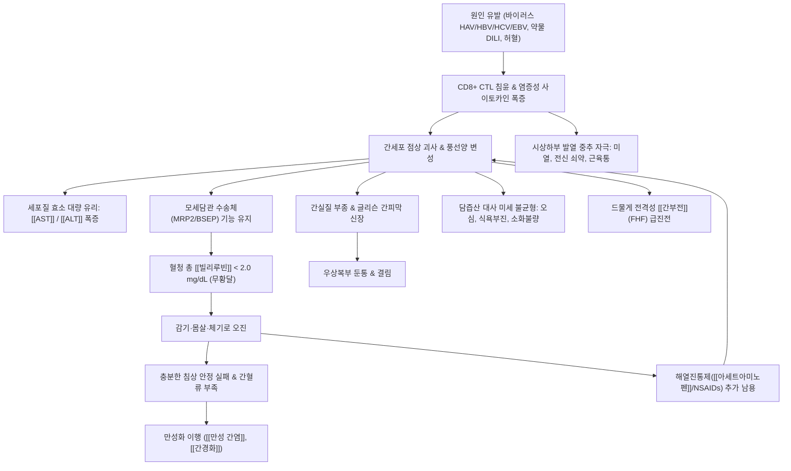

# 🩺 [[급성 무황달성 간염]] (Acute Anicteric Hepatitis / 急性無黃疸性肝炎, ICD-10 B15.9 / K73.9 / B17.8)

> **핵심 3줄 요약 (Key Summary)**:
> - 📍 **병소 부위 & 병태생리**: 간소엽(Hepatic lobule)의 광범위한 미세 염증 반응 및 간세포 점상 괴사(Spotty necrosis)와 풍선양 변성(Ballooning degeneration)이 급격히 유발되나, 모세담관 폐색 및 담즙산 배설 수송체 장애가 임계치 이하로 유지되어 공막·피부의 [[황달]]이나 고빌리루빈혈증(혈청 총 [[빌리루빈]] < 2.0~2.5 mg/dL) 없이 혈청 아미노전이효소([[AST]], [[ALT]])만 수백에서 수천 IU/L 단위로 폭증하는 [[급성 간염]]의 독특한 임상 아형.
> - 🚩 **전형적 임상 양상 & 3대 징후**: 황달이 결여되어 단순 인플루엔자·감기몸살 유사 전구증상(미열, 두통, 전신 쇠약감, 근육통) 및 급성 위장관염 양상(심한 식욕 부진, 오심, 구역질, 상복부 팽만감, 지방식 혐오), 글리슨 간피막 신장에 의한 우상복부 둔통 및 간비대와 압통. 소아 [[A형 간염]]의 70~90%를 차지하며 성인에서도 무증상 또는 경증 감기몸살로 오진되어 방치되기 쉬움.
> - 🛠️ **핵심 감별 & 한·양방 치료 전략**: 간기능 검사(LFT) 상 현저한 트랜스아미나제 상승과 정상 빌리루빈의 해리 소견 확인, 바이러스 혈청학적 표지자(Anti-HAV IgM, HBsAg, Anti-HBc IgM, Anti-HCV, Anti-HEV IgM, EBV VCA IgM, CMV IgM) 및 약물 복용력 추적. 치료의 근간은 간혈류를 극대화하는 절대 침상 안정(Bed rest)과 원인 약물 즉시 중단. 한의학에서는 울증(鬱證), 협통(脅痛), 습열내온(濕熱內蘊), 간기울결(肝氣鬱結), 비허습체(脾虛濕滯)로 변증하여 [[소시호탕]], [[시호소간산]], [[가미소요산]], [[인진오령산]], [[인진호탕]], [[삼령백출산]]을 단계별로 처방하고 기문·태충·족삼리·양릉천·간수 침구 치료 병용.
> - <font color="#fa7e7e">⚠️ **응급 의뢰 레드플래그**: 프로트롬빈 시간 연장(PT INR > 1.5, 간세포 합성 부전 급성 발현), 지남력 저하 및 수면 역전과 미세 손떨림([[간성뇌증]] 전구기), 간 크기의 급격한 위축, 심한 저혈당 발생 시 전격성 [[간부전]](Fulminant Hepatic Failure) 위험 신호이므로 즉시 3차 상급병원 응급의학과로 전원.</font>

---

## 📌 목차
1. [질환 개요 & 병태생리 (Disease Overview)](#1-질환-개요--병태생리-disease-overview)
2. [병태생리 메커니즘 & 대사·장기부전 악순환 네트워크](#2-병태생리-메커니즘--대사장기부전-악순환-네트워크)
3. [임상 증상 & 환자 소견 (Clinical Presentation)](#3-임상-증상--환자-소견-clinical-presentation)
4. [감별 진단 매트릭스 (Differential Diagnosis)](#4-감별-진단-매트릭스-differential-diagnosis)
5. [한의 통합 치료 프로토콜 (침·약침·한약)](#5-한의-통합-치료-프로토콜-침약침한약)
6. [양방 치료 & 병용·의뢰 기준 (Conventional Treatment & Referral)](#6-양방-치료--병용의뢰-기준-conventional-treatment--referral)
7. [식이·생활습관 & 자가관리 티칭 가이드](#7-식이생활습관--자가관리-티칭-가이드)
8. [💡 진료실 핵심 필기 & 임상 노하우](#8--진료실-핵심-필기--임상-노하우)
9. [출처 및 학술 참고 문헌 (References)](#9-출처-및-학술-참고-문헌-references)

---

## 1. 질환 개요 & 병태생리 (Disease Overview)

* **질환 정의 및 역학적 특징**:
  * [[급성 무황달성 간염]](Acute Anicteric Hepatitis)은 간세포의 급격한 괴사와 미만성 염증으로 인해 혈청 아미노전이효소([[AST]], [[ALT]])가 정상 상한치의 10~50배(수백~수천 IU/L)까지 치솟지만, 공막이나 피부에 육안적 [[황달]](Icterus/Jaundice)이 나타나지 않고 혈청 총 [[빌리루빈]] 수치가 임상적 황달 역치(2.0~2.5 mg/dL) 미만에 머무르는 급성 간염의 임상적 변이형입니다.
  * 역학적으로 급성 바이러스 간염 환자의 상당수가 무황달형으로 경과합니다. 특히 소아 및 영유아에서의 [[A형 간염]] 감염 시 약 70~90%가 황달 없이 가벼운 미열과 소화기 증상만으로 앓고 지나가며, 성인에서도 실제 감염자의 30~50%가 황달이 없어 단순 몸살감기, 인플루엔자, 급성 위장관염으로 오인됩니다.
  * [[B형 간염]], [[C형 간염]], [[E형 간염]]뿐만 아니라 [[헤르페스 바이러스]](HSV-1/2), [[엡스타인-바 바이러스]](EBV), [[거대세포바이러스]](CMV), 약물 유인성 간손상(DILI, Drug-Induced Liver Injury) 및 허혈성 간염(Shock liver)에서도 매우 흔하게 관찰됩니다.
  * 무황달성 간염은 질환 자체의 급성기 치명률은 황달형보다 낮지만, 환자 본인과 의료진이 간염의 존재를 인지하지 못하여 적절한 격리나 안정을 취하지 않고, 원인 약물 투여를 지속하거나 만성 간질환([[만성 B형 간염]], 만성 C형 간염)으로 지연 이행될 위험이 매우 높다는 점에서 임상적 경계가 필수적입니다.

* **관련 장기 및 해부학적 미세구조**:
  * **주 이환 장기 — 간(Liver) 실질 및 간소엽**:
    * 간실질의 기본 기능 단위인 간소엽(Hepatic lobule)과 간세포삭(Hepatic cords) 주변으로 세포독성 T세포 및 단핵구의 광범위한 침윤이 발생합니다.
    * 간세포의 풍선양 변성(Ballooning degeneration), 산호체(Councilman bodies, 아폽토시스 소체), 점상 괴사(Spotty necrosis)가 주로 간소엽 3구역(Zone 3, 중심정맥 주변) 또는 미만성으로 산재합니다.
  * **담즙 배출계의 기능적 보존**:
    * 모세담관(Bile canaliculi)과 담관 세포막의 융합 괴사나 담관 폐색이 현저하지 않아, 모세담관막에 위치한 다약제내성연관단백-2(MRP2, ABCC2) 및 담즙산염 수출펌프(BSEP, ABCB11)의 담즙 배설 수송 능력이 일정 수준 이상 보존됩니다.
    * 따라서 간세포에서 포합된 결합 빌리루빈(Conjugated bilirubin)이 혈류로 대량 역류되지 않고 담도로 정상 배출되므로 혈청 빌리루빈이 역치 이하로 유지됩니다.
  * **글리슨 간피막 (Glisson's capsule)**:
    * 간세포 손상 및 염증성 세포 침윤으로 간실질에 급성 부종(Edema)이 발생하면 간을 둘러싸고 있는 섬유성 글리슨 막이 팽창·신장되면서 감각신경(우측 횡격막신경 분지 및 늑간신경)을 자극하여 특징적인 우상복부 둔통과 압통을 유발합니다.

---

## 2. 병태생리 메커니즘 & 대사·장기부전 악순환 네트워크

### 1) 간세포 손상과 효소 유출의 면역학적 기전
급성 무황달성 간염의 핵심 병태생리는 숙주의 면역 반응에 의한 간세포 파괴와 담즙 배설 기능의 상대적 보존 간의 불균형입니다.

```
========================================================================================
                 [ 급성 무황달성 간염의 분자·세포학적 병태생리 흐름도 ]
========================================================================================

  [ 원인 인자 노출 ]
  ├─ 1. 간친화성 바이러스: HAV, HBV, HCV, HEV (불현성/조기 감염)
  ├─ 2. 비간친화성 바이러스: EBV, CMV, HSV-1/2, Parvovirus B19
  ├─ 3. 약물 및 독소(DILI): 아세트아미노펜, 항생제, NSAIDs, 성분미상 추출물
  └─ 4. 혈역학적 허혈: 심박출량 저하, 패혈증 쇼크 (Shock Liver)
                │
                ▼
  [ 간세포 내 침투 & 항원 발현 / 반응성 대사물질(NAPQI 등) 생성 ]
                │
                ▼
  [ 숙주 세포독성 T세포(CD8+ CTL) & NK 세포 활성화, 사이토카인(IFN-γ, TNF-α) 폭증 ]
                │
                ▼
  [ 간세포막 천공 및 점상 괴사(Spotty Necrosis) & 아폽토시스(Councilman body) ]
                │
                ├─────────────────────────────────────────┐
                ▼                                         ▼
   [ 간세포막 파열 & 세포질 효소 대량 유출 ]    [ 모세담관 및 담즙 수송체 기능 상대적 보존 ]
   ├─ AST (아스파르테이트아미노전이효소) ↑↑      ├─ 간세포 내 글루쿠론산 포합능 유지
   ├─ ALT (알라닌아미노전이효소) ↑↑             ├─ 모세담관 MRP2 / BSEP 수송체 배설 유지
   └─ 정상 상한치의 10~50배 (수백~수천 IU/L)     └─ 담관 폐색 및 담즙 정체(Cholestasis) 결여
                │                                         │
                ▼                                         ▼
   [ 간실질 염증 부종 & 글리슨 간피막 신장 ]    [ 혈청 총 빌리루빈 < 2.0~2.5 mg/dL ]
   ├─ 우상복부 둔통 및 압통 촉지                └─ 공막·피부 황달 없음 (무황달성 아형!)
   ├─ 전신 무기력, 미열, 근육통                           │
   └─ 식욕부진, 오심, 구역질, 복부팽만                    │
                │                                         │
                └───────────────────┬─────────────────────┘
                                    │
                                    ▼
                      ★ 급성 무황달성 간염 임상 발현 ★
                  (단순 감기몸살·급성 위장관염으로 오진 위험 극대화)
```

1. **바이러스 및 약물 매개 간세포 면역 손상**:
   - 바이러스(HAV, HBV 등) 자체의 직접적인 세포 용해 효과보다는, 감염된 간세포 표면에 제시된 바이러스 항원을 인식한 숙주의 CD8+ 세포독성 T림프구(CTL)와 자연살해세포(NK cell)가 퍼포린(Perforin)과 그랜자임(Granzyme)을 분비하여 간세포막을 파괴합니다.
   - 약물성 간손상(DILI)의 경우 약물의 활성 대사물질(예: [[아세트아미노펜]]의 NAPQI)이 간세포 글루타치온을 고갈시키고 미토콘드리아 호흡 사슬을 억제하여 괴사를 유도합니다.
2. **세포질 효소([[AST]], [[ALT]])의 폭발적 유리**:
   - 간세포막의 온전성이 붕괴되면 가용성 세포질 분획 효소인 ALT(반감기 약 47시간)와 미토콘드리아 및 세포질 효소인 AST(반감기 약 17시간)가 모세혈관망을 통해 전신 혈류로 대량 유출됩니다.
   - 혈청 AST와 ALT는 급격히 상승하여 정상 상한치(약 40 IU/L)의 수십 배에 달하는 500~2,000 IU/L 이상으로 치솟습니다.
3. **무황달성의 병리학적 근거 (왜 황달이 발생하지 않는가?)**:
   - 황달형 간염에서는 간세포의 광범위한 융합 괴사(Confluent/Bridging necrosis)와 담관 소포 손상으로 인해 담즙 배설 수송체가 완전히 파괴되고 모세담관이 파열되어 포합 담즙이 역류합니다.
   - 반면 무황달성 간염에서는 괴사가 소엽 내에 흩어져 있는 **점상 괴사(Spotty necrosis)** 수준에 머무르고, 간세포의 마이크로솜 효소계(UDP-글루쿠로닐 전이효소)와 모세담관막의 ATP 의존성 배설 수송체(MRP2)가 온전성을 유지합니다.
   - 따라서 적혈구 파괴 등으로 생성된 비결합 빌리루빈이 간세포 내에서 정상적으로 포합되어 담관으로 순조롭게 배설되므로, 혈청 총 [[빌리루빈]] 수치가 2.0 mg/dL 미만으로 유지되어 눈 공막이나 피부의 황염이 관찰되지 않습니다.

### 2) 대사·장기부전 악순환 네트워크


---

## 3. 임상 증상 & 환자 소견 (Clinical Presentation)

### 1) 주소증 및 임상 발현 양상
무황달성 간염의 임상 증상은 비특이적이고 모호하여, 환자 본인과 의사가 간질환을 의심하지 못하는 '침묵의 간염' 형태로 나타납니다.

* **감기몸살 및 인플루엔자 유사 전구증상**:
  * 감기 기운과 같은 미열(37.3~38.0℃), 오한, 두통, 전신 권태감(극심한 피로).
  * 전신 근육통, 관절통, 눕고만 싶은 극도의 쇠약감.
  * 호흡기 증상(기침, 콧물, 가래)은 거의 없거나 경미한데도 불구하고 몸살 증상이 1~2주 이상 지속되는 것이 특징입니다.
* **소화기 계통 주소증**:
  * **식욕 부진(Anorexia)**: 음식 냄새만 맡아도 속이 메스껍고 입맛이 전폐됨.
  * **오심 및 헛구역질**: 특히 기름진 음식이나 육류에 대한 극심한 혐오감(Aversion to greasy food).
  * **상복부 팽만감 및 소화장애**: 명치 끝이 꽉 막힌 듯 답답하고 트림이 자주 나옴.
  * 무른 변 또는 가벼운 설사.
* **간장 국소 증상**:
  * **우상복부 둔통**: 우측 갈비뼈 아래가 묵직하고 결리는 듯한 둔통 호소.
  * 몸을 앞으로 숙이거나 우측으로 누울 때, 심호흡을 할 때 결림이 심해짐.
  * 소변 색깔이 평소보다 약간 진해지거나 붉은빛(홍차색)을 띨 수 있으나, 대변 색깔은 정상(갈색)을 유지하며 피부 가려움증(소양증)은 거의 동반되지 않습니다.

### 2) 객관적 신체 검진 소견 (Physical Examination)
* **간장 촉진 및 타진 (Hepatic Palpation & Percussion)**:
  * 환자를 앙와위로 눕히고 양 무릎을 굽힌 상태에서, 우하복부에서 우측 늑골궁을 향해 호기-흡기에 맞춰 간 하연을 촉진합니다.
  * 정상 간은 늑골궁 아래에서 잘 만져지지 않으나, 급성기에는 간 하연이 늑골궁 하방 1~3 cm 지점에서 부드럽고 둥글며 매끄러운 형태로 촉지되며, 환자가 뚜렷한 압통(Tenderness)을 호소합니다.
  * 우측 쇄골중앙선 타진 상 간 둔탁음의 상하 경계가 정상 성인 기준(6~12 cm)을 초과하여 확장되어 있습니다.
* **공막 및 점막 시진 (Scleral & Mucosal Inspection)**:
  * 자연광 아래에서 상안검을 위로 젖혀 안구 공막(Sclera)과 설소대 하부(Sublingual mucosa)를 면밀히 관찰합니다.
  * 공막의 황염이 관찰되지 않음을 확인하여 황달성 간염과 감별합니다.
* **[[머피 징후]](Murphy's sign) 감별 검진**:
  * 우측 늑골하부(담낭 위치)를 깊게 누른 상태에서 환자에게 깊은 숨을 들이쉬게 했을 때 통증으로 흡기를 멈추는 머피 징후가 음성임을 확인하여 급성 담낭염과 구별합니다.

### 3) 검사실 지표 소견 (Laboratory Findings)
* **혈청 생화학 검사 (LFT)**:
  * **[[AST]] / [[ALT]]**: 500~2,000 IU/L 이상으로 급격히 동반 상승 (바이러스성 및 허혈성 간염에서는 대개 ALT > AST 패턴, 알코올성 및 간경화 기반에서는 AST > ALT 패턴).
  * **혈청 총 [[빌리루빈]](Total Bilirubin)**: 0.8~1.8 mg/dL (임상적 황달 기준인 2.0~2.5 mg/dL 미만 유지).
  * **[[알칼리인산분해효소]](ALP) 및 [[감마GTP]](GGT)**: 정상 또는 경미한 상승(담관 폐색 소견 없음).
  * **프로트롬빈 시간 (PT INR)**: 정상 범위(0.9~1.2) 유지 여부를 필수 확인 (간세포 합성 부전 평가).
* **간염 바이러스 혈청학적 표지자 (Serologic Markers)**:
  * Anti-HAV IgM: 급성 [[A형 간염]] 진단 (소아·청장년층 필수).
  * HBsAg 및 Anti-HBc IgM: 급성 [[B형 간염]] 또는 만성 B형 간염 급성 악화 감별.
  * Anti-HCV 및 HCV RNA: [[C형 간염]] 조기 선별.
  * Anti-HEV IgM: 불결한 음식이나 돼지고기 섭취 후 발생한 [[E형 간염]] 감별.
  * EBV VCA IgM / CMV IgM: 전염성 단핵구증 및 헤르페스 계열 감염 감별.

---

## 4. 감별 진단 매트릭스 (Differential Diagnosis)

| 감별 질환 | 주요 원인 및 병소 | 공막 [[황달]] | [[AST]] / [[ALT]] 수치 | 혈청 총 [[빌리루빈]] | 핵심 감별 진단 포인트 |
| :--- | :--- | :--- | :--- | :--- | :--- |
| **[[급성 무황달성 간염]]** (본 질환) | [[HAV]], [[HBV]], 약물(DILI), EBV 등 간세포 점상 괴사 | **음성 (결여)** | **500 ~ 2,000+ IU/L (극단적 상승)** | **< 2.0 mg/dL (정상~미세상승)** | 황달 없는 피로·소화불량, 간비대 및 압통, 바이러스 IgM 양성 |
| **급성 황달형 간염** | 광범위 간세포 괴사 및 모세담관 파열, 담즙 정체 | **양성 (명확)** | 500 ~ 2,000+ IU/L | **> 3.0 ~ 15.0 mg/dL (현저한 고빌리루빈혈증)** | 공막·피부 황달, 짙은 콜라색 소변, 전신 소양증, 백색변 가능 |
| **급성 결석성 [[담낭염]]** | 담낭관 결석 감돈 및 세균 감염 | 음성 또는 경미 | 대개 정상 또는 경도 상승 (< 100 IU/L) | 대개 정상 (< 2.0 mg/dL) | 식후 급격한 우상복부 산통, 발열, [[머피 징후]] 양성, 초음파상 담석 |
| **급성 위장관염** | 로타·노로바이러스, 식중독 세균 | 음성 | 정상 범위 (< 40 IU/L) | 정상 (< 1.2 mg/dL) | 심한 수양성 설사, 복부 경련통, 간비대 및 간압통 전혀 없음 |
| **전염성 단핵구증** | [[엡스타인-바 바이러스]](EBV), [[거대세포바이러스]](CMV) | 음성 (드물게 양성) | 100 ~ 500 IU/L (중등도 상승) | 정상 또는 경도 상승 | 삼출성 인후통, 경부 림프절 종대, 비장비대, 이형 림프구 증가 |
| **허혈성 간염** (Shock Liver) | 심부전, 패혈증, 저혈압 쇼크로 인한 간관류 부전 | 음성 또는 지연 발현 | **1,000 ~ 5,000+ IU/L (수직 상승 후 급락)** | 초기 정상 후 2~3일 뒤 경도 상승 | 선행 심장마비/저혈압 병력, 혈청 LDH의 폭발적 동반 상승 (ALT보다 LDH 우세) |
| **단순 상기도 감염** (감기/독감) | 인플루엔자, 라이노바이러스 | 음성 | 정상 범위 | 정상 | 기침, 가래, 콧물, 인후통 등 명확한 호흡기 증상 동반 |

---

## 5. 한의 통합 치료 프로토콜 (침·약침·한약)

* **한의학적 질환 인식 및 변증 대원칙: 소간해울(疏肝解鬱) & 청열조습(淸熱燥濕) & 건비화위(健脾和胃)**:
  * 한의학에서 급성 무황달성 간염은 **울증(鬱證)**, **협통(脅痛)**, **간위불화(肝胃不和)**, **비허습저(脾虛濕阻)**의 범주에 속합니다.
  * 외감 사기(습열의 사기)가 체내로 침입하거나 칠정울결(七情鬱結)로 인해 간기(肝氣)가 울체되고, 이것이 비위(脾胃)를 침범(목극토, 木剋土)하여 소화기 장애와 극심한 피로를 야기하는 병기입니다.
  * 황달형 간염이 습열이 혈분(血分)으로 훈증되어 밖으로 드러난 '양황(陽黃)'인 데 반해, 무황달형은 습열의 기운이 기분(氣分)과 간비(肝脾)에 머물러 울체된 상태이므로 간기를 소통시키고 비위 수습을 말려주는 치법이 핵심입니다.

### 1) 변증별 한약 처방 프로토콜

* **간담습열형 (肝膽濕熱型 — 간효소 급상승기 최다 다발 유형)**:
  * **임상 징후**: 미열이 오르내림, 전신 쇠약 및 나태감, 입안이 쓰고(구고) 마름, 가슴과 옆구리가 그득하고 결림, 식욕 부진, 오심, 헛구역질, 소변 색이 진함, 혀는 붉고 황니태(黃膩苔)가 두꺼움, 맥현수(弦數) 또는 활수(滑數).
  * **치치 원칙**: 청열이습(淸熱利濕), 소간사화(疏肝瀉火).
  * **대표 방제**: **[[인진호탕]](茵蔯蒿湯)** 또는 **[[가미온담탕]](加味溫膽湯)** 합 **[[인진오령산]](茵蔯오령산)** 가감.
  * **핵심 본초 구성**:
    * 군약: [[인진]](20~30g, 청열이습의 군약, 간세포 보호 및 간효소 강하).
    * 신약: [[금은화]](15g, 청열해독, 강력한 항바이러스 및 항염증), [[황금]](8~10g, 간담습열 청소), [[치자]](8g).
    * 좌약: [[반하]](8g), [[진피]](6g, 화담화위, 오심·구토 즉각 진정), [[택사]](10g), [[복령]](12g, 이수삼습).
    * 사약: [[감초]](4g).

* **간기울결 및 간위불화형 (肝氣鬱結·肝胃不和型 — 스트레스 및 소화불량 우세형)**:
  * **임상 징후**: 우측 늑골하부(협하) 둔통과 팽만감, 한숨을 자주 쉼, 가슴이 답답하고 불안·번조, 식후 명치 체기, 트림, 혀는 설태박백(薄白), 맥현(弦).
  * **치치 원칙**: 소간해울(疏肝解鬱), 행기지통(行氣止痛), 건비화위(健脾和胃).
  * **대표 방제**: **[[소시호탕]](小柴胡湯)** 또는 **[[시호소간산]](柴胡疎肝散)** 가감.
  * **핵심 본초 구성**:
    * 소간해울: [[시호]](8~12g), [[울금]](8~10g, 활혈지통 및 담즙산 분비 촉진), [[향부자]](8g).
    * 조화간위: [[백작약]](12g, 완급지통 및 간음 보호), [[지각]](6g), [[진피]](6g).
    * 화위강역: [[반하]](8g), [[생강]](6g).

* **비허습체형 (脾虛濕滯型 — 아급성기 및 회복기 피로 우세형)**:
  * **임상 징후**: 황달과 열은 없으나 몸이 천근만근 무겁고 팔다리에 힘이 없음, 식욕이 전혀 없고 조금만 먹어도 헛배가 부름, 대변이 무르고 흩어짐, 얼굴빛이 누렇고 핏기가 없음, 설담태백(舌淡苔白), 맥완약(緩弱).
  * **치치 원칙**: 익기건비(益氣健脾), 삼습화위(滲濕和胃).
  * **대표 방제**: **[[삼령백출산]](蔘苓白朮散)** 또는 **[[생간건비탕]](生肝健脾湯)** 가감.
  * **핵심 본초 구성**:
    * 보기건비: [[당삼]](10g), [[백출]](12g), [[복령]](15g).
    * 이습건비: [[의이인]](15g), [[산약]](12g), [[백편두]](10g).
    * 화위조중: [[사인]](4g, 후하), [[진피]](6g), [[맥아]](8g).

* **간신음허형 (肝腎陰虛型 — 오랜 투병으로 음혈 소모된 유형)**:
  * **임상 징후**: 미열, 뺨이 붉어짐, 손발바닥 열감(오심번열), 눈이 뻑뻑하고 피로함, 어지럼증, 협부 은은한 통증, 혀는 붉고 설태가 적음(소태), 맥세삭(細數).
  * **치치 원칙**: 자음양간(滋陰養肝), 보신청열(補腎淸熱).
  * **대표 방제**: **[[가미소요산]](加味逍遙散)** 또는 일관전(一貫煎) 가감.
  * **핵심 본초 구성**: [[생지황]](12g), [[북사삼]](10g), [[맥문동]](10g), [[당귀]](8g), [[구기자]](10g), [[단삼]](10g).

### 2) 침구 치료 프로토콜 (Acupuncture)
* **선혈 원칙**: 족궐음간경(足厥陰肝經), 족소양담경(足少陽膽經), 족양명위경(足陽明胃經)을 위주로 취혈하여 소간이담, 화위화습 유도.
* **주요 혈자리**:
  * 간담 경혈: **[[기문]](期門)**(간경 모혈, 간기 소통), **[[태충]](太衝)**(간경 원혈, 평간식풍 및 소간해울), **[[양릉천]](陽陵泉)**(담경 합혈이자 근회, 협통 완화).
  * 비위 경혈: **[[족삼리]](足三里)**(위경 합혈, 비위 기능 활성화 및 면역 증강), **[[중완]](中脘)**(위경 모혈, 복부 팽만 및 오심 완화).
  * 배수혈: **[[간수]](肝兪)**, **[[담수]](膽兪)**, **[[비수]](脾兪)**.
  * 사지 원위혈: **[[합곡]](合谷)**(태충과 배합하여 사관혈, 전신 기혈 순환 촉진), **[[내관]](內關)**(심포경 락혈, 오심·구역질 억제).
* **자침 기법 및 수기법**:
  * 급성 염증기(간효소 수치 급상승): 태충, 기문, 양릉천에 사법(瀉法)을 적용하여 간담 화열을 내림.
  * 소화불량 및 피로기: 족삼리, 중완, 비수에 보법(補法) 또는 평보평사(平補平瀉)를 적용.
  * 배수혈(간수·담수)에 2Hz 저주파 전침을 15분간 유침하여 간문맥 미세순환을 개선.

### 3) 약침 치료 프로토콜 (Pharmacopuncture)
* **황련해독탕 약침**:
  * 적응증: 간효소(AST/ALT)가 500 IU/L 이상 급상승하고 협하 압통과 미열이 있는 급성 습열기.
  * 시술 부위: 기문(期門), 간수(肝兪), 담수(膽兪)에 각 0.1~0.2 cc씩 분주.
  * 기전: 베르베린 등 알칼로이드 성분이 NF-κB 활성화를 차단하고 염증성 사이토카인 방출을 억제하여 간세포막 보호.
* **자하거(태반) 약침**:
  * 적응증: 급성 염증기가 지나고 간효소가 100~200 IU/L 수준으로 안정화된 후, 극심한 만성 피로와 간기능 회복 지연을 호소하는 회복기.
  * 시술 부위: 족삼리(足三里), 간수(肝兪)에 각 0.2~0.5 cc 주입.
  * 기전: 간세포 성장인자(HGF) 분비를 유도하여 간세포 재생 및 단백 합성 촉진.

---

## 6. 양방 치료 & 병용·의뢰 기준 (Conventional Treatment & Referral)

### 1) 표준 대증 치료 및 내과적 원칙
* **원인 약물 및 독소의 즉각적 중단**:
  * 약물 유인성 간손상(DILI)이 의심되는 경우, 최근 복용한 모든 불필요한 양약(진통소염제, 항생제, 항진균제 등), 건강기능식품, 다이어트 보조제, 농축 추출물을 즉시 전면 중단합니다.
* **절대 침상 안정 (Bed Rest)의 치료적 중요성**:
  * 급성 간염에서 가장 입증된 치료법은 **앙와위(누운 자세) 침상 안정**입니다.
  * 직립 자세나 신체 활동 시 간으로 가는 혈류량이 안정 시 대비 30~50% 감소하여 손상된 간세포의 허혈성 괴사가 악화되므로, 효소 수치가 안정될 때까지 무리한 운동과 업무를 엄격히 제한합니다.
* **특이 항바이러스 치료 적응증**:
  * 대부분의 급성 A형 및 E형 간염: 지지요법(수액 공급, 전해질 교정)만으로 4~8주 내 자연 관해.
  * **헤르페스성 간염(HSV Hepatitis)**: 면역저하자, 임산부 등에서 발생한 급성 무황달성 간염의 경우 치명적인 전격성 간부전으로 진행할 수 있으므로, 의심 즉시 **정맥용 아시클로버(Acyclovir 5~10 mg/kg IV q8h)** 조기 투여 필수.
  * 급성 B형 및 C형 간염: 중증 경과(PT 연장, 심한 황달 동반) 시 경구 항바이러스제(엔테카비르, 테노포비르 등) 또는 DAA 제제 고려.
* **간보호 보조제 (Hepatoprotectants)**:
  * UDCA (우르소데옥시콜산): 담즙산 분비 촉진 및 세포막 보호 (1회 100~200 mg, 1일 3회).
  * 실리마린(밀크씨슬) / 비페닐 디메틸 디카르복실레이트(DDB): 간세포 항산화 및 효소치 정상화 보조.
  * L-오르니틴-L-아스파르테이트: 간 대사 촉진 및 암모니아 해독.

### 2) 한·양방 병용 판단 및 상호작용
* **병용 가능 및 치료적 시너지**:
  * 양방의 침상 안정 및 LFT 혈액 모니터링 체계 하에서 한방 청열해독·건비이수 한약([[인진호탕]], [[소시호탕]])을 병용 투여할 경우, 간효소 수치 하강 속도가 유의하게 단축되고 환자가 호소하는 오심, 식욕부진, 피로감이 훨씬 빠르게 소퇴합니다.
* **병용 주의 및 금기 약물**:
  * **[[아세트아미노펜]](타이레놀)**: 감기몸살로 오인하여 환자가 타이레놀을 고용량 복용하면, 간세포 글루타치온이 고갈되어 간손상이 폭발적으로 증폭되므로 **절대 복용 금지**.
  * **NSAIDs(이부프로펜, 나프록센 등)**: 위장관 출혈 위험 및 간대사 부하 증가로 회피.
  * **성분 미상의 민간 생약 및 농축 엑기스**: 중금속이나 미정제 알칼로이드에 의한 2차성 간독성 위험이 있으므로 한의사의 정규 규격 한약재 처방 이외의 민간요법 완전 차단.

### 3) 상급병원 즉각 의뢰 기준 (Referral Red Flags)
다음 징후가 하나라도 나타나면 단순 무황달성 간염에서 치명적인 **전격성 간부전(Fulminant Hepatic Failure)**으로 악화되는 응급 상황이므로 즉시 3차 대학병원으로 응급 전원해야 합니다:

1. **간세포 합성 부전 징후 (응급 1순위)**:
   - 혈청 프로트롬빈 시간 연장: **PT INR > 1.5** (간의 응고인자 합성 능력이 파탄 났음을 의미).
2. **간성뇌증 (Hepatic Encephalopathy) 조기 징후**:
   - 낮과 밤의 수면 주기가 역전됨.
   - 대화 시 집중력이 떨어지고 엉뚱한 대답을 하거나 말이 어눌해짐(지남력 상실).
   - 양팔을 앞으로 뻗고 손목을 젖혔을 때 손이 퍼덕거리며 떨리는 **체위유지불능증(Asterixis/Flapping tremor)** 관찰.
3. **간 크기의 급격한 위축**:
   - 우상복부 타진 상 간 둔탁음의 범위가 며칠 사이에 급격히 줄어들면서 명치 부위가 홀쭉해지는 현상(광범위 간괴사로 인한 간실질 붕괴).
4. **대사성 응급 합병증**:
   - 간의 포도당 신생합성 마비로 인한 불응성 저혈당증(혈당 < 60 mg/dL).
   - 조혈인자 결핍 및 DIC(파종성 혈관내 응고)로 인한 잇몸 출혈, 피하 자반, 비출혈.

---

## 7. 식이·생활습관 & 자가관리 티칭 가이드

* **절대 침상 안정(Bed Rest)과 에너지 보존 가이드**:
  * 간염 급성기(ALT가 300 IU/L 이상인 시기)에는 하루 대부분의 시간을 침상에 편안히 누워서 보내야 합니다.
  * 누워 있는 자세는 서 있거나 앉아 있을 때보다 간으로 유입되는 혈류량을 30~50% 이상 증가시켜 산소와 영양 공급을 극대화하고 손상된 간세포의 자가 재생을 촉진합니다.
  * 가벼운 산책이나 운동조차도 급성기에는 간에 치명적인 허혈 스트레스를 유발하므로 효소 수치가 정상의 2배 이내로 떨어질 때까지 운동을 전면 금지합니다.
* **영양 관리 및 식습관 수칙**:
  * **고탄수화물 식이**: 간세포 글리코겐 저장을 돕고 단백질 분해를 막기 위해 소화가 잘되는 탄수화물(쌀죽, 꿀물, 과일주스, 바나나)을 소량씩 자주 섭취.
  * **적정량의 양질 단백질**: 간세포 재생을 위해 두부, 생선살, 계란 흰자 등 기름기 없는 단백질을 섭취하되, 간성뇌증 징후가 있을 때는 일시적으로 단백질을 제한.
  * **저지방 식이**: 담즙산 분비가 원활하지 못하므로 튀김, 삼겹살, 기름진 육류, 치즈 등 지방질 음식은 오심과 설사를 유발하므로 철저히 배제.
  * **소량 다식 원칙**: 조기 만복감과 오심을 극복하기 위해 하루 3끼 대신 소량씩 5~6회로 나누어 식사.
* **완벽한 금주 및 화학물질 차단**:
  * 간세포가 회복될 때까지 최소 6개월~1년간 단 한 방울의 알코올(술) 섭취도 엄격히 금지.
  * 담배 연기의 니코틴과 타르는 간의 해독 대사 효소계를 교란하므로 금연 필수.
  * 농축 과일즙, 붕어즙, 흑염소 엑기스, 헛개나무 추출물 등 간 대사에 부담을 주는 모든 미검증 가공식품 중단.
* **위생 관리 (A형 및 E형 간염 전파 차단)**:
  * A형과 E형 간염은 분변-구강(Fecal-oral) 경로로 전파되므로, 화장실 사용 후 및 식사 전 흐르는 물에 30초 이상 비누로 손 씻기.
  * 조개류, 굴 등 패류는 반드시 85℃ 이상에서 1분 이상 완전히 익혀 먹고, 지하수나 약수 대신 끓인 물 마시기.
  * 가족 간 식기, 칫솔, 면도기 공유 금지.

---

## 8. 💡 진료실 핵심 필기 & 임상 노하우

* **"황달이 없다고 간염이 아니라고 단정하면 치명적 오진이 된다"**:
  * 외래 진료실에 내원하는 환자가 "기침·콧물은 전혀 없는데 온몸이 두들겨 맞은 것처럼 쑤시고 나른하며, 밥맛이 뚝 떨어지고 며칠째 명치 끝이 체한 것처럼 메스껍다"고 호소하면 백에 아흔은 단순 감기몸살이나 체기로 생각하기 쉽습니다.
  * 이때 눈 흰자위가 노랗지 않다고 해서 간질환을 배제해 버리면 결정적인 치료 시기를 놓치게 됩니다.
  * 환자의 상복부를 진찰하여 **우측 늑골 아래를 지그시 눌렀을 때 묵직한 불쾌감이나 둔통(간압통)**이 있거나 간 하연이 촉지된다면, 주저하지 말고 즉시 간기능 검사(LFT)를 의뢰해야 합니다. 결과지를 보면 열에 아홉은 AST/ALT가 500~1,000 IU/L 이상 치솟아 있는 급성 무황달성 간염입니다.

* **감기약(해열진통제) 처방의 치명적 덫을 피하라**:
  * 무황달성 간염 환자가 감기몸살인 줄 알고 약국이나 의원에서 **[[아세트아미노펜]](타이레놀)**이나 복합 감기약을 사서 하루 2~3g씩 복용하는 경우가 비일비재합니다.
  * 이미 바이러스나 면역 반응으로 간세포가 파괴되고 글루타치온이 고갈되어 있는 상태에서 아세트아미노펜이 들어가면, 독성 대사물인 NAPQI가 간세포를 직격하여 전격성 간부전으로 직행하는 비극이 발생합니다.
  * 원인 불명의 발열과 전신 몸살을 호소하는 환자에게는 간기능이 확인되기 전까지 타이레놀 계열 해열진통제의 자의 복용을 엄격히 금지시켜야 합니다.

* **원장실 실전 한약 방제 노하우 ([[금은화]]와 [[인진]]의 절묘한 배합)**:
  * 급성기 환자에서 열감이 있고 AST/ALT가 1,000 단위에 육박할 때, 교과서적인 인진호탕만 고집할 필요가 없습니다.
  * **[[금은화]](15~20g)**와 **[[인진]](20~30g)**을 군약으로 함께 배합하면 바이러스 증식 억제와 간세포막 안정화에 강력한 시너지가 발생합니다.
  * 여기에 환자가 가장 고통스러워하는 오심과 헛구역질을 가라앉히기 위해 **[[반하]](8~10g, 생강즙 제)**와 **[[진피]](6~8g)**를 좌약으로 넣고, 간문맥 순환을 열어주는 **[[시호]](6g)**와 **[[황금]](8g)**을 가미하면, 3~5일 복용만으로도 오심이 씻은 듯이 사라지고 식욕이 돌아오며 간효소 수치가 급격히 꺾이는 임상적 쾌거를 경험할 수 있습니다.

* **실전 문진 체크리스트**:
  1. 최근 2~6주 이내에 날조개, 생굴, 회 등 익히지 않은 해산물을 드셨거나 동남아 등 해외여행을 다녀오신 적이 있습니까? ([[A형 간염]], [[E형 간염]] 확인)
  2. 기침이나 콧물은 없는데 감기몸살처럼 미열이 나고, 특히 고기 굽는 냄새나 기름 냄새를 맡으면 헛구역질이 올라옵니까?
  3. 최근 한 달 사이에 새로 복용하기 시작한 양약, 진통제, 건강기능식품, 농축 즙이 있습니까? (약물성 간손상 DILI 확인)
  4. 소변 색깔이 평소보다 붉거나 진한 갈색(홍차색)으로 변하지 않았습니까?

---

## 9. 출처 및 학술 참고 문헌 (References)

1. **Mondelli MU, et al. (2026)**. Herpes Simplex Virus Hepatitis: An Overlooked Cause of Acute Liver Failure Across a Broad Spectrum of Immunocompromise. *Liver Int*. [PMID: 42324722](https://pubmed.ncbi.nlm.nih.gov/42324722/)

   - **[연구 요약]**: 단순포진 바이러스(HSV)에 의한 급성 간염이 전형적인 황달 없이 심한 간효소 상승만을 보이며 전격성 간부전으로 급진전하는 임상적 특성을 규명하고, 조기 의심과 신속한 정맥용 아시클로버 투여의 중요성을 강조한 종설.

2. **Yue X, et al. (2026)**. Analysis of the epidemiological trends of hepatitis A and E in Zhejiang Province and clinical characteristics of severe patients. *BMC Infect Dis*, 26(1):158. [PMID: 41703477](https://pubmed.ncbi.nlm.nih.gov/41703477/)

   - **[연구 요약]**: A형 및 E형 간염의 대규모 역학적 추세와 중증 환자의 임상적 특징을 분석하고, 감염 초기 및 불현성 감염군에서 황달 결여와 소화기 증상 중심 발현의 역학적 데이터를 제시한 최신 연구.

3. **Jeong SH, Lee HS (2010)**. Hepatitis A: clinical manifestations and management. *Intervirology*, 53(1):15-19. [PMID: 20068336](https://pubmed.ncbi.nlm.nih.gov/20068336/)

   - **[연구 요약]**: 급성 A형 간염의 다양한 임상 스펙트럼을 체계화하고, 연령군에 따른 무황달형 발현 빈도(소아 70~90%, 성인 30% 이상)와 간효소 변동 패턴 및 내과적 보존 치료 원칙을 정립한 랜드마크 논문.

4. **Hadler SC, et al. (1980)**. Hepatitis A in day-care centers. A community-wide assessment. *N Engl J Med*, 302(22):1222-1227. [PMID: 6245363](https://pubmed.ncbi.nlm.nih.gov/6245363/)

   - **[연구 요약]**: 보육 시설 내 영유아 A형 간염 집단 발생 시 대다수 아동이 무황달성 및 무증상 위장관염으로 경과하여 가정 및 지역사회 전파의 잠재적 진원지가 됨을 밝혀낸 고전적 역학 연구.