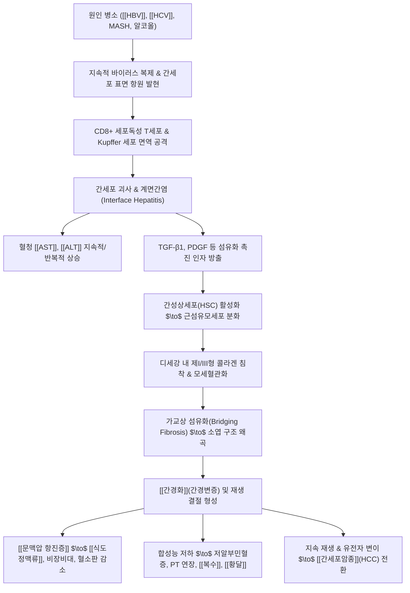

# 🩺 [[만성 간염]] (Chronic Hepatitis / 慢性肝炎, ICD-10 K73)

> **핵심 3줄 요약 (Key Summary)**:
> - 📍 **병소 부위 & 해부·병태생리**: 간세포 괴사 및 염증 반응이 최소 6개월 이상 지속되는 상태로, B형 간염 바이러스([[HBV]]), C형 간염 바이러스([[HCV]]), 지방독성([[대사이상 지방간염]]), 자가면역 등에 의해 지속적인 세포자멸사, 문맥역 염증, 계면간염(Interface hepatitis) 및 간성상세포 활성화를 통한 [[간섬유화]] 및 [[간경화]]로 진행.
> - 🚩 **전형적 임상 양상 & 3대 징후**: 수년간 무증상 잠복 또는 비특이적 만성 피로·권태감, 우상복부 팽만감 및 둔통, 진행 시 미열·피부발진·간종대 및 압통 발현. 비대상성 이행 시 [[황달]], [[복수]], 거미상 혈관종, 손바닥 홍반, 지혈 장애 출현.
> - 🛠️ **핵심 감별 & 한·양방 치료 전략**: 혈청 바이러스 마커(HBsAg, HBV DNA, Anti-HCV, HCV RNA), 간기능 효소([[AST]], [[ALT]]), 간섬유화 스캔(FibroScan LSM), FIB-4 지수 감별. 양방 항바이러스제(엔테카비르, 테노포비르, DAA 제제)와 한의학적 간울비허·기음양허·습열유련·어혈 변증([[생간건비탕]], [[인진청간탕]], [[일관전]], [[소요산]], 배수혈 침구) 통합 치료.
> - <font color="#fa7e7e">⚠️ **응급 의뢰 레드플래그**: 프로트롬빈 시간 급격한 연장(PT INR > 1.5), 간성혼수 초기 징후(수전증 Flapping tremor, 지남력 상실), 복수 급증 및 식도정맥류 파열 출혈(토혈, 흑색변), 간암 마커(AFP, PIVKA-II) 급상승 시 즉각 3차 상급병원 응급 전원.</font>

---

## 📌 목차
1. [질환 개요 & 병태생리 (Disease Overview)](#1-질환-개요--병태생리-disease-overview)
2. [병태생리 메커니즘 & 대사·장기부전 악순환 네트워크](#2-병태생리-메커니즘--대사장기부전-악순환-네트워크)
3. [임상 증상 & 환자 소견 (Clinical Presentation)](#3-임상-증상--환자-소견-clinical-presentation)
4. [감별 진단 매트릭스 (Differential Diagnosis)](#4-감별-진단-매트릭스-differential-diagnosis)
5. [한의 통합 치료 프로토콜 (침·약침·한약)](#5-한의-통합-치료-프로토콜-침약침한약)
6. [양방 치료 & 병용·의뢰 기준 (Conventional Treatment & Referral)](#6-양방-치료--병용의뢰-기준-conventional-treatment--referral)
7. [식이·생활습관 & 자가관리 티칭 가이드](#7-식이생활습관--자가관리-티칭-가이드)
8. [💡 진료실 핵심 필기 & 임상 노하우](#8--진료실-핵심-필기--임상-노하우)
9. [출처 및 학술 참고 문헌 (References)](#9-출처-및-학술-참고-문헌-references)

---

## 1. 질환 개요 & 병태생리 (Disease Overview)

* **질환 정의 및 분류**:
  * [[만성 간염]]은 간실질(Hepatic parenchyma)의 염증성 손상 및 [[간세포]] 괴사가 임상적 또는 병리학적으로 최소 6개월 이상 지속되는 질환군을 총칭합니다.
  * 급성 간염 바이러스 감염 후 숙주의 면역계가 바이러스를 완전 소멸시키지 못하거나, 지속적인 대사 이상, 알코올, 자가면역 기전 등에 의해 유발됩니다.
  * 초기에는 간기능 검사상 경미한 이상만을 보이지만, 장기간 방치될 경우 진행성 [[간섬유화]](Hepatic fibrosis)를 거쳐 비가역적인 [[간경화]](Liver cirrhosis) 및 [[간세포암종]](Hepatocellular carcinoma, HCC)으로 진행하는 대표적인 전암성(Premalignant) 만성 질환입니다.

* **주요 병인 및 역학적 특성**:
  * **바이러스성 간염**:
    * **만성 B형 간염 ([[HBV]])**: 국내 만성 간질환 및 간세포암종의 가장 주된 원인(약 60~70% 점유). 주산기 수직 감염 시 90% 이상 만성화되며, 성인기 수평 감염 시 만성화율은 5~10% 미만입니다. 백신 보급으로 유병률이 감소 추세이나 여전히 중장년층에서 높은 질병 부담을 유발합니다.
    * **만성 C형 간염 ([[HCV]])**: 급성 감염 후 75~85%라는 매우 높은 비율로 만성화되는 특징을 지닙니다. 오염된 혈액 제제, 주사기 재사용, 비위생적 문신·피어싱, 성접촉 등을 통해 전파되며, 예방 백신이 부재하여 조기 선별과 DAA 완치 치료가 필수적입니다.
    * **D형 간염 ([[HDV]])**: HBV 표면항원(HBsAg)을 외피로 빌려야만 증식할 수 있는 결손 바이러스로, HBV 중복감염(Superinfection) 시 급격한 전격성 간부전 및 고속 간경화 진행을 초래합니다.
  * **비바이러스성 병인**:
    * **대사이상 지방간염 ([[대사이상 지방간염]], MASH)**: 인슐린 저항성, 비만, 고지혈증에 동반되어 간세포 내 중성지방 축적과 지방독성(Lipotoxicity)으로 염증이 지속되는 질환군.
    * **알코올성 간염 ([[알코올성 간질환]])**: 장기간의 과도한 음주로 아세트알데히드 축적 및 산화 스트레스에 의해 간세포 손상이 지속되는 상태.
    * **약물유발성 간손상 ([[약물성 간손상]], DILI)**: 특정 양약, 독성 물질의 장기 노출로 발생하는 만성 간염.
    * **자가면역성 간질환**: 자가항체에 의한 [[자가면역성 간염]](AIH), 담관 파괴가 주된 [[원발성 담즙성 담관염]](PBC).

* **이환 조직 및 병리조직학적 특징**:
  * **문맥삼개(Portal triad)**: 문맥(Portal vein), 간동맥(Hepatic artery), 소엽간담관(Interlobular bile duct) 주변 결합조직에 단핵구, CD8+ 세포독성 T세포, 대식세포의 조밀한 침윤이 발생합니다.
  * **경계판 침범 및 계면간염(Interface hepatitis)**: 문맥역을 둘러싸고 있는 간세포 경계판(Limiting plate)이 염증세포의 침습을 받아 파괴되며, 경계부 간세포가 점진적으로 괴사·소실되는 조각괴사(Piecemeal necrosis / 계면간염)가 만성 진행의 핵심 병리 지표입니다.
  * **디세강(Space of Disse)과 간성상세포(Hepatic stellate cell, HSC)**: 지속적인 염증 반응으로 휴지기 간성상세포가 비타민 A 저장 능력을 잃고 근섬유모세포(Myofibroblast)로 전환되어 콜라겐을 분비함으로써 동양혈관 모세혈관화(Capillarization of sinusoids)를 유발합니다.

---

## 2. 병태생리 메커니즘 & 대사·장기부전 악순환 네트워크

```
========================================================================================
                      만성 간염의 병태생리 및 악순환 네트워크 (ASCII Flow)
========================================================================================

  [원인 자극]
  - HBV (핵내 cccDNA 영구 잔존)
  - HCV (지속 복제 및 면역 회피)        ───>  [숙주 면역 관용 파탄 & 지속 항원 노출]
  - 지방독성(MASH) / 독소
                                                        │
                                                        ▼
  [면역 매개 간세포 공격]
  - CD8+ 세포독성 T세포 활성화         ───>  [간세포 괴사 & 세포자멸사 (Apoptosis)]
  - 염증성 사이토카인 (TNF-α, IFN-γ)               │
                                                        │ (AST / ALT 누출)
                                                        ▼
  [쿠퍼세포(Kupffer cell) 활성화]       ───>  [전섬유화 인자 방출 (TGF-β1, PDGF)]
                                                        │
                                                        ▼
  [디세강 내 간성상세포(HSC) 형질전환] ───>  [근섬유모세포 활성화 & 제I/III형 콜라겐 침착]
                                                        │
                                                        ▼
  [동양혈관 모세혈관화 & 가교상 섬유화] ───>  [미세혈류 저항 증가 & 소엽 구조 왜곡]
                                                        │
                                                        ▼
  ┌─────────────────────────────────────────────────────┴─────────────────────────────────┐
  │                           간기능 부전 & 문맥압 항진의 악순환                             │
  │                                                                                       │
  │  [간실질 합성능 저하]      [혈관 저항 폭증]             [간성 림프액 유출 & 혈관 확장] │
  │  - 저알부민혈증            - [[문맥압 항진증]]          - 일산화질소(NO) 과다          │
  │  - 응고인자(PT) 저하        - [[식도정맥류]] 형성        - 유효 순환 혈장량 감소        │
  │         │                          │                            │                     │
  │         ▼                          ▼                            ▼                     │
  │   [출혈 경향 & 반상출혈]     [정맥류 파열 대출혈]         [신혈류 저하: RAAS 활성화]   │
  │                                                                 │                     │
  │                                                                 ▼                     │
  │                                                       [수분·나트륨 저류 ──> [[복수]]] │
  └───────────────────────────────────────────────────────────────────────────────────────┘
                                                        │
                                                        ▼
                              [말기 합병증: [[간경화]] / [[간성 혼수]] / [[간세포암종]]]
========================================================================================
```



### 1) 분자·세포 수준 기전
* **HBV의 면역 병태생리 및 cccDNA**:
  * HBV 자체는 간세포에 직접적인 세포독성을 유발하지 않는 비세포변성(Non-cytopathic) 바이러스입니다. 간 손상은 감염된 간세포막에 발현된 HBcAg, HBeAg 등의 바이러스 펩타이드를 숙주의 HLA Class I 분자를 통해 인식한 CD8+ 세포독성 T세포(CTL)가 침윤하여 간세포 자멸사를 유도하면서 발생합니다.
  * 감염된 간세포 핵 내에 형성된 cccDNA(Covalently closed circular DNA)는 숙주의 염색질 유사 구조로 매우 안정하게 유지되므로, 현행 경구용 항바이러스제(엔테카비르, 테노포비르 등)로 혈중 바이러스 증식을 억제하더라도 cccDNA를 완전히 제거하기 어려워 평생 투여 또는 장기 관리가 요구됩니다.
* **HCV의 지속 감염 및 면역 회피**:
  * HCV는 단일 가닥 RNA 바이러스로 간세포질 내에서 복제되며, NS3/4A 단백분해효소가 숙주의 선천 면역 신호전달 물질인 TRIF와 MAVS를 절단하여 인터페론-알파/베타 생성을 차단합니다. 이로 인해 숙주 면역계를 무력화시키고 80% 전후의 극히 높은 만성화율을 나타냅니다.
* **간성상세포 활성화와 세포외 기질(ECM) 축적**:
  * 파괴된 간세포의 잔해와 활성화된 쿠퍼세포에서 분비되는 TGF-β1, PDGF-BB, CTGF 등은 디세강의 휴지기 성상세포를 근섬유모세포로 형질전환시킵니다.
  * 활성화된 근섬유모세포는 α-SMA를 발현하며 제I형 및 제III형 콜라겐, 피브로넥틴을 과다 합성하여 동양혈관 내피세포의 창(Fenestration)을 폐쇄시킵니다(모세혈관화). 이는 간세포와 혈류 사이의 물질 교환을 차단하여 간세포 저산소증과 2차적 세포사를 악화시키는 악순환 고리를 만듭니다.

### 2) 장기·계통 수준 결과 및 만성 악순환 고리
* **미세혈관 저항 증가와 문맥압 항진증**:
  * 간내 섬유화 띠의 형성, 재생 결절의 혈관 압박, 내피세포의 산화질소(NO) 합성 저하로 간내 혈관 저항이 상승하여 [[문맥압 항진증]](Portal hypertension)이 발생합니다.
  * 문맥압 상승은 비장 울혈을 유발하여 비장비대 및 혈소판 파괴(비장기능항진증)를 초래하고, 위식도 측부순환을 발달시켜 치명적인 [[식도정맥류]] 출혈 위험을 유발합니다.
* **합성 기능 부전 및 대사 붕괴**:
  * 유효 간세포 수의 격감으로 알부민 합성 저하(교질삼투압 감소 → [[복수]] 및 하지 부종), 응고인자(I, II, V, VII, IX, X) 합성 저하(PT 연장, 출혈 경향), 빌리루빈 포합 및 배설 장애([[황달]])가 동시다발적으로 촉발됩니다.
  * 장관 유래 암모니아와 유독 물질을 요소로 전환하는 대사능이 상실되어 혈중 암모니아가 뇌-혈관 장벽(BBB)을 통과, 성상교세포 부종과 [[간성 혼수]](Hepatic encephalopathy)를 유발합니다.

### 3) 만성 B형 간염의 5단계 자연사 병기
1. **면역관용기 (Immune tolerant phase)**: HBeAg 양성, 매우 높은 HBV DNA(보통 > $10^7$ IU/mL), 정상 ALT, 조직학적 염증 및 섬유화 미미. (소아·청소년기 주산기 감염자).
2. **면역활동기 (HBeAg-positive immune reactive phase)**: HBeAg 양성, 높은 HBV DNA($10^4 \sim 10^7$ IU/mL), ALT의 지속적 또는 간헐적 상승, 활발한 계면간염 및 섬유화 진행. (적극적 항바이러스 치료 적응증).
3. **면역비활동기 / 비활동성 보유자 (Inactive carrier phase)**: HBeAg 음성, Anti-HBe 양성, 낮은 HBV DNA(< 2,000 IU/mL), 지속적 정상 ALT, 염증 완화.
4. **HBeAg 음성 면역활동기 (HBeAg-negative immune active phase)**: Pre-core 또는 Core promoter 돌연변이로 HBeAg은 음성이지만 HBV DNA 증식 지속(> 2,000 IU/mL), ALT 상승 및 섬유화의 급속 진행. (고령자 및 간암 위험군).
5. **HBsAg 소실기 (HBsAg loss / Functional cure)**: HBsAg 음전, HBV DNA 불검출, 간경변 및 간암 발생률 급감.

---

## 3. 임상 증상 & 환자 소견 (Clinical Presentation)

### 1) 주소증 및 핵심 증상
* **전형적 초기 증상 (보상기)**:
  * 대다수 환자는 수년에서 수십 년간 뚜렷한 자각 증상 없이 건강검진에서 우연히 발견됩니다.
  * 가장 흔한 주소증은 휴식을 취해도 풀리지 않는 **만성 피로감(Fatigue)**, 전신 무력감 및 권태감, 작업 집중력 저하입니다.
  * 식욕 감퇴, 구역질, 소화불량, 헛배부름 등 비특이적 위장관 증상과 함께 우측 늑골하부(우상복부)의 묵직하고 뻐근한 둔통이나 불쾌감을 호소합니다.
* **활동성 염증기 및 진행기 증상**:
  * 미열감, 발한, 전신 근육통 및 다발성 관절통.
  * 담즙 울체 시 피부 전신의 가려움증([[소양증]]), 짙은 갈색 소변(Bilirubinuria), 회백색 대변.
  * 안면 피부가 칙칙하고 거무스레하게 착색되는 간병성 안모(Hepatic facies).
* **비대상성(Decompensated) 간부전 이행 증상**:
  * **황달([[황달]])**: 공막과 피부 점막이 뚜렷한 황색으로 변색.
  * **복수([[복수]]) 및 부종**: 복벽 팽만, 복부 팽만감, 양측 하지 함요 부종(Pitting edema).
  * **피부 혈관 징후**: 목, 흉부, 어깨 부위의 거미상 혈관종(Spider angioma), 손바닥 무지구·소지구의 손바닥 홍반(Palmar erythema).
  * **내분비계 이상**: 에스트로겐 대사 저하로 인한 남성 유방화증(Gynecomastia), 고환 위축, 여성의 생리불순 및 무월경.
  * **출혈 경향**: 잦은 잇몸 출혈, 비출혈(코피), 경미한 외상에도 나타나는 광범위 반상출혈 및 자반.
  * **간성뇌증([[간성 혼수]])**: 수면 주기 역전(낮잠, 야간 불면), 성격 변화, 지남력 상실, 손을 앞으로 뻗었을 때 손목이 불수의적으로 펄럭이는 수전증(Flapping tremor / Asterixis).

### 2) 객관적 소견 및 진단 지표 (Signs & Labs)
* **신체 진찰 (Physical Exam)**:
  * **간 촉진**: 우측 늑골연 하방에서 정상 간의 부드러운 성상과 달리 단단하고 둔탁한 간 하연(Firm, blunt edge)이 촉지되며, 진행 시 표면의 결절성 요철감이 감지됩니다.
  * **비장 촉진**: 좌측 늑골 하연에서 종대된 비장(Splenomegaly)이 만져지며 이는 문맥압 항진증의 강력한 임상 징후입니다.
  * **복부 진찰**: 타진 시 이동성 탁음(Shifting dullness) 및 파동 검사(Fluid wave test) 양성으로 복수 저류 확인.
* **생화학적 간기능 검사 (LFT)**:
  * **[[AST]] / [[ALT]]**: 수십~수백 U/L로 상승 또는 정상과 상승을 주기적으로 반복. 급격한 급상승(ALT flare > 5~10배)은 급성 악화 또는 재활성화를 시사.
  * **알부민(Albumin)**: 정상치(3.5~5.0 g/dL) 이하로 감소 시 간의 만성 합성 기능 저하 및 예후 불량을 의미.
  * **프로트롬빈 시간 (PT INR)**: 비타민 K 의존성 응고인자 결핍을 반영하여 연장되며, 1.5 이상으로 지연 시 급성 전격성 간부전 이행 위험의 중요한 경보 신호.
  * **혈소판 수치 (Platelet)**: 문맥압 항진으로 인한 비장 포획 증가로 $150,000/\mu\text{L}$ 미만, 진행 시 $100,000/\mu\text{L}$ 이하로 감소.
* **비침습적 간섬유화 평가 공식**:
  * **APRI (AST to Platelet Ratio Index)**:
    $$\text{APRI} = \frac{(\text{AST} / \text{AST 상한치}) \times 100}{\text{혈소판 수치 } (10^9/\text{L})}$$
    (APRI > 1.0은 심각한 섬유화 F3 이상, > 2.0은 간경변증 F4 강력 시사).
  * **FIB-4 Index**:
    $$\text{FIB-4} = \frac{\text{연령(세)} \times \text{AST(U/L)}}{\text{혈소판}(10^9/\text{L}) \times \sqrt{\text{ALT(U/L)}}}$$
    - < 1.45: 진행성 섬유화(F3-F4) 음성 예측도 > 90% (저위험군).
    - 1.45 ~ 3.25: 불확정 영역(중등도 위험군, 추가 정밀 검사 요망).
    - > 3.25: 진행성 섬유화 및 간경변 양성 예측도 고위험군.
* **바이러스 혈청 표지자 검사 (Serologic Viral Markers)**:
  * **B형 간염**:
    * **HBsAg**: 6개월 이상 양성 지속 시 만성 B형 간염 확진.
    * **Anti-HBs**: HBsAg에 대한 방어 항체. 자연 감염 후 회복 또는 백신 접종 후 형성.
    * **HBeAg / Anti-HBe**: 바이러스의 고증식 상태 및 전염력 평가.
    * **HBV DNA 정량 검사 (Real-time PCR)**: 혈액 내 바이러스 복제 수준을 직접 측정(IU/mL). 항바이러스제 치료 시작 및 반응 평가의 표준 척도.
    * **Anti-HBc IgM / IgG**: IgM은 급성 감염 또는 만성 간염의 중증 재활성화 시 양성; IgG는 과거 또는 만성 감염 시 지속 양성.
  * **C형 간염**:
    * **Anti-HCV**: C형 간염 선별 항체. 과거 노출 또는 현재 감염을 의미.
    * **HCV RNA 정량 검사**: Anti-HCV 양성 환자에서 실제 바이러스가 혈중에 존재하는지 확인하는 확진 검사. 불검출 시 과거 완치 또는 위양성.
    * **HCV 유전자형(Genotype 1~6)**: 과거 약제 선택의 기준이었으나 최근 범유전자형 DAA 등장으로 필수성이 다소 감소하였으나 여전히 참고 지표.
* **영상 및 탄성도 검사**:
  * **복부 초음파 (US)**: 간 실질의 거친 에코(Coarse echotexture), 간 표면의 불규칙한 요철, 간연의 둔화, 문맥 직경 확장(> 13mm), 비장종대 관찰.
  * **순간탄성측정법 (Transient Elastography / FibroScan)**: 간 탄성도(Liver Stiffness Measurement, LSM)를 파동 전달 속도로 측정(단위: kPa).
    * < 6.0 kPa: F0-F1 (섬유화 없음 또는 경미).
    * 6.0 ~ 9.0 kPa: F2 (의미 있는 섬유화).
    * 9.0 ~ 12.0 kPa: F3 (진행성 섬유화).
    * $\ge$ 12.0 kPa: F4 ([[간경화]]).

---

## 4. 감별 진단 매트릭스 (Differential Diagnosis)

| 감별 질환 | 주요 병인 및 호발군 | 주소증 및 임상적 차이점 | 핵심 검사실 소견 | 영상 및 조직학적 소견 |
| :--- | :--- | :--- | :--- | :--- |
| **[[만성 간염]] (본 질환)** | [[HBV]], [[HCV]], 6개월 이상 지속 염증 | 만성 피로, 둔탁한 우상복부통, 보상기 무증상 | HBsAg(+) 또는 HCV RNA(+), AST/ALT 만성 상승 | 초음파상 거친 실질, 생검상 계면간염 및 가교상 섬유화 |
| **[[급성 무황달성 간염]]** | [[HAV]], 급성 HBV, 약물 노출 | 수일~수주 내 급격한 발병, 오심·구토, 독감 유사 증상 | AST/ALT 수천 U/L 단위 급상승, IgM anti-HAV(+) | 2~3개월 내 완전 정상화, 섬유화 결절 없음 |
| **[[간경화]] (간경변증)** | 만성 간염의 말기 단계, 전 섬유화 | [[복수]], [[황달]], 식도정맥류 출혈, [[간성 혼수]] | 혈소판 급감(<100,000), PT INR 현저 연장, 알부민 저하 | 표면 결절화, 문맥류 확장, FibroScan LSM $\ge$ 12kPa |
| **[[알코올성 간질환]] (간염)** | 장기간 과량의 지속적 음주력 | 황달의 급속 악화, 발열, 식욕 부진, 복통 | AST/ALT 비 $\ge$ 2.0 (AST 우세), GGT 현저 상승, 백혈구 증가 | 간생검상 Mallory-Denk 체, 풍선변성, 호중구 침윤 |
| **[[대사이상 지방간염]] (MASH)** | 대사증후군, 당뇨, 비만, 고지혈증 | 대부분 무증상, 피로감, 경미한 간종대 | 바이러스 마커 음성, ALT > AST (초기), HOMA-IR 상승 | 초음파상 지방간(고에코), 생검상 대수포성 지방변성 |
| **[[자가면역성 간염]] (AIH)** | 자가면역 기전, 40~50대 여성 또는 소아 | 관절통, 피부발진, 무월경 등 전신 자가면역 동반 | ANA, ASMA 양성, 혈청 IgG > 1.5배 상승 | 현저한 계면간염, 조밀한 형질세포 침윤, 로제트 형성 |
| **[[원발성 담즙성 담관염]] (PBC)** | 간내 소담관 자가면역 파괴, 중년 여성 | 극심한 피부 [[소양증]], 점진적 황달, 황색종 | AMA(항미토콘드리아항체) 양성 95%, ALP/GGT 현저 상승 | 비화농성 파괴성 담관염 (Florid duct lesion), 담관 소실 |
| **[[간세포암종]] (HCC)** | 만성 B/C형 간염, 간경변 합병 | 체중 감소, 우상복부 종괴 촉진, 복수 급증 | AFP > 200~400 ng/mL, PIVKA-II 급상승 | 조영증강 CT/MRI상 동맥기 조기 조영증강 및 문맥기 조기 유출 |

> 🚩 **레드플래그 감별 (응급)**:
> 1. **급성 간부전 / 전격성 간염(Fulminant hepatic failure)**: PT INR > 1.5 및 간성혼수가 황달 발현 8주 이내 급격히 병발하는 상태로 3차 병원 응급실 즉시 전원.
> 2. **식도정맥류 파열 출혈**: 대량 토혈(Hematemesis), 흑색변(Melena), 기립성 저혈압 및 빈맥 동반 시 즉각적인 내시경 지혈술 요망.
> 3. **세균성 복막염(SBP)**: 복수 환자에서 발열, 복부 전반 압통 및 반발통 출현 시 진단적 복수 천자 필수.

---

## 5. 한의 통합 치료 프로토콜 (침·약침·한약)

* **한의 변증 분류 체계**:
  * **1) 간울비허형(肝鬱脾虛型)**: 우협통(우측 옆구리 결림), 잦은 한숨, 복부 팽만, 피로, 식욕 부진, 대변 묽음, 설담태박백, 맥현세(弦細).
  * **2) 기음양허형(氣陰兩虛型)**: 만성적인 쇠약, 식은땀(도한), 미열감, 가슴 두근거림(심계), 구갈, 설홍소태, 맥세수(細數).
  * **3) 간담습열형(肝膽濕熱型)**: 흉협 창통, 입안이 쓰고 텁텁함, 신체 및 공막의 황달, 진한 갈색 뇨, 구역감, 설홍태황니, 맥현활삭(弦滑數).
  * **4) 간신음허형(肝腎陰虛型)**: 협하 은은한 통증, 어지럼증(현훈), 이명, 구건인조, 손발바닥 번열(수족심열), 요슬산연, 설홍무태, 맥세삭.
  * **5) 어혈저락형(瘀血阻絡型)**: 협하 찌르는 듯한 고정성 자통, 야간 통증 악화, 피부 거미상 혈관종, 손바닥 홍반, 간비대 및 결절, 설자암 유어반, 맥삽(澁).

* **한약 치료 (Herbal Medicine)**:
  * **간울비허형(肝鬱脾虛型) — [[소요산]](逍遙散) 가감**:
    * **처방 구성**: [[시호]] 6g, [[백작약]] 9g, [[당귀]] 9g, [[백출]] 9g, [[복령]] 9g, [[자감초]] 4.5g, [[박하]] 3g, [[생강]] 3g, 가미: [[울금]] 6g, [[향부자]] 6g, [[지각]] 6g.
    * **방의**: 시호는 소간해울(疏肝解鬱)하고 작약·당귀는 유간양혈(柔肝養血)하며, 백출·복령·감초는 건비익기(健脾益氣)하여 "견간지병 지간전비 당선실비(見肝之病 知肝傳脾 當先實脾)"의 원칙에 따라 간기 울결을 풀고 비기(脾氣)의 운화를 북돋웁니다.
  * **간담습열형(肝膽濕熱型) — [[생간건비탕]](生肝健脾湯) 및 [[인진청간탕]](茵蔯淸肝湯) 가감**:
    * **처방 구성**: [[인진]] 12g, [[패장초]] 12g, [[금은화]] 10g, [[산사]] 8g, [[맥아]] 8g, [[백출]] 8g, [[진피]] 6g, [[후박]] 6g, [[택사]] 6g, [[저령]] 6g, [[적복령]] 6g, [[차전자]] 6g, [[백작약]] 8g, [[시호]] 6g, [[감초]] 3g.
    * **방의**: 인진은 청열이습퇴황(淸熱利濕退黃)의 군약으로 작용하여 담즙 배설을 촉진하고, 패장초와 금은화는 해독소염(解毒消炎)하여 급성 간세포 괴사 및 염증 사이토카인을 억제합니다. 산사·맥아·백출·진피·후박은 비위를 조화롭게 하여 식욕 부진과 팽만감을 해소하고, 택사·저령·복령·차전자는 습열을 소변으로 이끌어 배출시킵니다.
  * **기음양허형(氣陰兩虛型) — [[일관전]](一貫煎) 가미**:
    * **처방 구성**: [[북사삼]] 12g, [[맥문동]] 12g, [[당귀]] 9g, [[생지황]] 15g, [[구기자]] 12g, [[천련자]] 4.5g, 가미: [[태자삼]] 12g, [[원삼]] 9g, [[산약]] 12g, [[나도근]] 15g.
    * **방의**: 생지황·사삼·맥문동·구기자는 간신(肝腎)의 진액을 대보(大補)하여 간세포막을 안정화하고, 당귀는 간혈을 보충하며, 천련자는 소간이기(疏肝理氣)하여 음허로 인한 기체(氣滯)를 풀어줍니다. 태자삼과 산약은 비폐의 원기를 돋우고 나도근은 식은땀을 수렴합니다.
  * **어혈저락형(瘀血阻絡型) — 활혈거어방(活血祛瘀方) 가감**:
    * **핵심 본초 배합**: [[단삼]] 15g, [[적작약]] 12g, [[당귀]] 9g, [[삼릉]] 6g, [[아출]] 6g, [[별갑]] 12g.
    * **방의**: 단삼과 적작약은 간류동(Sinusoid) 내 미세혈전 형성을 억제하고 간성상세포 활성화를 차단하여 간섬유화 진행을 지연시키며, 별갑은 연견산결(軟堅散結)하여 간종대와 초기 섬유화 결절을 완화합니다.

* **침구 치료 (Acupuncture)**:
  * **주요 선혈**:
    * **배수혈(Back-Shu)**: [[간수(BL18)]], [[담수(BL19)]], [[비수(BL20)]], [[신수(BL23)]].
    * **복모혈 및 국소혈**: [[기문(LR14)]], [[일월(GB24)]], [[거궐(CV14)]], [[중완(CV12)]].
    * **원위 사지혈**: [[태충(LR3)]], [[족삼리(ST36)]], [[삼음교(SP6)]], [[음릉천(SP9)]], [[곡지(LI11)]], [[합곡(LI4)]].
  * **자침 기법 및 자극량**:
    * 기문(LR14)·일월(GB24): 늑간 신경 및 간 표면 손상 방지를 위해 늑골을 따라 15~30도 사자(斜刺) 0.5~0.8촌 자입.
    * 간수(BL18)·비수(BL20): 척추 내측 방향으로 15도 사자 0.8~1.0촌 자입 (기흉 주의).
    * 태충(LR3)·곡지(LI11): 사법(瀉法)을 적용하여 간화(肝火)와 습열을 청열.
    * 족삼리(ST36)·삼음교(SP6): 보법(補法) 또는 평보평사로 비신(脾腎) 기능을 보강.
  * **전침 요법 (Electroacupuncture)**:
    * 태충(LR3) - 족삼리(ST36)에 전침 연결, 2Hz 저주파 통전 20분 유지.
    * 미주신경 자극 및 항염증 콜린성 경로(Cholinergic anti-inflammatory pathway) 활성화를 통해 간내 TNF-α, IL-6 분비를 억제하고 IL-10 생성을 촉진.

* **약침 치료 (Pharmacopuncture)**:
  * **자하거(인태반) 약침**:
    * **적응증**: 기음양허, 간신음허, 만성 피로, 간경화 초기 섬유화 진행 억제.
    * **혈위 및 용량**: 간수(BL18), 비수(BL20), 족삼리(ST36)에 혈당 0.2~0.5mL씩 총 1.0~2.0mL 주입 (주 2회).
    * **기전**: 간세포 증식 인자(HGF) 발현 촉진, 간세포 자멸사 억제, 단백질 합성능 촉진.
  * **황련해독탕 약침**:
    * **적응증**: 간담습열, ALT flare, 급성 염증 악화기.
    * **혈위 및 용량**: 기문(LR14), 태충(LR3), 양릉천(GB34)에 각 0.1~0.2mL씩 주입하여 간내 급성 염증 완화.

---

## 6. 양방 치료 & 병용·의뢰 기준 (Conventional Treatment & Referral)

* **만성 B형 간염 양방 약물 치료**:
  * **치료 목표**: HBV 복제를 장기간 강력히 억제하여 간내 염증 완화, 섬유화 개선 또는 역전, 간경변증 및 간세포암종 발생 예방.
  * **경구용 항바이러스제 (Nucleos/tide Analogues, NAs)**:
    * **엔테카비르 ([[엔테카비르]], Entecavir / 바라크루드)**:
      * 용법: 0.5mg 1일 1회 공복(식전 2시간 또는 식후 2시간). 라미부딘 내성 환자는 1.0mg 증량.
      * 특징: 구아노신 뉴클레오사이드 유사체로 역전사효소를 강력히 억제. 5년 누적 내성 발현율 1.2%로 내성 장벽이 높음.
    * **테노포비르 디소프록실 푸마르산염 ([[테노포비르]], TDF / 비리어드)**:
      * 용법: 300mg 1일 1회 식사와 무관하게 복용.
      * 특징: 아데닌 뉴클레오티드 유사체. 내성 돌연변이가 거의 보고되지 않음. 장기 복용 시 근위 세뇨관 손상(Fanconi 증후군), 혈청 크레아티닌 상승, 골밀도 감소(골다공증) 위험이 있어 신기능 및 골밀도 정기 모니터링 필수.
    * **테노포비르 알라페나미드 ([[테노포비르]], TAF / 베믈리디)**:
      * 용법: 25mg 1일 1회 식사와 함께 복용.
      * 특징: TDF의 표적 지향 전구약물로 혈중 안정성이 높아 적은 용량으로도 간세포 내 활성 대사물질(Tenofovir-DP) 농도를 유지. 혈장 내 테노포비르 노출을 89% 감소시켜 TDF 대비 신장 및 골 안전성을 획기적으로 개선함. 고령 환자, 신기능 저하, 골다공증 위험군에서 우선 권고.
    * **베시포비르 ([[베시포비르]], Besifovir / 베시보)**:
      * 용법: 150mg 1일 1회 식후 복용. 혈중 L-카르니틴 고갈을 방지하기 위해 L-카르니틴 660mg 병용 투여 필수.
  * **치료 원칙 및 투약 기간**:
    * 고역가 내성 장벽 약제(Entecavir, TDF, TAF)를 1차 선택제로 사용.
    * 임의 투약 중단 시 바이러스 재활성화와 치명적인 간부전(Severe flare)이 유발될 수 있으므로 HBsAg 혈청 소실(Functional cure)이 확인될 때까지 지속 투여(사실상 평생 투여)가 기본 원칙입니다.

* **만성 C형 간염 양방 직접작용 항바이러스제 (DAA)**:
  * **치료 목표**: 치료 종료 12주 후 혈중 HCV RNA가 검출되지 않는 **지속 바이러스 반응(SVR12)** 달성 $\to$ 98% 이상의 환자에서 사실상 바이러스 완치(Cure).
  * **소포스부비르 / 벨파타스비르 (Sofosbuvir/Velpatasvir, Epclusa / 엡클루사)**:
    * 용법: 400/100mg 복합제 1일 1회 1정, 12주간 투여.
    * 특징: NS5B 중합효소 억제제(소포스부비르) + NS5A 억제제(벨파타스비르) 조합의 범유전자형(Pangenotypic) 약제. 간경변이 없거나 대상성 간경변(Child-Pugh A) 환자에서 12주 투여로 전 유전자형에서 98% 이상 SVR 달성.
  * **글레카프레비르 / 피브렌타스비르 (Glecaprevir/Pibrentasvir, Maviret / 마비렛)**:
    * 용법: 100/40mg 복합제 3정을 1일 1회 식사와 함께 복용.
    * 치료 기간: 초치료 비경변성 환자는 8주 요법 가능, 대상성 간경변증 환자는 12주 요법.
    * 특징: NS3/4A 단백분해효소 억제제 + NS5A 억제제 조합. 신기능 장애(투석 환자 포함) 환자에서도 용량 조절 없이 투여 가능.

* **한의 병용 치료 판단 및 안전성 가이드**:
  * **병용 가능 및 권장**:
    * 항바이러스제(NAs)를 안정적으로 복용 중인 환자에서 간기능 효소 수치가 정상화되지 않거나 지속적인 피로, 소화불량, 간섬유화 진행 억제를 목적으로 생간건비탕, 일관전 등 간보호 한약을 병용하는 것은 안전하며 시너지 효과를 냅니다.
    * 간 대사 효소(CYP3A4 등)와의 잠재적 상호작용을 최소화하기 위해 양방 항바이러스제와 한약 복용 간격을 최소 1.5~2시간 이상 유지합니다.
  * **절대 금기 및 주의사항**:
    * **자의적 항바이러스제 중단 금지**: 한약을 시작한다고 해서 복용 중인 엔테카비르나 테노포비르를 환자 임의로 중단하거나 감량해서는 절대로 안 됩니다. 급격한 바이러스 반동 및 간부전 사망 위험이 있습니다.
    * 검증되지 않은 민간요법, 옻나무, 성분 불명의 엑기스제는 약물성 간손상(DILI)을 2차적으로 유발하여 비대상성 간부전을 촉발할 수 있으므로 금지합니다.

* **전문과 의뢰 및 수술·중재 시술 적응증**:
  * **내시경 정맥류 결찰술 (EVL)**: 고위험 식도정맥류(F2 이상 또는 Red color sign 양성) 출혈 예방 및 파열 시 응급 지혈.
  * **경경정맥 간내문맥전신단락술 (TIPS)**: 약물 및 내시경 치료에 불응하는 난치성 정맥류 출혈 또는 난치성 복수 조절.
  * **간암 국소 치료술 (RFA, TACE, 수술적 절제)**: 간세포암종 조기 발견 시 근치적 절제술 또는 경동맥화학색전술.
  * **간이식 (Liver Transplantation, LT)**: 비대상성 간경변증(MELD 점수 $\ge$ 15), 급성 간부전, 간세포암종 밀란 기준(Milan criteria) 부합 시 유일한 근치적 요법.

---

## 7. 식이·생활습관 & 자가관리 티칭 가이드

* **식이 지도 (Dietary Management)**:
  * **완전한 금주 (Alcohol Abstinence)**: 만성 B/C형 간염 환자에게 알코올은 간암 발생 위험을 10배 이상 상승시키는 1급 발암 보조 인자입니다. "약주", "가벼운 맥주 한 잔"도 절대 금기이며 완전한 평생 금주를 지도합니다.
  * **단백질 섭취 원칙**:
    * 보상기 간염 환자: 간세포 재생 및 알부민 유지를 위해 체중 1kg당 1.2~1.5g의 양질의 단백질(두부, 콩류, 계란 흰자, 흰살 생선, 살코기)을 권장합니다.
    * 간성혼수 전구기 환자: 장내 암모니아 생성을 억제하기 위해 일시적으로 식물성 단백질 위주로 제한합니다.
  * **저염식 (Low-sodium Diet)**:
    * 복수 및 부종이 발생한 환자는 1일 소금 섭취량을 5g 미만(나트륨 2,000mg 미만)으로 엄격히 제한합니다. 젓갈, 장아찌, 찌개 국물 섭취를 금지합니다.
  * **곰팡이 독소(Aflatoxin) 차단**:
    * 아스페르길루스(Aspergillus flavus) 곰팡이가 생성하는 아플라톡신 B1은 간암을 유발하는 강력한 독소이므로, 곰팡이가 피었거나 오래된 땅콩, 옥수수, 부패한 견과류는 절대 섭취하지 않도록 교육합니다.

* **생활습관 및 운동 티칭**:
  * **충분한 휴식과 수면**: 과도한 육체적 과로 및 야근은 간문맥 혈류량을 감소시켜 간세포 회복을 지연시킵니다. 매일 7~8시간의 규칙적인 수면을 유지하고 밤 11시 이전 취침을 권장합니다.
  * **적정 강도의 유산소 운동**:
    * 빠르게 걷기, 가벼운 수영, 고정식 자전거 타기 등 중등도 강도의 유산소 운동을 주 3~5회, 회당 30~40분 시행합니다.
    * MASH나 비만이 병발된 환자는 체중의 5~10% 감량을 목표로 설정하되, 무리한 단식이나 급격한 감량은 지방간염 악화를 초래하므로 월 1~2kg 감량을 원칙으로 합니다.

* **자가관리 및 환자 교육 스크립트**:
  * *"원장님, 간수치가 정상으로 나왔는데 B형 간염 약을 이제 끊어도 되나요?"*
    * **원장 답변 스크립트**: "간수치가 정상화된 것은 드시고 계신 항바이러스제가 바이러스를 억누르고 있기 때문입니다. 지금 약을 임의로 중단하시면 잠자던 바이러스가 폭발적으로 늘어나면서 급성 간부전이라는 매우 위험한 응급 상황이 발생할 수 있습니다. 항바이러스제는 반드시 전문의의 지도하에 복용하셔야 하며, 한의원에서는 약 복용으로 인한 피로 회복과 간섬유화 억제, 간세포 보호를 돕는 한약과 침 치료를 안전하게 병행해 드립니다."
  * *"가족들에게 전염될 위험은 없나요?"*
    * **원장 답변 스크립트**: "B형 간염은 일상적인 식사나 포옹, 대화로는 전염되지 않습니다. 다만 면도기, 손톱깎이, 칫솔 등 혈액이 묻을 수 있는 위생용품은 반드시 따로 쓰셔야 합니다. 또한 동거 가족들은 혈액 검사로 항체 유무를 확인하신 뒤 항체가 없다면 반드시 예방 접종을 완료하셔야 합니다."

* **정기 추적 검사 프로토콜**:
  * **모든 만성 B/C형 간염 환자**: 6개월마다 혈청 [[AST]], [[ALT]], 혈소판, 총빌리루빈, 알부민, PT INR 검사.
  * **간암 고위험군 감시 검사**: 40세 이상 만성 B형 간염 환자, 모든 간경변증 환자는 **6개월마다 복부 초음파 + 혈청 AFP(알파태아단백) / PIVKA-II 병용 검사** 필수.

---

## 8. 💡 진료실 핵심 필기 & 임상 노하우

> [!IMPORTANT]
> **🛡️ 원문 융합(Melt-In) 잔여 고유 필기 & 임상 의안 변증 심화**
> - **기존 필기 100% 흡수 완료**: 급성에서 만성화된 병태생리, AST/ALT 및 혈청 마커, 4대 변증(간울비허, 기음양허, 허혈, 습열), [[태자삼]], [[원삼]], [[백출]], [[당삼]], [[나도근]], [[패장초]], [[금은화]], [[당귀]], [[적작약]], [[단삼]]의 본초학적 기전 및 배합 원리를 상부 섹션에 완전 융합.
> - **수술 및 침습적 시술 시 사전 점검**: 만성 간염 환자는 간실질 손상으로 응고인자 합성이 저하되어 지혈 장애가 빈발하고, 마취제 대사 지연이 발생할 수 있으므로 치과 발치, 외과 수술, 침도(Acutomy) 시술 전 반드시 혈소판 수치와 PT INR을 확인해야 합니다.

* **원장님 진료실 핵심 의안 변증 노하우**:
  * **비허간울(脾虛肝鬱)의 맥진과 치법**:
    * 간염 환자가 "피로하고 밥맛이 없으며 명치 밑이 더부룩하다"고 할 때 좌관맥(左關脈)의 현(弦)함과 우관맥(右關脈)의 약(弱)함을 반드시 비교해야 합니다.
    * 비위가 허하다고 해서 인삼·백출 같은 보기약만 투여하면 간기(肝氣)의 울결이 심해져 가슴 답답함과 옆구리 결림이 악화됩니다. 반드시 [[시호]], [[백작약]], [[울금]]으로 간기를 소통시키면서 [[백출]], [[당삼]]으로 비기를 북돋워 주어야 비로소 소화가 되고 기운이 납니다.
  * **기음양허(氣陰兩虛)의 미열과 식은땀 다스리기**:
    * 유병기간이 긴 만성 B형 간염 환자가 오후 미열, 야간 식은땀(도한), 가슴 두근거림을 호소할 때, 청열제(황련, 황금 등)만 과용하면 비위 양기를 상하고 진액을 더욱 말립니다.
    * 이때는 [[태자삼]]과 [[원삼]], [[나도근]], [[산약]], [[구기자]]를 배합하여 익기양음(益氣養陰)하고 체온 조절 중추를 안정시키면 식은땀이 멎고 혈청 간효소가 안정되는 뛰어난 묘효가 있습니다.
  * **간장혈(肝藏血)과 혈액 순환(활혈거어)**:
    * 간염 수치(ALT)를 떨어뜨리는 데만 급급하여 소염제나 청열해독제만 장복시키면 간혈(肝血)이 손상되어 간이 더욱 굳어집니다.
    * 간의 생리 기능인 간장혈을 회복시키기 위해 [[당귀]], [[적작약]], [[단삼]] 같은 양혈활혈제를 적절히 가미하여 간동양혈관의 미세혈류를 열어주어야 섬유화 진행을 막을 수 있습니다.

* **진료실 정밀 모니터링 체크리스트**:
  * 1. HBsAg 양성 환자에게 6개월 주기 복부 초음파와 혈청 AFP 선별 검사를 철저히 안내하고 있는가?
  * 2. 혈소판(Platelet) 수치가 $150,000/\mu\text{L}$ 이하로 감소하는지 매 혈액검사마다 추적하여 잠재적 간섬유화 및 문맥압 항진증을 조기에 감지하고 있는가?
  * 3. 양방 항바이러스제(바라크루드, 비리어드, 베믈리디 등) 복용 환자에게 자의적 투약 중단 위험성을 명확히 교육하고, 한약 복용 시 최소 2시간의 복용 시간차를 두도록 지도하고 있는가?
  * 4. 환자가 복용 중인 건강기능식품, 버섯 달인 물, 성분 미상의 즙류를 전수 조사하여 즉각 중단시키고 있는가?

---

## 9. 출처 및 학술 참고 문헌 (References)

1. **Enomoto M, et al. (2026)**. Evolving Strategies in HBV Management: Insights From Updated International Guidelines. *Hepatol Res*. [PMID: 42144940](https://pubmed.ncbi.nlm.nih.gov/42144940/)
   - **[연구 요약]**: 최신 국제 만성 B형 간염 가이드라인의 주요 개정 사항을 비교 분석하고, cccDNA 억제 전략, 조기 항바이러스제 시작 기준 확대 및 간암 예방을 위한 장기적 질환 관리 패러다임 제시.

2. **European Association for the Study of the Liver (2025)**. EASL Clinical Practice Guidelines on the management of hepatitis B virus infection. *J Hepatol*. [PMID: 40348683](https://pubmed.ncbi.nlm.nih.gov/40348683/)
   - **[연구 요약]**: 유럽간학회의 최신 만성 B형 간염 임상 진료 가이드라인으로, 질병 자연사 분류, 비침습적 간섬유화 평가, NAs 장기 투여 시 안전성 모니터링 및 치료 중단 기준 정립.

3. **Lampertico P, et al. (2017)**. EASL 2017 Clinical Practice Guidelines on the management of hepatitis B virus infection. *Journal of Hepatology*, 67(2), 370-398. [PMID: 28427875](https://pubmed.ncbi.nlm.nih.gov/28427875/)
   - **[연구 요약]**: 만성 B형 간염의 5단계 자연사 분류 체계를 확립하고 엔테카비르 및 테노포비르 등 고내성장벽 항바이러스제의 1차 치료제 표준 권고.

4. **Terrault NA, et al. (2018)**. Update on prevention, diagnosis, and treatment of chronic hepatitis B: AASLD 2018 hepatitis B guidance. *Hepatology*, 67(4), 1560-1599. [PMID: 29405329](https://pubmed.ncbi.nlm.nih.gov/29405329/)
   - **[연구 요약]**: 미국간학회의 만성 B형 간염 가이드라인으로 치료 시작 적응증, 임신부 및 면역억제제 투여 환자에서의 예방적 항바이러스 치료 지침 제시.

5. **European Association for the Study of the Liver (2018)**. EASL Recommendations on Treatment of Hepatitis C 2018. *Journal of Hepatology*, 69(2), 461-511. [PMID: 29650333](https://pubmed.ncbi.nlm.nih.gov/29650333/)
   - **[연구 요약]**: 직접작용 항바이러스제(DAA) 기반의 만성 C형 간염 범유전자형 치료 지침 및 SVR12 완치 판정 후 간질환 관리 가이드라인 수립.
