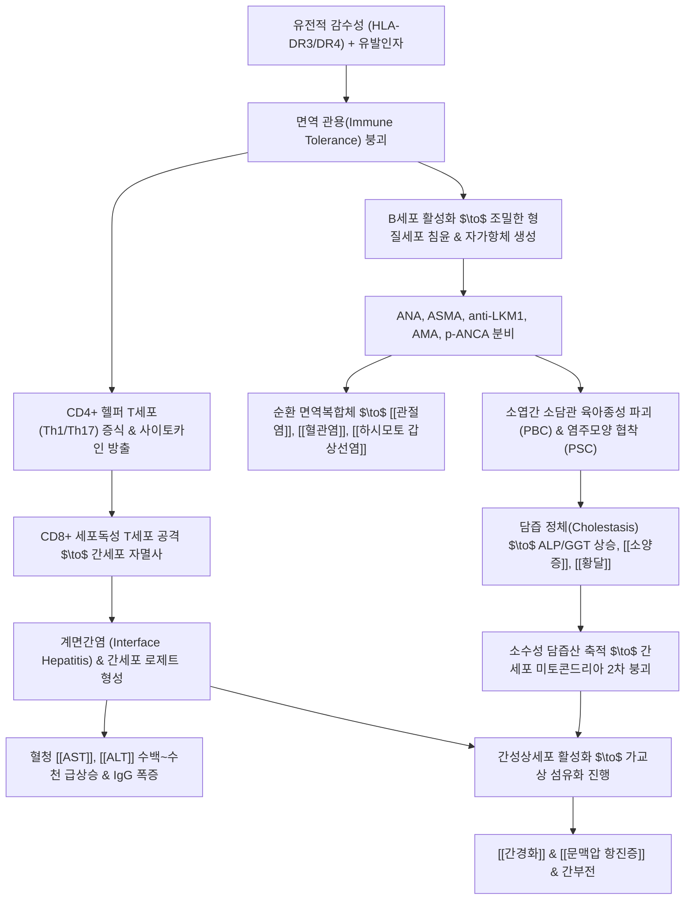

# 🩺 [[자가면역성 간질환]] (Autoimmune Liver Disease / 自身免疫性 肝疾患, ICD-10 K75.4 / K74.3 / K83.0)

> **핵심 3줄 요약 (Key Summary)**:
> - 📍 **병소 부위 & 해부·병태생리**: 유전적 감수성(HLA-DR3/DR4/DRB1)을 지닌 숙주에서 면역 관용이 파탄되어 CD4+/CD8+ T세포 및 자가항체가 간세포막 및 담관 상피세포를 표적으로 공격하는 만성 면역 매개 간질환군([[자가면역성 간염]] AIH, [[원발성 담즙성 담관염]] PBC, [[원발성 경화성 담관염]] PSC, [[중복증후군]]). 문맥역 계면간염(Interface hepatitis), 형질세포 침윤, 담관 소실(Ductopenia), 진행성 섬유화가 핵심 병리.
> - 🚩 **전형적 임상 양상 & 3대 징후**: 극심한 만성 피로감·권태감, 피부 가려움증([[소양증]]) 및 점진적 [[황달]], 간외 자가면역 질환 동반([[관절염]], [[혈관염]], [[하시모토 갑상선염]], [[궤양성 대장염]], 무월경).
> - 🛠️ **핵심 감별 & 한·양방 치료 전략**: IAIHG 단순 진단 점수(자가항체 ANA/ASMA/anti-LKM1, 혈청 IgG 상승, 간조직검사 형질세포 침윤, 바이러스 음성). 양방 스테로이드([[프레드니솔론]], [[부데소니드]]) + 면역억제제([[아자티오프린]]) 관해 유도/유지 및 UDCA 요법과 한의학적 간음부족·음허혈열·습열조체 변증([[일관전]], [[지백지황탕]], [[생지황]], [[목단피]], 배수혈 침구) 통합 관리.
> - <font color="#fa7e7e">⚠️ **응급 의뢰 레드플래그**: 급성 간세포 광범위 아괴사로 인한 전격성 간부전(Fulminant hepatic failure), 프로트롬빈 시간 급격 연장(PT INR > 1.5), 간성뇌증 초기(지남력 상실, 손떨림), 담관염 합병 패혈성 쇼크 출현 시 3차 상급병원 응급 전원.</font>

---

## 📌 목차
1. [질환 개요 & 병태생리 (Disease Overview)](#1-질환-개요--병태생리-disease-overview)
2. [병태생리 메커니즘 & 대사·장기부전 악순환 네트워크](#2-병태생리-메커니즘--대사장기부전-악순환-네트워크)
3. [임상 증상 & 환자 소견 (Clinical Presentation)](#3-임상-증상--환자-소견-clinical-presentation)
4. [감별 진단 매트릭스 (Differential Diagnosis)](#4-감별-진단-매트릭스-differential-diagnosis)
5. [한의 통합 치료 프로토콜 (침·약침·한약)](#5-한의-통합-치료-프로토콜-침약침한약)
6. [양방 치료 & 병용·의뢰 기준 (Conventional Treatment & Referral)](#6-양방-치료--병용의뢰-기준-conventional-treatment--referral)
7. [식이·생활습관 & 자가관리 티칭 가이드](#7-식이생활습관--자가관리-티칭-가이드)
8. [💡 진료실 핵심 필기 & 임상 노하우](#8--진료실-핵심-필기--임상-노하우)
9. [출처 및 학술 참고 문헌 (References)](#9-출처-및-학술-참고-문헌-references)

---

## 1. 질환 개요 & 병태생리 (Disease Overview)

* **질환 정의 및 3대 질환 스펙트럼**:
  * [[자가면역성 간질환]]은 숙주의 면역계가 자신의 [[간세포]](Hepatocyte) 또는 간내외 담관 상피세포(Cholangiocyte)를 비자기(Non-self) 항원으로 오인하여 지속적인 자가면역 염증, 세포사멸, 담즙 정체 및 간섬유화를 유발하고 궁극적으로 [[간경화]] 및 간부전으로 진행시키는 질환군입니다.
  * 병변의 주된 침범 표적에 따라 간세포 파괴 우세형인 **[[자가면역성 간염]](AIH)**, 간내 미세 담관 파괴 우세형인 **[[원발성 담즙성 담관염]](PBC)**, 간내외 대형 담관의 만성 경화성 염증 질환인 **[[원발성 경화성 담관염]](PSC)**의 3대 질환으로 분류됩니다.
  * **1) [[자가면역성 간염]] (Autoimmune Hepatitis, AIH / K75.4)**:
    * 간세포 자체를 주 표적으로 하는 만성 간염으로 고감마글로불린혈증(특히 IgG)과 순환 자가항체 발현이 특징입니다.
    * **제1형 AIH (Type 1 AIH)**: 전체 AIH의 약 80~90%를 차지하며 주로 40~50대 여성에서 호발하지만 모든 연령에서 발생 가능합니다. [[항핵항체]](ANA) 및 [[항평활근항체]](ASMA, anti-actin) 양성이 특징입니다.
    * **제2형 AIH (Type 2 AIH)**: 소아 및 10~20대 젊은 여성에서 주로 발생하며 급격한 전격성 경과와 잦은 재발을 보입니다. 항-간신장미세소체 1형 항체(Anti-LKM1) 또는 항-간세포질 1형 항체(Anti-LC1) 양성이 특징입니다.
  * **2) [[원발성 담즙성 담관염]] (Primary Biliary Cholangitis, PBC / K74.3)**:
    * 간내 소엽간 소담관(Interlobular bile ducts, 직경 100μm 미만)을 T세포가 만성 육아종성으로 파괴하는 만성 담즙 정체 질환입니다.
    * 환자의 90% 이상이 중년 여성(40~60대)이며, 95% 이상에서 [[항미토콘드리아항체]](AMA) 양성을 나타냅니다.
  * **3) [[원발성 경화성 담관염]] (Primary Sclerosing Cholangitis, PSC / K83.0)**:
    * 간내 및 간외 담관 전체에 만성 섬유화와 분절성 협착을 일으켜 담즙 정체와 간경변증을 유발하는 진행성 질환입니다.
    * 젊은 남성(30~40대)에 호발하며, 환자의 70~80%가 염증성 장질환인 [[궤양성 대장염]](Ulcerative colitis)을 동반하고, 비정형 p-ANCA 양성 소견을 보입니다.
  * **4) [[중복증후군]] (Overlap Syndrome)**:
    * 단일 질환의 범주에 명확히 들어맞지 않고 AIH와 PBC, 또는 AIH와 PSC의 임상적·생화학적·혈청학적·조직학적 특징이 동시에 병발하는 상태(AIH 환자의 약 10~15%). 파리 진단 기준(Paris criteria) 등을 적용하여 복합 치료를 계획합니다.

* **관련 해부학적 구조물**:
  * **문맥역(Portal Triad) 및 경계판(Limiting Plate)**: 면역 세포(T세포, 형질세포)가 침윤하여 간소엽 내부로 파고들며 간세포를 파괴하는 주전장.
  * **담관 상피세포(Cholangiocytes)**: PBC와 PSC의 1차 파괴 표적으로, 담관의 점진적 소실(Ductopenia)과 담즙산의 간세포 축적을 초래.
  * **전신 모세혈관 및 관절 활막**: 순환 자가항체와 자가항원이 결합한 면역복합체(Immune complex)가 침착되어 [[관절염]], [[혈관염]], [[사구체신염]] 유발.

---

## 2. 병태생리 메커니즘 & 대사·장기부전 악순환 네트워크

```
========================================================================================
                   자가면역성 간질환의 면역 병태생리 네트워크 (ASCII Flow)
========================================================================================

  [유전적 소인]
  - HLA-DR3 / HLA-DR4 / HLA-DRB1
  - 면역조절 T세포(Treg) 기능 결함      ───>  [자가 간세포/담관 항원에 대한 면역관용 붕괴]
  - 환경적 유발인자(바이러스, 약물)
                                                        │
                         ┌──────────────────────────────┴──────────────────────────────┐
                         ▼                                                            ▼
        [Th1 / Th17 세포 과항진 경로]                                [체액성 B세포 활성화 경로]
        - IFN-γ, TNF-α, IL-17 과다 분비                               - 형질세포(Plasma cell) 분화
                         │                                                            │
                         ▼                                                            ▼
        [CD8+ 세포독성 T세포 유도]                                     [특이 자가항체 대량 생성]
        - 간세포 표면 HLA 결합 항원 인식                              - ANA, ASMA, anti-LKM1 (AIH)
        - 퍼포린(Perforin)/그랜자임 방출                              - AMA (PBC) / p-ANCA (PSC)
                         │                                                            │
                         ▼                                                            │
        [간세포 계면간염 (Interface Hepatitis)]                                        │
        - 경계판 파괴 & 조각괴사 (Piecemeal necrosis)                                │
        - 간세포 로제트(Rosette) 형성                                                 │
                         │                                                            │
                         ├────────────────────────────────────────────────────────────┘
                         ▼
        [체액성 순환 면역복합체(CIC) 축적] ──> 간외 병변: [[관절염]], [[혈관염]], [[갑상선염]], 신염
                         │
                         ▼
        [담관 소실(Ductopenia) & 담즙 정체] ──> 소수성 담즙산 축적 (계면활성 독성)
                         │
                         ▼
        [쿠퍼세포 & 손상 간세포 신호]       ──> TGF-β1, PDGF 방출
                         │
                         ▼
        [디세강 내 간성상세포(HSC) 활성화]  ──> 콜라겐 과다 합성 & 가교상 섬유화
                         │
                         ▼
        [장기 악순환: [[간경화]] / [[문맥압 항진증]] / 비대상성 간부전 / 담관암]
========================================================================================
```



### 1) 분자·세포 수준 자가면역 기전
* **면역 관용 붕괴와 분자 모방(Molecular Mimicry)**:
  * 특정 HLA 유전형(HLA-DRB1*0301, HLA-DRB1*0401)을 가진 환자가 환경적 트리거(EBV, 바이러스 감염, 니트로푸란토인, 미노사이클린 등의 약물 노출)를 겪을 때, 바이러스 항원과 간세포 자가항원 사이의 분자 모방에 의해 자가면역 반응이 촉발됩니다.
  * 조절 T세포(Regulatory T cell, Treg: CD4+CD25+FoxP3+)의 수적 감소 및 기능 저하로 인해 자가 반응성 T세포 클론의 제거가 억제됩니다.
* **T세포 매개 세포독성 및 형질세포 침윤**:
  * Th1 세포가 방출한 IFN-γ는 간세포 표면에 HLA Class II 분자의 비정상적 발현을 유도하여 간세포 자체가 항원 제시 세포처럼 작용하게 만듭니다.
  * CD8+ 세포독성 T세포가 그랜자임 B와 퍼포린을 분비하여 간세포의 세포자멸사(Apoptosis)를 유도하고, 활성화된 B세포는 문맥역에 다량의 **형질세포(Plasma cells)**로 침윤하여 고농도의 다클론성 IgG를 합성·분비합니다.
* **담관 소실과 담즙산 독성 (PBC / PSC)**:
  * PBC에서는 피루브산 탈수소효소 복합체의 E2 소단위(PDC-E2)에 대한 자가항체(AMA) 및 T세포 공격으로 소엽간 소담관이 만성 파괴되어 담관 소실(Ductopenia)이 일어납니다.
  * 담즙 배설로가 차단되면서 케노데옥시콜산(CDCA), 데옥시콜산(DCA) 등 강한 소수성 담즙산이 간세포 내에 축적되어 계면활성제 작용으로 미토콘드리아 내외막을 파괴하고 2차적 간세포 괴사를 가속화합니다.

### 2) 장기·계통 수준 악순환 고리
* **다발성 간외 자가면역 증후군 악순환**:
  * 과량 생성된 자가항체와 자가항원이 결합한 면역복합체(Circulating immune complexes)가 혈류를 타고 전신으로 이동하여 말초 소혈관벽에 침착(백혈구파괴성 [[혈관염]]), 관절 활막에 침착([[관절염]]), 신사구체 침착([[사구체신염]])을 유발합니다.
  * 환자의 30~50%에서 [[하시모토 갑상선염]], 그레이브스병, [[쇼그렌 증후군]], 제1형 당뇨병, [[류마티스 관절염]] 등이 병발하는 다장기 자가면역 증후군(Polyautoimmune syndrome)의 양상을 보입니다.
* **간섬유화 및 문맥압 항진증으로의 급속 이행**:
  * 계면간염 부위에서 지속적으로 방출되는 TGF-β1, IL-13, PDGF는 간성상세포를 강력히 자극하여 문맥역-중심정맥 간 가교상 섬유화(Bridging fibrosis)를 초래하며, 바이러스 간염에 비해 간경화로의 진행 속도가 매우 빠르고 예측하기 어렵습니다.

---

## 3. 임상 증상 & 환자 소견 (Clinical Presentation)

### 1) 주소증 및 핵심 증상
* **전형적 자각 증상**:
  * **만성 피로감(Fatigue)**: 일상생활을 지속하기 어려울 정도의 극심한 전신 쇠약과 무력감(환자의 85% 이상 호소).
  * **식욕 부진 및 상복부 불쾌감**: 구역감, 소화불량, 헛배부름, 우상복부의 둔통 및 압박감.
  * **점진적 황달([[황달]])**: 질환 활성기나 간부전 진행 시 공막 황달, 짙은 갈색 소변 발생.
* **담즙 정체성 특징적 증상 (PBC/PSC 및 AIH 담즙정체형)**:
  * **극심한 피부 가려움증([[소양증]])**: 특히 손바닥, 발바닥, 사지 굴측부에서 밤에 심해지는 난치성 소양증. 피부를 반복적으로 긁어 광범위한 찰상(Excoriation)과 태선화 유발.
  * **지질 침착 징후**: 지질 배설 장애로 인한 안검황색종(Xanthelasma) 및 관절부 황색종(Xanthoma).
  * **지용성 비타민 흡수 장애**: 비타민 D 결핍으로 인한 골연화증·골다공증 및 골절, 비타민 K 결핍으로 인한 출혈 경향.
* **전신 간외 자가면역 합병 증상 (핵심 단서)**:
  * **대칭성 관절통 및 관절염([[관절염]])**: 무릎, 손가락, 손목 관절의 통증 및 조조강직.
  * **피부 혈관염 및 자반([[혈관염]])**: 양측 하지의 무통성 자반, 만져지는 자반(Palpable purpura), 결절성 홍반.
  * **내분비계 이상**: 젊은 여성의 이차성 [[무월경]], 생리불순, 심한 성인성 여드름, 다모증.
  * **장관 증상**: PSC 환자에서 만성 복통, 설사, 혈변([[궤양성 대장염]] 동반).

### 2) 객관적 소견 및 진단 지표 (Signs & Labs)
* **신체 진찰 (Physical Exam)**:
  * 우측 늑골연 하방 간종대(Hepatomegaly) 및 압통, 좌측 비장종대(Splenomegaly).
  * 안검황색종, 전신 피부의 찰흔, 하지의 혈관염성 자반, 거미상 혈관종, 손바닥 홍반.
* **생화학적 간기능 및 면역글로불린 검사**:
  * **간세포 손상 지표**: [[AST]], [[ALT]]가 정상 상한치의 수배에서 10~50배까지 현저히 상승(AIH 급성 발현 시 수천 U/L 도달).
  * **담즙 정체 지표**: ALP(Alkaline phosphatase) 및 GGT가 정상치의 2~5배 이상 상승 (PBC/PSC의 핵심 소견).
  * **혈청 면역글로불린 IgG / IgM**:
    * **AIH**: 다클론성 혈청 IgG가 정상 상한치의 1.2~2.0배 이상 현저히 상승(진단 및 치료 반응 평가의 핵심 표지자).
    * **PBC**: 혈청 IgM의 현저한 상승.
* **자가항체 혈청학적 스크리닝 패널**:
  * **항핵항체 ([[항핵항체]], ANA)**: 역가 $\ge$ 1:40 (성인) 또는 $\ge$ 1:20 (소아). 균질형(Homogeneous) 또는 반점형(Speckled).
  * **항평활근항체 ([[항평활근항체]], ASMA)**: 역가 $\ge$ 1:40 (F-액틴 특이 항체).
  * **항-간신미세소체 1형 항체 (Anti-LKM1)**: 역가 $\ge$ 1:20 (CYP2D6 표적, 제2형 AIH).
  * **항가용성간항원 항체 (Anti-SLA/LP)**: 특이도 99% 이상으로 매우 높음.
  * **항미토콘드리아항체 ([[항미토콘드리아항체]], AMA)**: 역가 $\ge$ 1:40, PBC 환자의 95%에서 양성.
  * **항호중구세포질항체 (p-ANCA)**: PSC 환자의 60~80%에서 비정형 양성.
* **국제 자가면역성 간염 그룹 (IAIHG) 단순 진단 점수표 (Simplified Criteria)**:
  1. 자가항체 (ANA 또는 ASMA $\ge$ 1:40: 1점 / $\ge$ 1:80 또는 anti-LKM1 $\ge$ 1:20, anti-SLA(+): 2점)
  2. IgG 농도 (> 정상 상한치: 1점 / > 정상 상한치의 1.1배: 2점)
  3. 간조직검사 소견 (AIH 부합 소견: 1점 / AIH 전형적 소견: 2점)
  4. 바이러스 간염 마커 음성 (음성: 2점)
  - **판정**: $\ge$ 6점 = 진단 가능(Probable AIH); $\ge$ 7점 = 확실한 진단(Definite AIH).
* **조직병리 및 영상의학적 검사**:
  * **간생검 (Liver Biopsy - 진단의 골드 스탠다드)**:
    * 문맥역 경계판을 침범하는 **현저한 계면간염(Interface hepatitis)**.
    * 림프구와 함께 **다량의 형질세포(Plasma cells) 침윤**.
    * 재생 간세포들이 소포 구조를 이루는 **간세포 로제트(Rosette formation)** 및 간세포 풍선변성, 가교상 괴사.
  * **자기공명 담췌관조영술 (MRCP)**:
    * PSC 진단의 표준 영상 검사. 간내외 담관의 불규칙한 다발성 협착과 낭성 확장이 교대로 나타나는 전형적인 **염주 모양(Beaded appearance)** 확인.

---

## 4. 감별 진단 매트릭스 (Differential Diagnosis)

| 감별 질환 | 호발 연령 및 성별 | 특징적 자가항체 및 혈청 검사 | 핵심 조직학 및 영상 소견 | 임상적 감별 포인트 |
| :--- | :--- | :--- | :--- | :--- |
| **[[자가면역성 간염]] (AIH)** | 40~50대 여성 (1형) / 소아·청소년 (2형) | ANA(+), ASMA(+), anti-LKM1(+), **IgG 현저 상승** | 계면간염, 조밀한 형질세포 침윤, 간세포 로제트 | 면역억제제(스테로이드) 투여 시 극적인 관해 반응 |
| **[[원발성 담즙성 담관염]] (PBC)** | 40~60대 중년 여성 (여:남 = 9:1) | **AMA(+) 95%**, ALP/GGT 현저 상승, **IgM 상승** | 소엽간 소담관 육아종성 파괴 (Florid duct lesion), 담관 소실 | 극심한 소양증, 안검황색종, UDCA에 양호한 반응 |
| **[[원발성 경화성 담관염]] (PSC)** | 30~40대 젊은 남성 (남:여 = 2:1) | p-ANCA(+), ALP 상승, IgG4 정상 또는 경미 상승 | MRCP상 담관의 분절성 협착과 확장 (**염주 모양**) | 70% 이상에서 **[[궤양성 대장염]]** 동반, 담관암 발생 고위험 |
| **[[중복증후군]] (AIH-PBC Overlap)** | 중년 여성 호발 | ANA/ASMA와 AMA 동시 양성, IgG 및 ALP 동시 상승 | 계면간염 소견과 담관 소실/담관염 소견 병발 | 스테로이드 + UDCA 병용 투여 필요 |
| **[[약물성 간손상]] (DILI)** | 전 연령, 약물 복용력 | 면역 알레르기성 시 자가항체 일시적 위양성 가능 | 문맥역 내 호산구(Eosinophil) 침윤 현저 | 원인 약물 중단 후 자발적 호전, IgG 상승 지속 없음 |
| **[[만성 B형 간염]] / [[만성 C형 간염]]** | 전 연령, 감염력 | HBsAg(+), HBV DNA(+), Anti-HCV(+), HCV RNA(+) | 간유리 간세포(HBV), 림프여포(HCV), 자가항체 음성 | 바이러스 마커 양성으로 즉시 감별 |
| **[[윌슨병]] (Wilson's Disease)** | 30세 이하 소아·청소년 | 세룰로플라스민(Ceruloplasmin) 저하, 24시간 뇨 구리 상승 | 각막 K-F ring (Kayser-Fleischer ring), 간내 구리 침착 | 신경학적 증상(진전, 구음장애), 용혈성 빈혈 동반 |
| **[[전신 홍반성 루푸스]] (SLE) 간침범** | 가임기 젊은 여성 | Anti-dsDNA(+), Anti-Sm(+), 보체(C3/C4) 저하 | 비특이적 반응성 간염, 조직검사상 계면간염 드묾 | 나비모양 홍반, 구강 궤양, 신염, 백혈구 감소증 동반 |

> 🚩 **레드플래그 감별 (응급)**:
> 1. **급성 중증/전격성 AIH (Acute severe AIH)**: 기저 질환이 없던 환자에서 급격한 황달, 간세포 광범위 괴사로 PT INR > 1.5 및 간성혼수가 발생하는 상태. 조기 정맥 스테로이드 투여 반응이 없으면(7일 내 호전 부재) 즉시 응급 간이식 등록 필수.
> 2. **화농성 담관염 합병 (PSC 환자)**: 우상복부통, 발열/오한, 황달의 Charcot 3징 및 저혈압, 의식 저하의 Reynold 5징 출현 시 패혈성 쇼크 위험 $\to$ 즉각적인 응급 담도 배액술(ERCP) 요망.

---

## 5. 한의 통합 치료 프로토콜 (침·약침·한약)

* **한의 변증 분류 체계**:
  * **1) 간음부족 및 음허혈열형(肝陰不足 兼 陰虛血熱型)**: 우협통(은은하고 지속적인 통증), 조열(오후 미열), 도한(식은땀), 구건인조, 수족심열, 사지 관절 산통, 하지 자반, 설홍소태, 맥세삭(細數).
  * **2) 습열조체 및 어혈형(濕熱阻滯 兼 瘀血型)**: 협하 창만 및 찌르는 듯한 통증, 황달, 피부의 극심한 소양증, 입안이 쓰고 번갈이 남, 소변 황적, 대변 비결, 설자암태황니, 맥현활삭(弦滑數).
  * **3) 간울비허 및 습담형(肝鬱脾虛 兼 濕痰型)**: 양협창통, 만성적인 극심한 피로감, 식욕 부진, 연변 및 복부 팽만, 무기력, 설담태백니, 맥세완(細緩).
  * **4) 간신음허 및 허화상염형(肝腎陰虛 兼 虛火上炎型)**: 현훈, 이명, 안구 건조, 요슬산연, 수면 장애, 안면 홍조, 성인성 여드름, 설홍무태 유열문, 맥세삭.

* **한약 치료 (Herbal Medicine)**:
  * **간음부족·음허혈열형(肝陰不足·陰虛血熱型) — [[일관전]](一貫煎) 합 [[당귀음자]](當歸飮子) 가감**:
    * **처방 구성**: [[생지황]] 15g, [[북사삼]] 12g, [[맥문동]] 12g, [[당귀]] 9g, [[구기자]] 12g, [[천련자]] 4.5g, [[목단피]] 9g, [[적작약]] 9g, [[단삼]] 12g, [[지골피]] 9g, [[야교등]] 15g.
    * **방의**: 생지황·사삼·맥문동·구기자는 자음양간(滋陰養肝)하여 T세포의 과면역 공격으로 파괴된 간세포의 진액을 대보(大補)합니다. 목단피·적작약·단삼은 청열양혈(淸熱凉血) 및 활혈거어(活血祛瘀)하여 순환 면역복합체 축적으로 인한 미세혈관염과 관절통, 하지 자반을 다스립니다. 지골피와 야교등은 허열을 식히고 야간 번열과 불면을 안정시킵니다.
  * **음허화왕형(陰虛火旺型) — [[지백지황탕]](知柏地黃湯) 가감**:
    * **처방 구성**: [[숙지황]] 15g, [[산약]] 12g, [[산수유]] 9g, [[택사]] 6g, [[목단피]] 9g, [[복령]] 9g, [[지모]] 9g, [[황백]] 9g, 가미: [[여정자]] 9g, [[한련초]] 9g.
    * **방의**: 지모와 황백은 신수(腎水)를 보하면서 하초의 허화를 사(瀉)하고, 육미지황탕 기본 방제가 간신의 음허를 보강합니다. 자가면역 반응으로 인한 만성 염증성 소모와 스테로이드 장기 복용으로 인한 음허화왕 징후(안면홍조, 도한, 불면)를 완화합니다.
  * **습열조체·소양황달형(濕熱阻滯·瘙癢黃疸型) — [[인진오령산]](茵蔯五苓散) 합 [[청영탕]](淸營湯) 가감**:
    * **처방 구성**: [[인진호]] 15g, [[택사]] 9g, [[저령]] 9g, [[백출]] 9g, [[복령]] 9g, [[계지]] 4.5g, [[금은화]] 12g, [[연교]] 9g, [[적작약]] 9g, [[현삼]] 12g, [[백선피]] 12g, [[지각]] 6g.
    * **방의**: 인진호와 오령산은 체내 정체된 독성 담즙산과 습열을 소변으로 배출시켜 담즙 울체성 황달을 해소합니다. 백선피와 현삼은 혈열(血熱)을 식혀 피부의 극심한 소양증과 찰흔을 진정시키며, 금은화·연교는 급성기 염증 사이토카인 분비를 억제합니다.
  * **만성 쇠약 및 스테로이드 감량기 — [[보중익기탕]](補中益氣湯) 가미**:
    * 처방에 [[황기]] 15g, [[백출]] 9g, [[당삼]] 9g을 군약으로 하여, 장기 면역억제제 투여로 피폐해진 비위 기혈을 회복시키고 면역 안정화를 도모합니다.

* **침구 치료 (Acupuncture)**:
  * **주요 혈자리**:
    * **배수혈(Back-Shu)**: [[간수(BL18)]], [[담수(BL19)]], [[비수(BL20)]], [[신수(BL23)]].
    * **복모혈 및 국소혈**: [[기문(LR14)]], [[일월(GB24)]], [[거궐(CV14)]], [[중완(CV12)]].
    * **혈액 및 면역 조절혈**: [[혈해(SP10)]], [[삼음교(SP6)]], [[곡지(LI11)]], [[대추(GV14)]].
    * **원위 사지혈**: [[태충(LR3)]], [[족삼리(ST36)]], [[음릉천(SP9)]], [[합곡(LI4)]].
  * **자침 기법**:
    * 혈해(SP10)·삼음교(SP6): 직자 1.0~1.5촌, 평보평사를 적용하여 혈분(血分)의 열을 식히고 면역복합체 흡수를 촉진.
    * 기문(LR14): 늑골을 따라 15~30도 사자 0.5~0.8촌 자입 (간실질 손상 주의).
    * 간수(BL18)·신수(BL23): 척추 내측으로 15도 사자 0.8~1.0촌 자입.
  * **전침 요법 (Electroacupuncture)**:
    * [[태충(LR3)]] - [[족삼리(ST36)]], [[혈해(SP10)]] - [[음릉천(SP9)]]에 전침을 연결하고 2Hz 저주파 통전 20분간 지속.
    * 비장 및 간 미세순환을 개선하고, FoxP3+ 조절 T세포(Treg)의 분화를 유도하여 자가면역 관용 회복을 보조.

* **약침 치료 (Pharmacopuncture)**:
  * **황련해독탕 약침**:
    * **적응증**: AST/ALT 급상승기, 열독(熱毒) 치성기, 피부 발진 및 관절 열통.
    * **혈위 및 용량**: 기문(LR14), 곡지(LI11), 태충(LR3)에 각 0.1~0.2mL씩 주입하여 면역 염증 급성 억제.
  * **자하거(인태반) 약침**:
    * **적응증**: 만성 관해 유지기, 간음부족, 스테로이드 장기 복용으로 인한 부신피질 기능 저하 및 골다공증 예방.
    * **혈위 및 용량**: 간수(BL18), 비수(BL20), 신수(BL23), 족삼리(ST36)에 각 0.2~0.5mL씩 총 1.0~2.0mL 주입 (주 2회).

---

## 6. 양방 치료 & 병용·의뢰 기준 (Conventional Treatment & Referral)

* **자가면역성 간염 (AIH) 양방 표준 약물 치료**:
  * **치료 목표**: 완전 관해(Complete Biochemical Remission: 혈청 AST/ALT 및 IgG의 완전한 정상화) 달성 및 간섬유화 진행 억제, 합병증 방지.
  * **1) 관해 유도 요법 (Induction of Remission)**:
    * **병용 요법 (표준 권고)**:
      * **프레드니솔론 ([[프레드니솔론]], Prednisolone)**: 초기 0.5~1.0 mg/kg/day (통상 30~40 mg/day로 시작하여 주 단위로 5~10mg씩 감량하여 10~15 mg/day 유지).
      * **아자티오프린 ([[아자티오프린]], Azathioprine, AZA)**: 1~2 mg/kg/day (통상 50 mg/day로 시작하여 점진적 증량).
      * 장점: 스테로이드 단독 요법에 비해 부작용 발생률이 현저히 낮음.
    * **부데소니드 ([[부데소니드]], Budesonide) 기반 요법**:
      * 용법: 9 mg/day + 아자티오프린 병용.
      * 특징: 간에서 90% 이상 초회 통과 대사(First-pass metabolism)되어 전신 부작용(쿠싱양 외모, 당뇨, 골다공증)이 현저히 적음.
      * ⚠️ **금기**: 간경변증 환자에서는 문맥-전신 단락(Shunt)으로 전신 혈류로 직접 유입되어 부작용이 증가하므로 비경변성 환자에서만 투여.
  * **2) 관해 유지 요법 (Maintenance of Remission)**:
    * 생화학적 완전 관해 도달 후, 아자티오프린 단독(1~2 mg/kg/day) 또는 저용량 프레드니솔론($\le$ 5~7.5 mg/day) 단독/병용으로 최소 2~3년 이상 유지.
    * 조직학적 관해(생검상 간내 염증 완전 소실) 확인 전 임의 중단 시 80% 이상에서 1년 내 재발하므로 장기 유지가 필수적입니다.
  * **3) 2차 치료제 (불응성 또는 아자티오프린 불내성 시)**:
    * **마이코페놀레이트 모페틸 ([[마이코페놀레이트 모페틸]], MMF / 셀셉트)**: 1.0~2.0 g/day 분할 투여. AZA 부작용(골수억제, 오심)으로 투약을 중단한 환자에서 높은 관해율 달성.
    * **칼시뉴린 억제제**: 타크롤리무스(Tacrolimus) 또는 사이클로스포린(Cyclosporine)을 구제 요법(Salvage therapy)으로 고려.

* **원발성 담즙성 담관염 (PBC) 양방 약물 치료**:
  * **1차 표준 치료제 — 우르소데옥시콜산 ([[우르소데옥시콜산]], UDCA / 우루사)**:
    * 용법: **13~15 mg/kg/day** (충분한 고용량 복용이 필수적임).
    * 기전: 친수성 담즙산으로 간내 독성 소수성 담즙산을 치환하고, 담관 중탄산염 우산(Bicarbonate umbrella)을 강화하며 항세포자멸사 작용 발휘.
    * 효과: 조기 복용 시 정상인과 동일한 수준으로 생존율을 연장시킴.
  * **2차 치료제 (UDCA 1년 투여 후 불충분 반응 시)**:
    * **오베티콜산 ([[오베티콜산]], Obeticholic Acid, OCA)**: FXR(Farnesoid X Receptor) 작용제로 담즙산 생합성을 억제. (소양증 악화 주의).
    * **베자피브레이트(Bezafibrate)**: PPAR-알파/델타 작용제로 ALP 수치 개선 및 소양증 완화에 탁월.

* **한의 병용 치료 판단 및 안전성 가이드**:
  * **병용 가능 및 시너지**:
    * **스테로이드 부작용 완화 및 감량(Tapering) 보조**: 스테로이드 장기 투여 환자에서 안면 만월안(Moon face), 골다공증, 소화성 궤양, 근위부 근병증이 흔히 발생합니다. [[생지황]], [[산수유]], [[구기자]], [[자하거약침]] 등의 자음보간(滋陰補肝) 한약 병용은 스테로이드 유발성 음허화왕 증상을 완화하고, 스테로이드 감량 시 발생하는 반동 현상(Rebound flare)을 안전하게 차단합니다.
    * **간섬유화 억제 시너지**: 면역억제제로 염증을 가라앉히는 동안, [[단삼]], [[적작약]], [[별갑]] 등 활혈거어제가 간성상세포의 교원질 분비를 차단하여 섬유화 역전을 유도합니다.
  * **주의 및 모니터링**:
    * 아자티오프린 복용 환자는 정기적인 전혈구 검사(CBC)를 통해 백혈구 감소증(Leukopenia) 및 혈소판 감소 여부를 모니터링해야 합니다 (TPMT 유전자 다형성 연관).
    * 한약과 양방 면역억제제는 대사 간섭을 피하기 위해 2시간 이상 간격을 두고 복용시킵니다.

* **양방·전문과 의뢰 기준 (Referral Criteria)**:
  * **응급 의뢰**: 급성 간부전 징후(PT INR > 1.5, 지남력 저하), 패혈증 의심 발열, 토혈/흑색변 시 즉시 3차 상급병원 응급의학과/소화기내과 전원.
  * **정기 의뢰**: IAIHG 점수 6점 이상으로 AIH가 강력 의심되나 확진 생검을 시행하지 않은 환자는 간조직검사를 위해 소화기내과 의뢰.

---

## 7. 식이·생활습관 & 자가관리 티칭 가이드

* **식이 지도 (Dietary Management)**:
  * **저염·저자극 청열 식이**:
    * 맵고 기름진 음식, 자극적인 향신료, 인스턴트 식품은 혈열(血熱)과 습열(濕熱)을 조장하므로 엄격히 차단합니다.
    * 신선한 채소, 해조류, 오이, 가지, 보리 등 성미가 서늘하고 섬유질이 풍부한 식단을 권장합니다.
  * **담즙산 정체 및 소양증 식이 관리**:
    * PBC 및 담즙 정체 환자는 고지방식 섭취 시 지방변과 소화불량이 악화되므로 저지방 식이를 유지하고, 필요 시 중쇄지방산(MCT oil)을 보충합니다.
  * **골다공증 예방 영양 관리**:
    * 만성 담즙 정체 및 스테로이드 장기 복용으로 인한 칼슘 흡수 장애를 예방하기 위해, 매일 칼슘 1,000~1,200mg 및 활성형 비타민 D 800~1,000 IU의 정기적 보충을 티칭합니다.
  * **간독성 물질 완전 배제**:
    * 성분 미상의 민간요법, 붕어즙, 헛개나무 농축액, 고용량 비타민 A/E 등은 면역 반응을 촉발하거나 간독성을 유발할 수 있으므로 섭취를 금지합니다.

* **피부 소양증 및 생활습관 관리**:
  * **피부 보습 및 미온수 샤워**:
    * 담즙산 축적으로 인한 가려움증 환자는 뜨거운 사우나나 때밀이를 절대 금하고 미온수로 가볍게 샤워합니다.
    * 샤워 후 3분 이내에 무자극성, 무향의 고보습 크림을 충분히 도포하여 피부 건조에 의한 2차 가려움증을 예방합니다.
    * 손톱을 짧게 깎고 야간 수면 시 얇은 면장갑을 착용하여 수면 중 피부 찰상과 2차 세균 감염을 차단합니다.
  * **규칙적 근력 운동**:
    * 스테로이드 장기 복용으로 인한 사지 근육 위축(Steroid myopathy)을 방지하기 위해 밴드 저항 운동, 맨몸 스쿼트, 평지 걷기를 주 3~4회 시행합니다.

* **환자 교육 스크립트**:
  * *"원장님, 바이러스 간염도 아니라는데 왜 제 면역세포가 제 간을 공격하나요?"*
    * **원장 답변 스크립트**: "원래 면역세포는 외부 세균이나 바이러스로부터 우리 몸을 지키는 군대입니다. 그런데 유전적인 요인과 과도한 스트레스, 약물이나 피로 등으로 인해 면역계의 조절 스위치가 고장 나면서 아군인 간세포를 적으로 오인해 공격하는 상태가 바로 자가면역성 간질환입니다. 다행히 정확한 약물로 과민해진 면역을 안정시키고, 한의학적으로 간의 진액을 보충하고 혈액 내 열독을 식혀주면 간기능이 정상으로 회복되고 정상적인 생활을 유지할 수 있습니다."
  * *"스테로이드를 오래 먹으면 얼굴도 붓고 뼈도 약해진다는데 무섭습니다."*
    * **원장 답변 스크립트**: "스테로이드는 급한 불(면역 염증)을 신속히 끄기 위한 소방수 역할을 합니다. 불이 꺼지고 간수치가 안정되면 면역억제제(아자티오프린)로 교체하면서 스테로이드를 서서히 안전하게 줄이게 됩니다. 한의원에서는 스테로이드로 인한 열감, 붓기, 골다공증 부작용을 줄이고 부신 기능을 회복시키는 한약과 약침 치료를 병행하여 안전한 감량을 적극적으로 도와드립니다."

* **정기 추적 검사 일정**:
  * 급성기 및 관해 유도기: 매 1~2주마다 혈청 [[AST]], [[ALT]], 빌리루빈, CBC(백혈구/혈소판) 추적.
  * 관해 유지기: 매 3개월마다 혈청 LFT, 혈청 IgG 농도 검사.
  * 매 1~2년마다 골밀도 검사(DEXA) 시행하여 골다공증 조기 진단 및 관리.

---

## 8. 💡 진료실 핵심 필기 & 임상 노하우

> [!IMPORTANT]
> **🛡️ 원문 융합(Melt-In) 잔여 고유 필기 & 임상 의안 변증 심화**
> - **기존 필기 100% 흡수 완료**: 1형/2형 AIH, PBC, PSC의 스펙트럼 및 병태생리, 계면간염과 형질세포의 임상병리적 의미, 관절염·혈관염·무월경 등 전신 결합조직 질환 징후와의 연계, [[생지황]], [[구기자]], [[인진호]], [[목단피]], [[단삼]], [[야교등]], [[지골피]]의 의안 처방 원리를 상부 섹션에 완전 융합.
> - **진료실 핵심 직관 팁**: **"간질환 환자인데 설명되지 않는 관절염·혈관염·피부자반이 보이면 반드시 자가면역성 간질환을 의심하라."**
>   - B형이나 C형 간염 바이러스 마커가 음성인데 지속적인 간효소 상승과 함께 원인 불명의 대칭성 관절통([[관절염]]), 하지의 점상 자반([[혈관염]]), 피부 발진, 젊은 여성의 이차성 무월경이 관찰된다면 이는 단순 간염이 아니라 전신 체액성 면역 이상이 수반된 자가면역성 간질환일 확률이 극도로 높습니다.

* **원장님 진료실 핵심 의안 변증 노하우**:
  * **청열조습(淸熱燥濕)과 활혈거어(活血祛瘀)의 병용 원칙**:
    * 자가면역성 간질환 환자는 간열(肝熱)과 더불어 비장의 **습(濕)과 혈액 내 어혈(瘀血)**이 복합적으로 얽힌 만성 난치성 병태입니다.
    * 소간이기(疏肝理氣)에만 치우쳐 향부자, 지각, 시호만을 다용하면 오히려 진액을 말리고 음허열(陰虛熱)을 조장할 수 있습니다. 반드시 [[생지황]], [[구기자]]로 간음(肝陰)을 넉넉히 적셔주면서 [[인진호]], [[황백]]으로 습열을 내리고, [[목단피]], [[단삼]], [[적작약]]으로 모세혈관의 면역복합체 울혈을 풀어주어야 간수치가 근본적으로 안정됩니다.
  * **스테로이드 테이퍼링(감량) 시 한약 협진 프로토콜**:
    * 양방에서 프레드니솔론을 감량할 때 환자들은 심한 전신 피로감, 관절통 재발, 감정 기복, 간수치 반동 현상을 자주 겪습니다.
    * 스테로이드 감량 2주 전부터 [[생지황]], [[산수유]], [[산약]], [[자하거약침]] 등 자음강화(滋陰降火) 및 보신익정(補腎益精) 치법을 병행하면 부신피질 기능의 자연 회복을 도와 리바운드 현상 없이 성공적으로 스테로이드를 중단할 수 있습니다.

* **진료실 정밀 모니터링 체크리스트**:
  * 1. 바이러스 간염 음성인 만성 간수치 상승 환자에서 혈청 IgG와 ANA 자가항체 검사를 즉시 확인하였는가?
  * 2. 아자티오프린 복용 환자에서 매월 CBC 검사를 추적하여 백혈구 수치(< $3,000/\mu\text{L}$) 및 혈소판 감소증이 발생하지 않는지 감시하고 있는가?
  * 3. 피부 소양증을 호소하는 환자에서 담즙 정체 지표인 ALP와 GGT 상승 여부를 확인하고, AMA(항미토콘드리아항체)를 선별 의뢰하였는가?
  * 4. 환자에게 민간요법, 농축 엑기스제의 완전 금기를 교육하고, 복용 중인 한약과 양약의 2시간 시간차 투여를 지도하였는가?

---

## 9. 출처 및 학술 참고 문헌 (References)

1. **Abe K, et al. (2026)**. Autoimmune Hepatitis: 2026 Update. *Gut Liver*. [PMID: 42860919](https://pubmed.ncbi.nlm.nih.gov/42860919/)
   - **[연구 요약]**: 자가면역성 간염의 병태생리적 최신 지견, 단순화 진단 기준의 임상적 유용성, 부데소니드 및 2차 면역억제제(MMF, 칼시뉴린 억제제)의 최신 임상 가이드라인 종합 고찰.

2. **Malham M, et al. (2026)**. Paediatric autoimmune liver disease in Europe, the prospective ERN R-LIVER registry. *JHEP Rep*. [PMID: 41966265](https://pubmed.ncbi.nlm.nih.gov/41966265/)
   - **[연구 요약]**: 유럽 전향적 다기관 레지스트리 연구를 통해 소아 자가면역성 간질환(제2형 AIH 및 자가면역성 경화성 담관염 ASC)의 역학, 급격한 임상 양상 및 장기 예후 분석.

3. **European Association for the Study of the Liver (2015)**. EASL Clinical Practice Guidelines: Autoimmune hepatitis. *Journal of Hepatology*, 63(4), 971-1004. [PMID: 26341719](https://pubmed.ncbi.nlm.nih.gov/26341719/)
   - **[연구 요약]**: 유럽간학회의 자가면역성 간염 임상 진료 가이드라인으로 점수화 진단 체계, 표준 스테로이드-아자티오프린 관해 유도 프로토콜 및 생화학적 완전 관해 판정 기준 정립.

4. **European Association for the Study of the Liver (2017)**. EASL Clinical Practice Guidelines: The diagnosis and management of patients with primary biliary cholangitis. *Journal of Hepatology*, 67(1), 145-172. [PMID: 28427765](https://pubmed.ncbi.nlm.nih.gov/28427765/)
   - **[연구 요약]**: 원발성 담즙성 담관염(PBC)의 비침습적 진단 기준(AMA 양성 및 ALP 상승), 고용량 UDCA(13~15 mg/kg/day) 치료 반응 평가 기준 및 장기 생존율 향상 지침.