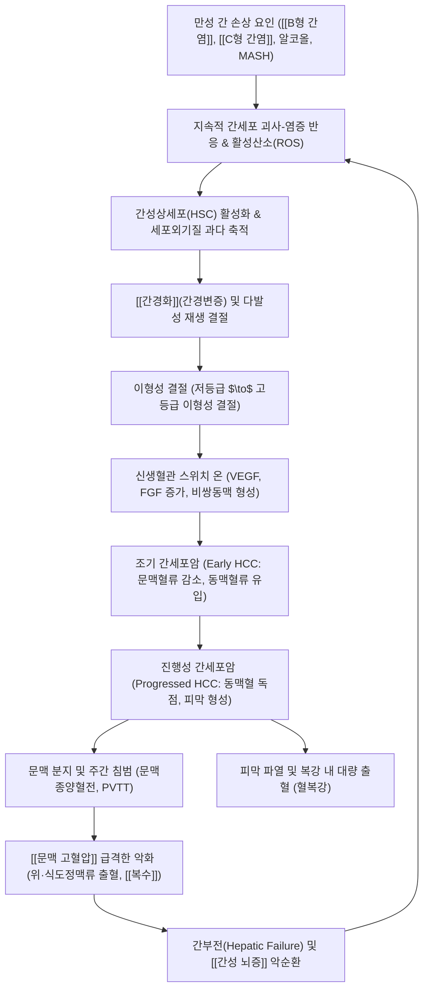

# 🩺 [[원발성 간암]] (Primary Liver Cancer / 原發性 肝癌, ICD-10 C22.0)

> **핵심 3줄 요약 (Key Summary)**:
> - 📍 **병소 부위 & 해부·병태생리**: 간실질 세포([[간세포암종]], HCC 85~90%) 및 간내 담관상피세포([[간내담관암]], ICC 10~15%)에서 기원하는 악성 종양으로, [[만성 간염]]([[B형 간염]]·[[C형 간염]])과 [[간경화]](간경변증), [[지방간]](MASH/대사성 간질환)에 의한 지속적 간세포 괴사·재생 결절 형성 및 신생혈관(비정상 간동맥혈류 지배, Neoarterialization) 형성의 악순환.
> - 🚩 **전형적 임상 양상 & 3대 징후**: 초기 완전 무증상 또는 비특이적 피로감·상복부 불쾌감, 진행 시 우상복부 둔통 및 단단하고 불규칙한 결절성 간종괴 촉지, 원인 미상의 급격한 [[체중 감소]] 및 기존 간질환의 급성 대상부전([[황달]], [[복수]], [[간성 뇌증]]).
> - 🛠️ **핵심 감별 검사 & 한·양방 다각적 치료 전략**: 고위험군 6개월 주기 복부 초음파 + 혈청 [[알파태아단백]](AFP) 및 [[PIVKA-II]] 선별, 4기 다중 동적 CT/MRI(동맥기 조영증강 및 문맥·지연기 씻김 현상 Washout) 진단, BCLC 병기에 따른 간절제술·간이식·국소열소작술(RFA)·경동맥화학색전술(TACE)·전신 면역표적치료, 한의 통합 치료([[소간활혈]], [[연견산결]], [[청열해독]], 암성 피로 개선 및 항암 부작용 완화).
> - <font color="#fa7e7e">⚠️ **응급 의뢰 레드플래그 & 악화 요인**: 종양 파열(Tumor Rupture)에 따른 돌발성 격통·혈복강 및 저혈량성 쇼크, 급성 식도정맥류 파열 대량 출혈, 문맥 주간 침범(PVTT)에 따른 급성 간부전 및 간성 혼수.</font>

---

## 📌 목차
1. [질환 개요 & 병태생리 (Disease Overview)](#1-질환-개요--병태생리-disease-overview)
2. [병태생리 메커니즘 & 대사·장기부전 악순환 네트워크](#2-병태생리-메커니즘--대사장기부전-악순환-네트워크)
3. [임상 증상 & 환자 소견 (Clinical Presentation)](#3-임상-증상--환자-소견-clinical-presentation)
4. [감별 진단 매트릭스 (Differential Diagnosis)](#4-감별-진단-매트릭스-differential-diagnosis)
5. [한의 통합 치료 프로토콜 (침·약침·한약)](#5-한의-통합-치료-프로토콜-침약침한약)
6. [양방 치료 & 병용·의뢰 기준 (Conventional Treatment & Referral)](#6-양방-치료--병용의뢰-기준-conventional-treatment--referral)
7. [식이·생활습관 & 자가관리 티칭 가이드](#7-식이생활습관--자가관리-티칭-가이드)
8. [💡 진료실 핵심 필기 & 임상 노하우](#8--진료실-핵심-필기--임상-노하우)
9. [출처 및 학술 참고 문헌 (References)](#9-출처-및-학술-참고-문헌-references)

---

## 1. 질환 개요 & 병태생리 (Disease Overview)

* **질환 정의 및 개요**:
  * **원발성 간암(Primary Liver Cancer)** 은 타 장기로부터 전이된 이차성 간암과 달리, 간 자체를 구성하는 실질 세포나 간내 담관 상피세포에서 원발성으로 발생하는 악성 신생물을 통칭한다.
  * 전체 원발성 간암 중 **[[간세포암종]](Hepatocellular Carcinoma, HCC)** 이 85~90%로 압도적 다수를 차지하며, 그 외 간내 담관 상피에서 기원하는 **[[간내담관암]](Intrahepatic Cholangiocarcinoma, ICC)** 이 10~15%, 기타 드문 형태인 복합 간세포-담관암종(Combined HCC-ICC), 간모세포종(Hepatoblastoma, 소아 호발), 간혈관육종(Hepatic Angiosarcoma) 등이 포함된다.
  * 간세포암종은 전 세계 암 관련 사망 원인 3~4위를 차지하는 치명적인 악성 종양이며, 대한민국을 포함한 동아시아 지역에서는 만성 B형 간염 바이러스 감염과 높은 간경변증 유병률로 인해 발생률과 사망률이 매우 높다.

* **역학 및 주요 병인적 위험인자**:
  * **[[B형 간염]] 바이러스(HBV)**: 국내 간세포암종 환자의 약 60~70%에서 원인 인자로 작용한다. HBV는 DNA 바이러스로서 숙주 간세포 게놈에 직접 삽입되어 유전체 불안정성을 유발하므로, 간경변증으로의 진행 없이 만성 간염 단계에서도 직접 간암을 발병시킬 수 있는 독특한 특성을 가진다.
  * **[[C형 간염]] 바이러스(HCV)**: 국내 환자의 약 10~15%를 차지하며, RNA 바이러스로서 직접적인 게놈 삽입은 없으나 만성 괴사-염증 반응과 광범위한 간섬유화를 거쳐 거의 대부분 [[간경화]]가 확립된 이후에 간암으로 이행한다.
  * **[[알코올성 간질환]]**: 만성 과다 음주(일 40~60g 이상 장기 음주)는 알코올 대사산물인 아세트알데하이드의 직접적 세포독성과 산화 스트레스를 유발하여 간경변증을 촉발하고 암 발생 위험을 수배 이상 증가시킨다.
  * **대사이상 관련 지방간염(MASH / NASH)**: 비만, 제2형 [[당뇨병]], 이상지질혈증에 수반되는 만성 대사성 염증으로, 최근 항바이러스제 보급으로 바이러스성 간염이 조절됨에 따라 간세포암종의 가장 가파르게 증가하는 신흥 원인군으로 부각되고 있다.
  * **기타 화학적 발암원**: 곰팡이 독소인 아플라톡신 B1(Aflatoxin B1, 오염된 땅콩·곡류에 함유, TP53 249번 코돈 돌연변이 유발), 유전성 혈색소증(Hemochromatosis), 윌슨병(Wilson's disease), 자가면역성 간염.

* **관련 해부학적 구조와 혈류 공급의 역전 (Dual Blood Supply Shifting)**:
  * **정상 간실질의 이중 혈류 공급**: 정상 간세포는 소화관에서 흡수된 영양분을 운반하는 [[간문맥]](Portal Vein)으로부터 총 혈류량의 70~80%, 풍부한 산소를 공급하는 [[간동맥]](Hepatic Artery)으로부터 20~30%의 혈류를 공급받는 독특한 이중 순환계를 형성한다.
  * **종양성 신생혈관 형성과 동맥 혈류 독점(Neoarterialization)**: 정상 간조직이 만성 염증과 이형성 과정을 거쳐 악성 간세포암종으로 전환되면, 기존의 문맥 분지와 정상 쿠퍼세포(Kupffer cells)가 파괴 및 소실된다. 종양세포가 강력한 혈관내피성장인자(VEGF)와 섬유아세포성장인자(bFGF)를 대량 분비하여 종양성 비쌍동맥(Unpaired arteries) 신생혈관망을 형성함으로써, 종양의 혈류 공급은 90~100% 간동맥에 의해 전적으로 지배받게 된다.
  * **진단 및 중재 시술의 병태생리학적 기초**: 이와 같은 혈류역학적 역전 현상은 조영 CT/MRI에서 나타나는 특징적인 '동맥기 조영증강(Arterial Phase Hyperenhancement, APHE)'과 '문맥·지연기 조영 씻김(Washout)' 현상의 물리적 기반이 되며, 간동맥을 선택적으로 카테터로 막아 항암제를 주입하는 경동맥화학색전술(TACE)의 기본 원리가 된다.
  * **간실질 구역 및 인접 신경 해부**:
    * 쿠이나드(Couinaud) 8개 간분절 체계를 기반으로 국소 수술 및 색전술 계획이 수립된다.
    * 간실질 자체는 통각 수용기가 없으나 간 표면을 감싸는 결합조직 피막인 [[글리손 간피막]](Glisson's capsule)은 척수신경 및 체성 감각신경의 지배를 받는다. 종양이 급격히 팽창하여 피막을 신장시키면 우상복부 둔통이 발생하며, 우측 횡격막 부근 병변은 [[횡격막신경]](Phrenic nerve, C3~C5)을 자극하여 우측 어깨 및 쇄골 상와 부위로 연관통을 방사한다.

---

## 2. 병태생리 메커니즘 & 대사·장기부전 악순환 네트워크

```
========================================================================================
                   [ 원발성 간세포암종(HCC) 다단계 발암 및 혈역학적 전환 병태생리 ]
========================================================================================

 [만성 손상 요인]  ──>  HBV DNA 삽입, HCV 산화 스트레스, 알코올 독성, MASH 지방독성
       │
       ▼
 [만성 간세포 괴사 및 재생] ──> 간세포 지속적 붕괴, 활성산소종(ROS) 폭발, 세포주기 교란
       │
       ▼
 [간성상세포(HSC) 활성화]  ──> TGF-β 분비, 교원질 과다 축적, 혈관 주위 모세혈관화(Capillarization)
       │
       ▼
 [간경변증 (간경화)]        ──> 광범위 섬유화 중격 형성, 혈류 저항 증가, [[문맥 고혈압]] 발생
       │
       ▼
 [이형성 결절 형성]        ──> 저등급 이형성 결절  ──>  고등급 이형성 결절 (High-Grade DN)
       │                      (문맥혈류 점진적 감소, 정상 쿠퍼세포 기능 점진적 상실)
       ▼
 [신생혈관 형성 (Angiogenesis)] ──> VEGF, bFGF, PDGF 발현 급증, 종양성 비쌍동맥(Unpaired artery) 증식
       │
       ▼
 [원발성 간세포암종 확립]  ──> 간동맥 혈류 90~100% 독점, 문맥혈류 소실 (CT: APHE & Washout)
       │
       ├─────────────────────────────────┬────────────────────────────────┐
       ▼                                 ▼                                ▼
 [간내 문맥혈전(PVTT)]          [종양 피막 파열(Rupture)]        [문맥압 항진 가속 & 간부전]
 문맥 주간 침범 및 폐·뼈 전이   혈복강 및 저혈량성 쇼크 발생      난치성 [[복수]], [[황달]], [[간성 뇌증]]
========================================================================================
```



### 1) 분자 및 유전체 수준의 다단계 발암 기전 (Multistep Hepatocarcinogenesis)
* **초기 돌연변이 사건 (TERT 프로모터 변이)**:
  * 간세포암종 발생의 가장 초기 단계에서 약 50~60%의 빈도로 텔로머레이스 역전사효소(TERT) 프로모터 영역의 체세포 돌연변이가 발생한다. 이는 노화된 간세포의 세포 분열 한계를 극복하고 무한 증식 능력을 부여하는 핵심 시발점이다.
* **종양 억제 유전자 결실 및 세포주기 이상**:
  * **TP53 변이**: 만성 염증, 알코올, 특히 아플라톡신 B1 노출군에서 30~40% 빈도로 발생하여 DNA 손상 복구와 세포자멸사(Apoptosis) 유도 기능을 마비시킨다.
  * **Wnt/β-catenin 신호전달계 변이**: CTNNB1 유전자 기능 획득 돌연변이(20~30%) 또는 AXIN1 불활성화 돌연변이가 동반되어 핵 내 β-catenin 축적과 하위 종양 촉진 유전자(Cyclin D1, c-Myc)의 과발현을 초래한다.
* **성장인자 수용체 및 신호전달 경로의 과잉 활성화**:
  * 수용체 티로신 키나아제(RTK) 경로인 VEGFR, FGFR, PDGFR, c-MET, EGFR의 과활성화는 세포 증식과 종양 혈관 신생을 촉진한다.
  * 하위의 RAS/RAF/MEK/ERK(MAPK) 경로 및 PI3K/AKT/mTOR 경로가 지속적으로 활성화되어 치료 저항성과 침습적 성장을 유도한다.

### 2) 간기능 저하와 문맥압 항진의 상호 증폭 악순환 (The Cirrhosis-HCC Vicious Cycle)
* **간실질 압박 및 문맥 침범**:
  * 종양이 직경 수 cm 이상으로 증대되면 주변 간실질을 압박하여 허혈성 위축을 일으키고, 종양세포가 간내 미세혈관 및 문맥 분지로 침윤하여 문맥종양혈전(Portal Vein Tumor Thrombosis, PVTT)을 형성한다.
  * 문맥 혈류의 폐색은 간내 혈류 저항을 폭발적으로 상승시켜 [[문맥 고혈압]]을 비가역적으로 악화시킨다.
* **혈역학적 합병증의 연쇄 폭발**:
  * 문맥압 상승은 비장 비대와 혈소판 파괴(비장기능항진증)를 유도하여 출혈 경향을 심화시키며, 측부 순환로인 [[식도정맥류]] 및 위정맥류를 팽창시켜 치명적인 대량 위장관 출혈을 유발한다.
  * 내장 혈관 확장과 유효 순환 혈장량 감소는 레닌-안지오텐신-알도스테론계(RAAS)를 과활성화시켜 수분과 염분의 저류, 불응성 [[복수]], 자발성 세균성 복막염(SBP), 간신증후군(Hepatorenal Syndrome)으로 이어지는 다발성 장기부전 연쇄를 형성한다.
* **치료 적용의 이중 딜레마(Double Jeopardy)**:
  * 간세포암종 치료의 가장 큰 난점은 암 자체의 악성도뿐만 아니라 동반된 기저 간경변증으로 인해 잔여 간기능(Child-Pugh 점수, ALBI 등급)이 취약하다는 점이다. 무리한 외과적 절제나 고용량 색전술은 치명적인 술후 간부전(Post-hepatectomy liver failure)을 초래할 수 있으므로, 종양의 크기·개수와 환자의 기저 간기능 보존 상태를 정밀하게 저울질해야 한다.

---

## 3. 임상 증상 & 환자 소견 (Clinical Presentation)

### 1) 주소증 및 질환 진행 단계별 임상 양상
* **무증상 잠복기 (초기~조기 병기)**:
  * 간 실질 내부에는 통각 신경이 분포하지 않아 종양 초기(직경 2~3cm 이하)에는 환자가 자각할 수 있는 신체적 이상 증상이 전혀 없다.
  * 대다수는 기존 만성 B형·C형 간염이나 간경변증으로 정기 감시 검사(초음파 및 종양표지자)를 받던 중 우연히 발견된다. 간혹 환자가 호소하는 가벼운 만성 피로감, 소화불량, 상복부 팽만감 등은 기저 만성 간질환의 일반적 증상과 구별되지 않는다.
* **진행기 전형 증상 (종양 팽창 및 침습기)**:
  * **우상복부 통증 (RUQ Dull Pain)**: 종괴가 증대되어 간의 외피막인 [[글리손 간피막]]을 신장시키거나 횡격막을 자극하면서 발생하는 묵직하고 뻐근한 지속적 둔통. 벽측 복막을 침범하면 날카롭고 국소화된 통증으로 전환된다.
  * **단단하고 불규칙한 복부 종괴 촉지**: 흡기 시 우측 늑골궁 하연에서 표면이 울퉁불퉁하고 돌처럼 단단하며 압통을 동반하는 간 하연 종괴가 손끝에 만져진다.
  * **급격한 대사성 악액질**: 특별한 식이 제한 없이도 6개월간 5~10% 이상의 비의도적 [[체중 감소]], 근감소증(Sarcopenia), 식욕 부진, 극심한 암성 무기력증.
* **급성 대상부전 증상 (Decompensation Triggers)**:
  * 안정적으로 조절되던 만성 간경변 환자에서 명확한 유발 요인(음주, 감염, 위장관 출혈) 없이 갑작스럽게 조절 불능의 [[복수]]가 차오르거나 하지 함요 부종이 심화된다.
  * 공막과 피부의 급격한 [[황달]](고빌리루빈혈증) 심화, 소변색의 흑갈색 변화.
  * 수면 패턴 역전, 손떨림(Asterixis, 자세유지불능증), 지남력 상실, 혼미 등 [[간성 뇌증]]의 급성 발현.
* **부종양 증후군 (Paraneoplastic Syndromes)**:
  * 간세포암종 세포가 비정상적인 호르몬 유사 펩타이드를 분비하여 발생한다.
  * **저혈당증(Hypoglycemia)**: 거대 종양의 과도한 포도당 소비 또는 IGF-II(인슐린유사성장인자-II) 유사 펩타이드 분비로 인해 아침 공복 시 식은땀, 진전, 의식 저하 유발.
  * **적혈구증가증(Erythrocytosis)**: 종양 조직의 에리스로포이에틴(EPO) 자율 분비로 혈색소 수치 이상 상승.
  * **고칼슘혈증(Hypercalcemia)**: 부갑상선호르몬 관련 단백(PTHrP) 분비로 인한 골흡수 촉진.
  * **고콜레스테롤혈증**: 간세포 내 정상 피드백 조절 기전 상실.

### 2) 객관적 신체 검진 및 진단 검사 수치 (Signs & Labs)
* **신체 진찰 (Physical Examination)**:
  * **시진**: 만성 간질환의 낙인인 거미상 혈관종(Spider angioma), 수장홍반(Palmar erythema), 여성형 유방(Gynecomastia), 복벽 정맥 노창(Caput medusae), 공막 황달.
  * **촉진**: 앙와위에서 양 무릎을 세우고 심호흡 시 우측 늑골하 2~3cm 이상 돌출되는 단단하고 결절성의 간연. 비장 비대 동반 확인.
  * **청진**: 종양 표면의 비정상적 신생혈관을 통과하는 난류로 인해 간 표면에서 동맥성 잡음(Arterial bruit) 또는 마찰음(Friction rub) 청진 가능.
* **혈청 생화학 검사 및 간기능 평가 지표**:
  * **간효소 수치**: AST, ALT의 불규칙한 상승, 담도 압박에 따른 ALP, GGT의 현저한 상승.
  * **단백합성 및 대사능**: 혈청 알부민(Albumin) 저하, 총 빌리루빈(Total Bilirubin) 상승, 프로트롬빈 시간(PT-INR) 연장.
  * **간기능 예비력 평가**: Child-Pugh Score (A: 5~6점, B: 7~9점, C: 10~15점) 및 ALBI Grade (Albumin-Bilirubin Score, 객관적 혈액 수치만으로 산출).
* **혈청 종양표지자 (Tumor Markers)**:
  * **[[알파태아단백]](Alpha-Fetoprotein, AFP)**:
    * 태생기 난황낭과 태아 간에서 합성되는 당단백질로, 성인 정상치는 10~20 ng/mL 미만이다.
    * 20 ng/mL 이상 시 감시 주의, 200 ng/mL 초과 시 특이도가 90% 이상으로 급상승하며, 400 ng/mL 이상이면 간경변 배경 환자에서 간세포암종의 가능성이 극히 높다. 단, 조기 간암의 약 30~40%는 AFP 음성을 보이므로 선별 검사 시 초음파와의 병행이 필수적이다.
  * **[[PIVKA-II]](Protein Induced by Vitamin K Absence or Antagonist-II / Des-gamma-carboxy prothrombin, DCP)**:
    * 비타민 K 결핍 또는 간암세포의 카르복실화 장애로 생성되는 비정상 프로트롬빈이다.
    * 40 mAU/mL 이상 시 양성으로 판정하며, AFP와 상관관계가 낮아 상호 보완적 진단 가치를 가진다. 특히 미세혈관 침범(Microvascular invasion) 및 문맥종양혈전 형성의 강력한 예측 지표로 활용된다.
* **영상의학적 진단 기준 및 LI-RADS 체계**:
  * **고위험군 선별 검사**: 간경변증 환자, 40세 이상 만성 B형 간염, 만성 C형 간염 환자는 **6개월 간격 복부 초음파 + 혈청 AFP** 검사를 평생 의무적으로 시행한다.
  * **동적 조영 CT / MRI 진단 기준**:
    * **동맥기(Arterial Phase)**: 신생 동맥혈관망으로 인해 종괴가 주변 정상 간실질보다 현저히 밝게 조영 증강된다 (Non-rim arterial phase hyperenhancement, APHE).
    * **문맥기 및 지연기(Portal Venous & Delayed Phases)**: 조영제가 급속히 빠져나가면서 주변 간조직보다 어둡게 관찰되는 조영 씻김(Washout) 소견 및 지연기 피막 조영증강(Enhancing capsule) 관찰.
  * **LI-RADS (Liver Imaging Reporting and Data System)**:
    * 고위험군에서 간세포암종의 진단 확률을 LR-1(명백한 양성)부터 LR-5(확실한 간세포암종), LR-M(비간세포암성 악성 종양), LR-TIV(혈관 내 종양혈전)로 표준화하여 분류한다. LR-5 병변은 조직검사 없이도 임상적 간세포암종으로 확진하고 근치적 치료를 시행한다.

---

## 4. 감별 진단 매트릭스 (Differential Diagnosis)

| 감별 질환 | 호발 배경 및 원인 | 주소증 및 임상적 차이점 | 동적 영상의학 소견 (CT/MRI) | 종양표지자 및 혈액 소견 |
| :--- | :--- | :--- | :--- | :--- |
| **[[원발성 간암]]<br>(간세포암종, HCC)** | 만성 B/C형 간염, 간경변증, MASH, 알코올성 | 우상복부 둔통, 체중 감소, 간비대, 기존 간질환의 급성 대상부전 | **동맥기 조영증강(APHE) + 문맥/지연기 조영 씻김(Washout)**, 피막 증강 | **[[알파태아단백]](AFP) 및 [[PIVKA-II]] 급상승**, 간기능 수치 이상 |
| **[[간내담관암]]<br>(ICC)** | 간흡충증, 담석증, 담도낭종, 원발성 경화성 담관염 | 무통성 황달, 둔통, 식욕 부진, 체중 감소, 간경변 배경 빈도 낮음 | 동맥기 변연부 조영증강 후 **지연기 중심부 점진적 조영증강(Delayed central enhancement)**, 간피막 견인 | AFP 대개 정상, **CA19-9 및 CEA 현저한 상승** |
| **[[간농양]]<br>(화농성/아메바성)** | 담도계 감염, 당뇨병, 면역저하, 복강내 패혈증 | **39℃ 이상의 고열, 오한, 극심한 우상복부 타통**, 식욕부진 | 조영증강되지 않는 저음영 낭성 병변, **이중 표적 징후(Double target sign)**, 벽 비후 | **백혈구(WBC) 및 CRP/ESR 폭발적 상승**, 혈액 배양 양성 |
| **[[간혈관종]]<br>(Hemangioma)** | 선천성 모세혈관 기형, 가장 흔한 양성 종양 | 대다수 완전 무증상, 거대화 시에만 경미한 압박감 | 동맥기 **변연부 결절성 조영증강(Peripheral nodular) $\to$ 중심부 점진적 충만(Centripetal fill-in)** | 종양표지자 정상, 혈액검사 및 간기능 정상 |
| **[[간전이암]]<br>(Metastatic Liver Cancer)** | 대장암, 위암, 췌장암, 유방암, 폐암 등 타 장기 | 원발암 증상(배변습관 변화, 소화불량, 혈변), 다발성 결절 | 다발성 저음영 결절, 전형적인 **과녁 징후(Target sign / Bull's eye)**, 림프절 비대 | 원발암 표지자 상승(대장암: CEA, 췌장암: CA19-9) |
| **[[간낭종]]<br>(단순 간낭종)** | 선천성 담관 발달 이상, 배아기 잔유물 | 95% 이상 완전 무증상, 통증 없음 (거대화 시 상복부 팽만) | 초음파상 **완전 무에코(Anechoic), 매끄럽고 얇은 벽, 후방음향증강**, 조영증강 없음 | 모든 종양표지자 및 혈액 간효소 정상치 유지 |
| **국소결절과증식<br>(FNH)** | 비정상적 혈관 기형에 대한 간세포의 과형성 반응 | 젊은 여성 호발, 대다수 무증상 | 동맥기 강력한 균일 조영증강, **중심부 성상 반흔(Central stellate scar)의 지연기 조영증강** | 종양표지자 정상, 악성화 가능성 없음 |

> <font color="#fa7e7e">🚩 **원발성 간암 레드플래그 감별 (즉각 응급 의뢰)**:
> 1. **간암 파열(Spontaneous HCC Rupture)**: 거대 외장성 종괴가 피막을 뚫고 복강 내로 파열 시 환자는 칼로 찌르는 듯한 극심한 우상복부 통증, 복부 팽만, 식은땀, 청색증, 수축기 혈압 90mmHg 이하의 저혈량성 쇼크에 빠진다. (사망률 30~50%의 초응급)
> 2. **식도정맥류 대량 출혈(Variceal Bleeding)**: 문맥종양혈전(PVTT)으로 문맥압이 폭증하면서 식도 및 위 분문부 정맥류가 파열되어 선홍색 토혈(Hematemesis), 흑색변(Melena), 대량 혈변을 유발한다.
> 3. **급성 간부전 및 간성 혼수(Fulminant Decompensation)**: 혈청 빌리루빈 급상승, 고암모니아혈증, 뇌부종, 심한 지남력 상실 및 혼수 유발.</font>

---

## 5. 한의 통합 치료 프로토콜 (침·약침·한약)

* **한의 치료의 기본 원칙**:
  * 한의학에서 원발성 간암은 징하(癥瘕), 적취(積聚), 간적(肝積), 협통(脇痛), 황달(黃疸), 고창(鼓脹)의 범주에 속한다.
  * 질환의 기본 병기는 **본허표실(本虛標實)** 로, 정기 부족(간신음허, 비신양허)을 바탕(本)으로 하여 기체(氣滯), 어혈(瘀血), 습열(濕熱), 열독(熱毒)의 사기(邪氣)가 간락(肝絡)에 엉겨 단단한 종괴(實)를 형성한 것으로 파악한다.
  * 따라서 치료는 초기 종괴 위주 단계에서는 **소간활혈(疏肝活血)·연견산결(軟堅散結)·청열해독(淸熱解毒)** 으로 사기를 꺾고, 중·후기 및 양방 항암·색전술 병행 단계에서는 **부정배본(扶正培本)·건비보신(健脾補腎)·익기양음(益氣養陰)** 을 위주로 하여 면역 기능을 보존하고 삶의 질을 개선한다.

### 1) 변증 분류 및 한약 치료 프로토콜 (Herbal Medicine)

* **1. 기체혈어형 (氣滯血瘀型) — 초기 및 종괴 형성기**:
  * **주요 증상**: 우측 협하부의 찌르는 듯한 고정성 둔통, 밤에 심해지는 야간통, 단단하고 불규칙한 종괴 촉지, 흉협 팽만감, 피부 건조, 설질 암홍색 또는 반점(어반), 맥 현삽(弦澁).
  * **치법**: 행기활혈(行氣活血), 연견소적(軟堅消積), 화어산결(化瘀散結).
  * **대표 처방**: [[별갑전환]](鱉甲煎丸) 합 [[복원활혈탕]](復元活血湯) 가감.
  * **주요 구성 약재 및 배오 원리**:
    * [[별갑]](鱉甲, 15~30g): 초별갑을 사용하여 입간경(入肝經), 자음잠양(滋陰潛陽)하며 굳어진 징하 덩어리를 부드럽게 푸는 연견산결의 군약(君藥).
    * [[단삼]](丹參, 15g) · [[적작약]](赤芍藥, 10g): 활혈거어(活血祛瘀)하여 간내 미세순환을 개선하고 섬유화를 억제.
    * [[아출]](莪朮, 10g) · [[삼릉]](三稜, 10g): 강력한 파혈소적(破血消積), 행기지통(行氣止痛) 효능으로 종괴의 성장을 저지.
    * [[시호]](柴胡, 8g) · [[향부자]](香附子, 8g): 소간해울(疏肝解鬱)하여 기기를 소통시키고 협하부 장력을 완화.
    * [[백화사설초]](白花蛇舌草, 30g) · [[반변련]](半邊蓮, 15g): 청열해독, 종양세포 증식 억제.

* **2. 습열온결형 (濕熱蘊結型) — 담즙 정체, 황달 및 간수치 급상승기**:
  * **주요 증상**: 안구 및 피부의 선명한 [[황달]], 우상복부 팽만통, 발열 또는 신열 번조, 구갈(갈증이 있으나 물을 많이 마시지 않음), 오심 구토, 구고(입안이 씀), 소변 단적(진한 갈색뇨), 대변 비결 또는 끈적함, 설홍 태황니(黃膩), 맥 현삭(弦數) 또는 활삭(滑數).
  * **치법**: 청열이습(淸熱利濕), 이담퇴황(利膽退黃), 해독소종(解毒消腫).
  * **대표 처방**: [[인진호탕]](茵蔯蒿湯) 합 [[생간건비탕]](茵蔯生肝健脾湯) 가감.
  * **주요 구성 약재 및 배오 원리**:
    * [[인진호]](茵蔯蒿, 20~30g): 이담퇴황의 요약으로 담즙 분비를 촉진하고 빌리루빈 배설을 유도.
    * [[치자]](梔子, 10g) · [[대황]](大黃, 6g): 삼초의 습열을 소변과 대변으로 사하(瀉下)하여 전신 염증 반응을 진정.
    * [[황금]](黃芩, 10g) · [[용담초]](龍膽草, 6g): 청간담실화(淸肝膽實火), 간세포 괴사 및 효소 수치 상승 억제.
    * [[백화사설초]](白花蛇舌草, 30g): 열독(熱毒)을 제거하여 간암세포의 침습을 억제.

* **3. 간신음허형 (肝腎陰虛型) — 항암·색전술 후 진액 고갈 및 허열기**:
  * **주요 증상**: 우협부의 은은한 통증, 신형 소수(극심한 수척), 골증조열(오후 미열), 오심번열(손발바닥 열감), 도한(도둑땀), 구건인조, 어지럼증, 이명, 불면, 설홍 소태(무태 또는 박황), 맥 세삭(細數).
  * **치법**: 자보간신(滋補肝腎), 양음청열(養陰淸熱), 유간지통(柔肝止痛).
  * **대표 처방**: [[일관전]](一貫煎) 합 [[자음강화탕]](滋陰降火湯) 가감.
  * **주요 구성 약재 및 배오 원리**:
    * [[생지황]](生地黃, 15g) · [[북사삼]](北沙參, 12g) · [[맥문동]](麥門冬, 12g): 자음생진(滋陰生津)하여 간음과 신수를 보충.
    * [[당귀]](當歸, 10g) · [[구기자]](枸杞子, 12g): 보혈양간(補血養肝)하여 손상된 간세포의 영양 대사를 지원.
    * [[천련자]](川楝子, 6g): 음허(陰虛)에 수반된 간기울결을 풀어주고 유간지통(柔肝止痛).
    * [[여정자]](女貞子, 10g) · [[한련초]](旱蓮草, 10g): 간신을 보하고 허열을 내리며 면역 세포 활성을 촉진.

* **4. 비신양허 및 기혈양허형 (脾腎陽虛 / 氣血兩虛型) — 말기 악액질 및 복수기**:
  * **주요 증상**: 극심한 전신 쇠약, 안색 창백 또는 위황, 복창 비만, 묽은 변 또는 설사, 사지 냉감 및 부종, 식욕 전무, 자한, 호흡 단촉, 설담 체반 치흔, 맥 침세무력(沈細無力).
  * **치법**: 온보비신(溫補脾腎), 보기생혈(益氣生血), 건비이수(健脾利水).
  * **대표 처방**: [[보중익기탕]](補中益氣湯) 합 [[향사육군자탕]](香砂六君子湯) 또는 [[실비음]](實脾飮) 가감.
  * **주요 구성 약재**: [[황기]](黃芪, 30g), [[인삼]](人參, 10g), [[백출]](白朮, 15g), [[복령]](茯苓, 15g), [[택사]](澤瀉, 10g), [[차전자]](車前子, 10g), [[포부자]](附子, 4g, 신중 투여).

### 2) 침구 치료 프로토콜 (Acupuncture)
* **선혈 원칙**: 소간해울(疏肝解鬱), 활혈화어(活血化瘀), 건비화위(健脾和胃), 진통완화.
* **주요 경혈 구성**:
  * **주혈**: [[기문(LR14)]](간의 모혈), [[태충(LR3)]](간경 원혈), [[간수(BL18)]](간 배수혈), [[담수(BL19)]], [[격수(BL17)]](혈회), [[비수(BL20)]], [[족삼리(ST36)]](위경 합혈), [[내관(PC6)]], [[합곡(LI4)]].
  * **변증 배혈**:
    * 복수 및 하지 부종 시: [[수분(CV9)]], [[음릉천(SP9)]], [[삼음교(SP6)]], [[복결(SP14)]].
    * 오심·구토 및 식욕 부진 시: [[중완(CV12)]], [[공손(SP4)]], [[내관(PC6)]].
    * 암성 통증 및 불면 시: [[신문(HT7)]], [[백회(GV20)]], [[양릉천(GB34)]].
* **자침 기법 및 전침 자극 파라미터**:
  * 사지 원위혈([[족삼리]]-[[태충]], [[내관]]-[[합곡]])은 직자(15~25mm)하여 득기(得氣) 후 2Hz 저주파 전침을 20분간 통전하여 엔도르핀 분비 촉진과 자율신경계 안정을 유도한다.
  * **절대적 자침 안전 수칙**: 우상복부 간 종괴 부위([[기문]], [[일월]], 우측 [[거궐]])는 종양 피막 손상 및 복강 내 대량 출혈(파열)을 야기할 수 있으므로 **깊은 직자(Deep needling)나 도침 치료를 절대 금기**하며, 얕은 횡자(피하 자침) 또는 사지 원위혈·배수혈 위주로만 시술한다.

### 3) 약침 치료 프로토콜 (Pharmacopuncture)
* **제제 선택**:
  * **[[산삼약침]]**: 원기 회복, 면역세포(NK cell, T lymphocyte) 활성화, 항암 화학요법 후 백혈구 감소증 개선 및 암성 피로 완화.
  * **[[황련해독탕]] 약침**: 급성 염증성 간효소 수치 상승 완화, 국소 청열해독.
* **주입 부위 및 용량**:
  * 배수혈인 [[간수(BL18)]], [[비수(BL20)]] 및 족양명위경의 [[족삼리(ST36)]]에 1회당 0.1~0.2cc씩 총 0.5~1.0cc를 주입한다. (복부 종양 부위 직접 주입 금기).

---

## 6. 양방 치료 & 병용·의뢰 기준 (Conventional Treatment & Referral)

### 1) BCLC 병기 체계에 따른 양방 표준 치료 알고리즘
국제 표준 가이드라인인 바르셀로나 병기 체계(BCLC Staging System, 2022 업데이트 반영)에 따라 종양의 크기, 결절 수, 혈관 침범 유무, 기저 간기능(Child-Pugh), 전신 수행능력(ECOG PS)을 종합하여 치료 방침을 결정한다.

```
========================================================================================
             [ BCLC 병기별 원발성 간세포암종 표준 양방 치료 알고리즘 ]
========================================================================================

  [ BCLC 0기 (극초기) ] ──> 단일 종양 < 2cm, Child-Pugh A, PS 0
        │                  └─> 수술적 간절제술(Resection) 또는 국소열소작술(RFA)
        ▼
  [ BCLC A기 (초기) ]   ──> 단일 종양 또는 3개 이하(모두 < 3cm), Child-Pugh A-B, PS 0
        │                  ├─> 정상 문맥압/빌리루빈: 수술적 간절제술
        │                  ├─> Milan 기준 충족: 간이식 (Liver Transplantation)
        │                  └─> 동반 질환 고령: 경피적 고주파 열치료(RFA) / 극초단파(MWA)
        ▼
  [ BCLC B기 (중간기) ] ──> 다발성(Multinodular), 혈관 침범 없음, Child-Pugh A-B, PS 0
        │                  ├─> 표준 치료: 경동맥 화학색전술 (cTACE / DEB-TACE)
        │                  └─> 광범위 병변: 경동맥 방사선색전술 (TARE, Yttrium-90)
        ▼
  [ BCLC C기 (진행기) ] ──> 문맥 침범(PVTT) 또는 간외 전이(Mets), ECOG PS 1-2
        │                  ├─> 1차 전신요법: 아테졸리주맙 + 베바시주맙 (Atezo + Bev)
        │                  │                 또는 더발루맙 + 트레멜리무맙 (Durva + Treme)
        │                  │                 또는 렌바티닙 (Lenvatinib) / 소라페닙 (Sorafenib)
        │                  └─> 2차 전신요법: 레고라페닙, 카보잔티닙, 라무시루맙
        ▼
  [ BCLC D기 (말기) ]   ──> Child-Pugh C (말기 간경변), ECOG PS 3-4 (간이식 대상 제외 시)
                           └─> 최적 완화 지지의료 (Best Supportive Care)
========================================================================================
```

* **1. 수술적 간절제술 (Surgical Resection)**:
  * **적응증**: 단일 종괴, 간외 전이 및 주요 혈관 침범 없음, 보존된 잔여 간기능(Child-Pugh A, 정상 빌리루빈, 문맥압 항진증 없음: 간정맥압력구배 HVPG < 10mmHg, 혈소판 > 10만/uL, 인도시안 그린 ICG-R15 < 10~14%).
  * **예후**: 5년 생존율 60~70%로 우수하나, 기저 간경변으로 인해 5년 내 간내 재발률이 50~70%에 달함.
* **2. 간이식 (Liver Transplantation, LT)**:
  * **의의**: 종양 자체뿐만 아니라 암을 유발하는 기저 병변인 간경변증을 동시에 근치시키는 가장 이상적인 치료법.
  * **밀라노 기준(Milan Criteria)**: 단일 종괴 직경 ≤ 5cm, 또는 다발성일 경우 3개 이하이며 각각 직경 ≤ 3cm, 대혈관 침범 및 간외 전이 없음. 밀라노 기준 충족 시 간이식 후 5년 생존율 75% 이상, 재발률 15% 미만.
* **3. 국소 열소작술 (Locoregional Ablation)**:
  * **경피적 고주파 열치료(RFA)** 및 **극초단파 소작술(MWA)**:
  * **적응증**: 3cm 이하의 단일 또는 3개 이하의 소간암에서 수술이 불가능하거나 환자가 거부할 때. 2cm 이하의 극초기 간암에서는 수술적 절제와 동등한 생존율을 보임.
* **4. 경동맥 화학색전술 (Transarterial Chemoembolization, TACE)**:
  * **원리**: 정상 간실질은 문맥혈(75%)을 받고 종양은 간동맥혈(90% 이상)을 받는 혈류역학적 차이를 이용. 간동맥 분지에 카테터를 삽입하여 항암제(독소루비신 또는 시스플라틴)와 리피오돌(Lipiodol) 에멀전을 주입한 후 젤라틴 스펀지 분말로 혈관을 색전하여 종양의 허혈성 괴사를 유도.
  * **적용**: BCLC B기 중간기 간암의 표준 치료법.
* **5. 전신 표적 및 면역항암치료 (Systemic Therapy)**:
  * **1차 전신 표준 치료**:
    * **[[아테졸리주맙]](Atezolizumab, 항-PD-L1) + [[베바시주맙]](Bevacizumab, 항-VEGF)** 병용요법: IMbrave150 임상 3상에서 기존 표준 표적치료제 대비 전반적 생존율(OS)과 무진행 생존율(PFS)을 유의하게 연장시켜 글로벌 1차 표준 치료로 확립됨. (단, 베바시주맙에 의한 위장관 출혈 위험으로 투약 전 반드시 내시경으로 식도정맥류 검사 및 결찰술 선행 필수).
    * **[[더발루맙]](Durvalumab, 항-PD-L1) + [[트레멜리무맙]](Tremelimumab, 항-CTLA-4)**: HIMALAYA 임상에서 단회 고용량 CTLA-4 항체 투여와 지속적 PD-L1 항체 병용(STRIDE 요법)으로 우수한 생존율 입증.
    * **[[렌바티닙]](Lenvatinib) 및 [[소라페닙]](Sorafenib)**: 다중 수용체 티로신 키나아제 억제제(TKI)로, 면역항암제 금기 환자(자가면역질환 등)에서 1차 치료제로 투여.

### 2) 한의학적 병용 판단 및 상호작용 (Combination Therapy)
* **TACE 후 증후군(Post-TACE Syndrome)의 한의 복합 관리**:
  * 색전술 후 종양 조직의 급격한 괴사로 인해 60~80%의 환자가 일시적인 고열, 우상복부 산통, 오심, 구토, 무기력, AST/ALT의 급격한 상승을 경험한다.
  * 이때 [[생간건비탕]] 합 [[곽향정기산]] 또는 [[소시호탕]] 가감방을 병용 투여하고, 원위혈 침구 치료([[족삼리]], [[내관]])를 시행하면 항암색전술 후 염증성 사이토카인 폭풍을 진정시키고 소화기 부작용을 신속히 완화한다.
* **항암 표적/면역치료 병용 시 주의사항**:
  * **출혈 경향 감시**: 베바시주맙(VEGF 억제제)이나 티로신 키나아제 억제제 투여 중에는 혈관 내피 손상으로 출혈 위험이 증가하므로, 한약 투여 시 강력한 파혈거어제([[아출]], [[삼릉]], [[수질]])의 과량 장기 투여를 제한하고 지혈 및 혈관벽 보호 효과가 있는 [[삼칠근]](三七根), [[단삼]] 위주로 안전하게 배오한다.
  * **간독성 회피**: 간대사 효소(CYP3A4) 경쟁을 유발할 수 있는 불분명한 민간 건강기능식품(농축 상황버섯즙, 붕어즙, 엑기스 등)을 철저히 배제하고, 안전성이 검증된 표준 규격 한약재만을 원내 조제 처방한다.

### 3) 양방 전문과 및 상급병원 전원·응급 의뢰 기준 (Referral Criteria)
* **즉각적 119 응급 이송 기준 (Emergency Red Flags)**:
  * 우상복부의 돌발성 격통과 함께 식은땀, 안색 창백, 청색증, 수축기 혈압 90mmHg 이하 급락: **종양 파열에 의한 복강 내 출혈(혈복강)** 의심.
  * 대량의 선홍색 피를 토하거나(토혈) 짜장면 색깔의 흑색변(혈변)을 보이며 어지럼증을 호소: **식도정맥류 파열 출혈** 의심.
  * 수면 패턴이 완전히 바뀌고, 횡설수설하며 손을 떨거나 의식을 잃음: **급성 [[간성 뇌증]] 및 간성 혼수** 의심.
* **외래 정밀 검사 및 상급병원 소화기내과/간담췌외과 의뢰 기준**:
  * 만성 B형·C형 간염 또는 간경변 환자에서 복부 초음파상 신규 간내 결절(≥ 1cm)이 최초 발견된 경우.
  * 혈청 [[알파태아단백]](AFP) 수치가 기저치 대비 지속 상승하거나 200 ng/mL를 초과한 경우.
  * 원인 불명의 급격한 체중 감소와 함께 간비대가 촉지되는 경우.

---

## 7. 식이·생활습관 & 자가관리 티칭 가이드

* **식이 요법 (Dietary Management)**:
  * **단백질 섭취 원칙**: 간경변 및 간암 환자는 만성적인 단백질 이화작용으로 근감소증(Sarcopenia)에 빠지기 쉽다. 간성 뇌증의 급성 징후가 없는 한, 체중당 1.2~1.5g의 충분한 단백질을 매일 섭취해야 한다. 특히 분지쇄아미노산(BCAA: 류신, 이소류신, 발린)이 풍부한 식물성 콩류, 두부, 저지방 가금류, 달걀, 생선 위주의 단백질을 권장한다.
  * **저염식 원칙**: 복수나 하지 부종이 동반된 환자는 일일 소금 섭취량을 5g(나트륨 2,000mg) 이하로 철저히 제한한다. 찌개 국물, 젓갈, 장아찌, 가공식품 섭취를 금한다.
  * **절대 금주**: 소량의 알코올이라도 이미 손상된 간세포의 DNA 복구를 차단하고 종양 성장을 촉진하므로 한 방울의 음주도 엄격히 금한다.
  * **발암 독소 및 오염 식품 회피**: 곰팡이가 피거나 부패한 견과류(땅콩, 옥수수 등)는 강력한 간발암물질인 아플라톡신(Aflatoxin B1)을 함유하므로 절대 섭취하지 않는다. 날 생선 및 어패류(비브리오 패혈증 위험)는 피하고 충분히 익힌 음식만 섭취한다.

* **생활습관 및 운동 티칭 (Lifestyle & Exercise)**:
  * **가벼운 유산소 운동**: 하루 20~30분간 평지 걷기, 맨손 체조 등 저강도 유산소 운동으로 근육량을 보존하고 암성 피로를 극복한다.
  * **복압 급상승 운동 엄격 금지**: 거대 종양이 있는 환자가 무거운 물건을 들거나, 윗몸일으키기, 복부를 강하게 압박하는 웨이트 트레이닝을 시행할 경우 종양 피막이 파열될 위험이 있으므로 엄격히 금지한다.
  * **충분한 수면과 휴식**: 간 혈류량은 앙와위(누운 자세)에서 가장 풍부해지므로, 식후 30분간 편안히 누워 휴식을 취하고 매일 7~8시간의 규칙적인 수면을 유지한다.

* **자가 모니터링 (Self-Monitoring)**:
  * **체중 및 복위(복부 둘레) 매일 측정**: 매일 아침 배뇨 후 공복 상태에서 체중과 배꼽 높이의 복부 둘레를 측정하여 기록한다. 1주일에 2kg 이상의 급격한 체중 증가는 복수 저류의 신호이다.
  * **대변 색상 관찰**: 대변이 자장면처럼 검거나(흑색변), 붉은 피가 섞여 나오는지 매일 아침 대변 색상을 확인한다.
  * **지남력 및 수면 자가 점검**: 밤낮이 바뀌거나 손끝이 미세하게 떨리는지 가족과 함께 매일 체크한다.

* **환자 교육 상담 스크립트**:
  > "원발성 간암은 '침묵의 장기'인 간에서 발생하기 때문에 초기에는 증상이 전혀 없다가 병이 상당히 진행된 뒤에야 발견되는 경우가 많습니다. 이미 간암으로 진단받으셨더라도, 현대의학의 발전으로 조기 절제술, 간이식, 색전술뿐만 아니라 최신 면역항암치료까지 병기에 맞춘 다양한 무기가 준비되어 있습니다. 한의원에서는 몸의 기력을 보강하고, 항암 및 색전술 치료 후 발생하는 피로와 소화기 부작용을 완화하며, 종양의 성장을 억제하는 통합 치료를 통해 환자분의 간기능과 삶의 질을 지켜드릴 것입니다. 복부에 강한 힘을 주는 행동을 피하시고, 절대 술을 입에 대지 마시며, 처방해 드리는 안전한 규격 한약 외에 검증되지 않은 즙이나 민간요법은 절대로 드시지 마십시오."

* **정기 추적 검사 일정**:
  * 완치 목적 치료(간절제술, RFA) 후: 최초 2년간 2~3개월 간격으로 복부 동적 CT/MRI 및 혈청 종양표지자(AFP, PIVKA-II), 간기능 검사를 시행하고, 이후 5년까지 4~6개월 간격으로 정기 모니터링을 지속한다.

---

## 8. 💡 진료실 핵심 필기 & 임상 노하우

* **1차 한의 진료실 내원 간암 환자의 3대 임상 유형별 진료 전략**:
  * **유형 1: 건강검진 후 결절 의심으로 불안해하며 내원한 환자**:
    * 환자가 간수치 이상이나 복부 초음파상 1cm 미만의 결절 소견을 받고 한의원에 방문한 경우, 한약으로 혹을 없애주겠다고 섣불리 단정해서는 안 된다. 즉시 상급병원 소화기내과 동적 CT/MRI 정밀 검사를 받도록 전원 의뢰서를 작성하는 것이 환자를 살리는 길이다.
  * **유형 2: 수술 또는 TACE(색전술) 후 회복 및 재발 방지를 위해 내원한 환자**:
    * 간절제술이나 색전술 후 극심한 피로, 오심, 식욕부진, 간수치 상승을 호소하는 환자가 가장 흔하다. 이때는 사기를 공격하는 약재보다는 [[생간건비탕]]이나 [[보중익기탕]] 계열로 소화기를 살리고 기력을 북돋워 주며, 침 치료([[족삼리]], [[내관]])로 구역감을 잡아야 한다.
  * **유형 3: 진행기/말기로 전신 항암치료 중 또는 호스피스 완화 목적 환자**:
    * 면역항암제 병용 중인 환자는 면역 관련 이상반응(irAE)인 대장염, 간염, 피부발진 여부를 주기적으로 체크해야 한다. 암성 통증 완화를 위해 온열요법과 배수혈 침 치료를 적용하며 환자의 심리적 안정과 진통 관리에 집중한다.

* **복진(腹診) 및 진찰 시 절대 금기 사항**:
  * 우상복부에 단단한 종괴가 의심되거나 이미 간암으로 진단받은 환자의 우측 계륵부(기문, 일월 부위)를 손바닥으로 세게 누르는 강한 안복법(深按)이나 타진은 **종양 피막을 파열시켜 치명적인 복강 내 출혈(혈복강)을 야기할 수 있으므로 절대 엄금**한다.
  * 복진은 가볍게 표면을 스치는 경안(輕按) 위주로 시행하며, 우상복부에 직접적인 도침이나 장침 심자를 결코 시행해서는 안 된다.

* **혈청 종양표지자 판독의 실전 노하우**:
  * AFP는 간세포의 급격한 괴사와 재생 과정에서도 일시적으로 100~200 ng/mL까지 상승할 수 있다. 반면 [[PIVKA-II]]는 단순 간염에서는 거의 상승하지 않고 간세포암종에 매우 특이적이다. 따라서 두 수치의 동반 상승 여부를 반드시 확인해야 한다.
  * AFP가 정상 범위(20 이하)라도 초음파나 CT상 이상 결절이 보인다면 결코 간암을 배제해서는 안 되며, 환자의 약 30%는 AFP 비분비성 간암이다.

* **TACE 후 증후군 극복을 위한 비약물적 팁**:
  * 색전술 직후 오심과 구토가 극심할 때 얼음 조각을 입에 물리고 [[내관(PC6)]]에 이압요법(피내침 또는 지압)을 시행하면 연수의 화학수용체 유발대(CTZ)를 진정시켜 항구토제 단독 투여보다 훨씬 빠른 진정 효과를 얻을 수 있다.

---

## 9. 출처 및 학술 참고 문헌 (References)

1. **Park, L., Nezami, N., et al.** (2026). *Recent developments and prospects in locoregional therapy of hepatocellular carcinoma*. **Abdominal Radiology (New York)**, 51(11), 5385-5401. [PMID: 42089990](https://pubmed.ncbi.nlm.nih.gov/42089990/)
   - **[연구 요약]**: 간세포암종의 국소 치료술(경피적 고주파 열치료 RFA, 마이크로웨이브 소작술 MWA, 경동맥 화학색전술 TACE 및 방사선색전술 TARE)의 최신 발전 경향과 면역항암제 병용 요법의 임상적 유효성을 종합 분석한 종설.

2. Xie DY, et al. (2020). 2019 Chinese clinical guidelines for the management of hepatocellular carcinoma: updates and insights. *Hepatobiliary Surg Nutr*. [PMID: 32832496](https://pubmed.ncbi.nlm.nih.gov/32832496/)
   - **[연구 요약]**: 중국 간세포암종 임상 가이드라인 개정판으로, B형 간염 호발 지역에서의 조기 감시 시스템, 다학제적 치료 전략, 외과적 절제 및 현대적 한의 복합 제제의 병용 치료 권고안 제시.

3. **European Association for the Study of the Liver (EASL)** (2018). *EASL Clinical Practice Guidelines: Management of hepatocellular carcinoma*. **Journal of Hepatology**, 69(1), 182-236. [PMID: 29628281](https://pubmed.ncbi.nlm.nih.gov/29628281/)
   - **[연구 요약]**: 간세포암종의 고위험군 선별 검진 주기, 4기 다중 동적 조영 CT/MRI 기반 비침습적 진단 기준 및 BCLC 병기 체계에 따른 전 세계 표준 치료 지침.

4. **Singal, A. G., Llovet, J. M., Yarchoan, M., et al.** (2023). *AASLD Practice Guidance on prevention, diagnosis, and treatment of hepatocellular carcinoma*. **Hepatology**, 78(6), 1922-1965. [PMID: 37199193](https://pubmed.ncbi.nlm.nih.gov/37199193/)
   - **[연구 요약]**: 미국간학회(AASLD) 공식 임상 지침으로, 간세포암종의 분자 표적 치료제 및 아테졸리주맙+베바시주맙 등 면역관문억제제 기반 1차 전신 항암치료 알고리즘과 환자 관리 방안 수록.

5. **Llovet, J. M., Kelley, R. K., Villanueva, A., et al.** (2021). *Hepatocellular carcinoma*. **Nature Reviews Disease Primers**, 7(1), 6. [PMID: 33479224](https://pubmed.ncbi.nlm.nih.gov/33479224/)
   - **[연구 요약]**: 간세포암종의 분자유전학적 발암 기전, 종양 면역 미세환경, 신생혈관 형성과 약제 내성 메커니즘을 총망라한 최고 권위의 의학 총설.
