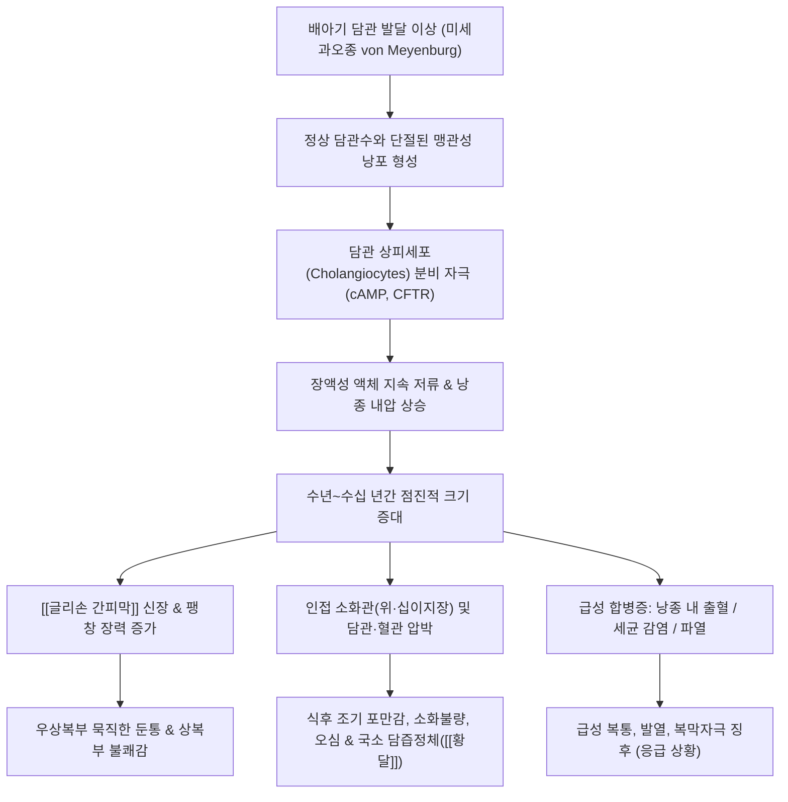

# 🩺 [[간낭종]] (Hepatic Cyst / 단순 간낭종 & 다낭성 간질환, ICD-10 K76.8)

> **핵심 3줄 요약 (Key Summary)**:
> - 📍 **병소 부위 & 해부·병태생리**: 배아기 간내 담관망 발달 이상(미세 담관의 맹관화 및 담관 미세과오종 von Meyenburg complexes 유래)으로 정상 담도계와 단절된 단층의 담관 상피세포(Cholangiocytes)가 cAMP 의존성 염화물 통로(CFTR)를 통해 무색 투명한 장액(Serous fluid)을 낭강 내로 지속 분비하여 형성되는 양성 비종양성 물혹 병변.
> - 🚩 **전형적 임상 양상 & 3대 징후**: 전체 환자의 85~95%는 평생 무증상(건강검진 복부 초음파상 우연히 발견)이나, 직경 5~10cm 이상의 거대 낭종(Giant Cyst) 또는 [[다낭성 간질환]](PLD)으로 진행 시 우상복부 둔통 및 불쾌감, 위장관 압박에 따른 식후 조기 포만감·소화불량, 간문부 주담관 압박에 의한 경도 [[황달]] 발현.
> - 🛠️ **핵심 감별 검사 & 한·양방 다각적 치료 전략**: 복부 초음파 3대 확진 소견(완전한 무에코 Anechoic, 얇고 매끄러운 벽, 후방 음향 증강 Posterior acoustic enhancement) 확인, 무증상 시 치료 불필요(안심 티칭 및 주기적 추적), 유증상 거대 낭종 시 경피적 에탄올/라우로마크로골 경화요법(Sclerotherapy) 또는 복강경하 낭종 천개절제술(Laparoscopic fenestration / Deroofing), 한의학적으로 징하(癥瘕)·적취(積聚)·담음(痰飮)으로 변증하여 [[계지복령환]], [[시호소간산]], [[이진탕]] 및 소담산결제([[모려]], [[와릉자]], [[하고초]]) 응용.
> - <font color="#fa7e7e">⚠️ **응급 의뢰 레드플래그 & 악화 요인**: 낭종벽 미세혈관 파열에 따른 낭종 내 출혈(Intracystic hemorrhage)로 인한 돌발성 격통, 세균 감염성 낭종 농양(고열, 오한, 압통), 초음파상 두꺼운 격벽(Septa)·내부 결절(Mural nodule) 관찰 시 악성화 잠재력을 지닌 점액성 낭성 종양(MCN) 감별을 위한 상급병원 외과 즉각 의뢰.</font>

---

## 📌 목차
1. [질환 개요 & 병태생리 (Disease Overview)](#1-질환-개요--병태생리-disease-overview)
2. [병태생리 메커니즘 & 대사·장기부전 악순환 네트워크](#2-병태생리-메커니즘--대사장기부전-악순환-네트워크)
3. [임상 증상 & 환자 소견 (Clinical Presentation)](#3-임상-증상--환자-소견-clinical-presentation)
4. [감별 진단 매트릭스 (Differential Diagnosis)](#4-감별-진단-매트릭스-differential-diagnosis)
5. [한의 통합 치료 프로토콜 (침·약침·한약)](#5-한의-통합-치료-프로토콜-침약침한약)
6. [양방 치료 & 병용·의뢰 기준 (Conventional Treatment & Referral)](#6-양방-치료--병용의뢰-기준-conventional-treatment--referral)
7. [식이·생활습관 & 자가관리 티칭 가이드](#7-식이생활습관--자가관리-티칭-가이드)
8. [💡 진료실 핵심 필기 & 임상 노하우](#8--진료실-핵심-필기--임상-노하우)
9. [출처 및 학술 참고 문헌 (References)](#9-출처-및-학술-참고-문헌-references)

---

## 1. 질환 개요 & 병태생리 (Disease Overview)

* **질환 정의 및 개요**:
  * **[[간낭종]](단순 간낭종, Simple Hepatic Cyst)** 은 간 실질 내부에 단층의 입방형(Cuboidal) 또는 원주형(Columnar) 담관 상피세포(Cholangiocytes)로 둘러싸인 주머니가 형성되고, 그 내강에 담즙 성분이 섞이지 않은 맑고 투명한 장액성 체액(Serous fluid)이 차 있는 대표적인 양성 비종양성 낭성 병변이다.
  * 한의학에서는 간 부위에 물혹이나 덩어리가 촉지되거나 팽만감을 일으키는 병증을 징하(癥瘕), 적취(積聚), 협하적(脅下積) 또는 비괴(痞塊)의 범주로 다룬다. 장부 기능의 실조로 인해 간기울결(肝氣鬱結)이 선행되고, 이로 인해 체내 진액이 병리적 산물인 담음(痰飮)으로 변성되어 국소 어혈(瘀血)과 상호 결합함으로써 간혈락(肝血絡)에 엉겨 낭포(囊胞)를 형성한 것으로 인식한다.

* **역학 및 발생 원인 분류**:
  * **단순 간낭종 (Simple Liver Cyst)**:
    * **선천성 발생 기원**: 태생기 배아 발달 과정에서 간내 담관망(Intrahepatic biliary tree)의 리모델링 부전으로 퇴화해야 할 미세 담관 잔유물(담관 미세과오종, von Meyenburg complex)이 주 담관망과 단절된 채 맹관(Blind pouch) 형태로 잔존하여 발생한다.
    * **유병률 및 호발군**: 현대 복부 초음파 및 조영 CT의 보편화로 건강검진 수검자의 약 5~18%에서 발견될 정도로 흔하다. 연령이 증가함에 따라 발생률과 크기가 증가하며, 여성 호르몬(에스트로겐)의 분비 촉진 영향으로 여성에서 남성보다 약 1.5~2배 호발한다. 대다수는 단발성이지만 2~3개 이상의 다발성 병변도 흔히 관찰된다.
  * **[[다낭성 간질환]](Polycystic Liver Disease, PLD)**:
    * 간 전체에 걸쳐 수십~수백 개의 크고 작은 낭종이 간실질을 광범위하게 치환하는 유전성 질환군이다.
    * **상염색체 우성 다낭신(ADPKD)**: PKD1(16번 염색체) 또는 PKD2(4번 염색체) 돌연변이에 의해 양측 신장의 다발성 낭종과 함께 환자의 80% 이상에서 다낭성 간질환이 동반된다.
    * **단독 상염색체 우성 다낭간(ADPLD)**: 신장 침범 없이 간에만 국한되어 다발성 낭종이 발생하는 질환으로, PRKCSH, SEC63, LRP5, ALG8 등의 유전자 변이가 관여한다.
  * **이차성 및 기타 낭성 병변**:
    * 외상 후 혈종 흡수 후 잔존 낭종, 세균성 간농양 치료 후 잔존 가성낭종, 기생충 감염에 의한 [[포충낭종]](Echinococcosis), 그리고 악성화 위험을 내포한 점액성 낭성 종양(Mucinous Cystic Neoplasm, MCN) 등이 감별 대상이다.

* **관련 해부학적 구조물 및 물리적 압박 경로**:
  * **간 실질 및 글리손 간피막(Glisson's capsule)**:
    * 단순 간낭종은 우엽(Right lobe, 세그먼트 5, 6, 7, 8)에 약 60~70% 빈도로 더 흔하게 발생한다.
    * 간 실질 자체는 감각신경이 결여되어 있으나, 간 표면을 감싸는 결합조직 피막인 [[글리손 간피막]]은 풍부한 체성 감각신경의 지배를 받는다. 낭종이 피막 하(Subcapsular)에 위치하여 크기가 증대되면 피막이 팽창·신장되면서 우상복부 둔통과 묵직한 중압감을 유발한다.
  * **간문맥 및 하대정맥계**:
    * 낭종이 10cm 이상으로 거대화될 경우 [[간문맥]](Portal vein) 분지를 외인성으로 압박하여 국소 문맥 혈류 저항을 높이거나, 후방으로 성장하여 하대정맥(IVC) 및 간정맥을 압박함으로써 하지 부종을 초래할 수 있다.
  * **간내외 담도계**:
    * 간문부(Porta hepatis) 인접 낭종은 총간관 또는 주 간내 담관을 물리적으로 눌러 담즙 배출 장애 및 폐쇄성 [[황달]]을 유발할 수 있다.

---

## 2. 병태생리 메커니즘 & 대사·장기부전 악순환 네트워크

```
========================================================================================
                     [ 단순 간낭종 및 다낭성 간질환의 팽창 병태생리 ]
========================================================================================

 [배아기 담도 발생 부전] ──> 간내 담관 분절 퇴화 실패 (von Meyenburg 복합체 잔존)
           │
           ▼
 [맹관성 담관낭 형성]    ──> 주 담도계와 완전히 단절된 단층 담관 상피세포 주머니 형성
           │
           ▼
 [상피세포 분비 활성화]  ──> 세크레틴(Secretin) 수용체 활성화 & 세포내 cAMP 농도 상승
           │                   CFTR 염화물 통로 및 AQP-1(Aquaporin-1)을 통한 수분 능동 분비
           ▼
 [내강 체액 지속 저류]  ──> 배출로 부재로 낭강 내압 상승, 수년~수십 년간 점진적 팽창
           │
 ┌─────────┴────────────────────────────────┬────────────────────────────────┐
 ▼                                          ▼                                ▼
[단순 낭종 (< 5cm)]               [거대 낭종 (Giant Cyst > 5~10cm)]     [다낭성 간질환 (PLD)]
• 간실질 압박 경미                • 글리손 피막 신장 ──> 우상복부 둔통  • 간부피 2~10배 비대
• 90% 이상 무증상                 • 위·십이지장 압박 ──> 조기 포만감    • 횡격막 거상 & 호흡곤란
• 간기능 완벽 정상                • 담관 압박 ──> 경도 [[황달]]         • 신기능 부전 동반(ADPKD)
• 치료 불요 (경과관찰)            • 혈관 압박 ──> 하지 부종             • 복부 둘레 폭발적 증가
           │                                │                                │
           └────────────────────────────────┼────────────────────────────────┘
                                            ▼
                           [ 급성 합병증 발생 (레드플래그) ]
                           • 낭종벽 미세혈관 파열 ──> 낭종 내 출혈 & 급성 산통
                           • 혈행성/상행성 세균 감염 ──> 화농성 낭종 농양 (고열·오한)
                           • 낭종 외막 파열 ──> 복강 내 누출 및 급성 복막염
========================================================================================
```



### 1) 담관 상피세포의 분비 생리 및 분자적 팽창 기전
* **상피세포의 분비 장벽 확립**:
  * 단순 간낭종의 내벽은 세포학적으로 정상 간내 담관을 구성하는 담관 상피세포(Cholangiocytes)와 동일한 입방형 단층 상피로 덮여 있으며, 기저막(Basement membrane)과 얇은 교원섬유 결합조직이 이를 지지한다.
* **cAMP 및 CFTR 의존성 전해질 수송**:
  * 순환계의 호르몬인 세크레틴(Secretin)이나 에스트로겐이 상피세포 표면 수용체에 결합하면 아데닐릴 시클라아제(Adenylyl cyclase)가 활성화되어 세포 내 cAMP 농도가 급격히 상승한다.
  * cAMP는 낭종 상피의 내강 쪽 막에 발현된 낭포성 섬유증 막관통 전도 조절인자(CFTR, Cystic Fibrosis Transmembrane Conductance Regulator) 염화물 통로를 개방하여 Cl⁻ 및 HCO₃⁻ 이온을 낭종 내강으로 능동 수송한다.
  * 형성된 삼투압 구배를 따라 물 분자가 아쿠아포린-1(Aquaporin-1, AQP-1) 수위 통로를 통해 세포 간극에서 내강으로 빨려 들어간다.
* **장액성 낭종액의 조성 특성**:
  * 정상 담도와 연결 통로가 완전히 차단되어 있으므로, 한번 분비된 액체는 배출되지 못하고 내강에 영구 저류된다.
  * 낭종액은 빌리루빈, 담즙산염, 아밀라아제가 전혀 포함되지 않은 무색 투명하고 맑은 장액(Serous fluid)이다. 비중은 1.005~1.010, 전해질 농도(Na⁺, K⁺, Cl⁻)는 혈청과 거의 동일하여 화학적 자극성이 없다.

### 2) 거대 낭종의 해부학적 압박 효과 및 악순환 네트워크 (The Giant Cyst Mass Effect)
* **공간 점유 병변에 의한 장기 압박**:
  * 낭종의 크기가 5cm 미만일 때는 간 실질의 유연한 보상 작용으로 아무런 기능적 이상을 유발하지 않는다.
  * 그러나 직경이 10cm 이상, 낭종액 부피가 500~1,000mL 이상인 '거대 간낭종(Giant Hepatic Cyst)'으로 자라나면 주변 해부학적 공간을 침범한다.
  * **위 및 십이지장 압박**: 전하방으로 돌출된 낭종이 위 유문부와 십이지장을 압박하여 위 배출능 저하(Gastric emptying delay), 식후 조기 포만감, 구역감, 만성 소화불량을 유발하여 장기적인 영양 흡수 장애를 초래한다.
  * **혈관 및 담관 압박**: 하대정맥(IVC)을 후방에서 압박할 경우 하지 정맥 환류 저하로 인한 양측성 하지 부종 및 심부정맥 혈전증 위험이 발생하며, 간문부 주담관 압박 시 국소 담즙 정체와 빌리루빈 상승([[황달]])이 나타난다.
* **합병증의 병태생리 연쇄**:
  * **낭종 내 출혈(Intracystic Hemorrhage)**: 낭종벽을 주행하는 미세 혈관이 과도한 내압 신장이나 외상에 의해 파열되면 낭종 내로 혈액이 급격히 유입되어 내압이 폭증하면서 찌르는 듯한 급성 산통을 유발한다.
  * **낭종성 농양(Cyst Infection / Abscess)**: 면역 저하나 인접 담도 감염으로부터 혈행성 또는 림프성으로 세균(주로 대장균 E. coli, Klebsiella)이 낭종 내로 유입되면 고열, 오한, 패혈증을 동반한 거대 간농양으로 전환된다.

---

## 3. 임상 증상 & 환자 소견 (Clinical Presentation)

### 1) 주소증 및 임상 발현 양상
* **무증상 잠복기 (85~95%의 압도적 다수)**:
  * 단순 간낭종 환자의 대다수는 평생 아무런 주관적 증상을 느끼지 못하며, 직장 건강검진이나 타 질환 감별을 위해 시행한 복부 초음파 또는 복부 CT 검사에서 우연히 발견된다(Incidentaloma).
  * 간세포의 파괴, 괴사, 염증 반응이 전혀 없으므로 혈액학적 간효소 수치(AST, ALT, 빌리루빈, 알부민)는 완벽하게 정상 범위를 유지한다.
* **유증상 거대 낭종의 전형적 증상**:
  * **우상복부 둔통 및 복부 팽만감**: 우측 늑골 아래 또는 명치 부위의 묵직하고 뻐근한 지속적인 압박감, 불쾌감. 자세를 웅크리거나 식후 복압이 증가할 때 증상이 심화된다.
  * **소화기 압박 증상**: 조금만 음식을 먹어도 배가 가득 차는 **조기 포만감(Early satiety)**, 식욕 저하, 트림, 속쓰림, 간헐적인 오심(Nausea) 및 소화불량.
  * **호흡기 압박 증상**: 횡격막 직하부(간 상극부, 세그먼트 7, 8)에 위치한 거대 낭종은 우측 횡격막을 위로 밀어올려 깊은 숨을 들이쉴 때 흉통이나 운동 시 호흡 곤란을 유발할 수 있다.
  * **복부 종괴 자각**: 체형이 마른 환자의 경우 우상복부에서 부드럽고 둥근 혹이 손으로 직접 만져져 내원하기도 한다.
* **다낭성 간질환(PLD)의 특이 증상**:
  * 간 전체가 거대한 낭종 덩어리로 변하면서 정상 간부피(1.5L)의 수배에 달하는 거대 간종대(Massive hepatomegaly)가 발생한다.
  * 임산부처럼 복부 둘레가 비정상적으로 팽창하며, 극심한 요통, 위식도 역류, 늑골 통증, 영양실조(근감소증)가 발생한다. 상염색체 우성 다낭신(ADPKD) 환자의 경우 단백뇨, 고혈압, 만성 신부전 증상이 선행하거나 동반된다.

### 2) 객관적 신체 검진 소견 (Physical Examination)
* **복부 촉진 (Abdominal Palpation)**:
  * 환자를 편안히 눕히고 양 무릎을 가볍게 굽힌 상태에서 우상복부를 부드럽게 촉진한다.
  * 거대 낭종 환자에서는 우측 늑골하 마진 아래에서 표면이 매끄럽고 둥글며 탄력적인 파동성(Fluctuant)을 띠는 무통성 종괴가 만져진다.
  * **간암 종괴와의 결정적 감별**: 간암의 종괴는 돌처럼 딱딱하고 표면이 불규칙한 결절상(Hard, irregular, nodular)인 반면, 간낭종은 부드럽고 경계가 명확하며 탄력적인 물주머니 느낌(Smooth, soft, elastic)을 준다.
* **머피 징후 (Murphy's Sign) 검사**:
  * 단순 간낭종에서는 원칙적으로 음성(Negative)이다. 만약 우측 늑골하 촉진 시 흡기 중단 통증(Murphy's sign 양성)이 나타나면 급성 담낭염이나 낭종 감염(농양화)을 의심해야 한다.
* **간 타진 (Percussion)**:
  * 우측 쇄골 중간선에서 간 탁음계(Liver dullness)를 측정하면 상하 폭이 12cm 이상으로 확장되어 간 비대 소견을 보인다.

### 3) 영상의학적 확진 기준 및 검사 소견 (Imaging & Labs)
* **복부 초음파 (Abdominal Ultrasonography) — 1차 표준 확진 검사**:
  * 복부 초음파는 단순 간낭종에 대해 95% 이상의 민감도와 특이도를 가지며, 다음의 **전형적인 3대 진단 기준(Classic Triad)** 을 만족하면 추가 검사 없이 확진된다.
    1. **완전한 무에코성 내부 (Anechoic)**: 낭종 내부에 음향 반사가 전혀 없어 완전한 칠흑색(Jet black)으로 관찰된다.
    2. **얇고 매끄러운 경계벽 (Well-defined thin wall)**: 낭종 외벽이 두께 1mm 이하로 극히 얇고 규칙적이며, 내부 격벽(Septation)이나 고형 결절(Mural nodule)이 관찰되지 않는다.
    3. **후방 음향 증강 (Posterior Acoustic Enhancement)**: 초음파 빔이 감쇠 없이 낭종 내 체액을 통과하면서 낭종 뒷부분의 간 실질이 주변보다 유난히 밝게 빛나 보이는 전형적 음향 현상이 나타난다.

```
========================================================================================
                      [ 복부 초음파상 단순 간낭종의 특징적 소견 ]
========================================================================================

          간 실질 (정상 에코)
      ─────────────────────────
             ┌───────────┐
             │           │  <─── 얇고 매끄러운 외벽 (Thin, regular wall)
             │   무에코   │
             │ (Anechoic)│  <─── 내부 액체 저류 (완전한 암흑색, 격벽/결절 없음)
             │           │
             └───────────┘
      ═════════════════════════  <─── 후방 음향 증강 (Posterior acoustic enhancement)
          밝게 빛나는 간 실질         (초음파 빔 감쇠 없이 통과하여 후방이 밝아짐)
========================================================================================
```

* **복부 전산화단층촬영 (CT) 및 자기공명영상 (MRI)**:
  * 단순 낭종 감별이 모호하거나, 낭종 내 출혈·감염이 의심되거나, 점액성 낭성 종양(MCN) 배제가 필요할 때 시행한다.
  * **조영 CT**: 조영 전후 모두 균일한 물 음영(0~20 Hounsfield Units, HU)을 나타내며, 조영제 주입 후 동맥기, 문맥기, 지연기 어느 시점에서도 낭종벽이나 내부의 조영 증강(Enhancement)이 전혀 나타나지 않는다.
  * **MRI**: T1 강조영상에서 균일한 극저신호강도(Dark signal), T2 강조영상에서 뇌척수액과 유사한 극고신호강도(Bright light-bulb signal)를 보인다.
* **혈액 및 생화학 검사**:
  * 혈청 AST, ALT, Total Bilirubin, ALP, Albumin, PT-INR 모두 정상치를 유지한다.
  * 종양표지자인 [[알파태아단백]](AFP) 및 CEA는 완벽히 정상이다. 단, 낭종 상피세포 자체에서 미량 분비될 수 있어 혈청 CA19-9 수치가 경미하게 상승하는 경우가 드물게 있으나, 영상 소견이 단순 낭종에 부합하면 악성으로 해석하지 않는다.

---

## 4. 감별 진단 매트릭스 (Differential Diagnosis)

| 감별 질환 | 호발 원인 및 역학 | 주소증 및 임상적 차이점 | 초음파 및 영상학적 감별 포인트 (US/CT/MRI) | 검사 소견 및 악성화 잠재력 |
| :--- | :--- | :--- | :--- | :--- |
| **[[간낭종]]<br>(단순 간낭종)** | 선천성 담관 발달 이상, 중년 여성 호발 | **85~95% 완전 무증상**, 우연 발견, 간기능 완벽 정상 | **완전 무에코(Anechoic), 얇은 벽, 후방음향증강**, 조영증강 없음, 격벽 없음 | **악성화 위험 0%**, 종양표지자 및 혈액 수치 정상 |
| **점액성 낭성 종양<br>(MCN / 담도낭선종)** | 난소모양 기질을 가진 전암성 종양, 중년 여성(40~50대) | 상복부 통증, 팽만감, 간기능 이상 동반 가능 | **두꺼운 다방성 격벽(Septations), 벽 결절(Mural nodules), 조영증강 소견** | **악성화(낭선암종) 잠재력 높음**, 수술적 완전 절제 필수 |
| **[[간농양]]<br>(화농성/아메바성)** | 담도계 감염, 혈행성 파급, 당뇨·면역저하 | **39℃ 이상 고열, 오한, 극심한 우상복부 타통**, 전신 쇠약 | 불규칙하고 두꺼운 벽, **내부 저에코성 파편/잔류물, 공기 음영(Gas), 조영증강 벽** | **백혈구 및 CRP/ESR 급증**, 즉각적 항생제 및 배액술 |
| **[[포충낭종]]<br>(Hydatid Cyst)** | 에키노코쿠스(Echinococcus) 기생충 감염, 유행지 여행력 | 복부 둔통, 알레르기 반응(두드러기, 가려움), 호산구 증가 | 모낭종 내의 다발성 **자낭종(Daughter cysts), 수레바퀴 모양(Spoke-wheel), 벽 석회화** | 에키노코쿠스 IgG 항체 양성, **천자 시 아나필락시스 쇼크 주의** |
| **[[다낭성 간질환]]<br>(PLD)** | ADPKD (PKD1/2) 또는 ADPLD (PRKCSH/SEC63) | **복부 둘레의 극심한 팽창, 거대 간종대**, 요통, 신부전 동반 | **간 전체에 걸쳐 수십~수백 개의 낭종 군집**, 정상 간실질 압박 | 신기능 저하(ADPKD 동반 시), 유전자 검사 양성 |
| **낭성 [[간전이암]]<br>(Cystic Metastasis)** | 신경내분비암, 위장관간질종양(GIST), 난소암, 흑색종 | 원발암 병력, 급격한 체중 감소, 악액질 | 불규칙한 두꺼운 결절성 벽, **벽 주변의 불균일한 조영증강, 다발성 병변** | 원발암 종양표지자 상승, 중심부 괴사 동반 |
| **[[간혈관종]]<br>(Hemangioma)** | 가장 흔한 양성 간종양 (혈관 기형) | 대부분 무증상, 통증 없음 | 초음파상 **균일한 고에코성(Hyperechoic)**, CT상 **변연부 결절성 조영증강 $\to$ 중심부 충만** | 낭성 병변이 아닌 고형 혈관성 종양 |

> <font color="#fa7e7e">🚩 **간낭종 진료실 레드플래그 감별 (즉각 상급병원 외과 의뢰)**:
> 1. **초음파 판독지상 '복합 낭종(Complex Cyst)' 소견**: 초음파나 CT에서 단순 낭종과 달리 **"내부 격벽(Septation)이 두껍거나", "벽 결절(Mural nodule)이 관찰되거나", "벽에 조영증강이 나타나거나", "석회화가 관찰되는"** 경우, 이는 단순 낭종이 아니라 악성화 잠재력을 지닌 **점액성 낭성 종양(MCN)** 이거나 낭선암종일 가능성이 높으므로 반드시 간담췌외과로 정밀 전원해야 한다.
> 2. **낭종 내 급성 출혈(Intracystic Hemorrhage)**: 기왕의 간낭종 환자가 갑작스럽게 우상복부에 쥐어짜는 듯한 격심한 산통을 호소하고, 빈혈이나 혈압 저하가 동반되는 경우 낭종벽 미세혈관 파열에 의한 급성 출혈을 의심해야 한다.
> 3. **낭종 농양화(Infected Cyst)**: 낭종 환자에서 38.5℃ 이상의 고열, 오한, 우상복부 극심한 압통이 발생하면 세균 감염에 의한 패혈증 진행을 막기 위해 즉각적인 경피적 배액술과 정맥 항생제 투여가 필요하다.</font>

---

## 5. 한의 통합 치료 프로토콜 (침·약침·한약)

* **한의 치료의 기본 원칙**:
  * **"무증상 관찰(Reassurance & Watchful Waiting)" & "유증상 시 연견소적(軟堅消積)·화어이기(化瘀理氣)"**:
  * 현대의학적 원칙과 완벽히 동일하게, 우연히 발견된 무증상 소형 단순 간낭종은 양약이나 침구, 한약으로 억지로 물혹의 크기를 줄이려 하지 않는다. 환자의 막연한 암 공포증을 안심시키고 정기적인 영상 추적 관찰을 유도하는 것이 제1의 치료이다.
  * 그러나 환자가 우상복부의 뻐근한 중압감, 복부 팽만감, 소화불량, 만성 피로를 호소하거나 한의학적 기체(氣滯)·어혈(瘀血)·담음(痰飮)의 장부 실조 징후가 명확할 경우, 신체 전반의 기혈 순환을 개선하고 복강 내 장간막 순환을 촉진하여 자각 증상을 근본적으로 해소하는 통합 치료를 시행한다.

### 1) 변증 분류 및 한약 치료 프로토콜 (Herbal Medicine)

* **1. 징가어혈형 (癥瘕瘀血型) — 우상복부 둔통, 고정성 불쾌감, 혈액순환 저체**:
  * **주요 증상**: 우상복부의 뻐근하고 찌르는 듯한 묵직한 둔통, 야간에 가중되는 복부 불쾌감, 어두운 안색, 혀의 자암색(紫暗) 또는 어반(瘀斑), 맥 현삽(弦澁).
  * **치법**: 활혈화어(活血化瘀), 연견소적(軟堅消積), 행기지통(行氣止痛).
  * **대표 처방**: [[계지복령환]](桂枝茯苓丸) 가감방.
  * **주요 구성 약재 및 배오 원리**:
    * [[계지]](桂枝, 8g): 혈맥을 따뜻하게 통하게 하여(온통혈맥) 간락의 울체를 풀고 상하 기혈 순환을 촉진.
    * [[복령]](茯苓, 15g): 비위를 보하고 담음과 수습을 소변으로 삼습이뇨(滲濕利尿)하여 낭종 주변 미세 부종을 완화.
    * [[목단피]](牡丹皮, 10g) · [[적작약]](赤芍藥, 10g): 청열양혈(淸熱涼血), 산어통경(散瘀通經)하여 간문맥 혈류 순환 저항을 경감.
    * [[도인]](桃仁, 10g): 파혈행어(破血行瘀)하여 엉긴 어혈 덩어리를 소통.
    * [[향부자]](香附子, 8g) · [[단삼]](丹參, 12g): 기체(氣滯)와 혈어(血瘀)를 동시에 풀어주어 협통을 완화.

* **2. 간울기체형 (肝鬱氣滯型) — 스트레스성 협통, 상복부 팽만감, 소화불량**:
  * **주요 증상**: 정서적 긴장이나 스트레스 후 심해지는 우상복부 팽만통, 흉협고만(胸脇苦滿), 잦은 한숨과 트림, 목안의 이물감(매핵기), 설박백, 맥 현(弦).
  * **치법**: 소간해울(疏肝解鬱), 이기지통(理氣止痛), 유간화위(柔肝和胃).
  * **대표 처방**: [[시호소간산]](柴胡疏肝散) 또는 [[가미소요산]](加味逍遙散) 가감.
  * **주요 구성 약재 및 배오 원리**:
    * [[시호]](柴胡, 10g) · [[백작약]](白芍藥, 12g): 간기를 소통시키고 간목의 긴장을 부드럽게 이완(유간지통).
    * [[지각]](枳殼, 8g) · [[진피]](陳皮, 8g): 흉격의 맺힌 기운을 아래로 내리고 복부 팽만감을 해소.
    * [[천궁]](川芎, 8g) · [[향부자]](香附子, 8g): 기중(氣中)의 혈약으로 기와 혈의 울체를 동시 해소.

* **3. 담음저체 및 비허습담형 (痰飮沮滯 / 脾虛濕痰型) — 조기 포만감, 만성 소화불량, 수습 정체**:
  * **주요 증상**: 식사 후 조기 포만감, 명치 아래의 더부룩함(비만), 트림, 묽은 변, 만성 피로, 몸이 무겁고 가라앉음, 설담 체반 치흔 백니태, 맥 활(滑) 또는 완(緩).
  * **치법**: 건비화습(健脾化濕), 조습화담(燥濕化痰), 이기화중(理氣和中).
  * **대표 처방**: [[이진탕]](二陳湯) 합 [[평위산]](平胃散) 또는 [[육군자탕]](六君子湯) 가감.
  * **주요 구성 약재 및 배오 원리**:
    * [[반하]](半夏, 10g) · [[진피]](陳皮, 10g): 비위를 화순하게 하여 담음 생성을 원천 차단하고 구역감을 진정.
    * [[백출]](白朮, 12g) · [[복령]](茯苓, 15g): 비장의 운화 기능을 정상화하여 체내 병리적 수액 저류를 해소.
    * [[창출]](蒼朮, 8g) · [[후박]](厚朴, 8g): 위장관의 습사를 말리고 복부 가스 팽만을 배출.

* **4. 소담산결제 (消痰散結劑) 특화 배오**:
  * 낭종으로 인한 물리적 종괴감과 담음 결절이 뚜렷할 경우 다음의 연견산결 본초를 선별 가미한다.
    * [[모려]](牡蠣, 20g, 선전): 짠맛으로 단단한 멍울을 부드럽게 풀고(함미연견 鹹味軟堅), 간양을 가라앉히며 제산지통.
    * [[와릉자]](瓦楞子, 15g): 조개껍질 한약재로 소담화어(消痰化瘀), 연견소적의 특효약으로 적취 덩어리를 삭임.
    * [[하고초]](夏枯草, 12g): 간화(肝火)를 끄고 맺힌 담핵과 낭포성 결절을 흩뜨림(산결소종).

### 2) 침구 치료 프로토콜 (Acupuncture)
* **선혈 원칙**: 소간해울(疏肝解鬱), 화어통락(化瘀通絡), 건비화위(健脾和胃), 기기조절.
* **주요 경혈 구성**:
  * **주혈**: [[기문(LR14)]](간 모혈), [[일월(GB24)]](담 모혈), [[양릉천(GB34)]](근회, 담경 합혈), [[태충(LR3)]](간경 원혈), [[족삼리(ST36)]](위경 합혈), [[중완(CV12)]](위 모혈, 부회), [[삼음교(SP6)]], [[혈해(SP10)]], [[간수(BL18)]], [[담수(BL19)]], [[비수(BL20)]].
  * **변증 배혈**:
    * 식후 조기 포만감 및 비만: [[공손(SP4)]], [[내관(PC6)]], [[하완(CV10)]].
    * 옆구리 결림 및 둔통: [[지구(TE6)]], [[구허(GB40)]], [[현종(GB39)]].
* **자침 기법 및 절대 안전 수칙**:
  * **복부 혈자리 안전 자침 수칙**: 거대 낭종 환자의 경우 간이 늑골하로 돌출되어 피막 바로 아래에 낭종이 위치하므로, 우상복부 혈자리인 [[기문(LR14)]], [[일월(GB24)]], 우측 [[거궐(CV14)]] 등에 **과도하게 깊은 직자(Deep needling)를 시행하는 것은 낭종 피막을 관통하여 급성 낭종 내 출혈이나 복막강 누출을 야기할 수 있으므로 절대 엄금**한다.
  * 복부 자침은 피하로 5~10mm 깊이의 얕은 사자(斜刺) 또는 횡자(橫刺)로 안전하게 시술하며, 치료 자극은 사지 원위혈([[태충]], [[양릉천]], [[족삼리]], [[내관]]) 위주로 유도한다.
  * 족삼리-태충에 2Hz 저주파 전침을 20분간 적용하여 자율신경계를 안정시키고 위장관 평활근 긴장을 완화한다.

### 3) 약침 치료 프로토콜 (Pharmacopuncture)
* **제제 선택**:
  * **[[황련해독탕]] 약침**: 국소 미세 염증 반응 완화, 간담열증(肝膽熱證) 해소.
  * **자하거(인태반) 약침**: 비위 허약 및 만성 소화불량 환자의 기혈 보강.
* **주입 부위 및 용량**:
  * 낭종 부위를 직접 찌르지 않고, 배수혈인 [[간수(BL18)]], [[비수(BL20)]] 및 족삼리에 회당 0.1cc씩 총 0.4~0.6cc를 피내 또는 피하 주입한다.

---

## 6. 양방 치료 & 병용·의뢰 기준 (Conventional Treatment & Referral)

### 1) 양방 표준 치료 가이드라인 및 중재 시술
유럽간학회(EASL 2022) 및 세계간담췌외과학회 가이드라인에 따른 단순 간낭종 치료의 대원칙은 **"무증상 낭종은 크기와 관계없이 일체 치료하지 않는다"** 이다. 치료는 오직 환자가 명백한 통증, 조기 포만감, 담도/혈관 압박 등 **임상 증상을 호소할 때에만** 적용한다.

```
========================================================================================
                      [ 간낭종 양방 표준 치료 결정 알고리즘 ]
========================================================================================

  [ 복부 초음파/CT상 간낭종 발견 ]
                 │
                 ▼
  [ 낭종의 성상 평가 ] ──> 격벽(Septa), 벽 결절, 조영증강 관찰 시
                 │        └─> [점액성 낭성 종양(MCN) 의심] ──> 수술적 완전 절제
                 ▼
  [ 전형적 단순 간낭종 확인 ]
                 │
        ┌────────┴────────────────────────┐
        ▼                                 ▼
  [ 무증상 (Asymptomatic) ]       [ 유증상 거대 낭종 (Symptomatic Giant Cyst) ]
  • 크기 불문 (1cm ~ 15cm)        • 지속적 우상복부 통증, 조기 포만감, 담관 압박
  • 치료 불필요 (No intervention)  • 환자 상태 및 낭종 위치에 따른 치료법 선택
  • 안심 티칭 및 주기적 초음파           │
                                 ├────────────────────────────────┐
                                 ▼                                ▼
                    [ 1차 시술: 경화요법 ]           [ 표준 수술: 복강경 천개술 ]
                    경피적 에탄올 / 라우로마크로골    복강경 낭종 창형성술 (Deroofing)
                    단순 흡인은 재발률 > 90% 금기    외벽 광범위 절제 + 조직검사(MCN 배제)
                    경화제로 상피세포 완전 파괴       가장 낮은 재발률 (5~10% 미만)
========================================================================================
```

* **1. 단순 경피적 흡인술의 한계 (Simple Aspiration — 금기 권고)**:
  * 초음파 유도하에 바늘로 낭종액만 뽑아내는 단순 흡인술은 시술 직후 증상은 호전되나, 낭종 내벽의 상피세포가 그대로 남아 장액을 계속 분비하므로 **수주~수개월 내에 90~100% 재발**한다. 따라서 진단적 목적(감염 배제)을 제외하고는 단독 치료로 권장되지 않는다.
* **2. 경피적 천자 흡인 및 경화요법 (Percutaneous Aspiration and Sclerotherapy, PAI)**:
  * **원리**: 초음파 유도하에 낭종을 천자하여 내부 액체를 완전히 배액한 후, 낭종 내강에 화학적 경화제를 주입하여 내벽의 상피세포를 화학적으로 괴사·탈락시키고 벽을 유착시켜 재발을 방지하는 비수술적 최소침습 시술이다.
  * **경화제 제제**:
    * **무수 에탄올(Absolute Ethanol, 99.5%)**: 가장 널리 사용되며, 낭종 부피의 약 10~25% 용량을 주입하고 10~20분간 환자 체위를 변경하며 상피세포를 응고괴사시킨 후 완전히 재흡인하여 제거한다.
    * **라우로마크로골(Lauromacrogol)**: 폴리도카놀 계열의 혈관/낭종 경화제로, 에탄올에 비해 주입 시 통증이 적고 후복막 유출 시 부작용 위험이 낮아 최근 간낭종 경화요법에서 우수한 성적으로 널리 쓰이고 있다.
  * **성공률**: 성공률 75~90%, 수술 고위험군이나 간 후분절 병변에서 1차 치료로 우선 고려된다.
* **3. 복강경하 낭종 천개절제술 / 창형성술 (Laparoscopic Fenestration / Deroofing / Lin's Procedure)**:
  * **표준 외과적 수술법**: 전신마취 하에 복강경으로 간 표면에 돌출된 낭종의 덮개(외벽)를 가위나 초음파 절삭기로 최대한 광범위하게 절제(Deroofing)해 내는 수술이다.
  * **치료 기전**: 낭종을 개방하여 낭종 상피에서 분비되는 액체가 복강 내로 흘러나오게 만들면, 넓은 복막(Peritoneum)에서 체액이 자연 흡수되므로 낭종이 다시 부풀어 오르지 않는다.
  * **결정적 장점**: 절제된 낭종 외벽 조직 전체를 병리과로 보내 현미경 조직검사를 시행함으로써, 육안으로 감별하기 어려운 악성화 전암 병변인 **점액성 낭성 종양(MCN)을 최종 조직학적으로 완벽히 배제**할 수 있다.
  * **성공률 및 재발률**: 증상 호전율 90% 이상, 장기 재발률 5~10% 미만으로 가장 확실한 근치적 외과 표준 치료이다.
* **4. 다낭성 간질환(PLD)의 특수 치료법**:
  * **소마토스타틴 유사체 (Somatostatin Analogues: Octreotide, Lanreotide)**: 담관 상피세포의 cAMP 생성을 억제하여 낭종 체액 분비와 세포 증식을 억제함으로써 간 부피를 약 5~15% 감소시킨다.
  * **부분 간절제술 및 간이식(Liver Transplantation)**: 거대 간종대로 인해 일상생활이 불가능하거나 영양실조에 빠진 난치성 말기 다낭성 간질환 환자에서는 간이식이 유일한 근치적 치료법이다.

### 2) 한의 병용 판단 및 상호작용 (Combination Therapy)
* **경화요법 또는 복강경 천개술 후 회복기 한의 병용**:
  * 수술이나 경화요법 후 복강 내 가스 저류, 일시적 복부 팽만통, 소화불량, 전신 피로를 호소하는 환자에게 [[생간건비탕]]이나 [[보중익기탕]] 가감방을 투여하면 수술 후 장운동 회복을 촉진하고 체력을 조기 정상화할 수 있다.
* **복용 중인 양방약과의 상호작용**:
  * 단순 간낭종 환자는 간세포 대사 기능이 정상이므로 일반적인 한약 복용 시 간기능 악화 위험이 없다. 단, 다낭신(ADPKD) 환자가 신부전을 동반한 경우에는 신장 배설 한약재의 용량을 정밀하게 조절해야 한다.

### 3) 양방 전문과 전원 및 응급 의뢰 기준 (Referral Criteria)
* **즉각적 외과 및 상급병원 전원 의뢰 기준**:
  1. 초음파 판독지에 **"Complex cyst", "Thick septation", "Mural nodule", "Calcification"** 등 비단순성 낭종 소견이 기술되어 전암성 종양(MCN) 배제가 필요한 경우.
  2. 단순 낭종이라도 직경이 10cm 이상으로 거대하고, 지속적인 소화장애(조기 포만감)나 우상복부 둔통으로 환자의 일상생활이 현저히 저해되어 경화요법이나 복강경 수술이 필요한 경우.
  3. 기왕의 낭종 환자가 갑작스러운 38.5℃ 이상의 고열과 오한을 동반한 복통을 호소하는 경우(낭종 감염 의심).
  4. 우상복부에 찌르는 듯한 급격한 통증과 함께 복벽 강직 등 복막자극 징후가 나타나는 경우(낭종 파열 또는 낭종 내 출혈 의심).

---

## 7. 식이·생활습관 & 자가관리 티칭 가이드

* **환자 안심 교육 (The Power of Reassurance)**:
  * 건강검진에서 "간에 물혹이 있다"는 판정을 받은 환자들은 대다수 암으로 발전하지 않을까 극심한 공포와 불안을 겪는다.
  * 진료실에서 환자에게 **"단순 간낭종은 피부의 점이나 물집과 같은 선천적인 물혹으로, 평생 간암으로 발전할 확률이 0%에 수렴하는 완벽한 양성 혹"** 임을 명확하고 단호하게 설명하여 불안을 즉각 해소시켜 주어야 한다.
  * 불필요하게 물혹을 없애겠다고 검증되지 않은 민간요법이나 독성 버섯 농축액, 고용량 즙을 섭취하여 오히려 독성 간염을 유발하는 일이 없도록 철저히 계도한다.

* **복압 관리 및 외상 방지 수칙**:
  * 5cm 이상의 거대 낭종 환자는 복부에 직접적인 강한 충격을 줄 수 있는 격투기, 럭비, 유도 등 과격한 접촉 스포츠나 낙상 위험 활동을 피하도록 권고한다.
  * 허리띠나 코르셋을 지나치게 꽉 조여 복압을 높이는 복장을 피하고, 무거운 짐을 갑자기 힘을 주어 들어 올리는 동작을 삼가도록 지도한다.

* **식이 지도 (Dietary Teaching)**:
  * 거대 낭종으로 인해 조기 포만감이나 소화불량이 있는 환자는 한 번에 많은 양을 먹는 과식을 피하고, 하루 4~5회로 식사를 나누어 소량씩 천천히 섭취하는 **소량 빈식(Small frequent meals)** 을 권장한다.
  * 소화기 점막을 자극하고 복부 가스를 유발하는 기름진 튀김류, 맵고 짠 자극성 음식, 탄산음료 섭취를 제한한다.
  * 간 대사에 부담을 주는 과도한 음주를 삼가고, 신선한 채소와 양질의 단백질 위주로 균형 잡힌 식단을 유지한다.

* **자가 모니터링 및 정기 영상 추적 일정 (Self-Monitoring & Follow-up)**:
  * **정기 추적 관찰**: 최초로 단순 간낭종을 발견한 환자는 첫 1년 차에 복부 초음파를 1회 재시행하여 낭종의 급격한 크기 증대(연간 1~2cm 이상)나 내부 결절 형성 여부를 확인한다. 크기 변화가 없다면 이후 1~2년 간격의 정기 건강검진 초음파로 충분하다.
  * **자가 이상 징후 감시**: 복부 둘레의 급격한 팽창, 눈동자가 노랗게 변하는 황달, 설명되지 않는 38℃ 이상의 발열이나 갑작스러운 우상복부 산통이 발생할 경우 즉시 내원하도록 교육한다.

* **환자 교육 상담 스크립트**:
  > "원장님, 건강검진에서 간에 물혹이 여러 개 있대요. 이거 간암으로 변하는 거 아닌가요? 너무 무섭습니다."
  > 
  > **[원장실 답변 스크립트]**:
  > "전혀 걱정하지 마십시오. 건강검진을 받는 성인 10명 중 1~2명에게서 발견될 만큼 아주 흔한 단순 간낭종입니다. 이것은 뱃속에서 태어날 때 담관의 미세한 관이 막히면서 생긴 맑은 물주머니로, 피부에 생긴 점이나 단순한 물집과 같습니다. 가장 중요한 점은, 이 물혹은 평생 가지고 계셔도 **간암으로 악성화될 위험이 전혀 없다**는 사실입니다. 간수치도 완벽히 정상이고 크기도 크지 않으므로 수술이나 약으로 없앨 필요가 전혀 없습니다. 1년에 한 번 정기 검진 초음파로 모양만 확인하시면 충분합니다. 간혹 암을 없앤다며 출처 불명의 붕어즙이나 상황버섯 엑기스를 드시는 분들이 계신데, 그것이 오히려 간을 망가뜨립니다. 안심하시고 평소처럼 건강하게 생활하십시오."

---

## 8. 💡 진료실 핵심 필기 & 임상 노하우

* **진료실 실제 내원 환자 패턴과 원장실 상담의 1차 목표**:
  * 단순 간낭종 환자가 증상 때문에 스스로 병원을 찾는 일은 거의 없다. 99%는 국가건강검진이나 직장 검진에서 복부 초음파 판독지에 '간낭종(Liver cyst)'이라는 단어를 보고 놀라 불안해하며 한의원에 찾아온다.
  * 따라서 진료실의 제1 치료는 처방이나 침이 아니라 **'정확한 의학적 사실에 기반한 환자 안심(Reassurance)'** 이다. 환자의 불안이 해소되는 순간 환자가 호소하던 주관적인 명치 답답함이나 소화불량의 50% 이상이 즉시 경감된다.

* **초음파 판독지 검토 시 원장의 3대 체크리스트**:
  * 환자가 가져온 영상의학과 초음파 판독 결과지에서 다음 세 가지 단어를 눈으로 반드시 확인해야 한다:
    1. **"Simple cyst" vs "Complex cyst"**: Simple이면 완전 안심, Complex이면 외과 의뢰.
    2. **"Septation (격벽)" 또는 "Mural nodule (벽 결절)" 표기 유무**: 격벽이나 결절이 있다면 단순 물혹이 아닌 전암성 점액성 종양(MCN) 감별이 필요하므로 즉시 소화기내과/외과 CT 의뢰.
    3. **"Posterior acoustic enhancement (후방 음향 증강)"**: 이 소견이 적혀 있다면 내부가 순수한 액체(물)임을 증명하는 결정적 징후이다.

* **복진(腹診) 및 침구 시술 시의 실전 주의점**:
  * 마른 체형의 여성 환자에서 8cm 이상의 거대 낭종이 있는 경우, 복진 시 우상복부에서 부드럽고 둥글며 탄력 있는 종괴가 만져진다.
  * 이때 간암(돌처럼 딱딱하고 울퉁불퉁함)이나 간농양(심한 열감과 압통)과 감별할 수 있어야 하며, 종괴가 만져진다고 해서 확인을 위해 손가락 끝으로 배를 깊고 세게 찌르는 압복(深按)을 시행하면 안 된다.
  * 침 치료 시에도 상복부 모혈([[기문]], [[일월]])에 장침을 깊게 직자하는 실수를 범하지 말고, 반드시 사자(斜刺)로 얕게 시술하거나 배수혈과 사지 원위혈 위주로 배혈한다.

* **간낭종 환자의 실전 한약 배오 요령**:
  * 낭종이 있으면서 복부 팽만과 소화장애, 어두운 설진(자암설, 어반)을 호소할 때 [[계지복령환]]에 [[향부자]], [[단삼]], [[모려]]를 가미하여 처방하면, 물혹 자체를 소실시키지는 않더라도 복강 내 장간막 순환과 간문맥 울혈을 풀어주어 환자의 복부 팽만감과 소화불량이 획기적으로 개선된다.

---

## 9. 출처 및 학술 참고 문헌 (References)

1. Gomez A, et al. (2021). Contemporary Management of Hepatic Cyst Disease: Techniques and Outcomes at a Tertiary Hepatobiliary Center. *J Gastrointest Surg*. [PMID: 33083858](https://pubmed.ncbi.nlm.nih.gov/33083858/)
   - **[연구 요약]**: 3차 간담췌 전문 외과 센터에서 시행된 간낭종 질환 환자 대상의 후향적 코호트 연구로, 단순 낭종 및 다낭성 간질환에 대한 복강경하 천개술(Deroofing), 경화요법, 간절제술의 치료 성공률, 합병증 및 장기 재발률을 체계적으로 비교 분석.

2. Xu S, et al. (2020). The efficacy of laparoscopic lauromacrogol sclerotherapy in the treatment of simple hepatic cysts located in posterior segments: a refined surgical approach. *Ann Palliat Med*. [PMID: 33065797](https://pubmed.ncbi.nlm.nih.gov/33065797/)
   - **[연구 요약]**: 간 후분절에 위치하여 일반적인 수술적 접근이 어려운 단순 간낭종 환자들을 대상으로 복강경하 라우로마크로골 경화요법의 임상적 치료 유효성과 안전성을 입증한 임상 연구.

3. European Association for the Study of the Liver (2022). EASL Clinical Practice Guidelines on the management of cystic liver diseases. *J Hepatol*. [PMID: 35728731](https://pubmed.ncbi.nlm.nih.gov/35728731/)
   - **[연구 요약]**: 유럽간학회(EASL) 공식 가이드라인으로, 단순 간낭종, 점액성 낭성 종양(MCN), 다낭성 간질환(PLD), 포충낭종의 영상의학적 감별 진단 기준과 무증상 낭종의 보존적 관찰 원칙 및 유증상 병변의 단계별 중재술 알고리즘 확립.

4. Mavilia MG, et al. (2018). Differentiating Cystic Liver Lesions: A Review of Imaging Modalities, Diagnosis and Management. *J Clin Transl Hepatol*. [PMID: 29951366](https://pubmed.ncbi.nlm.nih.gov/29951366/)
   - **[연구 요약]**: 초음파, 조영증강 CT, MRI를 활용한 간내 다양한 낭성 병변의 감별 진단 포인트와 전암성 점액성 낭성 종양의 감별 알고리즘을 종합 정리한 임상 종설.

5. Scoping Review on Polycystic Liver Disease in PKD1/PKD2 Gene Carriers: Genetic Aspects, Pathophysiology, and Therapeutic Approaches. *J Clin Exp Hepatol*. [PMID: 42701438](https://pubmed.ncbi.nlm.nih.gov/42701438/)
   - **[연구 요약]**: PKD1 및 PKD2 유전자 변이를 동반한 다낭성 간질환 환자의 분자유전학적 발병 기전, 담관 상피세포 분비 생리학 및 최신 약물학적·수술적 치료 접근법을 체계적으로 고찰한 종설.
