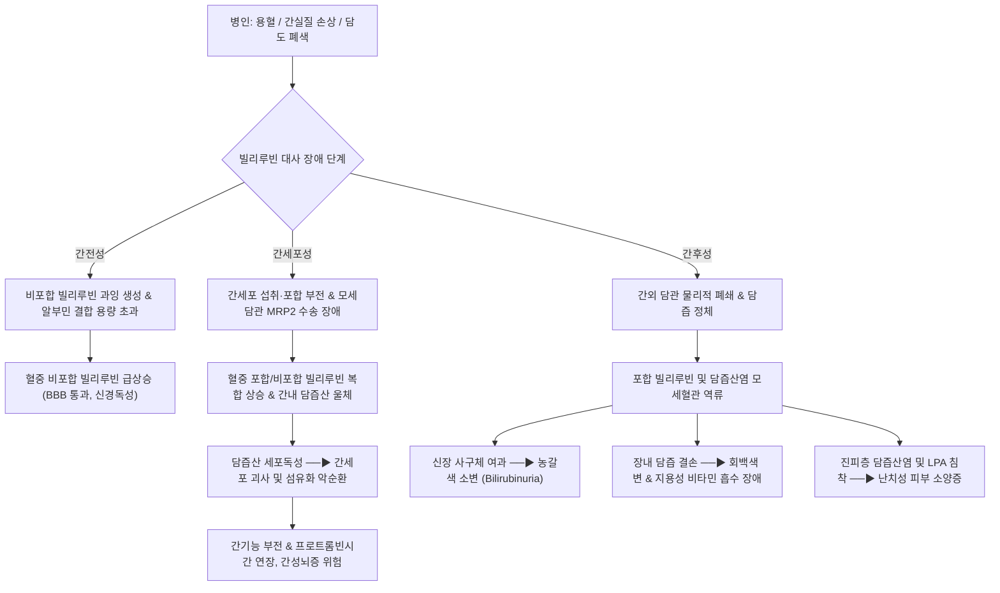

# 🩺 [[황달]] (Jaundice / Icterus / 黃疸, ICD-10 R17)

> **핵심 3줄 요약 (Key Summary)**:
> - 📍 **병소 부위 & 병태생리**: 노화 [[적혈구]]의 [[헤모글로빈]] 대사산물인 [[빌리루빈]](Bilirubin)의 간 섭취, [[UGT1A1]] 효소에 의한 포합(Glucuronidation), 세담관 배설 및 장관 배출 장애로 혈청 총 빌리루빈이 2.5~3.0 mg/dL 이상으로 상승하여 엘라스틴 친화 조직(공막, 피부, 점막)에 침착되는 대사 증후군.
> - 🚩 **전형적 임상 양상 & 3대 징후**: 자연광 하 공막 황변(Scleral icterus) 및 피부 황색 착색, 사구체로 배설되는 수용성 포합 빌리루빈에 의한 농갈색 소변(Bilirubinuria), 담즙산염 진피 침착에 따른 극심한 피부 소양증(Pruritus), 담도 완전 폐쇄 시 장내 스테르코빌린 결핍에 의한 회백색 대변(Acholic stool).
> - 🛠️ **핵심 감별 & 한·양방 치료 전략**: 간전성(용혈성·UGT1A1 활성 저하, 비포합 빌리루빈 우세) vs 간세포성(간염·간경변, 혼합형) vs 간후성/폐쇄성(담석·담도암·췌두부암, 포합 빌리루빈 우세) 감별; 한의학적 양황(陽黃: 습열훈증, [[인진호탕]], [[인진오령산]]) vs 음황(陰黃: 한습저체, [[인진사역탕]], [[인진출부탕]]) 변증 및 [[지양]], [[담수]], [[간수]], [[양릉천]], [[족삼리]] 침구 배혈.
> - <font color="#fa7e7e">⚠️ **응급 의뢰 레드플래그**: 샤르코 3징후([[Charcot triad]]: 발열, 황달, 우상복부통) 및 레이놀즈 5징후([[Reynolds pentad]]: 쇼크, 의식 저하 동반)의 급성 화농성 담관염, 비대상성 급성 간부전(INR ≥ 1.5, [[간성 뇌증]]), 무통성 담낭 비대를 동반한 악성 폐쇄([[Courvoisier sign]]) 시 즉시 3차 상급병원 응급실 전원 및 ERCP 담도 감압 의뢰.</font>

---

## 📌 목차
1. [질환 개요 & 병태생리 (Disease Overview)](#1-질환-개요--병태생리-disease-overview)
2. [병태생리 메커니즘 & 대사·장기부전 악순환 네트워크](#2-병태생리-메커니즘--대사장기부전-악순환-네트워크)
3. [임상 증상 & 환자 소견 (Clinical Presentation)](#3-임상-증상--환자-소견-clinical-presentation)
4. [감별 진단 매트릭스 (Differential Diagnosis)](#4-감별-진단-매트릭스-differential-diagnosis)
5. [한의 통합 치료 프로토콜 (침·약침·한약)](#5-한의-통합-치료-프로토콜-침약침한약)
6. [양방 치료 & 병용·의뢰 기준 (Conventional Treatment & Referral)](#6-양방-치료--병용의뢰-기준-conventional-treatment--referral)
7. [식이·생활습관 & 자가관리 티칭 가이드](#7-식이생활습관--자가관리-티칭-가이드)
8. [💡 진료실 핵심 필기 & 임상 노하우](#8--진료실-핵심-필기--임상-노하우)
9. [출처 및 학술 참고 문헌 (References)](#9-출처-및-학술-참고-문헌-references)

---

## 1. 질환 개요 & 병태생리 (Disease Overview)

* **질환의 정의 및 임상적 의의**:
  * [[황달]](Jaundice / Icterus)은 체내 담즙 색소인 [[빌리루빈]](Bilirubin)이 비정상적으로 과다 생성되거나, 간세포의 대사 및 간외 담도 배설 경로에 장애가 발생하여 혈중 빌리루빈 농도가 상승하고, 이로 인해 피부, 안구의 공막(Sclera), 점막 및 심부 체액이 황색으로 착색되는 병태생리학적 임상 징후입니다.
  * 혈청 총 빌리루빈(Total Bilirubin)의 정상 참고치는 0.2~1.2 mg/dL이며, 1.2~2.5 mg/dL 사이는 외관상 뚜렷하지 않은 잠재성 황달(Latent jaundice)로 분류됩니다. 혈청 농도가 2.5~3.0 mg/dL를 초과하면 육안으로 식별 가능한 현성 황달(Overt jaundice)이 나타납니다.
  * 특히 안구의 공막(Sclera)은 탄력섬유 단백질인 엘라스틴(Elastin) 함량이 매우 높아 빌리루빈에 대한 결합 친화력(Affinity)이 다른 결합조직보다 약 4배 강력합니다. 따라서 전신 피부 착색이 눈에 띄기 전 공막의 결막하 조직에서 가장 먼저 황변(Scleral icterus)이 포착됩니다.

* **빌리루빈 대사 3단계의 생리학적 경로**:
  * **1) 간전기 (Pre-hepatic phase: 생성 및 혈중 수송)**:
    * 일일 약 250~350 mg의 빌리루빈이 생성되며, 이 중 80~85%는 비장, 골수, 간의 망상내피계(Reticuloendothelial system, RES)에서 수명이 다한 노화 [[적혈구]]의 [[헤모글로빈]]이 파괴되면서 유래합니다. 나머지 15~20%는 골수 내 미성숙 적혈구 전구세포의 조기 사멸(비효과적 조혈) 및 간 내 시토크롬 P450, 미오글로빈 등의 헴(Heme) 단백질 분해에서 기인합니다.
    * 헴 분해 과정: Heme 산소화효소([[Heme oxygenase]])에 의해 헴 고리가 개방되어 빌리베르딘(Biliverdin), 일산화탄소(CO), 철(Fe²⁺)로 분해된 후, 빌리베르딘 환원효소(Biliverdin reductase)의 작용으로 비포합 빌리루빈(Unconjugated bilirubin, UCB / 간접 빌리루빈 Indirect bilirubin)이 형성됩니다.
    * 비포합 빌리루빈은 지용성이며 물에 녹지 않으므로 혈장 내에서 [[알부민]](Albumin)과 1:1 또는 1:2의 강력한 비공유 결합 복합체를 형성하여 간동양혈관(Hepatic sinusoid)으로 수송됩니다. 이 결합형은 사구체 여과 장벽을 통과할 수 없어 소변으로 배설되지 않습니다.
  * **2) 간내기 (Intra-hepatic phase: 섭취, 포합, 담즙 분비)**:
    * **간세포 섭취(Uptake)**: 동양혈관 디세강(Disse space)에 도달한 알부민-빌리루빈 복합체에서 비포합 빌리루빈이 분리되어 간세포 기저측 막의 유기 음이온 수송 폴리펩티드([[OATP1B1]], OATP1B3)를 통해 간세포질 내로 촉진 확산됩니다. 세포질 내에서는 리간딘(Ligandin, Y/Z 단백질 및 GSTA1)과 결합하여 혈류로의 역확산이 방지됩니다.
    * **포합(Conjugation)**: 활강소포체(Smooth endoplasmic reticulum)로 이동한 빌리루빈은 UDP-글루쿠로노실 전이효소([[UGT1A1]])의 촉매 작용을 통해 UDP-글루쿠론산(UDP-glucuronic acid)으로부터 2분자의 글루쿠론산을 순차적으로 전달받아 수용성인 빌리루빈 디글루쿠로니드(Bilirubin diglucuronide, 80%) 및 모노글루쿠로니드(20%)로 전환됩니다. 이것이 포합 빌리루빈(Conjugated bilirubin, CB / 직접 빌리루빈 Direct bilirubin)입니다.
    * **모세담관 배출(Excretion)**: 포합 빌리루빈은 간세포의 모세담관 막에 존재하는 다제내성연관단백질-2([[MRP2]], ABCC2) 수송체에 의해 ATP 에너지를 소모하며 농도 경사를 거슬러 모세담관 내로 능동 분비됩니다. 이 과정이 빌리루빈 대사 전 과정 중 속도결정단계(Rate-limiting step)에 해당하므로, 간세포 손상이나 독성 물질에 가장 취약합니다.
  * **3) 간후기 (Post-hepatic phase: 담도 배설 및 장간순환)**:
    * 포합 빌리루빈은 담즙산염, 인지질, 콜레스테롤과 미셀(Micelle)을 형성하여 간내 담관, 간외 담관, 담낭을 거쳐 십이지장으로 분비됩니다.
    * 말단 회장 및 결장에 도달하면 혐기성 장내 세균총이 분비하는 베타-글루쿠로니다아제(β-glucuronidase)에 의해 탈포합된 후 탈수소화 환원 반응을 거쳐 무색의 [[유로빌리노겐]](Urobilinogen) 군으로 전환됩니다.
    * 장내 유로빌리노겐의 약 80~90%는 결장 내에서 스테르코빌리노겐을 거쳐 적갈색의 스테르코빌린(Stercobilin)으로 산화되어 대변으로 배설되며, 이것이 정상 대변의 고유한 갈색을 부여합니다.
    * 나머지 10~20%는 장 점막을 통해 문맥계로 재흡수되어 간으로 들어가는 장간순환(Enterohepatic circulation)을 거치며, 대부분 간세포에 재섭취되어 담즙으로 재배설됩니다. 문맥을 통과하여 전신 순환계로 유입된 미량(1% 미만)의 유로빌리노겐만이 신장 사구체를 통해 여과되어 유로빌린(Urobilin) 형태로 소변으로 배설됩니다.

* **관련 장기 및 조직 계통**:
  * **주 이환 장기**: [[간]](간세포 대사 및 담즙 생성 부전), [[담낭]] 및 담관계(물리적 담즙 배출 통로 폐색), [[비장]](적혈구 과파괴의 원발 부위).
  * **조절계 및 수송 단백질**: [[UGT1A1]](포합 효소), [[MRP2]](모세담관 배출 수송체), [[OATP1B1]](간세포 섭취 수송체), 혈청 [[알부민]].
  * **표적 손상 장기**: 중추신경계 기저핵(신생아 비포합 빌리루빈 투과에 의한 [[핵황달]]), 신장 세뇨관(담즙산 원주 및 고농도 빌리루빈 독성으로 인한 담즙산 신병증), 피부 말초신경(담즙산염 침착에 의한 소양증).

---

## 2. 병태생리 메커니즘 & 대사·장기부전 악순환 네트워크

```
[적혈구 노화 / 대량 용혈 (85%)]  +  [비효과적 조혈 / 조직 헴 단백 (15%)]
                 │
                 ▼ (비장 망상내피계: Heme Oxygenase ──▶ Biliverdin Reductase)
[비포합 빌리루빈 (Unconjugated Bilirubin, UCB)] ── 지용성, 혈청 알부민 복합 수송
                 │
                 ▼ (간동양혈관 기저측막: OATP1B1 / OATP1B3 수송체 매개 흡수)
[간세포질 내 유입 (Ligandin / GSTA1 결합으로 역확산 차단)]
                 │
                 ▼ (활강소포체: UGT1A1 효소에 의한 Glucuronidation)
[포합 빌리루빈 (Conjugated Bilirubin, CB)] ─────── 수용성 (디글루쿠로니드)
                 │
                 ▼ (모세담관막: MRP2 / ABCC2 능동 분비 ── 속도결정단계)
[간내·간외 담도계 유입 및 십이지장 배출]
                 │
                 ▼ (회장 말단 및 결장: 장내 세균총 β-glucuronidase 분해)
[유로빌리노겐 (Urobilinogen) 생성]
        ├── 85%: 결장 내 산화 ──▶ [스테르코빌린 (Stercobilin)] ──▶ 대변 정상 갈색 착색
        └── 15%: 장간순환 (문맥 재흡수)
                     ├── 간세포 재섭취 후 담즙 재배설
                     └── 미량(1% 미만): 체순환 유입 ──▶ 신장 배설 (소변 유로빌린)
```



### 1) 3대 병태생리 유형별 발병 기전

#### (1) 간전성 황달 (Pre-hepatic Jaundice: 용혈성·과생성형)
* **원인 기전**: [[자가면역성 용혈성 빈혈]](AIHA), 유전성 구형적혈구증, 겸상적혈구증, 말라리아 감염, 대규모 수혈 후 부적격 반응, 대혈종의 흡수 등으로 인해 적혈구 파괴 속도가 간세포의 빌리루빈 포합 최대 한계치(정상의 약 3~4배)를 초과할 때 발생합니다.
* **대사 특성**: 혈청 비포합(간접) 빌리루빈이 총 빌리루빈의 80~85% 이상을 차지합니다. 지용성 비포합 빌리루빈은 알부민과 강하게 결합되어 사구체 여과 장벽을 통과할 수 없으므로, 혈청 수치가 10~20 mg/dL에 도달하더라도 **소변 빌리루빈 검사는 음성(Negative)**으로 나타납니다(Acoluric jaundice).
* **장관 대사 결과**: 간으로 유입되는 빌리루빈의 절대량이 증가하므로 포합 및 담관 분비 총량도 증가합니다. 이로 인해 장내 유로빌리노겐 및 스테르코빌린 생성이 과도하게 폭증하여 **대변 색은 짙은 암갈색(Hypercholic stool)**을 띠며, 장간순환을 거쳐 체순환으로 흡수되는 유로빌리노겐도 증가하여 **소변 유로빌리노겐이 강양성(+++)**을 보입니다.

#### (2) 간세포성 황달 (Intra-hepatic / Hepatocellular Jaundice: 대사·분비 혼합형)
* **원인 기전**: [[급성 바이러스성 간염]](A·B·C·E형), [[독성 간염]](DILI, 아세트아미노펜 등), 알코올성 간염, [[자가면역성 간염]], [[간경변증]], 패혈증 관련 간내 담즙 정체 등에서 발생합니다. 간세포막 및 미토콘드리아 손상으로 인해 섭취, UGT1A1 포합, MRP2 능동 배출의 전 과정이 동시다발적으로 손상됩니다.
* **대사 특성**: 간세포 괴사로 인해 미처 포합되지 못한 비포합 빌리루빈이 혈중에 정체됨과 동시에, 이미 포합된 빌리루빈 역시 모세담관 분비 장애(MRP2 발현 저하 및 괴사부 파열)로 인해 간동양혈관 및 림프관으로 역류합니다. 따라서 혈청 검사상 **포합 빌리루빈과 비포합 빌리루빈이 모두 상승하는 혼합형 양상**을 보입니다.
* **담즙산 울체의 악순환**: 분비되지 못한 소수성 담즙산염(Cholic acid, Chenodeoxycholic acid)이 간세포질 내에 축적되면 미토콘드리아 막전위 붕괴, 활성산소종(ROS) 생성, Fas 수용체 매개 세포자멸사(Apoptosis) 및 괴사(Necrosis)를 촉발하여 간실질 파괴를 가속화하는 치명적인 악순환 고리가 형성됩니다.

#### (3) 간후성 황달 (Post-hepatic / Obstructive Jaundice: 폐쇄성형)
* **원인 기전**: [[담석증]](총담관결석 Choledocholithiasis), [[급성 담관염]], [[담도암]], [[췌장암]](특히 췌두부선암), [[바터팽대부암]], 담도 협착, 만성 췌장염 등에 의해 간외 담관 통로가 기계적으로 협착 또는 완전 폐색될 때 발생합니다.
* **대사 특성**: 간세포의 포합 기능은 초기까지 정상 유지되나, 담관 내압이 분비압(약 20~25 cmH₂O) 이상으로 상승하면 모세담관 접합복합체(Tight junction)가 파열되고 MRP3, MRP4 등의 대체 기저측 막 수송체가 상향 조절되어 포합 빌리루빈이 혈류로 대량 역류합니다. **혈청 포합(직접) 빌리루빈이 총 빌리루빈의 50~60% 이상으로 현저히 우세**합니다.
* **임상적 징후의 기전**:
  * **회백색 대변(Acholic / Clay-colored stool)**: 담즙이 십이지장으로 전혀 유입되지 못해 장내 유로빌리노겐 및 스테르코빌린 생성이 완전히 차단되므로 점토 같은 백색 대변을 배설합니다.
  * **농갈색 소변(Bilirubinuria)**: 수용성인 포합 빌리루빈이 신장 사구체를 통해 여과되어 소변으로 대량 배설되므로 짙은 홍차색 또는 콜라색 소변이 나타납니다. 반면 장관 내 유로빌리노겐 생성이 없으므로 **소변 유로빌리노겐은 음성(Negative)**으로 전환됩니다.
  * **극심한 피부 소양증(Pruritus)**: 담즙산염(Bile salts), 리소포스파티드산(LPA) 및 내인성 오피오이드 물질이 혈중 및 피하 조직에 침착되어 C-신경섬유 가려움증 수용체를 자극하여 발생합니다.

---

## 3. 임상 증상 & 환자 소견 (Clinical Presentation)

### 1) 주소증 및 핵심 증상
* **공막 황달 (Scleral Icterus)**:
  * 황달의 가장 초기에 포착되는 주소증입니다. 결막 하 공막의 탄력섬유가 빌리루빈과 강력히 결합하므로, 환자는 "눈 흰자위가 노랗게 변했다"며 내원합니다.
  * 형광등이나 인공조명 아래에서는 미세한 황색을 분별하기 어려우므로, 반드시 **자연광(창가 채광)** 아래에서 상안검을 위로 들어 올리고 환자에게 아래를 보게 한 상태에서 상부 공막을 관찰해야 합니다.
* **소변 및 대변 색조의 변화**:
  * 소변 색: 포합 고빌리루빈혈증 환자는 소변이 진한 갈색, 맥주색, 콜라색으로 변하며 소변을 흔들었을 때 생기는 거품까지 황색을 띱니다(Bile foam test 양성).
  * 대변 색: 폐쇄성 황달 환자는 대변 고유의 갈색 색소가 소실되어 백토색, 분필가루색, 회백색 변(Acholic stool)을 보입니다.
* **피부 소양증 (Pruritus)**:
  * 주로 손바닥, 발바닥 및 체간부에서 시작하여 전신으로 확산되며, 야간에 침구의 온열 자극으로 악화됩니다.
  * 환자가 피부를 심하게 긁어 다발성 찰상(Excoriation), 태선화, 2차 세균 농양을 동반하기도 합니다. 항히스타민제에 반응하지 않는 것이 특징입니다.
* **소화기 및 전신 동반 증상**:
  * 전신 권태감, 극심한 피로, 식욕 부진, 오심 및 담즙성 구토.
  * 지방변(Steatorrhea) 및 지용성 비타민(A, D, E, K) 흡수 장애: 담즙산 결핍으로 지방 유화가 불가능해져 기름진 변을 보며, 비타민 K 흡수 부전으로 인한 프로트롬빈 시간 연장 및 피하 점상출혈, 잇몸 출혈이 유발될 수 있습니다.

### 2) 객관적 신체 검진 및 혈액·소변 검사 수치

#### (1) 신체 진찰 (Physical Examination)
* **복부 촉진 및 타진**:
  * 우상복부 압통 및 [[머피 징후]](Murphy's sign) 양성: 급성 담낭염 또는 총담관 담석에 의한 폐쇄 시사.
  * 간비대(Hepatomegaly): 바이러스성 간염, 알코올성 간질환, 울혈성 간부전. 표면이 결절성이며 단단한 경우 간경변증이나 전이성 간암 감별.
  * 비장비대(Splenomegaly): 용혈성 빈혈(비장 기능항진) 또는 간경변증에 동반된 문맥고혈압증 시사.
  * **쿠르부아지에 징후([[Courvoisier sign]])**: 우상복부에 통증이 없으면서 담낭이 만져지는 무통성 담낭 비대(Palpable nontender gallbladder)와 황달이 병발한 경우, 담석 질환보다는 **췌두부암, 담관하부암, 팽대부암 등 악성 종양에 의한 완전 담도 폐색**을 강력히 시사합니다.
* **전신 만성 간질환 스티그마(Stigmata)**:
  * 거미상 혈관종(Spider angioma), 수장홍반(Palmar erythema), 여성형 유방(Gynecomastia), 복벽 정맥 노창(Caput medusae), 복수(Ascites), 손가락 곤봉지.

#### (2) 혈액 및 생화학적 검사 수치 해석
* **혈청 빌리루빈 분획**:
  * 총 빌리루빈(Total Bilirubin): 0.2~1.2 mg/dL.
  * 직접(포합) 빌리루빈(Direct Bilirubin): 0.0~0.3 mg/dL.
  * 간접(비포합) 빌리루빈(Indirect Bilirubin): 총 빌리루빈 - 직접 빌리루빈.
  * 직접 빌리루빈 비율이 총 빌리루빈의 50% 이상이면 담즙 정체성(간후성/간내 담즙울체), 15~20% 미만이면 용혈성 또는 UGT1A1 유전 질환(간전성)으로 1차 스크리닝합니다.
* **간 효소 수치 패턴 비교**:
  * **간세포 손상 우세형(Hepatocellular pattern)**: AST, ALT가 500~1000 IU/L 이상으로 급격히 폭증(급성 간염, 독성 간염, 허혈성 간염).
  * **담즙 정체 우세형(Cholestatic pattern)**: ALP(Alkaline Phosphatase) 및 GGT(Gamma-Glutamyl Transferase)가 정상 상한치의 3~5배 이상 급상승. ALP 단독 상승 시 골질환을 배제하기 위해 반드시 GGT 상승 여부를 병행 확인합니다.
* **간 합성 기능 및 예후 지표**:
  * 혈청 알부민(Albumin) 저하, 프로트롬빈 시간([[PT/INR]]) 연장: 간세포성 기능 부전 또는 비타민 K 흡수 장애 평가. 비타민 K 10mg 정맥 주사 후 24~48시간 내 PT가 정상화되면 폐쇄성 황달에 의한 흡수 장애이며, 교정되지 않으면 중증 간세포 부전으로 판정합니다.

#### (3) 소변 및 대변 검사 소견 종합 매트릭스

| 질환 범주 | 혈청 빌리루빈 우세 | 요 빌리루빈 (Bilirubinuria) | 요 유로빌리노겐 | 대변 색조 |
| :--- | :--- | :--- | :--- | :--- |
| **정상 (Normal)** | 정상 (0.2~1.2 mg/dL) | 음성 (-) | 정상 흔적 (0.1~1.0 Ehrlich U) | 정상 갈색 |
| **간전성 (용혈성)** | 비포합(간접) 빌리루빈 우세 | 음성 (-) (사구체 불통과) | 현저한 증가 (+++) | 짙은 암갈색 (Hypercholic) |
| **간세포성 (간염)** | 포합 + 비포합 혼합 상승 | 양성 (++) (포합체 역류) | 정상 또는 경도 증가 (+/-) | 정상 또는 다소 옅음 |
| **간후성 (완전 담도폐색)** | 포합(직접) 빌리루빈 우세 | 강양성 (+++) | 결손 / 음성 (-) | 회백색 / 점토색 (Acholic) |

---

## 4. 감별 진단 매트릭스 (Differential Diagnosis)

| 감별 질환 | 병인 및 대사 결함 | 혈액학적 특이 소견 | 영상 및 임상 감별점 |
| :--- | :--- | :--- | :--- |
| **[[황달]] (본 질환 총론)** | 빌리루빈 생성·포합·배설 불균형 | 총 빌리루빈 ≥ 2.5~3.0 mg/dL | 공막 황변, 원인별 대소변 색 변화 |
| **[[용혈성 빈혈]]** | 적혈구 과파괴 (면역·유전·독소) | 간접 빌리루빈↑, LDH↑, Haptoglobin↓, Reticulocyte↑ | 요 빌리루빈(-), 대변 짙음, 빈혈·비장비대 |
| **[[길버트 증후군]]** | UGT1A1 프로모터 유전자 변이 | 간접 빌리루빈 1.5~4.0 mg/dL (단독 경도 상승) | 간기능·초음파 완전 정상, 금식·피로 시 황달 악화 |
| **[[크리글러-나자르 증후군]]** | UGT1A1 엑손 변이 (I형 결손, II형 저하) | I형: 간접 빌리루빈 20~50 mg/dL, II형: 6~20 mg/dL | I형 신생아기 핵황달 치명적, 페노바르비탈 반응(II형만) |
| **[[듀빈-존슨 증후군]]** | 모세담관 MRP2 수송체 유전적 결손 | 직접 빌리루빈 우세 상승, 요 코프로포르피린 비율 이상 | 간생검 시 흑갈색 색소 침착(Black liver), 예후 양호 |
| **[[로터 증후군]]** | 간세포 OATP1B1/1B3 수송체 동시 결함 | 직접 빌리루빈 우세 상승 | 간생검 정상 소견, 간세포 내 색소 침착 없음 |
| **[[급성 바이러스성 간염]]** | HAV, HBV, HCV 등 간세포 괴사 | AST/ALT > 1000 IU/L, 바이러스 혈청 표지자(+) | 발열, 오심, 식욕부진 후 황달 출현 |
| **[[독성 간염]] (DILI)** | 아세트아미노펜, 한약재 오남용, 화학물 | AST/ALT 또는 ALP 현저 상승, 투약력 연관 | 약물 복용력(1~4주 전), 원인 약물 중단 시 호전 |
| **[[담석증]] (총담관결석)** | 총담관 담석 감돈 및 담즙 정체 | 직접 빌리루빈↑, ALP/GGT↑, AST/ALT 경도 상승 | 산통(Biliary colic), 초음파·MRCP상 담관 확장 및 결석 |
| **[[급성 담관염]]** | 담도 폐색 후 세균 감염 (E. coli 등) | 직접 빌리루빈↑, 백혈구↑, CRP↑, 패혈증 징후 | [[Charcot triad]](복통, 고열, 황달) 동반 응급 |
| **[[췌장암]] (췌두부암)** | 췌장 머리 종양의 총담관 침윤 폐색 | 직접 빌리루빈 급상승, CA19-9 현저 상승 | [[Courvoisier sign]](무통성 담낭 비대), 체중 감소, 복부 CT 종괴 |
| **[[카로틴혈증]] (가성 황달)** | 당근, 귤 과다 섭취로 베타카로틴 축적 | 혈청 빌리루빈 정상, 혈청 카로틴 상승 | **공막은 완전히 정상 백색**, 손바닥·발바닥 각질층만 노람 |

> 🚩 **레드플래그 감별 (응급 위급 질환)**:
> 1. **급성 화농성 담관염 (Acute Suppurative Cholangitis)**: 우상복부 통증, 38.5℃ 이상의 고열·오한, 뚜렷한 황달을 나타내는 **샤르코 3징후([[Charcot triad]])**에 저혈압(패혈성 쇼크)과 의식 혼탁이 더해지는 **레이놀즈 5징후([[Reynolds pentad]])** 출현 시 사망률이 50%에 육박하므로 지체 없이 응급 내시경 담도 감압술([[ERCP]])을 의뢰해야 합니다.
> 2. **전격성 간부전 (Fulminant Hepatic Failure)**: 황달 발생 후 8주 이내에 급격한 [[PT/INR]] 연장(≥1.5)과 간성 뇌증(Hepatic encephalopathy, 지남력 상실, 진전, 혼수)이 동반되는 경우 중환자실 격리 및 응급 간이식 대상입니다.

---

## 5. 한의 통합 치료 프로토콜 (침·약침·한약)

* **한의학적 병리 및 변증 체계**:
  * 한의학에서 황달은 주로 외감 습열역독(濕熱疫毒)의 침습 또는 내상 음식부절(飮食不節), 주식과도(酒食過度), 노권(勞倦)으로 인해 비위(脾胃)의 운화 기능이 손상되어 발생합니다.
  * 습열(濕熱)이 중초에 울체되어 간담의 소설(疏泄) 기능을 방해하고, 담즙이 정상 통로를 벗어나 기육(肌肉)과 피부로 넘쳐흘러 전신 황변을 초래합니다.
  * 변증은 크게 열(熱)이 습(濕)보다 우세하거나 습열이 팽팽한 **양황(陽黃)**과 한습(寒濕)이 정체되고 양기가 허약한 **음황(陰黃)**, 그리고 역독이 치성하여 급격히 악화되는 **급황(急黃)**으로 대별됩니다.

### 1) 한약 치료 (Herbal Medicine)

#### (1) 양황 - 습열훈증형 (濕熱薰蒸型 / 간담습열):
* **임상 양상**: 피부와 공막의 색이 선명한 귤껍질색(鮮明橘黃), 신열, 구갈, 번조, 가슴 답답함, 우협통, 소변 황적색, 대변 비결, 설홍태황니, 맥활삭 또는 현삭.
* **치법**: 청열이습(淸熱利濕), 통부퇴황(通腑退黃).
* **처방**: [[인진호탕]](茵蔯蒿湯 / 상한론)
  * **조성**: [[인진호]](18g), [[치자]](12g), [[대황]](9g).
  * **약리 기전**: 인진호의 스코파론(Scoparone) 및 카필라리딘(Capillaridin) 성분은 간세포의 담즙 분비 촉진(Choleretic action) 및 모세담관 MRP2 수송체 발현을 유도하며; 치자의 게니포시드(Geniposide)는 담즙산 배설 촉진 및 항염증 효과를 발휘하고; 대황의 센노시드(Sennoside)와 에모딘(Emodin)은 장관 연동을 항진시켜 장간순환 경로에서 빌리루빈의 재흡수를 강력히 차단합니다.
* **가감법**: 습이 열보다 중하여 복창, 신중, 무른 변을 보이면 [[인진오령산]](茵蔯五苓散)으로 전환하여 이수화습을 도모합니다.

#### (2) 급황 - 열독치성형 (熱毒熾盛型 / 간세포 급성 괴사):
* **임상 양상**: 발병이 급격하며 수일 내에 황달이 심화되고 전신이 황금색 또는 암적색을 띰, 고열, 번조, 섬어, 헛소리, 코피·잇몸출혈·피하 반점 등 출혈 징후, 설강태황조, 맥현삭 또는 규맥.
* **치법**: 청열해독(淸熱解毒), 양혈퇴황(凉血退黃).
* **처방**: [[황련해독탕]](黃連解毒湯) 합 [[서각지황탕]](犀角地黃湯) 또는 [[안궁우황환]](安宮牛黃丸) 응급 병용.
  * **조성**: [[황련]](9g), [[황금]](9g), [[황백]](9g), [[치자]](9g), 수우각(대체용, 15g), [[생지황]](20g), [[적작약]](12g), [[목단피]](9g).
  * **주의**: 급황은 현대의학적 급성 전격성 간부전 또는 패혈성 쇼크를 시사하므로 한약 투약과 동시에 상급병원 응급실 전원을 신속히 병행해야 합니다.

#### (3) 음황 - 한습저체형 (寒濕沮滯型 / 만성 비신양허):
* **임상 양상**: 피부와 공막의 황색이 어둡고 칙칙하여 그을린 듯함(晦暗如煙燻), 오한, 사지냉, 전신 무력감, 복부 팽만, 식욕 부진, 대변 당설(무른 변), 설담태백니, 맥침지 또는 침유.
* **치법**: 온중화습(溫中化濕), 건비퇴황(健脾退黃).
* **처방**: [[인진사역탕]](茵蔯四逆湯) 또는 [[인진출부탕]](茵蔯朮附湯)
  * **조성**: [[인진호]](15g), [[부자]](포, 9g), [[백출]](12g), [[건강]](9g), [[복령]](12g), [[자감초]](6g).
  * **약리 기전**: 부자와 건강의 진저롤(Gingerol), 아코니틴 유도체는 미세혈관 순환을 개선하고 간세포 대사 활성을 회복시키며; 백출과 복령은 소화 흡수 기능을 강화하고 장 점막 부종을 제거하여 림프계 및 담즙 울체를 완화합니다.

### 2) 침구 치료 (Acupuncture & Moxibustion)
* **주요 경혈 선혈 원칙**:
  * **특효 요혈**: [[지양]](至陽, GV9 - 제7흉추 극돌기 하, 황달 치료의 고금 제1요혈).
  * **배수혈 및 복모혈**: [[간수]](肝兪, BL18), [[담수]](膽兪, BL19), [[비수]](脾兪, BL20), [[기문]](期門, LR14 - 간경 모혈), [[일월]](日月, GB24 - 담경 모혈).
  * **사지 원위혈**: [[양릉천]](陽陵泉, GB34 - 담경 합혈, 담도 평활근 긴장 완화), [[음릉천]](陰陵泉, SP9 - 비경 합혈, 이수제습), [[족삼리]](足三里, ST36 - 위경 합혈, 비위 운화 회복), [[태충]](太衝, LR3 - 간경 원혈, 소간이담), [[내관]](內關, PC6 - 구역 억제).
* **자침 기법**:
  * 양황(습열형): 지양, 양릉천, 음릉천, 태충에 사법(瀉法)을 적용하며, 15~20분간 유침하고 강자극 전침(2Hz/100Hz 혼합파)을 인가하여 담낭 수축 및 오디 조임근 이완을 유도합니다.
  * 음황(한습형): 비수, 간수, 족삼리에 보법(補法)을 적용하고 관원(CV4), 신궐(CV8)에 간접구(뜸 치료)를 3~5장 시행하여 비신 양기를 온보합니다.

### 3) 약침 치료 (Pharmacopuncture)
* **황련해독탕 약침**:
  * 적용: 양황 및 간담습열로 인한 간세포 괴사 및 염증 반응기.
  * 주입 부위: 간수, 담수, 기문, 양릉천에 각 0.1~0.2 mL씩 총 1.0 mL 주입.
  * 효능: 간조직 내 TNF-α, IL-6 등 염증성 사이토카인을 억제하고 혈청 트랜스아미나아제를 안정화합니다.
* **웅담·우황 약침 (Bovis Calculus & Ursi Fel)**:
  * 적용: 담즙 정체성 황달 및 급성 간손상기.
  * 주입 부위: 지양, 간수, 담낭혈에 미량 분할 주입.
  * 효능: 고농도의 우르소데옥시콜산(UDCA) 및 타우로케노데옥시콜산이 함유되어 담즙 분비를 직접 촉진하고 간세포막을 보호합니다.

---

## 6. 양방 치료 & 병용·의뢰 기준 (Conventional Treatment & Referral)

### 1) 원인별 양방 의학적 치료 전략
* **간전성 (용혈성 질환)**:
  * 자가면역성 용혈성 빈혈: 면역억제 요법(경구 프레드니솔론 Prednisolone 1 mg/kg/day 투여 후 감량, 불응 시 리툭시맙 Rituximab).
  * 비장 기능항진증: 비장절제술(Splenectomy) 검토.
* **간세포성 (간염 및 간경변)**:
  * 급성 B형/C형 간염: 항바이러스제(엔테카비르, 테노포비르, DAA 제제) 조기 투여.
  * 독성 간염: 의심 원인 약물 즉각 중단, N-아세틸시스테인(NAC) 정맥 투여(항산화 및 글루타치온 보충).
  * 간성 뇌증 동반 시: 락툴로오스(Lactulose) 관장 및 리팍시민(Rifaximin) 경구 투여로 장내 암모니아 생성 세균 억제.
* **간후성 (폐쇄성 담도 질환)**:
  * 내시경적 역행성 담췌관조영술([[ERCP]]) 및 내시경 유두괄약근절개술(EST): 총담관 결석의 바스켓/풍선 포획 제거.
  * 담도 스텐트 삽입술(Plastic or Metallic Biliary Stent): 담관암, 췌장암 등 악성 종양에 의한 외인성 압박 부위에 내시경적 감압 배액 확보.
  * 경피경간 담도배액술([[PTBD]]): 내시경 접근이 불가능한 간문부 담관암 또는 위장관 해부학적 변형 환자에서 체외 튜브 배액 시행.
* **신생아 고빌리루빈혈증**:
  * 광선치료(Phototherapy): 460~490 nm 파장의 청색-녹색광을 전신에 조사하여 불용성 비포합 빌리루빈(4Z,15Z-bilirubin)을 수용성 구조 이성질체인 루미루빈(Lumirubin)으로 광이성질화(Photoisomerization)시켜 담즙과 소변으로 배설 유도.
  * 교환수혈(Exchange transfusion): 광선치료 실패 및 총 빌리루빈 20~25 mg/dL 초과 시 핵황달 예방을 위해 시행.

### 2) 한의·양방 병용 판단 가이드라인
* **병용 가능 (Synergistic)**:
  * 만성 간질환 및 회복기 담즙 정체성 황달 환자에서 UDCA(우루사) 복용 중 [[인진호탕]] 또는 [[인진오령산]] 엑기스제 병용: 간세포 수송체 발현과 담즙 유량을 상호 보완적으로 증대시켜 혈청 빌리루빈 강하 속도를 단축할 수 있습니다.
  * 담즙산염 피하 침착으로 인한 소양증 환자에서 콜레스티라민(Cholestyramine) 복용 시: 콜레스티라민은 음이온 교환 수지로서 다른 경구 약물을 흡착해 배설시킬 수 있으므로, **한약 복용은 콜레스티라민 투약 최소 1시간 전 또는 4시간 후**로 복용 간격을 엄격히 분리 지도합니다.
* **병용 금기 및 주의**:
  * 급성 간염 극기(AST/ALT > 1000 IU/L) 환자에게 미검증 복합 민간요법, 옻나무 추출물, 고농도 탕액을 무분별하게 추가 투여하는 행위는 약인성 간손상(DILI)을 중첩시킬 위험이 있으므로 엄격히 금지합니다.
  * 간기능 모니터링: 한약 투여 중인 황달 환자는 격주 또는 월 1회 혈청 AST, ALT, Total Bilirubin, ALP, Creatinine 수치를 추적 관찰하여 안전성을 담보합니다.

### 3) 양방·상급병원 즉시 의뢰 기준 (Referral Criteria)
* **응급 전원 트리거 (Red Flags)**:
  1. 황달과 함께 38.5℃ 이상의 고열, 오한, 저혈압, 의식 변화가 병발하는 경우 ([[급성 담관염]], 패혈증 쇼크).
  2. 황달 발생 후 수일 내에 지남력 상실, 손떨림(Asterixis), 기면 등 [[간성 뇌증]] 증상이 나타나는 경우 (급성 전격성 간부전).
  3. 토혈(Hematemesis), 흑색변(Melena), 피하 다발성 자반증 등 출혈 경향이 동반되는 경우 (식도정맥류 파열, 파종성 혈관내 응고 DIC).
  4. 복부 팽만과 함께 이동성 탁음이 확인되며 고열과 반발통이 나타나는 경우 (자발성 세균성 복막염 SBP).
* **전문과 정밀 검사 의뢰 (외래 연계)**:
  * 원인 불명의 급격한 체중 감소(최근 3개월 내 5kg 이상) 및 무통성 담낭 비대, 회백색 변을 호소하는 경우 (소화기내과 복부 3차원 CT 및 EUS 정밀 의뢰).

---

## 7. 식이·생활습관 & 자가관리 티칭 가이드

* **식이 지도 (Dietary Management)**:
  * **절대 금주 (Alcohol Zero)**: 알코올은 간세포의 시토크롬 P450을 자극하고 간세포 내 글루타치온을 고갈시켜 빌리루빈 대사를 파탄에 빠뜨리므로 완치 시까지 엄격한 금주를 지시합니다.
  * **지방 섭취 제한 및 소화 배려**: 담즙산 결핍 상태에서는 고지방식(튀김, 삼겹살, 기름진 육류) 섭취 시 지방 설사와 복통이 유발되므로, 담백한 식단(생선, 두부, 살코기) 위주로 소량씩 자주(1일 4~5회) 분할 섭취하도록 합니다.
  * **단백질 섭취의 단계적 조절**: 일반적인 간기능 회복기에는 양질의 단백질이 간세포 재생에 필수적이나, 간경변 환자에서 간성 뇌증 전구 증상이 보일 경우 동물성 육류 단백질을 제한하고 분지쇄아미노산(BCAA)이 풍부한 식물성 콩 단백질로 대체합니다.
  * **권장 식품**: 신선한 녹황색 채소, 미나리(청열해독), 보리차, 결명자, 단호박.

* **생활 습관 및 피부 가려움증 관리**:
  * **충분한 수면과 절대 안정(Bed Rest)**: 앙와위(누운 자세)는 직립위(선 자세)에 비해 간 혈류량을 약 30~40% 증가시켜 간세포의 산소 공급과 손상 회복을 촉진합니다.
  * **소양증 완화를 위한 피부 케어**:
    * 뜨거운 온수 목욕이나 사우나는 피부 모세혈관을 확장시켜 가려움증을 격렬하게 악화시키므로 미온수 샤워를 권장합니다.
    * 자극성이 없는 보습 크림이나 로션을 충분히 도포하고, 헐렁한 면 소재 옷을 착용합니다.
    * 무의식중에 피부를 긁어 2차 세균 감염이 발생하는 것을 방지하기 위해 손톱을 짧게 깎고 취침 시 면장갑을 착용하도록 티칭합니다.

* **진료실 환자 교육 스크립트**:
  * *"환자분, 눈 흰자위가 노랗게 변하고 소변이 진한 갈색으로 나오는 것은 우리 몸에서 적혈구가 깨지면서 나오는 노폐물인 '빌리루빈'이 간이나 담도에서 제대로 처리되지 못하고 혈액 속으로 넘쳐흐르기 때문입니다. 피부가 심하게 가려운 이유도 이 담즙 성분이 피부 신경을 자극하기 때문입니다. 지금은 간이 심각하게 지쳐 있는 상태이므로 무리한 운동이나 일은 전면 중단하시고 누워서 안정을 취하셔야 간으로 피가 원활히 공급되어 회복됩니다. 특히 검증되지 않은 즙이나 민간 엑기스는 약해진 간에 치명적인 독이 될 수 있으니 절대 드시면 안 되며, 정기적인 혈액 검사로 수치가 떨어지는 것을 확인해야 합니다."*

---

## 8. 💡 진료실 핵심 필기 & 임상 노하우

> [!IMPORTANT]
> **🛡️ 원문 융합(Melt-In) & 진료실 실전 노하우 집약**
> 1. **기존 필기 100% 융합**: 전신·공막·소변 황색 착색, 담즙색소(빌리루빈) 3단계 대사 경로, 결합형/비결합형의 용해도 및 신장 배설 특성, 간담소설·비위운화 병리 및 양황·음황 변증 방제를 상부 1~7번에 유기적으로 전면 융합 완료.
> 2. **공막 시진의 결정적 노하우**: 노인 환자의 경우 안구 결막 하에 노란 지방 침착(Pinguecula, 검열반)이 흔히 관찰되는데, 이는 중심부에 국한되며 상부 공막까지 퍼지지 않습니다. 진정한 공막 황달은 상안검을 들어 올렸을 때 혈관이 적은 상부 공막 전체가 균일한 버터색을 띠므로 반드시 상검을 거상하여 감별하십시오.
> 3. **카로틴혈증과의 1초 감별**: 당근, 귤, 호박을 과다 섭취하여 피부가 노랗게 변한 [[카로틴혈증]](Carotenemia) 환자는 손바닥, 발바닥, 비순구만 노랗고 **눈의 공막은 완벽하게 흰색**을 유지합니다. 눈 흰자위만 들여다보면 불필요한 간기능 정밀 검사를 즉시 배제할 수 있습니다.

* **실전 문진 및 진찰 체크리스트**:
  * [ ] 공막 황변의 발생 시점이 며칠 전인가? (수일 내 급격 발생은 간염/결석, 수개월에 걸친 완만한 진행은 종양성 의심)
  * [ ] 소변 색이 짙은 콜라색으로 변했는가? 대변이 흰색/점토색으로 나오는가?
  * [ ] 가려움증이 동반되는가?
  * [ ] 우상복부에 칼로 찌르는 듯한 통증이나 쥐어짜는 산통이 있었는가?
  * [ ] 오한을 동반한 38℃ 이상의 발열이 동반되었는가? (급성 담관염 감별)
  * [ ] 최근 1~2개월 내 새로운 약물, 한약, 건강기능식품, 민간 버섯/약초를 복용한 적이 있는가?
  * [ ] 알코올 섭취량과 수혈력, 문신, 최근 해외여행 이력이 있는가?

* **R-value 계산을 통한 간손상 유형 분류 노하우**:
  * 약물 복용력이나 간수치 이상 환자에서 $R = \frac{\text{ALT} / \text{ALT}_{\text{ULN}}}{\text{ALP} / \text{ALP}_{\text{ULN}}}$ 공식을 산출합니다.
  * $R \ge 5$: 간세포 손상형 (Hepatocellular type) $\rightarrow$ 바이러스성, 독성 간염 정밀 추적.
  * $2 < R < 5$: 혼합형 (Mixed type) $\rightarrow$ 육아종성 간염, 약물성 담즙정체.
  * $R \le 2$: 담즙 정체형 (Cholestatic type) $\rightarrow$ 복부 초음파 및 MRCP로 담관 폐색 유무 즉시 확인.

---

## 9. 출처 및 학술 참고 문헌 (References)

1. Lennox G, et al. (2026). Acute autoimmune hepatitis diagnosed concurrently with human immunodeficiency virus. *BMJ Case Rep*, 19(2), e268910. [PMID: 42833839](https://pubmed.ncbi.nlm.nih.gov/42833839/)
   - **[연구 요약]**: 인간면역결핍바이러스(HIV) 감염과 급성 자가면역성 간염이 동시에 발병하여 중증 황달을 나타낸 증례를 통해, 복합 면역 이상 환자에서의 조기 간생검 및 면역억제 치료의 중요성을 보고함.

2. Khawaji ZY, et al. (2026). Thyrotoxicosis-Associated Cholestatic Jaundice in a Patient With Incidental Gallstone Disease: A Case Report and Literature Review. *Am J Case Rep*, 27, e949821. [PMID: 42823791](https://pubmed.ncbi.nlm.nih.gov/42823791/)
   - **[연구 요약]**: 무증상 담석을 동반한 갑상선중독증 환자에서 발생한 담즙정체성 황달 증례를 분석하여, 갑상선호르몬 과다가 간세포 담즙 수송체에 미치는 억제 기전과 항갑상선제 치료 후 황달의 완전 호전을 규명함.

3. Nelson M, et al. (2025). Evaluation of Jaundice in Adults. *Am Fam Physician*, 111(1), 25-30. [PMID: 39823630](https://pubmed.ncbi.nlm.nih.gov/39823630/)
   - **[연구 요약]**: 성인 황달 환자의 초기 병력 청취, 진찰 및 간기능 검사(간접 vs 직접 빌리루빈 비율)에 기반한 단계적 감별 진단 및 영상의학적 검사 알고리즘 제시.

4. Fargo MV, et al. (2017). Evaluation of Jaundice in Adults. *Am Fam Physician*, 95(3), 164-168. [PMID: 28145671](https://pubmed.ncbi.nlm.nih.gov/28145671/)
   - **[연구 요약]**: 일차 진료 환경에서 고빌리루빈혈증 환자의 간전성, 간세포성, 간후성 분류와 알칼라인 인산분해효소 및 아미노전이효소 해석 가이드라인.

5. Kwo PY, et al. (2017). ACG Clinical Guideline: Evaluation of Abnormal Liver Chemistries. *Am J Gastroenterol*, 112(1), 18-35. [PMID: 27995906](https://pubmed.ncbi.nlm.nih.gov/27995906/)
   - **[연구 요약]**: 미국위장관학회(ACG)의 간 화학 검사 이상 평가 지침으로, 빌리루빈 상승 양상에 따른 질환군 분류와 비침습적 진단 경로 확립.

6. Ruiz MA, et al. (1997). The clinical detection of scleral icterus: observations of multiple examiners. *Mil Med*, 162(8), 560-563. [PMID: 9271910](https://pubmed.ncbi.nlm.nih.gov/9271910/)
   - **[연구 요약]**: 혈청 빌리루빈 농도가 2.5~3.0 mg/dL에 도달할 때 육안적 공막 황달의 민감도와 특이도가 임상의 간 유의한 일치도를 보임을 실증적으로 증명.

7. Phillips J, et al. (2018). Hemolytic Anemia: Evaluation and Differential Diagnosis. *Am Fam Physician*, 98(6), 354-361. [PMID: 30215915](https://pubmed.ncbi.nlm.nih.gov/30215915/)
   - **[연구 요약]**: 비포합 고빌리루빈혈증을 유발하는 용혈성 빈혈의 원인별 감별 진단(적혈구 파괴 지표: LDH 상승, 합토글로빈 감소, 망상적혈구 증가) 정리.

8. European Association for the Study of the Liver (2017). EASL Clinical Practice Guidelines: The diagnosis and management of patients with primary biliary cholangitis. *J Hepatol*, 67(1), 145-172. [PMID: 28427765](https://pubmed.ncbi.nlm.nih.gov/28427765/)
   - **[연구 요약]**: 원발성 담즙성 담관염(PBC) 환자에서 만성 담즙 정체로 인한 황달 및 소양증의 기전, 우르소데옥시콜산(UDCA) 요법 가이드라인.

9. Moole H, et al. (2016). Efficacy of preoperative biliary drainage in malignant obstructive jaundice: a meta-analysis and systematic review. *World J Surg Oncol*, 14(1), 182. [PMID: 27400651](https://pubmed.ncbi.nlm.nih.gov/27400651/)
   - **[연구 요약]**: 악성 폐쇄성 황달 환자에서 수술 전 경피적 또는 내시경적 담도 배액술의 효과 및 합병증 발생률에 대한 체계적 문헌고찰 및 메타분석.

10. Butler DC, et al. (2024). Chronic Pruritus: A Review. *JAMA*, 331(24), 2114-2124. [PMID: 38809527](https://pubmed.ncbi.nlm.nih.gov/38809527/)
    - **[연구 요약]**: 담즙 정체성 황달 환자에서 담즙산염 및 오피오이드성 신경 매개물질 축적에 기인한 만성 소양증의 신경생리학적 기전과 다학제적 치료 전략.

11. Li Y, et al. (2020). [Advances in research of traditional Chinese medicine for promoting bile secretion and excretion]. *Zhongguo Zhong Yao Za Zhi*, 45(6), 1287-1296. [PMID: 32281338](https://pubmed.ncbi.nlm.nih.gov/32281338/)
    - **[연구 요약]**: 인진호, 치자, 대황 등 이담배석 한약재가 간세포 담즙산 수송체(BSEP, MRP2) 발현을 촉진하여 담즙 정체 및 황달을 경감시키는 분자 기전 분석.

12. Chen TS, et al. (1998). The liver in traditional Chinese medicine. *J Gastroenterol Hepatol*, 13(4), 437-442. [PMID: 9641312](https://pubmed.ncbi.nlm.nih.gov/9641312/)
    - **[연구 요약]**: 한의학에서 간의 소설 및 장혈 생리와 황달(양황 vs 음황) 병태생리를 현대 간생리학 및 담즙 대사 관점에서 비교 고찰.

13. Mitra S, et al. (2017). Neonatal jaundice: aetiology, diagnosis and treatment. *Br J Hosp Med (Lond)*, 78(12), 699-704. [PMID: 29240507](https://pubmed.ncbi.nlm.nih.gov/29240507/)
    - **[연구 요약]**: 신생아 황달의 생리적 vs 병적 원인 감별, 비결합형 빌리루빈의 신경독성 및 광선치료 원리 정리.

14. Par EJ, et al. (2023). Neonatal Hyperbilirubinemia: Evaluation and Treatment. *Am Fam Physician*, 107(5), 525-534. [PMID: 37192079](https://pubmed.ncbi.nlm.nih.gov/37192079/)
    - **[연구 요약]**: 신생아 고빌리루빈혈증의 시간대별 노모그램 평가, 핵황달 예방을 위한 광선요법 및 교환수혈 지침.