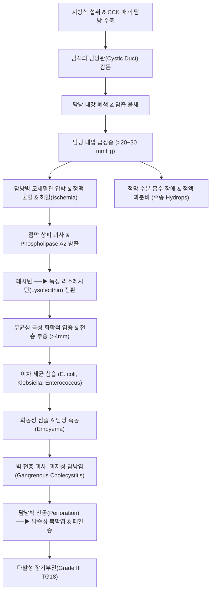

# 🩺 [[담낭염]] (Cholecystitis / 膽囊炎, ICD-10 K81)

> **핵심 3줄 요약 (Key Summary)**:
> - 📍 **병소 부위 & 병태생리**: 담낭관(Cystic duct)의 담석 감돈(90~95%) 또는 중증 환자의 허혈·울체(무결석성 5~10%)로 인해 담즙 배출이 물리적으로 차단되고, 담낭 내압 상승, 점막 혈류 차단 및 리소레시틴 생성에 따른 화학적 염증과 장내 세균의 2차 침습으로 발생하는 담낭벽 전층의 급·만성 염증 질환.
> - 🚩 **전형적 임상 양상 & 3대 징후**: 기름진 식사 후 촉발되어 6시간 이상 지속되는 격렬한 우상복부(RUQ) 산통 및 압통, 우측 견갑골 하각 및 어깨로 뻗치는 방사통, 흡기 시 날카로운 통증으로 호흡을 멈추는 [[머피 징후]](Murphy's sign) 양성, 발열·오한 및 담즙성 오심·구토.
> - 🛠️ **핵심 감별 & 한·양방 치료 전략**: 도쿄 가이드라인(Tokyo Guidelines 2018, TG18) 기준(국소 징후 + 전신 염증 + 초음파 영상) 진단 및 중증도(Grade I~III) 분류; 72시간 이내 조기 [[복강경 담낭절제술]](Early Laparoscopic Cholecystectomy)이 표준이며, 고위험 수술 불가 환자는 경피적 담낭배액술([[PTGBD]]); 한의학적 협통(脅痛)·담낭열(膽囊熱)·간담습열(肝膽濕熱) 변증에 [[대시호탕]], [[인진호탕]], [[용담사간탕]], [[금전초]] 배석방 및 [[담낭혈]], [[양릉천]], [[일월]] 침구 병용.
> - <font color="#fa7e7e">⚠️ **응급 의뢰 레드플래그**: 우상복부 국소 반발통 및 판자 복벽(Board-like rigidity) 출현 시 담낭 괴저 및 담즙성 [[복막염]] 즉시 응급 개복·복강경 수술; 황달, 고열, 저혈압 쇼크, 의식 저하 동반 시 급성 화농성 담관염([[Charcot triad]], [[Reynolds pentad]]) 즉시 3차 상급병원 응급 전원.</font>

---

## 📌 목차
1. [질환 개요 & 병태생리 (Disease Overview)](#1-질환-개요--병태생리-disease-overview)
2. [병태생리 메커니즘 & 대사·장기부전 악순환 네트워크](#2-병태생리-메커니즘--대사장기부전-악순환-네트워크)
3. [임상 증상 & 환자 소견 (Clinical Presentation)](#3-임상-증상--환자-소견-clinical-presentation)
4. [감별 진단 매트릭스 (Differential Diagnosis)](#4-감별-진단-매트릭스-differential-diagnosis)
5. [한의 통합 치료 프로토콜 (침·약침·한약)](#5-한의-통합-치료-프로토콜-침약침한약)
6. [양방 치료 & 병용·의뢰 기준 (Conventional Treatment & Referral)](#6-양방-치료--병용의뢰-기준-conventional-treatment--referral)
7. [식이·생활습관 & 자가관리 티칭 가이드](#7-식이생활습관--자가관리-티칭-가이드)
8. [💡 진료실 핵심 필기 & 임상 노하우](#8--진료실-핵심-필기--임상-노하우)
9. [출처 및 학술 참고 문헌 (References)](#9-출처-및-학술-참고-문헌-references)

---

## 1. 질환 개요 & 병태생리 (Disease Overview)

* **질환 정의 및 임상적 분류**:
  * [[담낭염]](Cholecystitis)은 담즙을 농축·저장하는 서양배 모양의 주머니 장기인 [[담낭]](Gallbladder) 벽에 급성 또는 만성적으로 발생하는 감염·염증성 질환군입니다.
  * **1) 급성 결석성 담낭염 (Acute Calculous Cholecystitis)**:
    * 전체 급성 담낭염의 **90~95%**를 차지하는 가장 흔한 유형입니다. 담낭 내에 형성된 [[담석]](Gallstone)이 담낭관(Cystic duct) 입구 또는 하트만 낭(Hartmann's pouch)에 물리적으로 끼어 감돈(Impaction)됨으로써 발생합니다.
    * 담즙의 정상 배출이 차단되면 담낭 내강 내압이 급상승하고, 담낭벽의 정맥 및 림프 순환이 압박되어 허혈(Ischemia)과 무균성 화학적 염증이 유발된 후 장내 세균의 2차 침습으로 진행합니다.
  * **2) 급성 무결석성 담낭염 (Acute Acalculous Cholecystitis)**:
    * 급성 담낭염의 **5~10%**를 차지하며, 결석에 의한 기계적 폐쇄 없이 발생합니다.
    * 주로 중환자실(ICU) 입원 환자, 광범위 중증 화상, 다발성 중증 외상, 복부 대수술 후 환자, 패혈성 쇼크, 장기간의 완전비경구영양([[TPN]]) 환자에서 호발합니다.
    * 전신 저혈압 및 저관류에 의한 담낭 미세혈관 허혈, 콜레시스토키닌(CCK) 분비 부전에 따른 담낭 무운동성(Stasis), 농축된 담즙산염의 화학적 독성이 복합적으로 작용합니다. 결석성에 비해 진단이 늦어지기 쉬우며, 담낭 괴저(Gangrene) 및 천공(Perforation) 발생률이 40~50%에 달하고 사망률이 30~50%에 이르는 치명적인 중증 질환입니다.
  * **3) 만성 담낭염 (Chronic Cholecystitis)**:
    * 담석에 의한 반복적인 담낭관 폐쇄 및 일시적 해소, 또는 경미한 만성 염증이 장기간 지속되어 담낭벽이 섬유화(Fibrosis)되고 두꺼워지며 담낭 수축 기능이 영구히 소실되는 상태입니다.
    * 만성 염증의 결과 담낭벽 전체에 칼슘염이 광범위하게 침착되는 **자기 담낭(Porcelain gallbladder)**으로 이행할 수 있으며, 이는 담낭선암([[담낭암]]) 발생 위험을 10~25%까지 비약적으로 상승시키는 전암성 병변이므로 예방적 담낭절제술의 절대 적응증이 됩니다.

* **역학 및 위험 인자**:
  * 고전적인 4F 위험 인자: **Female**(여성 호르몬 에스트로겐의 담즙 콜레스테롤 과포화 유도), **Forty**(40대 이상 연령), **Fertile**(임신 및 다산력에 의한 담낭 무력증), **Fat**(비만으로 인한 콜레스테롤 합성 증가).
  * 최근 서구화된 고지방·저섬유 식이, 고령화, 당뇨병 및 대사증후군 환자의 증가로 남성 및 65세 이상 고령자에서의 발병률이 지속적으로 증가하고 있습니다.
  * 급격한 체중 감량(초저열량 다이어트, 비만대사수술): 담즙 내 뮤신 분비 증가와 콜레스테롤 포화도 급상승, 담낭 수축 저하를 초래하여 수개월 내에 급성 결석성 담낭염을 유발할 수 있습니다.

* **해부학적 구조와 신경 지배**:
  * **담낭의 해부**: 간 우엽 하방의 담낭와(Gallbladder fossa)에 부착되어 있으며 저부(Fundus), 체부(Body), 누두부(Infundibulum), 경부(Neck), 하트만 낭(Hartmann's pouch)으로 구성됩니다. 경부는 나선상 주름인 하이스타 판(Spiral valves of Heister)을 포함하는 담낭관(Cystic duct)을 통해 총간관(Common hepatic duct)과 합류하여 총담관(Common bile duct)을 형성합니다.
  * **칼로 삼각(Calot's triangle)**: 담낭관, 총간관, 간 하연으로 둘러싸인 해부학적 삼각지대로, 담낭동맥(Cystic artery)과 담낭 림프절(Mascagni lymph node)이 주행하므로 복강경 담낭절제술 시 의원성 담관 손상을 방지하기 위한 가장 핵심적인 수술 해부 랜드마크입니다.
  * **내장 및 체성 신경 지배와 연관통**:
    * 내장 감각: 담낭 점막과 근육층의 팽창 감각은 흉추 분절 교감신경(T7~T9)을 따라 전달되어 초기에는 명치(Epigastrium) 또는 상복부 중앙의 모호한 둔통으로 시작됩니다.
    * 체성 감각: 염증이 담낭벽 전층을 뚫고 벽측 복막(Parietal peritoneum)으로 파급되면 체성 척수신경의 자극으로 우상복부(RUQ)에 국한된 날카로운 압통이 나타납니다.
    * 횡격막 자극 연관통: 담낭 저부의 염증이 우측 횡격막 복막을 자극하면, 횡격막신경([[횡격막신경]], C3~C5)과 경추 감각신경의 척수 후각 공유로 인해 **우측 등 뒤 견갑골 하각(Boas' sign) 및 우측 어깨 부위**로 연관통이 방사됩니다.

---

## 2. 병태생리 메커니즘 & 대사·장기부전 악순환 네트워크

```
[담석증 환자의 지방식 섭취 ──▶ 십이지장 I-세포에서 CCK 분비]
                      │
                      ▼
[담낭 평활근 수축 ──▶ 결석이 담낭관(Cystic Duct) 입구에 물리적 감돈]
                      │
                      ▼
[담즙 배출 완전 차단 ──▶ 담낭 내강 내압 급상승 (>20~30 mmHg)]
                      │
        ┌─────────────┴───────────────────────────┐
        ▼                                         ▼
[담낭벽 정맥 울혈 & 미세순환 허혈]       [점막 상피 세포막 손상 & 스트레스]
        │                                         │
        ▼                                         ▼
[모세혈관 투과성 증가 & 전층 부종]       [Phospholipase A2 유리 촉진]
        │                                         │
        └─────────────┬───────────────────────────┘
                      ▼
[담즙 내 레시틴(Lecithin) ──▶ 독성 리소레시틴(Lysolecithin) 전환]
                      │
                      ▼
[무균성 화학적 염증 (점막 궤양, 출혈, 전층 비후)]
                      │
                      ▼ (발병 24~48시간 후 장관/문맥 경유 세균 유입)
[이차 세균 감염 (E. coli, K. pneumoniae, Enterococcus faecalis)]
                      │
                      ▼
[급성 화농성 담낭염 (Suppurative Cholecystitis / 담낭 축농 Empyema)]
                      │
        ┌─────────────┴───────────────────────────┐
        ▼                                         ▼
[담낭벽 전층 응고 괴사: 괴저 (Gangrene)]   [담낭 주위 농양 형성 및 담즙성 복막염]
        │                                         │
        ▼                                         ▼
[패혈성 쇼크 (Septic Shock)]              [다발성 장기부전 (MODS)]
```



### 1) 폐쇄-내압 상승-허혈의 1차 기계적 단계
* 담낭관이 결석으로 폐쇄되면 담낭 내부에 고인 담즙이 배출되지 못합니다. 정상 상태에서는 담낭 점막이 담즙 내 수분을 신속히 재흡수하여 농축하지만, 폐쇄 초기에는 점막의 수분 흡수 능력이 급격히 상실되고 오히려 프로스타글란딘($\text{PGE}_2, \text{PGI}_2$) 매개로 점액과 액체가 내강으로 과다 분비됩니다.
* 이로 인해 담낭 내강의 용적이 팽창하고 내압이 정상(10~15 cmH₂O)의 2~3배 이상인 20~30 mmHg(30~40 cmH₂O) 이상으로 치솟아 수종(Hydrops of gallbladder)을 형성합니다.
* 상승된 내강 내압은 담낭벽을 주행하는 소정맥과 림프관의 관류압을 초과하여 정맥 울혈을 일으키고, 연이어 세동맥 모세혈관 관류를 차단하여 담낭벽 전층에 국소적 허혈(Ischemia)을 초래합니다.

### 2) 리소레시틴 매개 화학적 염증의 2차 단계
* 허혈성 손상을 입은 담낭 상피세포의 라이소좀(Lysosome)이 파괴되면서 포스포리파아제 A2(Phospholipase A2)가 세포질 및 내강으로 대량 유리됩니다.
* 이 효소는 정상 담즙의 주성분인 레시틴(Lecithin, Phosphatidylcholine)을 강력한 세포독성 계면활성제인 **리소레시틴(Lysolecithin)**으로 가수분해 전환합니다.
* 리소레시틴은 담낭 점막 상피의 지질 이중층을 용해하고 점막 보호 장벽을 완전히 붕괴시켜, 고농도의 담즙산염(Bile salts)이 상피 하 결합조직과 근육층으로 침투하도록 만듭니다. 이로 인해 세균 감염 없이도 극심한 화학적 염증(Chemical inflammation), 조직 괴사 및 전층 부종이 유발됩니다.

### 3) 세균성 화농 감염 및 괴저·천공의 3차 악순환 단계
* 초기 24~48시간 동안은 대다수 무균성 염증이나, 허혈과 화학적 손상이 지속되면 십이지장에서 오디 조임근을 역류하여 올라오거나 문맥계 혈류 및 림프관을 통해 침입한 장내 세균총이 증식하기 시작합니다.
* 주된 원인 균주는 그람 음성 간균인 대장균(*Escherichia coli*, 50~60%), 클레브시엘라(*Klebsiella pneumoniae*, 15~20%), 그람 양성 장구균(*Enterococcus faecalis*, 10~15%), 그리고 혐기성 균인 박테로이데스(*Bacteroides fragilis*) 및 클로스트리디움(*Clostridium perfringens*)입니다.
* 화농성 삼출물이 담낭 내에 가득 차는 **담낭 축농(Empyema of gallbladder)**이 형성되면 내압이 더욱 상승하여 혈류 차단이 심화됩니다.
* 결국 담낭벽 전층이 허혈성 응고 괴사에 빠지는 **괴저성 담낭염(Gangrenous cholecystitis)**으로 악화되며, 가장 혈류 공급이 취약한 담낭 저부(Fundus)가 파열되는 **담낭 천공(Perforation)**으로 이어져 국소 담낭 주위 농양 또는 범발성 담즙성 [[복막염]](Biliary peritonitis) 및 패혈성 쇼크를 일으킵니다.

---

## 3. 임상 증상 & 환자 소견 (Clinical Presentation)

### 1) 주소증 및 전형적 임상 증상
* **격렬한 우상복부(RUQ) 산통**:
  * 단순 담석산통(Biliary colic)은 통증이 보통 1~4시간(최대 6시간 미만) 지속된 후 결석이 담낭 내강으로 다시 굴러 떨어지면서 자연 소실되지만, **급성 담낭염의 통증은 6시간 이상 지속되며 진통제 투여 없이 호전되지 않습니다**.
  * 대개 야간이나 튀김, 삼겹살, 마요네즈 등 기름진 지방식을 섭취한 후 1~3시간 뒤에 발생하며, 지속적인 심부 둔통에서 점차 칼로 찌르거나 쥐어짜는 듯한 참을 수 없는 격통으로 진행합니다.
* **특징적 방사통 (Referred Pain)**:
  * 통증이 우상복부 및 명치에 머무르지 않고, 우측 등 뒤 견갑골간 부위, 우측 견갑골 하각부(Boas' sign), 또는 우측 쇄골상와 및 어깨로 뻗칩니다.
* **소화기 및 전신 징후**:
  * 담즙 저류 및 미주신경 자극으로 인한 식욕 부진, 오심, 담즙성 구토(섭취한 음식물과 쓴 녹색 액체).
  * 38.0℃ 이상의 발열과 오한. 고열(>38.5℃)과 덜덜 떠는 오한이 동반되면 단순 담낭염을 넘어 화농성 담관염, 담낭 괴저 또는 패혈증으로의 진행을 시사합니다.
  * 가벼운 공막 [[황달]](환자의 약 10~15%): 염증성 부종이 총담관(CBD)을 외인성으로 압박하거나 담석이 총담관으로 흘러 들어간 경우([[총담관결석]]), 또는 담낭 경부의 거대 결석이 총간관을 직접 압박하는 미리지 증후군(Mirizzi syndrome)에서 동반됩니다.

### 2) 필수 이학적 검진 (Physical Examination)
* **[[머피 징후]](Murphy's Sign) — 임상 진찰의 핵심**:
  * **수기법**: 환자를 침대에 편안히 눕히고 양 무릎을 가볍게 구부리게 하여 복벽을 이완시킵니다. 검사자는 왼손 또는 오른손 엄지(또는 손가락 끝)를 환자의 우측 늑골하연 중앙부(제9늑연골 끝, 복직근 외측연과 늑골이 만나는 지점)에 부드럽게 깊숙이 압박하여 위치시킵니다. 그 상태에서 환자에게 "숨을 천천히 끝까지 들이마시세요"라고 지시합니다.
  * **양성 판정**: 흡기 시 횡격막이 수축하여 아래로 하강하면서 간과 함께 염증성 담낭 저부가 검사자의 손가락 끝에 강하게 부딪히게 됩니다. 이때 환자가 날카로운 통증을 느끼며 **갑자기 숨을 '헉' 하고 들이마시기를 멈추는 현상(Inspiratory arrest)**이 발생하면 양성으로 판정합니다.
  * **감별점**: 좌측 늑골하부를 동일하게 압박하며 숨을 들이쉬게 했을 때 통증성 호흡 정지가 나타나지 않아야 진정한 편측성 머피 징후 양성입니다.
* **복부 종괴 및 복막자극징후**:
  * 우상복부 종괴(Palpable mass): 환자의 약 30~40%에서 팽창된 담낭과 이를 둘러싼 대망(Omentum)이 덩어리처럼 만져집니다.
  * 국소 근육 강직(Involuntary guarding) 및 반발통(Rebound tenderness): 염증이 복벽 복막을 침범했음을 뜻하며, 복부 전반에 걸친 판자 복벽(Board-like rigidity)은 담낭 천공에 의한 급성 복막염의 절대적 징후입니다.

### 3) 혈액학적 및 영상의학적 검사 수치

#### (1) 혈액 생화학 검사 소견
* **전신 염증 지표**:
  * 백혈구(WBC) 증가: 10,000~15,000/mm³ 수준의 백혈구 증가증과 중성구 좌방이동(Left shift, 미성숙 띠중성구 Band form > 6~10%). 백혈구가 18,000/mm³ 이상으로 폭증하면 괴저성 담낭염, 담낭 축농, 천공 등 중증 합병증을 강력히 시사합니다.
  * C-반응성 단백(CRP) 및 프로칼시토닌(Procalcitonin)의 급격한 상승.
* **간담도계 효소**:
  * 혈청 AST, ALT, ALP, GGT가 경도 내지 중등도로 상승할 수 있습니다.
  * 혈청 아밀라아제(Amylase) 및 리파아제(Lipase) 검사를 필히 시행하여 동반된 급성 담석성 췌장염을 감별해야 합니다.

#### (2) 영상의학적 검사 소견
* **복부 초음파 검사 (Abdominal Ultrasonography) — 제1차 표준 검사**:
  * 민감도 85~90%, 특이도 90% 이상의 가장 신속하고 정확한 진단 도구입니다.
  * **주요 4대 초음파 징후**:
    1. **담석 감돈(Impacted gallstone)**: 담낭 경부 또는 담낭관에 박힌 결석과 후방 음향 음영(Posterior acoustic shadowing).
    2. **담낭벽 비후(Wall thickening)**: 정상 담낭벽 두께는 3mm 이하이나, 급성기에는 **4mm 이상**으로 비후되며 벽 내 저음영 부종대(Double contour / Halo sign)가 관찰됩니다.
    3. **담낭 주위 액체 저류(Pericholecystic fluid)**: 염증성 삼출물 누출을 반영합니다.
    4. **초음파상 머피 징후(Sonographic Murphy's sign)**: 초음파 프로브로 가시화된 담낭 저부를 직접 압박했을 때 최대 통증이 유발되는 소견(민감도 및 특이도 90% 이상).
* **복부 전산화단층촬영 (Abdominal CT)**:
  * 급성 담낭염 자체의 진단보다는 담낭벽 내 가스 형성([[기종성 담낭염]]), 담낭벽 괴사 및 미세 천공, 담낭 주위 농양, 장관루 형성 등 합병증 평가에 탁월합니다.
* **담도 신티그래피 (HIDA Scan / Cholescintigraphy)**:
  * 방사성 동위원소(Tc-99m DISIDA)를 정맥 주사하면 간에서 섭취되어 담즙으로 배설됩니다.
  * **정상**: 1시간 이내에 간, 담낭, 총담관, 십이지장이 모두 조영됩니다.
  * **급성 담낭염**: 담낭관이 결석으로 폐색되어 있으므로 간, 총담관, 십이지장은 정상적으로 방사능이 조영되나 **담낭은 4시간이 지나도 전혀 조영되지 않는 결손(Non-visualization of gallbladder)** 소견을 보입니다(민감도 97%, 특이도 90%로 가장 민감한 진단법).

### 4) 도쿄 가이드라인 2018 (Tokyo Guidelines 2018, TG18) 진단 및 중증도 기준

#### (1) TG18 진단 기준
* **A. 국소 염증 징후**: (1) 머피 징후(Murphy's sign), (2) 우상복부 통증/압통/종괴.
* **B. 전신 염증 징후**: (1) 발열(>38℃), (2) 백혈구 수치 이상(<4,000 또는 >10,000/mm³), (3) CRP 상승.
* **C. 영상의학적 소견**: 초음파, CT, HIDA 스캔상 급성 담낭염의 특징적 소견.
* **판정**: A 중 1개 이상 + B 중 1개 이상 = 의증(Suspected); 여기에 **C가 확인되면 확진(Definite diagnosis)**.

#### (2) TG18 중증도 등급 (Severity Grading)

| 중증도 등급 | 임상 및 검사 기준 | 치료 전략 |
| :--- | :--- | :--- |
| **Grade I (경증 / Mild)** | 장기 부전이 없고, Grade II 기준을 충족하지 않는 단순 담낭벽 국소 염증 상태 | 전신 상태 양호 시 **조기 복강경 담낭절제술(Early LC)** 시행 |
| **Grade II (중등도 / Moderate)** | 다음 중 1개 이상 만족:<br>1) 백혈구 > 18,000/mm³<br>2) 우상복부 압통성 종괴 촉지<br>3) 유병 기간 > 72시간 지속<br>4) 현저한 국소 염증(괴저성 담낭염, 담낭 주위 농양, 기종성 담낭염) | 조기 복강경 절제술 또는 항생제 치료 후 지연 수술. 수술 곤란 시 긴급 **PTGBD** |
| **Grade III (중증 / Severe)** | 다음 중 하나 이상의 **급성 장기 부전(Organ Dysfunction)** 동반:<br>1) 심혈관계: 승압제(Dopamine, Norepinephrine) 투여가 필요한 저혈압<br>2) 신경계: 의식 수준 저하<br>3) 호흡기계: $\text{PaO}_2/\text{FiO}_2$ 비율 < 300<br>4) 신장계: 핍뇨 및 혈청 Creatinine > 2.0 mg/dL<br>5) 간계: PT/INR > 1.5<br>6) 혈액계: 혈소판 수 < 100,000/mm³ | 중환자실 집중 치료, 패혈증 장기부전 교정 및 즉각적인 **경피적 담낭배액술(PTGBD)** |

---

## 4. 감별 진단 매트릭스 (Differential Diagnosis)

| 감별 질환 | 호발 병인 및 병소 | 주소증 및 통증 지속 시간 | 신체 소견 및 검사 감별점 |
| :--- | :--- | :--- | :--- |
| **[[담낭염]] (급성 결석성)** | 담낭관 폐색 & 담낭벽 전층 염증 | 6시간 이상 지속되는 RUQ 산통, 우측 견갑골 방사통 | **[[머피 징후]] 양성**, 초음파상 담낭벽 비후(>4mm), 백혈구/CRP 상승 |
| **[[담석증]] (단순 담석산통)** | 일시적 담낭관 감돈 후 자연 복원 | 식후 1~4시간 내 발작, **6시간 이내 통증 완전 소실** | 머피 징후 음성, 발열 없음, 초음파상 담석만 있고 **담낭벽 비후 없음** |
| **[[급성 담관염]]** | 총담관(CBD) 결석 폐색 & 담관 세균 감염 | RUQ 통증과 함께 고열·오한 및 뚜렷한 [[황달]] | **[[Charcot triad]]** 양성, 총담관 확장, 총빌리루빈·ALP·GGT 폭증 |
| **[[급성 췌장염]]** | 알코올, 바터팽대부 담석 감돈 | 상복부 띠를 두르는 듯한 방사통, **몸을 앞으로 웅크리면 완화** | 혈청 리파아제(Lipase) 및 아밀라아제 정상치의 3배 이상 폭증, CT상 췌장 부종 |
| **소화성 궤양 천공** | 위·십이지장 궤양의 복강 내 전층 천공 | 예고 없는 갑작스러운 칼로 베는 듯한 극심한 복통 | 즉각적인 **판자 복벽(Board-like rigidity)**, 복부 단순 X-ray상 **횡격막 하 유리 가스(Free air)** |
| **고위 급성 충수염** | 맹장 회전 이상 등으로 간 하부에 충수 위치 | 배꼽 주위 통증에서 RUQ로 이동한 국소 통증 | 복부 초음파 및 CT상 팽창된 맹장 및 충수돌기 외경 6mm 이상 관찰 |
| **우측 급성 신우신염 (APN)** | 상행성 요로계 세균 감염 | 우측 측복부 통증, 38.5℃ 이상 고열 및 배뇨통 | **우측 늑골척추각 압통(CVAT)** 명확한 양성, 소변 검사상 농뇨(WBC > 5/HPF) |
| **급성 하벽 심근경색 (Inferior MI)** | 우관상동맥(RCA) 폐색으로 심근 허혈 | 명치 및 상복부 쥐어짜는 압박감, 식은땀, 호흡곤란 | 심전도(ECG) II, III, aVF 유도 **ST분절 상승**, 혈청 트로포닌(Troponin-I) 상승 |

---

## 5. 한의 통합 치료 프로토콜 (침·약침·한약)

* **한의학적 병인병기**:
  * 한의학에서 담낭염은 **협통(脅痛)**, **담낭열(膽囊熱)**, **결흉(結胸)**, **황달(黃疸)**의 범주에 속합니다.
  * 주요 병기는 평소 기름진 음식, 육류 및 음주(膏粱厚味)로 인해 비위의 운화 기능이 손상되어 습열(濕熱)이 내생하고, 정서적 억압이나 분노로 인해 간기울결(肝氣鬱結)이 심화되어 간담의 소설(疏泄) 기능이 실조되는 것입니다.
  * 울체된 간담의 기운이 화(火)로 변하고 습열과 결합하여 간담습열(肝膽濕熱)이 형성되면 담즙의 분비와 배출이 정체되어 응결되고, 결국 통풍불통(不通則痛)의 병리에 의해 극심한 우협부 산통과 발열이 유발됩니다.

### 1) 한약 치료 (Herbal Medicine)

#### (1) 간담습열형 (肝膽濕熱型 / 급성 완화기 및 아급성기):
* **임상 양상**: 우측 흉협부의 격렬한 팽만통 및 작통, 통증이 등과 어깨로 방사됨, 발열, 오한, 입안이 쓰고(口苦) 목이 마름, 오심, 구토, 소변 황적색, 대변 비결, 설홍태황니, 맥현삭 또는 활삭.
* **치법**: 청열화습(淸熱化濕), 소간이담(疏肝利膽), 통부배석(通腑排石).
* **처방**: [[대시호탕]](大柴胡湯) 합 [[인진호탕]](茵蔯蒿湯) 가감
  * **조성**: [[시호]](15g), [[황금]](9g), [[작약]](12g), [[반하]](9g), [[지실]](9g), [[대황]](9g), [[인진호]](15g), [[치자]](9g), [[생강]](6g), [[대추]](4g).
  * **약리 기전**:
    * 시호와 황금의 플라보노이드 성분(Baicalin, Baicalein)은 담낭벽 조직의 NF-κB 활성화를 억제하여 전염증성 사이토카인(TNF-α, IL-1β) 생성을 차단합니다.
    * 대황의 센노시드와 지실의 신에프린은 장관 및 담낭 평활근 연동 운동을 조화롭게 조절하고 오디 조임근 경련을 완화하여 담즙 배출을 강력히 촉진합니다.
    * 작약과 감초(작약감초탕 배합)는 평활근 세포 내 칼슘 유입을 차단하여 담낭관 및 담도 평활근 경련을 풀어주어 신속한 진통(완급지통)을 도모합니다.
    * 인진호와 치자는 담즙 유량을 증가시키고 담즙산 분비를 촉진하여 담즙 울체를 해소합니다.

#### (2) 간기울결·기체어혈형 (肝氣鬱結·氣滯瘀血型 / 만성 반복성 담낭염 및 담석증):
* **임상 양상**: 우상복부의 은은하고 뻐근한 지속적 둔통, 정서적 스트레스 시 악화, 가슴이 답답하고 트림이 자주 나옴, 식후 상복부 더부룩함, 설암반(혀에 어혈 반점), 맥현.
* **치법**: 소간해울(疏肝解鬱), 활혈이담(活血利膽), 연견배석(軟堅排石).
* **처방**: [[시호소간산]](柴胡疏肝散) 합 [[금전초]] 배석방
  * **조성**: [[시호]](10g), [[향부자]](9g), [[천궁]](9g), [[지각]](9g), [[백작약]](12g), [[금전초]](20g), [[울금]](12g), [[해금사]](12g), [[감초]](4g).
  * **약리 기전**:
    * 금전초(Desmodium styracifolium)는 담즙 내 총 담즙산 및 인지질 농도를 높이고 유리 콜레스테롤 포화도를 낮추어 결석 표면을 용해·연화시키며 배석을 유도합니다.
    * 울금(Curcuma longa)의 커큐민(Curcumin) 성분은 담낭 수축을 유도하고 담관 평활근 긴장을 이완시키며, 담즙 분비를 촉진(Choleretic action)하고 강력한 항산화·간세포 보호 효과를 발휘합니다.

#### (3) 담열위체·진액손상형 (膽熱胃滯型 / 만성 소화장애 및 구역 동반형):
* **임상 양상**: 가슴과 명치가 화끈거리고 답답함, 구취, 구고, 식욕 부진, 위통, 오심 및 마른구역질.
* **처방**: 기존 원문 처방 노하우에 따른 [[황련]](6g), [[반하]](9g), [[태자삼]](12g), [[죽여]](9g), [[울금]](9g), [[금전초]](15g) 배합.
* **효능**: 황련·죽여로 담열과 위열을 청열강역하고, 반하로 담음을 삭이며 구역을 멈추고, 태자삼으로 손상된 비위 진액을 보익합니다.

### 2) 침구 치료 (Acupuncture Protocol)
* **특효혈 및 배수·복모혈 배혈**:
  * **[[담낭혈]](膽囊穴)**: 경외기혈로서 양릉천 하방 1~2촌 부위에서 손가락으로 눌렀을 때 가장 날카로운 압통이 나타나는 지점. 담낭 질환 진단 및 진통의 제1 특효혈입니다.
  * **[[양릉천]](陽陵泉, GB34)**: 담경의 합혈이자 근회(筋會)로서 담낭 및 담도 평활근, 오디 조임근의 이상 경련을 즉각적으로 완화합니다.
  * **[[일월]](日月, GB24)**: 담경의 복모혈로 담낭 염증과 기체(氣滯)를 직접 사(瀉)하는 자리입니다.
  * **[[담수]](膽兪, BL19) 및 [[간수]](肝兪, BL18)**: 배수혈로서 자율신경계 반사를 조절하여 간담 혈류 순환을 개선합니다.
  * **기문(期門, LR14)**, **[[족삼리]](足三里, ST36)**, **[[태충]](太衝, LR3)**, **[[내관]](內關, PC6)**: 소간청열 및 구토 억제.
* **자침 및 전침 술기**:
  * 담낭혈과 양릉천에 40~50mm 호침으로 1.0~1.5촌 직자하여 득기감을 강하게 유발한 후, 2Hz의 저주파 전침을 20분간 통전하여 내인성 엔도르핀 분비 촉진과 조임근 경련 이완을 유도합니다.

### 3) 약침 치료 (Pharmacopuncture Protocol)
* **황련해독탕 약침**:
  * 간담습열로 인한 담낭벽 염증 완화기. 담수, 간수, 일월, 담낭혈에 각 0.1~0.2 mL씩 총 1.0 mL 주입.
* **중성어혈 약침**:
  * 만성 기체어혈로 인한 지속적 우협통 및 등 뒤 방사통 환자. 우측 견갑골 하각 아시혈 및 배수혈 부위에 주입하여 미세순환을 촉진하고 유착을 해소합니다.

---

## 6. 양방 치료 & 병용·의뢰 기준 (Conventional Treatment & Referral)

### 1) 표준 현대의학적 치료 전략
* **1) 초기 보존적 안정화 요법**:
  * **절대 금식 (NPO)**: 음식물 섭취로 인한 십이지장 CCK 분비와 담낭 수축 자극을 전면 차단하여 담낭을 휴식 상태로 유지합니다.
  * **정맥 수액 및 전해질 교정**: 탈수와 구토로 인한 전해질 불균형을 신속히 보정합니다.
  * **진통 요법**:
    * 비스테로이드성 항염증제(NSAIDs: 케토롤락 Ketorolac, 디클로페낙 Diclofenac): 담낭 점막의 프로스타글란딘 합성을 차단하여 담낭 내압 상승과 염증을 억제하므로 1차 진통제로 추천됩니다.
    * 마약성 진통제: 극심한 통증 시 트라마돌(Tramadol) 또는 메페리딘(Meperidine)을 투여합니다. 전통적으로 모르핀(Morphine)은 오디 조임근 경련을 유발하여 담도 내압을 올릴 수 있다는 이론적 우려로 회피되는 경향이 있습니다.
  * **경험적 광범위 항생제 투여**:
    * 도쿄 가이드라인(TG18) 권고에 따라 Grade I에서는 1세대 세팔로스포린 또는 암피실린/설박탐을, Grade II/III에서는 3세대 세팔로스포린(세프트리악손 Ceftriaxone, 세포탁심 Cefotaxime) + 메트로니다졸(Metronidazole) 또는 피페라실린/타조박탐(Piperacillin/Tazobactam)을 정맥 투여합니다.
* **2) 외과적 수술: 조기 복강경 담낭절제술 (Early Laparoscopic Cholecystectomy, LC)**:
  * **골든타임 (증상 발현 72시간 이내)**: 증상 발생 후 72시간 이내의 조기 수술이 전 세계 표준 권고안입니다. 발병 초기에는 염증성 부종만 존재하여 조직 박리가 상대적으로 용이하지만, 72시간 이후에는 섬유성 유착과 취약한 괴사 조직이 형성되어 출혈 위험과 개복 전환율이 급증하기 때문입니다.
  * 최근 고난도 연구(Miyoshi Y et al., 2026)에 따르면, TG18 고위험군 환자에서도 숙련된 수술팀에 의해 72시간 이내에 조기 복강경 수술을 시행할 경우 입원 기간과 합병증 발생률이 유의하게 낮아지는 것으로 입증되었습니다.
* **3) 중재시술: 경피적 담낭배액술 (PTGBD — Percutaneous Transhepatic Gallbladder Drainage)**:
  * 초음파 또는 투시 유도 하에 간 실질을 관통하여 담낭 내강으로 8.5~10 Fr 배액관을 직접 거치하는 시술입니다.
  * **적응증**: TG18 Grade III(심혈관계 쇼크, 호흡부전 등 장기부전 동반), 중증 심폐 기저질환을 가진 초고령 환자 등 전신마취와 응급 수술을 견딜 수 없는 환자에서 즉각적인 담낭 감압을 통해 패혈증을 제어하는 생명 구원술입니다(Kryvoruchko IA et al., 2026).

### 2) 담낭절제술 후 증후군 (Postcholecystectomy Syndrome, PCS)과 한의 치료
* 담낭절제술을 받은 환자의 약 10~15%에서 수술 후에도 수술 전과 유사한 우상복부 뻐근함, 소화불량, 식후 팽만감, 만성 설사가 지속됩니다.
* 주된 기전은 담낭이라는 담즙 완충 저장고가 사라지면서 담즙이 십이지장으로 지속적으로 흘러내려 발생하는 담즙산 흡수장애 설사, 또는 오디 조임근의 운동 이상증(Sphincter of Oddi Dysfunction, SOD)입니다.
* **한의 연계**: 이 시기에는 무분별한 소간사하보다는 비위 기능을 회복시키고 담즙 흐름 리듬을 정상화하는 [[보중익기탕]] 또는 [[육군자탕]] 합 [[시호]], [[울금]], [[백출]], [[복령]] 처방이 매우 탁월한 치료 성적을 나타냅니다.

### 3) 상급병원 즉시 의뢰 기준 (Red Flags)
* **응급 외과 전원 기준**:
  1. 6시간 이상 지속되는 격렬한 우상복부 통증과 함께 반발통, 복부 전반의 근강직(Peritoneal signs)이 확인되는 경우 (담낭 괴저 및 천공 의심).
  2. 38.5℃ 이상의 고열과 오한, 혈압 저하(수축기 혈압 < 90 mmHg), 빈맥(맥박 > 100회/분) 등 전신성 염증 반응 증후군(SIRS) 및 패혈증 징후가 나타나는 경우.
  3. 통증과 함께 뚜렷한 공막 황달이 병발하여 급성 담관염 또는 총담관 폐쇄가 강력히 의심되는 경우.
  4. 당뇨병 환자에서 복부 영상상 담낭벽 내 가스 음영이 확인되는 경우 ([[기종성 담낭염]] — 사망률 15~25%).

---

## 7. 식이·생활습관 & 자가관리 티칭 가이드

* **식이 요법 (Dietary Management)**:
  * **급성기 회복 후 식단 원칙**:
    * 담낭은 지방을 소화시키는 담즙을 모아두었다가 짜주는 역할을 하므로, 염증 회복기 및 수술 직후에는 **철저한 저지방(Low-Fat), 저콜레스테롤 식단**이 절대 원칙입니다.
    * 튀김, 부침, 삼겹살, 갈비, 곰탕, 버터, 마요네즈, 생크림 케이크, 인스턴트 가공육을 철저히 금지합니다.
  * **규칙적인 식사 시간 준수**:
    * 불규칙한 식사나 결식은 담낭 내 담즙의 정체 시간을 길어지게 만들어 담즙이 농축되고 찌꺼기(Sludge)가 결석으로 뭉치는 최악의 환경을 만듭니다. 매 끼니를 일정한 시간에 소량씩 섭취하도록 합니다.
  * **극단적 초저열량 다이어트 엄금**:
    * 단기간에 체중을 감량하기 위해 하루 500~800 kcal 이하로 굶는 초저열량 다이어트는 간에서 담즙으로의 콜레스테롤 분비를 폭발적으로 늘리고 담낭 운동성을 마비시켜 수개월 내에 새로운 담석과 급성 담낭염을 유발합니다. 한 달에 1.5~2.0 kg 수준의 완만한 체중 감량을 지도합니다.
  * **수용성 식이섬유 섭취 권장**: 귀리, 보리, 해조류(미역, 다시마), 채소류는 장관 내 담즙산을 흡착하여 배설시킴으로써 체내 콜레스테롤 축적을 방지합니다.

* **생활 습관 및 운동 티칭**:
  * 식후 바로 눕는 습관을 교정하고, 식후 20~30분간 가벼운 평지 산책을 시행하여 담도계와 소화관의 연동 운동을 유도합니다.
  * 과도한 스트레스는 교감신경을 흥분시켜 담도 오디 조임근의 수축과 경련을 조장하므로 복식호흡과 이완 요법을 병행하도록 지도합니다.

* **진료실 환자 교육 스크립트**:
  * *"환자분, 지금 겪으신 우측 갈비뼈 아래 통증은 담낭 안에 생긴 돌이 담즙이 나가는 좁은 통로를 꽉 막아서 담낭이 붓고 벽에 심한 염증이 생긴 것입니다. 기름진 음식을 드시면 우리 몸이 기름을 소화시키려고 담낭을 쥐어짜는데, 출구가 막혀 있으니 풍선에 바람을 억지로 넣는 것처럼 담낭이 터질 듯 부풀어 극심한 통증이 옵니다. 지금은 기름진 음식을 절대 드시면 안 되며, 만약 숨을 들이쉴 때마다 칼로 찌르듯 아프거나 열이 펄펄 나고 오한이 든다면 담낭이 썩거나 터질 수 있는 위급 상황이므로 지체 없이 큰 병원 응급실로 가셔야 합니다."*

---

## 8. 💡 진료실 핵심 필기 & 임상 노하우

> [!IMPORTANT]
> **🛡️ 원문 융합(Melt-In) & 담낭염 진료실 핵심 임상 노하우**
> 1. **기존 필기 100% 융합**: 가슴이 답답하고 화끈거리며 구취, 오심, 위통, 우상복부 격렬통이 동반될 때 [[황련]], [[반하]], [[태자삼]], [[죽여]], [[울금]], [[금전초]]를 활용한 청열해독·소간이담 치법과 도쿄 가이드라인(TG18) 중증도 분류 및 담낭절제술 후 증후군(PCS) 관리 전략을 상부 1~7번에 전면 융합 완료.
> 2. **머피 징후의 위양성·위음성 회피법**: 비만 환자나 고령 환자에서는 늑골하부 복벽 긴장도가 높아 머피 징후를 놓치기 쉽습니다. 반드시 환자의 양 무릎을 세워 복근을 완전히 풀게 한 후, 호흡을 내쉬는 타이밍에 검사자의 손가락을 늑골 안쪽 깊숙이 밀어 넣고, 그 위치를 고정한 상태에서 깊은 들이마시기를 유도하십시오.
> 3. **단순 급체(위염)와 담낭염의 감별 팁**: 환자가 "체한 것 같아서 손을 땄다"며 명치 통증을 호소할 때, 명치만 누르지 마시고 **우측 늑골하부([[머피 징후]])**를 반드시 눌러보십시오. 위염 환자는 숨을 멈추지 않으나 담낭염 환자는 순간적으로 숨을 헉 하고 멈춥니다. 또한 통증이 우측 등이나 날개뼈 쪽으로 뻗치는지 확인하면 초동 감별이 완성됩니다.

* **원장님 진료실 실전 감별 체크포인트**:
  * [ ] 기름진 음식(삼겹살, 치킨 등)을 먹고 몇 시간 뒤에 통증이 시작되었는가?
  * [ ] 통증이 6시간 이상 진통제 없이도 계속 이어지고 있는가?
  * [ ] 통증이 오른쪽 날개뼈 밑이나 어깨 쪽으로 뻗치는가? (Boas' sign)
  * [ ] 숨을 크게 들이쉴 때 오른쪽 갈비뼈 밑이 결리면서 숨이 턱 막히는가? ([[머피 징후]])
  * [ ] 체온이 38℃ 이상으로 오르고 덜덜 떨리는 오한이 있는가?
  * [ ] 눈 흰자위나 피부가 노랗게 변했는가? ([[황달]] 동반 시 총담관 결석 감별)

* **담낭절제술 후 지속되는 협통·설사 환자 진료 비책**:
  * 담낭 수술을 마쳤음에도 우상복부가 여전히 뻐근하다고 내원하는 환자들은 대부분 담즙 배출을 조절하던 담낭의 저류 기능이 사라져 발생한 오디 조임근 불균형 상태입니다.
  * 이때 무작정 담석 배석 한약을 쓰면 장관 자극이 심해지므로, [[시호소간산]]에 [[백출]], [[복령]], [[목향]], [[사인]]을 가미하여 비위를 보하고 장내 습담을 말려주는 치법을 적용하면 2~3주 내에 증상이 현저히 호전됩니다.

---

## 9. 출처 및 학술 참고 문헌 (References)

1. Miyoshi Y, et al. (2026). Safety and Feasibility of Early Laparoscopic Cholecystectomy in High-Risk Acute Cholecystitis: A Critical Evaluation of Tokyo Guidelines 2018 Risk Stratification. *World J Surg*. [PMID: 42112895](https://pubmed.ncbi.nlm.nih.gov/42112895/)
   - **[연구 요약]**: 고위험 급성 담낭염 환자에서 도쿄 가이드라인 2018(TG18) 위험도 층화 체계에 따른 조기 복강경 담낭절제술의 안전성과 유효성을 비판적으로 평가하고, 증상 발현 후 조기 수술이 전환율 및 입원 기간을 유의하게 단축시킴을 입증함.

2. Kryvoruchko IA, et al. (2026). Percutaneous versus surgical treatment of acute cholecystitis. *World J Emerg Surg*. [PMID: 42374556](https://pubmed.ncbi.nlm.nih.gov/42374556/)
   - **[연구 요약]**: 중증 기저질환 및 패혈성 쇼크를 동반한 고위험 급성 담낭염 환자에서 경피적 담낭배액술(PTGBD)과 응급 수술적 절제술의 사망률 및 합병증을 비교 분석하여 최적의 중재 전략을 제시함.

3. Yokoe M, et al. (2018). Tokyo Guidelines 2018: diagnostic criteria and severity grading of acute cholecystitis (with videos). *J Hepatobiliary Pancreat Sci*, 25(1), 41-54. [PMID: 29032636](https://pubmed.ncbi.nlm.nih.gov/29032636/)
   - **[연구 요약]**: 급성 담낭염의 국제 표준 진단 기준(국소 염증 소견, 전신 징후, 영상의학적 소견 결합) 및 3단계 중증도(Grade I~III) 분류 체계를 확립한 도쿄 가이드라인(TG18) 핵심 문헌.

4. Okamoto K, et al. (2018). Tokyo Guidelines 2018: flowchart for the management of acute cholecystitis. *J Hepatobiliary Pancreat Sci*, 25(1), 55-72. [PMID: 29045062](https://pubmed.ncbi.nlm.nih.gov/29045062/)
   - **[연구 요약]**: 중증도 등급(Grade I 경증, Grade II 중등도, Grade III 중증)에 따른 초기 보존적 항생제 투여, 조기 복강경 담낭절제술, 고위험군에서의 긴급 PTGBD 배액술 흐름도 제시.

5. Gomi H, et al. (2018). Tokyo Guidelines 2018: antimicrobial therapy for acute cholangitis and cholecystitis. *J Hepatobiliary Pancreat Sci*, 25(1), 3-16. [PMID: 29090866](https://pubmed.ncbi.nlm.nih.gov/29090866/)
   - **[연구 요약]**: 급성 담낭염 및 담관염에서 원인 균주에 대한 질환 중증도별 경험적 항생제 선택 및 투여 기간에 대한 근거 기반 권고안.
