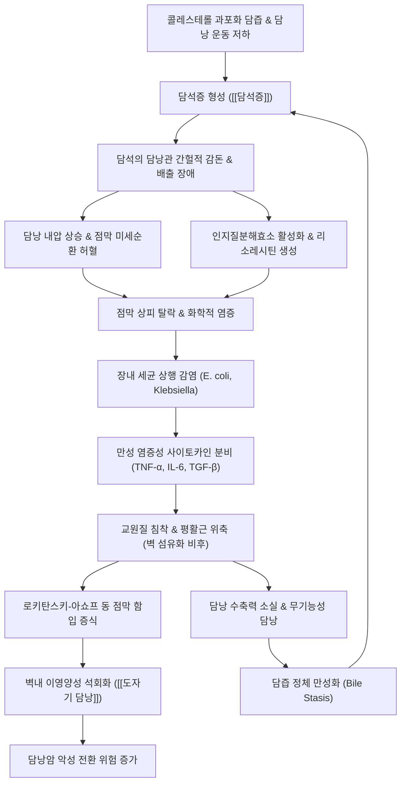

# 🩺 [[만성 담낭염]] (Chronic Cholecystitis / 慢性膽囊炎, ICD-10 K81.1)

> **핵심 3줄 요약 (Key Summary)**:
> - 📍 **병소 부위 & 병태생리**: 담낭 점막 및 근육층([[담낭]]). 담석증([[담석증]])의 기계적 자극과 담낭관의 간헐적 폐색, 세균 감염 및 리소레시틴 생성에 따른 화학적 손상이 반복되어 담낭벽 전층의 만성 염증, 점막 함입([[로키탄스키-아쇼프 동]]), 결합조직 증식 및 섬유화 비후, 담낭 수축력 부전 및 저장·농축 기능 소실을 초래.
> - 🚩 **전형적 임상 양상 & 3대 징후**: 기름진 식사 후 발생하는 1~4시간 지속성의 우상복부·심와부 둔통([[담도산통]]), 우측 견갑골간부 방사통, 만성 소화불량(조기 포만감, 트림, 오심) 및 담즙 울체 시 대변 색조 이상(회백색변/점토색변). 급성 담낭염과 달리 지속적 고열과 뚜렷한 복막자극징후는 결여됨.
> - 🛠️ **핵심 감별 & 한·양방 치료 전략**: 복부 초음파(담석, 담낭벽 비후, WES 징후, 담낭 위축 확인), 전산화단층촬영(CT, [[도자기 담낭]] 석회화 및 악성종양 감별). 양방 표준 치료는 선택적 복강경 담낭절제술이며, 한의학에서는 간담습열·간울기체·기체어혈 변증 하에 [[대시호탕]], [[시호소간산]], [[인진호탕]], 금전초배석방 및 [[양릉천]], [[담낭혈]], [[일월]], [[담수]], [[족삼리]] 침구 치료로 평활근 경련 완화와 담도 유체역학 정상화를 도모.
> - <font color="#fa7e7e">⚠️ **응급 의뢰 레드플래그**: 지속성 극심통(6시간 이상), 고열·오한·황달([[샤르코 3징후]]) 동반 시 급성 화농성 담관염 의심, 복부 반발통 및 근성 방어(담낭 천공·복막염), 복부 CT상 담낭벽 전층 석회화([[도자기 담낭]]) 발견 시 담낭암 발생 고위험군으로 즉각적인 외과 수술 의뢰.</font>

---

## 📌 목차
1. [질환 개요 & 병태생리 (Disease Overview)](#1-질환-개요--병태생리-disease-overview)
2. [병태생리 메커니즘 & 대사·장기부전 악순환 네트워크](#2-병태생리-메커니즘--대사장기부전-악순환-네트워크)
3. [임상 증상 & 환자 소견 (Clinical Presentation)](#3-임상-증상--환자-소견-clinical-presentation)
4. [감별 진단 매트릭스 (Differential Diagnosis)](#4-감별-진단-매트릭스-differential-diagnosis)
5. [한의 통합 치료 프로토콜 (침·약침·한약)](#5-한의-통합-치료-프로토콜-침약침한약)
6. [양방 치료 & 병용·의뢰 기준 (Conventional Treatment & Referral)](#6-양방-치료--병용의뢰-기준-conventional-treatment--referral)
7. [식이·생활습관 & 자가관리 티칭 가이드](#7-식이생활습관--자가관리-티칭-가이드)
8. [💡 진료실 핵심 필기 & 임상 노하우](#8--진료실-핵심-필기--임상-노하우)
9. [출처 및 학술 참고 문헌 (References)](#9-출처-및-학술-참고-문헌-references)

---

## 1. 질환 개요 & 병태생리 (Disease Overview)

### 1) 질환 정의 및 분류
* **정의**: [[만성 담낭염]]은 담낭 내벽에 장기간에 걸쳐 지속적·반복적으로 발생하는 만성 염증성 질환으로, 담낭벽의 결합조직 증식, 섬유화 비후, 평활근 위축 및 점막 변형을 초래하여 담낭 고유의 수축성 배출 기능과 담즙 농축 조절 기능을 비가역적으로 황폐화시키는 병태입니다.
* **병리학적 분류**:
  * **결석성 만성 담낭염 (Chronic Calculous Cholecystitis)**: 전체 만성 담낭염의 90~95%를 차지하며, 담석에 의한 기계적 담낭관 감돈과 담즙 정체가 주된 발병 기전입니다.
  * **무결석성 만성 담낭염 (Chronic Acalculous Cholecystitis)**: 담석 없이 담낭 운동장애, 허혈성 미세혈관 변화, 장기간의 총정맥영양(TPN), 담낭관의 해부학적 굴곡이나 섬유성 유착으로 발생합니다.
  * **황색육아종성 담낭염 (Xanthogranulomatous Cholecystitis, XGC)**: 파열된 로키탄스키-아쇼프 동을 통해 점막하층으로 담즙이 침윤하여 지질을 탐식한 거품조직구(Foamy histiocyte)와 거대세포가 결절을 형성하는 특수 형태로, 영상학적으로 [[담낭암]]과의 감별이 매우 어렵습니다.
  * **[[도자기 담낭]] (Porcelain Gallbladder)**: 만성 염증의 종말 단계에서 담낭벽 전층 또는 점막하층에 광범위한 이영양성 석회화(Dystrophic calcification)가 발생하는 형태로, 담낭선암 발생 위험도가 유의하게 높습니다.
  * **담낭선근종증 (Adenomyomatosis)**: 담낭 상피세포의 과형성과 함께 로키탄스키-아쇼프 동이 근육층 깊숙이 증식하고 평활근 비후가 동반되는 과오종성 병변입니다.

### 2) 역학 및 호발 인자
* **유병률 및 성별 특성**: 성인 인구의 약 10~15%에서 담석이 발견되며, 이 중 증상성 담석 환자의 상당수가 만성 담낭염으로 진행합니다. 여성 대 남성의 비율은 약 2:1~3:1로 여성에서 호발합니다.
* **전통적 위험 인자 ("5F Rule")**:
  * **Female**: 여성호르몬([[에스트로겐]])은 간의 콜레스테롤 합성 및 담즙 분비를 증가시키고, [[프로게스테론]]은 담낭 평활근 수축을 억제하여 담즙 정체를 유발.
  * **Forty**: 40대 이상에서 담즙 내 콜레스테롤 포화도가 상승하고 담도 운동성 감소.
  * **Fat / Fertile**: [[비만]]은 체내 콜레스테롤 합성 증가와 관련되며, 다임신은 호르몬 노출 누적으로 위험 증대.
  * **Fair / Family history**: 백인 및 유전적 감수성([[콜레스테롤]] 수송체 유전자 다형성: ABCG5/G8).
* **현대적 신흥 위험 인자**:
  * 급격한 체중 감량(초저열량 식이, 베리아트릭 수술): 담즙 내 뮤신 분비 증가와 콜레스테롤 결정화 촉진.
  * [[GLP-1 수용체 작용제]](세마글루타이드, 리라글루타이드 등): 위장관 및 담낭 평활근 운동을 억제하여 담낭 배출 지연, 담즙 슬러지 형성 및 담석증 위험을 상승시킴.

### 3) 관련 해부학적 구조물 및 신경 경로
* **[[담낭]] (Gallbladder)**: 간 우엽 하면의 담낭와(Gallbladder fossa)에 부착되어 있으며 길이 7~10 cm, 용적 30~50 mL의 서양배 모양 주머니입니다. 해부학적으로 저부(Fundus), 체부(Body), 누덕부(Infundibulum/Hartmann's pouch), 경부(Neck)로 나뉩니다.
* **담관 배출계**: 담낭경부 $\rightarrow$ 하이스타 나선판포(Spiral valves of Heister)를 포함하는 담낭관(Cystic duct) $\rightarrow$ 총간관(Common hepatic duct)과 합류하여 총담관(Common bile duct, CBD) 형성 $\rightarrow$ 바터 팽대부(Ampulla of Vater) 및 [[오디 조임근]](Sphincter of Oddi)을 거쳐 십이지장 하행부로 개구.
* **신경 지배 및 연관통 기전**:
  * **내장성 구심 신경**: T7~T9 척수 분절에서 기원하는 대내장신경(Greater splanchnic nerve) 및 복강신경총(Celiac plexus)을 통해 주행하며, 담낭 팽창 및 허혈 시 심와부(명치)와 우상복부의 모호한 둔통을 유발.
  * **체성 감각 및 방사통**: 담낭벽의 만성 염증이 장막을 넘어 우측 횡격막 복막을 자극할 경우, C3~C5 척수 신경에서 분지하는 우측 [[횡격막신경]](Phrenic nerve)을 경유하여 우측 어깨 및 견갑골 하각부(Boas' sign)로 방사통이 전달됨.

---

## 2. 병태생리 메커니즘 & 대사·장기부전 악순환 네트워크

### 1) ASCII 병태생리 다이어그램
```text
+-----------------------------------------------------------------------------------+
|                           [만성 담낭염의 병태생리적 진행 네트워크]                       |
+-----------------------------------------------------------------------------------+
  [위험인자: 5F, 비만, 고지방식이, 유전, 급격한 절식, GLP-1 RA 사용]
                             │
                             ▼
  [간세포 콜레스테롤 과포화 분비 + 담즙산/인지질 결핍 + 담낭 운동성 저하]
                             │
                             ▼
  [콜레스테롤 미세결정 석출 및 핵형성 (Microlithiasis) ──> 담즙 슬러지 및 담석 형성]
                             │
                             ▼
  [담석의 담낭관 간헐적 감돈 (Intermittent Cystic Duct Impaction)]
   ┌─────────────────────────┴─────────────────────────┐
   ▼                                                   ▼
[기계적 내강 내압 상승]                             [화학적 자극 및 점막 손상]
 - 담낭 평활근 격렬 수축 (담도산통)                   - 인지질분해효소 A2 활성화
 - 미세혈관 압박 및 점막 허혈                        - 레시틴 ──> 세포독성 리소레시틴 전환
   └─────────────────────────┬─────────────────────────┘
                             ▼
  [반복적인 미세 염증 반응 및 장내 세균 증식 (E. coli, Klebsiella 등)]
                             │
                             ▼
  [점막 궤양·탈락 ──> 림프구·형질세포 만성 침윤 ──> 근육층 교원질 섬유화 침착]
                             │
                             ▼
  [조직학적 변형: 로키탄스키-아쇼프 동(Rokitansky-Aschoff sinuses) 점막 함입 증식]
   ┌─────────────────────────┴─────────────────────────┐
   ▼                                                   ▼
[담낭벽 섬유성 비후 및 근층 위축]                   [이영양성 석회화 (Dystrophic Calcification)]
 - 담낭 수축력 영구 소실                            - 담낭벽 전층 백색 도자기화
 - 무기능성 위축 담낭                               - 도자기 담낭 (Porcelain Gallbladder)
   │                                                   │
   ▼                                                   ▼
[담즙 정체 만성화 & 악순환 지속]                    [담낭 선암종 (Gallbladder Cancer) 이행 위험]
+-----------------------------------------------------------------------------------+
```

### 2) Mermaid 병태생리 악순환 캐스케이드


### 3) 분자·세포 수준 기전
* **화학적 염증 및 리소레시틴의 세포독성**: 담낭관이 일시적으로 폐쇄되면 담낭 점막 세포에서 인지질분해효소 A2(Phospholipase A2)가 유리되어 담즙 내 무해한 레시틴(Lecithin)을 강력한 세포용해성 독소인 리소레시틴(Lysolecithin)으로 전환시킵니다. 리소레시틴은 담낭 점막 상피의 세포막 지질 이중층을 용해하고 점막 보호 장벽을 파괴합니다.
* **프로스타글란딘 매개 염증 반응**: 점막 손상은 프로스타글란딘(PGE2, PGI2)의 국소 합성을 촉진하여 점막 점액 분비를 과도하게 유도하고 혈관 투과성을 증가시키며, 담낭 내강 내 압력을 급격히 상승시켜 허혈을 가속화합니다.
* **만성 염증 세포 침윤 및 교원질 침착**: 반복적인 급만성 손상 주기를 거치며 점막하층과 고유근층에 림프구, 형질세포, 조직구가 지속적으로 침윤합니다. 섬유아세포가 활성화되어 제1형 및 제3형 교원질을 과다 생성하며, 정상적인 평활근 다발이 점진적으로 섬유성 결합조직으로 대체되어 벽 두께가 3~10 mm 이상으로 불규칙하게 비후됩니다.
* **[[로키탄스키-아쇼프 동]](Rokitansky-Aschoff Sinuses)의 형성**: 담낭벽의 결합조직 증가와 지속적인 내압 상승으로 인해, 담낭 점막 상피세포가 근육층의 틈새를 뚫고 점막하층 및 장막하층 깊숙이 낭상(Saccular) 형태로 함입되는 구조물입니다. 이 곁주머니 내에 담즙이 정체되면 미세 담석 침전, 국소 감염의 온상이 되며, 드물게 세균성 농양이나 천공을 유발합니다.
* **이영양성 석회화와 [[도자기 담낭]]**: 만성적인 염증, 점막 궤양 및 미세혈관 허혈이 수십 년간 누적되면 괴사된 조직 잔해에 칼슘염(인산칼슘, 탄산칼슘)이 침착되는 이영양성 석회화가 진행됩니다. 석회화가 담낭벽 전층에 광범위하게 발생하면 도자기 담낭(Porcelain gallbladder)으로 불리며, 만성 점막 자극과 재생성 이형성증(Dysplasia)으로 인해 담낭선암(Gallbladder adenocarcinoma) 발생률이 일반 인구에 비해 유의미하게 상승합니다.

### 4) 담즙 생화학 및 대변 색조 변화의 병태생리
* **정상 담즙 분비 및 대변 착색 기전**: 간세포에서 생성된 비포합 빌리루빈은 간 내에서 글루쿠론산 포합 과정을 거쳐 수용성 포합 빌리루빈으로 전환된 후 담관을 통해 십이지장으로 배출됩니다. 회장 말단 및 결장에 도달한 포합 빌리루빈은 장내 세균의 베타-글루쿠로니다아제 및 환원효소에 의해 유로빌리노겐(Urobilinogen)과 스테르코빌리노겐(Stercobilinogen)으로 환원되며, 공기 중에 산화되어 갈색 색소인 스테르코빌린(Stercobilin)으로 변함으로써 정상 대변의 갈색을 형성합니다.
* **담즙 울체에 의한 회백색변 (Clay-colored / Acholic stool)**:
  * 만성 담낭염 환자에서 담석 이동이나 담낭 경부의 심한 부종, 또는 총담관 결석 합병으로 담관이 완전 또는 아완전 폐색되면 담즙이 십이지장으로 전혀 유입되지 못합니다.
  * 장내 스테르코빌린이 고갈되면서 대변이 착색되지 못해 **회백색(점토색, 분필가루색)**을 띠게 됩니다.
  * 이는 단순 만성 담낭염을 넘어 총담관 폐색 또는 급성 폐쇄성 담관염으로의 진행을 시사하는 중대한 징후입니다.
* **장 통과 가속에 의한 녹색변 (Green stool)**:
  * 간에서 분비된 담즙의 초기 산화 형태는 청록색을 띠는 빌리베르딘(Biliverdin)입니다.
  * 만성 담낭염 환자가 소화불량으로 인해 급성 장염, 설사, 과민성 장반응 또는 장운동 촉진 약물을 복용하여 장 내용물의 통과 시간(Transit time)이 비정상적으로 단축될 경우, 빌리베르딘이 황갈색의 스테르코빌린으로 세균 환원될 충분한 시간을 갖지 못하고 그대로 배출되어 **짙은 녹색 변**을 보게 됩니다.

---

## 3. 임상 증상 & 환자 소견 (Clinical Presentation)

### 1) 주소증 및 임상적 특징
* **반복성 [[담도산통]] (Recurrent Biliary Colic)**:
  * 만성 담낭염의 가장 특징적인 통증 양상으로, 고지방식(삼겹살, 튀김, 크림, 버터)이나 과식 후 1~3시간 이내에 발생합니다.
  * 우상복부(Right Upper Quadrant, RUQ) 또는 심와부(Epigastrium)에 지속적이고 묵직하게 쥐어짜는 듯한 둔통으로 발현합니다.
  * 통증은 15~30분에 걸쳐 최고조에 달한 후 수 시간(전형적으로 1~4시간) 지속되다가 서서히 감쇄합니다.
  * **급성 담낭염과의 차이점**: 급성 담낭염의 통증이 6시간 이상 지속되며 진통제 없이는 가라앉지 않고 고열이 동반되는 데 반해, 만성 담낭염의 산통 발작은 대개 4~6시간 이내에 저절로 완화됩니다.
* **연관통 및 방사통 (Referred Pain)**:
  * 복강신경총 및 횡격막신경 자극으로 인해 통증이 우측 견갑골 하각(Boas' sign), 등(견갑골간부), 또는 우측 어깨로 뻗치는 방사통이 전형적으로 동반됩니다.
* **만성 소화불량 증후군 (Dyspeptic Symptoms)**:
  * 환자의 70% 이상이 잦은 트림, 조기 포만감, 식후 상복부 팽만감, 가스 참, 식욕 부진, 간헐적인 오심과 구역감을 호소합니다.
  * 종종 위장관 내시경 검사상 뚜렷한 병변이 없음에도 불구하고 다년간 "신경성 위염", "소화불량증"으로 오진되어 위장약을 장기 복용하는 경우가 흔합니다.
* **지방 불내성 (Fatty Food Intolerance)**:
  * 기름진 음식을 섭취하면 담낭이 수축하여 결석이 담낭관을 압박하므로, 환자 스스로 고지방 음식을 기피하는 식이 회피 패턴을 보입니다.

### 2) 객관적 소견 (Signs & Labs)
* **신체 진찰 소견**:
  * **우상복부 압통**: 심호흡이나 촉진 시 우상복부 또는 간하부에 경미하거나 중등도의 둔한 압통이 확인됩니다.
  * **[[머피 징후]](Murphy's Sign)**: 우측 늑골하부를 검사자의 손가락으로 깊게 누른 상태에서 환자에게 깊은 숨을 들이쉬게 할 때 통증으로 인해 흡기가 일시 정지되는 징후입니다. 급성 담낭염에서는 강한 양성을 보이나, 만성 담낭염에서는 벽의 섬유화로 인해 급격한 팽창이 억제되어 부분적 압통만 나타나거나 위음성을 보일 수 있습니다.
  * **복막자극징후의 부재**: 반발통(Rebound tenderness)이나 복벽 강직(Muscle guarding)은 단순 만성 담낭염에서는 관찰되지 않으며, 이들이 관찰된다면 담낭 천공이나 급성 담낭염으로의 재발 악화를 의미합니다.
* **진단 검사 및 영상의학 소견**:
  * **혈액 검사**: 비합병증 만성 담낭염에서는 백혈구(WBC), C-반응성 단백(CRP), 적혈구 침강속도(ESR)가 정상이거나 경미한 상승에 그칩니다. 간기능 검사(AST, ALT, 빌리루빈, ALP, GGT) 역시 통상 정상이지만, 미세결석이 일시적으로 총담관을 통과하는 순간 일과성 상승을 보일 수 있습니다.
  * **복부 초음파 검사 (Abdominal Ultrasonography, 1차 표준 검사)**:
    * 담낭 내 강한 고에코성 결석과 후방 음향 음영(Posterior acoustic shadowing).
    * 담낭벽의 불규칙한 비후 (> 3 mm) 및 반흔성 섬유화 음영.
    * 수축성 위축 담낭 및 WES 복합체(Wall-Echo-Shadow complex): 담낭 내강이 완전히 위축되어 담석으로 가득 찰 때 담낭벽(Wall), 담석 에코(Echo), 후방 음영(Shadow)만 관찰되는 소견.
    * 체위 변화에 따른 담석의 이동성 확인(결석 감돈 여부 감별).
  * **복부 전산화단층촬영 (Contrast-enhanced Abdominal CT)**:
    * 담낭벽의 이영양성 석회화([[도자기 담낭]])의 정밀 진단.
    * 담낭벽의 비대칭적 결절성 비후, 주변 간 실질 침윤 여부를 평가하여 [[담낭암]]과의 감별에 필수적.
  * **간담도 신티그래피 (HIDA Scan / Cholescintigraphy)**:
    * 방사성 동위원소 테크네튬(Tc-99m)을 투여하여 담낭의 배출 기능을 동적 평가.
    * CCK(콜레시스토키닌) 자극 후 담낭 배출률(Gallbladder Ejection Fraction, GBEF)이 35% 미만인 경우 담낭 운동이상증 및 만성 기능부전을 확진.

### 3) 병기 및 임상적 중증도 판정
* **1단계 (무증상/잠복기)**: 초음파상 담석과 경미한 담낭벽 비후가 관찰되나 소화불량 및 산통이 없는 상태.
* **2단계 (경증 증상성 만성 담낭염)**: 연 1~3회의 경미한 담도산통 발작, 경도의 식후 상복부 팽만 및 트림.
* **3단계 (중등증 재발성 만성 담낭염)**: 월 1회 이상의 반복적인 담도산통, 지방 불내성 현저, 지속적인 소화장애 및 삶의 질 저하.
* **4단계 (복합 합병성 만성 담낭염)**: 만성 염증으로 인한 담낭수종(Hydrops), 도자기 담낭, 황색육아종성 담낭염, 미리지 증후군(Mirizzi syndrome) 또는 담낭-장관 누공(Cholecystoenteric fistula) 동반 상태.

---

## 4. 감별 진단 매트릭스 (Differential Diagnosis)

| 감별 질환 | 호발 병인 및 병태생리 | 전형적 증상 양상 | 검사 및 영상 소견 | 감별 포인트 |
| :--- | :--- | :--- | :--- | :--- |
| **[[만성 담낭염]]** (본 질환) | 담석에 의한 반복적 감돈, 화학적 자극 및 만성 섬유화 | 기름진 식후 1~4시간 우상복부 둔통, 우견갑 방사통, 만성 소화불량 | 초음파상 담석, 담낭벽 비후(>3mm), 담낭 위축, WES 징후 | 발열/백혈구 증다증 없음, 통증 6시간 이내 소실 |
| **[[담낭염]] (급성 결석성)** <font color="#fa7e7e">[응급]</font> | 급성 담낭관 폐쇄, 세균 감염 및 허혈성 괴사 | 6시간 이상 지속되는 극심한 우상복부통, 고열, 오한, 구토 | 초음파상 담낭 종대, 벽 비후(>4mm), 삼중벽 구조, 담낭주위 액체저류, [[머피 징후]] 강양성 | 백혈구/CRP 현저 상승, 즉각적 입원 및 응급 수술 필요 |
| **급성 담관염 (Acute Cholangitis)** <font color="#fa7e7e">[초응급]</font> | 총담관 결석 폐쇄에 의한 급성 세균성 상행 감염 | 우상복부통 + 고열·오한 + 황달 ([[샤르코 3징후]]) $\pm$ 쇼크, 의식저하 | 빌리루빈 현저 상승, ALP/GGT 급상승, 혈액배양 양성, CT/초음파상 담관 확장 | 패혈성 쇼크 위험, 즉각적 ERCP 담도 감압술 필수 |
| **급성 췌장염 (Acute Pancreatitis)** <font color="#fa7e7e">[응급]</font> | 담석 담도 유출(담인성) 또는 알코올/약물성 췌선방세포 손상 | 심와부의 극심한 통증, 등으로 뚫고 나가는 방사통, 구부리면 완화 | 혈청 아밀라아제/리파아제 정상치 3배 이상 상승, 복부 CT상 췌장 부종 | 통증 지속성, 앙와위 악화/좌위 전굴 완화 |
| **단순 [[담석증]] (담도산통)** | 결석의 일시적 담낭관 감돈 후 자연 정복 | 식후 발작적 우상복부통, 1~4시간 내 완전 관해 | 초음파상 결석은 확인되나 담낭벽 비후나 만성 염증 소견 없음 | 산통 사이에는 완벽한 무증상, 담낭벽 정상 두께 |
| **소화성 궤양 질환** | 헬리코박터 파일로리 감염, NSAIDs 복용, 위산 과다 | 공복통, 야간통(십이지장궤양) 또는 식후 즉시통(위궤양), 속쓰림 | 상부위장관 내시경 검사상 점막 결손 및 궤양 확인 | 제산제/식사 시 통증 일시 완화, 초음파 담낭 정상 |
| **위식도역류질환 ([[역류성 식도염]])** | 하부식도조임근 일시적 이완, 위산 및 담즙 역류 | 흉골 뒤 작열감(Heartburn), 위산 역류, 신트림, 앙와위 악화 | 식도 내시경 점막 손상, 24시간 식도 산도 검사 양성 | 지방식뿐 아니라 카페인/음주/수면 시 악화 |
| **[[기능성 소화불량증]]** | 위장관 운동성 저하, 내장 감각 과민, 뇌장축 이상 | 식후 포만감, 조기 만복감, 명치 쓰림, 통증 경미 | 초음파, 내시경, 혈액검사상 일체의 기질적 병변 전무 | 로마 IV 진단 기준 만족, 담낭벽 및 담석 이상 없음 |
| **담낭선근종증 (Adenomyomatosis)** | 담낭 점막 상피 증식 및 로키탄스키 동 비후 | 무증상 다수, 만성 담낭염과 유사한 비특이적 둔통 | 초음파상 담낭벽 비후 내 미세낭성 병변 및 혜성꼬리 음영(Comet-tail) | 과오종성 양성 병변, 결석 없을 시 보존적 관찰 가능 |
| **[[담낭암]] (Gallbladder Cancer)** | 담낭 상피의 악성 신생물 (선암종 90%) | 체중 감소, 식욕 부진, 지속적 우상복부 둔통, 후기 폐쇄성 황달 | 복부 CT상 담낭벽의 비대칭적 종괴형 비후, 간 침윤, 림프절 종대 | 체중 감소 동반, CEA/CA19-9 상승, 조기 절제 필수 |

---

## 5. 한의 통합 치료 프로토콜 (침·약침·한약)

### 1) 변증 분류 체계
* **간담습열형 (肝膽濕熱型)**:
  * **병태생리**: 고량후미(고지방식, 음주)의 과도한 섭취로 비위가 손상되어 습열이 내생하고 간담에 울결하여 담즙 소설 기능이 실조된 상태.
  * **주요 증상**: 우상복부 팽만통 및 압통, 입안이 씀(口苦), 목이 마름, 오심구역, 식욕 부진, 대변 비결 또는 후중감이 있는 무른 변, 짙은 황색 소변.
  * **설맥**: 설홍(舌紅), 설태 황니(苔黃膩), 맥현활(脈弦滑) 또는 현삭(弦數).
* **간울기체형 (肝鬱氣滯型)**:
  * **병태생리**: 정신적 스트레스와 정서 울결로 인해 간기(肝氣)가 울결되고 담도 평활근이 경련을 일으켜 기기(氣機)가 소통되지 못하는 병태.
  * **주요 증상**: 정서적 긴장 시 악화되는 우측 협통, 통증 부위가 유주성(이동성)임, 가슴과 옆구리가 그득함, 잦은 한숨, 트림, 복부 팽만.
  * **설맥**: 설담홍(舌淡紅), 설태 박백(苔薄白), 맥현(脈弦).
* **기체어혈형 (氣滯瘀血型)**:
  * **병태생리**: 기체(氣滯)가 장기화되어 담도 미세혈관의 혈류 장애를 유발하고 국소 어혈(瘀血)이 형성되어 담낭벽 섬유화를 촉진한 상태.
  * **주요 증상**: 찌르는 듯한 고정성 우협통(刺痛), 야간 통증 가중, 우상복부 촉진 시 단단한 저항감, 안색 암담.
  * **설맥**: 설자암(舌紫暗) 또는 어반(瘀斑), 설하정맥 노창, 맥현삽(脈弦澁).
* **비위허약형 (脾胃虛弱型)**:
  * **병태생리**: 만성적인 소화불량과 결석 질환의 경과로 비위의 운화 기능이 극도로 쇠약해져 담즙 배출을 추동하지 못하는 만성 허증 상태.
  * **주요 증상**: 은은한 우상복부 둔통, 식후 복부 팽만, 피로 권태, 사지 무력, 무른 변(설사 경향), 소화되지 않은 대변 배출.
  * **설맥**: 설담(舌淡), 설태 백활(苔白滑) 또는 치흔설(齒痕舌), 맥침세약(脈沈細弱).

### 2) 침구 치료 (Acupuncture)
* **배혈 원칙 및 특효혈 구성**:
  * **주요 경혈**: [[양릉천]](GB34, 담경의 하합혈이자 근회), [[담낭혈]](EX-LE6, 양릉천 직하 1~2촌 압통점, 담도 질환의 특효 경험혈), [[일월]](GB24, 담경 모혈), [[기문]](LR14, 간경 모혈), [[담수]](BL19, 담경 배수혈), [[간수]](BL18, 간경 배수혈), [[중완]](CV12, 위경 모혈이자 부회), [[족삼리]](ST36, 위경 하합혈), [[태충]](LR3, 간경 원혈).
* **자침 기법 및 신경전기생리학적 조절**:
  * **양릉천 & 담낭혈**: 1.5~2.0촌 직자하여 득기감을 유도한 후, 저주파-고주파 혼합 전침(2/100 Hz dense-disperse wave)을 20분간 적용합니다. 이는 대내장신경의 교감신경 흥분을 억제하고 콜린성 부교감신경을 자극하여 오디 조임근의 경련을 완화하고 담낭 평활근의 규칙적 율동 수축을 유도합니다.
  * **일월 & 기문**: 늑골을 따라 0.5~0.8촌 사자(斜刺)하여 국소 복벽 긴장과 횡격막 신경의 연관 과민을 해소합니다. (기흉 방지를 위해 직자 금기).
  * **담수 & 간수**: 0.5~0.8촌 척추 방향으로 사자하여 T7~T9 척수 분절의 내장통 체성 투사를 억제합니다.

### 3) 약침 치료 (Pharmacopuncture)
* **제제 선택 및 자입점**:
  * **황련해독탕 약침**: 간담습열형 환자의 담수, 간수, 담낭혈, 우측 일월혈에 각 0.1~0.2 mL씩 총 1.0 mL를 분주합니다. 황련, 황금, 황백, 치자의 강력한 항염증 성분([[베르베린]], 바이칼린 등)이 국소 염증성 사이토카인(TNF-α, IL-6) 분비를 억제하고 담도 점막 부종을 완화합니다.
  * **중성어혈 약침**: 기체어혈형 환자의 늑골하 아시혈, 격수(BL17), 담수에 분주하여 미세 순환을 개선하고 섬유아세포 증식을 억제합니다.
  * **웅담 약침**: 간수, 담수, 양릉천에 주입하여 체내 담즙산 조성을 개선하고 간세포 세포보호 효과를 도모합니다.

### 4) 한약 치료 (Herbal Medicine)
* **변증별 대표 처방**:
  * **간담습열형**: **[[대시호탕]](大柴胡湯)** 또는 **[[인진호탕]](茵蔯蒿湯)** 가감.
    * 처방 구성: [[시호]](12g), [[황금]](8g), [[작약]](12g), [[반하]](8g), [[대황]](4~8g, 후하), [[지실]](8g), [[생강]](6g), [[대조]](4g).
    * 가감법: 담석 정체가 뚜렷하면 [[금전초]](30g), [[해금사]](10g), [[울금]](10g)을 가하여 이담배석 효과를 극대화합니다.
    * 현대 약리 기전: 시호의 사이코사포닌과 황금의 바이칼린이 담낭 상피세포 염증을 차단하고, 대황의 센노사이드와 지실의 시네프린이 장관 운동을 촉진하며 오디 조임근을 이완시킵니다.
  * **간울기체형**: **[[시호소간산]](柴胡疏肝散)** 합 금전초배석방.
    * 처방 구성: [[시호]](10g), [[진피]](8g), [[천궁]](8g), [[향부자]](8g), [[지각]](8g), [[작약]](12g), [[감초]](4g) + [[금전초]](20g), [[울금]](10g).
    * 효능: 소간이기(疏肝理氣), 활혈지통(活血止痛). 담낭의 불규칙한 연동운동을 정상화하고 소화관 내 가스 배출을 촉진합니다.
  * **비위허약 및 습열내울형**: **보간건비탕(補肝健脾湯)** 또는 **금궤안중산(金匱安中散)** 가미.
    * 처방 구성: [[태자삼]](12g), [[백출]](10g), [[복령]](10g), [[진피]](6g), [[반하]](6g), [[황련]](4g), [[죽여]](6g), [[작약]](10g), [[감초]](4g).
    * 임상 팁: 비위 허약을 동반하여 만성적인 설사나 소화불량을 겪는 환자에게 대황 등 한성(寒性) 사하제를 남용하면 비위가 더욱 황폐화되므로, 온화한 건비이기제와 소포의 청열약을 배합합니다.
* **배석(排石) 및 이담(利膽) 핵심 단미제 약리**:
  * **[[금전초]](Lysimachiae Herba)**: 담낭 배석 요법의 군약(君藥). 담즙 산성도를 조절하고 콜레스테롤 결정의 응집을 차단하며, 소변과 담즙 분비를 동시에 촉진하여 미세 결석 배출을 촉진합니다 (임상용량 30~60g 대용량 투여).
  * **[[울금]](Curcumae Radix) & [[강황]]**: 커큐민(Curcumin) 성분이 콜레시스토키닌 분비를 자극하여 담낭 수축을 유도하고 담관 평활근 경련을 진정시킵니다.
  * **[[옥미수]](Maydis Stigma)**: 온화한 이뇨이담 작용으로 담즙 배설을 증가시키고 담낭 내 부종을 가라앉힙니다.

---

## 6. 양방 치료 & 병용·의뢰 기준 (Conventional Treatment & Referral)

### 1) 양방 약물 요법 (Medical Therapy)
* **경구 담석 용해 요법 (Oral Dissolution Therapy)**:
  * **약제**: 우르소데옥시콜산([[우르소데옥시콜산]], Ursodeoxycholic acid, UDCA) 8~10 mg/kg/일 분복.
  * **적응증**: 수술 위험도가 매우 높은 초고령자, 심폐 중증 질환자 또는 수술을 절대적으로 거부하는 환자.
  * **필수 조건**: 1) 방사선 투과성(Radiolucent) 순수 콜레스테롤 담석, 2) 담석 직경 5~10 mm 이하, 3) 조영 초음파 또는 HIDA 스캔상 담낭 수축 배출 기능이 보존되어 있을 것.
  * **한계**: 결석 용해에 최소 6~24개월의 장기 투약이 필요하며, 완전 용해율은 30~50% 수준이고 약물 중단 후 5년 내 재발률이 50%에 달하여 만성 담낭염의 근치적 치료가 되지 못합니다.
* **진통 진경제 요법**:
  * **항콜린제/진경 평활근 이완제**: 티로프라미드(Tiropramide), 플로로글루시놀(Phloroglucinol), 부틸스코폴라민(Scopolamine butylbromide) 투여로 담관 평활근 경련 완화.
  * **비스테로이드성 소염진통제(NSAIDs)**: 케토롤락(Ketorolac), 디클로페낙(Diclofenac) 정주 또는 경구 투여. 담낭 점막의 프로스타글란딘 합성을 억제하여 담낭 내압 상승을 차단하고, 단순 담도산통이 급성 담낭염으로 진행하는 것을 방지합니다.

### 2) 외과적 수술 치료 (Surgical Management)
* **표준 치료: 선택적 복강경 담낭절제술 (Elective Laparoscopic Cholecystectomy)**:
  * 만성 담낭염의 완치를 위한 유일한 근치적 표준 치료법입니다.
  * 복강경을 통해 3~4개의 투관침을 삽입하여 담낭관과 담낭동맥을 결찰·절단하고 담낭을 적출합니다.
  * 개복술에 비해 통증이 적고 입원 기간(1~3일)이 짧으며 일상 복귀가 빠릅니다.
* **절대적 및 상대적 수술 적응증**:
  * 재발성 담도산통으로 일상생활 영위가 불가능한 경우.
  * 초음파 또는 CT상 **[[도자기 담낭]](Porcelain Gallbladder)**이 확인된 경우 (담낭암 발생률 2~15% 예방).
  * 담석의 크기가 **3 cm 이상**인 경우 (담낭암 발생 위험이 일반 결석 대비 10배 증가).
  * 담낭벽에 10 mm 이상의 용종(Polyp)이 동반되었거나 크기가 급격히 증가하는 경우.
  * 담낭벽 섬유화가 극심하여 담낭 수축 기능이 완전히 상실된 무기능성 담낭.
  * 담석과 동반된 담낭수종(Hydrops) 또는 황색육아종성 담낭염.

### 3) 수술 합병증 및 담낭절제술 후 증후군
* **담관 손상 (Bile Duct Injury, BDI)**: 복강경 수술 중 발생률 약 0.3~0.5%로 총담관 또는 우측 간관의 열상·협착·결찰이 발생할 수 있습니다.
* **잔류 담석 및 복벽 농양 (Retained Gallstones & Abscess)**:
  * 수술 중 담낭 파열로 복강 내로 유출된 결석(Spilled gallstones)이 완전히 제거되지 못하고 체류할 경우, 수개월~수년 후 복강 내 또는 복벽에 세균 감염의 중심핵으로 작용하여 만성 복벽 농양 및 누공을 유발할 수 있습니다 ([Anaya 2026](https://pubmed.ncbi.nlm.nih.gov/42828374/)).
* **담낭절제술 후 증후군 (Post-cholecystectomy Syndrome, PCS)**:
  * 담낭 절제 환자의 10~15%에서 수술 전과 유사한 우상복부 둔통, 지방변, 잦은 연변, 가스 팽만을 호소합니다.
  * 주원인은 오디 조임근 기능부전(Sphincter of Oddi Dysfunction), 잔류 담관 결석, 담도 미세 협착, 또는 절제 전부터 존재하던 과민성 장증후군/위식도역류질환의 지속입니다.

### 4) 한의·양방 병용 판단 및 상호작용
* **수술 대기 기간의 한의 보존 치료**: 수술 일정이 잡히기 전까지 혹은 환자가 선택적 수술을 준비하는 동안, 침구 치료와 소간이담 한약을 통해 담도산통 발생 빈도를 낮추고 소화불량을 개선하는 병용 요법은 매우 효과적이고 안전합니다.
* **담낭절제술 후 증후군(PCS)의 한의 치료**: 양방에서 대증적 지사제나 진경제 외에 뚜렷한 대안이 없는 PCS에 대해, 비위기포(脾胃氣虛) 및 습열을 다스리는 [[이진탕]], [[연령초]], 보간건비탕 가감방을 적용하여 장내 담즙산 풀 불균형과 설사 증상을 우수하게 개선할 수 있습니다.
* **⚠️ 강제 배석(排石) 요법의 엄격한 금기**:
  * **금기 대상**: 담석 직경이 10 mm 이상인 경우, 다발성 거대 결석, 담낭 경부 또는 담낭관에 결석이 꽉 끼어 있는 경우.
  * **이유**: 이러한 환자에게 과도한 이담·사하성 배석제를 투여하여 담낭의 강력한 수축을 유도하면, 결석이 좁은 담낭관이나 바터 팽대부에 영구 감돈되어 급성 화농성 담관염, 담낭 파열, 혹은 급성 췌장염([[Alanizi 2026](https://pubmed.ncbi.nlm.nih.gov/42769395/)])이라는 치명적 합병증을 촉발할 수 있습니다.

### 5) 양방·전문과 의뢰 기준 (Referral Criteria)
* **🚨 즉각적 응급실 전원 트리거**:
  * **샤르코 3징후([[샤르코 3징후]]) 발현**: 지속적 우상복부 극심통 + 오한을 동반한 고열(>38.5°C) + 공막/피부 황달 (급성 폐쇄성 담관염 의심).
  * **레이놀즈 5징후**: 샤르코 3징후에 더하여 저혈압(쇼크) 및 급성 의식 혼탁이 동반되는 경우(패혈성 쇼크, 사망률 30% 이상).
  * **급성 복막자극징후**: 우상복부 판자 같은 복벽 강직(Board-like rigidity), 전복부 반발통(담낭 괴저, 천공, 범발성 복막염).
  * **급성 담인성 췌장염 의심**: 식후 통증이 등 뒤를 뚫듯이 지속되며 혈청 아밀라아제/리파아제가 정상 상한치의 3배 이상 급상승.
* **외과 외래 의뢰 기준**:
  * 복부 초음파/CT상 도자기 담낭 소견 발견 시.
  * 담석 크기 3 cm 초과 또는 1 cm 이상의 담낭 용종 동반.
  * 보존적 한의 치료에도 불구하고 담도산통의 빈도와 강도가 지속적으로 악화될 때.

---

## 7. 식이·생활습관 & 자가관리 티칭 가이드

### 1) 식이 요법 (Dietary Management)
* **엄격한 저지방 식이 원칙**:
  * 지방 섭취량을 하루 총 열량의 20~25% 이내로 제한합니다.
  * **피해야 할 음식**: 동물성 포화지방(삼겹살, 갈비, 곱창, 닭껍질), 전유, 버터, 치즈, 마요네즈, 튀김류, 전, 패스트푸드, 크림 파스타, 가공육(소시지, 스팸).
  * **권장 단백질 급원**: 기름기 없는 닭가슴살, 흰살생선(동태, 조기, 대구), 두부, 콩류, 계란 흰자.
* **규칙적인 소식(小食) 습관**:
  * 과식은 일시에 대량의 콜레시스토키닌 분비를 촉진하여 담낭을 과도하게 수축시키므로, 1일 3~4회 규칙적으로 소량씩 나누어 식사합니다.
  * 장시간의 결식(단식)은 담낭 내 담즙 정체 시간을 늘려 콜레스테롤 침전을 유발하므로 규칙적인 아침 식사를 권장합니다.
* **수용성 식이섬유 대량 섭취**:
  * 귀리, 보리, 해조류(미역, 다시마), 사과, 채소류에 풍부한 수용성 식이섬유는 장내에서 담즙산과 결합하여 체외 배출을 촉진하고, 간의 콜레스테롤 소모를 유도하여 담즙 포화도를 낮춥니다.
* **급격한 초저열량 다이어트 금기**:
  * 단기간에 체중을 감량하기 위해 하루 800 kcal 이하의 초저열량 식이를 시행하면, 말초 지방이 급격히 분해되어 간으로 유입되고 담즙 내 콜레스테롤이 과포화되어 수주일 내에 새로운 담석이 폭발적으로 생성됩니다. 체중 감량은 주당 0.5~1.0 kg 이내로 완만하게 진행해야 합니다.

### 2) 생활습관 및 운동 티칭
* **식후 가벼운 유산소 보행**:
  * 식후 즉시 눕지 않고 20~30분간 평지를 천천히 걷는 습관은 위장관 배출과 장운동을 활성화하여 담도계 내압 상승을 방지합니다.
* **복부 압박 요인 제거**:
  * 꽉 끼는 보정속옷, 복대, 꽉 조이는 바지 착용을 피하여 복압 상승으로 인한 담낭관 감돈 위험을 줄입니다.
* **금주 및 절주**:
  * 과도한 알코올 섭취는 간세포의 지질 대사를 교란하고 오디 조임근의 경련을 유발하므로 금주를 원칙으로 합니다.

### 3) 환자 교육 스크립트
* *"환자분, 지금 겪고 계신 소화불량과 등 쪽의 뻐근한 통증은 위장이 아니라 담낭(쓸개)에 기름때처럼 굳은 돌과 오랜 염증 때문입니다. 기름진 음식을 드시면 쓸개가 쥐어짜면서 돌이 입구를 막아 통증이 생깁니다. 절대로 한 번에 많이 드시지 마시고, 튀김과 기름진 육류를 철저히 줄이셔야 발작을 막을 수 있습니다. 만약 열이 펄펄 나거나 흰색 변을 보거나 눈동자가 노랗게 변하면 지체 없이 큰 병원 응급실로 가셔야 합니다."*

---

## 8. 💡 진료실 핵심 필기 & 임상 노하우

### 1) 실전 문진 체크리스트 & 위장병 오인 탈출 노하우
* **"위내시경은 깨끗한데 소화제를 달고 산다"는 환자의 접근법**:
  * 상복부 팽만감, 잦은 트림, 체기(滯氣)를 호소하여 수년간 내시경 검사를 받았으나 "경미한 표재성 위염" 외에 별다른 이상이 없다는 환자가 내원하면, 십중팔구 담석을 동반한 [[만성 담낭염]]입니다.
  * 반드시 최근 1~2년 이내의 복부 초음파 검사 시행 여부를 확인하고, 검사 이력이 없다면 지체 없이 상복부 초음파를 의뢰해야 합니다.
* **대변 색깔 문진의 핵심 진단 가치**:
  * 문진 시 반드시 "변 색깔이 평소와 다른 적이 있습니까?"를 물어야 합니다.
  * **회백색변(점토색변)**: 담즙이 장으로 전혀 배출되지 못하는 완전 담관 폐쇄 상태를 의미하므로 지체 없이 황달 및 혈청 빌리루빈 검사를 진행하고 외과로 전원해야 합니다.
  * **녹색변**: 담즙이 분비되었으나 급격한 장관 통과 속도로 인해 미처 환원되지 못한 상태이므로 장운동 항진증 및 과민성 장반응에 대한 치료를 병행합니다.

### 2) 의안 변증 실전 처방 조합 노하우
* **심와부 작열감과 오심을 동반한 만성 담도통 의안**:
  * 가슴이 답답하고 화끈거리며, 입안이 쓰고 냄새가 나며, 대변 냄새가 지독하고, 기름진 음식을 먹으면 명치와 우상복부가 뻐근하게 조여올 때:
  * 청열사화의 군약인 [[황련]](4~6g)에 강역화담의 [[반하]](8g), [[죽여]](8g)를 배합하여 위장 내 역류를 제어하고, 비위 원기를 보좌하는 [[태자삼]](12g)과 소간활혈·이담배석의 요약인 [[울금]](10g), [[금전초]](30g)를 유기적으로 결합하면 담낭 평활근 경련과 만성 염증이 신속히 호전됩니다.
* **배석 요법 처방 구성 노하우**:
  * 결석 크기가 5 mm 미만이고 담낭벽 비후가 심하지 않은 모래알 형태의 미세 결석(Microlithiasis) 환자에게는 [[금전초]](30~60g)를 군약으로 삼고, [[옥미수]](15g), [[해금사]](10g), [[계내금]](10g), [[울금]](10g), [[강황]](6g)을 배합하여 전탕 복용시킴으로써 자연 배출을 유도합니다.

### 3) 도자기 담낭(Porcelain Gallbladder) 감시 임상 팁
* 만성 담낭염 환자의 초음파나 단순 복부 X-선에서 담낭 부위에 계란 껍질 모양의 석회화 테두리가 보이거나 복부 CT상 담낭벽 전층 석회화가 확인되면 환자가 전혀 통증을 느끼지 않더라도 절대 안심해서는 안 됩니다.
* 이는 담낭암 발생의 고위험 전구 병변이므로 즉시 간담췌외과로 환자를 전원하여 예방적 복강경 담낭절제술을 시행하도록 설득해야 합니다.

### 4) 최신 약물 관련 주의사항: GLP-1 수용체 작용제
* 최근 비만 및 당뇨병 치료제로 널리 쓰이는 세마글루타이드(Semaglutide) 등 GLP-1 수용체 작용제를 복용 중인 환자가 약물 용량을 증량한 직후 심와부 통증을 호소할 경우, 단순 약물 위장 부작용으로 넘기지 말고 담석 생성 촉진에 따른 급성 담인성 췌장염([[Alanizi 2026](https://pubmed.ncbi.nlm.nih.gov/42769395/)])의 발생 가능성을 반드시 염두에 두어야 합니다.

---

## 9. 출처 및 학술 참고 문헌 (References)

1. Alanizi AH, et al. (2026). Case Report: Acute biliary pancreatitis after semaglutide dose escalation in an adolescent with obesity and cholelithiasis. *Front Pediatr*. [PMID: 42769395](https://pubmed.ncbi.nlm.nih.gov/42769395/)
   - **[연구 요약]**: 비만 및 무증상 담석증을 지닌 청소년에서 세마글루타이드 용량 증량 직후 담낭 운동성 억제와 미세결석 이동으로 인해 촉발된 급성 담인성 췌장염 증례 보고로, GLP-1 수용체 작용제 사용 시 담도계 합병증 감시의 중요성을 강조.

2. Anaya N, et al. (2026). Abdominal Wall Abscess Due to Retained Gallstone After Laparoscopic Cholecystectomy: A Case Report. *Cureus*. [PMID: 42828374](https://pubmed.ncbi.nlm.nih.gov/42828374/)
   - **[연구 요약]**: 복강경 담낭절제술 중 유출된 후 복강 내에 체류된 잔류 담석이 수술 후 장기간 경과한 뒤 복벽 농양을 형성한 희귀 증례로, 수술 중 담석 회수의 철저함과 수술 후 만성 복벽 합병증 감별의 필요성을 규명.

3. StatPearls. Chronic Cholecystitis. [PMID: 29261986](https://pubmed.ncbi.nlm.nih.gov/29261986/)
   - **[연구 요약]**: 만성 담낭염의 병인론, 담석에 의한 기계적 자극 및 세균성 병태생리, 초음파를 통한 담낭벽 비후 평가 및 복강경 담낭절제술의 표준 적응증을 총망라한 임상 종설.

4. European Association for the Study of the Liver (EASL) (2016). EASL Clinical Practice Guidelines on the prevention, diagnosis and treatment of gallstones. *J Hepatol*, 65(1), 146-181. [PMID: 27085810](https://pubmed.ncbi.nlm.nih.gov/27085810/)
   - **[연구 요약]**: 담석 질환 및 만성 담낭염의 역학, 초음파 진단 표준, 우르소데옥시콜산(UDCA)의 제한적 적응증, 그리고 증상성 결석 질환에서의 외과적 절제술 가이드라인을 체계화한 유럽간학회 진료 지침.

5. Schnelldorfer T. (2013). Porcelain gallbladder: a benign process or concern for malignancy? *J Gastrointest Surg*, 17(6), 1161-1168. [PMID: 23423431](https://pubmed.ncbi.nlm.nih.gov/23423431/)
   - **[연구 요약]**: 만성 담낭염의 합병증인 도자기 담낭의 병리학적 메커니즘과 담낭선암 발생 위험도에 관한 대규모 메타분석으로, 부분 또는 전층 석회화 시 예방적 담낭절제술의 타당성을 입증.