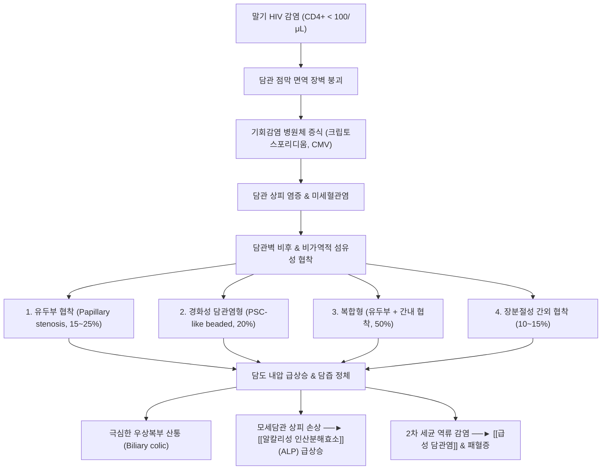

# 🩺 말기 HIV로 인한 담관 협착 (AIDS Cholangiopathy / 후천성면역결핍증 관련 담관병증, ICD-10: B20.8, K83.1 / KCD: B20.8)

> **핵심 3줄 요약 (Key Summary)**:
> - 📍 병소 부위 & 해부·병태생리: 중증 세포면역 결핍 상태(말기 [[HIV]] 감염, CD4+ T림프구 < 100/μL) 환자에서 [[크립토스포리디움]](Cryptosporidium parvum), [[거대세포바이러스]](CMV), [[마이크로스포리디아]](Microsporidia) 등 기회감염 병원체가 바터 팽대부 십이지장 유두 및 간내·간외 담관 상피세포에 직접 침윤하여 만성 궤양성·증식성 염증, 섬유화 및 비가역적 담관 협착을 유발하는 기회감염성 담도 질환.
> - 🚩 전형적 임상 양상 & 3대 징후: **우상복부 또는 심와부의 극심한 담도 산통(Biliary colic), 발열, 오심·구토**가 주소증이며, 생화학 검사상 [[알칼리성 인산분해효소]](ALP)의 현저한 단독 급상승(정상 상한치의 5~10배 이상) 대비 혈청 [[빌리루빈]](Total Bilirubin)은 정상이거나 경미한 상승에 그치는 독특한 효소 해리(Dissociation) 소견.
> - 🛠️ 핵심 감별 검사 & 한·양방 다각적 치료 전략: 복부 초음파, [[자기공명 담췌관 조영술]](MRCP) 및 [[내시경적 역행성 담췌관 조영술]](ERCP)을 통해 4대 담도 협착 형태(유두부 협착, 경화성 담관염형, 복합형, 장분절성 간외 협착) 감별 진단; 양방 1차 치료는 면역 재건을 위한 강력한 [[항레트로바이러스 요법]](HAART/ART)과 원인 병원체 박멸([[니타조사나이드]], [[간시클로버]]), 유두부 협착에 의한 산통 완화를 위한 ERCP하 내시경 [[유두괄약근절개술]](EST) 및 스텐트 삽입; 한의 치료는 본허표실(本虛標實) 원칙하에 급성 산통·습열기에 [[소시호탕]] 합 금령자산, 만성 소모성 미열에 [[청호별갑탕]], 비신양허 설사·악액질에 [[금궤신기환]], 습열어결 소변불리에 [[자신환]] 응용.
> - <font color="#fa7e7e">⚠️ 응급 의뢰 레드플래그: 세균성 화농성 [[급성 담관염]](Charcot 3징: 우상복부통, 39°C 이상 고열, 황달 / Reynolds 5징: 저혈압 쇼크, 의식 저하/혼돈), 급성 복막염, 패혈성 쇼크 징후 확인 시 즉시 3차 상급병원 췌담도 내과-감염내과 중재팀으로 초응급 전원.</font>

---

## 📌 목차
1. [질환 개요 & 병태생리 (Disease Overview)](#1-질환-개요--병태생리-disease-overview)
2. [병태생리 메커니즘 & 대사·장기부전 악순환 네트워크](#2-병태생리-메커니즘--대사장기부전-악순환-네트워크)
3. [임상 증상 & 환자 소견 (Clinical Presentation)](#3-임상-증상--환자-소견-clinical-presentation)
4. [감별 진단 매트릭스 (Differential Diagnosis)](#4-감별-진단-매트릭스-differential-diagnosis)
5. [한의 통합 치료 프로토콜 (침·약침·한약)](#5-한의-통합-치료-프로토콜-침약침한약)
6. [양방 치료 & 병용·의뢰 기준 (Conventional Treatment & Referral)](#6-양방-치료--병용의뢰-기준-conventional-treatment--referral)
7. [식이·생활습관 & 자가관리 티칭 가이드](#7-식이생활습관--자가관리-티칭-가이드)
8. [💡 진료실 핵심 필기 & 임상 노하우](#8--진료실-핵심-필기--임상-노하우)
9. [출처 및 학술 참고 문헌 (References)](#9-출처-및-학술-참고-문헌-references)

---

## 1. 질환 개요 & 병태생리 (Disease Overview)

### 1) 질환 정의 및 임상적 중요성
[[말기 hiv로 인한 담관 협착]](AIDS Cholangiopathy, 후천성면역결핍증 관련 담관병증)은 인체면역결핍바이러스([[HIV]]) 감염의 말기 단계, 즉 CD4+ T림프구 수가 심각하게 고갈된 상태(통상 < 100/μL, 대개 < 50/μL)에서 발생하는 기회감염성 담도 파괴 질환군이다.
세포매개성 점막 면역이 붕괴되면서 장관 내 상주하거나 오염된 수원을 통해 침입한 원충, 바이러스, 진균 등 다양한 기회감염 미생물이 십이지장 바터 팽대부(Ampulla of Vater) 및 담관 상피세포(Cholangiocyte)에 침투하여 만성적이고 진행성인 궤양, 섬유화, 상피 비후 및 담관 내강 폐쇄를 야기한다.

- **역학적 변천**:
  - 고강도 [[항레트로바이러스 요법]](HAART/ART)이 보편화되기 전(1980년대~1990년대 중반)에는 말기 AIDS 환자의 약 15~26%에서 관찰되던 주요한 복부 기회감염 합병증이었다.
  - 현대에는 조기 진단과 효과적인 항레트로바이러스 요법으로 인해 전체 발생률은 크게 감소하였으나, **ART 비순응자, 약제 내성 환자, HIV 감염 사실을 인지하지 못한 채 뒤늦게 발견된 만기 진단자(Late presenters)**에서 여전히 치명적인 2차성 담관염 및 담도 폐쇄성 질환으로 지속 발생하고 있다.

### 2) 주요 원인 기회감염 병원체
담관 점막을 침범하여 담관 협착을 유발하는 3대 주요 기회감염 병원체는 다음과 같다:
1. [[크립토스포리디움]](Cryptosporidium parvum, 와포자충):
   - AIDS 담관병증 환자의 담즙 및 담관 생검에서 가장 흔하게 검출(약 70~80%)되는 단세포 원충이다.
   - 담관 상피세포의 브러시 경계(Brush border)에 세포내-세포질외(Intracellular, extracytoplasmic) 형태로 기생하며 담관 상피의 세포골격을 파괴하고 만성 염증성 협착을 촉진한다.
2. [[거대세포바이러스]](Cytomegalovirus, CMV):
   - 환자의 약 20~30%에서 단독 또는 크립토스포리디움과 동시 복합 감염 형태로 확인된다.
   - 담관 상피세포 및 점막하 미세혈관 내피세포를 직접 감염시켜 괴사성 혈관염(Necrotizing vasculitis)과 점막 허혈성 궤양, 심부 섬유성 반흔을 형성한다.
3. [[마이크로스포리디아]](Microsporidia, 미포자충류: Enterocytozoon bieneusi, Encephalitozoon intestinalis):
   - 약 10~20%의 빈도로 관찰되며, 상피세포 내 포자(Spore) 증식을 통해 상피세포 파열과 융합을 일으킨다.
4. **기타 병원체**:
   - 마이코박테리움 아비움 복합체(MAC), 결핵균(Mycobacterium tuberculosis), 카포시 육종(Kaposi's sarcoma)의 담도 침윤, 림프종(Non-Hodgkin lymphoma)에 의한 외인성 담관 압박.

### 3) 관련 장기 및 해부학적 이환 부위
- **주 이환 장기**: 담도계(Biliary tree)
  - **바터 팽대부 및 오디 괄약근(Ampulla of Vater & Sphincter of Oddi)**: 유두부 협착(Papillary stenosis)의 발생 중심지.
  - **총담관 및 총간관(Common Bile Duct & Common Hepatic Duct)**: 장분절성 간외 담관 협착.
  - **간내 분지 담관(Intrahepatic bile ducts)**: 다발성 분절성 협착과 낭포성 확장.
  - **담낭(Gallbladder)**: 무결석성 담낭염(Acalculous cholecystitis)의 동반 호발 부위.
- **연관 장기**: [[십이지장]](Duodenum), [[간]](Liver, 이차성 담즙정체 및 미세섬유화), [[췌장]](Pancreas, 유두부 협착으로 인한 췌관 내압 상승 및 췌장염).

---

## 2. 병태생리 메커니즘 & 대사·장기부전 악순환 네트워크

```
[HIV 바이러스 증식 ──► CD4+ T림프구 극심한 고갈 (< 50~100 cells/μL)]
                                │
                                ▼
         [장점막 및 담관 상피 국소 점막 면역계(sIgA, CTL) 붕괴]
                                │
                                ▼
         [기회감염 병원체 유입: Cryptosporidium, CMV, Microsporidia]
                                │
        ┌───────────────────────┴───────────────────────┐
        ▼                                               ▼
[크립토스포리디움 (원충 침윤)]                    [거대세포바이러스 CMV (혈관 침윤)]
 - 담관 상피 브러시 경계 부착                     - 미세혈관 내피세포 감염
 - 상피세포 TLR4 신호 활성화                      - 괴사성 혈관염 & 국소 허혈
 - NF-κB 유도 염증 사이토카인 분비                - 깊은 점막하 궤양 및 비후
        │                                               │
        └───────────────────────┬───────────────────────┘
                                ▼
               [담관 상피세포 괴사 & 세포고사 & 만성 섬유화]
                                │
                                ▼
           ┌────────────────────┴────────────────────┐
           ▼                                         ▼
   [바터 팽대부 오디 괄약근 부종]             [간내·외 담관 분절성 섬유화]
   - 유두부 협착 (Papillary stenosis)        - 경화성 담관염 (PSC-like)
   - 담관 출구 완전/부분 폐쇄                 - 구슬 모양 (Beaded appearance)
           │                                         │
           └────────────────────┬────────────────────┘
                                ▼
                   [담도 내압의 폭발적 상승]
                                │
          ┌─────────────────────┴─────────────────────┐
          ▼                                           ▼
[극심한 담도 산통 (Biliary colic)]           [모세담관 압력 상승 & ALP 누출]
- 우상복부·심와부 산통                       - ALP 고도 상승 (정상의 5~10배)
- 오심, 구토, 조기 포만감                   - 총 빌리루빈은 정상/경미 (불완전 폐쇄)
          │                                           │
          └─────────────────────┬─────────────────────┘
                                ▼
               [정체된 담즙 내 2차 세균 감염 합병]
                                │
                                ▼
               [급성 화농성 담관염 & 패혈성 쇼크]
```



### 1) 4대 담도 해부학적 손상 형태 (Anatomical Classification)
내시경적 역행성 담췌관 조영술(ERCP) 및 자기공명 담췌관 조영술(MRCP)을 통해 규명된 AIDS 담관병증의 4가지 전형적 아형은 다음과 같다:

1. **단독 유두부 협착 (Isolated Papillary Stenosis, 약 15~25%)**:
   - 바터 팽대부 오디 괄약근의 감염성 염증 및 부종으로 인해 원위부 총담관 말단이 좁아진 상태이다.
   - 근위부 총담관과 간내 담관이 2차적으로 현저하게 미만성 확장되지만, 간내 담관 자체의 고유 협착은 없다.
   - **임상적 특징**: 내시경 [[유두괄약근절개술]](EST)을 통해 유두부를 절개하면 담관 내압이 즉각 해소되어 통증이 90% 이상 드라마틱하게 소실된다.
2. **간내/간외 경화성 담관염형 (Sclerosing Cholangitis-like, 약 20%)**:
   - 원발성 경화성 담관염([[일차성 경화성 담관염]], PSC)과 형태학적으로 매우 유사하다.
   - 간내 및 간외 담관에 다발성 분절 협착과 정상/확장 부위가 교대로 나타나는 전형적인 **구슬 모양(Beaded appearance)** 소견을 보인다. 바터 팽대부 유두부는 정상 개구 상태를 유지한다.
3. **복합형 (Combined Papillary Stenosis and Sclerosing Cholangitis, 약 50% 최다 빈도)**:
   - 유두부 협착과 간내외 담관의 경화성 다발 협착이 동시에 존재하는 가장 흔하고 중증인 형태이다.
   - 총담관의 확장과 더불어 간내 담관의 분절성 가지치기 협착이 관찰되며, 지속적인 우상복부 둔통과 담즙정체가 지속된다.
4. **장분절성 간외 담관 협착 (Isolated Long Extrahepatic Bile Duct Stricture, 약 10~15%)**:
   - 총담관 또는 총간관의 긴 분절(2 cm 이상)이 테이퍼(Tapered) 모양으로 매끄럽게 좁아져 있는 형태이다.
   - 종종 담관암(Cholangiocarcinoma)이나 림프종, 카포시 육종의 침윤과 육안적 구별이 어려워 조직 생검 감별이 필수적이다.

### 2) ALP-빌리루빈 효소 해리(Dissociation)의 병태생리
AIDS 담관병증의 가장 두드러진 임상병리학적 역설은 **알칼리성 인산분해효소(ALP)의 극단적 상승(정상 상한치의 5~10배 이상)에도 불구하고 혈청 총 빌리루빈(Total Bilirubin)은 정상 범위이거나 경미한 상승(< 2.0~3.0 mg/dL)에 그친다는 점**이다.
- **기전**:
  - 대부분의 담관 협착이 불완전 협착(Partial obstruction) 상태이거나, 다발성 간내 분지 중 일부만 폐쇄되고 나머지 분지를 통해 담즙산과 빌리루빈의 기본 배출이 유지되기 때문이다.
  - 그러나 협착 분지의 담관 상피세포막은 높은 정수압(Hydrostatic pressure)과 기회감염균의 직접적인 자극을 받아 상피세포막 결합 효소인 ALP를 혈액 내로 대량 유리한다.
  - 따라서 현저한 황달 없이도 환자는 극심한 담도 산통과 고ALP혈증을 나타내게 된다.

---

## 3. 임상 증상 & 환자 소견 (Clinical Presentation)

### 1) 전형적 주소증 및 임상 징후
1. **우상복부 및 심와부 담도 산통 (Right Upper Quadrant / Epigastric Pain)**:
   - 환자의 80~90% 이상에서 나타나는 가장 흔하고 고통스러운 주소증이다.
   - 오디 괄약근 경련 및 담관 내압 급상승으로 인해 발생하는 쥐어짜는 듯한 통증(Colicky pain) 또는 지속적인 심부 둔통으로, 우측 견갑골이나 등으로 방사될 수 있다.
2. **소화기 전신 증상**:
   - 오심, 구토, 식욕 부진, 조기 포만감, 복부 팽만.
   - **난치성 수양성 설사(Watery Diarrhea)**: 크립토스포리디움이나 마이크로스포리디아가 소장 점막을 광범위하게 동시 감염시키기 때문에 하루 수회~수십 회의 물설사를 동반하며, 이로 인해 급격한 전신 소모증(AIDS Wasting syndrome)과 전해질 불균형이 초래된다.
3. **불명열 및 야간 발한**:
   - 37.8~38.5°C의 만성적인 미열 또는 간헐적 이장열, 도한(Night sweats).
4. **황달의 부재 또는 경미성**:
   - 환자의 약 20% 미만에서만 육안적 황달([[황달]])이 나타난다. 따라서 **"황달이 없다고 해서 담도 협착을 배제해서는 절대 안 된다"**는 것이 본 질환의 핵심 진찰 원칙이다.

### 2) 신체 진찰 소견 (Physical Examination)
- **복부 진찰**:
  - 우상복부 늑골하 부위의 뚜렷한 압통(RUQ Tenderness).
  - 머피 징후(Murphy's sign) 양성 가능 (무결석성 담낭염 동반 시).
  - 간종대(Hepatomegaly)가 약 40~50%에서 촉지된다.
- **전신 진찰**:
  - 심한 악액질(Cachexia), 측두근 위축, 피부 건조, 탈수 징후.
  - 전신 림프절 비대, 구강 캔디다증(Oral candidiasis), 지루성 피부염 등 진행된 면역결핍증의 전신 징후가 동반된다.

### 3) 진단 검사 및 영상의학적 소견
- **혈액 생화학 검사**:
  - [[알칼리성 인산분해효소]](ALP): 정상 상한치의 5배에서 20배 이상(500~2,500 IU/L) 현저한 상승.
  - 감마글루타밀전이효소(GGT): ALP와 평행하여 극심하게 상승.
  - AST, ALT: 정상이거나 2~3배 정도의 경도 상승(경화성 간염 동반 시).
  - 총 빌리루빈(Total Bilirubin): 정상(0.8~1.2 mg/dL) 또는 1.5~3.0 mg/dL 내외의 경도 상승.
  - **면역학적 검사**: **CD4+ T세포 수치 < 100 cells/μL (대부분 < 50 cells/μL)**, HIV-1 RNA 바이러스 역가 고도 상승.
- **미생물학적 검사**:
  - 대변 검사: 특수 항산성 염색(Modified acid-fast Kinyoun stain) 또는 형광 염색을 통해 분변 내 크립토스포리디움 난포낭(Oocyst) 검출.
  - 대변 다중 PCR(Multiplex stool PCR): Cryptosporidium 및 Microsporidia DNA 검출.
  - 혈청 CMV Real-time PCR: 혈중 거대세포바이러스 DNA 정량 검사.
- **영상의학적 검사**:
  - **복부 초음파(Abdominal Ultrasonography)**:
    - 1차 선별 검사. 총담관벽의 미만성 비후, 간외 담관 확장, 담낭벽 비후 및 부종 소견 확인.
  - [[자기공명 담췌관 조영술]](MRCP):
    - **가장 안전하고 정확한 비침습적 진단 표준(Gold Standard Imaging)**.
    - 조영제 투여나 방사선 피폭, 십이지장 내시경 삽입 없이 담도계 전체를 3차원 영상으로 묘출한다.
    - 유두부 협착(원위부 매끄러운 세선화 및 상부 확장), 간내 담관의 다발성 협착 및 확장(구슬 모양), 담관벽 조영 증강을 95% 이상의 민감도로 진단한다.
  - [[내시경적 역행성 담췌관 조영술]](ERCP):
    - 진단과 동시에 유두괄약근절개술(EST), 세포진 브러싱 검사(Brushing cytology), 담관 배액관/스텐트 삽입을 시행할 수 있는 확진 및 치료적 수단이다.

---

## 4. 감별 진단 매트릭스 (Differential Diagnosis)

| 감별 질환 | 호발 기저 질환 및 역학 | 담도 손상 형태 및 영상 소견 | 핵심 감별 포인트 (임상·검사) |
| :--- | :--- | :--- | :--- |
| [[말기 hiv로 인한 담관 협착]] (본 질환) | 말기 HIV/AIDS (CD4+ < 100/μL), 기회감염 노출 | 유두부 협착, 경화성 담관염 구슬상 변화, 장분절 협착 | ALP 고도 상승 vs 빌리루빈 정상/경미, 대변 Cryptosporidium 검출 |
| [[일차성 경화성 담관염]] (PSC) | 젊은 남성, 궤양성 대장염(UC) 환자의 70~80% 동반 | 간내외 담관의 전형적 구슬상 협착, 양파껍질양 섬유화 | HIV 음성, CD4 정상, p-ANCA 양성 빈발, 유두부 협착은 없음 |
| [[igg4 관련 경화성 담관염]] | 60대 이상 고령 남성, 자가면역성 췌장염 동반 | 하부 총담관벽의 광범위한 동심원성 비후, 협착 | 혈청 IgG4 수치 급상승, 스테로이드 치료에 즉각 반응 |
| [[급성 담관염]] (결석성) | 담석증 기왕력, 중장년층, 고지혈증 환자 | 총담관 결석(Choledocholithiasis)에 의한 기계적 폐쇄 | 심한 황달과 복통 동시 출현, 초음파상 음향음영 동반 결석 |
| [[담관염]] (카포시 육종 침윤) | 말기 AIDS 환자, 피부/구강 자갈색 혈관종 결절 | 담관벽의 침윤성 종괴 및 결절성 압박 소견 | 피부 및 점막 카포시 육종 확인, HHV-8 검출, 생검상 방추형 세포 |
| 원발성 담도암 (Cholangiocarcinoma) | 60~70대, 간흡충증(간디스토마) 유행지 거주력 | 단일 담관 분절의 불규칙한 협착 및 담관벽 침윤 종괴 | CA19-9 종양표지자 고도 상승, 만성적인 체중 감소 및 진행성 황달 |
| 무결석성 담낭염 | 중환자실 장기 재원, 패혈증, 대수술 후 환자 | 담석 없이 담낭 팽만 및 담낭벽 비후, 담낭 주위 액체저류 | 담관 협착 없이 담낭 중심 병변, Murphy sign 양성 |

> 🚩 **원발성 경화성 담관염(PSC)과의 감별 주의점**:
> AIDS 담관병증의 간내 담관 영상은 원발성 경화성 담관염(PSC)과 육안적으로 거의 구별이 불가능하다. 그러나 PSC 환자는 바터 팽대부의 단독 유두부 협착(Papillary stenosis)이 발생하지 않으며, AIDS 환자에서는 CD4 림프구 격감과 원충 검출이 동반되므로 면역 상태 확인이 감별의 절대 기준이 된다.

---

## 5. 한의 통합 치료 프로토콜 (침·약침·한약)

### 1) 한의학적 병인병기 인식
한의학에서 말기 HIV로 인한 담관 협착은 **협통(脅痛)**, **복통(腹痛)**, [[황달]](黃疸), **허로(虛勞)**, **결핵(結核)**의 복합 범주에 속한다.
- **본허표실(本虛標實), 허실협잡(虛實挾雜)**:
  - 본(本)은 만성적인 역려지기(疫癘之氣, HIV) 감염으로 인한 **선천신기(先天腎氣)와 후천비위(後天脾胃)의 극심한 고갈**, 즉 정기극허(正氣極虛), 비신양허(脾腎陽虛) 또는 기음양허(氣陰兩虛)이다.
  - 표(標)는 면역 붕괴 틈을 타 침입한 기회감염 사기(邪氣)가 간담(肝膽)에 옹체되어 유발하는 **습열독성(濕熱毒盛), 간담기체(肝膽氣滯), 어혈저체(瘀血沮滯)**이다.
- **기기울체 및 불통즉통(氣機鬱滯·不通則痛)**:
  - 간담의 소설(疎泄) 기능이 완전히 상실되고 담즙 통로(오디 괄약근 및 담관)가 어혈과 습열로 막혀 통하지 못하므로(不通則痛) 우상복부의 극심한 산통(疝痛)과 복창통이 발생한다.

### 2) 변증별 한약 치료 프로토콜

#### (1) 간담습열(肝膽濕熱) 및 기체어혈(氣滯瘀血)형 (급성 담도 산통기)
- **주증**: 우측 협하부 및 명치의 쥐어짜는 듯한 극심한 산통(통증이 등과 어깨로 방사), 압통, 오심, 구토, 입안이 쓰고(구고), 가슴이 답답함, 소변 황적, 설질 암홍 태 황니, 맥 현활(弦滑) 또는 현긴(弦緊).
- **치법**: 소간이담(疎肝利膽), 청열이습(淸熱利濕), 활혈지통(活血止痛).
- **처방**: [[소시호탕]](小柴胡湯) 합 금령자산(金鈴子散) 가미방
  - **구성**: 시호 12g, 황금 10g, 인삼 6g, 반하(강반하) 8g, 생강 6g, 대추 4g, 현호색 10g, 천련자 8g, 백작약 15g, 울금 10g, 지각 8g, 인진 15g, 감초 4g.
  - **가감법**: 담즙 배출 장애 극심 시 대황(후하) 4~6g, 치자 8g 가미; 통증 격렬 시 몰약 6g, 유향 6g 추가.
  - **현대 약리 기전**:
    - 시호의 사이코사포닌(Saikosaponins)과 황금의 바이칼린(Baicalin)은 담관 상피세포의 NF-κB 활성화를 억제하고 염증성 프로스타글란딘 합성을 차단한다.
    - 천련자의 멜리아토닌과 현호색의 코리달린(Corydaline)은 오디 괄약근 평활근의 비정상적 경련을 이완시키고 내장 통각 역치를 높여 담도 산통을 신속히 완화한다.
    - 백작약(Paeoniflorin)과 감초(Glycyrrhizin)의 상호작용(작약감초탕 원리)은 담도 민무늬근의 칼슘 채널을 조절하여 경련성 산통을 억제한다.

#### (2) 음허내열(陰虛內熱) 및 골증노열(骨蒸勞熱)형 (만성 소모성 미열기)
- **주증**: 지속적인 골증미열(오후 및 야간 발열), 도한(식은땀), 손발바닥 열감(오심번열), 구건인조, 우협부 은은한 작통, 마른기침, 극심한 마름, 설홍강 무태, 맥 세삭(細數).
- **치법**: 양음청열(養陰淸熱), 퇴허열(退虛熱), 보익간신(補益肝腎).
- **처방**: [[청호별갑탕]](靑蒿鼈甲湯) 가감방
  - **구성**: 청호 12g, 별갑(선전 1시간) 15g, 지모 10g, 생지황 15g, 목단피 10g, 지골피 12g, 은시호 8g, 인진 12g, 백화사설초 15g, 감초 4g.
  - **약리 기전**: 청호의 아르테미시닌(Artemisinin) 성분은 항말라리아 및 항기생충 활성을 지니며 원충의 미토콘드리아 기능을 억제하고, 별갑·생지황의 다당체는 소모된 세포매개 면역 환경을 지지하며 만성 염증성 인터루킨 생성을 조절한다.

#### (3) 비신양허(脾腎陽虛) 및 완복냉통·수사(水瀉)형 (만성 설사 및 악액질기)
- **주증**: 크립토스포리디움 장염 동반으로 맑은 물 같은 설사 하루 수회 이상 지속, 오경설사(새벽 설사), 사지 냉증, 복부 냉통, 무력감, 얼굴이 창백하고 핏기가 없음, 설담 태 백활, 맥 침미무력(沈微無力).
- **치법**: 온보비신(溫補脾腎), 고장지사(固腸止瀉).
- **처방**: [[금궤신기환]](金匱腎氣丸) 합 이중탕(理中湯) 가감방
  - **구성**: 숙지황 15g, 산약 15g, 산수유 10g, 복령 12g, 택사 10g, 목단피 8g, 육계 4g, 부자(포부자) 4g, 인삼 8g, 백출 12g, 건강 6g, 오미자 6g, 가자피 6g, 감초 4g.
  - **임상 팁**: 면역이 극도로 고갈된 상태에서 비신양기(脾腎陽氣)를 북돋아 장관 점막의 수분 흡수 기능을 회복시키고 탈수를 방지한다.

#### (4) 습열어결(濕熱瘀結) 및 하초울체·소변불리형
- **주증**: 복부 팽만, 소변량이 급격히 줄고 배뇨 곤란, 구갈이 있으나 물을 마시려 하지 않음, 담도 및 요로계 습열 정체.
- **치법**: 청열사화(淸熱瀉火), 통관이지(通關利滯).
- **처방**: [[자신환]](滋腎丸, 通關丸) 가감방
  - **구성**: 황백(주초) 12g, 지모(주초) 12g, 육계 3g. (필요 시 복령 12g, 저령 10g, 인진 15g 합방).
  - **기전**: 신수(腎水)를 자양하고 방광과 담도의 사화(邪火)를 꺾어 기화(氣化) 기능을 열어줌으로써 담즙과 소변의 소통을 돕는다.

### 3) 침구 치료 프로토콜
- **기본 선혈**:
  - 간담경·비위경 복모혈 및 배수혈: [[간수]](BL18), [[담수]](BL19), [[비수]](BL20), [[일월]](GB24), [[기문]](LR14), [[중완]](CV12).
  - 사지 원위부 혈위: [[양릉천]](GB34, 근회혈이자 담낭질환 특효혈), [[태충]](LR3), [[족삼리]](ST36), [[음릉천]](SP9), [[지구]](TE6), [[내관]](PC6, 오심·구토 진정).
- **자침 기법**:
  - 담도 산통 발작 시: 양릉천과 우측 일월, 기문에 강자극 침을 놓고 지제를 병행하여 담도 연축을 신속히 완화한다.
  - 면역 보강: 족삼리, 비수, 신수에 온침(溫鍼) 또는 보법을 적용한다.
  - **감염 방지 절대 원칙**: CD4 세포수가 결핍된 환자이므로 1회용 멸균 침 사용, 알코올 소독 철저, 피부 감염 징후 부위 자침 금지.

### 4) 약침 요법
- **약침 제제**: 황련해독탕 약침(담도 염증 및 발열 제어) 또는 자하거 약침(극심한 허로 및 면역세포 고갈 보충).
- **시술 부위**: 간수(BL18), 담수(BL19), 양릉천(GB34).
- **용량**: 포인트당 0.1 cc씩 총 0.5 cc 내외 주입, 주 2회 시술. (혈소판감소증이 동반되는 경우가 흔하므로 심부 근육 주입을 피하고 피하 천층 주입).

---

## 6. 양방 치료 & 병용·의뢰 기준 (Conventional Treatment & Referral)

### 1) 현대 의학의 표준 치료 삼총사
AIDS 담관병증 치료의 현대적 원칙은 **① 면역 재건, ② 기회감염균 박멸, ③ 내시경적 담도 중재술**의 3대 축으로 구성된다:

```
[말기 HIV 관련 담관 협착 표준 치료]
        │
        ├─────────────────────────────────────────────────┐
        ▼                                                 ▼
[1. 면역 재건 요법 (근본 치료)]                    [2. 기회감염 병원체 박멸 요법]
 - 항레트로바이러스 요법(cART) 즉각 개시          - Cryptosporidium: [[니타조사나이드]](Nitazoxanide)
 - 2~3종 복합제제(INSTI + 2 NRTIs)               - CMV: [[간시클로버]](Ganciclovir), Valganciclovir
 - 목표: CD4+ > 200/μL 회복 및 바이러스 미검출    - Microsporidia: 알벤다졸(Albendazole)
        │                                                 │
        └────────────────────────┬────────────────────────┘
                                 ▼
              [3. 내시경적 췌담도 중재술 (ERCP Interventions)]
               - 유두부 협착(Papillary stenosis): 내시경 유두괄약근절개술([[EST]])
               - 장분절성 간외 협착/폐쇄: 플라스틱 담관 스텐트 삽입
               - 담즙 울체 완화 보조: 우르소데옥시콜산([[UDCA]]) 10~15 mg/kg/일
```

1. **강력한 항레트로바이러스 요법 (cART / HAART, 근본적 치료)**:
   - 본 질환의 장기 예후를 결정하는 가장 결정적인 치료이다.
   - 테노포비르(Tenofovir), 엠트리시타빈(Emtricitabine), 돌루테그라비르(Dolutegravir) 등 최신 복합 ART를 즉각 도입하여 바이러스 복제를 억제하고 **CD4+ 림프구 수를 200/μL 이상으로 회복**시켜야만 담도 점막 면역이 복원되어 기회감염 병원체가 자연 사멸하고 협착 진행이 멈춘다.
2. **원인 병원체 표적 박멸 요법**:
   - [[크립토스포리디움]](Cryptosporidium):
     - [[니타조사나이드]](Nitazoxanide) 500~1,000 mg 1일 2회 경구 투여. (단, 면역 정상인과 달리 말기 AIDS 환자에서는 단독 투약으로 원충 완전 박멸이 어려우므로 반드시 조기 ART 병용이 병행되어야 한다).
   - [[거대세포바이러스]](CMV):
     - 정맥용 [[간시클로버]](Ganciclovir) (5 mg/kg 12시간마다 정맥 점적, 2~3주간) 유도 요법 후, 경구 발간시클로버(Valganciclovir 900 mg 1일 1회) 유지 요법.
   - [[마이크로스포리디아]](Microsporidia):
     - 알벤다졸(Albendazole) 400 mg 1일 2회 경구 투여.
3. **내시경적 췌담도 중재술 (Endoscopic Retrograde Interventions)**:
   - **내시경 유두괄약근절개술([[EST]], Endoscopic Sphincterotomy)**:
     - **유두부 협착(Papillary stenosis) 환자에서 가장 우수한 증상 완화 술기**.
     - 십이지장 유두 개구부의 오디 괄약근을 고주파 절개도로 절개하여 담즙 배출 저항을 제거한다.
     - 환자의 80~90%에서 시술 직후 극심한 담도 산통이 극적으로 해소된다. (단, 간내 담관 협착이 동반된 복합형에서는 통증은 호전되나 ALP 수치는 완전히 정상화되지 않을 수 있다).
   - **담관 내 스텐트 삽입술(Biliary Stenting)**:
     - 장분절성 간외 담관 협착이 있거나 세균성 담관염으로 담즙 정체가 극심한 경우, 7~10 Fr 플라스틱 스텐트를 거치하여 담도 배액을 유지한다. (통상 3개월마다 교체).
4. **보조 약제 요법**:
   - [[우르소데옥시콜산]](UDCA, 10~15 mg/kg/일): 친수성 담즙산으로서 세포독성 소수성 담즙산을 치환하고 담관 상피세포의 중탄산염 분비를 자극하여 담즙 정체를 완화한다.

### 2) 한의 병용 판단 및 상호작용 (Combination Therapy)
- **병용 권장**:
  - ART 및 항생/항원충 치료를 안정적으로 유지하는 환자에서, 잔여 담도 팽만감 및 만성 피로, 소화불량 개선을 위한 소간건비 한약 병용.
  - 침구 치료를 통한 내장 진통 및 자율신경 안정화.
- **약물 상호작용(DDI) 주의**:
  - 현대 ART 제제(특히 프로테아제 억제제 PI 또는 비뉴클레오시드 역전사효소 억제제 NNRTI)는 간의 CYP3A4 효소 및 P-당단백질(P-gp) 대사를 공유하므로, 세인트존스워트 등 효소 유도 한약재는 ART 혈중 농도를 급락시켜 치료 실패를 부를 수 있으므로 엄격히 금기한다.
- **감염 위험 주의**:
  - 백혈구 및 호중구 감소증이 동반된 말기 환자에게 뜸 치료 시 화상 및 2차 연조직염 발생 위험이 있으므로 직접구(Direct moxibustion)는 금한다.

### 3) 응급 전원 및 상급병원 의뢰 기준 (Red Flags)
다음 징후 발생 시 1차 의료기관에서 지체하지 말고 즉시 대학병원 감염내과 및 소화기내과 췌담도팀으로 응급 이송한다:
1. **샤르코 3징(Charcot's triad)**: 우상복부 격통 + 38.5°C 이상 고열/오한 + 황달([[황달]]). (2차성 세균성 급성 화농성 담관염 합병).
2. **레이놀즈 5징(Reynolds' pentad)**: 샤르코 3징 + 저혈압 쇼크(수축기 혈압 < 90 mmHg) + 급성 의식 변화/혼돈. (초응급 패혈성 담관염으로 24시간 내 사망률 극도로 높음).
3. **복막 자극 징후**: 담낭 파열 또는 담관 천공을 시사하는 반발통(Rebound tenderness), 복부 판자양 강직(Board-like rigidity).
4. **급성 췌장염 병발**: 유두부 폐쇄로 인한 등 뒤로 뚫고 나가는 심와부 통증 및 혈청 리파아제/아밀라아제 3배 이상 급상승.

---

## 7. 식이·생활습관 & 자가관리 티칭 가이드

### 1) 음용수 및 식품 위생의 절대 수칙
면역결핍 환자에서 Cryptosporidium은 치명적인 기회감염원이므로 다음과 같은 엄격한 위생 지도가 필수적이다:
- **수돗물 및 생수의 가열 소독**:
  - 크립토스포리디움 난포낭(Oocyst)은 일반적인 수돗물 정수장 염소 소독 농도에 완전히 저항한다.
  - 따라서 면역저하 환자는 **모든 음용수를 최소 1분 이상 팔팔 끓인 후(Rolling boil)** 식혀서 마셔야 한다. (고산지대에서는 3분 이상).
  - 정수기를 사용할 경우 반드시 '절대 1마이크론(Absolute 1 micron) 이하'의 역삼투압(RO) 필터 규격품을 사용해야 한다.
- **음식 조리 관리**:
  - 날생선(회), 덜 익힌 조개류, 날고기, 살균되지 않은 생우유 및 치즈 섭취를 엄격히 금지한다.
  - 과일과 채소는 껍질을 벗겨 먹을 수 있는 것 위주로 선택하며, 생채소는 흐르는 깨끗한 끓인 물에 철저히 세척한다.
- **반려동물 및 토양 접촉 차단**:
  - 어린 강아지, 고양이, 가축(송아지 등)의 대변은 크립토스포리디움의 주요 보균체이므로 면역 회복기까지 배변 처리를 직접 하지 않도록 지도한다.

### 2) 영양 공급 및 악액질 극복
- **고칼로리·고단백 영양 보충**:
  - 만성 흡수장애와 소모증에 대처하기 위해 으깬 두부, 계란찜, 닭가슴살 죽 등 부드럽고 소화 흡수가 용이한 단백질을 매끼 소량씩 자주 섭취한다.
- **중쇄 중성지방(MCT Oil) 활용**:
  - 담관 협착으로 담즙산 분비가 저하되면 일반 장쇄 지방산의 유화 흡수가 어렵다. 담즙산 없이도 문맥으로 바로 흡수되는 MCT 오일을 죽이나 샐러드에 소량(1일 10~15 mL) 첨가하여 양질의 에너지를 공급한다.
- **충분한 수액 및 전해질 보충**:
  - 만성 설사로 인한 탈수 및 저칼륨혈증을 방지하기 위해 경구 수액염(ORS)이나 이온 음료를 수시로 음용한다.

### 3) 진료실 환자 교육 스크립트
> *"환자분, 지금 겪고 계신 우상복부 통증은 면역력이 크게 떨어진 틈을 타 작은 기생충이나 바이러스가 담즙이 내려가는 길에 염증과 흉터를 만들어 담즙 통로가 좁아졌기 때문에 생기는 질환입니다. 통증이 너무 심하실 텐데, 담즙 압력을 낮춰주는 내시경 시술과 함께 면역력을 올리는 약물 치료를 병행하면 반드시 호전될 수 있습니다.*
> 
> *이 병을 이겨내기 위해 환자분이 일상에서 반드시 지켜주셔야 할 가장 중요한 약속이 있습니다. 첫째, 드시는 모든 물은 반드시 1분 이상 펄펄 끓인 물만 드셔야 합니다. 일반 수돗물이나 대충 정수한 물에 들어있는 미세 기생충은 면역력이 약한 상태에서는 치명적일 수 있습니다. 얼음이나 생수도 끓인 물이 아니면 피하십시오. 둘째, 병원에서 처방받으신 항바이러스제(HIV약)는 단 하루도 거르지 않고 정해진 시간에 정확히 드셔야 합니다. 면역세포 수치가 회복되어야만 이 담도 질환이 근본적으로 멈추기 때문입니다.*
> 
> *만약 갑자기 38도 이상의 높은 열이 나면서 오한이 들거나, 눈이 노랗게 변하고 배가 칼로 찌르듯 아프면서 혈압이 떨어지거나 어지러우시다면, 담도에 2차 세균 감염이 발생한 응급 상황이므로 지체 없이 대학병원 응급실로 가셔야 합니다."*

---

## 8. 💡 진료실 핵심 필기 & 임상 노하우

> [!IMPORTANT]
> **🛡️ AIDS 담관병증(HIV Cholangiopathy) 진료실 실전 감별 및 노하우**
> 1. **"ALP 단독 폭발 + 황달 미미 + HIV 환자 = 99% AIDS Cholangiopathy"**:
>    - 면역저하 또는 HIV 감염 환자가 심와부나 우상복부 산통으로 내원했을 때, 혈액검사에서 간효소(AST/ALT)는 100~200 수준인데 **ALP만 1,000~2,000 IU/L 이상으로 치솟아 있고 총 빌리루빈은 2.0 이하**로 정상에 가깝다면, 담석이나 일반 간염을 생각하지 말고 즉시 AIDS Cholangiopathy를 1순위로 떠올려야 한다.
> 2. **"복부 초음파가 정상이거나 경미하다고 방심하지 말고 MRCP를 찍어라"**:
>    - 초음파는 유두부 협착이나 간내 담관의 미세한 구슬상 협착을 놓치기 쉽다. 환자가 우상복부 통증을 지속적으로 호소하고 ALP가 높다면, 초음파 결과만 믿고 "단순 위염이나 소화불량"으로 치부해서는 안 되며, 비침습적 확진 검사인 **MRCP(자기공명 담췌관 조영술)**를 즉시 의뢰해야 한다.
> 3. **"내시경 유두괄약근절개술(EST)은 최고의 진통제이지만, 종착역은 ART이다"**:
>    - 유두부 협착 환자에게 EST 시술은 담도 내압을 즉시 떨어뜨려 극심한 산통을 씻은 듯이 없애준다. 그러나 내강을 넓혀주어도 근본적인 원인인 HIV 바이러스를 억제하여 CD4 림프구 수를 200 이상으로 올려주지 못하면, 기회감염균의 지속적 침윤으로 결국 재협착과 광범위한 경화성 간경변으로 사망하게 된다. 내시경 중재와 항레트로바이러스 요법의 신속한 병행이 환자를 살리는 열쇠이다.
> 4. **"침구 시술 시 무균 조작(Asepsis)의 극한을 지켜라"**:
>    - CD4 수치가 50 이하인 환자는 정상인에게는 아무 해도 없는 피부 상재균(포도구균 등)에 의해서도 괴사성 근막염이나 균혈증이 발생할 수 있다. 침 치료를 병행할 때는 1회용 침 사용은 물론, 자침 부위 알코올 소독을 철저히 하고 깊은 심부 자침을 지양하며 침 치료 후 발적이나 열감이 발생하는지 면밀히 추적해야 한다.

---

## 9. 출처 및 학술 참고 문헌 (References)

- Avalos Gonzalez G, Ramirez J, Perez M, et al. (2025). Secondary HIV Cholangiopathy as a Cause of Acute Cholangitis: A Case Report. *Cureus*. 17(8):e90991. [PMID: 40873908](https://pubmed.ncbi.nlm.nih.gov/40873908/)

- Abdullah R, Qureshi H, Khan S, et al. (2023). Magnetic Resonance Cholangiopancreatography (MRCP) Findings in a Patient With AIDS Cholangiopathy and Cryptosporidiosis. *Cureus*. 15(9):e45869. [PMID: 37885561](https://pubmed.ncbi.nlm.nih.gov/37885561/)
