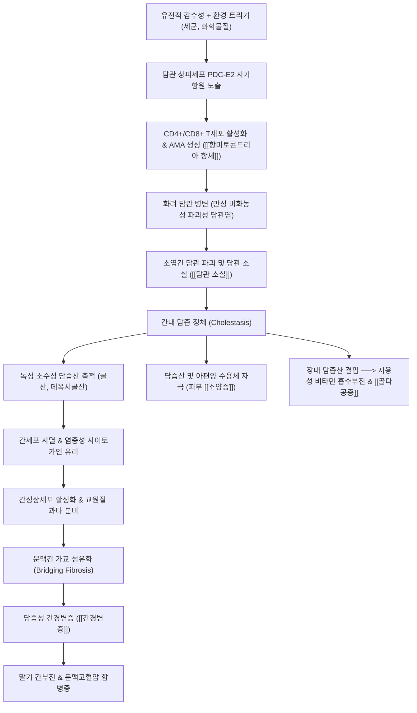

# 🩺 [[일차성 담즙성 담관염]] (Primary Biliary Cholangitis, PBC / 구 일차성 담즙성 간경변증, ICD-10 K74.3)

> **핵심 3줄 요약 (Key Summary)**:
> - 📍 **병소 부위 & 병태생리**: 간내 소엽간 담관(Interlobular bile ducts, 구경 40~100 μm)의 담관 상피세포([[담관 상피세포]])를 표적으로 하는 만성 진행성 자가면역 질환. T세포 매개성의 만성 비화농성 파괴성 담관염(CNSDC)으로 담관 소실([[담관 소실]])과 간내 담즙 정체가 발생하고, 세포독성 소수성 담즙산 축적으로 간세포 괴사·세포사멸 및 간성상세포 활성화를 거쳐 담즙성 [[간경변증]]으로 이행.
> - 🚩 **전형적 임상 양상 & 3대 징후**: 중년 여성(여:남 = 9~10:1)에서 호발. 초기에는 무증상(건강검진상 ALP 단독 상승)이 흔하나, 진행 시 특징적인 2대 주소증인 **극심한 만성 피로감(Fatigue)**과 **야간 악화형 난치성 피부 소양증(Pruritus, 손발바닥 호발)**이 발현. 지질 대사 장애로 인한 안검 황색판종([[황색판종]])/황색종, 지용성 비타민 흡수 장애 및 골다공증([[골다공증]]) 동반.
> - 🛠️ **핵심 감별 & 한·양방 치료 전략**: 1) ALP 1.5배 이상 상승, 2) [[항미토콘드리아 항체]](AMA, PDC-E2 표적) 또는 특이 ANA(sp100, gp210) 양성, 3) 간조직검사 소견(Florid duct lesion) 중 2가지 이상 만족 시 확진. 양방 1차 표준 약제는 [[우르소데옥시콜산]](UDCA, 13~15 mg/kg/일 평생 투여), 2차 약제는 오베티콜산(OCA) 및 베자피브레이트(Bezafibrate). 한의학에서는 간음부족(肝陰不足)·풍열습독(風熱濕毒)·간담습열(肝膽濕熱) 변증 하에 [[일관전]], [[인진호탕]], [[소풍산]], [[지백지황탕]] 및 [[양릉천]], [[간수]], [[혈해]], [[삼음교]] 침구·약침 치료를 통해 가려움증 완화, 면역 조절 및 간기능 보호를 도모.
> - <font color="#fa7e7e">⚠️ **응급 의뢰 레드플래그**: 혈청 총 빌리루빈의 급격한 상승(> 2.0~3.0 mg/dL 지속 시 진행성 간부전 시사), 비대상성 간경변증 징후(복수, 간성뇌증, 식도정맥류 출혈), 난치성 세균성 자발성 복막염(SBP) 발생 시 즉시 상급병원 간담췌내과 및 간이식센터 긴급 의뢰.</font>

---

## 📌 목차
1. [질환 개요 & 병태생리 (Disease Overview)](#1-질환-개요--병태생리-disease-overview)
2. [병태생리 메커니즘 & 대사·장기부전 악순환 네트워크](#2-병태생리-메커니즘--대사장기부전-악순환-네트워크)
3. [임상 증상 & 환자 소견 (Clinical Presentation)](#3-임상-증상--환자-소견-clinical-presentation)
4. [감별 진단 매트릭스 (Differential Diagnosis)](#4-감별-진단-매트릭스-differential-diagnosis)
5. [한의 통합 치료 프로토콜 (침·약침·한약)](#5-한의-통합-치료-프로토콜-침약침한약)
6. [양방 치료 & 병용·의뢰 기준 (Conventional Treatment & Referral)](#6-양방-치료--병용의뢰-기준-conventional-treatment--referral)
7. [식이·생활습관 & 자가관리 티칭 가이드](#7-식이생활습관--자가관리-티칭-가이드)
8. [💡 진료실 핵심 필기 & 임상 노하우](#8--진료실-핵심-필기--임상-노하우)
9. [출처 및 학술 참고 문헌 (References)](#9-출처-및-학술-참고-문헌-references)

---

## 1. 질환 개요 & 병태생리 (Disease Overview)

### 1) 질환 정의 및 명칭 변경의 역사
* **정의**: [[일차성 담즙성 담관염]](Primary Biliary Cholangitis, PBC)은 간내 소엽간 담관(Interlobular and septal bile ducts)을 선택적으로 침범하는 원인 불명의 만성 진행성 자가면역성 담즙정체 질환입니다.
* **병명 개정의 의학적 의의**: 과거 '일차성 담즙성 간경변증(Primary Biliary Cirrhosis)'으로 불렸으나, 조기 진단 기법의 발달과 표준 치료제([[우르소데옥시콜산]], UDCA)의 조기 도입으로 대다수 환자가 간경변증으로 이행하지 않고 관리됨에 따라, 환자에게 불필요한 공포를 줄이고 조기 염증 병태를 정확히 반영하기 위해 2015년 세계보건기구(WHO) 및 유럽·미국간학회(EASL/AASLD) 주도로 '담관염(Cholangitis)'으로 공식 명칭이 개정되었습니다.

### 2) 역학 및 인구학적 특성
* **성별 및 연령 분포**: 자가면역 질환 중에서도 가장 극단적인 성별 편향성을 보여 전체 환자의 **90% 이상(여성 대 남성 비율 약 9:1~10:1)**이 여성입니다.
* **호발 연령**: 주로 40~60대 중년 여성에서 발병하며, 20대 이전의 발병은 극히 드뭅니다.
* **유병률 및 발생률**: 북미 및 서유럽에서는 인구 10만 명당 20~40명의 유병률을 보이며, 한국을 포함한 동아시아에서도 건강검진의 활성화로 유병률이 꾸준히 증가 추세에 있습니다.
* **동반 자가면역 질환**: PBC 환자의 60~70%에서 타 자가면역 질환이 동반됩니다:
  * **[[쇼그렌 증후군]](Sjögren's Syndrome)**: 약 50~70%에서 동반되어 건성안(Keratoconjunctivitis sicca) 및 구강 건조증 유발.
  * **[[하시모토 갑상선염]]**: 약 15~25%에서 갑상선기능저하증 동반.
  * **[[전신경화증]] (Systemic Sclerosis / CREST 증후군)**: 약 5~15%에서 레이노 현상, 피부경화증 동반(Reynolds syndrome).
  * **[[류마티스 관절염]] 및 셀리악병**: 높은 빈도로 병발.

### 3) 관련 해부학적 구조물 및 표적 부위
* **간내 담도 트리 구조 (Intrahepatic Biliary Tree)**:
  * 간세포 모세담관(Bile canaliculi) $\rightarrow$ 헤링관(Canals of Hering) $\rightarrow$ 소엽간 담관(Interlobular bile ducts, 직경 40~100 μm) $\rightarrow$ 중격 담관(Septal bile ducts) $\rightarrow$ 구역 담관 $\rightarrow$ 좌우 간관(Hepatic ducts).
* **주요 병소 부위**:
  * PBC의 병리적 공격은 간외 담관이나 굵은 간내 담관이 아니라, **간삼조(Portal triad) 내에 위치하는 소엽간 담관의 담관 상피세포([[담관 상피세포]], Cholangiocytes)**에 국한됩니다.
  * 간외 담관(총담관, 담낭관)은 침범되지 않으므로, 복부 초음파나 CT 등 일반 영상 검사에서 간외 담도 폐색 소견(담관 확장)이 관찰되지 않는 것이 진단학적 핵심 특징입니다.

---

## 2. 병태생리 메커니즘 & 대사·장기부전 악순환 네트워크

### 1) ASCII 병태생리 다이어그램
```text
+-----------------------------------------------------------------------------------+
|                        [일차성 담즙성 담관염(PBC)의 병태생리 네트워크]                       |
+-----------------------------------------------------------------------------------+
  [유전적 소인: HLA-DRB1, IL-12 신호경로] + [환경적 촉발: 세균 감염, 제노바이오틱스, 흡연]
                                      │
                                      ▼
  [간내 소엽간 담관 상피세포(BEC)의 미토콘드리아 내막 항원 PDC-E2 변형 노출]
                                      │
                                      ▼
  [면역학적 면역관용 파탄 ──> 자가항원 감작]
   ┌──────────────────────────────────┴──────────────────────────────────┐
   ▼                                                                     ▼
[체액성 면역 반응 (B세포)]                                           [세포성 면역 반응 (T세포)]
 - B림프구 클론 증식 & 다형 IgM 분비                                  - CD4+ Th1 / Th17 세포 침윤
 - 항미토콘드리아 항체([[항미토콘드리아 항체]]) 형성                    - CD8+ 세포독성 T세포(CTL) 활성화
 - 미토콘드리아 내막 PDC-E2 자가항체 생성 (95%+)                       - 퍼포린·그랜자임 분비로 상피세포 파괴
   └──────────────────────────────────┬──────────────────────────────────┘
                                      ▼
  [만성 비화농성 파괴성 담관염 (CNSDC) & 화려 담관 병변 (Florid Duct Lesion)]
                                      │
                                      ▼
  [담관 상피세포의 진행성 세포사멸(Apoptosis) ──> 담관 소실 (Ductopenia, >50% 소실)]
                                      │
                                      ▼
  [간내 미세 담즙 정체 (Cholestasis)]
   ┌──────────────────────────────────┴──────────────────────────────────┐
   ▼                                                                     ▼
[소수성 세포독성 담즙산 축적 (TCA, DCA, CDCA)]                        [혈류 내 담즙산·지질 역류]
 - 간세포 미토콘드리아 기능부전 & 산화 스트레스                        - 전신 피부 소양증 유발 ([[소양증]])
 - 간세포 괴사 및 사멸 (Bile infarct)                                - 콜레스테롤 혈증 ──> [[황색판종]]
   └──────────────────────────────────┬──────────────────────────────────┘
                                      ▼
  [쿠퍼세포 활성화 ──> 간성상세포(HSC) 자극 ──> TGF-β 분비 ──> 문맥 주변 섬유화 진행]
                                      │
                                      ▼
  [담즙성 간섬유화(Bridging Fibrosis) ──> 담즙성 간경변증 (Biliary Cirrhosis)]
                                      │
                                      ▼
  [간부전, 문맥고혈압 합병증 (복수, 정맥류, 간성뇌증) ──> 간이식 미시행 시 사망]
+-----------------------------------------------------------------------------------+
```

### 2) Mermaid 병태생리 악순환 캐스케이드


### 3) 분자·세포 수준 자가면역 기전
* **표적 자가항원: 미토콘드리아 PDC-E2**:
  * PBC의 핵심 자가항원은 미토콘드리아 내막의 피루브산 탈수소효소 복합체 E2 소단위(Pyruvate Dehydrogenase Complex E2 subunit, **PDC-E2**)입니다.
  * 담관 상피세포가 세포사멸(Apoptosis)을 겪는 과정에서, 세포질의 분열 파편(Apotope) 내에 보존된 PDC-E2 항원이 면역계에 온전한 상태로 노출됩니다.
  * 여기에 감작된 CD4+ 헬퍼 T세포(Th1, Th17)와 CD8+ 세포독성 T세포(CTL)가 담관 주변으로 침윤하여 퍼포린(Perforin), 그랜자임(Granzyme B) 및 인터페론-감마(IFN-γ)를 분비함으로써 담관 상피세포를 선택적으로 용해·사멸시킵니다.
* **자가항체 프로파일**:
  * **[[항미토콘드리아 항체]](Antimitochondrial Antibody, AMA)**: 환자의 **95% 이상**에서 고역가(1:40 이상)로 검출되는 PBC의 독보적 혈청학적 지표입니다. 면역글로불린 M(IgM)과 IgG 이소형으로 존재하며, 환자의 혈청 IgM 수치 상승의 원인이 됩니다.
  * **PBC 특이 항핵항체(ANA)**: AMA 음성인 5% 환자(자가면역성 담관병증)에서 **항-sp100**(Multiple nuclear dots 패턴) 및 **항-gp210**(Nuclear rim / pore membrane 패턴) 항체가 발견되며, 이들은 질환의 진행성과 불량한 예후를 예측하는 중요한 생체지표입니다.
* **소수성 담즙산의 세포독성 및 간섬유화 가속화**:
  * 담관 상피세포가 사멸하여 소엽간 담관의 50% 이상이 소실되는 **[[담관 소실]](Ductopenia)** 단계에 이르면, 간세포에서 모세담관으로 분비된 담즙이 배출 경로를 잃고 간 실질 내에 정체됩니다.
  * 담즙 내의 친유성·소수성 담즙산(케노데옥시콜산, 데옥시콜산 등)은 간세포막을 용해하고 미토콘드리아 막전위를 붕괴시켜 활성산소종(ROS)을 대량 방출함으로써 간세포 자멸사 및 괴사(Bile infarcts)를 유도합니다.
  * 괴사된 간세포에서 방출된 손상연계분자유형(DAMPs)은 쿠퍼세포(Kupffer cells)를 자극하여 TGF-β1, PDGF 등 강력한 섬유화 촉진 인자를 분비하게 하며, 이는 간성상세포(Hepatic Stellate Cells, HSC)를 근섬유아세포로 형질전환시켜 문맥간 가교 섬유화(Bridging fibrosis)와 담즙성 간경변증을 촉발합니다.

### 4) 전신 대사 이상 및 합병증 기전
* **소양증([[소양증]], Pruritus)의 신경전달 기전**:
  * 과거 담즙산염의 피부 침착으로 설명되었으나, 현대 분자생물학적 연구에 따르면 간세포에서 혈류로 역류한 리소포스파티드산(Lysophosphatidic acid, LPA)과 이를 생성하는 자율효소인 오토탁신(Autotaxin, ATX), 그리고 체내 내인성 아편양 물질(Endogenous opioids)의 농도 증가가 척수 후각 신경세포의 가려움 전달 경로(MrgprX4 수용체 등)를 만성 자극하여 발생합니다.
* **지용성 비타민 흡수 장애 및 골대사 질환**:
  * 장내로 분비되는 담즙산 미셀(Micelle)이 결핍됨에 따라 식이 지질 및 지용성 비타민(A, D, E, K)의 유화 및 흡수가 불가능해집니다.
  * **비타민 D 결핍 및 간성 골이형성증([[골다공증]])**: 담즙 정체 환자의 30~50%에서 심한 골감소증 및 골다공증이 발생하며, 이는 비타민 D 흡수 저하뿐 아니라 정체된 담즙산 및 빌리루빈이 조골세포(Osteoblast)의 분화와 활성을 직접 억제하기 때문입니다.
  * **비타민 K 결핍**: 응고인자(II, VII, IX, X) 합성 저하로 출혈 경향 증가.
* **고콜레스테롤혈증 및 황색종**:
  * 담관을 통한 콜레스테롤 배설 경로가 차단되어 혈청 내 총콜레스테롤과 비정상적 지단백인 **리포프로테인-X(Lipoprotein-X)**가 축적되며, 이 지질이 피부 조직구에 탐식되어 안검 내측의 황색판종([[황색판종]], Xanthelasma) 및 관절부 황색종(Xanthoma)을 형성합니다. (단, Lp-X는 죽상경화증 유발 위험은 상대적으로 낮음).

---

## 3. 임상 증상 & 환자 소견 (Clinical Presentation)

### 1) 주소증 및 임상적 특징
* **무증상기 (Asymptomatic Presentation, 50~60%)**:
  * 정기 건강검진이나 타 질환 검사 중 혈청 알칼리인산분해효소([[ALP]]) 또는 감마-GTP([[GGT]])의 원인 불명의 단독 상승이 발견되어 진단되는 경우가 최근 과반수를 차지합니다.
* **전형적 2대 핵심 증상**:
  * **만성 난치성 피로감 (Fatigue, 환자의 70~80%)**:
    * 단순한 수면 부족으로 회복되지 않는 극심한 무기력증과 주간 졸림증을 호소합니다.
    * 간질환의 조직학적 중증도나 섬유화 병기와 직접적인 상관관계를 보이지 않으며, 중추신경계의 자율신경계 기능부전 및 세로토닌/코르티솔 경로 교란과 연관됩니다.
  * **피부 소양증 (Pruritus, 환자의 55~70%)**:
    * 황달이 나타나기 수개월~수년 전부터 선행 발현하는 가장 고통스러운 증상입니다.
    * 전형적으로 손바닥, 발바닥 및 옷에 쓸리는 사지 신전부에서 시작되어 전신으로 번집니다.
    * **야간 악화**: 체온이 상승하는 밤에 심해져 수면 장애와 우울증을 야기합니다.
    * 침구류나 따뜻한 목욕, 털 옷과의 접촉 시 격렬해지는 양상을 보입니다.
* **피부 및 결합조직 소견**:
  * **황색판종([[황색판종]], Xanthelasma)**: 양측 눈꺼풀 안쪽 점막하에 편평하고 부드러운 황색 지질 침착판 형성.
  * **피부 과색소침착 (Melanoderma)**: 긁은 부위의 표피 탈락 및 멜라닌 색소 침착으로 피부가 짙은 갈색을 띰.
  * 안구 건조 및 구강 건조 (쇼그렌 증후군 동반).
* **후기 진행성 간경변 증상**:
  * 담즙성 간경변증으로 이행하면 공막 및 피부 황달, 짙은 암갈색 소변, 거미상 혈관종, 수장홍반, 비장 종대, 복수, 식도정맥류 출혈, 간성뇌증이 발생합니다.

### 2) 객관적 소견 (Signs & Labs)
* **혈청 생화학 검사 (Liver Function Tests)**:
  * **담즙정체 효소의 현저한 상승**: [[ALP]]는 정상 상한치의 2~10배 이상 상승하며 질환의 활동성과 담관 손상을 반영하는 가장 핵심적인 추적 지표입니다. [[GGT]] 역시 동반 상승합니다.
  * **아미노전이효소(AST/ALT)**: 정상이거나 경미한 상승(대개 정상 상한치의 2~3배 이내)에 그쳐 바이러스성 간염이나 독성 간염에 비해 상승 폭이 작습니다.
  * **혈청 빌리루빈**: 초기에는 완전 정상이지만, 질병 말기로 갈수록 점진적으로 상승합니다. 혈청 총 빌리루빈의 지속적인 상승(> 2.0 mg/dL)은 담관 소실이 광범위하게 진행되었음을 뜻하며 예후 판정의 가장 결정적인 지표입니다.
  * **혈청 면역글로불린**: 면역글로불린 M(**IgM**) 수치가 특징적으로 현저히 상승합니다.
* **자가항체 검사 (Autoantibodies)**:
  * **[[항미토콘드리아 항체]](AMA)**: 역가 1:40 이상 양성 (특이도 98% 이상).
  * **특이 항핵항체(ANA)**: 항-sp100 및 항-gp210 항체 검사 (AMA 음성 환자 진단 및 고위험군 선별).
* **영상의학 및 비침습적 섬유화 검사**:
  * **복부 초음파 검사**: 간외 담관의 확장이 없음을 증명하여 담석이나 종양에 의한 기계적 담도 폐쇄를 배제하는 목적으로 필수 시행.
  * **순간탄성측정법 (FibroScan / 간 섬유화 스캔)**: 간 경도(Liver Stiffness Measurement, LSM)를 측정하여 간섬유화 병기를 비침습적으로 정량 평가(정상 < 6.0 kPa, 간경변증 $\ge$ 14~16 kPa).
* **간 조직검사 (Liver Biopsy)**:
  * 전형적인 생화학 및 AMA 양성 소견이 있으면 진단을 위한 생검은 필수적이지 않으나, AMA 음성 환자, 자가면역성 간염과의 중복증후군(Overlap syndrome) 감별, 또는 병기 판정을 위해 시행됩니다.

### 3) 조직학적 병기 분류 (Ludwig & Scheuer Staging)
* **1기 (문맥기, Portal Stage)**: 염증이 간삼조(문맥역)에 국한되며, 소엽간 담관 상피세포 괴사 및 림프구 침윤을 특징으로 하는 **화려 담관 병변(Florid duct lesion)**과 상피양 육아종(Epithelioid granuloma) 관찰.
* **2기 (문맥주위기, Periportal Stage)**: 염증이 한계판(Limiting plate)을 넘어 간 실질로 파급(Interface hepatitis), 세담관 증식(Ductular proliferation) 및 국소 담관 소실 시작.
* **3기 (중격기, Septal Stage)**: 문맥과 문맥 사이를 연결하는 가교 섬유화(Bridging fibrosis) 형성, 광범위한 담관 소실(Ductopenia) 확인.
* **4기 (간경변기, Cirrhotic Stage)**: 광범위한 재생 결절과 섬유성 격벽이 형성된 비가역적 담즙성 간경변증(Biliary cirrhosis).

---

## 4. 감별 진단 매트릭스 (Differential Diagnosis)

| 감별 질환 | 호발 연령 및 성별 | 특징적 침범 부위 | 혈청 자가항체 및 검사 | 영상의학 소견 | 핵심 감별 포인트 |
| :--- | :--- | :--- | :--- | :--- | :--- |
| **[[일차성 담즙성 담관염]]** (본 질환) | 40~60대 여성 (90%+) | 간내 소엽간 미세 담관 (40~100 μm) | **AMA 양성 (95%+)**, IgM 상승, ALP $\ge$1.5배 | 정상 담도 영상 (간외 담관 확장 없음) | 중년 여성, 손발 소양증, AMA 양성, 대형 담관 침범 없음 |
| **일차성 경화성 담관염 ([[PSC]])** | 20~40대 남성 (70%) | 간내 및 간외 대형 담관 전반 | p-ANCA 양성 (50~80%), AMA 음성 | MRCP/ERCP상 **비드 모양 담관(Beaded appearance)**, 다발성 협착 | 남성 호발, [[염증성 장질환]](궤양성 대장염 70% 동반), 담관암 고위험 |
| **자가면역성 간염 ([[AIH]])** | 전 연령대 여성 (75%) | 간세포 (간 실질 중심) | **ANA, ASMA(항평활근항체) 양성**, IgG 현저 상승 | 간 실질 염증성 변화, 담관 이상 없음 | ALT/AST가 수백~수천 단위로 우세 상승, 스테로이드 반응성 우수 |
| **PBC-AIH 중복증후군** | 중년 여성 | 담관 + 간세포 동시 침범 | AMA 양성 + ANA/ASMA 고역가 양성, IgG 및 IgM 동시 상승 | 조직검사상 화려 담관 병변과 중증 계면간염 동시 확인 | UDCA 단독 치료에 불응, 면역억제제(스테로이드/아자티오프린) 병용 필수 |
| **약물유인성 담즙정체 (DILI)** | 전 연령, 성차 없음 | 모세담관 및 간세포 | 자가항체 음성, 원인 약물(항생제, 아나볼릭 스테로이드 등) 노출 | 영상상 담도 폐쇄 없음, 약물 중단 후 회복 | 명확한 약물 복용력, 약물 투약 중단 시 ALP 정상화 |
| **총담관 결석증 ([[담석증]])** | 전 연령, 여성 다소 우세 | 총담관(간외 담관) | 자가항체 음성, 간헐적 급격한 간수치 상승 | 복부 초음파/CT/MRCP상 **간내외 담관 확장 및 결석 음영** | 산통 발작, 황달 급격 발현, 초음파상 굵은 담관 확장 확인 |
| **IgG4 연관 경화성 담관염** | 60대 이상 고령 남성 | 간내외 담관 및 췌장 | **혈청 IgG4 농도 상승**, AMA 음성 | 담관벽 전반의 비후, 자가면역성 췌장염 동반 | 고령 남성, 타 장기 IgG4 섬유화 병변, 스테로이드 치료 극적 반응 |

---

## 5. 한의 통합 치료 프로토콜 (침·약침·한약)

### 1) 변증 분류 체계
* **간음부족 및 허풍내동형 (肝陰不足·虛風內動型)**:
  * **병태생리**: 장기간의 담즙 정체와 간기능 손상으로 간신(肝腎)의 음혈(陰血)이 고갈되어 영혈(營血)이 피부를 자양하지 못하고 조열(燥熱)이 생겨 허풍이 피부 주리를 요동시키는 상태. (PBC의 특징적인 만성 소양증의 핵심 병기).
  * **주요 증상**: 야간에 격렬해지는 피부 소양증, 피부 건조 및 인설, 전신 피로감, 구건인조(口乾咽燥), 수족심열(手足心熱), 현훈, 이명, 도한.
  * **설맥**: 설홍소태(舌紅少苔) 또는 무태(無苔), 맥세삭(脈細數).
* **간담습열형 (肝膽濕熱型)**:
  * **병태생리**: 습열(濕熱)의 사기가 간담에 울결하여 담즙의 정상적인 소설(疏泄) 경로를 차단하고 혈맥으로 넘쳐나게 하는 실열 병태.
  * **주요 증상**: 안구 및 피부 황달, 우협부 팽만통, 입안이 쓰고 텁텁함, 가슴 답답함, 오심구역, 짙은 황갈색 소변, 대변 비결 또는 무른 변.
  * **설맥**: 설홍(舌紅), 설태 황니(苔黃膩), 맥현삭(脈弦數) 또는 현활(弦滑).
* **풍열습독형 (風熱濕毒型)**:
  * **병태생리**: 풍열의 사기가 피부 혈분에 침입하여 습독과 결합함으로써 피부에 구진, 가려움증, 긁은 자국(소파흔)을 극렬하게 유발하는 급성 악화기 병태.
  * **주요 증상**: 전신을 참을 수 없이 긁어 피가 날 정도의 맹렬한 소양증, 긁은 부위의 작열감 및 발적, 피부 침윤 및 태선화, 번조불안.
  * **설맥**: 설첨홍(舌尖紅), 설태 박황(苔薄黃), 맥부삭(脈浮數).
* **어혈저락형 (瘀血阻絡型)**:
  * **병태생리**: 담즙 정체와 기포가 만성화되어 간락(肝絡)에 미세 어혈이 정체되고 결합조직 증식(간섬유화)을 촉발하는 단계.
  * **주요 증상**: 우협부의 찌르는 듯한 고정성 자통(刺痛), 간비종대(간과 비장이 단단하게 촉지됨), 안색 암흑(거무튀튀한 안색), 피부 과색소침착, 거미상 혈관종, 수장홍반.
  * **설맥**: 설질 자암(舌質紫暗) 또는 어점·어반, 맥침삽(脈沈澁).

### 2) 침구 치료 (Acupuncture)
* **주요 경혈 구성**:
  * **소양증 진정 및 청열식풍**: [[혈해]](SP10, 조혈청혈의 요혈), [[곡지]](LI11, 청열식풍), [[삼음교]](SP6, 간비신 삼음경 교회혈), [[백충와]](EX-LE3, 난치성 가려움증 특효혈).
  * **간담 소설 촉진 및 면역 조절**: [[양릉천]](GB34, 담경 하합혈), [[간수]](BL18), [[담수]](BL19), [[기문]](LR14, 간경 모혈), [[태충]](LR3, 간경 원혈).
  * **비위 보양 및 피로 개선**: [[족삼리]](ST36), [[중완]](CV12), [[비수]](BL20).
* **자침 기법**:
  * 혈해, 백충와, 곡지혈에 자침 후 평보평사 기법을 시행하고, 필요 시 고주파 전침(100 Hz)을 가하여 척수 후각 신경세포의 가려움 신호 전달을 연접전 억제(Gating mechanism)합니다.
  * 간수, 담수혈에는 0.5~0.8촌 사자하여 간담 미세혈류 순환을 촉진하고 간세포 세포사멸을 억제합니다.

### 3) 약침 치료 (Pharmacopuncture)
* **자하거(Hominis Placenta) 약침**:
  * 간음부족형 환자의 간수, 담수, 신수(BL23), 족삼리에 각 0.2~0.3 mL씩 주입합니다.
  * 풍부한 아미노산, 펩타이드, 성장인자(HGF, EGF)가 간세포 재생을 촉진하고 자가면역성 간세포 손상 및 섬유화 진행을 억제합니다.
* **황련해독탕 약침**:
  * 풍열습독 및 간담습열로 인한 극심한 소양증 환자의 혈해, 곡지, 담낭혈에 분주하여 염증성 히스타민 분비 및 혈액 내 오토탁신 경로의 과활성을 차단합니다.

### 4) 한약 치료 (Herbal Medicine)
* **변증별 대표 처방**:
  * **간음부족형 (음허 소양증 및 만성 피로)**: **[[일관전]](一貫煎)** 또는 **[[지백지황탕]](知柏地黃탕)** 가미.
    * 처방 구성: [[북사삼]](12g), [[맥문동]](12g), [[당귀]](10g), [[생지황]](15g), [[구기자]](12g), [[천련자]](6g) + [[지모]](8g), [[황백]](8g), [[백선피]](10g), [[지부자]](10g).
    * 효능 및 약리: 자음유간(滋陰柔肝), 청열량혈(淸熱凉血), 지양(止痒). 간세포 내 산화 스트레스를 경감하고 소수성 담즙산에 의한 세포막 지질 과산화를 방어합니다.
  * **간담습열형 (황달 및 담즙 정체 활성기)**: **[[인진호탕]](茵蔯蒿湯)** 합 **가미소요산**.
    * 처방 구성: [[인진]](20~30g), [[치자]](10g), [[대황]](4~6g, 후하), [[시호]](8g), [[백작약]](12g), [[백출]](10g), [[복령]](10g), [[울금]](10g).
    * 효능: 청열이습(淸熱利濕), 퇴황이담(退黃利膽). 인진의 캡실라린(Capillarin)과 스코파론(Scoparone) 성분이 담즙산 수송체(BSEP, MRP2)의 발현을 유도하여 간세포 내 축적된 담즙산 배설을 촉진합니다.
  * **풍열습독형 (맹렬한 피부 가려움 급성 발작)**: **[[소풍산]](消風散)** 가미방.
    * 처방 구성: [[형개]](8g), [[방풍]](8g), [[우방자]](8g), [[선태]](6g), [[백선피]](12g), [[지부자]](12g), [[고삼]](8g), [[생지황]](12g), [[당귀]](8g), [[감초]](4g).
    * 효능: 소풍청열(疏風淸熱), 제습지양(除濕止痒). 중추 및 말초 가려움 매개체의 분비를 억제하고 표피 신경 말단의 과민성을 완화합니다.
  * **어혈저락형 (간섬유화 진행기)**: **격하축어탕(膈下逐瘀湯)** 가감.
    * 처방 구성: [[단삼]](15g), [[도인]](10g), [[홍화]](6g), [[울금]](10g), [[적작약]](12g), [[연모]](별갑, 10g), [[시호]](8g).
    * 효능: 활혈화어(活血化瘀), 연견산결(軟堅散結). 간성상세포 활성화를 억제하고 제1형 교원질의 간내 침착을 감소시킵니다.
* **핵심 단미 본초의 현대 약리**:
  * **[[인진]](Artemisiae Capillaris Herba)**: 담즙 분비를 촉진하고 담즙산 독립성 담즙 유량을 증가시키며, 간세포 사멸을 방어.
  * **[[백선피]](Dictamni Radicis Cortex) & [[지부자]](Kochiae Fructus)**: 말초 지양 작용의 요약으로, 비만세포 탈과립 억제 및 가려움 수용체 자극 차단.
  * **[[단삼]](Salviae Miltiorrhizae Radix)**: 간 미세순환 개선, 항간섬유화, TGF-β1/Smad 경로 억제.

---

## 6. 양방 치료 & 병용·의뢰 기준 (Conventional Treatment & Referral)

### 1) 표준 약물 요법 (Medical Therapy)
* **1차 표준 치료제: 우르소데옥시콜산 ([[우르소데옥시콜산]], UDCA)**:
  * **용량 및 투여법**: **13~15 mg/kg/일**을 1일 1회 또는 2~3회 분복 (평생 복용).
  * **작용 기전**:
    1) 장관 내에서 독성 소수성 담즙산(체노데옥시콜산 등)과 경쟁적으로 흡수되어 전체 담즙산 풀(Pool)에서 친수성 UDCA의 비율을 40~60% 이상으로 대체.
    2) 간세포 모세담관 막의 중탄산염 보호막(Bicarbonate umbrella) 형성 촉진.
    3) 담즙산 분비 수송체(BSEP, MRP2) 발현 촉진으로 담즙 정체 완화.
    4) 간세포 미토콘드리아 세포사멸 경로 차단.
  * **임상적 이점**: 생화학적 수치(ALP, 빌리루빈) 개선, 조직학적 진행 지연, 식도정맥류 발생 억제, 간이식 없이 생존율(Transplant-free survival)의 극적 향상.
  * **치료 반응 평가 (Paris II 기준 등)**: 1년간 UDCA 복용 후 **ALP $\le$ 1.5배 ULN, AST $\le$ 1.5배 ULN, 정상 총 빌리루빈**을 만족하면 양호한 반응군으로 판정 ([Strasser 2026](https://pubmed.ncbi.nlm.nih.gov/42572114/)).
* **2차 치료제 (UDCA 불응성 또는 불내성 시, 약 30~40%)**:
  * **오베티콜산 (Obeticholic Acid, OCA)**:
    * 파르네소이드 X 수용체(Farnesoid X Receptor, FXR)의 강력한 작용제.
    * 간세포 내 담즙산 합성 효소(CYP7A1)를 억제하여 담즙산 생성을 줄이고 배출을 촉진.
    * **치명적 주의점**: 비대상성 간경변증(Child-Pugh B, C) 환자에서 투여 시 급성 간부전 및 사망 위험이 있어 미국 FDA 블랙박스 경고 및 금기 지정.
  * **피브레이트계 약제 (Bezafibrate, Fenofibrate)**:
    * PPAR-알파(Peroxisome Proliferator-Activated Receptor-alpha) 작용제.
    * 담즙산 합성 억제 및 담관 상피세포의 MDR3(인지질 수송체) 발현을 유도하여 담관 내 중화 능력 강화.
    * 임상 연구에서 UDCA와 병용 시 ALP 정상화율을 비약적으로 상승시킴 ([Shamseddine 2026](https://pubmed.ncbi.nlm.nih.gov/42583948/)).

### 2) 증상 조절 요법 (Symptomatic Management)
* **난치성 소양증([[소양증]])의 단계적 치료**:
  * **1단계**: **콜레스티라민(Cholestyramine)** 4~16 g/일. 음이온 교환 수지로 장관 내 담즙산을 비가역적으로 흡착 배설. (⚠️ UDCA 및 타 약제의 흡수를 방해하므로 다른 약 복용 4시간 전 또는 1시간 후에 복용해야 함).
  * **2단계**: **리팜핀(Rifampicin)** 150~300 mg/일. PXR 수용체 작용제로 간 효소 유도 및 오토탁신 경로 억제. (간독성 모니터링 필수).
  * **3단계**: **날트렉손(Naltrexone)** 경구 아편양 수용체 길항제.
  * **4단계**: **설트랄린(Sertraline)** SSRI 계열 항우울제.
* **골대사 질환([[골다공증]]) 치료**:
  * 칼슘(1,000~1,200 mg/일) 및 활성형 비타민 D(800~1,000 IU/일) 보충.
  * 골밀도 T-score $\le$ -2.5 시 비스포스포네이트(Alendronate 등) 투여.

### 3) 간이식 (Liver Transplantation)
* **적응증**:
  * 말기 간부전(MELD 점수 $\ge$ 15, Child-Pugh C).
  * 혈청 총 빌리루빈 지속적 6~10 mg/dL 이상.
  * 난치성 복수, 반복적인 식도정맥류 출혈, 간성뇌증.
  * 약물로 조절되지 않는 난치성 극심 소양증(삶의 질 붕괴).
* **예후**: 5년 생존율 80~85%로 간이식 질환 중 예후가 가장 우수하나, 이식 후 약 20~30%에서 PBC가 재발할 수 있습니다.

### 4) 한의·양방 병용 판단 및 상호작용
* **UDCA 복용 환자의 한약 병용 원칙**:
  * **절대적 원칙: UDCA 임의 중단 금지**: 환자가 한의원에 내원하여 한약 복용을 시작하더라도 양방의 1차 표준 치료제인 UDCA는 절대로 중단시키지 않습니다. UDCA는 질병의 자연 경과를 바꾸는 유일한 약제입니다.
  * **병용 시너지 효과**: UDCA 단독 복용으로 간수치(ALP)가 충분히 떨어지지 않거나 극심한 피로감과 피부 소양증이 지속되는 경우, 한약([[일관전]], [[인진호탕]], 소풍산 가감방)을 병용하면 UDCA의 담즙산 풀 개선 작용과 한약의 항염증·면역조절·지양 효과가 상호 보완되어 탁월한 증상 경감을 유도할 수 있습니다.
* **복용 간격 준수**:
  * 만약 환자가 가려움증으로 콜레스티라민(Cholestyramine)을 복용 중이라면, 한약의 유효 성분이 흡착되어 체외로 배출되므로 **콜레스티라민 복용 최소 2~4시간 전후**로 간격을 두고 한약을 복용하도록 지도해야 합니다.

### 5) 양방·전문과 의뢰 기준 (Referral Criteria)
* **🚨 즉각적 상급병원 응급실 전원 트리거**:
  * **비대상성 간부전 징후**: 토혈 및 흑색변(식도정맥류 파열 의심), 급성 복부 팽만 및 압통(자발성 세균성 복막염 SBP 의심), 수면 주기 역전 및 날개치기 진전(Asterixis)을 동반한 간성뇌증.
  * **급격한 황달 심화**: 혈청 빌리루빈이 수주 내에 급상승하며 전신 쇠약이 동반될 때.
* **소화기내과/간담췌센터 정기 의뢰 지표**:
  * 1년간 UDCA 표준 용량 복용 후에도 ALP가 정상 상한치의 1.67배 이상으로 유지되는 치료 불응군 (2차 약제 OCA/피브레이트 도입 평가 필요).
  * 간경화 진행 의심 소견(혈소판 감소증 < 150,000/μL, 비장 종대, FibroScan > 15 kPa).
  * 조절되지 않는 체중 감소 및 복통 (담관암 또는 간세포암 동반 선별검사 필요).

---

## 7. 식이·생활습관 & 자가관리 티칭 가이드

### 1) 식이 요법 (Dietary Management)
* **저염 식이 및 복수 예방**:
  * 문맥압 상승 및 간섬유화 진행 환자는 하루 나트륨 섭취량을 2,000 mg(소금 5g) 이하로 철저히 제한합니다.
* **양질의 단백질 및 소화성 식단**:
  * 만성 간염 및 간경변 환자의 근감소증(Sarcopenia)을 예방하기 위해 두부, 생선, 살코기 등 식물성 및 저지방 동물성 단백질을 체중당 1.2~1.5 g 섭취합니다.
  * 지용성 비타민 흡수가 저하되어 있으므로 녹황색 채소(비타민 A), 계란 노른자·버섯(비타민 D), 견과류(비타민 E), 시금치·브로콜리(비타민 K)를 충분히 섭취하되, 흡수를 돕기 위해 올리브유 등 불포화지방을 소량 곁들입니다.
* **알코올 완전 금기**:
  * 알코올은 간세포의 산화 스트레스를 가중시키고 담관 손상을 촉진하므로 한 방울의 음주도 금지(단주)합니다.
* **미검증 건강기능식품 및 생약 남용 금지**:
  * 엑기스류, 칡즙, 상황버섯 달인 물, 정체불명의 농축 보조제는 자가면역성 간질환에서 치명적인 급성 약물유인성 간손상(DILI)을 유발할 수 있으므로 철저히 차단합니다.

### 2) 생활습관 및 소양증 자가관리
* **미온수 샤워 및 피부 보습**:
  * 뜨거운 목욕이나 사우나는 피부 혈관을 확장시키고 히스타민 및 신경펩타이드 분비를 촉진하여 가려움증을 폭발적으로 악화시키므로 미지근한 물(체온 수준)로 짧게 샤워합니다.
  * 샤워 직후 3분 이내에 세라마이드 성분의 보습제를 전신에 도포하여 피부 장벽 붕괴를 방지합니다.
* **실내 온습도 조절**:
  * 침실 온도를 18~20°C로 서늘하게 유지하고, 습도를 50~60%로 관리하여 야간 발한과 체온 상승에 의한 수면 중 가려움증 발작을 억제합니다.
* **의복 및 침구류 관리**:
  * 꽉 끼는 옷, 양모(울), 합성 섬유를 피하고 부드러운 100% 면 소재의 헐렁한 옷을 착용합니다.
* **손톱 관리**:
  * 수면 중 무의식적으로 피부를 긁어 발생하는 2차 세균 감염 및 영구적 색소침착을 막기 위해 손톱을 짧게 깎고, 필요 시 얇은 면장갑을 착용하고 수면을 취합니다.
* **체중 부하 운동을 통한 골밀도 유지**:
  * 주 3~4회, 하루 30분 이상의 평지 걷기, 가벼운 아령 운동 등 체중 부하 운동을 통해 조골세포를 자극하고 골다공증 진행을 지연시킵니다.

### 3) 정기 추적 검사 주기
* **혈액 검사(간기능 검사, LFT)**: 매 3~6개월마다 ALP, AST/ALT, 총 빌리루빈, 알부민, 혈소판 수치 추적.
* **복부 초음파 검사**: 간경변증 환자는 6개월마다 간세포암(HCC) 선별검사 시행.
* **골밀도 검사 (DEXA Scan)**: 매 2~3년마다 요추 및 대퇴골 골밀도 측정.
* **상부위장관 내시경**: 간경변증(FibroScan $\ge$ 15 kPa 또는 혈소판 < 150,000) 환자는 1~2년마다 식도정맥류 발생 여부 감시.

### 4) 환자 교육 스크립트
* *"환자분, 지금 겪고 계시는 피로감과 밤마다 온몸이 찢어질 듯 가려운 증상은 단순한 피부병이나 과로 때문이 아닙니다. 간 속에서 담즙이 흐르는 아주 미세한 배수관(담관)에 자가면역 염증이 생겨 담즙 성분이 혈관을 타고 피부로 역류하기 때문입니다. 병원에서 처방받으신 UDCA(우루사) 약은 쓸개즙 독성을 빼주는 생명줄과 같으니 절대로 임의로 끊으시면 안 됩니다. 한의원에서는 열을 내리고 피를 맑게 하며 피부 가려움 신경을 가라앉히는 한약과 침 치료를 병행하여, 간을 보호하고 삶의 질을 되찾으실 수 있도록 돕겠습니다. 뜨거운 탕 목욕을 피하시고 방을 시원하게 유지해 주십시오."*

---

## 8. 💡 진료실 핵심 필기 & 임상 노하우

### 1) 진료실 첫 문진 시 "소양증 vs 황달" 착각 교정 팁
* 많은 환자와 초심 의료진이 "가려움증은 황달이 생겨야 나타난다"고 착각합니다.
* **임상 핵심**: PBC에서 피부 소양증은 **황달이 생기기 수년 전(전신 빌리루빈 수치가 완벽히 정상인 상태)**에 가장 심하게 나타납니다.
* 중년 여성이 "피부에 두드러기나 발진은 전혀 없는데, 밤마다 손바닥과 발바닥이 미치도록 가렵고 온몸을 긁는다"고 호소하면 피부과 질환으로 돌리지 말고, 즉시 혈청 [[ALP]]와 [[항미토콘드리아 항체]](AMA) 검사를 의뢰해야 합니다.

### 2) AMA 음성 PBC (자가면역성 담관병증) 진단 노하우
* 약 5%의 PBC 환자는 전형적인 담즙정체 생화학 수치와 조직학적 florid duct lesion을 보임에도 AMA 검사에서 위음성(Negative)으로 나타납니다.
* 이때는 실망하지 말고 정밀 면역형광 항핵항체(ANA) 서브타입 검사를 확인하십시오.
* **항-sp100**(핵 내 다발성 반점 패턴)이나 **항-gp210**(핵막 고리형 패턴) 항체가 양성이면 AMA 음성이더라도 일차성 담즙성 담관염으로 확진할 수 있습니다. 특히 항-gp210 양성 환자는 간섬유화 진행 속도가 매우 빠르므로 적극적인 치료가 요구됩니다.

### 3) UDCA 복용 중단 환자의 심리적 설득 노하우
* PBC 환자 중 상당수가 "병원 약(UDCA)을 수개월째 먹고 있는데 가려움증이나 피로감이 하나도 안 좋아진다"며 약효가 없다고 판단하고 임의로 복약을 중단한 채 한의원에 내원합니다.
* **티칭 포인트**: UDCA는 즉각적인 가려움증 완화제가 아니라, 담즙산의 독성을 중화하여 간세포가 망가지고 간경변으로 넘어가는 것을 막아주는 '간 장기 보호제'임을 환자에게 명확히 교육해야 합니다.
* 가려움증과 만성 피로감은 한의학적 청열식풍 및 자음익기 치료([[일관전]], [[소풍산]], 침구 요법)를 통해 완화시켜 줄 것임을 약속하고, UDCA 복용을 반드시 지속하도록 재안내해야 합니다.

### 4) 콜레스티라민과 한약의 복용 간격 티칭 팁
* 양방에서 가려움증 조절제로 흔히 처방하는 콜레스티라민(퀘스트란 현탁용산 등)은 강력한 양이온 결합 수지입니다.
* 이 약은 담즙산뿐 아니라 한약 탕전액 내의 플라보노이드, 사포닌, 알칼로이드 등 핵심 유효 성분을 장내에서 강력하게 흡착하여 대변으로 배출시켜 버립니다.
* 따라서 환자가 콜레스티라민을 복용 중이라면 **반드시 콜레스티라민 복용 4시간 전 또는 복용 1~2시간 후**에 한약을 복용하도록 복약 지도를 철저히 해야 합니다.

---

## 9. 출처 및 학술 참고 문헌 (References)

1. Strasser SI, et al. (2026). Treatment Goals for Primary Biliary Cholangitis, an Australian Perspective. *J Gastroenterol Hepatol*. [PMID: 42572114](https://pubmed.ncbi.nlm.nih.gov/42572114/)
   - **[연구 요약]**: 일차성 담즙성 담관염 환자에서 조기 UDCA 투여 반응 평가, ALP 및 빌리루빈 정상화를 목표로 하는 치료 기준, 그리고 불응성 환자에서 2차 치료제 도입에 관한 호주 가이드라인 종설.

2. Shamseddine N, et al. (2026). Real-world treatment patterns and clinical outcomes of patients with primary biliary cholangitis in the United States. *Journal of Comparative Effectiveness Research*. [PMID: 42583948](https://pubmed.ncbi.nlm.nih.gov/42583948/)
   - **[연구 요약]**: 미국 내 대규모 PBC 코호트 분석을 통해 UDCA 단독 및 2차 약제(오베티콜산, 피브레이트) 병용 시의 실제 처방 패턴과 생화학적 반응률 및 간부전 진행 지연 효과를 평가한 실사용 증거(RWE) 연구.

3. European Association for the Study of the Liver (EASL) (2017). EASL Clinical Practice Guidelines: The diagnosis and management of patients with primary biliary cholangitis. *J Hepatol*, 67(1), 145-172. [PMID: 28427765](https://pubmed.ncbi.nlm.nih.gov/28427765/)
   - **[연구 요약]**: 일차성 담즙성 담관염의 명칭 개정 배경, AMA 및 특이 ANA를 통한 비침습적 진단 기준, UDCA 13~15 mg/kg 표준 용량 투여 및 소양증 단계별 치료 알고리즘을 정립한 유럽간학회 표준 가이드라인.

4. Lindor KD, et al. (2019). Primary Biliary Cholangitis: 2018 Practice Guidance from the American Association for the Study of Liver Diseases. *Hepatology*, 69(1), 394-419. [PMID: 30070375](https://pubmed.ncbi.nlm.nih.gov/30070375/)
   - **[연구 요약]**: 미국간학회(AASLD) 공식 진료 지침으로, PBC 환자의 위험 층화, Paris/GLOBE 치료 반응 평가 모델, 골다공증 예방 및 관리, 간이식 의뢰 기준을 체계화.
