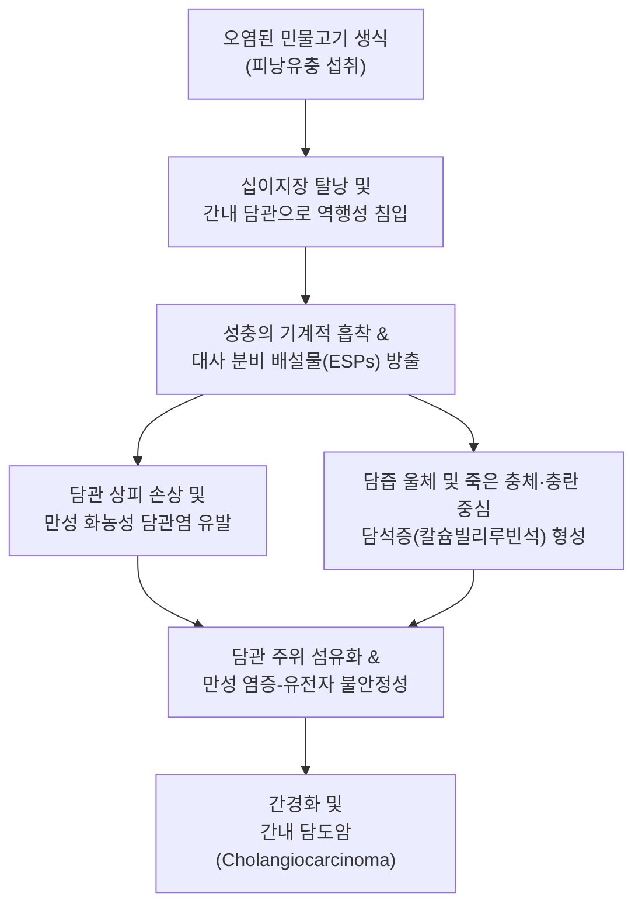
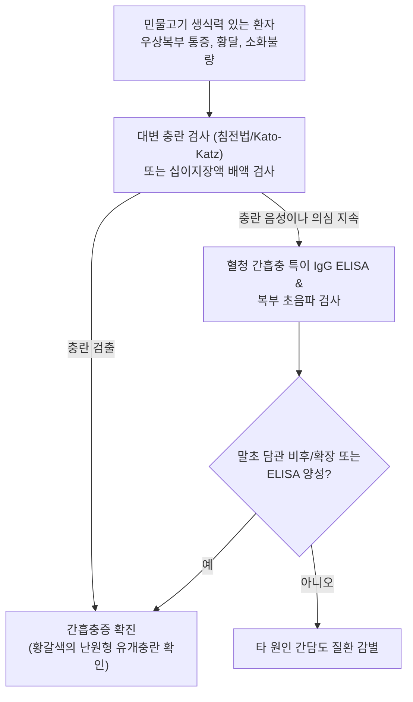

# 🩺 간흡충증

> **핵심 3줄 요약 (Key Summary)**:
> - 📍 병소 부위 & 해부·병태생리: 담관 상피(intrahepatic and extrahepatic bile ducts)에 기생하는 간흡충(*Clonorchis sinensis*) 감염으로, 기계적 자극 및 분비 배설물 독성에 의해 만성 화농성 [[담관염]], 담관 상피 과형성, 담관 주위 섬유화 및 [[간내 담도암]](담관암) 유발.
> - 🚩 전형적 임상 양상: 초기에는 무증상이 흔하나, 만성 감염 시 우상복부 둔통, 피로감, 소화불량, 간비대, 담즙 정체에 따른 [[황달]], [[소양증]] 동반.
> - 🛠️ 핵심 검사 & 치료 전략: 대변 충란 검사(Formalin-ether 원심침전법), 십이지장액 검사, 간흡충 특이 IgG ELISA, 복부 초음파(말초 담관 벽의 미만성 비후 및 반사 증가); 1차 선택 구충제 프라지콴텔(Praziquantel $25\text{ mg/kg}$ tid 1~2일).
> - ⚠️ 응급 의뢰 레드플래그: 급성 화농성 담관염(Charcot 3징: 고열, 황달, 우상복부 산통 또는 Reynolds 5징: 패혈성 쇼크, 의식 저하 동반), 담관 폐색성 담즙 정체, 담낭 천공 의심 징후.

---

## 📌 목차
1. [질환 개요 & 해부학적 병태생리](#1-질환-개요--해부학적-병태생리)
2. [병태생리 메커니즘 & 생체역학적 악순환 네트워크](#2-병태생리-메커니즘--생체역학적-악순환-네트워크)
3. [임상 증상 & 이학적 검사(Physical Exam) 알고리즘](#3-임상-증상--이학적-검사physical-exam-알고리즘)
4. [감별 진단 매트릭스 (Differential Diagnosis)](#4-감별-진단-매트릭스--differential-diagnosis)
5. [한의 통합 치료 프로토콜 (침·약침·추나·한약)](#5-한의-통합-치료-프로토콜--침약침추나한약)
6. [양방 치료 & 병용·의뢰 기준 (Conventional Treatment & Referral)](#6-양방-치료--병용의뢰-기준-conventional-treatment--referral)
7. [재활 운동 & 생활습관 티칭 가이드](#7-재활-운동--생활습관-티칭-가이드)
8. [💡 사용자 진료실 핵심 필기 & 임상 노하우 (Melt-In 잔여 심화 집약)](#8--사용자-진료실-핵심-필기--임상-노하우--melt-in-잔여-심화-집약)
9. [출처 및 학술 참고 문헌 (References)](#9-출처-및-학술-참고-문헌--references)

---

## 1. 질환 개요 & 해부학적 병태생리

**간흡충증(Clonorchiasis)**은 인간 및 육식 포유류의 간 내·외 담관에 기생하는 간흡충(*Clonorchis sinensis*)에 의해 유발되는 주요 인수공통 식품 매개 윤충증이다. 대한민국을 비롯하여 중국 남부, 베트남 북부 등 동아시아 지역에 광범위하게 풍토병으로 분포하며, 국내 장내 기생충 감염증 중 발생률 1위를 차지한다. 감염은 제2중간숙주인 왜매치, 참붕어, 잉어 등 담수어(민물고기)를 생식하거나 불완전하게 가열 조리하여 섭취함으로써 피낭유충(Metacercaria)이 소화관으로 유입되면서 시작된다.

섭취된 피낭유충은 십이지장에서 탈낭한 후 바터 팽대부(Ampulla of Vater)를 거쳐 총담관 및 간내 중소 담관으로 역행성 이동한다. 담관 점막에 흡반으로 부착된 성충은 $15\sim 25\text{ years}$ 동안 장기 생존하며 지속적으로 기계적 손상과 분비·배설 항원(Excretory-secretory products, ESPs)을 방출한다. 이로 인해 담관 상피세포의 점액샘양 과형성(Adenomatous hyperplasia), 담관벽의 심각한 섬유화, 담관 확장 및 담관염이 유발되며, WHO 산하 국제암연구소(IARC)는 간흡충을 Group 1 발암물질([[간내 담도암]] 원인체)로 지정하고 있다.

---

## 2. 병태생리 메커니즘 & 생체역학적 악순환 네트워크

간흡충 감염의 병태생리는 성충의 물리적 자극, 담즙 유동 장애, 대사 독소 및 숙주 면역 염증 반응의 복합 작용이다. 충체에서 분비되는 ESPs는 활성산소종(ROS) 및 활성질소종(RNS)을 대량 발생시켜 숙주 담관 상피세포의 DNA 손상을 유도하고, $p53$ 종양 억제 유전자의 돌연변이 및 세포사멸 회피 경로를 활성화한다. 또한 사멸한 충체 찌꺼기와 배출된 충란은 담즙 내 빌리루빈 및 칼슘염 침착의 핵(Nidus)으로 작용하여 간내 [[담석증]] 및 재발성 화농성 [[담관염]]의 악순환을 형성한다.

---

## 3. 임상 증상 & 이학적 검사(Physical Exam) 알고리즘

### 주요 임상 증상
- **경도 감염 (충체수 < 100마리)**: 대다수에서 자각 증상이 거의 없거나 경미한 소화불량, 상복부 팽만감, 간헐적 식욕부진.
- **중등도~중증 감염 (충체수 100~1,000마리 이상)**:
  - 우상복부(심와부) 둔통 및 압통, 전신 쇠약감, 만성 [[피로]].
  - 간종대(Hepatomegaly), 진행 시 비장 종대([[비장 비대]]) 동반.
  - 담즙 정체성 [[황달]], 피부 [[소양증]], 흑갈색 뇨 및 회백색 변.
  - 세균성 이차 감염 병발 시 급성 오한, 고열, 심한 산통.

### 진단 알고리즘

---

## 4. 감별 진단 매트릭스 (Differential Diagnosis)

| 감별 질환 | 감염원 및 병인 | 주요 병소 및 증상 | 진단적 핵심 소견 | 치료 및 예후 |
| :--- | :--- | :--- | :--- | :--- |
| **간흡충증 (*C. sinensis*)** | 담수어(잉어, 붕어) 생식 | 간내 말초 담관, 만성 소화장애, [[황달]], [[간내 담도암]] 위험 | 대변 내 작은 유개충란($27\sim 35\ \mu\text{m}$), 초음파상 담관벽 비후 | 프라지콴텔 $25\text{ mg/kg}$ tid 1~2일 완치 |
| **간질증 (*Fasciola hepatica*)** | 미나리 등 수생식물 섭취 | 간 실질 관통 후 주담관 안착, 급성기 고열·간비대 | 대변 내 대형 유개충란($130\sim 150\ \mu\text{m}$), 호산구증다증 | 트리클라벤다졸(Triclabendazole) 반응, 프라지콴텔 저항 |
| **간내 담도 결석증** | 담즙 정체, 세균 감염 | 우상복부 산통, 급성 화농성 [[담관염]] | 복부 CT/MRCP상 담관 내 고음영 결석 | 내시경적/외과적 결석 제거술 |
| **원발성 담즙성 담관염 (PBC)** | 자가면역 기전 담관 파괴 | 중년 여성, 극심한 [[소양증]], [[황달]], [[피로]] | 혈청 항미토콘드리아 항체(AMA) 양성, IgM 상승 | UDCA 및 면역조절제, 진행 시 간이식 |
| **급성 [[담낭염]]** | 담낭경부 담석 감동 | 우상복부 산통, 머피 징후 양성, 발열 | 담낭벽 비후($>3\text{ mm}$), 담낭 주위 삼출액 | 응급 담낭절제술 및 항생제 투여 |

---

## 5. 한의 통합 치료 프로토콜 (침·약침·추나·한약)

> ⚠️ 한의학적 치료는 간흡충 자체의 박멸을 대체할 수 없으므로 확진 시 양방 표준 구충제(프라지콴텔) 투여가 선행되어야 한다. 한의 치료는 구충 후 잔존하는 만성 담도 염증, 담즙 정체, 소화불량, 간섬유화 진행 억제 및 간기능 회복을 위한 병용 지지요법으로 시행한다.

### 1) 한약 처방 (변증별 지지요법)
- **간담습열증 (肝膽濕熱證 - 구충 후 지속되는 우상복부 팽만, 황달, 구고, 설태 황니)**:
  - 처방: [[인진호탕]] 또는 가미[[대시호탕]] ([[인진호]], [[치자]], [[대황]], [[시호]], [[황금]], [[백작약]], [[반하]], 생강).
  - 약리 기전: [[인진호]]의 카필라린(Capillarin) 및 치자의 제니포시드(Geniposide)가 담즙 분비를 촉진(Choleretic action)하고 담관 상피세포 염증 신호 억제.
- **비허간울증 (脾虛肝鬱證 - 만성 피로, 소화불량, 설사, 식후 복통)**:
  - 처방: [[소시호탕]] 합 [[평위산]] 또는 [[삼령백출산]] 가감 ([[시호]], [[황금]], [[인삼]], [[반하]], [[진피]], [[복령]], [[백출]], 감초).
  - 작용: 소화 흡수 기능 재건, 담관 주위 미세혈류 순환 개선.
- **기체어혈증 (氣滯瘀血證 - 우협하 자통, 간비대 및 간섬유화 억제)**:
  - 처방: [[혈부축어탕]] 가감 ([[당귀]], [[생지황]], [[적작약]], [[천궁]], [[시호]], 도인, 홍화).
  - 학술 근거: 간 섬유모세포 활성화 억제 및 세포외 기질 침착 완화.

### 2) 침구 치료
- **혈위**: 양릉천(GB34), 일월(GB24), 기문(LR14), 태충(LR3), 족삼리(ST36), 중완(CV12), 담수(BL19), 간수(BL18).
- **시술 지침**: 양릉천과 기문은 담낭 수축 및 오디 괄약근 이완을 도와 담즙 배출을 촉진함. 급성 화농성 담관염 의심 시 자침을 금하고 응급 전원.

---

## 6. 양방 치료 & 병용·의뢰 기준 (Conventional Treatment & Referral)

### 양방 표준 치료 프로토콜
- **1차 표준 구충 요법**:
  - **프라지콴텔(Praziquantel)**: $25\text{ mg/kg}$씩 1일 3회, $4\sim 6$시간 간격으로 1일간 경구 투여(중증 감염 시 2일간 투여).
  - 작용 기전: 흡충 세포막의 칼슘 이온 투과성을 급격히 증가시켜 충체의 근육 강직성 마비 및 외피 손상 유발 후 숙주 면역계에 의해 파괴.
  - 치유 판정: 투약 3~4주 후 대변 충란 검사를 재시행하여 음전 확인.
- **합병증 치료**:
  - 담도 폐색 및 결석: 내시경적 역행성 담췌관 조영술(ERCP)을 통한 괄약근 절개술 및 배액술.
  - 급성 담관염 병발 시: 3세대 세팔로스포린 또는 피페라실린/타조박탐 정맥 항생제 투여.

### 긴급 응급 의뢰 레드플래그
- **Charcot 3징**: 심와부/우상복부의 극심한 산통, $38.5^\circ\text{C}$ 이상의 고열 및 오한, 육안적 [[황달]].
- **Reynolds 5징**: Charcot 3징에 저혈압(수축기 혈압 $< 90\text{ mmHg}$) 및 급격한 의식 혼돈 동반 (급성 폐쇄성 화농성 담관염으로 인한 패혈성 쇼크 의심).
- 복부 전반의 반발통 및 근육 연축(담낭 천공에 따른 범발성 복막염 의심).

---

## 7. 재활 운동 & 생활습관 티칭 가이드

- **절대적 식이 예방 티칭**: 민물고기(잉어, 붕어, 피라미, 왜매치 등)의 생식(회, 초밥 등)을 절대 금지하고, 반드시 중심 온도 $70^\circ\text{C}$ 이상에서 충분히 가열 조리하여 섭취하도록 지도함.
- **조리 기구 교차 오염 방지**: 민물고기를 손질한 도마, 칼, 식기는 끓는 물이나 락스 희석액으로 철저히 소독하며, 손질 중 채소나 다른 식재료와 접촉하지 않도록 주의.
- **가족 동반 스크리닝**: 민물고기 생식 습관은 가족이나 동호회 단위로 이루어지는 경우가 많으므로, 함께 식사한 동반인 전원에 대해 대변 검사 및 예방적 검진 권고.
- **금주 및 간 보호**: 구충 후에도 손상된 담관 상피의 재생과 [[간내 담도암]] 예방을 위해 과도한 음주를 피하고 균형 잡힌 저지방 항산화 식단을 유지함.

---

## 8. 💡 사용자 진료실 핵심 필기 & 임상 노하우 (Melt-In 잔여 심화 집약)

> 💡 **임상 핵심 진주 (Clinical Pearls)**:
> - **낙동강·섬진강 유역의 과거력 추적**: 원인 불명의 만성 소화불량, 피로감, 경미한 간기능 수치(AST/ALT, GGT, ALP) 상승 환자가 내원했을 때, 낙동강, 영산강, 금강, 섬진강 등 5대강 유역 거주력이나 민물고기 회 섭취력을 반드시 문진해야 한다. 10~20년 전 섭취한 유충이 담관에서 생존해 있을 수 있다.
> - **프라지콴텔 복용의 팁**: 프라지콴텔 복용 후 일시적인 두통, 현훈, 오심, 복통이 빈발한다. 이는 약제 자체의 부작용 외에도 충체가 파괴되면서 방출되는 항원에 의한 급성 면역 반응이므로, 환자에게 미리 설명하여 복약을 중단하지 않도록 안심시켜야 한다.
> - **구충 후에도 끝난 것이 아니다**: 프라지콴텔로 충체를 박멸해도 수십 년간 지속된 담관벽 섬유화와 이형성 변화는 즉시 회복되지 않으며, 담관암 발생 위험도가 장기간 유지되므로 연 1회 이상의 정기적인 복부 초음파 및 종양 표지자(CA 19-9) 추적 관찰이 필수적이다.
> - **담낭 초음파 판독의 단서**: 간흡충 감염 초음파의 전형적 특징은 간 실질 내 말초 담관 벽이 균일하게 하얗게 비후되어 보이는 '동심원양 반사(Periductal echogenicity)'이다. 담석이 없는데도 말초 담관이 늘어나 보이면 간흡충증을 1순위로 의심해야 한다.

---

## 9. 출처 및 학술 참고 문헌 (References)

- Bi J, et al. (2026). Highly efficient RPA product degradation and expanded PAM recognition for rapid, reliable detection of Clonorchis sinensis without post-amplification operations. *Anal Chim Acta*. PMID: 42838688.

- Du Y, et al. (2026). A pathogenic CD8⁺ TRM-chemokine axis orchestrates liver fibrosis and periductal collagen deposition in Clonorchis sinensis infection. *Nat Commun*. PMID: 42669716.

- Zhang X, et al. (2026). Neutrophil depletion exacerbates Clonorchis sinensis associated hepatobiliary injury by dysregulating the balance between pro- and anti-inflammatory cytokines. *Food Waterborne Parasitol*. PMID: 42666541.
