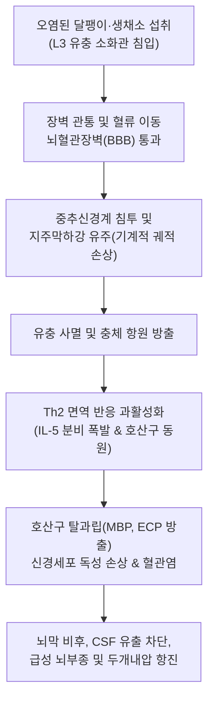
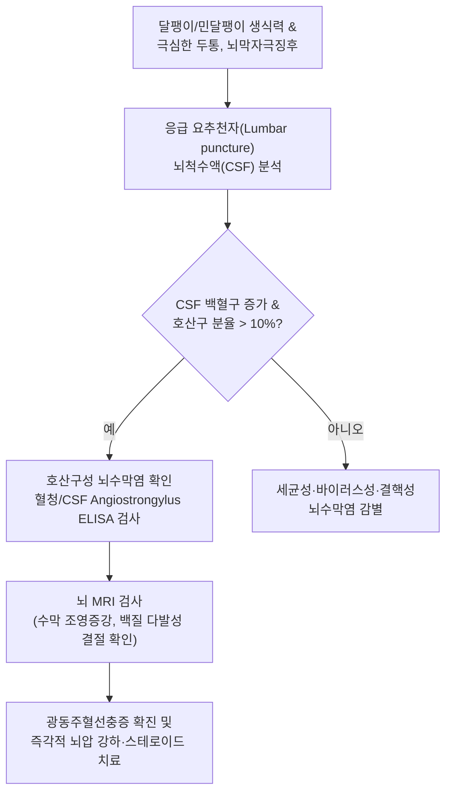

# 🩺 광동주혈선충증

> **핵심 3줄 요약 (Key Summary)**:
> - 📍 병소 부위 & 해부·병태생리: 쥐의 폐동맥에 기생하는 광동주혈선충(*Angiostrongylus cantonensis*)의 제3기 유충이 인체 중추신경계(뇌실질, 뇌척수막, 지주막하강)로 이행하여 발생하는 호산구성 [[뇌수막염]](Eosinophilic meningitis).
> - 🚩 전형적 임상 양상: 달팽이·민달팽이 생식 또는 오염된 채소 섭취 1~3주 후 발생하는 찌르는 듯한 극심한 후두부 두통, 경부 강직, 감각이상(피부 이질통·통각과민), 오심, 구토.
> - 🛠️ 핵심 검사 & 치료 전략: 요추천자 뇌척수액(CSF) 검사(백혈구 증가 및 호산구 비율 $>10\%$, 단백질 상승, 개두압 상승), 혈청/CSF 특이 항체 검사; 고용량 코르티코스테로이드(Dexamethasone/Prednisolone) 및 뇌압 강하 치료, 알벤다졸 병용 주의.
> - ⚠️ 응급 의뢰 레드플래그: 급격한 의식 저하 및 기면, 동안신경 또는 외전신경 마비, 유두부종(Papilledema), 뇌간 압박에 따른 쿠싱 삼징후(고혈압, 서맥, 불규칙 호흡).

---

## 📌 목차
1. [질환 개요 & 해부학적 병태생리](#1-질환-개요--해부학적-병태생리)
2. [병태생리 메커니즘 & 생체역학적 악순환 네트워크](#2-병태생리-메커니즘--생체역학적-악순환-네트워크)
3. [임상 증상 & 이학적 검사(Physical Exam) 알고리즘](#3-임상-증상--이학적-검사physical-exam-알고리즘)
4. [감별 진단 매트릭스 (Differential Diagnosis)](#4-감별-진단-매트릭스--differential-diagnosis)
5. [한의 통합 치료 프로토콜 (침·약침·추나·한약)](#5-한의-통합-치료-프로토콜--침약침추나한약)
6. [양방 치료 & 병용·의뢰 기준 (Conventional Treatment & Referral)](#6-양방-치료--병용의뢰-기준-conventional-treatment--referral)
7. [재활 운동 & 생활습관 티칭 가이드](#7-재활-운동--생활습관-티칭-가이드)
8. [💡 사용자 진료실 핵심 필기 & 임상 노하우 (Melt-In 잔여 심화 집약)](#8--사용자-진료실-핵심-필기--임상-노하우--melt-in-잔여-심화-집약)
9. [출처 및 학술 참고 문헌 (References)](#9-출처-및-학술-참고-문헌--references)

---

## 1. 질환 개요 & 해부학적 병태생리

**광동주혈선충증(Angiostrongyliasis)**은 선충류인 광동주혈선충(*Angiostrongylus cantonensis*)의 유충 감염에 의해 발생하는 중추신경계 기생충 감염증으로, 전 세계적으로 호산구성 [[뇌수막염]]의 가장 흔한 원인 질환이다. 고유 종숙주는 시궁쥐(Rattus norvegicus) 등 야생 쥐이며, 중간숙주는 아프리카왕달팽이(Achatina fulica), 민달팽이, 우렁이 등 육상 및 담수 패류이다. 인간은 종말숙주(Dead-end host)로서 유충에 오염된 패류나 운반숙주(민물 새우, 게, 개구리, 왕우렁이)를 날것으로 먹거나 오염된 채소, 음용수를 섭취함으로써 우발적으로 감염된다.

인체에 섭취된 제3기 유충(L3)은 장벽을 관통하여 정맥 및 림프계를 타고 전신 순환한 뒤, 뇌혈관장벽(BBB)을 통과하여 뇌와 척수의 지주막하강 및 뇌실질로 이동한다. 유충은 뇌신경 조직에서 제4기 유충을 거쳐 성충 직전 단계까지 발육하지만 인간의 체내에서는 폐동맥으로 최종 이동하여 성충으로 성숙하지 못하고 대개 중추신경계 내에서 사멸한다. 유충이 뇌신경 조직 내에서 이동하면서 남기는 기계적 터널 손상과 유충 사멸 시 방출되는 항원은 뇌막과 뇌실질에 극심한 호산구성 염증 반응과 뇌부종, 두개내압 상승을 초래한다.

---

## 2. 병태생리 메커니즘 & 생체역학적 악순환 네트워크

뇌 조직 내로 침입한 유충은 사멸하면서 다량의 가용성 항원을 유리시킨다. 이는 Th2 림프구를 강력히 자극하여 IL-4, IL-5, IL-13의 과잉 분비를 유도하며, 대량의 호산구를 뇌척수액(CSF) 및 연수막으로 끌어들인다. 동원된 호산구는 주요 염기성 단백질(Major Basic Protein, MBP), 호산구 양이온 단백질(ECP), 호산구 과산화효소(EPO)를 탈과립 분비하여 신경축삭과 희소돌기아교세포를 직접 파괴한다. 또한 거미막하 과립(Arachnoid villi)의 흡수 장애와 뇌혈관 투과성 증가로 인해 심각한 연통성 수두증 및 뇌압 상승의 악순환이 발생한다.

---

## 3. 임상 증상 & 이학적 검사(Physical Exam) 알고리즘

### 주요 임상 증상
- **두통**: 환자의 $90\sim 95\%$ 이상에서 호소하는 주증상으로, 진통제에 반응하지 않는 박동성 혹은 쥐어짜는 듯한 극심한 전두부 및 후두부 두통.
- **뇌막 자극 징후**: 경부 강직(Nuchal rigidity), 케르니히 징후(Kernig sign) 및 브루진스키 징후(Brudzinski sign) 양성.
- **감각 이상 (Paresthesia & Allodynia)**: 피부의 가벼운 접촉이나 바람에도 극심한 통증을 느끼는 피부 이질통(Allodynia), 작열감, 감각 저하(사지 또는 체간 호발).
- **뇌신경 마비**: 제6뇌신경(외전신경) 및 제7뇌신경(안면신경) 침범에 따른 복시, 안구 운동 장애, 안면 마비.
- **소화기 및 전신 증상**: 발열은 미열에 그치는 경우가 많으나 구역, 분출성 구토, 전신 무력감 동반.

### 진단 알고리즘

---

## 4. 감별 진단 매트릭스 (Differential Diagnosis)

| 감별 질환 | 병원체 및 감염원 | CSF 소견 (백혈구/호산구) | 임상 특징 및 감별점 | 치료 접근법 |
| :--- | :--- | :--- | :--- | :--- |
| **광동주혈선충증** | *A. cantonensis*, 달팽이 생식 | 호산구 $>10\%$, 단백질 상승, 당 정상/경미 저하 | 극심한 두통, 피부 이질통, 안구 외전신경 마비 | 뇌압 배액, 고용량 코르티코스테로이드 |
| **악구충증 (*Gnathostoma*)** | *G. spinigerum*, 민물고기/장어 생식 | 혈성/황색 CSF, 현저한 호산구 증가 | 이동성 피하 결절, 신경근병증, 뇌출혈·척수염 호발 | 이베르멕틴, 알벤다졸, 외과적 적출 |
| **유구낭미충증 (Neurocysticercosis)** | *Taenia solium*, 돼지고기/충란 섭취 | 호산구 경도 증가 가능, 림프구 우세 | 뇌전증 발작, 뇌실질 내 낭미충 결절(CT/MRI상 스콜렉스) | 알벤다졸, 프라지콴텔, 항경련제 |
| **결핵성 [[뇌수막염]]** | *Mycobacterium tuberculosis* | 림프구 우세, 포도당 현저 저하, 단백질 극상승 | 2주 이상 서서히 진행하는 미열, 뇌기저부 수막염 | 항결핵제 4제 요법 + 스테로이드 |
| **바이러스성 수막염** | Enterovirus, HSV 등 | 단핵구/림프구 우세, 호산구 정상 | 급성 고열, 두통, 전신 근육통, 양호한 자연 경과 | 보존적 대증 요법, 아시클로버(HSV) |

---

## 5. 한의 통합 치료 프로토콜 (침·약침·추나·한약)

> ⚠️ 광동주혈선충증은 급성 두개내압 상승 및 영구적 신경 손상, 뇌탈출을 유발할 수 있는 응급 질환이므로, 급성기에는 신경과/감염내과의 요추천자 뇌압 배액 및 고용량 스테로이드 치료가 최우선이다. 한의 치료는 급성 뇌부종이 진정된 후 잔여 두통, 만성 신경병증성 피부 이질통, 안면신경 마비 재활 및 뇌척수액 순환 장애 완화에 국한하여 보완적으로 적용한다.

### 1) 한약 처방 (아급성·만성기 신경 재활 지지요법)
- **담탁조락 및 풍화상요증 (痰濁阻絡 風火上擾證 - 극심한 잔여 두통, 어지럼, 오심, 구고)**:
  - 처방: 반하백출천마탕 합 [[갈근탕]] 가감 ([[반하]], [[천마]], [[백출]], [[복령]], [[갈근]], [[마황]], [[백작약]], [[감초]]).
  - 기전: 갈근의 푸에라린(Puerarin) 성분이 뇌혈류를 개선하고 혈관연축 완화, 반하-천마의 중추 진정 및 전정신경 안정 작용.
- **열독상음 및 어혈조체증 (熱毒傷陰 瘀血阻滯證 - 피부 이질통, 찌르는 듯한 신경통, 번열)**:
  - 처방: [[온청음]] 합 천궁다조산 가감 ([[생지황]], [[당귀]], [[백작약]], [[천궁]], [[황련]], [[황금]], [[황백]], [[치자]], 방풍, 세신).
  - 작용: 말초 및 중추 신경성 감작(Central sensitization) 억제, 신경 염증 진정.
- **기혈양허 및 경락불리증 (氣血兩虛 經絡不利證 - 안면 마비 후유증, 사지 위약, 만성 피로)**:
  - 처방: [[보중익기탕]] 가미 ([[황기]], [[인삼]], [[백출]], [[감초]], [[당귀]], 진피, 승마, 시호).
  - 목적: 손상된 신경 세포 재생 환경 지원 및 면역 조절.

### 2) 침구 치료
- **혈위**: 백회(GV20), 풍지(GB20), 태양(EX-HN5), 합곡(LI4), 태충(LR3), 곡지(LI11), 족삼리(ST36), 아문(GV15).
- **시술 지침**: 급성기 두개내압 항진 환자에게 강자극이나 후두하부 심자(Deep puncture)는 금기. 아급성기 두통 완화를 위해 풍지와 태양 혈위를 사자(Oblique puncture)하여 후두신경 및 측두부 근막 긴장을 이완함.

---

## 6. 양방 치료 & 병용·의뢰 기준 (Conventional Treatment & Referral)

### 양방 표준 치료 프로토콜
1. **두개내압 조절 및 증상 완화 (치료의 핵심)**:
   - **반복적 치료적 요추천자(Therapeutic lumbar puncture)**: 뇌척수액을 수차례 배액하여 개두압을 즉각적으로 정상화함으로써 극심한 두통을 신속히 완화.
2. **항염증 코르티코스테로이드 요법**:
   - **프레드니솔론(Prednisolone)**: $60\text{ mg/day}$ (또는 덱사메타손), $2\sim 3\text{ weeks}$ 투여 후 감량.
   - 근거: 충체 사멸에 따른 급성 알레르기성 신경 염증을 억제하고 뇌부종 발생을 차단하여 신경학적 후유증을 유의미하게 감소시킴.
3. **구충제 투여 논쟁 및 원칙**:
   - 알벤다졸(Albendazole $15\text{ mg/kg/day}$ 2주): 단독 투여 시 유충의 대량 사멸로 인해 뇌수막염 증상이 급격히 악화될 수 있으므로 **반드시 충분한 고용량 스테로이드 치료가 병용된 상태에서만 신중히 투여**.

### 긴급 응급 의뢰 레드플래그
- 기면, 혼미 등 급격한 의식 수준 저하.
- 안저 검사상 시신경 유두부종(Papilledema) 및 시력 상실.
- 뇌간 탈출 전조 증상(쿠싱 삼징후: 서맥, 수축기 고혈압, 불규칙한 호흡).
- 제6/제7 뇌신경 마비의 급속한 진행 및 전신 경련 발작.

---

## 7. 재활 운동 & 생활습관 티칭 가이드

- **식습관 위생 철저 교육**: 달팽이 요리(에스카르고 등)나 아프리카왕달팽이, 민달팽이, 개구리, 민물 가재를 절대 날것으로 먹지 않도록 강력히 경고함.
- **날채소 세척 지침**: 유행 지역(동남아, 하와이, 태평양 제도, 대만 등) 여행 시 샐러드나 쌈 채소 등 생채소 섭취를 피하고, 섭취 시 흐르는 물에 잎을 한 장씩 철저히 씻거나 익혀 먹도록 지도함.
- **달팽이 접촉 후 손 위생**: 텃밭이나 야외 활동 중 민달팽이나 달팽이를 맨손으로 만진 후에는 즉시 비누와 물로 손을 철저히 씻도록 교육.
- **신경병증성 통증 완화 환경**: 피부 이질통이 있는 부위에는 꽉 끼는 옷을 피하고 헐렁한 면 소재 옷을 착용하며, 통증 부위에 급격한 온도 변화가 닿지 않도록 관리.

---

## 8. 💡 사용자 진료실 핵심 필기 & 임상 노하우 (Melt-In 잔여 심화 집약)

> 💡 **임상 핵심 진주 (Clinical Pearls)**:
> - **'진통제가 듣지 않는 두통'과 피부 접촉통의 조합**: 환자가 "머리가 깨질 듯이 아픈데 타이레놀이나 NSAIDs를 한 주먹 먹어도 전혀 안 가라앉고, 이상하게 팔다리 살갗에 옷만 스쳐도 소름 끼치고 아프다"고 호소하면 즉시 광동주혈선충증을 떠올려야 한다. 피부 이질통(Allodynia)은 이 질환의 매우 특징적인 임상 단서이다.
> - **동남아·제주도 여행력 문진**: 최근 1~4주 이내에 동남아시아(베트남, 태국 등), 하와이, 혹은 국내 남부 도서 지역에서 야생 채소나 생간, 덜 익힌 달팽이/우렁이를 섭취한 이력이 있는지 반드시 확인해야 한다.
> - **구충제 단독 처방의 위험성**: 일반적인 장내 기생충 감염처럼 생각하고 알벤다졸을 단독 처방하면 뇌실질 내에 있던 유충이 일시에 사멸하면서 대량의 항원이 유리되어 뇌부종과 뇌헤르니아를 유발할 수 있다. 반드시 상급 병원에서 스테로이드 병용 프로토콜 하에 치료받도록 전원해야 한다.
> - **요추천자의 치료적 마법**: 이 질환에서 요추천자는 단순한 진단 검사를 넘어 최고의 진통 치료법이다. 뇌척수액을 $10\sim 20\text{ mL}$ 배액하는 즉시 두통이 극적으로 소실되는 현상을 보이며, 이는 두통의 주원인이 두개내압 상승임을 방증한다.

---

## 9. 출처 및 학술 참고 문헌 (References)

- Neves D, et al. (2026). Stage-Dependent Anthelmintic Activity of Licarin A Against the Neurotropic Nematode Angiostrongylus cantonensis. *Trop Med Infect Dis*. PMID: 42931447.

- Pandian SJ, et al. (2026). Revisiting a Neglected Zoonosis: Molecular Identification of Angiostrongylus cantonensis in Southern Indian Rodents. *Zoonoses Public Health*. PMID: 42904524.

- He P, et al. (2026). Metagenomic analysis of developmental-category-associated fungal communities of Pomacea canaliculata and its potential as an ecological barrier against Angiostrongylus cantonensis. *Parasit Vectors*. PMID: 42888449.
