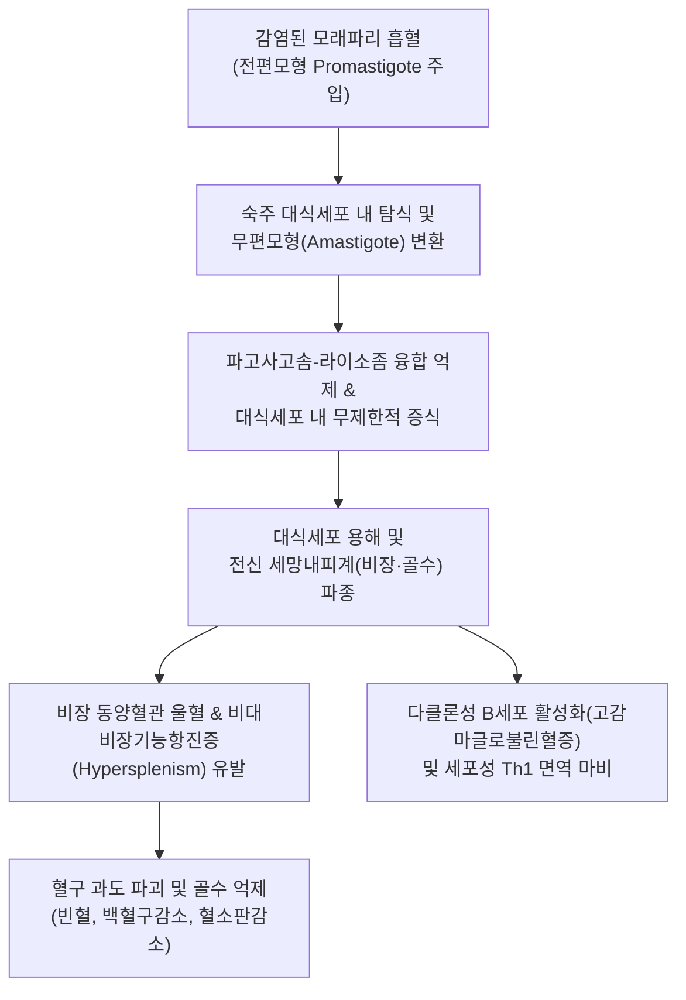
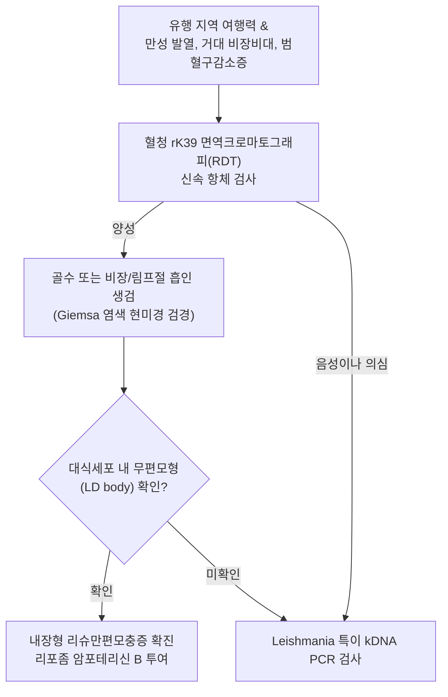

# 🩺 리슈만편모충증

> **핵심 3줄 요약 (Key Summary)**:
> - 📍 병소 부위 & 해부·병태생리: 모래파리(Sandfly) 흡혈에 의해 매개되는 리슈마니아 원충(*Leishmania* spp.) 감염으로, 대식세포계 및 세망내피계(비장, 간, 골수, 림프절)를 침범하여 발생하는 내장형(Kala-azar), 피부형, 점막피부형 질환군.
> - 🚩 전형적 임상 양상: 내장형의 경우 불규칙한 장기적 [[발열]], 현저한 거대 [[비장 비대]], 간비대, 범혈구감소증, 체중 감소, 피부 흑화; 피부형은 통증 없는 융기형 홍반성 구진이 중심부 궤양(화산 분화구양)으로 진행.
> - 🛠️ 핵심 검사 & 치료 전략: 골수/비장/림프절 천자액 또는 피부 생검 도말 검사(Giemsa 염색상 무편모형 Amastigote 확인), rK39 면역크로마토그래피 신속 진단, kDNA PCR; 리포좀 암포테리신 B(Liposomal amphotericin B), 밀테포신(Miltefosine), 5가 안티몬 제제.
> - ⚠️ 응급 의뢰 레드플래그: 내장형 리슈만편모충증 환자의 중증 범혈구감소증(혈소판 < 20,000/μL로 인한 출혈), 이차 세균성 패혈증, 비장 파열 징후, 혈구탐식성 림프조직구증(HLH) 의심.

---

## 📌 목차
1. [질환 개요 & 해부학적 병태생리](#1-질환-개요--해부학적-병태생리)
2. [병태생리 메커니즘 & 생체역학적 악순환 네트워크](#2-병태생리-메커니즘--생체역학적-악순환-네트워크)
3. [임상 증상 & 이학적 검사(Physical Exam) 알고리즘](#3-임상-증상--이학적-검사physical-exam-알고리즘)
4. [감별 진단 매트릭스 (Differential Diagnosis)](#4-감별-진단-매트릭스--differential-diagnosis)
5. [한의 통합 치료 프로토콜 (침·약침·추나·한약)](#5-한의-통합-치료-프로토콜--침약침추나한약)
6. [양방 치료 & 병용·의뢰 기준 (Conventional Treatment & Referral)](#6-양방-치료--병용의뢰-기준-conventional-treatment--referral)
7. [재활 운동 & 생활습관 티칭 가이드](#7-재활-운동--생활습관-티칭-가이드)
8. [💡 사용자 진료실 핵심 필기 & 임상 노하우 (Melt-In 잔여 심화 집약)](#8--사용자-진료실-핵심-필기--임상-노하우--melt-in-잔여-심화-집약)
9. [출처 및 학술 참고 문헌 (References)](#9-출처-및-학술-참고-문헌--references)

---

## 1. 질환 개요 & 해부학적 병태생리

**리슈만편모충증(Leishmaniasis)**은 흡혈 곤충인 모래파리(Sandfly, 구대륙 *Phlebotomus*속, 신대륙 *Lutzomyia*속)를 통해 전파되는 편모충류 원충인 *Leishmania*속 감염에 기인하는 주요 소외 열대질환(NTD)이다. 전 세계 90개국 이상의 아열대 및 열대 지역(인도, 방글라데시, 동아프리카, 지중해 분지, 중남미)에 토착화되어 있으며, 국내에서는 유행 지역 여행객이나 해외 파견 노동자, 이주민에서 유입되는 법정 감염병이다. 임상적으로는 크게 **내장형(Visceral leishmaniasis, 일명 칼라아자르 Kala-azar)**, **피부형(Cutaneous leishmaniasis)**, **점막피부형(Mucocutaneous leishmaniasis)**으로 대별된다.

모래파리가 흡혈할 때 전편모형(Promastigote) 유충이 인체 피하로 주입되면, 숙주 단핵구 및 대식세포에 의해 탐식된다. 포식소체 내로 진입한 원충은 편모를 소실하고 무편모형(Amastigote)으로 형태를 변환하여 대식세포의 라이소좀 효소 공격을 무력화시키고 세포 내에서 증식한다. 대식세포가 파괴되면 유리된 무편모형 충체들이 주변의 다른 단핵포식세포계를 침범한다. *L. donovani* 및 *L. infantum*에 의한 내장형의 경우 비장, 간, 골수, 림프절 등 전신 세망내피계로 파종되어 극심한 장기 종대와 조혈 기능 부전을 일으킨다.

---

## 2. 병태생리 메커니즘 & 생체역학적 악순환 네트워크

리슈마니아 원충은 세포성 면역(Th1) 반응을 교란하고 비효과적인 Th2 반응 및 다클론성 B세포 자극을 유도한다. 혈청 내 IgG는 극도로 증가하여 고감마글로불린혈증을 초래하지만, 정작 원충을 제거하는 IFN-$\gamma$ 및 TNF-$\alpha$ 분비는 저해된다. 세망내피계의 과형성으로 비장이 골반강까지 비대해지며, 비장기능항진증에 의해 적혈구, 백혈구, 혈소판이 비장에서 무차별 파괴되어 중증 [[빈혈]]과 출혈 경향, 치명적인 기회 세균 감염의 악순환이 완성된다.

---

## 3. 임상 증상 & 이학적 검사(Physical Exam) 알고리즘

### 주요 임상 양상
- **내장형 (Kala-azar, 흑열병)**:
  - 수주~수개월에 걸친 불규칙한 이봉성(Double daily peak) 고열.
  - 현저한 복부 팽만 및 거대 [[비장 비대]](배꼽 아래 또는 골반강까지 도달).
  - 간종대, 전신 림프절 비대([[림프절염]]), 진행성 체중 감소 및 악액질.
  - 전신성 피부 흑화(손, 발, 복부의 피부 과다 색소침착).
  - 코피, 잇몸 출혈 등 혈소판 감소에 따른 출혈 경향.
- **피부형 (Cutaneous leishmaniasis)**:
  - 노출부(안면, 팔, 다리)에 구진으로 시작하여 서서히 커지며 중심부가 괴사되어 분화구 형태의 무통성 궤양 형성, 경계가 융기됨.
- **점막피부형 (Mucocutaneous leishmaniasis)**:
  - 피부 병변 후 수개월~수년 뒤 비중격, 구강, 인후두 점막이 궤양화되고 연골이 파괴되어 '맥주병 코(Tapir nose)' 기형 유발.

### 진단 알고리즘

---

## 4. 감별 진단 매트릭스 (Differential Diagnosis)

| 감별 질환 | 병원체 및 기전 | 비장 및 간 소견 | 혈액학적 이상 소견 | 감별 검사 및 핵심 포인트 |
| :--- | :--- | :--- | :--- | :--- |
| **내장형 리슈만편모충증** | *L. donovani*, 대식세포 증식 | 거대 비장비대(단단함), 간비대 | 심한 범혈구감소증, 고감마글로불린혈증 | 골수/비장 흡인 도말상 LD body, rK39 RDT 양성 |
| **[[말라리아]] (*P. falciparum*)** | *Plasmodium*, 적혈구 파괴 | 비장비대(부드러움, 압통) | 용혈성 [[빈혈]], 혈소판감소증 | 말초혈액 도말상 적혈구 내 열원충 링 폼(Ring form) |
| **장티푸스 (*S. typhi*)** | *Salmonella typhi*, 장관 침범 | 경도 비장비대, 간비대 | 백혈구 감소증, 호산구 소실 | 혈액 배양 검사 양성, Widal 반응, 장미진(Rose spot) |
| **급성 골수성 백혈병** | 조혈모세포 악성 증식 | 간비장비대 동반 가능 | 백혈구 증가 또는 감소, 빈혈, 혈소판감소 | 골수 생검상 골수모세포(Myeloblast) $>20\%$ |
| **혈구탐식성 림프조직구증 (HLH)** | T세포/대식세포 과활성화 | 간비장비대 | 범혈구감소증, 고페리틴혈증($>500$) | 혈구포식 현상, NK세포 활성 저하, 페리틴 극초과 |

---

## 5. 한의 통합 치료 프로토콜 (침·약침·추나·한약)

> ⚠️ 내장형 리슈만편모충증은 치료하지 않을 경우 세균성 패혈증이나 중증 출혈, 다발성 장기 부전으로 2년 내 사망률이 $90\%$를 상회하는 치명적 감염증이므로, 양방 항원충제(리포좀 암포테리신 B) 치료가 절대적으로 선행되어야 한다. 한의 치료는 항원충 요법 후 발생하는 조혈계 기능 저하, 쇠약, 면역 결핍 및 비장비대 후유증 완화를 위한 지지요법으로 국한한다.

### 1) 한약 처방 (아급성·회복기 지지요법)
- **온열여독 및 음허발열증 (溫熱餘毒 陰虛發熱證 - 항원충 치료 후 미열, 도한, 구갈, 수척)**:
  - 처방: 청호별갑탕 또는 [[생맥산]] 가감 (청호, 별갑, [[생지황]], 지모, [[목단피]], [[인삼]], [[맥문동]], 오미자).
  - 약리 기전: 별갑의 면역 조절 작용 및 청호의 아르테미시닌 유사 항원충 보조 활성, 음액 보충을 통한 골수 재생 환경 조성.
- **기혈양허 및 징가적취증 (氣血兩虛 癥瘕積聚證 - 거대 비장비대, 만성 빈혈, 극심한 무력감)**:
  - 처방: [[보중익기탕]] 합 당귀보혈탕 가미 ([[황기]], [[인삼]], [[백출]], [[당귀]], [[숙지황]], [[천궁]], [[적작약]], 삼릉, 봉출).
  - 작용: 비장 미세순환 개선을 통한 울혈 완화 및 조혈 기능 촉진.
- **습열어독증 (濕熱瘀毒證 - 피부형 궤양 삼출, 림프절염)**:
  - 처방: [[황련해독탕]] 합 선방활명음 가감 ([[황련]], [[황금]], [[황백]], [[치자]], [[금은화]], [[연교]], [[포공영]]).
  - 효과: 피부 병소의 2차 세균 감염 차단 및 상피화 촉진.

### 2) 침구 치료
- **혈위**: 족삼리(ST36), 삼음교(SP6), 비수(BL20), 간수(BL18), 격수(BL17), 중완(CV12), 합곡(LI4).
- **시술 지침**: 거대 비장비대가 있는 좌상복부 및 복벽에는 자침을 엄격히 금함(비장 파열 위험). 원격 혈위 위주로 부드럽게 자침하여 비위 기능 보강.

---

## 6. 양방 치료 & 병용·의뢰 기준 (Conventional Treatment & Referral)

### 양방 표준 치료 프로토콜 (WHO 가이드라인)
1. **내장형 리슈만편모충증 (1차 표준 치료)**:
   - **리포좀 암포테리신 B (Liposomal Amphotericin B, AmBisome)**: 총 용량 $10\sim 20\text{ mg/kg}$을 $2\sim 5$일에 걸쳐 분할 정맥 점적 투여. 신독성이 적고 $95\%$ 이상의 관해율 달성.
   - 대체 요법: 경구용 밀테포신(Miltefosine $2.5\text{ mg/kg/day}$ 28일), 파로모마이신(Paromomycin), 5가 안티몬 제제(Sodium stibogluconate).
2. **피부형 리슈만편모충증**:
   - 국소 요법: 병변 내 5가 안티몬 주사, 냉동요법, 가열요법.
   - 복합/광범위 병변: 경구 밀테포신 또는 아졸계 항진균제.

### 긴급 응급 의뢰 레드플래그
- 비장 부위의 갑작스러운 극심한 격통 및 복강 내 출혈 쇼크(비장 파열).
- 혈소판 수치 $< 20,000/\mu\text{L}$에 따른 뇌출혈 또는 대량 위장관 출혈.
- $39^\circ\text{C}$ 이상의 고열 지속과 호중구 절대수 $< 500/\mu\text{L}$ (호중구감소성 패혈증).

---

## 7. 재활 운동 & 생활습관 티칭 가이드

- **모래파리 회피 및 방충 수칙**: 유행 지역 여행 시 황혼부터 새벽까지의 야외 활동을 피하고, DEET 성분의 모기 기피제를 피부에 도포함. 모래파리는 일반 모기장 그물망을 통과할 수 있으므로 극미세망(Fine mesh) 방충망 및 살충제 처리 모기장을 사용함.
- **비장 보호를 위한 신체 접촉 금지**: 거대 비장비대가 있는 환자는 비장 피막이 극도로 얇아져 가벼운 외상이나 압박에도 파열될 수 있으므로, 과격한 운동, 격투기, 무거운 짐 들기를 엄격히 금함.
- **피부 병변 관리**: 피부형 궤양 병변을 손으로 짜거나 긁지 않도록 교육하며, 생리식염수로 세척 후 멸균 드레싱을 유지하여 2차 화농성 감염을 예방함.
- **고단백 영양 요법**: 심각한 악액질과 혈장 알부민 저하를 극복하기 위해 소화하기 쉬운 고단백·고칼로리 균형식을 공급함.

---

## 8. 💡 사용자 진료실 핵심 필기 & 임상 노하우 (Melt-In 잔여 심화 집약)

> 💡 **임상 핵심 진주 (Clinical Pearls)**:
> - **'말라리아가 아닌 열대 열병'의 3대 징후**: 인도나 아프리카를 다녀온 환자가 말라리아 치료제를 복용해도 열이 떨어지지 않고, 배가 임산부처럼 부풀어 오르며, 얼굴과 손발 피부가 거무스름하게 변했다면(칼라아자르 = '검은 병'이란 뜻) 1순위로 내장형 리슈만편모충증을 의심해야 한다.
> - **비장 촉진 시 주의사항**: 촉진 시 비장의 전연(Anterior border)에 노치(Splenic notch)가 뚜렷하게 만져지며 골반강까지 내려오는 거대 비장을 확인할 수 있다. 그러나 비장 파열의 위험이 매우 높으므로 절대로 심하게 누르거나 충격을 주어서는 안 되며, 가볍게 촉진해야 한다.
> - **혈액 검사 판독의 핵심**: 알부민/글로불린 비(A/G ratio)의 역전이 극단적으로 나타난다. 간기능 저하로 알부민은 급감하고, 만성 B세포 자극으로 감마글로불린이 폭증하여 총단백질 수치는 정상 이상인데 알부민은 $2.0\text{ g/dL}$ 이하로 떨어지는 기현상을 보인다.
> - **피부 궤양의 화산 분화구 소견**: 중동이나 중남미를 다녀온 후 수주 뒤 발생한 피부 궤양이 통증이 별로 없고, 테두리가 둥글게 솟아오른 융기부를 형성하면서 중심부가 파여 있다면 세균성 종기가 아닌 피부형 리슈마니아증을 의심하고 피부과/감염내과로 의뢰해야 한다.

---

## 9. 출처 및 학술 참고 문헌 (References)

- García-Oro M, et al. (2026). Visceral leishmaniasis associated with ixekizumab therapy presenting as prolonged fever of unknown origin. *Med Clin (Barc)*. PMID: 42963294.

- Zeng Y, et al. (2026). Metagenomic next-generation sequencing rescues a case of imported visceral leishmaniasis masquerading as hemophagocytic lymphohistiocytosis. *Trop Biomed*. PMID: 42960658.

- Lamattina D, et al. (2026). Rapid test performance for the diagnosis of canine visceral leishmaniasis in an endemic area of Argentina: A field-based evaluation. *Vet Res Commun*. PMID: 42955157.
