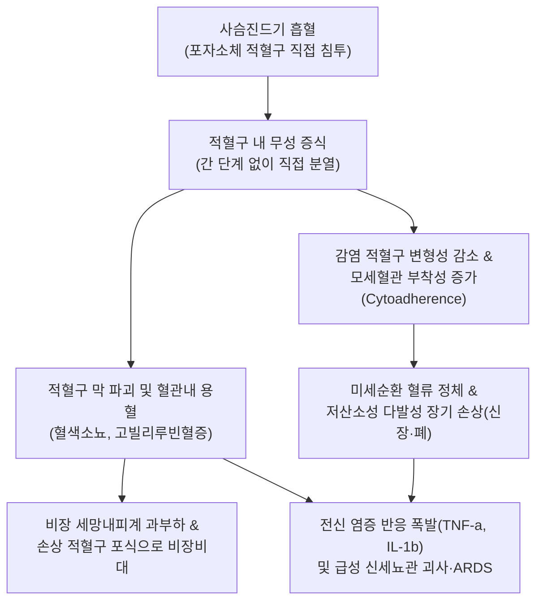
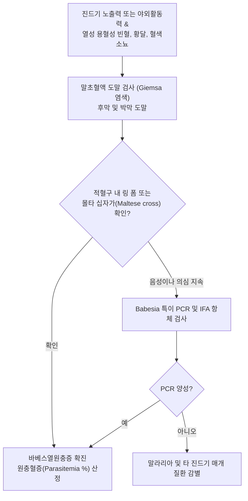

# 🩺 바베스열원충증

> **핵심 3줄 요약 (Key Summary)**:
> - 📍 병소 부위 & 해부·병태생리: 사슴진드기(*Ixodes scapularis*) 흡혈에 의해 전파되는 바베시아 원충(*Babesia microti*, *Babesia divergens*)이 적혈구 내로 침입하여 증식함으로써 적혈구 용혈, 미세혈관 폐색 및 급성 저산소성 조직 손상을 유발하는 인수공통 진드기 매개 질환.
> - 🚩 전형적 임상 양상: 진드기 물림 1~4주 후 발생하는 말라리아 유사 증상(불규칙한 고열, 오한, 야간 발한, 근육통, 두통), 용혈성 [[빈혈]], [[황달]], 혈색소뇨(진한 갈색뇨), 간비대 및 [[비장 비대]].
> - 🛠️ 핵심 검사 & 치료 전략: 말초혈액 김사(Giemsa) 도말 검사(적혈구 내 몰타 십자가 모양 'Maltese cross' 사분체 또는 다발성 링 폼), Babesia 특이 PCR 및 IFA 혈청 검사; 1차 표준 치료 아토바쿠온(Atovaquone) + 아지트로마이신(Azithromycin), 중증 시 클린다마이신 + 퀴닌 또는 적혈구 교환수혈.
> - ⚠️ 응급 의뢰 레드플래그: 무비증 환자 또는 면역저하자의 급격한 중증 용혈(헤모글로빈 < 8 g/dL), 원충혈증(Parasitemia > 10%), 급성 신부전(핍뇨), 급성 호흡곤란 증후군(ARDS), 파종성 혈관내 응고(DIC).

---

## 📌 목차
1. [질환 개요 & 해부학적 병태생리](#1-질환-개요--해부학적-병태생리)
2. [병태생리 메커니즘 & 생체역학적 악순환 네트워크](#2-병태생리-메커니즘--생체역학적-악순환-네트워크)
3. [임상 증상 & 이학적 검사(Physical Exam) 알고리즘](#3-임상-증상--이학적-검사physical-exam-알고리즘)
4. [감별 진단 매트릭스 (Differential Diagnosis)](#4-감별-진단-매트릭스--differential-diagnosis)
5. [한의 통합 치료 프로토콜 (침·약침·추나·한약)](#5-한의-통합-치료-프로토콜--침약침추나한약)
6. [양방 치료 & 병용·의뢰 기준 (Conventional Treatment & Referral)](#6-양방-치료--병용의뢰-기준-conventional-treatment--referral)
7. [재활 운동 & 생활습관 티칭 가이드](#7-재활-운동--생활습관-티칭-가이드)
8. [💡 사용자 진료실 핵심 필기 & 임상 노하우 (Melt-In 잔여 심화 집약)](#8--사용자-진료실-핵심-필기--임상-노하우--melt-in-잔여-심화-집약)
9. [출처 및 학술 참고 문헌 (References)](#9-출처-및-학술-참고-문헌--references)

---

## 1. 질환 개요 & 해부학적 병태생리

**바베스열원충증(Babesiosis)**은 적혈구를 침범하는 진드기 매개 원생동물인 바베시아(*Babesia*)속 감염에 의해 발생하는 급성 열성 용혈성 질환이다. 북미(미국 북동부 및 중서부)에서는 주로 *Babesia microti*에 의해 발병하며, 유럽에서는 소를 숙주로 하는 *Babesia divergens*에 의한 중증 감염이 보고된다. 감염 매개체는 사슴진드기(*Ixodes scapularis*)로, 이는 라임병(*Borrelia burgdorferi*) 및 아나플라스마증(*Anaplasma phagocytophilum*)의 매개체와 정확히 일치하여 진드기 한 마리에 의한 복합 동시 감염(Co-infection) 빈도가 높다. 드물게 수혈이나 장기 이식, 수직 감염을 통해서도 전파된다.

진드기 흡혈 시 타액을 통해 포자소체(Sporozoite)가 혈류로 유입되면 적혈구 표면 수용체와 결합하여 적혈구 내로 진입한다. 말라리아 원충과 달리 바베시아는 간세포 침범 단계(Exoerythrocytic schizogony)를 거치지 않고 혈류 내에서 즉시 적혈구를 직접 침범하는 해부병태생리학적 특징을 갖는다. 적혈구 내부에서 이분법(Binary fission)을 통해 무성 생식하며 영양형(Trophozoite) 및 분열소체(Merozoite)로 증식하고, 적혈구를 용해 파괴하면서 인접한 새로운 적혈구로 연쇄 파종된다.

---

## 2. 병태생리 메커니즘 & 생체역학적 악순환 네트워크

적혈구의 광범위한 혈관내 및 혈관외 용혈은 대량의 유리 헤모글로빈을 방출시켜 합토글로빈을 고갈시키고 간접 빌리루빈 상승([[황달]])을 초래한다. 유리된 헤모글로빈과 적혈구 세포막 파편은 신장 사구체를 거쳐 근위 세뇨관을 폐색시키고 산화 손상을 유발하여 급성 신세뇨관 괴사(ATN) 및 급성 신부전을 일으킨다. 또한 염증성 사이토카인의 폭발로 혈관 내피세포가 손상되고 파종성 혈관내 응고(DIC) 및 비심인성 폐부종(급성 호흡곤란 증후군)으로 급속히 악화된다. 특히 비장 절제 환자(무비증)는 감염 적혈구를 여과·제거하는 면역 감시망이 없어 원충혈증이 $50\%$ 이상 치솟으며 치명률이 급상승한다.

---

## 3. 임상 증상 & 이학적 검사(Physical Exam) 알고리즘

### 주요 임상 증상
- **무증상~경증**: 건강한 면역 정상인에서는 무증상이거나 가벼운 감기 유사 증상(미열, 피로, 두통) 후 자연 소실.
- **전형적 급성 증상**:
  - $39\sim 40^\circ\text{C}$에 달하는 불규칙한 고열, 오한, 흠뻑 젖는 발한(Drenching sweats).
  - 극심한 근육통, 관절통, 요통, 전신 피로 및 쇠약.
  - 혈관내 용혈에 따른 암갈색/콜라색 소변(혈색소뇨), 공막 및 피부의 [[황달]].
  - 간종대 및 비장 종대([[비장 비대]]), 림프절 비대.
- **중증 합병증**: 혈역학적 쇼크, 핍뇨성 급성 신부전, 호흡곤란(ARDS), 심근염 및 부정맥, 파종성 혈관내 응고(DIC).

### 진단 알고리즘

---

## 4. 감별 진단 매트릭스 (Differential Diagnosis)

| 감별 질환 | 병원체 및 매개체 | 도말 검사 형태학적 특징 | 임상적 감별점 | 치료 약제 |
| :--- | :--- | :--- | :--- | :--- |
| **바베스열원충증** | *B. microti*, 사슴진드기 | 적혈구 내 사분체(Maltese cross), 색소체(Hemozoin) 없음, 간 단계 없음 | 비장절제 환자에서 치명적, 콜라색 뇨, 미국 북동부 호발 | 아토바쿠온 + 아지트로마이신 |
| **열대열 [[말라리아]]** | *P. falciparum*, 얼룩날개모기 | 섬세한 링 폼, 갈모형 생식모세포, 혈색소 소화 색소체 존재 | 열대 지역 여행력, 열 발작의 주기성, 모기 매개 | 아르테미시닌 기반 복합요법(ACT) |
| **라임병 (Lyme disease)** | *Borrelia burgdorferi*, 사슴진드기 | 혈액 도말 검사상 불검출 (혈청 항체/Western blot 진단) | 유주성 홍반(Erythema migrans), 관절염, 안면신경 마비 | 독시사이클린(Doxycycline) |
| **인간 과립구성 아나플라스마증** | *Anaplasma phagocytophilum*, 진드기 | 말초혈액 호중구 세포질 내 뽕나무 열매형 봉입체(Morulae) | 용혈성 빈혈 드묾, 백혈구감소증, 혈소판감소증, 간효소치 상승 | 독시사이클린 |
| **자가면역 용혈성 빈혈 (AIHA)** | 온난/한랭 자가항체 | 적혈구 내 병원체 불검출, 구상적혈구(Spherocyte) 다수 | 쿰스 검사(Direct Coombs test) 양성, 진드기 노출력 없음 | 면역억제제, 스테로이드 |

---

## 5. 한의 통합 치료 프로토콜 (침·약침·추나·한약)

> ⚠️ 바베스열원충증은 급성 용혈과 신부전, 폐부종을 유발할 수 있는 급성 감염증이므로 항원충 약물 요법이 최우선이다. 한의 치료는 급성기 해열 후 골수 적혈구 조혈 회복, 간비장 기능 회복, 만성 피로 및 진드기 매개 복합 감염 후유증을 관리하는 지지요법으로 시행한다.

### 1) 한약 처방 (회복기 지지요법)
- **온학 및 습열울결증 (溫瘧 濕熱鬱結證 - 급성기 후 잔여 미열, 구고, 식욕부진, 황달)**:
  - 처방: [[소시호탕]] 합 [[인진호탕]] 가감 ([[시호]], [[황금]], [[인삼]], [[반하]], [[인진호]], [[치자]], [[대황]], [[감초]]).
  - 약리 기전: 시호-황금의 염증성 사이토카인(TNF-$\alpha$, IL-6) 억제 및 해열 작용, 인진호의 담즙 배출 촉진 및 간세포 항산화 보호.
- **기혈양허 및 노권증 (氣血兩虛 勞倦證 - 용혈 후 빈혈, 극심한 피로, 어지럼증, 자한)**:
  - 처방: 당귀보혈탕 합 [[보중익기탕]] 가감 ([[황기]], [[당귀]], [[인삼]], [[백출]], [[복령]], [[숙지황]], [[백작약]]).
  - 학술 근거: 황기 다당체가 에리스로포이에틴(EPO) 감수성을 향상시켜 조혈모세포 분화 촉진.
- **기음양허증 (氣陰兩虛證 - 야간 식은땀, 가슴 두근거림, 구갈)**:
  - 처방: [[생맥산]] 가감 ([[인삼]], [[맥문동]], 오미자, [[생지황]]).
  - 작용: 심근 산소 소모량 절감 및 미세순환 회복.

### 2) 침구 치료
- **혈위**: 족삼리(ST36), 삼음교(SP6), 격수(BL17), 비수(BL20), 간수(BL18), 합곡(LI4), 태충(LR3).
- **시술 지침**: 급성 용혈성 빈혈로 인한 혈압 불안정 시 무리한 강자극을 금하고 원격 혈위에 평보평사(Gentle stimulation) 시행.

---

## 6. 양방 치료 & 병용·의뢰 기준 (Conventional Treatment & Referral)

### 양방 표준 치료 프로토콜
1. **경도~중등도 질환**:
   - **아토바쿠온(Atovaquone $750\text{ mg}$ po bid)** + **아지트로마이신(Azithromycin $500\text{ mg}$ 첫날 후 $250\text{ mg}$ po qd)** $7\sim 10$일간 투여.
   - 퀴닌 요법 대비 부작용이 현저히 적어 1차 치료제로 표준화됨.
2. **중증 질환 (중환자실 치료)**:
   - **클린다마이신(Clindamycin $600\text{ mg}$ iv q8h)** + **퀴닌(Quinine $650\text{ mg}$ po q8h)** $7\sim 10$일간 투여.
3. **적혈구 교환수혈 (Red blood cell exchange transfusion)**:
   - 적응증: 원충혈증 $>10\%$, 헤모글로빈 $< 8\text{ g/dL}$, 급성 신부전 또는 호흡부전 동반 중증 환자.

### 긴급 응급 의뢰 레드플래그
- 비장 절제 환자, 암 환자, 면역억제제 복용자의 발열 및 황달.
- 핍뇨 또는 무뇨, 혈청 크레아티닌의 급격한 상승.
- 호흡수 $>30\text{회/분}$, 산소포화도 $< 90\%$ (급성 호흡곤란 증후군 전조).
- 말초혈액 도말상 원충혈증 비율 $> 10\%$.

---

## 7. 재활 운동 & 생활습관 티칭 가이드

- **진드기 물림 철저 예방**: 수풀이나 풀밭 작업, 등산 시 밝은색 긴 옷을 착용하여 진드기 부착을 쉽게 발견하고, 바짓단을 양말 안으로 집어넣음.
- **귀가 후 전신 신체 검사**: 야외 활동 후 겨드랑이, 서혜부, 무릎 뒤, 두피, 귀 뒷부분을 꼼꼼히 살피고 진드기 발견 시 핀셋으로 피부에 밀착하여 비틀지 말고 수직으로 조심스럽게 제거함.
- **수혈 관련 안전 교육**: 바베시아 감염 병력이 있는 환자는 완치 후에도 일정 기간 헌혈을 금지하도록 안내함.
- **충분한 수분 섭취**: 용혈성 헤모글로빈에 의한 신세뇨관 손상을 막기 위해 급성기 이후에도 하루 $1.5\sim 2\text{ L}$의 충분한 수분을 섭취하도록 지도함.

---

## 8. 💡 사용자 진료실 핵심 필기 & 임상 노하우 (Melt-In 잔여 심화 집약)

> 💡 **임상 핵심 진주 (Clinical Pearls)**:
> - **'말라리아 유사 증상인데 해외여행력이 없다?'**: 환자가 말라리아처럼 오한, 고열, 황달을 호소하는데 동남아나 아프리카 여행력이 없고, 대신 북미 여행력이나 국내 야외활동 및 진드기 물림 병력이 있다면 반드시 바베시아증을 의심해야 한다.
> - **비장 절제술(Splenectomy) 과거력의 치명성**: 비장이 없는 환자에게 바베시아증은 사망률이 $20\sim 30\%$에 달하는 치명적 맹독성 질환이다. 복부 수술 흉터가 있거나 비장 절제 과거력이 있는 환자가 열과 빈혈을 보이면 지체 없이 응급 혈액내과로 전원해야 한다.
> - **몰타 십자가(Maltese Cross)의 결정적 형태학**: 혈액 도말 검사에서 분열소체 4개가 십자가 형태로 배열된 '몰타 십자가' 상은 바베시아증의 결정적 병태생리학적 증거이다. 링 폼(Ring form)만 관찰될 경우 열대열 말라리아와 혼동하기 쉬우나, 바베시아는 적혈구 내에 갈색 말라리아 색소(Hemozoin)가 전혀 없는 것으로 감별할 수 있다.
> - **라임병 치료 실패 시의 역발상**: 야외활동 후 라임병으로 진단받고 독시사이클린을 복용 중인데도 고열과 심한 빈혈이 지속된다면, 같은 사슴진드기에 의해 바베시아가 동시 감염되었을 가능성을 반드시 고려해야 한다. 독시사이클린은 바베시아 원충을 치료하지 못한다.

---

## 9. 출처 및 학술 참고 문헌 (References)

- Han X, et al. (2026). A SAGA-like AP2-P-ARP1-GCN5 transcriptional complex targets pathogenesis-associated genes during the blood-stage development of Babesia gibsoni. *Nat Commun*. PMID: 42957733.

- Oakley S, et al. (2026). Circulating IP-10/CXCL10 Correlates With Parasitemia and Disease Severity in Patients With Babesiosis: A Pilot Study. *Open Forum Infect Dis*. PMID: 42936128.

- Hirsch P, et al. (2026). Babesia divergens IgG Antibodies and ABO Blood Types in Humans. *Pathogens*. PMID: 42931168.
