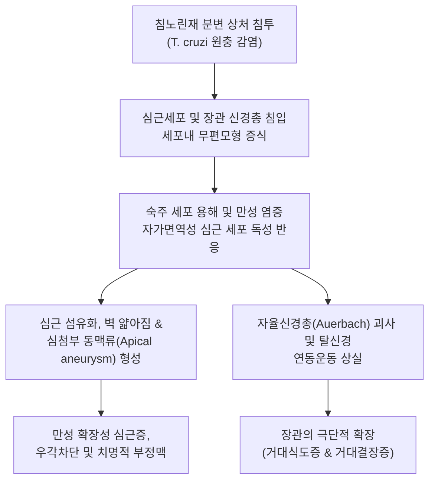
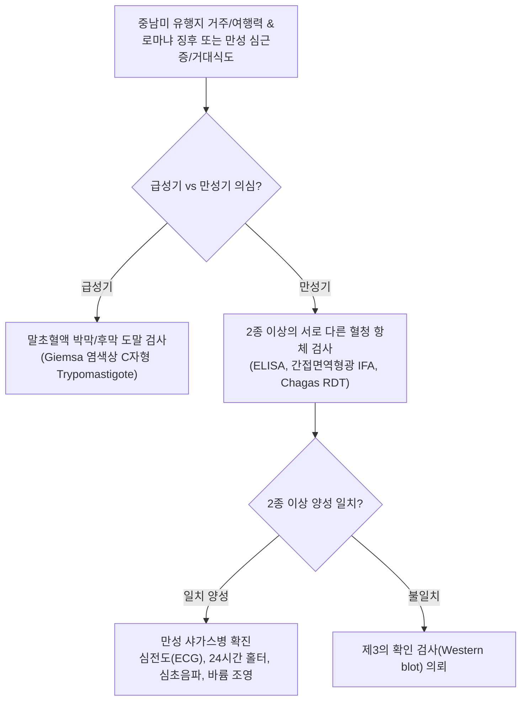

# 🩺 샤가스병

> **핵심 3줄 요약 (Key Summary)**:
> - 📍 병소 부위 & 해부·병태생리: 침노린재(Triatomine bug, 일명 'Kissing bug') 분변에 배출된 크루스파동편모충(*Trypanosoma cruzi*) 감염으로, 심근 섬유 및 소화관 신경총(Auerbach 신경총)을 파괴하여 만성 확장성 [[심근염]], 거대식도증, 거대결장증 유발.
> - 🚩 전형적 임상 양상: 급성기 무통성 편측 안검 부종(로마냐 징후 Romaña sign) 또는 피하 샤고마(Chagoma); 수십 년 잠복 후 만성기 심계항진, 실신, 심부전, 연하곤란, 극심한 만성 [[변비]].
> - 🛠️ 핵심 검사 & 치료 전략: 급성기 혈액 도말 검사(Giemsa 염색상 C자형 유편모형 Trypomastigote 확인), 만성기 2종 이상의 혈청 면역항체 검사(ELISA, IFA), 심전도(우각차단 RBBB), 심장 초음파, 식도/바륨 조영술; 1차 항원충제 벤즈니다졸(Benznidazole) 또는 니푸르티목스(Nifurtimox).
> - ⚠️ 응급 의뢰 레드플래그: 고도 방실 차단(Mobitz II 이상) 및 완전 방실 차단, 심실빈맥·심실세동 등 악성 부정맥, 심실동맥류 파열, 급성 뇌색전증(뇌졸중), 식도/결장의 급성 천공 징후.

---

## 📌 목차
1. [질환 개요 & 해부학적 병태생리](#1-질환-개요--해부학적-병태생리)
2. [병태생리 메커니즘 & 생체역학적 악순환 네트워크](#2-병태생리-메커니즘--생체역학적-악순환-네트워크)
3. [임상 증상 & 이학적 검사(Physical Exam) 알고리즘](#3-임상-증상--이학적-검사physical-exam-알고리즘)
4. [감별 진단 매트릭스 (Differential Diagnosis)](#4-감별-진단-매트릭스--differential-diagnosis)
5. [한의 통합 치료 프로토콜 (침·약침·추나·한약)](#5-한의-통합-치료-프로토콜--침약침추나한약)
6. [양방 치료 & 병용·의뢰 기준 (Conventional Treatment & Referral)](#6-양방-치료--병용의뢰-기준-conventional-treatment--referral)
7. [재활 운동 & 생활습관 티칭 가이드](#7-재활-운동--생활습관-티칭-가이드)
8. [💡 사용자 진료실 핵심 필기 & 임상 노하우 (Melt-In 잔여 심화 집약)](#8--사용자-진료실-핵심-필기--임상-노하우--melt-in-잔여-심화-집약)
9. [출처 및 학술 참고 문헌 (References)](#9-출처-및-학술-참고-문헌--references)

---

## 1. 질환 개요 & 해부학적 병태생리

**샤가스병(Chagas disease)**, 또는 **아메리카 수면병(American Trypanosomiasis)**은 편모충류 원충인 *Trypanosoma cruzi* 감염에 의해 발생하는 치명적인 만성 인수공통 전신 감염 질환이다. 중남미 21개국(멕시코, 볼리비아, 아르헨티나, 브라질 등)의 대표적 풍토병이며, 카를로스 샤가스(Carlos Chagas)에 의해 처음 규명되었다. 감염의 주된 경로는 야행성 흡혈 곤충인 침노린재(Triatominae, 일명 '키싱 버그')가 야간에 인간의 안면이나 노출부를 흡혈하면서 배설한 분변 내의 원충(Metacyclic trypomastigote)이 물린 상처나 결막 점막을 통해 침투하는 것이다. 그 외에도 오염된 사탕수수/아사이 주스 섭취, 수혈, 장기 이식, 선천성 모체 전파를 통해서도 감염된다.

침투한 원충은 국소 대식세포 및 섬유모세포 내부로 침입하여 무편모형(Amastigote)으로 분열 증식한 후 유편모형으로 변환되어 혈류를 타고 전신으로 파종된다. *T. cruzi*의 주요 표적 장기는 심장 심근세포와 자율신경계 절후 신경절 세포, 특히 소화관 벽의 장근신경총(Auerbach's myenteric plexus)이다. 급성기 이후 $10\sim 30\text{년}$에 달하는 긴 무증상 잠복기(Indeterminate stage)를 거쳐 환자의 약 $30\sim 40\%$에서 비가역적인 장기 손상이 발현되는 만성 임상기로 이행한다.

---

## 2. 병태생리 메커니즘 & 생체역학적 악순환 네트워크

만성 샤가스병의 병태생리 기전은 만성 저등급 원충 지속 감염과 자가면역 교차 반응의 결합이다. 심근세포에 침윤한 T림프구와 대식세포는 지속적인 만성 염증과 미세혈관 허혈을 유발하며, 정상 심근이 결합조직과 지방으로 대체되는 광범위한 심근 섬유화가 발생한다. 특히 좌심실 심첨부 벽이 극단적으로 얇아져 형성되는 심첨부 동맥류(Apical aneurysm)는 혈전 형성 및 색전증의 온상이 된다. 전도계 침범에 의해 우각차단(RBBB)과 좌전섬유속차단(LAFB)이 빈발한다. 소화관에서는 연하 및 배변 반사를 관장하는 신경총의 $80\%$ 이상이 소실되면서 평활근 긴장도가 상실되어 거대식도와 거대결장으로 확장된다.

---

## 3. 임상 증상 & 이학적 검사(Physical Exam) 알고리즘

### 단계별 임상 증상
- **급성기 ($1\sim 2$개월)**:
  - 감염 부위 피부 경결 및 부종: 샤고마(Chagoma).
  - 결막 침투 시 전형적인 편측성 무통성 안검 부종 및 결막염, 귓바퀴 주위 림프절 비대: **로마냐 징후(Romaña sign)**.
  - 전신 발열, 권태감, 간비장 비대, 림프절염. 대다수 소아에서 급성 심근염 또는 뇌수막염으로 악화되지 않는 한 저절로 호전됨.
- **만성 잠복기 (Indeterminate form)**: 수년~수십 년간 무증상이며 혈청 항체만 양성, 정상 심전도 유지.
- **만성 심장형 (Chagas cardiomyopathy, 약 $30\%$)**:
  - 심계항진, 현훈, 아담스-스토크스 발작(완전 방실차단에 따른 실신).
  - 운동성 호흡곤란, 기좌호흡, 사지 부종 등 울혈성 심부전 징후.
  - 심인성 색전증으로 인한 뇌졸중.
- **만성 소화기형 (Mega-syndromes, 약 $10\%$)**:
  - 거대식도증: 진행성 연하곤란, 음식물 역류, 오연성 폐렴, 심한 체중 감소.
  - 거대결장증: 수일~수주일간 배변을 보지 못하는 난치성 만성 [[변비]], 심한 복부 팽만, 분변 매복(Fecaloma), 장염전(Volvulus) 및 [[장폐색]].

### 진단 알고리즘

---

## 4. 감별 진단 매트릭스 (Differential Diagnosis)

| 감별 질환 | 병인 및 역학 | 심장 침범 양상 | 소화관 침범 여부 | 진단적 감별점 |
| :--- | :--- | :--- | :--- | :--- |
| **샤가스병 (*T. cruzi*)** | 중남미 침노린재 매개 | 확장성 심근병증, 심첨부 동맥류, 우각차단(RBBB) 빈발 | 거대식도증, 거대결장증 동반 흔함 | 혈청 특이 IgG 항체 2종 양성, 중남미 체류력 |
| **특발성 확장성 심근병증 (DCM)** | 유전, 바이러스, 특발성 | 양심실 확장, 전반적 수축력 저하 | 소화관 확장 동반 없음 | 심첨부 동맥류 드묾, 기생충 항체 음성 |
| **식도이완불능증 (Achalasia)** | 자율신경 변성(특발성) | 정상 심장 기능 | 식도 하부 연동운동 소실, 새부리 모양 협착 | 식도 내압검사상 LES 이완 부전, Chagas 항체 음성 |
| **허혈성 심질환 (협심증/심근경색)** | 관상동맥 죽상경화증 | 관상동맥 지배 영역 국소 벽운동 장애 | 소화관 병변 없음 | 관상동맥 조영술(CAG)상 유의미한 협착 확인 |
| **아프리카 수면병** | 체체파리, *T. brucei* | 심근염 가능하나 경미 | 림프절 비대(Winterbottom 징후), 중추신경계 졸음증 우세 | 혈액/림프절 천자 도말상 T. brucei 확인 |

---

## 5. 한의 통합 치료 프로토콜 (침·약침·추나·한약)

> ⚠️ 급성기 및 조기 만성기 샤가스병은 항원충제(벤즈니다졸)로 원충을 제거하는 양방 치료가 필수적이다. 만성 심근병증 및 거대장관증으로 진행된 후에는 기생충을 박멸해도 비가역적 섬유화가 남으므로, 한의 치료는 심부전 증상 완화, 심근 대사 보조, 장관 연동 반사 자극 및 완하를 위한 완화 지지요법으로 시행한다.

### 1) 한약 처방 (만성기 합병증 보완 지지요법)
- **심양허탈 및 기음양허증 (心陽虛脫 氣陰兩虛證 - 만성 심근병증, 심계항진, 호흡곤란, 부종, 피로)**:
  - 처방: [[생맥산]] 합 진무탕 가감 ([[인삼]], [[맥문동]], 오미자, [[백출]], [[복령]], [[백작약]], 부자, 생강).
  - 약리 기전: 인삼 사포닌(Ginsenoside)의 심근 수축력 강화 및 항부정맥 작용, 맥문동의 심근 허혈 재관류 손상 억제, 복령-백출의 이뇨 소종.
- **심혈어저증 (心血瘀阻證 - 흉부 압박감, 부정맥, 미세순환 장애)**:
  - 처방: [[혈부축어탕]] 또는 관심2호방 가감 ([[단삼]], [[적작약]], [[천궁]], [[당귀]], [[도인]], [[홍화]]).
  - 학술 근거: 단삼의 탄시논(Tanshinone) 성분이 심근 미세혈관 확장 및 섬유화 유전자 발현 억제.
- **장위조열 및 비양허증 (腸胃燥熱 脾陽虛證 - 거대결장증, 극심한 만성 변비, 복부 팽만)**:
  - 처방: 마자인환 합 [[대황]]부자탕 가감 (마자인, 백자인, 욱리인, [[대황]], [[지실]], [[후박]]).
  - 목적: 무긴장성 대장 평활근의 윤활 지원 및 대변 배출 촉진.

### 2) 침구 치료
- **혈위**: 내관(PC6), 심수(BL15), 궐음수(BL14), 신문(HT7), 족삼리(ST36), 천추(ST25), 상거허(ST37), 관원(CV4).
- **시술 지침**: 내관과 심수는 미주신경 톤을 조절하여 심박수 변이도(HRV)를 안정시킴. 거대결장 환자의 복부 침 치료 시 과도한 심자를 피하고 완만하게 자극하여 장 천공을 방지함.

---

## 6. 양방 치료 & 병용·의뢰 기준 (Conventional Treatment & Referral)

### 양방 표준 치료 프로토콜 (PAHO/CDC)
1. **항원충 약물 요법**:
   - 대상: 급성기 환자 전원, 선천성 감염 신생아, 50세 이하의 조기 만성기 환자.
   - **벤즈니다졸 (Benznidazole)**: $5\sim 7\text{ mg/kg/day}$를 2회 분할하여 60일간 경구 투여 (1차 표준).
   - 대체약: **니푸르티목스 (Nifurtimox)**: $8\sim 10\text{ mg/kg/day}$를 3회 분할하여 60~90일간 투여.
2. **만성 심장 합병증 관리**:
   - 심부전 표준 약물: ACE 억제제/ARB, 베타차단제, 염류코르티코이드 수용체 길항제(MRA), SGLT2 억제제.
   - 전도 장애 및 부정맥: 영구 심박동기(Pacemaker) 삽입(완전 방실차단), 삽입형 제세동기(ICD, 심실빈맥 예방).
3. **만성 소화기 합병증 수술적 요법**:
   - 거대식도증: 보툴리눔 독소 주입, 풍선 확장술, 헬러 근절개술(Heller myotomy).
   - 거대결장증: S상 결장 절제술(Duhamel 술식 등).

### 긴급 응급 의뢰 레드플래그
- 심전도상 2도 2형 이상의 고도 방실 차단 또는 3도 완전 방실 차단.
- 지속성 심실빈맥(VT) 또는 실신(Syncope) 병력.
- 거대결장증 환자에서 복부의 극심한 판상 강직 및 반발통(장염전, 장괴사 및 장천공 의심).
- 심장 내 혈전 탈락에 따른 급성 편마비, 언어 장애(뇌색전증).

---

## 7. 재활 운동 & 생활습관 티칭 가이드

- **유행 지역 주거 환경 주의**: 중남미 농촌 지역 체류 시 진흙 벽, 짚으로 엮은 지붕 등 침노린재가 서식하기 쉬운 가옥에서의 숙박을 피하고, 살충제 분무 및 방충망이 완비된 현대식 숙소를 이용함.
- **날음식 섭취 금지**: 침노린재가 분쇄되어 오염될 수 있는 생 사탕수수즙이나 아사이베리 생즙의 길거리 음용을 엄격히 피함.
- **심부전 환자 운동 가이드**: 중등도 이상의 심근병증 환자는 심장에 무리를 주는 고강도 무산소 운동을 금하고, 매일 20분 내외의 가벼운 평지 걷기를 시행하며 심박수와 호흡곤란을 모니터링함.
- **수분 및 염분 제한**: 심부전 및 부종이 동반된 경우 일일 나트륨 섭취를 $2\text{ g}$ 이하로 제한하고 매일 아침 공복 체중을 측정하여 급격한 체중 증가 시 내원하도록 티칭함.

---

## 8. 💡 사용자 진료실 핵심 필기 & 임상 노하우 (Melt-In 잔여 심화 집약)

> 💡 **임상 핵심 진주 (Clinical Pearls)**:
> - **'로마냐 징후(Romaña sign)'를 기억하라**: 중남미 여행 후 한쪽 눈꺼풀과 눈 주위가 아프지도 않고 빨갛게 붓지도 않으면서 팽팽하게 부어오르는(무통성 편측 안검 부종) 소견은 샤가스병의 교과서적 특이 징후이다. 봉와직염이나 알레르기 혈관부종으로 오진하기 쉬우므로 주의해야 한다.
> - **중남미 출신 이주민의 원인 불명 부정맥**: 브라질, 볼리비아, 멕시코 출신의 환자가 특별한 기저 질환이 없는데도 젊은 나이에 우각차단(RBBB)이나 심실부정맥, 심부전으로 내원했다면 만성 샤가스 심근증을 반드시 배제 진단해야 한다.
> - **심첨부 동맥류(Apical Aneurysm)의 맹점**: 샤가스 심근증의 가장 특징적인 소견은 좌심실 심첨부 벽이 손가락 골무처럼 볼록 튀어나오는 심첨부 동맥류이다. 이 부위는 혈류가 정체되어 거대한 벽벽 혈전(Mural thrombus)이 잘 생기며, 이것이 떨어져 나가면 젊은 나이에 뇌졸중을 일으킨다.
> - **소화관 거대증 환자 침 시술 주의**: 샤가스병 환자의 복부는 장관이 거대하게 늘어나 복벽 바로 아래까지 팽창된 대장이 자리 잡고 있을 수 있다. 천추, 중완 등의 혈위에 장침을 깊게 자침하면 장벽을 관통하여 치명적인 복막염을 초래할 수 있으므로 극도로 얕게 자침해야 한다.

---

## 9. 출처 및 학술 참고 문헌 (References)

- Benchimol-Barbosa PR, et al. (2026). Left atrial dimension and new-onset atrial fibrillation in chronic Chagas cardiomyopathy: A 10-year follow-up study. *Int J Cardiol*. PMID: 42887824.

- Reyna MA, et al. (2026). Detection of Chagas disease from the ECG: the George B. Moody PhysioNet Challenge 2024. *Physiol Meas*. PMID: 42805232.

- De Jesús-González LA, et al. (2026). Stage-Informed Trypanosoma cruzi Antigen Selection Enhances Assay Concurrence for Chagas Disease Diagnosis in Mexico. *Microorganisms*. PMID: 42795481.
