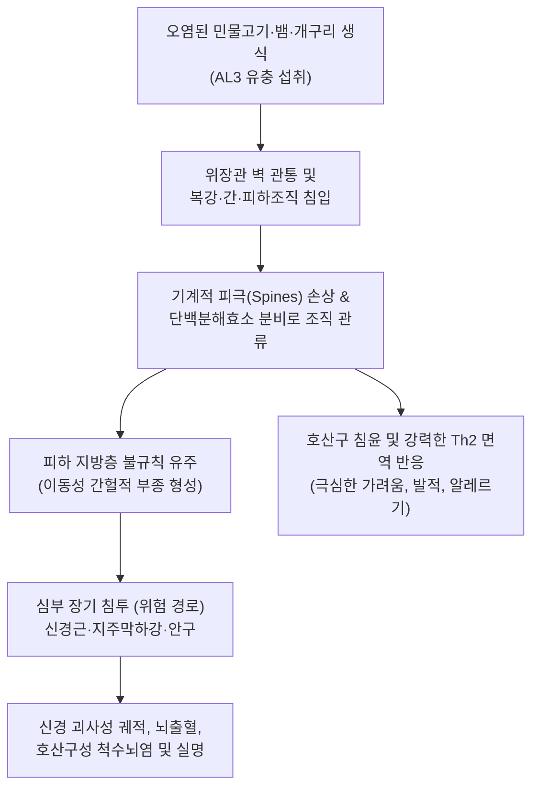
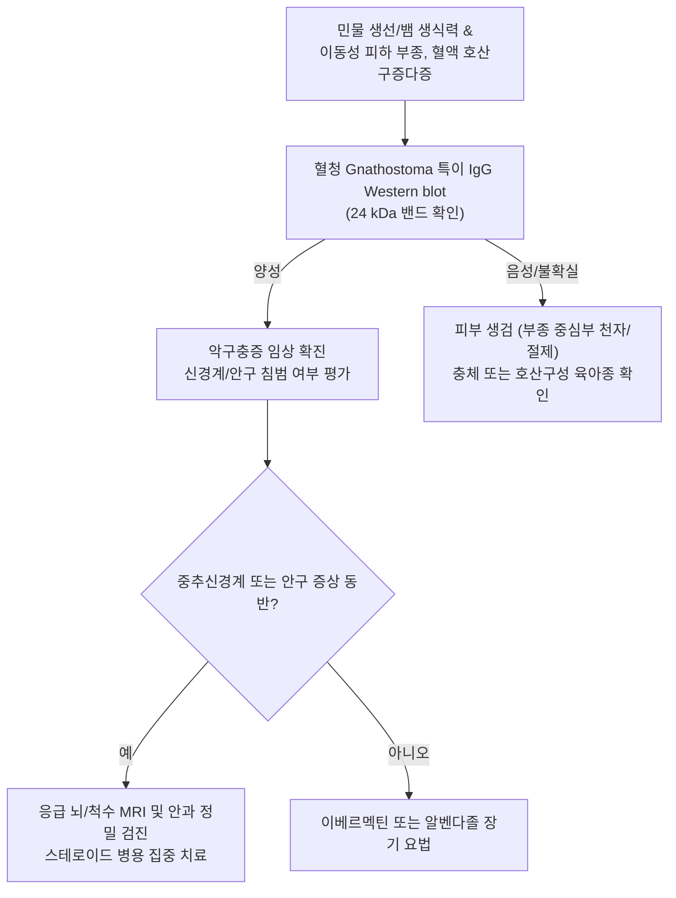

# 🩺 악구충증

> **핵심 3줄 요약 (Key Summary)**:
> - 📍 병소 부위 & 해부·병태생리: 턱구충류 선충(*Gnathostoma spinigerum* 등)의 제3기 유충이 인체 조직(피하 지방층, 근육, 신경계, 안구, 내장)을 불규칙하게 유주하며 유발하는 조직 유충이동증(Larva migrans).
> - 🚩 전형적 임상 양상: 가물치, 뱀, 개구리, 장어 생식 1~4주 후 발생하는 통증을 동반한 간헐적 이동성 피하 결절(Migratory cutaneous swelling), 심한 [[소양증]], 홍반 및 작열감.
> - 🛠️ 핵심 검사 & 치료 전략: 말초혈액 현저한 호산구 증가증, 혈청 악구충 특이 IgG Western blot/ELISA, 병변부 외과적 생검 및 충체 적출; 1차 표준 약물 이베르멕틴(Ivermectin $0.2\text{ mg/kg}$ qd 1~2일) 또는 알벤다졸(Albendazole $400\text{ mg}$ bid 21일).
> - ⚠️ 응급 의뢰 레드플래그: 중추신경계 침범 징후(극심한 신경근통, 척수염에 의한 하반신 마비, 지주막하 출혈), 안구 내 충체 침투(실명 위험), 흉막/심낭 침범.

---

## 📌 목차
1. [질환 개요 & 해부학적 병태생리](#1-질환-개요--해부학적-병태생리)
2. [병태생리 메커니즘 & 생체역학적 악순환 네트워크](#2-병태생리-메커니즘--생체역학적-악순환-네트워크)
3. [임상 증상 & 이학적 검사(Physical Exam) 알고리즘](#3-임상-증상--이학적-검사physical-exam-알고리즘)
4. [감별 진단 매트릭스 (Differential Diagnosis)](#4-감별-진단-매트릭스--differential-diagnosis)
5. [한의 통합 치료 프로토콜 (침·약침·추나·한약)](#5-한의-통합-치료-프로토콜--침약침추나한약)
6. [양방 치료 & 병용·의뢰 기준 (Conventional Treatment & Referral)](#6-양방-치료--병용의뢰-기준-conventional-treatment--referral)
7. [재활 운동 & 생활습관 티칭 가이드](#7-재활-운동--생활습관-티칭-가이드)
8. [💡 사용자 진료실 핵심 필기 & 임상 노하우 (Melt-In 잔여 심화 집약)](#8--사용자-진료실-핵심-필기--임상-노하우--melt-in-잔여-심화-집약)
9. [출처 및 학술 참고 문헌 (References)](#9-출처-및-학술-참고-문헌--references)

---

## 1. 질환 개요 & 해부학적 병태생리

**악구충증(Gnathostomiasis)**은 선충류인 악구충속(*Gnathostoma* spp., 주로 *Gnathostoma spinigerum*)의 조기 제3기 유충(Advanced third-stage larva, AL3)에 의해 발생하는 위험한 인수공통 기생충 감염증이다. 동남아시아(태국, 베트남, 미얀마 등), 멕시코, 중남미, 일본 등지에서 광범위하게 발생하며, 국내에서도 동남아 여행력이나 가물치, 미꾸라지, 뱀, 개구리 생식에 따른 유입 사례가 보고된다. 종숙주는 고양이, 개, 호랑이 등 육식 포유류이며, 제1중간숙주는 물벼룩(Cyclops), 제2중간숙주는 민물고기(가물치, 붕어, 메기, 장어) 및 양서류/파충류이다.

인간은 부적합 숙주(Accidental/Dead-end host)로서 성충으로 자라지 못하고 유충 상태로 체내 조직을 수개월에서 수년간 무차별 유주한다. 섭취된 유충은 위장관 벽을 뚫고 복강을 거쳐 간으로 이동한 후 피하 결합조직과 근육층으로 침투한다. 유충의 두부에는 4~8열의 예리한 피극(Cuticular spines)이 돋아 있어 조직을 찢으며 전진하고 아세틸콜린에스테라아제 및 히알루로니다아제 등의 단백질 분해 효소를 분비하여 조직 괴사와 심각한 호산구성 염증성 부종을 유발한다.

---

## 2. 병태생리 메커니즘 & 생체역학적 악순환 네트워크

유충의 유주 속도는 시간당 수 밀리미터에서 하루 수 센티미터에 달하며, 유충이 지나간 자리는 심각한 기계적 궤적 손상과 함께 모세혈관 파열성 출혈, 호산구 침윤성 육아종이 형성된다. 유충이 말초 신경을 따라 척추공을 통해 중추신경계(CNS)로 진입할 경우 신경근을 파괴하며 상행성 척수염, 지주막하 출혈, 뇌실질 괴사를 유발한다. 안구 내로 침투할 경우 망막 박리, 유리체 출혈 및 전방 축농을 일으켜 영구적인 실명을 초래한다.

---

## 3. 임상 증상 & 이학적 검사(Physical Exam) 알고리즘

### 주요 임상 증상
- **초기 소화기 증상 (감염 수일 내)**: 유충의 위장관 관통 시 일시적인 상복부 통증, 오심, 구토, [[발열]], 두드러기.
- **피하 유충이동증 (가장 흔함, $80\sim 90\%$)**:
  - 이동성 피하 종창(Migratory subcutaneous swelling): 통증과 압통을 동반한 비함요성 부종이 신체 한 부위(복벽, 흉벽, 사지 등)에 나타났다가 $1\sim 2$주 후 가라앉고, 며칠 뒤 다른 부위에 재출현함.
  - 국소 발적, 열감, 찌르는 듯한 둔통, 극심한 [[소양증]].
  - 피부 천공(Creeping eruption): 유충이 표피 가까이 이동하며 뱀 모양의 붉은 선상 피진 형성.
- **신경 악구충증 (치명적 합병증)**:
  - 척수 신경근을 따라 발생하는 극심한 신경통(Shooting radicular pain)이 선행한 후 급격한 하지 위약, 감각 마비, 대소변 실금.
  - 지주막하 출혈로 인한 벼락 두통, 의식 저하, 뇌신경 마비.
- **안구 악구충증**: 안구 통증, 시야 흐림, 결막하 충혈, 전방 내 충체 육안 관찰.

### 진단 알고리즘

---

## 4. 감별 진단 매트릭스 (Differential Diagnosis)

| 감별 질환 | 병원체 및 기전 | 부종 및 병변 양상 | 혈액 호산구 소견 | 감별 핵심 포인트 |
| :--- | :--- | :--- | :--- | :--- |
| **악구충증** | *G. spinigerum*, 유충 유주 | 통증 동반 이동성 피하 결절, $1\sim 2$주 지속 후 다른 부위 재발 | 현저한 호산구증다증($>1,000/\mu\text{L}$) | 민물어 생식력, Western blot 24kDa 양성, 이베르멕틴 반응 |
| **스파르가눔증 (Sparganosis)** | *Spirometra* 만손열두조충 유충 | 서서히 자라는 단일 무통성/압통성 피하 결절, 이동성 적음 | 호산구 경도 증가 | 개구리/뱀 섭취력, 외과적 절제 시 흰색 납작한 충체 확인 |
| **선모충증 (Trichinellosis)** | *Trichinella spiralis*, 근육 피낭 | 양측 안검 부종, 골격근 격통, 결막하 출혈 | 극심한 호산구증다증, CK 상승 | 멧돼지/돼지고기 생식력, 전신 근육통, 근생검 확인 |
| **피부 유충이행증 (CLM)** | 개/고양이 구충 (*Ancylostoma*) | 표피 내 사행성 홍반성 구진/수포(매우 가려움, 피하 결절 없음) | 호산구 정상 또는 경도 증가 | 모래사장/흙 접촉력, 표피층 국한, 국소 이베르멕틴 반응 |
| **혈관부종 (Angioedema)** | 비만세포 히스타민/브라디키닌 | 통증 없는 비함요성 급성 부종, 수시간~수일 내 소실 | 호산구 대개 정상 | 알레르기 항원 또는 C1-INH 결핍, 유충 이동 양상 없음 |

---

## 5. 한의 통합 치료 프로토콜 (침·약침·추나·한약)

> ⚠️ 악구충증은 중추신경계 침범 시 치명적인 영구 마비나 뇌출혈을 일으킬 수 있는 침습적 기생충증이므로, 양방 구충 치료(이베르멕틴 또는 알벤다졸)가 필수적이다. 한의 치료는 구충 약물 요법 중 피하 염증 완화, 호산구성 과민 반응 진정 및 충체 사멸 후 잔여 신경병증성 동통 완화를 위한 병용 지지요법으로 시행한다.

### 1) 한약 처방 (변증별 지지요법)
- **풍열습독 및 충독온결증 (風熱濕毒 蟲毒蘊結證 - 피하 이동성 부종, 작열감, 극심한 가려움, 발적)**:
  - 처방: [[소풍산]] 합 [[황련해독탕]] 가감 ([[황련]], [[황금]], [[황백]], [[치자]], 형개, 방풍, 당귀, 지황, [[고삼]], 선태).
  - 약리 기전: 고삼의 마트린(Matrine) 및 황련의 베르베린 성분이 비만세포 탈과립을 억제하고 Th2 편향 사이토카인 및 호산구 염증 매개물질 억제.
- **풍한습비 및 어혈조락증 (風寒濕痺 瘀血阻絡證 - 유충 유주 후 잔여 신경통, 찌르는 듯한 결절 통증)**:
  - 처방: 독활기생탕 합 [[혈부축어탕]] 가감 ([[독활]], [[방풍]], [[당귀]], [[숙지황]], [[천궁]], [[적작약]], 우슬, 두충, 도인, 홍화).
  - 목적: 말초 신경 미세혈류 순환 개선 및 신경 손상 후유증 완화.
- **충적복통증 (蟲積腹痛證 - 감염 초기 복통, 소화불량, 쇠약)**:
  - 처방: [[오매환]] 가감 ([[오매]], [[황련]], [[황백]], [[세신]], 건강, 부자, 당귀).
  - 작용: 장관 내 기생충 활동 진정 및 비위 기운 보강.

### 2) 침구 치료
- **혈위**: 곡지(LI11), 혈해(SP10), 삼음교(SP6), 합곡(LI4), 태충(LR3), 풍시(GB31), 족삼리(ST36).
- **시술 지침**: 현재 붉게 부어오른 피하 부종 부위에 직접 자침하는 것은 충체를 자극하여 심부로의 이동을 유발할 수 있으므로 절대 금기. 원격 혈위 위주로 자침하여 전신 소양증과 염증을 완화함.

---

## 6. 양방 치료 & 병용·의뢰 기준 (Conventional Treatment & Referral)

### 양방 표준 치료 프로토콜 (CDC 가이드라인)
1. **1차 표준 구충 요법**:
   - **이베르멕틴 (Ivermectin)**: $0.2\text{ mg/kg}$ 경구 단회 또는 2일 연속 투여. (치료 성공률 $90\%$ 이상, 부작용이 적어 1차 선택).
   - **알벤다졸 (Albendazole)**: $400\text{ mg}$ 1일 2회, 21일간 장기 경구 투여. (유충을 피부 표면으로 유도하여 적출을 용이하게 하기도 함).
2. **외과적 충체 적출술 (Definitive cure)**:
   - 유충이 표피 가까이 접근하여 육안으로 관찰되거나 촉진될 때 국소마취 하에 절개하여 완전 적출.
3. **신경 악구충증 치료**:
   - 뇌부종 및 척수염 억제를 위해 고용량 코르티코스테로이드(Dexamethasone)를 구충제와 반드시 병용 투여.

### 긴급 응급 의뢰 레드플래그
- 흉부나 하지의 전기가 통하는 듯한 극심한 신경통(Shooting radicular pain) 및 하지 근력 저하.
- 갑작스러운 의식 저하, 뇌신경 마비, 반신 불수(지주막하 출혈 또는 뇌출혈 의심).
- 안구 충혈, 안구 통증, 급격한 시력 저하(안구 내 침투).

---

## 7. 재활 운동 & 생활습관 티칭 가이드

- **민물 수산물 생식 절대 금지**: 가물치, 메기, 미꾸라지 회, 민물 게장, 생가재즙을 절대 섭취하지 않으며, 뱀이나 개구리를 보양 목적으로 날것으로 먹는 행위를 엄격히 금함.
- **충분한 가열 조리**: 모든 민물 어류와 육류는 중심 온도 $70^\circ\text{C}$ 이상에서 완전히 익혀서 섭취하도록 안내함.
- **유행 지역 여행자 주의**: 태국 등 동남아 여행 시 덜 익힌 민물 생선 요리(태국의 '플라 솜 Pla som' 등) 섭취를 피하도록 사전 교육.
- **부종 부위 압박 금지**: 피하 결절이 발생한 부위를 손으로 쥐어짜거나 자극하지 않도록 주의(충체가 심부 결합조직이나 신경강으로 도피할 위험).

---

## 8. 💡 사용자 진료실 핵심 필기 & 임상 노하우 (Melt-In 잔여 심화 집약)

> 💡 **임상 핵심 진주 (Clinical Pearls)**:
> - **'돌아다니는 피부 부종'의 정체**: "며칠 전에는 오른쪽 옆구리가 붓고 아프더니 가라앉고, 어제부터는 왼쪽 허벅지가 뻘겋게 붓고 쑤셔요"라고 환자가 호소하면 악구충증을 가장 먼저 의심해야 한다. 이와 같은 이동성 피하 결절(Migratory panniculitis)은 악구충의 독보적 임상 소견이다.
> - **민물 생선 및 보양식 섭취력 역추적**: 가물치회나 붕어즙, 뱀탕, 개구리 생식을 한 적이 있는지 1~2개월 전의 식이력을 집요하게 확인해야 한다. 환자 본인은 대수롭지 않게 여겨 말하지 않는 경우가 많다.
> - **호산구 수치를 반드시 확인하라**: 혈액 검사상 백혈구 중 호산구 분율이 $20\sim 50\%$ 이상으로 치솟아 있는 경우가 흔하다. 심한 호산구증다증을 동반한 이동성 피부 결절은 악구충증 진단의 결정적 열쇠이다.
> - **알벤다졸 복용 중 충체 표출 현상**: 알벤다졸을 복용하면 유충이 약물을 피해 피부 표피 바로 아래로 도망쳐 나오는 경우가 있다. 이때 붉은 선상 피진 끝에서 작은 결절이 만져지면 피부과나 외과로 의뢰하여 핀셋으로 충체를 온전히 적출할 수 있는 절호의 기회가 된다.

---

## 9. 출처 및 학술 참고 문헌 (References)

- Sunderkötter C, et al. (2026). [Classification and special characteristics of parasitic skin infections]. *Dermatologie (Heidelb)*. PMID: 42955286.

- Piyaphanee W, et al. (2026). Gnathostomiasis: shifting epidemiology and persistent challenges in diagnosis and treatment. *Curr Opin Infect Dis*. PMID: 42578567.

- Frey CF, et al. (2026). Human gnathostomiasis - A systematic review and analysis of the literature. *PLoS Negl Trop Dis*. PMID: 42536675.
