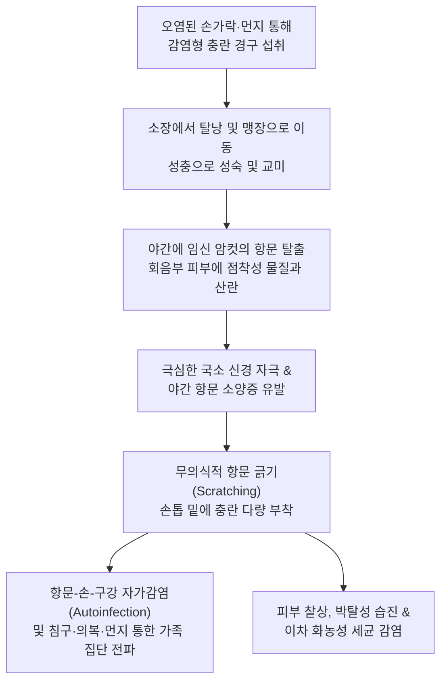
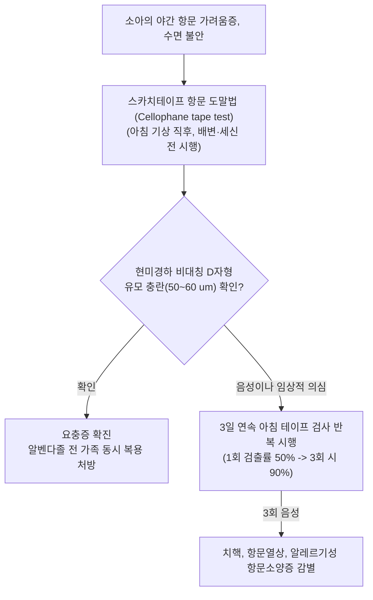

# 🩺 요충증

> **핵심 3줄 요약 (Key Summary)**:
> - 📍 병소 부위 & 해부·병태생리: 대장(맹장 및 회맹부)에 서식하는 요충(*Enterobius vermicularis*)의 성충 암컷이 야간에 항문 괄약근을 통과하여 항문 주위 회음부 피부에 산란하며 점착성 분비물로 알레르기성 자극 유발.
> - 🚩 전형적 임상 양상: 소아에서 호발하는 야간의 극심한 항문 주위 [[소양증]], 수면 장애, 야뇨증, 정서 불안, 긁음으로 인한 이차 습진 및 세균 감염, 드물게 충수 침범으로 급성 [[맹장염]] 모사.
> - 🛠️ 핵심 검사 & 치료 전략: 아침 기상 직후 배변/목욕 전 스카치테이프 항문 도말법(Cellophane tape anal swab - 평철형 유모 충란 검출); 알벤다졸(Albendazole $400\text{ mg}$ 단회 복용) 또는 플루벤다졸, **2주 후 반드시 재투여** 및 **전 가족/동거인 동시 치료**.
> - ⚠️ 응급 의뢰 레드플래그: 요충의 충수 침범에 따른 급성 충수염(우하복부 반발통 및 고열), 여성 소아에서 질염·골반염·복막염으로의 이소성 기생 침범.

---

## 📌 목차
1. [질환 개요 & 해부학적 병태생리](#1-질환-개요--해부학적-병태생리)
2. [병태생리 메커니즘 & 생체역학적 악순환 네트워크](#2-병태생리-메커니즘--생체역학적-악순환-네트워크)
3. [임상 증상 & 이학적 검사(Physical Exam) 알고리즘](#3-임상-증상--이학적-검사physical-exam-알고리즘)
4. [감별 진단 매트릭스 (Differential Diagnosis)](#4-감별-진단-매트릭스--differential-diagnosis)
5. [한의 통합 치료 프로토콜 (침·약침·추나·한약)](#5-한의-통합-치료-프로토콜--침약침추나한약)
6. [양방 치료 & 병용·의뢰 기준 (Conventional Treatment & Referral)](#6-양방-치료--병용의뢰-기준-conventional-treatment--referral)
7. [재활 운동 & 생활습관 티칭 가이드](#7-재활-운동--생활습관-티칭-가이드)
8. [💡 사용자 진료실 핵심 필기 & 임상 노하우 (Melt-In 잔여 심화 집약)](#8--사용자-진료실-핵심-필기--임상-노하우--melt-in-잔여-심화-집약)
9. [출처 및 학술 참고 문헌 (References)](#9-출처-및-학술-참고-문헌--references)

---

## 1. 질환 개요 & 해부학적 병태생리

**요충증(Enterobiasis)**은 인간을 유일한 고유 숙주로 하는 소형 선충인 요충(*Enterobius vermicularis*, 일명 Pinworm)에 의해 발생하는 장내 기생충 질환이다. 전 세계적으로 가장 널리 분포하는 윤충증 중 하나로, 사회경제적 수준과 무관하게 어린이집, 유치원, 초등학교 등 집단생활을 하는 소아와 그 가족 구성원 사이에서 높은 감염률을 보인다. 중간숙주가 없으며, 충란의 경구 섭취를 통해 직접 전파되는 단순한 생활사를 갖는다.

성충은 주로 대장의 맹장(Cecum), 충수(Appendix) 및 회장 말단에 머물며 장내 세균과 점막 분비물을 먹고 산다. 교미를 마친 성숙한 암컷($8\sim 13\text{ mm}$)은 체강 내에 수천 개의 충란이 가득 차면 장벽 부착력을 잃고 결장을 따라 하강하여 숙주가 수면을 취하는 야간에 항문 괄약근을 기어나온다. 항문 주위 피부 주름과 회음부에 수천에서 1만 개 이상의 충란을 산란하면서 다량의 다당체 점착성 물질을 분비하는데, 이 물질이 숙주의 신경말단을 자극하여 극심한 소양증을 유발한다.

---

## 2. 병태생리 메커니즘 & 생체역학적 악순환 네트워크

배출된 충란은 산소와 체온에 노출되면 불과 $4\sim 6\text{시간}$ 만에 감염력을 갖는 유충포장란(Embryonated egg)으로 성숙한다. 환아가 가려움으로 항문을 긁으면 손톱 밑에 충란이 끼어 장난감, 식기, 의복, 침구류를 오염시키고, 손가락을 빨거나 음식을 집어먹음으로써 끊임없는 자가감염(Autoinfection)의 악순환이 지속된다. 또한 침구를 털 때 공기 중에 비산된 충란을 흡입하여 인두를 거쳐 삼킴으로써 감염되는 역감염(Retroinfection)도 가능하다.

---

## 3. 임상 증상 & 이학적 검사(Physical Exam) 알고리즘

### 주요 임상 증상
- **야간 항문 소양증**: 밤에 잠자리에 들었을 때 항문과 회음부가 참을 수 없이 가려워 뒤척이고 잠을 깨는 전형적 증상.
- **수면 장애 및 행동 이상**: 만성적인 수면 박탈로 인한 주간 집중력 저하, 짜증, 정서 불안, 야뇨증(Enuresis), 이갈이(Bruxism).
- **피부 합병증**: 항문 주위 피부 찰상, 발적, 진물, 습진화 및 포도상구균/연쇄상구균 이차 세균 감염.
- **이소성 기생 (Ectopic enterobiasis)**:
  - 여성 소아에서 암컷이 질 내부로 기어들어가 질염, 외음부염, 질 분비물 증가 유발.
  - 충수돌기 내부로 침입하여 내강 폐색을 일으켜 급성 [[맹장염]] 증상 유발.

### 진단 알고리즘

---

## 4. 감별 진단 매트릭스 (Differential Diagnosis)

| 감별 질환 | 호발 연령 및 부위 | 주증상 및 양상 | 검사 및 진단 소견 | 치료 접근법 |
| :--- | :--- | :--- | :--- | :--- |
| **요충증 (*E. vermicularis*)** | 학동기 소아, 항문 주위 | 야간성 극심한 항문 가려움, 수면 장애 | 테이프 검사상 D자형 충란, 대변 검사는 위음성 높음 | 알벤다졸 전 가족 동시 복용, 2주 후 재투여 |
| **알레르기/특발성 항문 소양증** | 성인 흔함, 항문 주위 | 주야간 지속되는 가려움, 과도한 세정력 | 기생충란 불검출, 항문 주위 태선화/백색화 | 저자극 보습, 약한 스테로이드 연고, 원인 회피 |
| **항문 칸디다증** | 당뇨, 항생제 복용자 | 항문 주변 붉은 홍반, 짓무름, 위성 농포 | KOH 도말 검사상 가성균사 및 효모 관찰 | 국소/경구 항진균제(플루코나졸) |
| **급성 충수염 ([[맹장염]])** | 전 연령, 우하복부 | 맥버니점 압통, 반발통, [[발열]], 백혈구 증가 | 복부 초음파/CT상 충수 직경 $>6\text{ mm}$ 비후 | 응급 충수절제술 (수술 시 요충 발견되기도 함) |
| **연쇄상구균성 항문주위염** | 소아 호발, 항문 주변 | 경계가 명확한 선홍색 홍반, 배변통, 직장 출혈 | 인두 및 항문 배양 검사상 Group A Strep 양성 | 경구 아목시실린 등 항생제 치료 |

---

## 5. 한의 통합 치료 프로토콜 (침·약침·추나·한약)

> ⚠️ 요충증은 전염력이 극히 높고 충란 생활사가 명확하므로 양방 구충제(알벤다졸 등)의 전 가족 복용이 근본 치료이다. 한의 치료는 잦은 재감염을 겪는 허약아의 장관 면역력 증진, 비위 소화기능 강화 및 항문 국소 가려움증 완화를 위한 한약 좌욕 및 보조 요법으로 활용한다.

### 1) 한약 처방 (구충 보조 및 장관 허약 체질 개선)
- **충적복통 및 장위습열증 (蟲積腹痛 腸胃濕熱證 - 복통, 항문 가려움, 이갈이, 식욕부진)**:
  - 처방: [[오매환]] 가감 ([[오매]], [[황련]], [[황백]], 사군자, 빈랑, 뇌환, [[당귀]]).
  - 약리 기전: 사군자의 퀴스콸린산(Quisqualic acid)과 빈랑의 아레콜린(Arecoline) 성분이 충체의 신경근을 마비시켜 배출을 촉진하고, 오매의 산미가 충체를 진정시킴.
- **비위기허 및 식적증 (脾胃氣虛 食積證 - 잦은 재감염 소아, 안색 황백, 복부 팽만, 묽은 변)**:
  - 처방: [[삼령백출산]] 또는 비아환 가감 ([[인삼]], [[백출]], [[복령]], [[산약]], 의이인, 연육, 사인, 신곡, 맥아).
  - 목적: 장관 상피 점막 장벽 강화 및 면역 분비형 sIgA 분비 촉진.

### 2) 한약 외용 좌욕 및 세포 요법 (지양 고삼탕)
- **구성**: [[고삼]] $30\text{ g}$, [[황백]] $15\text{ g}$, 백렴 $15\text{ g}$, 사상자 $15\text{ g}$.
- **방법**: 약재를 달인 따뜻한 미온수에 취침 전 10~15분간 항문 부위를 좌욕함. 항문 주위의 알레르기성 신경 자극을 즉각적으로 진정시키고 이차 세균 감염을 억제함.

---

## 6. 양방 치료 & 병용·의뢰 기준 (Conventional Treatment & Referral)

### 양방 표준 치료 프로토콜
1. **1차 표준 구충 약물**:
   - **알벤다졸 (Albendazole)**: $400\text{ mg}$ 단회 경구 복용 (2세 미만 소아는 $200\text{ mg}$).
   - **플루벤다졸 (Flubendazole)**: $500\text{ mg}$ 단회 경구 복용.
   - **피란텔 파모에이트 (Pyrantel pamoate)**: $11\text{ mg/kg}$ (최대 $1\text{ g}$) 단회 복용.
2. **반드시 지켜야 할 '2-2 원칙'**:
   - **2주 후 2차 복용 필수**: 구충제는 장내 성충만 죽이고 산란된 충란은 죽이지 못하므로, 체내에 남은 충란이 부화하는 $2\text{주}$ 뒤에 반드시 동일 용량을 1회 더 복용해야 박멸됨.
   - **전 가족/동거인 동시 복용**: 무증상 보균자가 충란을 계속 배출하므로 가족 전원이 같은 날 약을 복용해야 핑퐁 감염을 차단할 수 있음.

### 긴급 응급 의뢰 레드플래그
- 우하복부의 심한 반발통 및 고열(요충성 급성 충수염 의심).
- 여성 소아에서 심한 하복통과 함께 골반염, 난소농양 의심 소견.
- 항문 주위 광범위한 농양 형성 및 봉와직염 진행.

---

## 7. 재활 운동 & 생활습관 티칭 가이드

- **손톱 관리 및 손 위생 철저**: 아이의 손톱을 항상 바짝 짧게 깎아주고, 기상 후, 식사 전, 배변 후 반드시 비누로 $30\text{초}$ 이상 손가락 사이와 손톱 밑을 문질러 씻도록 지도함.
- **아침 샤워 및 탈의 티칭**: 기상 직후 항문 주위에 산란된 충란을 물로 씻어내기 위해 가볍게 아침 샤워를 시키며, 이때 충란이 욕조에 퍼지지 않도록 서서 샤워기를 사용함.
- **침구류 및 내의 열탕 소독**: 복약 당일 아이가 입었던 잠옷, 속옷, 침대 시트, 베개 커버를 털지 말고 조심스럽게 걷어내어 $60^\circ\text{C}$ 이상의 뜨거운 물로 세탁하고 건조기에 돌림.
- **장난감 및 실내 청소**: 손이 자주 닿는 장난감, 문손잡이, 바닥을 물걸레로 닦아 먼지에 섞인 충란을 제거함.

---

## 8. 💡 사용자 진료실 핵심 필기 & 임상 노하우 (Melt-In 잔여 심화 집약)

> 💡 **임상 핵심 진주 (Clinical Pearls)**:
> - **대변 검사로는 요충을 찾을 수 없다**: 요충은 장관 내에 알을 낳지 않고 항문 밖으로 나와 산란하므로, 일반적인 대변 충란 검사(Stool exam)의 검출률은 $5\%$ 미만에 불과하다. 반드시 투명 스카치테이프를 아침에 항문에 붙였다 떼는 '스카치테이프 도말법'을 써야 한다.
> - **'2주 뒤 재복용' 티칭 누락이 실패의 90%**: 약국이나 의원에서 알벤다졸을 한 알만 먹고 끝내는 경우가 허다하다. 성충만 죽고 충란은 살아남아 2주 뒤 다시 성충이 되어 산란하므로, 복약 지도 시 스마트폰 알람을 맞춰주고 2주 뒤 2차 복용을 반드시 완수하도록 해야 한다.
> - **야간 수면 불안과 이갈이의 숨은 원인**: 밤마다 칭얼거리고 자다 깨서 울며, 이를 바득바득 갈거나 바지를 쥐어뜯는 아이는 야경증이나 뇌신경 문제가 아니라 요충증일 가능성이 매우 높다. 손전등을 켜고 아이가 잠든 지 2~3시간 뒤 항문을 벌려보면 하얀 실밥 같은 충체가 기어나오는 것을 직접 목격할 수 있다.
> - **급성 맹장염과의 오진 주의**: 최근 학계에 요충이 충수돌기를 폐색시켜 급성 충수염을 모사하는 증례가 다수 보고되고 있다. 우하복부 통증 환아에서 요충증 병력이 있는지 확인하고, 수술적 응급 상황을 놓치지 않도록 신속히 감별해야 한다.

---

## 9. 출처 및 학술 참고 문헌 (References)

- Jaffry Z, et al. (2026). Enterobius vermicularis as a Mimic of Acute Appendicitis: A Case Report. *Cureus*. PMID: 42559549.

- Shen T, et al. (2026). A rare case of abdominal pain caused by Enterobius vermicularis. *BMC Gastroenterol*. PMID: 42380810.

- Bedir O, et al. (2026). Regional genetic diversity and COI haplotype characterization of human-derived Enterobius vermicularis isolates. *Mol Biol Rep*. PMID: 42377758.
