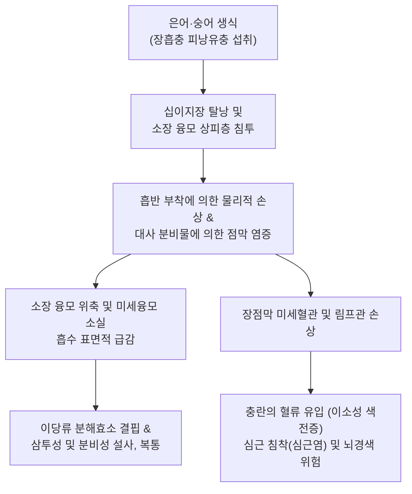
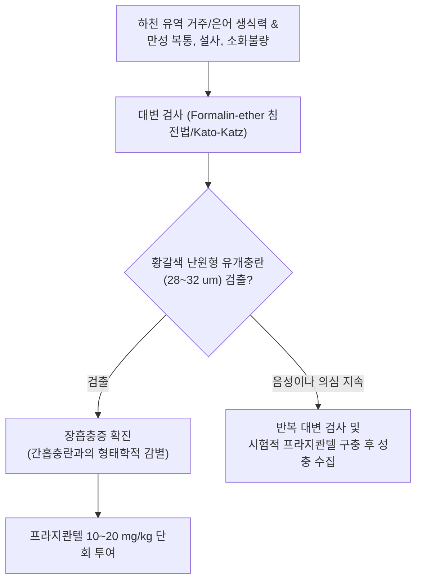

# 🩺 장흡충증

> **핵심 3줄 요약 (Key Summary)**:
> - 📍 병소 부위 & 해부·병태생리: 은어, 숭어, 붕어 등 담수 및 반염수 어류를 생식하여 요코가와흡충(*Metagonimus yokogawai*) 또는 이형흡충(*Heterophyes heterophyes*) 등의 피낭유충이 소장(십이지장·공장) 융모 사이에 기생하여 점막 궤양, 카타르성 장염 유발.
> - 🚩 전형적 임상 양상: 경증은 무증상이나, 다수 감염 시 심와부/배꼽 주위 복통, 물설사, 소화불량, 피로감, 식욕부진; 드물게 충란이 장벽 정맥을 타고 심장 판막이나 뇌로 색전증을 일으킴.
> - 🛠️ 핵심 검사 & 치료 전략: 대변 충란 검사(Formalin-ether 침전법 또는 Kato-Katz 도말법 - 작은 황갈색 난원형 유개충란 확인); 프라지콴텔(Praziquantel $10\sim 20\text{ mg/kg}$ 단회 복용).
> - ⚠️ 응급 의뢰 레드플래그: 충란의 혈류 색전증에 따른 급성 심근염/심부전(흉통, 부정맥), 뇌색전증(돌발성 반신마비, 전간 발작), 소아 중증 설사로 인한 중증 탈수 및 전해질 쇼크.

---

## 📌 목차
1. [질환 개요 & 해부학적 병태생리](#1-질환-개요--해부학적-병태생리)
2. [병태생리 메커니즘 & 생체역학적 악순환 네트워크](#2-병태생리-메커니즘--생체역학적-악순환-네트워크)
3. [임상 증상 & 이학적 검사(Physical Exam) 알고리즘](#3-임상-증상--이학적-검사physical-exam-알고리즘)
4. [감별 진단 매트릭스 (Differential Diagnosis)](#4-감별-진단-매트릭스--differential-diagnosis)
5. [한의 통합 치료 프로토콜 (침·약침·추나·한약)](#5-한의-통합-치료-프로토콜--침약침추나한약)
6. [양방 치료 & 병용·의뢰 기준 (Conventional Treatment & Referral)](#6-양방-치료--병용의뢰-기준-conventional-treatment--referral)
7. [재활 운동 & 생활습관 티칭 가이드](#7-재활-운동--생활습관-티칭-가이드)
8. [💡 사용자 진료실 핵심 필기 & 임상 노하우 (Melt-In 잔여 심화 집약)](#8--사용자-진료실-핵심-필기--임상-노하우--melt-in-잔여-심화-집약)
9. [출처 및 학술 참고 문헌 (References)](#9-출처-및-학술-참고-문헌--references)

---

## 1. 질환 개요 & 해부학적 병태생리

**장흡충증(Intestinal Fluke Infection)**은 소장에 기생하는 흡충류 감염에 의해 발생하는 소화관 기생충 질환이다. 국내에서 가장 임상적 비중이 높은 대표 원인체는 요코가와흡충(*Metagonimus yokogawai*)과 미야타장흡충(*M. miyatai*)이며, 그 외에도 이형이형흡충(*Heterophyes heterophyes*), 극구흡충류(*Echinostoma* spp.) 등이 포함된다. 동해안 및 남해안으로 흘러드는 주요 하천(섬진강, 탐진강, 밀양강, 오십천 등) 유역에서 은어(Plecoglossus altivelis)를 회로 즐겨 먹는 식습관으로 인해 높은 감염률을 보인다.

제2중간숙주인 은어의 비늘 밑, 지느러미, 근육에 형성된 피낭유충(Metacercaria)을 인간이 날것으로 섭취하면, 소장 상부(십이지장 및 공장)에서 탈낭하여 점막 융모(Villous) 틈새로 파고든다. 충체는 $1\sim 2\text{ mm}$ 내외의 미세한 크기이지만 복흡반과 생식흡반으로 소장 융모 기저부에 강력히 부착한다. 이 과정에서 장점막 융모의 위축, 융합, 기저 소와(Crypt) 과형성, 점막 상피의 괴사성 탈락 및 호산구, 형질세포, 림프구가 침윤하는 카타르성 장염이 발생한다.

---

## 2. 병태생리 메커니즘 & 생체역학적 악순환 네트워크

장흡충의 성충은 소장 상피 점막하층까지 깊숙이 파고들어 산란을 지속한다. 충체가 점막 장벽을 손상시키면 융모 표면의 락타아제 등 소화효소가 결핍되어 장내 영양분의 흡수 장애와 삼투성 설사가 발생한다. 특히 심각한 해부병태생리학적 합병증은 작은 크기($28\sim 32\ \mu\text{m}$)의 충란이 손상된 림프관이나 장간막 유미관, 장간막 정맥 모세혈관으로 유입되는 것이다. 혈관을 타고 전신 순환계로 흘러 들어간 충란은 심장 판막이나 심근 미세혈관에 걸려 호산구성 육아종성 심근염과 판막 기능 부전을 일으키거나, 뇌혈관을 막아 뇌색전성 경색을 유발할 수 있다.

---

## 3. 임상 증상 & 이학적 검사(Physical Exam) 알고리즘

### 주요 임상 증상
- **경도 감염 (소수 기생)**: 대다수에서 무증상이거나 간헐적인 소화불량, 가벼운 무른 변.
- **다수 감염 (수백~수천 마리 기생)**:
  - 감염 $1\sim 2$주 후부터 시작되는 상복부 및 배꼽 주위의 쥐어짜는 듯한 복통.
  - 하루 수회의 묽은 설사 또는 수양성 설사(점액 변 동반 가능).
  - 식욕부진, 복부 팽만감, 구역감, 전신 쇠약감, 만성 [[피로]].
- **만성 감염 후유증**: 장기화된 흡수 장애로 인한 체중 감소 및 영양 결핍, 경미한 [[빈혈]].
- **색전성 합병증 (드묾)**: 심계항진, 호흡곤란, 흉통, 심부정맥, 돌발성 신경학적 결손(반신 마비 등).

### 진단 알고리즘

---

## 4. 감별 진단 매트릭스 (Differential Diagnosis)

| 감별 질환 | 병원체 및 감염원 | 기생 부위 | 충란 형태 및 특징 | 치료 약제 |
| :--- | :--- | :--- | :--- | :--- |
| **장흡충증 (*M. yokogawai*)** | 담수어(은어) 생식 | 소장(십이지장·공장) 점막 | 황갈색 타원형, 뚜껑(Operculum) 있음, 표면 과립 미세 | 프라지콴텔 $10\sim 20\text{ mg/kg}$ 1회 |
| **[[간흡충증]] (*C. sinensis*)** | 담수어(붕어·잉어) 생식 | 간내·외 담관 | 항아리 모양, 뚜껑 테두리(Shouldering) 뚜렷, 후단 돌기 | 프라지콴텔 $25\text{ mg/kg}$ tid 1~2일 |
| **이질아메바증 (Amebiasis)** | 오염된 물/음식, 분변-구강 | 대장(맹장·상행결장) | 대변 내 아메바 포낭 또는 적혈구 포식 영양형 | 메트로니다졸(Metronidazole) 후 파로모마이신 |
| **과민성 장증후군 (IBS)** | 장-뇌 축 기능 이상, 스트레스 | 전 장관 기능 이상 | 기생충란 불검출, 배변 후 복통 완화 | 식이 조절, 진경제, 유산균 |
| **염증성 장질환 (크론병/궤양성대장염)** | 자가면역성 만성 장염 | 소장 말단 또는 대장 전반 | 점액혈변, 내시경상 종주 궤양/조약돌 점막 | 5-ASA, 스테로이드, 생물학제제 |

---

## 5. 한의 통합 치료 프로토콜 (침·약침·추나·한약)

> ⚠️ 장흡충증의 근본 치료는 충체를 완벽히 구충하는 프라지콴텔 투여이다. 한의 치료는 구충 약물 복용 후 손상된 소장 점막 융모의 재생을 촉진하고, 카타르성 장염으로 인한 만성 설사, 복부 냉증, 소화 흡수 장애를 재건하는 지지요법으로 시행한다.

### 1) 한약 처방 (구충 후 장점막 재건 지지요법)
- **비위허약 및 비허습열증 (脾胃虛弱 脾虛濕熱證 - 구충 후 지속되는 묽은 설사, 복통, 소화불량)**:
  - 처방: [[삼령백출산]] 합 [[평위산]] 가감 ([[인삼]], [[백출]], [[복령]], [[산약]], [[진피]], [[후박]], [[창출]], [[감초]]).
  - 약리 기전: 백출과 복령의 장관 상피 점막 수분 조절 및 삼투성 설사 억제, 인삼 사포닌의 장점막 융모 세포 증식 촉진.
- **비신양허 및 오경설사증 (脾腎陽虛 五更泄瀉證 - 새벽녘 복통과 설사, 수족 냉증, 피로)**:
  - 처방: 사신환 합 [[이중탕]] 가감 (보골지, 육두구, 오수유, 오미자, [[인삼]], [[백출]], 건강, 부자).
  - 작용: 소장 평활근의 비정상적 과민 연동운동 억제 및 흡수력 강화.
- **충독살충 보조 요법**:
  - 처방: [[오매환]] 가감 ([[오매]], [[황련]], [[황백]], 사군자, 건강, 세신).
  - 효과: 장관 내 미세 기생충에 대한 구충 보조 작용 및 점막 진정.

### 2) 침구 및 온열 치료
- **혈위**: 중완(CV12), 천추(ST25), 관원(CV4), 족삼리(ST36), 상거허(ST37), 비수(BL20).
- **시술 지침**: 관원과 천추 혈위에 뜸 치료(간접구) 또는 온침을 병용하여 냉해진 소장 국소 순환을 개선하고 복통과 설사를 신속히 완화함.

---

## 6. 양방 치료 & 병용·의뢰 기준 (Conventional Treatment & Referral)

### 양방 표준 치료 프로토콜
- **1차 표준 구충 요법**:
  - **프라지콴텔 (Praziquantel)**: $10\sim 20\text{ mg/kg}$을 **식후 단 1회 경구 투여**.
  - 기전: 충체 표피의 칼슘 채널을 개방시켜 전신 강직성 마비를 유도하고, 장점막 부착력을 상실시켜 장 연동운동에 의해 대변으로 배출시킴.
  - 예후: 단 1회 투여로 $95\sim 100\%$의 완치율을 보임.
- **수액 및 대증 요법**:
  - 다량의 수양성 설사로 인한 탈수 시 경구 수액염(ORS) 또는 정맥 수액 투여.

### 긴급 응급 의뢰 레드플래그
- 은어 섭취 후 수일~수주 내 발생하는 돌발성 흉통, 호흡곤란, 심계항진(심근/판막 충란 색전증 의심).
- 편측 사지 위약, 감각 마비, 언어 장애, 전간 발작(뇌색전증 의심).
- 심한 탈수로 인한 소변량 급감, 기립성 어지럼증, 저혈압 쇼크.

---

## 7. 재활 운동 & 생활습관 티칭 가이드

- **은어 및 담수어 생식 절대 금지**: 동해안과 남해안 하천에서 갓 잡은 은어는 비린내가 없고 수박 향이 난다고 하여 회나 튀김을 덜 익혀 먹는 문화가 있으나, 이는 장흡충 감염의 주원인이므로 절대 생식을 피함.
- **안전한 조리법**: 은어 및 민물 생선은 반드시 $100^\circ\text{C}$ 이상에서 푹 끓이거나 중심부까지 완전히 구워서 섭취함.
- **냉동 처리 기준**: 생식이 불가피할 경우 영하 $20^\circ\text{C}$ 이하에서 최소 7일 이상 급속 냉동해야 피낭유충이 사멸함.
- **조리 도구 위생**: 생선을 손질한 칼과 도마는 즉시 끓는 물로 세척하여 다른 반찬으로의 교차 오염을 방지함.

---

## 8. 💡 사용자 진료실 핵심 필기 & 임상 노하우 (Melt-In 잔여 심화 집약)

> 💡 **임상 핵심 진주 (Clinical Pearls)**:
> - **'은어회 먹고 설사' 환자의 전형적 프로필**: 여름철이나 초가을에 경남 하동(섬진강), 전남 강진(탐진강), 경북 영덕(오십천) 등으로 여행을 다녀와서 은어회를 먹은 뒤 1~2주 뒤부터 물설사와 쥐어짜는 복통이 시작되었다면 장흡충증을 1순위로 확진해야 한다.
> - **간흡충란과의 현미경적 감별 묘미**: 요코가와흡충란은 크기($28\sim 32\ \mu\text{m}$)와 모양이 간흡충란과 매우 흡사하여 오진하기 쉽다. 그러나 간흡충란은 뚜껑(Operculum) 부위에 어깨처럼 튀어나온 턱(Shouldering)이 뚜렷하고 후단에 작은 돌기가 있는 반면, 요코가와흡충란은 전체적으로 매끄러운 타원형 곡선을 이룬다.
> - **프라지콴텔 단 1회의 마법**: 간흡충은 하루 3회씩 복용해야 하지만, 장흡충은 장관 내강에 노출되어 있으므로 체중당 $10\sim 20\text{ mg/kg}$ 단 한 번만 복용하면 다음 날 대변으로 충체들이 모두 쏟아져 나오며 즉시 완치된다.
> - **심장과 뇌를 노리는 색전증의 위험성**: 흔치 않지만 장벽이 얇아진 상태에서 수천 마리의 충체가 대량 산란하면 충란이 혈관을 뚫고 들어가 심근염이나 뇌경색을 일으킬 수 있다. 따라서 단순 장염으로 치부하지 말고 조기에 구충제를 복용시키는 것이 안전하다.

---

## 9. 출처 및 학술 참고 문헌 (References)

- Sokolov SG, et al. (2026). Analysis of the phylogenetic position of Pseudexorchis Yamaguti, 1938 (Digenea: Opisthorchioidea) suggests new complexity in the relationships of the Cryptogonimidae. *J Helminthol*. PMID: 42947563.

- Coppens C, et al. (2026). Evaluation of the Biosynex AMPLIQUICK® Fecal Parasitology assays in a Belgian travel clinic. *Front Cell Infect Microbiol*. PMID: 42908692.

- Serrat J, et al. (2026). Development of a novel organoid-based two-dimensional system to model the intestinal host-parasite interface in fasciolosis. *Front Cell Infect Microbiol*. PMID: 42856945.
