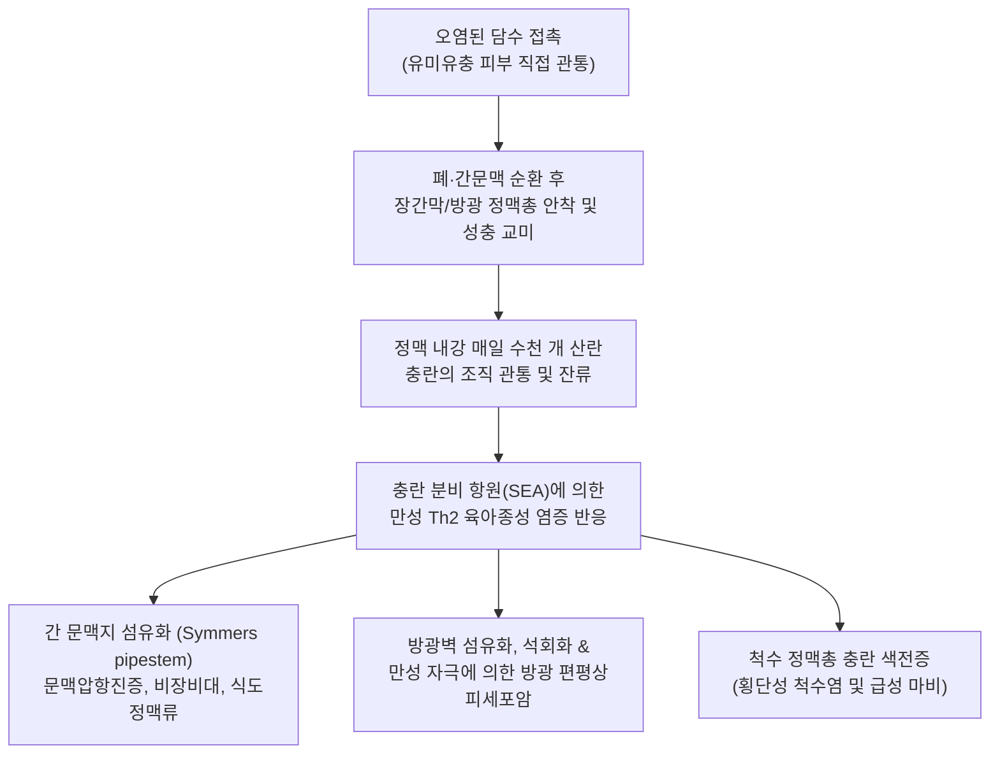
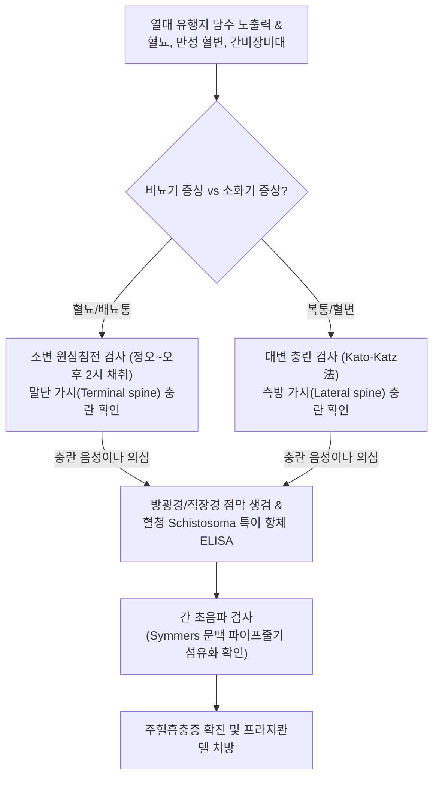

# 🩺 주혈흡충증

> **핵심 3줄 요약 (Key Summary)**:
> - 📍 병소 부위 & 해부·병태생리: 오염된 담수 접촉 시 유미유충(Cercaria)의 피부 관통으로 감염되어 장간막 정맥총(*S. mansoni*, *S. japonicum*) 또는 방광·골반 정맥총(*S. haematobium*)에 기생하는 주혈흡충증으로, 충란 침착에 따른 광범위한 육아종성 염증 및 섬유화 유발.
> - 🚩 전형적 임상 양상: 초기 침입 부위 세르카리아 피부염(Swimmer's itch), 급성기 카타야마열(Katayama fever: 고열, 오한, 기침, 간비종대), 만성 장관/간형(문맥 섬유화, 복수, 식도정맥류), 비뇨생식기형(무통성 종말 혈뇨, 방광암 위험).
> - 🛠️ 핵심 검사 & 치료 전략: 대변 또는 소변 충란 검사(특이 가시 spine 관찰), 방광/직장 점막 생검, 혈청 특이 항체 검사, 간 초음파(파이프줄기 모양 문맥 섬유화 Symmers' pipestem fibrosis); 1차 표준 구충제 프라지콴텔(Praziquantel $40\sim 60\text{ mg/kg}$ 1일 분할 투여).
> - ⚠️ 응급 의뢰 레드플래그: 식도정맥류 파열에 따른 대량 토혈(Hematemesis) 및 저혈량성 쇼크, 척수 침범에 따른 급성 하지 마비(횡단성 척수염), 대량 육안적 혈뇨 및 방광 폐색.

---

## 📌 목차
1. [질환 개요 & 해부학적 병태생리](#1-질환-개요--해부학적-병태생리)
2. [병태생리 메커니즘 & 생체역학적 악순환 네트워크](#2-병태생리-메커니즘--생체역학적-악순환-네트워크)
3. [임상 증상 & 이학적 검사(Physical Exam) 알고리즘](#3-임상-증상--이학적-검사physical-exam-알고리즘)
4. [감별 진단 매트릭스 (Differential Diagnosis)](#4-감별-진단-매트릭스--differential-diagnosis)
5. [한의 통합 치료 프로토콜 (침·약침·추나·한약)](#5-한의-통합-치료-프로토콜--침약침추나한약)
6. [양방 치료 & 병용·의뢰 기준 (Conventional Treatment & Referral)](#6-양방-치료--병용의뢰-기준-conventional-treatment--referral)
7. [재활 운동 & 생활습관 티칭 가이드](#7-재활-운동--생활습관-티칭-가이드)
8. [💡 사용자 진료실 핵심 필기 & 임상 노하우 (Melt-In 잔여 심화 집약)](#8--사용자-진료실-핵심-필기--임상-노하우--melt-in-잔여-심화-집약)
9. [출처 및 학술 참고 문헌 (References)](#9-출처-및-학술-참고-문헌--references)

---

## 1. 질환 개요 & 해부학적 병태생리

**주혈흡충증(Schistosomiasis)**, 또는 **빌하르츠증(Bilharziasis)**은 *Schistosoma*속 흡충류 감염에 의해 발생하는 치명적인 열대성 만성 기생충 질환이다. 말라리아에 이어 전 세계적으로 두 번째로 사회경제적 파급력이 큰 기생충 질환으로, 아프리카, 중동, 남미, 동남아시아의 열대·아열대 지역에 광범위하게 분포한다. 인간을 침범하는 3대 주요 종은 만손주혈흡충(*S. mansoni* - 아프리카, 남미), 일본주혈흡충(*S. japonicum* - 동아시아, 필리핀), 방광주혈흡충(*S. haematobium* - 아프리카, 중동)이다.

감염은 중간숙주인 담수 패류(우렁이, 달팽이)에서 방출된 꼬리가 갈라진 유미유충(Cercaria)이 서식하는 오염된 담수에 인간이 수영, 목욕, 세탁 등으로 접촉할 때 발생한다. 유미유충은 단백분해효소를 분비하여 무손상 인체 피부를 수 분 내에 직접 뚫고 침입한 후 꼬리를 떼어내고 주혈흡충자(Schistosomulum)로 변환된다. 혈류와 림프계를 타고 폐와 심장을 거쳐 간문맥계로 이동하여 성충으로 성숙하며, 자웅이 포옹(Amplexus)한 상태로 최종 목적지인 하장간막정맥(*S. mansoni*), 상장간막정맥(*S. japonicum*), 또는 방광 및 골반 정맥총(*S. haematobium*)으로 이동하여 수년간 매일 수백~수천 개의 충란을 혈관 내에 산란한다.

---

## 2. 병태생리 메커니즘 & 생체역학적 악순환 네트워크

주혈흡충증의 주요 병변은 성충 자체보다 조직 내에 갇힌 **충란**에 의해 유도된다. 산란된 충란 중 일부만 장관이나 방광 내강으로 빠져나가고, 상당수는 조직에 박히거나 혈류를 타고 간 실질로 역류한다. 충란의 가용성 항원(Soluble Egg Antigens, SEA)은 Th2 편향 세포성 면역 반응을 촉발하여 호산구, 대식세포, 섬유모세포로 둘러싸인 거대한 만성 육아종을 형성한다. 간에서는 문맥 주위 결합조직이 하얗고 두껍게 굳어지는 **파이프줄기 섬유화(Symmers' pipestem fibrosis)**를 초래하여 정상 간 실질은 보존되면서도 극심한 문맥압 항진증과 [[비장 비대]], 치명적인 식도정맥류 출혈을 유발한다. 방광에서는 점막하 육아종이 석회화되고 만성 궤양을 형성하여 방광암으로 이행한다.

---

## 3. 임상 증상 & 이학적 검사(Physical Exam) 알고리즘

### 단계별 임상 증상
- **1단계: 세르카리아 피부염 (침입 수시간~수일)**:
  - 물에 들어갔던 피부 부위에 찌르는 듯한 가려움, 구진성 홍반 피진(Swimmer's itch).
- **2단계: 급성 주혈흡충증 (카타야마열, 감염 2~8주 후)**:
  - 대량 산란 시작에 따른 급성 알레르기 면역 반응: $39^\circ\text{C}$ 이상의 고열, 오한, 마른기침, 두드러기, 복통, 간비대 및 [[비장 비대]], 현저한 호산구 증가증.
- **3단계: 만성 주혈흡충증 (수개월~수년 후)**:
  - **장관/간형 (*S. mansoni*, *S. japonicum*)**: 만성 혈변, 점액성 설사, 복통, 간경화 양상의 복수, 식도정맥류 출혈(대량 토혈), 간성 뇌증.
  - **비뇨생식기형 (*S. haematobium*)**: 배뇨 말기 무통성 혈뇨(Terminal hematuria), 배뇨통, 빈뇨, 방광 석회화, 신우신염, 수신증, 여성 외음부 육아종.
  - **이소성 합병증**: 척수 침범 시 급성 하반신 마비(Paraplegia), 감각 상실, 폐동맥 고혈압.

### 진단 알고리즘

---

## 4. 감별 진단 매트릭스 (Differential Diagnosis)

| 감별 질환 | 병원체 및 기전 | 주요 침범 부위 및 증상 | 진단적 핵심 소견 | 치료 접근법 |
| :--- | :--- | :--- | :--- | :--- |
| **만손주혈흡충증 (*S. mansoni*)** | 담수 유미유충 침투 | 장간막 정맥, 간 문맥 | 대변 내 대형 측방 가시(Lateral spine) 충란, 문맥 섬유화 | 프라지콴텔 $40\text{ mg/kg}$ 분할 투여 |
| **방광주혈흡충증 (*S. haematobium*)** | 담수 유미유충 침투 | 방광·골반 정맥총 | 소변 내 말단 가시(Terminal spine) 충란, 무통성 혈뇨 | 프라지콴텔 $40\text{ mg/kg}$ 분할 투여 |
| **방광암 (요로상피세포암)** | 흡연, 화학물질 노출 | 방광 점막 | 육안적 무통성 혈뇨, 방광경하 유두상 종괴, 요세포진 양성 | 경요도 방광종양절제술(TURBT) |
| **간경화 (간경변증)** | 간염 바이러스, 알코올 | 간 실질 전반 | 간 실질 미만성 결절, 재생결절, 바이러스 표지자 양성 | 원인 바이러스 치료, 합병증 관리 |
| **장결핵 (*M. tuberculosis*)** | 결핵균 장관 침범 | 회맹부 호발 | 궤양 및 장벽 비후, 결핵균 PCR 양성, 건락성 괴사 | 항결핵제 4제 요법 |

---

## 5. 한의 통합 치료 프로토콜 (침·약침·추나·한약)

> ⚠️ 주혈흡충증의 원인체 박멸에는 프라지콴텔 구충 요법이 절대적이다. 한의 치료는 급성 카타야마열의 염증성 고열 완화, 구충 후 간 문맥 섬유화 및 비장비대의 진행 억제, 만성 비뇨기계 염증 및 혈뇨 후유증을 회복시키는 병용 지지요법으로 시행한다.

### 1) 한약 처방 (변증별 지지요법)
- **온열어독증 (溫熱瘀毒證 - 급성 카타야마열, 고열, 오한, 기침, 두드러기)**:
  - 처방: [[백호가인삼탕]] 합 [[황련해독탕]] 가감 ([[석고]], [[지모]], [[인삼]], [[황련]], [[황금]], [[황백]], [[치자]], [[감초]]).
  - 기전: 과도한 전신 전염증성 사이토카인 분비 억제 및 해열 작용.
- **간비혈어 및 징적증 (肝脾血瘀 癥積證 - 만성 문맥 섬유화, 간비장 비대, 복수, 소화장애)**:
  - 처방: [[혈부축어탕]] 또는 복방별갑전환 가감 ([[단삼]], [[적작약]], [[도인]], [[홍화]], 별갑, 삼릉, 봉출, [[당귀]], [[시호]]).
  - 학술 근거: 단삼과 별갑 성분이 간 성상세포(HSC) 활성화를 차단하고 콜라겐 섬유 침착을 억제하여 문맥압 상승 완화.
- **하초습열 및 열림혈림증 (下焦濕熱 熱淋血淋證 - 방광형 만성 혈뇨, 배뇨통, 빈뇨)**:
  - 처방: 소계음자 가감 (소계, 포황, 우슬, [[생지황]], 활석, 목통, [[치자]], 죽엽, 당귀, 감초).
  - 작용: 비뇨기 점막의 미세혈관 지혈 및 상피 재생 촉진.

### 2) 침구 치료
- **혈위**: 간수(BL18), 비수(BL20), 신수(BL23), 방광수(BL28), 족삼리(ST36), 삼음교(SP6), 중극(CV3), 태충(LR3).
- **시술 지침**: 식도정맥류나 중증 문맥압항진증이 있는 환자에게 복부 강자극은 금기. 하초 습열을 내리기 위해 중극과 삼음교를 부드럽게 사법으로 자침함.

---

## 6. 양방 치료 & 병용·의뢰 기준 (Conventional Treatment & Referral)

### 양방 표준 치료 프로토콜 (WHO 가이드라인)
- **1차 표준 구충 약물**:
  - **프라지콴텔 (Praziquantel)**:
    - *S. mansoni*, *S. haematobium*: $40\text{ mg/kg}$을 1~2회로 나누어 1일간 경구 투여.
    - *S. japonicum*: $60\text{ mg/kg}$을 3회로 나누어 1일간 경구 투여 (충체 저항성이 높아 고용량 필요).
  - 기전: 성충의 외피를 파괴하여 숙주 면역세포에 노출시킴으로써 사멸 유도. 충란에는 직접 작용하지 못하므로 감염 초기(유충기)에는 효과가 떨어질 수 있어 $4\sim 6\text{주}$ 후 재투여 고려.
- **카타야마열 치료**:
  - 충체 파괴 시 발생하는 면역 복합체 반응 억제를 위해 고용량 프레드니손($20\sim 40\text{ mg/day}$)을 프라지콴텔과 병용.

### 긴급 응급 의뢰 레드플래그
- 식도정맥류 파열에 의한 대량 토혈 및 혈변, 저혈압 쇼크.
- 급성 하지 위약, 감각 마비, 배뇨 장애(척수 충란 침착에 따른 급성 횡단성 척수염).
- 대량의 육안적 혈뇨와 방광 내 거대 혈종 폐색.

---

## 7. 재활 운동 & 생활습관 티칭 가이드

- **풍토병 지역 담수 접촉 절대 금지**: 아프리카(빅토리아호, 말라위호 등), 중동, 남미 여행 시 호수, 강, 저수지에서 수영, 래프팅, 목욕을 절대 금지함.
- **안전한 물 사용**: 샤워나 세안 시 수돗물이 없으면 물을 최소 1분 이상 끓이거나, 정밀 필터로 여과하거나, 최소 48시간 이상 저장하여 유미유충이 자연 사멸한 물을 사용함.
- **신속한 피부 건조**: 우발적으로 담수에 피부가 닿았을 경우 즉시 마른 수건으로 피부를 세게 문질러 닦으면 유미유충이 피부를 뚫기 전에 기계적으로 털어낼 수 있음.
- **정기 비뇨기계 스크리닝**: 방광주혈흡충증 병력이 있는 환자는 완치 후에도 방광암 발생 위험이 높으므로, 매년 정기적인 소변 세포진 검사 및 방광경 검사를 받도록 지도함.

---

## 8. 💡 사용자 진료실 핵심 필기 & 임상 노하우 (Melt-In 잔여 심화 집약)

> 💡 **임상 핵심 진주 (Clinical Pearls)**:
> - **'소변 끝에 피가 비치는 아프리카 여행자'**: 아프리카를 다녀온 환자가 통증도 별로 없는데 소변을 다 볼 때쯤 붉은 피가 똑똑 떨어진다고 호소하면(Terminal hematuria) 100% 방광주혈흡충증을 의심해야 한다. 현미경으로 소변 침전물을 보면 끝에 뾰족한 가시가 달린 거대한 충란을 쉽게 발견할 수 있다.
> - **파이프줄기 섬유화(Pipestem fibrosis)의 독특함**: 일반 간경변증은 간세포가 망가지면서 간기능 수치가 심하게 깨지지만, 주혈흡충 간질환은 간세포 자체는 멀쩡하고 문맥 혈관 주위만 하얗게 섬유화되는 '순수 혈관 폐색성' 질환이다. 따라서 황달이나 알부민 저하 없이 비장비대와 식도정맥류 출혈이 먼저 터지는 특징이 있다.
> - **급성기 카타야마열의 함정**: 감염 후 1달쯤 지나 고열과 심한 기침, 두드러기가 나타날 때 말라리아나 장티푸스로 오진하기 쉽다. 이때는 대변이나 소변에서 아직 알이 나오지 않으므로, 담수 노출력과 혈액 호산구 수치(종종 $50\%$ 이상)를 보고 진단해야 한다.
> - **프라지콴텔의 투여 시점**: 감염 직후(피부 침투 직후 1~2주)에는 유충이 프라지콴텔에 잘 듣지 않는다. 성충으로 자란 감염 6~8주 이후에 복용해야 완치율이 높으며, 급성기에 복용했을 경우 1달 뒤 반드시 재투여해야 한다.

---

## 9. 출처 및 학술 참고 문헌 (References)

- Mercier A, et al. (2026). Environmental RNA improves detection and surveillance of schistosomiasis transmission sites. *Proc Natl Acad Sci U S A*. PMID: 42949976.

- Katembo V, et al. (2026). Knowledge, attitudes, and practices of healthcare professionals on female genital schistosomiasis in rural Democratic Republic of Congo. *BMC Womens Health*. PMID: 42947095.

- Tong Y, et al. (2026). CT-based radiomics combined with clinical features for non-invasive differentiation of schistosomal and non-schistosomal liver disease. *BMC Med Imaging*. PMID: 42934564.
