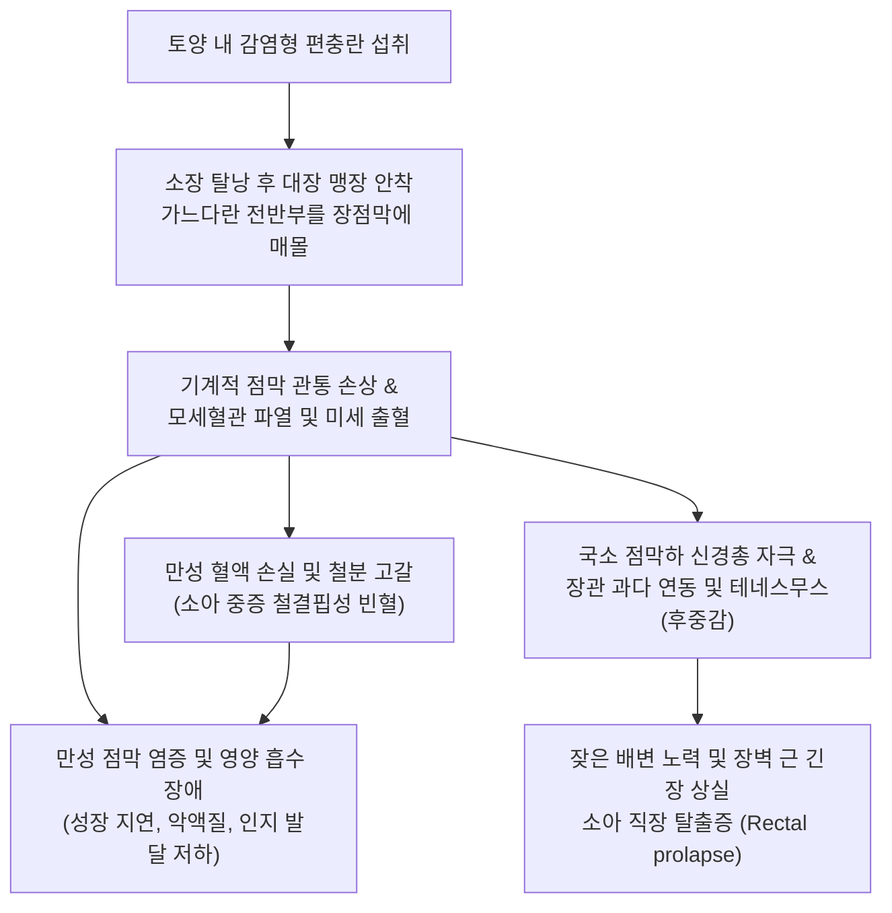
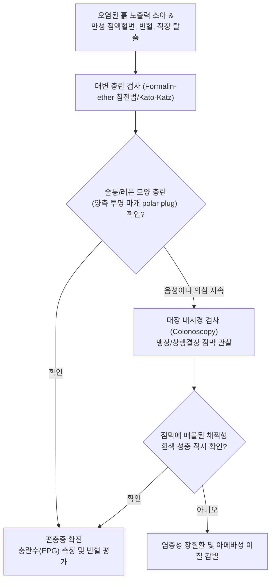

# 🩺 편충증

> **핵심 3줄 요약 (Key Summary)**:
> - 📍 병소 부위 & 해부·병태생리: 맹장 및 대장 점막 상피 내에 채찍 모양의 전반부를 파묻고 기생하는 편충(*Trichuris trichiura*, Whipworm) 감염으로, 대장 점막 궤양, 미세 출혈, 카타르성 장염 유발.
> - 🚩 전형적 임상 양상: 소수 기생 시 무증상이나, 소아 다수 기생 시 만성 점액성 혈변, 잦은 설사, 테네스무스(후중감), 중증 철결핍성 [[빈혈]], 성장 부전, 극심한 직장 탈출증(Rectal prolapse).
> - 🛠️ 핵심 검사 & 치료 전략: 대변 충란 검사(Formalin-ether 침전법 또는 Kato-Katz 도말법상 전형적인 레몬/술통 모양 양측 마개 충란 확인), 대장 내시경(맹장 점막에 박혀 있는 흰색 실 모양 충체 직시); 알벤다졸(Albendazole $400\text{ mg}$ qd 3일간) 또는 메벤다졸($100\text{ mg}$ bid 3일간), 중증 시 이베르멕틴 병용.
> - ⚠️ 응급 의뢰 레드플래그: 직장 탈출증의 감돈 및 괴사, 헤모글로빈 < 6 g/dL의 중증 극단적 빈혈 및 심부전 징후, 소아의 급성 전해질 쇼크.

---

## 📌 목차
1. [질환 개요 & 해부학적 병태생리](#1-질환-개요--해부학적-병태생리)
2. [병태생리 메커니즘 & 생체역학적 악순환 네트워크](#2-병태생리-메커니즘--생체역학적-악순환-네트워크)
3. [임상 증상 & 이학적 검사(Physical Exam) 알고리즘](#3-임상-증상--이학적-검사physical-exam-알고리즘)
4. [감별 진단 매트릭스 (Differential Diagnosis)](#4-감별-진단-매트릭스--differential-diagnosis)
5. [한의 통합 치료 프로토콜 (침·약침·추나·한약)](#5-한의-통합-치료-프로토콜--침약침추나한약)
6. [양방 치료 & 병용·의뢰 기준 (Conventional Treatment & Referral)](#6-양방-치료--병용의뢰-기준-conventional-treatment--referral)
7. [재활 운동 & 생활습관 티칭 가이드](#7-재활-운동--생활습관-티칭-가이드)
8. [💡 사용자 진료실 핵심 필기 & 임상 노하우 (Melt-In 잔여 심화 집약)](#8--사용자-진료실-핵심-필기--임상-노하우--melt-in-잔여-심화-집약)
9. [출처 및 학술 참고 문헌 (References)](#9-출처-및-학술-참고-문헌--references)

---

## 1. 질환 개요 & 해부학적 병태생리

**편충증(Trichuriasis)**은 대장에 기생하는 토양 매개성 선충류인 편충(*Trichuris trichiura*, 일명 Whipworm) 감염에 의해 발생하는 소화관 질환이다. 회충, 구충과 함께 대표적인 세계 3대 토양 매개 윤충증으로, 온난다습한 아열대 및 열대 지역의 개발도상국 농촌뿐 아니라 토양 오염 및 인분 비료 사용 지역에서 빈발한다. 충체는 앞부분 $3/5$이 실처럼 가늘고 뒷부분 $2/5$는 굵은 채찍 모양($30\sim 50\text{ mm}$)을 띠고 있어 편충(鞭蟲)이라는 이름이 붙여졌다.

감염은 토양에서 $2\sim 4\text{주}$간 성숙하여 유충을 형성한 감염형 충란을 오염된 채소, 과일, 음용수 또는 흙 묻은 손을 통해 경구 섭취함으로써 이루어진다. 섭취된 충란은 소장에서 탈낭하여 유충이 된 후 결장으로 하강하여 맹장(Cecum) 및 상행결장 점막 상피세포 내로 침입한다. 성충은 가느다란 식도부(전반부)를 대장 점막 상피 세포막을 관통하여 결합조직 내에 깊숙이 묻고(Tunneling), 굵은 후반부는 장 내강으로 늘어뜨린 채 수년간 서식하며 점막 조직액과 혈액을 섭취한다.

---

## 2. 병태생리 메커니즘 & 생체역학적 악순환 네트워크

편충 성충이 장점막에 머리를 파묻고 물리적·효소적 손상을 가하면 만성적인 점막 미세 출혈이 발생한다. 충체 1마리당 매일 약 $0.005\text{ mL}$의 혈액이 소실되는데, 수백~수천 마리의 대량 감염 환아에서는 일일 혈액 소실량이 심각하여 극심한 소구성 저색소성 철결핍성 [[빈혈]]과 저알부민혈증이 초래된다. 또한 점막 염증으로 인해 직장 신경총이 지속적으로 자극받아 격렬한 후중감(Tenesmus)이 발생하며, 반복적으로 힘을 주는 과정에서 골반저 근육이 이완되고 장점막이 항문 밖으로 밀려 나오는 **직장 탈출증(Rectal prolapse)**이 유발된다.

---

## 3. 임상 증상 & 이학적 검사(Physical Exam) 알고리즘

### 주요 임상 증상
- **경도 감염 (충체수 < 100마리)**: 대다수 성인에서 무증상, 건강검진 대장 내시경 중 우연히 발견.
- **중등도~중증 감염 (수백~수천 마리, 소아 호발)**:
  - 잦은 복통(심와부 및 하복부 경련통), 만성 점액성 혈변 및 수양성 설사.
  - 뒤가 묵직하고 시원하지 않은 후중감(Tenesmus).
  - 창백한 안색, 스푼형 손톱(Koilonychia), 전신 무력감, 심한 [[피로]].
  - 단백소실성 장병증에 의한 전신 [[부종]], 성장 지연 및 왜소증.
- **특이 합병증: 편충성 이질 증후군 (Trichuris Dysentery Syndrome, TDS)**:
  - 만성 점액혈변, 심각한 빈혈, 곤봉지(Clubbing of fingers), 그리고 기침이나 배변 시 항문 밖으로 붉은 대장 점막이 뒤집혀 나오는 직장 탈출증.

### 진단 알고리즘

---

## 4. 감별 진단 매트릭스 (Differential Diagnosis)

| 감별 질환 | 병원체 및 기전 | 주요 호발 부위 및 증상 | 진단적 핵심 소견 | 치료 접근법 |
| :--- | :--- | :--- | :--- | :--- |
| **편충증 (*T. trichiura*)** | 채찍형 선충의 대장 기생 | 맹장 및 대장, 점액혈변, 직장 탈출증 | 대변 내 술통형 유모 충란(양단 극마개), 내시경 소견 | 알벤다졸 3일 요법 또는 메벤다졸 |
| **아메바성 이질 (*E. histolytica*)** | 원충 침입, 점막 궤양 | 맹장·상행결장, 딸기잼양 점액혈변 | 대변 도말상 적혈구 포식 아메바, 플라스크 궤양 | 메트로니다졸 후 관내 살충제 |
| **세균성 이질 (Shigellosis)** | *Shigella* 세균 감염 | 결장 전반, 급성 고열, 뒤안락(이질통) | 대변 배양상 Shigella 검출, 다수의 다형핵구 | 시프로플록사신 등 감수성 항생제 |
| **궤양성 대장염 (UC)** | 자가면역성 만성 장염 | 직장에서 상행하는 연속적 궤양 | 내시경상 미만성 출혈/취약 점막, 크립트 농양 | 5-ASA 제제, 스테로이드 |
| **구충증 (Hookworm)** | 십이지장장선충/아메리카구충 | 십이지장·공장, 극심한 빈혈 | 대변 내 타원형 난할 충란, 피부 유충 침투 | 알벤다졸 단회 요법 |

---

## 5. 한의 통합 치료 프로토콜 (침·약침·추나·한약)

> ⚠️ 편충증의 일차적 해결은 구충 약물(알벤다졸 등)을 투여하여 대장 점막에 박힌 충체를 제거하는 것이다. 한의 치료는 장기간의 편충 기생으로 파괴된 장점막 궤양 회복, 소아의 심각한 철결핍성 빈혈 및 영양실조 개선, 골반저 근육 무력으로 인한 직장 탈출증을 치료하는 보강 지지요법으로 활용한다.

### 1) 한약 처방 (변증별 지지요법)
- **비허하함 및 중기하함증 (脾虛下陷 中氣下陷證 - 소아 직장 탈출증, 만성 설사, 피로, 복부 연약)**:
  - 처방: [[보중익기탕]] 가감 ([[황기]], [[인삼]], [[백출]], [[감초]], [[당귀]], 진피, 승마, 시호, 지각, 오배자).
  - 약리 기전: 황기-승마-시호의 중기 거양(승제) 작용을 통해 골반저 평활근 및 항문 괄약근 긴장도를 회복시키고 직장 탈출 방지.
- **비신양허 및 혈어변혈증 (脾腎兩虛 血瘀便血證 - 점액 혈변, 만성 빈혈, 수척, 안색 창백)**:
  - 처방: 귀비탕 합 [[삼령백출산]] 가감 ([[황기]], [[당귀]], [[인삼]], [[백출]], [[복령]], 산조인, 아교, 포황, [[산약]]).
  - 학술 근거: 아교와 포황의 장점막 미세혈관 지혈 및 백출-산약의 대장 점막 상피화 촉진, 철분 흡수력 향상.
- **충적복통증 (蟲積腹痛證 - 복통, 후중감, 식욕부진)**:
  - 처방: [[오매환]] 가감 ([[오매]], [[황련]], [[황백]], 사군자, 빈랑, 건강).
  - 작용: 잔여 장내 기생충 배출 보조 및 장관 염증 진정.

### 2) 외용 수렴 및 훈증 요법 (직장 탈출증)
- **오배자 탕전 외용 세척**:
  - 구성: 오배자 $30\text{ g}$, 백반 $10\text{ g}$, 석류피 $20\text{ g}$.
  - 방법: 달인 미온수로 탈출된 직장 점막을 조심스럽게 세척한 후 멸균 거즈로 부드럽게 밀어 넣고 거치대 유지. 강력한 수렴 지혈 작용으로 탈출 점막의 부종을 신속히 가라앉힘.

---

## 6. 양방 치료 & 병용·의뢰 기준 (Conventional Treatment & Referral)

### 양방 표준 치료 프로토콜 (WHO 가이드라인)
1. **표준 구충 요법 (편충은 단회 요법 완치율이 낮음)**:
   - **알벤다졸 (Albendazole)**: $400\text{ mg}$ 1일 1회, **3일 연속 경구 투여**. (1회 단독 투여 시 완치율이 $30\sim 40\%$에 불과하므로 반드시 3일 요법 시행).
   - **메벤다졸 (Mebendazole)**: $100\text{ mg}$ 1일 2회, 3일간 경구 투여.
   - **복합 요법 (중증 또는 불응성)**: 알벤다졸 3일 + **이베르멕틴 (Ivermectin $0.2\text{ mg/kg}$ 단회)** 병용 투여 시 완치율 $80\sim 90\%$ 이상으로 상승.
2. **빈혈 및 영양 결핍 교정**:
   - 경구 철분제(황산제일철 등)를 최소 3개월 이상 투여하여 저장철(페리틴) 정상화.
   - 직장 탈출증 시 즉각적인 도수 정복 및 테이핑.

### 긴급 응급 의뢰 레드플래그
- 탈출된 직장 점막이 환입되지 않고 검자줏빛으로 변색되며 괴사 징후를 보이는 경우(감돈 직장 탈출증).
- 헤모글로빈 $< 6.0\text{ g/dL}$의 극단적 중증 빈혈로 인한 호흡곤란, 빈맥, 심부전.
- 소아의 지속적인 수양성 점액혈변에 따른 저혈량성 쇼크.

---

## 7. 재활 운동 & 생활습관 티칭 가이드

- **철저한 식품 위생 및 세척**: 밭에서 재배한 채소와 과일은 흐르는 물에 3회 이상 깨끗이 씻어 먹으며, 가급적 익혀 먹도록 교육함.
- **토양 접촉 후 손 위생**: 텃밭 가꾸기, 흙장난, 농작업 후에는 반드시 비누로 손톱 밑까지 깨끗이 씻도록 지도함.
- **배변 훈련 티칭**: 변기에 10분 이상 오래 앉아 무리하게 힘을 주는 배변 습관을 고치고, 변의가 느껴질 때만 배변하도록 소아를 훈련함.
- **철분 강화 식이 요법**: 소간, 붉은 살코기, 달걀노른자, 시금치 등 철분과 비타민 C가 풍부한 음식을 충분히 섭취시켜 빈혈 회복을 도모함.

---

## 8. 💡 사용자 진료실 핵심 필기 & 임상 노하우 (Melt-In 잔여 심화 집약)

> 💡 **임상 핵심 진주 (Clinical Pearls)**:
> - **'알벤다졸 1알로는 편충을 잡지 못한다'**: 회충이나 요충은 알벤다졸 1회 복용으로 대부분 박멸되지만, 편충은 충체 앞부분이 대장 점막 깊숙이 파묻혀 있어 약물 침투가 어렵다. 알벤다졸을 1알만 먹으면 완치율이 $30\%$에 그치므로, 반드시 "하루 1알씩 3일간 연속 복용"하도록 처방해야 한다.
> - **소아 직장 탈출증의 1순위 감별**: 소아가 변을 보다가 항문 밖으로 빨간 창자(직장 점막)가 튀어나왔다고 부모가 패닉 상태로 데려왔을 때, 탈장이나 직장 용종 외에 반드시 편충증을 떠올려야 한다. 대변 검사를 내보면 술통 모양의 충란이 무더기로 나오는 경우가 많다.
> - **술통 모양 충란(Bipolar Plugs)의 독보적 형태**: 대변 검경 시 양쪽 끝에 투명한 마개가 달린 술통(Barrel) 또는 레몬 모양의 충란은 편충의 교과서적 표지자이다. 이 형태는 다른 기생충란과 절대로 혼동되지 않는다.
> - **중기하함(中氣下陷)의 한의 치료적 승부처**: 구충제로 충체를 박멸해도 오랫동안 늘어난 직장 점막과 이완된 골반저 근육은 쉽게 복원되지 않아 기침만 해도 직장이 탈출한다. 이때 보중익기탕에 승마, 시호를 증량하고 오배자 외용 수렴제를 병용하면 수술 없이도 직장 탈출증을 기적적으로 안정시킬 수 있다.

---

## 9. 출처 및 학술 참고 문헌 (References)

- Richins TG, et al. (2026). Molecular and morphologic characterization of Trichuris trichiura infection in wild olive baboons. *PLoS Negl Trop Dis*. PMID: 42461969.

- da Conceição de Andrade M, et al. (2026). From Parasite to Therapy: Immunomodulatory Effects of a Trichuris trichiura Antigen in an Allergic Airway Disease Model. *Clin Exp Allergy*. PMID: 42324120.

- Fleitas PE, et al. (2025). Assessing the diagnostic value of qPCR for Trichuris trichiura: sub-analysis of a community-based diagnostic trial in Argentina. *Front Parasitol*. PMID: 41281264.
