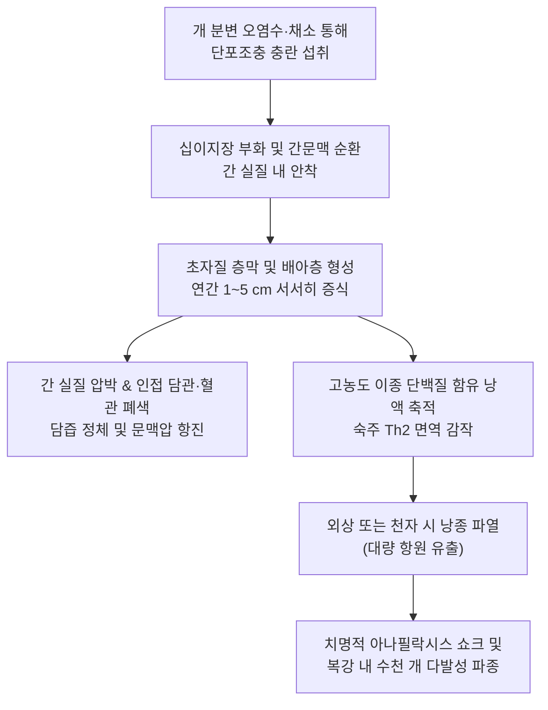
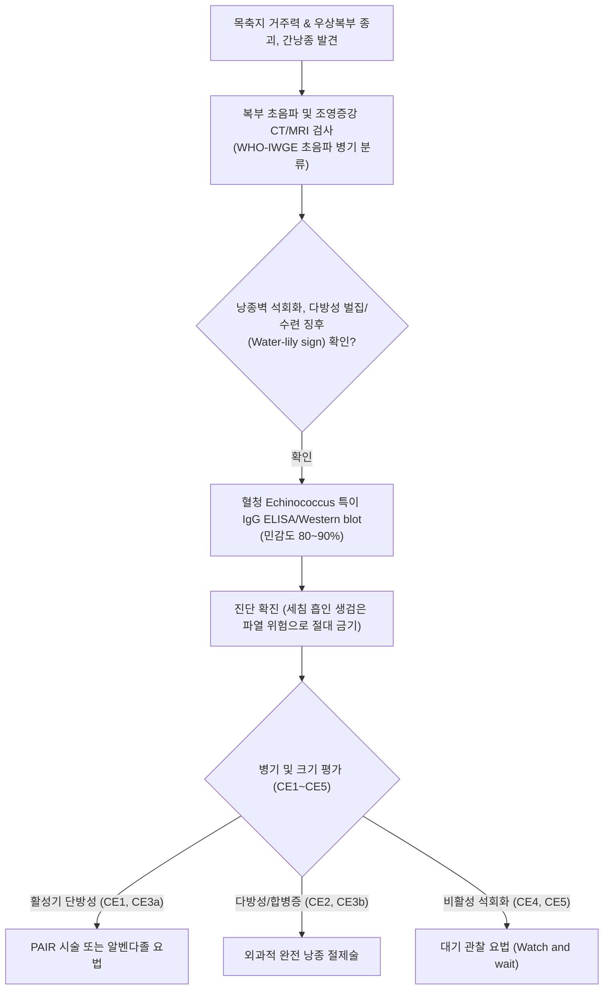

# 🩺 포충증

> **핵심 3줄 요약 (Key Summary)**:
> - 📍 병소 부위 & 해부·병태생리: 개과 동물이 종숙주인 단포조충(*Echinococcus granulosus*) 또는 다포조충(*Echinococcus multilocularis*) 충란 섭취 시 간(약 70%), 폐(약 20%), 뇌, 골격에 형성되는 서서히 증식하는 기생충성 낭종성 병변.
> - 🚩 전형적 임상 양상: 수년~수십 년간 무증상으로 잠복하다가 낭종 증대에 따른 우상복부 둔통, 간비대, 담도 압박성 [[황달]], 폐 침범 시 기침, 흉통, 객혈 유발.
> - 🛠️ 핵심 검사 & 치료 전략: 복부 초음파(Gharbi/WHO 분류: 수포성 낭종, 바퀴살/수련 징후, 석회화 벽), 복부 CT/MRI, 혈청 Echinococcus 특이 IgG ELISA; 1차 약물 알벤다졸(Albendazole $10\sim 15\text{ mg/kg/day}$), 경피적 흡인 주입 재흡인술(PAIR) 또는 외과적 낭종 적출술.
> - ⚠️ 응급 의뢰 레드플래그: 낭종 파열에 따른 급격한 저혈압 쇼크 및 아나필락시스 반응, 복강/흉강 내 파종성 이차 포충증 파열, 담도 파열로 인한 급성 화농성 담관염.

---

## 📌 목차
1. [질환 개요 & 해부학적 병태생리](#1-질환-개요--해부학적-병태생리)
2. [병태생리 메커니즘 & 생체역학적 악순환 네트워크](#2-병태생리-메커니즘--생체역학적-악순환-네트워크)
3. [임상 증상 & 이학적 검사(Physical Exam) 알고리즘](#3-임상-증상--이학적-검사physical-exam-알고리즘)
4. [감별 진단 매트릭스 (Differential Diagnosis)](#4-감별-진단-매트릭스--differential-diagnosis)
5. [한의 통합 치료 프로토콜 (침·약침·추나·한약)](#5-한의-통합-치료-프로토콜--침약침추나한약)
6. [양방 치료 & 병용·의뢰 기준 (Conventional Treatment & Referral)](#6-양방-치료--병용의뢰-기준-conventional-treatment--referral)
7. [재활 운동 & 생활습관 티칭 가이드](#7-재활-운동--생활습관-티칭-가이드)
8. [💡 사용자 진료실 핵심 필기 & 임상 노하우 (Melt-In 잔여 심화 집약)](#8--사용자-진료실-핵심-필기--임상-노하우--melt-in-잔여-심화-집약)
9. [출처 및 학술 참고 문헌 (References)](#9-출처-및-학술-참고-문헌--references)

---

## 1. 질환 개요 & 해부학적 병태생리

**포충증(Echinococcosis)**, 또는 **포충낭종증(Hydatid Disease)**은 조충류인 에키노코쿠스속(*Echinococcus* spp.)의 유충(포충)에 의해 유발되는 치명적인 인수공통 기생충 감염증이다. 형태학적 및 병태생리학적으로 크게 **낭포성 포충증(Cystic echinococcosis, CE - *E. granulosus*)**과 악성 종양처럼 침윤성 증식을 보이는 **다포성 포충증(Alveolar echinococcosis, AE - *E. multilocularis*)**으로 구분된다. 중앙아시아, 중동, 지중해 분지, 남미, 중국 서부 등 목축업이 성행하는 지역의 주요 풍토병이며, 국내에서는 유행 지역 여행객이나 해외 이주민을 통해 보고되는 해외 유입 감염병이다.

종숙주(개, 늑대, 여우)의 분변에 배출된 충란을 중간숙주(양, 소, 설치류)나 인간이 우발적으로 경구 섭취하면, 소장에서 육구유충(Oncosphere)이 부화하여 장점막을 뚫고 간문맥계로 유입된다. 가장 먼저 도달하는 간(전체의 약 $70\%$)의 모세혈관망에 걸려 낭종을 형성하며, 일부는 간을 통과하여 하대정맥을 타고 폐(약 $20\%$), 뇌, 신장, 비장, 뼈로 전이된다. 낭종은 외측의 숙주 반응성 섬유성 피막(Pericyst), 중간의 무핵성 초자질 층막(Laminated membrane), 내측의 배아층(Germinal layer)으로 구성된 3중벽 구조를 이루며, 배아층에서 무수한 원두절(Protoscolices)과 수포성 낭(Brood capsules)이 증식하여 '포충 모래(Hydatid sand)'가 낭액 속에 부유한다.

---

## 2. 병태생리 메커니즘 & 생체역학적 악순환 네트워크

포충낭은 매년 $1\sim 5\text{ cm}$씩 수년에 걸쳐 서서히 자라며 주변 정상 간세포를 압박 괴사시킨다. 낭포성 포충증은 팽창성 성장을 하여 피막이 잘 유지되지만, 다포성 포충증은 외피층이 불완전하여 낭포 싹(Budding)이 간 실질로 무제한 침윤하고 혈관과 담관을 파괴하며 간부전 및 원격 전이를 일으켜 간암과 유사한 치명적 경과를 밟는다. 낭포 내부 액체는 독성이 강한 이종 단백질을 다량 함유하고 있어, 외상이나 부적절한 천자로 인해 낭액이 복강이나 흉강으로 누출되면 비만세포의 폭발적 탈과립으로 즉각적인 아나필락시스 쇼크를 유발하며, 유출된 원두절이 전신으로 퍼져 다발성 이차 포충증을 형성하는 치명적 악순환을 유발한다.

---

## 3. 임상 증상 & 이학적 검사(Physical Exam) 알고리즘

### 주요 임상 증상
- **간 포충증**: 우상복부의 둔한 통증, 촉진 시 부드럽고 둥근 무통성 거대 종괴, 간비대. 낭종이 담관을 압박하거나 담도로 파열될 경우 산통, [[황달]], [[발열]], 담관염 징후.
- **폐 포충증**: 만성 기침, 호흡곤란, 흉통, 객혈. 낭종이 기관지로 파열될 경우 짠맛이 나는 다량의 포충 낭액과 포도 껍질 같은 낭벽 조각을 기침과 함께 객출(Hydatidoptysis).
- **뇌 포충증**: 두통, 구토, 유두부종 등 두개내압 항진 징후, 뇌전증 발작, 국소 신경 마비.
- **골 포충증**: 골소주 침식에 따른 병적 골절 및 척수 압박.
- **파열 합병증**: 낭종 파열 시 전신 두드러기, 홍조, 기관지 연축, 청색증, 혈압 급강하.

### 진단 알고리즘

---

## 4. 감별 진단 매트릭스 (Differential Diagnosis)

| 감별 질환 | 병인 및 특성 | 영상의학적 소견 (초음파/CT) | 혈청학 및 생검 소견 | 치료 접근법 |
| :--- | :--- | :--- | :--- | :--- |
| **포충증 (간포충낭종)** | *Echinococcus* 조충 유충 | 벽 석회화, 낭포 내 낭포(Daughter cysts), 수련 징후 | 생검 금기, Echinococcus IgG 양성 | 알벤다졸, PAIR 시술, 낭종 절제술 |
| **단순 간낭종 (Simple hepatic cyst)** | 선천성 담관 상피 기원 | 얇고 매끄러운 단일벽, 내부 무음영, 격벽 없음 | 혈청 항체 음성, 무증상 시 치료 불필요 | 경과 관찰, 거대 낭종 시 경피적 알코올 경화요법 |
| **화농성 간농양 (Pyogenic abscess)** | *K. pneumoniae*, *E. coli* 등 | 두꺼운 조영증강 벽, 내부 가스 음영 및 찌꺼기 | 혈액 백혈구/CRP 극상승, 혈액 배양 양성 | 경피적 배액술 및 정맥 항생제 |
| **아메바성 간농양** | *Entamoeba histolytica* | 주로 우엽 단일 농양, 초콜릿색 농양액 | 아메바 혈청 항체 양성, 충란 음성 흔함 | 메트로니다졸 경구 투여 |
| **낭성 간암 / 간세포암종** | 악성 상피 종양 | 불규칙한 두꺼운 결절성 벽, 조영 증강 소견 | AFP 상승, B/C형 간염 기저, 조직 생검 확진 | 간 부분 절제술, 항암화학요법 |

---

## 5. 한의 통합 치료 프로토콜 (침·약침·추나·한약)

> ⚠️ 포충증은 낭종 파열 시 치명적 쇼크를 유발할 수 있으므로 양방 외과적 절제, PAIR 시술 및 알벤다졸 항원충 치료가 절대적 표준이다. 복강 내 직접 자침이나 복부 강자극은 낭종 파열을 일으킬 수 있어 절대 금기이다. 한의 치료는 수술 및 항원충 화학요법 후의 간기능 회복, 면역 기능 재건, 만성 소화불량 및 피로를 완화하는 보완 지지요법으로 한정한다.

### 1) 한약 처방 (수술/구충 후 회복 지지요법)
- **간울비허증 (肝鬱脾虛證 - 구충 후 지속되는 우협부 팽만, 소화불량, 식욕부진, 피로)**:
  - 처방: [[소시호탕]] 합 [[삼령백출산]] 가감 ([[시호]], [[황금]], [[인삼]], [[반하]], [[백출]], [[복령]], [[산약]], [[진피]], [[감초]]).
  - 약리 기전: 시호-황금의 간세포 보호 및 만성 염증 신호 억제, 백출-산약의 비위 소화기능 강화 및 알벤다졸 간독성 완화.
- **간담습열 및 어혈증 (肝膽濕熱 瘀血證 - 담즙 정체 후유증, 황달 잔여, 협통)**:
  - 처방: [[인진호탕]] 합 [[혈부축어탕]] 가감 ([[인진호]], [[치자]], [[대황]], [[단삼]], [[적작약]], [[당귀]], [[시호]]).
  - 작용: 담즙 산 분비 촉진 및 간 실질 섬유화 진행 억제.
- **기혈양허증 (氣血兩虛證 - 수술 후 체력 저하, 만성 빈혈, 면역 저하)**:
  - 처방: [[보중익기탕]] 가미 ([[황기]], [[인삼]], [[백출]], [[당귀]], 승마, 시호).
  - 목적: 숙주 세포성 면역 환경을 강화하여 잔여 충체의 재발 억제 보조.

### 2) 침구 치료
- **혈위**: 족삼리(ST36), 양릉천(GB34), 삼음교(SP6), 태충(LR3), 내관(PC6), 곡지(LI11).
- **시술 지침**: 간낭종이 존재하는 우상복부 및 복벽에는 어떠한 침습적 자침도 절대 금기(낭종 천자 위험 방지). 사지 말단의 원격 혈위 위주로 부드럽게 자침함.

---

## 6. 양방 치료 & 병용·의뢰 기준 (Conventional Treatment & Referral)

### 양방 표준 치료 가이드라인 (WHO-IWGE)
1. **화학요법 (Anthelmintic chemotherapy)**:
   - **알벤다졸 (Albendazole)**: $10\sim 15\text{ mg/kg/day}$를 2회 분할 식후 복용. 수술 전 1개월부터 투여하여 낭액 내 충체 생존력을 떨어뜨리고, 수술 후 1~3개월간 지속하여 파종 재발 방지.
2. **PAIR 시술 (Puncture, Aspiration, Injection, Re-aspiration)**:
   - 적응증: 초음파 유도하에 경피적으로 낭종을 천자하여 낭액을 흡인하고, 살원충제(고농도 $20\%$ 식염수 또는 $95\%$ 에탄올)를 주입 후 15분 뒤 재흡인하는 최소 침습 시술 (CE1, CE3a 병기).
3. **외과적 수술 (Surgical treatment)**:
   - 완전 낭종 적출술(Total pericystectomy) 또는 간 부분 절제술. 낭종 내용물이 수술 시야에 쏟아지지 않도록 고농도 식염수 거즈로 완벽히 차폐 후 시행.

### 긴급 응급 의뢰 레드플래그
- 갑작스러운 복부 팽만과 함께 발생하는 전신 두드러기, 호흡곤란, 저혈압 쇼크(낭종 자연/외상성 파열).
- $39^\circ\text{C}$ 이상의 고열과 심한 오한, 급격한 황달(낭종 담도 파열 및 화농성 담관염).
- 흉통 후 다량의 짠맛 낭액 및 각피상 물질을 기침으로 토해내는 경우(폐낭종 기관지 파열).

---

## 7. 재활 운동 & 생활습관 티칭 가이드

- **복부 외상 절대 주의**: 간낭종을 진단받은 환자는 축구, 격투기, 무거운 물건 들기 등 복부에 강한 충격이나 압박을 가할 수 있는 모든 활동을 엄격히 금지함(경미한 충격에도 낭종이 파열되어 쇼크사할 위험).
- **개과 동물 접촉 및 위생**: 목축지나 시골 개와 접촉 후 반드시 비누로 손을 철저히 씻고, 개에게 익히지 않은 가축 내장을 먹이지 않도록 지도함.
- **음용수 및 채소 위생**: 야외 개울물이나 생수를 끓이지 않고 마시는 행위를 금하며, 노지 채소는 흙을 완전히 씻어내고 익혀서 섭취함.
- **정기 영상 추적**: 치료 종료 후에도 수년간 재발 여부를 감시하기 위해 6개월~1년 주기로 복부 초음파 및 혈청 검사를 지속함.

---

## 8. 💡 사용자 진료실 핵심 필기 & 임상 노하우 (Melt-In 잔여 심화 집약)

> 💡 **임상 핵심 진주 (Clinical Pearls)**:
> - **'간낭종을 바늘로 찌르는 순간 환자가 사망할 수 있다'**: 건강검진 초음파에서 간낭종이 발견되었을 때, 단순 물혹으로 오인하고 침습적 생검이나 배액을 시도하면 포충낭 파열로 인한 치명적 아나필락시스 쇼크가 발생한다. 환자가 몽골, 중국 신장, 중앙아시아, 중동 체류력이 있다면 반드시 포충증을 의심하고 세침 흡인을 절대 금해야 한다.
> - **수련 징후(Water-lily sign)의 병리학적 의미**: 초음파나 CT에서 낭종 내부에 떠다니는 물결 모양의 막 구조물(Water-lily sign)은 낭종 내피세포인 층막이 파열되어 낭액 속에 쭈글쭈글하게 부유하는 결정적 영상 소견이다. 이 소견이 보이면 포충증으로 확진할 수 있다.
> - **폐 포충증의 기침 양상**: 폐에 생긴 낭종이 기관지를 뚫고 터지면 환자는 "기침할 때 갑자기 짭짤하고 비린 물이 쏟아져 나오면서 포도 껍질 같은 하얀 찌꺼기가 나왔다"고 표현한다. 이는 매우 특이적인 포충증 파열 소견이다.
> - **알벤다졸 복용 시 지방식 병용**: 알벤다졸은 지용성 약물로 장관 흡수율이 $5\%$ 미만으로 매우 낮다. 포충낭 내로 충분한 약물 농도를 침투시키기 위해서는 반드시 기름진 음식이나 우유와 함께 복용하도록 환자에게 복약 지도해야 한다.

---

## 9. 출처 및 학술 참고 문헌 (References)

- He P, et al. (2026). Hepatic alveolar echinococcosis-induced IL-23 maintains Th17/Treg homeostasis via the JAK2/STAT3 signaling pathway. *Int Immunopharmacol*. PMID: 42966127.

- Mosawi SH, et al. (2026). Cystic echinococcosis in Afghanistan: addressing evidence gaps through regional one health collaboration with WHO EMRO. *Trans R Soc Trop Med Hyg*. PMID: 42931792.

- Ekemen Keleş S, et al. (2026). Organ-Specific Clinical Patterns of Pediatric Cystic Echinococcosis: A Multicenter Cohort from an Endemic Region. *Trop Med Infect Dis*. PMID: 42931468.
