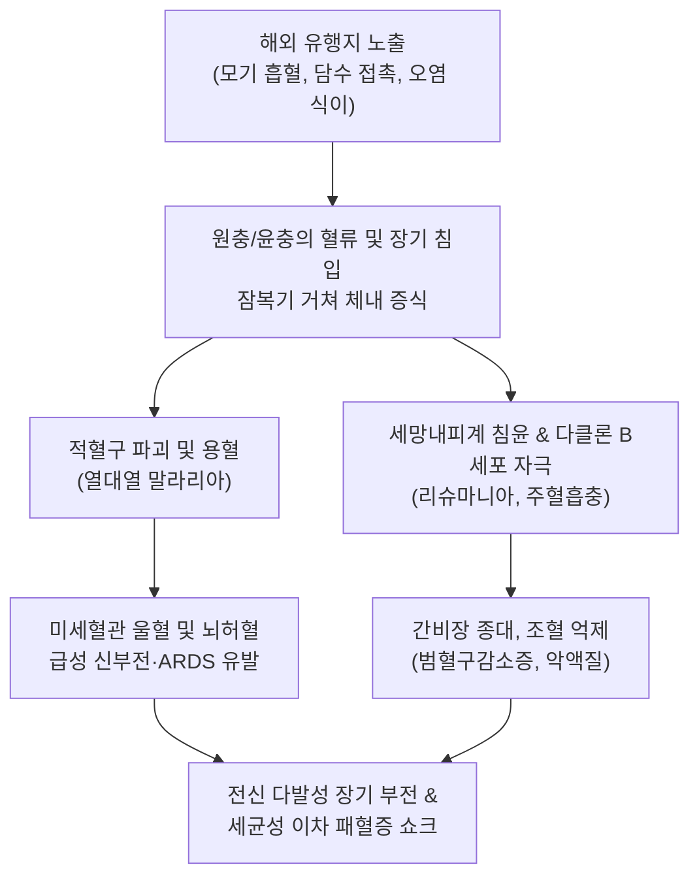
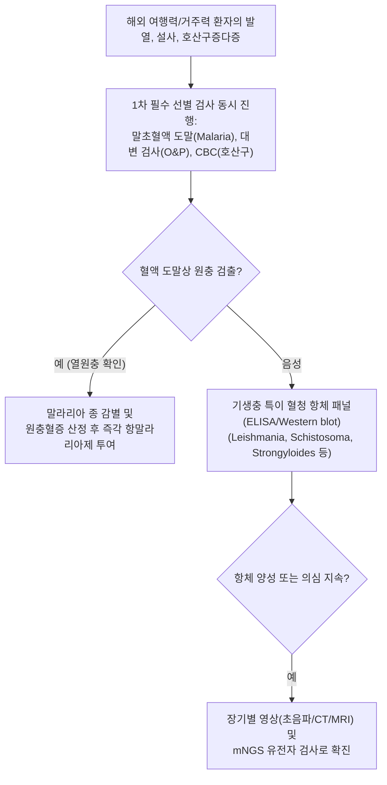

# 🩺 해외유입기생충감염증

> **핵심 3줄 요약 (Key Summary)**:
> - 📍 병소 부위 & 해부·병태생리: 해외 열대·아열대 유행 지역 여행객 및 이주민에서 유입되는 기생충 질환군으로, 열대열 [[말라리아]](적혈구계), [[주혈흡충증]](문맥/방광 정맥총), [[리슈만편모충증]](세망내피계), [[샤가스병]](심근/신경총), 분선충증 및 장내 원충 감염을 총괄.
> - 🚩 전형적 임상 양상: 귀국 후 수일~수개월 내 발생하는 원인 불명의 급만성 [[발열]], 만성 혈변성 [[설사]], 복통, 간비대 및 [[비장 비대]], [[빈혈]], 심한 호산구 증가증, 피부 결절.
> - 🛠️ 핵심 검사 & 치료 전략: 말초혈액 후막/박막 도말 검사, 대변 기생충란/원충 도말 및 농축 검사, 기생충 특이 혈청 IgG 항체 스크리닝(ELISA/Western blot), metagenomic NGS(mNGS); 원인 병원체별 표적 항기생충제(아르테미시닌 복합제, 프라지콴텔, 리포좀 암포테리신 B, 이베르멕틴) 투여.
> - ⚠️ 응급 의뢰 레드플래그: 중증 열대열 말라리아(의식 혼돈, 급성 신부전, 폐부종, 헤모글로빈 < 7 g/dL), 면역저하자의 파종성 분선충 과다감염 증후군(패혈성 쇼크), 아나필락시스 반응.

---

## 📌 목차
1. [질환 개요 & 해부학적 병태생리](#1-질환-개요--해부학적-병태생리)
2. [병태생리 메커니즘 & 생체역학적 악순환 네트워크](#2-병태생리-메커니즘--생체역학적-악순환-네트워크)
3. [임상 증상 & 이학적 검사(Physical Exam) 알고리즘](#3-임상-증상--이학적-검사physical-exam-알고리즘)
4. [감별 진단 매트릭스 (Differential Diagnosis)](#4-감별-진단-매트릭스--differential-diagnosis)
5. [한의 통합 치료 프로토콜 (침·약침·추나·한약)](#5-한의-통합-치료-프로토콜--침약침추나한약)
6. [양방 치료 & 병용·의뢰 기준 (Conventional Treatment & Referral)](#6-양방-치료--병용의뢰-기준-conventional-treatment--referral)
7. [재활 운동 & 생활습관 티칭 가이드](#7-재활-운동--생활습관-티칭-가이드)
8. [💡 사용자 진료실 핵심 필기 & 임상 노하우 (Melt-In 잔여 심화 집약)](#8--사용자-진료실-핵심-필기--임상-노하우--melt-in-잔여-심화-집약)
9. [출처 및 학술 참고 문헌 (References)](#9-출처-및-학술-참고-문헌--references)

---

## 1. 질환 개요 & 해부학적 병태생리

**해외유입기생충감염증(Imported Parasitic Infections)**은 국제 교류, 해외여행, 파견 근무, 이민의 증가로 인해 국내 비풍토성 기생충이 체내에 감염된 상태로 귀국하여 발병하는 외래 기생충 질환군을 포괄한다. 질병관리청(KDCA) 감시 체계의 핵심 관리 대상이며, 원인체는 원충류(Protozoa: *Plasmodium* 열원충, *Leishmania*, *Trypanosoma*, *Entamoeba*, *Giardia* 등)와 윤충류(Helminths: *Schistosoma* 주혈흡충, *Strongyloides* 분선충, *Fasciola*, *Gnathostoma* 등)로 광범위하다.

병원체의 전파 경로는 모기, 진드기, 파리 등 절지동물 매개 흡혈, 오염된 음식물 및 식수 섭취, 오염된 담수와의 피부 접촉, 토양 유충의 피부 직접 관통 등으로 다양하다. 인체 내에서 적혈구 파괴(말라리아), 세망내피계 대식세포 증식(내장형 리슈마니아증), 간문맥 및 방광 정맥벽 만성 육아종 형성(주혈흡충증), 심근 및 소화관 신경총 변성(샤가스병) 등 장기 특이적 병변을 유발하며, 면역 억제 상태에서는 분선충 과다감염증(Hyperinfection syndrome)처럼 체내 자가증식을 통해 전신 장기 부전으로 급격히 악화될 수 있다.

---

## 2. 병태생리 메커니즘 & 생체역학적 악순환 네트워크

해외유입 기생충의 공통 병태생리적 특징은 숙주 면역계를 교란하는 정교한 면역 회피 전략(Antigenic variation, 세포내 기생, 면역억제 사이토카인 분비)이다. 진단이 지연될 경우 원충 및 충란의 축적으로 비가역적 장기 손상이 발생한다. 특히 열대열 말라리아의 경우 감염 적혈구가 혈관 내피세포에 부착(Sequestration)되어 뇌, 신장, 폐의 미세순환을 전면 차단함으로써 뇌성 말라리아와 다발성 장기 부전의 치명적 악순환으로 직결된다.

---

## 3. 임상 증상 & 이학적 검사(Physical Exam) 알고리즘

### 주요 임상 증상군
- **열성 증상군 (Febrile syndrome)**:
  - 아프리카, 동남아 여행 후 발생하는 급성 고열, 오한, 두통: 1순위 열대열 [[말라리아]], 바베시아증, 급성 [[주혈흡충증]](카타야마열).
  - 수주~수개월 이상 지속되는 불규칙한 만성 고열, 현저한 [[비장 비대]], 피부 흑화: 내장형 [[리슈만편모충증]].
- **위장관 증상군 (Gastrointestinal syndrome)**:
  - 만성 점액혈변, 복통, 후중감: 아메바성 이질, 만손주혈흡충증, 편충증.
  - 흡수장애성 수양성 설사, 복부 팽만, 영양실조: 람블편모충증, 장흡충증.
- **호산구증다증 및 피부/신경 증상군**:
  - 혈액 호산구 극상승을 동반한 이동성 피하 부종: 악구충증, 스파르가눔증.
  - 호산구성 뇌수막염(극심한 두통, 피부 이질통): 광동주혈선충증.
  - 무통성 종말 혈뇨: 방광주혈흡충증.

### 진단 알고리즘

---

## 4. 감별 진단 매트릭스 (Differential Diagnosis)

| 감별 질환 | 주요 위험 지역 및 매개체 | 전형적 증상 및 징후 | 핵심 검사 소견 | 치료 표준 약제 |
| :--- | :--- | :--- | :--- | :--- |
| **열대열 [[말라리아]]** | 사하라 이남 아프리카, 모기 | 고열, 오한, 두통, 황달, 급격한 악화 | 혈액 도말상 링 폼, RDT 양성, 혈소판 감소 | 아르테수네이트 주사 또는 코아템 경구 |
| **내장형 [[리슈만편모충증]]** | 인도, 방글라데시, 모래파리 | 만성 발열, 거대 비장비대, 피부 흑화 | 범혈구감소증, 골수 도말상 LD body, rK39 양성 | 리포좀 암포테리신 B, 밀테포신 |
| **만성 [[주혈흡충증]]** | 아프리카 호수/강, 유미유충 | 문맥 섬유화, 식도정맥류 출혈, 혈뇨 | 대변/소변 충란(가시 형태), 간 초음파 | 프라지콴텔 $40\sim 60\text{ mg/kg}$ |
| **장티푸스 (*S. typhi*)** | 동남아 오염 식수/음식 | 계단식 발열, 서맥, 장미진, 비장비대 | 혈액 배양 검사 양성, 백혈구 감소 | 세프트리악손, 아지트로마이신 |
| **[[뎅기열]]** | 동남아, 중남미, 숲모기 | 고열, 심한 안와통, 뼈 부서지는 근육통, 발진 | 백혈구/혈소판 감소, 뎅기 NS1 항원 양성 | 수액 요법, 대증 치료 |

---

## 5. 한의 통합 치료 프로토콜 (침·약침·추나·한약)

> ⚠️ 해외유입 기생충 질환은 진행 속도가 빠르고 치명률이 높은 급성 열원충 및 침습적 감염증이 다수 포함되어 있으므로, 감염내과적 정확한 병원체 진단과 표준 항기생충제 투여가 선행되어야 한다. 한의 치료는 급성 감염 치료 후 발생하는 조혈계 부전, 간비장 기능 저하, 만성 흡수 장애 및 면역 저하를 극복하기 위한 지지요법으로 시행한다.

### 1) 한약 처방 (회복기 면역 재건 지지요법)
- **온열여독 및 음허내열증 (溫熱餘毒 陰虛內熱證 - 말라리아/열병 회복 후 잔여 미열, 구갈, 피로)**:
  - 처방: [[자음강화탕]] 또는 [[생맥산]] 가감 ([[청호]], [[별갑]], [[생지황]], [[지모]], [[목단피]], [[인삼]], [[맥문동]], [[오미자]]).
  - 약리 기전: 청호의 항염증 및 잔여 원충 억제 작용, 별갑-생지황의 골수 미세환경 보호 및 면역 조절.
- **기혈양허 및 징하비대증 (氣血兩虛 癥瘕脾大證 - 만성 빈혈, 비장비대, 전신 쇠약)**:
  - 처방: [[보중익기탕]] 합 당귀보혈탕 가감 ([[황기]], [[인삼]], [[백출]], [[당귀]], [[복령]], [[천궁]], [[적작약]], [[시호]]).
  - 학술 근거: 황기-인삼 성분이 면역글로불린 정상화 및 비장 울혈 완화 지원.
- **장위습열 및 만성설사증 (腸胃濕熱 慢性泄瀉證 - 기생충 박멸 후 잔여 장염, 소화불량)**:
  - 처방: [[삼령백출산]] 합 [[평위산]] 가감 ([[인삼]], [[백출]], [[복령]], [[산약]], [[진피]], [[후박]], [[창출]], [[감초]]).
  - 작용: 장관 점막 상피화 촉진 및 장내 미생물총 균형 재건.

### 2) 침구 치료
- **혈위**: 족삼리(ST36), 삼음교(SP6), 비수(BL20), 간수(BL18), 합곡(LI4), 태충(LR3), 중완(CV12).
- **시술 지침**: 거대 비장비대가 동반된 환자의 복부 자침은 금기이며, 사지 원격 혈위 위주로 부드럽게 자침함.

---

## 6. 양방 치료 & 병용·의뢰 기준 (Conventional Treatment & Referral)

### 양방 표준 치료 원칙
1. **병원체별 표적 항기생충제 즉각 투여**:
   - 말라리아: 아르테수네이트(Artesunate IV) 또는 경구 아르테메터/루메판트린(Coartem).
   - 주혈흡충증/장흡충증: 프라지콴텔(Praziquantel).
   - 리슈만편모충증: 리포좀 암포테리신 B 또는 밀테포신.
   - 분선충증/악구충증: 이베르멕틴(Ivermectin).
   - 아메바증: 메트로니다졸 후 파로모마이신.
2. **다제내성 감시**:
   - 동남아 및 아프리카 유입 말라리아의 Kelch13 유전자 돌연변이(아르테미시닌 내성) 모니터링.

### 긴급 응급 의뢰 레드플래그
- 열대열 말라리아 의심 환자의 의식 혼탁, 경련, 기면(뇌성 말라리아 전조).
- 중증 빈혈(Hb $< 7\text{ g/dL}$), 혈소판 $< 20,000/\mu\text{L}$, 자발성 출혈.
- 소변량 급감(핍뇨), 혈청 크레아티닌 급상승, 호흡곤란(ARDS 징후).
- 식도정맥류 파열에 의한 토혈, 흑색변, 혈압 급강하.

---

## 7. 재활 운동 & 생활습관 티칭 가이드

- **출국 전 여행자 클리닉 상담**: 열대 지역 출국 $4\sim 6\text{주}$ 전 여행의학 클리닉을 방문하여 유행 지역 맞춤형 예방약(말라리아 예방약 아토바쿠온/프로구아닐 또는 독시사이클린)을 처방받고 황열, 장티푸스 백신을 접종함.
- **물과 음식 섭취 3대 수칙 (Boil it, cook it, peel it, or forget it)**: 반드시 끓인 물이나 밀봉된 생수만 마시고, 얼음, 길거리 생과일 주스, 날채소, 덜 익힌 육류와 어패류 섭취를 엄격히 금함.
- **모기 및 곤충 회피 철저**: DEET $30\%$ 함유 기피제 도포, 긴 소매 의복 착용, 페르메트린 처리 모기장 사용.
- **귀국 후 자가 모니터링**: 유행 지역 방문 후 최대 1년 이내에 발생하는 원인 불명의 발열이나 설사는 즉시 의사에게 여행력을 알리고 진료를 받도록 교육함.

---

## 8. 💡 사용자 진료실 핵심 필기 & 임상 노하우 (Melt-In 잔여 심화 집약)

> 💡 **임상 핵심 진주 (Clinical Pearls)**:
> - **'열대열 말라리아의 골든타임은 24시간이다'**: 아프리카나 동남아를 다녀온 환자가 열이 난다면 '감기'나 '단순 피로'로 넘겨짚어서는 절대 안 된다. 열대열 말라리아는 발열 시작 후 24~48시간 이내에 뇌성 마비나 다발성 장기 부전으로 급격히 사망할 수 있으므로, 당일 즉시 말초혈액 도말 검사와 RDT 검사가 가능한 응급 의료기관으로 보내야 한다.
> - **여행력 문진의 디테일**: 단순한 방문 국가명뿐 아니라 "도시 호텔에만 머물렀는지, 시골 농촌이나 정글을 갔는지, 담수 호수에 발을 담갔는지, 날음식을 먹었는지" 등 구체적 노출 활동을 역학적으로 파악해야 주혈흡충, 악구충, 분선충 등을 감별할 수 있다.
> - **호산구 수치는 윤충 감염의 경보등**: 원충(말라리아, 아메바)은 호산구를 잘 올리지 않지만, 조직을 침범하는 윤충(악구충, 주혈흡충, 분선충)은 호산구 수치를 수천 단위로 폭증시킨다. 설명되지 않는 극심한 호산구증다증은 해외 유입 윤충증의 강력한 지표이다.
> - **면역저하자에서의 분선충 과다감염 주의**: 과거 동남아나 남미 거주력이 있는 환자에게 고용량 스테로이드나 면역억제제를 투여할 경우, 체내에 잠복해 있던 분선충이 폭발적으로 증식하여 장내 세균을 뇌와 전신으로 몰고 가는 치명적 과다감염 증후군(Hyperinfection syndrome)을 유발하므로, 투약 전 분선충 혈청 항체 검사가 필수적이다.

---

## 9. 출처 및 학술 참고 문헌 (References)

- Zeng Y, et al. (2026). Metagenomic next-generation sequencing rescues a case of imported visceral leishmaniasis masquerading as hemophagocytic lymphohistiocytosis. *Trop Biomed*. PMID: 42960658.

- Du Y, et al. (2026). Interpreting imported malaria genomes: population-genomic sensitivity analyses of West Africa-associated Plasmodium falciparum isolates detected in China. *Front Cell Infect Microbiol*. PMID: 42935501.

- Kasongo NA, et al. (2026). Delayed presentation of intraocular pentastomiasis resulting in unilateral blindness in a Congolese child. *J AAPOS*. PMID: 42946152.
