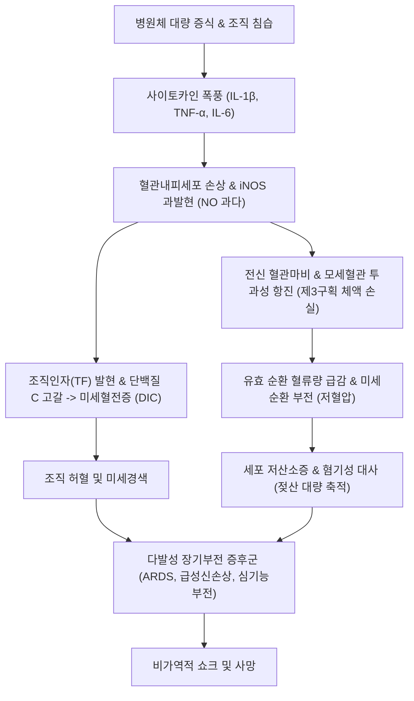

# 🩺 [[감염]] (Infection / 感染, ICD-10: B99 / KCD: B99)

> **핵심 3줄 요약 (Key Summary)**:
> - 📍 **병소 부위 & 병태생리**: 병원체(세균, 바이러스, 진균, 원충)의 피부·점막 장벽 침입, 조직 정착 및 증식과 이에 대응하는 숙주 방어계([[선천면역]] PRR-TLR, [[보체계]], [[적응면역]] T/B세포)의 국소 및 전신 면역-염증 연쇄 반응.
> - 🚩 **전형적 임상 양상 & 3대 징후**: [[발열]](Fever) 및 오한(Chills), 국소 염증의 4대 징후(발적, 종창, 열감, 동통)와 전신성 빈맥·빈호흡, 급성기 반응 물질(CRP, Procalcitonin) 및 백혈구 수치 이상.
> - 🛠️ **핵심 감별 & 한·양방 치료 전략**: 비감염성 전신 염증 반응([[전신 염증 반응 증후군|SIRS]]) 및 자가면역 질환과의 감별, 경험적 광범위 항균제 즉각 투여 후 배양·항균제 감수성 검사(AST) 기반 표적 항균제 전환, 한의학적 온병(溫病) [[위기영혈 변증]] 및 상한 [[육경변증]]에 기반한 [[은교산]], [[백호탕]], [[청영탕]], [[청호별갑탕]]과 구급·사열 침구 치료([[십선혈]], [[대추(GV14)]], [[곡지(LI11)]], [[합곡(LI4)]]) 병용.
> - <font color="#fa7e7e">⚠️ **응급 의뢰 레드플래그**: [[패혈증]](Sepsis-3: 감염 의심 + SOFA 점수 ≥ 2점 증가), [[패혈성 쇼크]](승압제 투여에도 MAP < 65 mmHg 지속 및 혈청 젖산 > 2 mmol/L), 급격한 의식 저하(GCS < 15), 파종성 혈관내 응고([[파종성 혈관내 응고|DIC]]) 출혈 징후.</font>

---

## 📌 목차
1. [질환 개요 & 병태생리 (Disease Overview)](#1-질환-개요--병태생리-disease-overview)
2. [병태생리 메커니즘 & 대사·장기부전 악순환 네트워크](#2-병태생리-메커니즘--대사장기부전-악순환-네트워크)
3. [임상 증상 & 환자 소견 (Clinical Presentation)](#3-임상-증상--환자-소견-clinical-presentation)
4. [감별 진단 매트릭스 (Differential Diagnosis)](#4-감별-진단-매트릭스-differential-diagnosis)
5. [한의 통합 치료 프로토콜 (침·약침·한약)](#5-한의-통합-치료-프로토콜-침약침한약)
6. [양방 치료 & 병용·의뢰 기준 (Conventional Treatment & Referral)](#6-양방-치료--병용의뢰-기준-conventional-treatment--referral)
7. [식이·생활습관 & 자가관리 티칭 가이드](#7-식이생활습관--자가관리-티칭-가이드)
8. [💡 진료실 핵심 필기 & 임상 노하우](#8--진료실-핵심-필기--임상-노하우)
9. [출처 및 학술 참고 문헌 (References)](#9-출처-및-학술-참고-문헌-references)

---

## 1. 질환 개요 & 병태생리 (Disease Overview)

* **질환 정의 및 개념적 구분**:
  * **감염(Infection)**이란 병원성 미생물(세균, 바이러스, 진균, 원충, 기생충 등)이 감수성이 있는 숙주(Host)의 체내로 침입(Invasion)하여, 특정 조직에 정착(Establishment)하고 증식(Multiplication)함으로써 숙주와 미생물 사이에 상호작용이 일어나는 동적 생물학적 과정을 의미한다.
  * **정상 상재균총(Normal Microbiota)**: 인체 피부, 구강, 소화관, 질 점막 등에 공생하며 외인성 병원균의 정착을 방어하는 상재 세균군.
  * **보균 및 집락 형성(Colonization)**: 미생물이 숙주 조직에 정착하여 증식하나 조직 손상, 기능 부전 또는 뚜렷한 숙주 면역반응(증상)을 유발하지 않는 상태.
  * **감염 질환(Infectious Disease)**: 증식한 병원체 또는 병원체가 분비하는 독소(Toxins)에 의해 숙주의 세포·조직이 실질적으로 손상되고, 이에 따른 염증 반응 및 임상 증상(발열, 백혈구 증가 등)이 객관적으로 발현된 병적 상태.
  * **불현성 감염(Subclinical / Inapparent Infection)**: 감염이 성립하여 면역학적 반응(항체 생성 등)은 유도되었으나 자각적·타각적 증상이 발현되지 않는 잠재 상태.

* **병원체 유형별 분류 및 생물학적 특성**:
  1. **세균(Bacteria)**: 단세포 원핵생물.
     - 그람양성 구균([[황색포도구균|Staphylococcus aureus]], [[화농성연쇄구균|Streptococcus pyogenes]], [[폐렴구균|Streptococcus pneumoniae]]): 두꺼운 펩티도글리칸(Peptidoglycan) 층과 테이코산(Teichoic acid) 보유, 외독소(Exotoxin) 분비.
     - 그람음성 간균([[대장균|Escherichia coli]], [[녹농균|Pseudomonas aeruginosa]], [[폐렴간균|Klebsiella pneumoniae]]): 외막(Outer membrane)에 내독소인 지질다당류([[지질다당류|Lipopolysaccharide, LPS]])를 보유하여 강력한 패혈성 염증 유발.
     - 혐기성균([[바실루스|Bacteroides fragilis]], [[클로스트리디움|Clostridium difficile]]): 심부 농양 및 가스 괴저 유발.
     - 비정형 세균([[마이코플라스마|Mycoplasma pneumoniae]], [[클라미디아|Chlamydia pneumoniae]], [[레지오넬라|Legionella pneumophila]]): 세포벽 결손 또는 세포내 기생 특성.
  2. **바이러스(Viruses)**: 세포 내 절대 기생체.
     - DNA 바이러스([[단순포진바이러스|HSV]], [[수두대상포진바이러스|VZV]], [[거대세포바이러스|CMV]], B형 간염 바이러스): 숙주 핵 내에서 복제 및 잠복 감염 형성.
     - RNA 바이러스([[인플루엔자바이러스|Influenza virus]], [[사스코로나바이러스-2|SARS-CoV-2]], 노로바이러스): 유전적 변이(Antigenic drift/shift) 빈발, 급성 호흡기/소화기 감염 주도.
  3. **진균(Fungi)**: 진핵생물, 에르고스테롤(Ergosterol) 세포막과 키틴/글루칸 세포벽 보유.
     - 효모균([[칸디다|Candida albicans]], [[크립토코쿠스|Cryptococcus neoformans]]): 기회감염 및 수막염 유발.
     - 사상균([[아스페르길루스|Aspergillus fumigatus]], 모균 [[무코르|Mucorales]]): 호중구 감소 환자에서 혈관 침윤성 병변 유발.
  4. **원충 및 기생충(Protozoa & Helminths)**: [[말라리아원충|Plasmodium spp.]], [[톡소포자충|Toxoplasma gondii]], 아메바 등 다세포/단세포 진핵 기생체.

* **감염병 전파 경로(Modes of Transmission) 및 역학**:
  * **공기 전파(Airborne)**: 5 μm 이하의 비말핵(Droplet nuclei)이 공기 중에 장시간 부유하며 흡입되어 전파 (결핵균, 홍역, 수두). 음압 격리실 및 N95 마스크 필요.
  * **비말 전파(Droplet)**: 5 μm 이상의 호흡기 비말이 기침, 재채기, 대화 시 1~2m 이내로 비산하여 점막에 접촉 (인플루엔자, 백일해, 코로나19). 표준 마스크 착용.
  * **접촉 전파(Contact)**:
    - 직접 접촉: 감염원과의 신체적 직접 접촉(성매개 감염, 옴, 피부 감염).
    - 간접 접촉: 오염된 물품(Fomites), 의료기구, 의료진의 오염된 손을 매개로 전파(다제내성균 MRSA, VRE, C. difficile).
  * **매개체 전파(Vector-borne & Vehicle-borne)**: 모기([[말라리아]]), 진드기([[쯔쯔가무시병]], [[중증열성혈소판감소증후군]]), 오염된 수자원 및 식품([[콜레라]], 장티푸스).

* **보건의료 관련 감염(Healthcare-Associated Infections, HAIs)**:
  * 입원 48시간 이후 발생하는 병원 내 감염으로, 침습적 카테터 관련 감염(CAUTI, CLABSI), 인공호흡기 관련 폐렴(VAP), 수술 부위 감염(SSI)이 대표적이며 고도의 다제내성(MDR)을 동반한다.

* **관련 장기 및 숙주 면역 조직**:
  * **주요 침입 관문**: 피부 표피 장벽, 호흡기 점막 섬모 상피, 위장관 점막 상피, 비뇨생식기 점막.
  * **중추 면역 기관**: [[골수]](Bone marrow, 모든 조혈모세포 및 면역세포 기원), [[흉선]](Thymus, T림프구 성숙).
  * **말초 면역 기관**: [[비장]](Spleen, 혈액 매개 병원체 여과 및 협막세균 방어), [[림프절]](Lymph nodes, 국소 림프액 여과 및 항원 제시), 점막연관림프조직(MALT, Peyer's patch).

---

## 2. 병태생리 메커니즘 & 대사·장기부전 악순환 네트워크

```
[감염의 분자-세포-전신 병태생리 연쇄 흐름도]

 +-------------------------------------------------------------------------+
 |             병원체(세균, 바이러스, 진균)의 침입 및 조직 정착            |
 |         (상피 파괴, 부착인자 Adhesins, 세포외 효소, 독소 분비)          |
 +------------------------------------+------------------------------------+
                                      |
                                      v
 +-------------------------------------------------------------------------+
 |                      선천면역 인식 및 염증 반응 개시                    |
 |  - PAMPs(LPS, Peptidoglycan, Flagellin) + DAMPs(HMGB1, ATP, mtDNA)      |
 |  - PRRs 결합: TLR2/TLR4, NLRs(인플라마좀 NLRP3 활성화 -> Caspase-1)     |
 |  - 보체계 활성화: C3 전환효소 -> C3a/C5a(아나필라톡신) + C3b(옵소닌)   |
 +------------------------------------+------------------------------------+
                                      |
                                      v
 +-------------------------------------------------------------------------+
 |                    사이토카인 방출 및 발열의 정밀 기전                  |
 |  - 대식세포·수지상세포: IL-1β, TNF-α, IL-6, IFN-γ 전신 분비             |
 |  - 뇌혈관장벽(BBB) 내피세포: COX-2 발현 -> PGE2 합성 급증               |
 |  - 시상하부 시각전구역(OVLT): EP3 수용체 자극 -> 체온 조절점(Set-point) 상승 |
 |  - 말초 혈관 수축(열손실 방지) + 골격근 떨림(Shivering) -> 고열(Fever)   |
 +------------------------------------+------------------------------------+
                                      |
             +------------------------+------------------------+
             |                                                 |
             v (국소 제어 성공)                                 v (면역 과활성화 / 제어 실패)
 +-----------------------+                 +---------------------------------------+
 |  국소 염증 및 병원체  |                 |     전신 염증 반응 증후군 (SIRS)     |
 |  포식·살균 (호중구,   |                 | - iNOS 과발현 -> 과량의 일산화질소(NO)|
 |  대식세포, 특이 항체) |                 | - 혈관 평활근 이완 및 혈관마비(저혈압)|
 |  -> 조직 복구 및 치유 |                 | - 모세혈관 투과성 항진 -> 제3구획 체액|
 +-----------------------+                 +-------------------+-------------------+
                                                               |
                                                               v
                                           +---------------------------------------+
                                           |          패혈증 및 패혈성 쇼크        |
                                           | - 미세순환 부전 -> 조직 저산소증      |
                                           | - 혐기성 해당작용 -> 젖산산증(Lactate)|
                                           | - 조직인자(TF) 발현 -> 미세혈전증/DIC |
                                           | - 다발성 장기부전 증후군 (MODS) 발발  |
                                           +---------------------------------------+
```

### 1) 분자·세포 수준 기전 (Host-Pathogen Interactions)

* **병원체의 병원성 인자(Virulence Factors)**:
  * **부착 및 집락화**: 선모(Pili/Fimbriae) 및 표면 부착소(Adhesins)를 통해 숙주 세포 수용체에 특이적으로 결합.
  * **조직 침투 효소**: 히알루로니다아제(Hyaluronidase), 콜라게나아제(Collagenase), 엘라스타아제(Elastase)를 분비하여 세포외 기질(ECM)을 분해.
  * **면역 회피 기전**: 다당류 협막(Capsule)에 의한 식균 작용 저항, 항원 변이(Antigenic variation), 단백분해효소에 의한 면역글로불린(IgA protease) 분해, 바이오필름(Biofilm) 형성을 통한 항생제 및 면역세포 침투 차단.
  * **독소 생성**:
    - **내독소(Endotoxin, LPS)**: 그람음성균 세포벽 외막 성분으로, Lipid A 부위가 강력한 면역독성을 발휘.
    - **외독소(Exotoxin)**: 세균이 외부로 분비하는 단백질 독소(A-B 독소, 막파괴 독소, 슈퍼항원 Superantigens).

* **숙주 선천면역 인식 네트워크**:
  * **PAMPs (Pathogen-Associated Molecular Patterns)**: 병원체 고유의 보존된 분자 패턴(LPS, Flagellin, Peptidoglycan, Lipoteichoic acid, 이중가닥 RNA, 비메틸화 CpG DNA).
  * **DAMPs (Damage-Associated Molecular Patterns)**: 감염 조직 괴사 시 방출되는 숙주 내인성 위험 신호(HMGB1, ATP, S100 단백, 미토콘드리아 DNA).
  * **PRRs (Pattern Recognition Receptors)**:
    - **Toll-like Receptors (TLRs)**: 세포 표면(TLR4-LPS 인식, TLR2-펩티도글리칸 인식) 및 엔도좀(TLR3-dsRNA, TLR7/8-ssRNA, TLR9-CpG DNA)에 분포. MyD88 또는 TRIF 경로를 통해 [[NF-κB]] 및 IRF 전사인자를 활성화하여 염증성 사이토카인과 제1형 인터페론 전사를 유도.
    - **NLRs (NOD-like Receptors)**: 세포질 내 수용체. 특히 NLRP3는 칼륨 유출, 활성산소(ROS), 리소좀 파괴를 감지하여 **인플라마좀(Inflammasome)**을 형성. Pro-caspase-1을 Caspase-1으로 절단하여 불활성 전구체인 Pro-IL-1β 및 Pro-IL-18을 성숙한 활성형 IL-1β, IL-18로 전환 분비시키며, 가스더민 D(Gasdermin D) 개열을 통해 염증성 세포사멸인 파이롭토시스(Pyroptosis)를 유발.

* **보체계(Complement System)와 면역 조절**:
  * 보체는 고전 경로(항체-항원 복합체), 대체 경로(미생물 표면 직접 활성화), 렉틴 경로(MBL이 미생물 만노스 잔기 인식)를 통해 활성화된다.
  * 중심 매개체인 **C3**가 분해되어 형성된 **C3b**는 강력한 옵소닌(Opsonin)으로 작용하여 포식세포의 인식을 극대화하며, **C3a** 및 **C5a**는 아나필라톡신(Anaphylatoxin)으로서 비만세포의 히스타민 유리를 촉진하고 호중구를 감염소로 유인한다.
  * 최종적으로 C5b-9 복합체인 **막공격복합체(Membrane Attack Complex, MAC)**를 형성하여 세균 세포막에 천공을 형성함으로써 용균(Lysis)을 유도한다.
  * 최근 연구(Kuska K, et al., 2025; Deptuła A, et al., 2026)에 따르면, 혈장 보체 외에도 면역세포 내부의 **세포내 C3(Intracellular C3 / Complosome)**가 자가분비/내분비 경로를 통해 NF-κB 신호전달을 정밀하게 조절함으로써 감염에 대한 숙주 염증 및 대사 적응을 제어하는 핵심 인자임이 규명되었다.

* **발열(Fever)의 정밀 신경-내분비 병태생리**:
  1. 감염소에서 방출된 외인성 발열원(LPS 등)이 순환 [[대식세포]], 단핵구, 내피세포를 자극.
  2. 내인성 발열원(Endogenous pyrogens)인 [[인터루킨-1|IL-1β]], [[종양괴사인자|TNF-α]], [[인터루킨-6|IL-6]], IFN 등이 혈류로 방출.
  3. 시상하부 시각전구역(Preoptic area) 인근의 혈관장기(Organum vasculosum of lamina terminalis, OVLT) 내피세포에 도달.
  4. 시클로옥시게나아제-2([[COX-2]]) 및 막결합 프로스타글란딘 E 합성효소-1(mPGES-1) 활성화 -> **[[프로스타글란딘 E2|Prostaglandin E2 (PGE2)]]** 합성 급증.
  5. PGE2가 시상하부 체온조절 중추 신경세포의 EP3 수용체에 결합 -> 세포내 cAMP 증가 -> 신경 발화 억제/흥분 조절 -> **체온 조절 중점(Thermoregulatory Set-point) 상향 재설정**.
  6. 체온 중점이 상승함에 따라 현재 체온을 '저체온'으로 인지:
     - 교감신경 흥분 -> 피부 혈관 수축(말초 창백, 피부 냉감) -> 열 방출 억제.
     - 골격근 진전(Shivering) 및 갈색지방 조직 열발생(Non-shivering thermogenesis) 활성화 -> 급격한 체온 상승(고열 도달).

### 2) 장기·계통 수준 결과 및 패혈증 악순환 네트워크



* **악순환 1: 혈관내피 기능 부전 및 혈관마비 (Vasoplegia Loop)**:
  * 과잉 분비된 TNF-α와 IL-1은 내피세포의 유도성 일산화질소 합성효소([[iNOS]])를 발현시켜 다량의 [[일산화질소|NO]]를 생성한다. NO는 혈관 평활근의 cGMP를 상승시켜 전신 동맥 및 세정맥의 극심한 확장을 초래하며, 카테콜아민 승압제에 대한 혈관 반응성을 마비시킨다. 이로 인해 이완기 혈압 급락 및 평균동맥압(MAP) 저하가 초래된다.
* **악순환 2: 모세혈관 누출 및 저혈량성 쇼크 (Capillary Leak Syndrome)**:
  * 내피세포 접합부(Adherens junctions) 해체로 인해 혈관 내 혈장과 알부민이 간질(Interstitium)강으로 대량 유출된다(제3구획 체액 저류). 이는 정맥 환류량 감소 -> 심박출량 감소 -> 조직 관류 저하의 악순환을 형성한다.
* **악순환 3: 응고 병증 및 미세혈전 (Coagulopathy & DIC Loop)**:
  * 염증 사이토카인은 단핵구 및 내피세포 표면에 조직인자(Tissue Factor, TF)를 발현시켜 외인성 응고 경로를 전신적으로 폭주시키는 반면, 트롬보모듈린(Thrombomodulin), 활성화 단백질 C(APC), 안티트롬빈 III(ATIII) 등 내인성 항응고 체계는 급속도로 고갈된다. 전신 미세혈관에 섬유소 혈전이 침착하여 장기 허혈을 가속하고, 응고인자 및 혈소판 소모로 인해 이차성 출혈이 병발하는 [[파종성 혈관내 응고|DIC]]로 이행한다.
* **악순환 4: 미토콘드리아 손상 및 다발성 장기부전 (Mitochondrial Cytopathic Hypoxia)**:
  * 과량의 산소라디칼(ROS)과 반응성 질소종(RNS)은 미토콘드리아 전자전달계를 직접 차단한다. 산소가 공급되더라도 세포가 ATP를 합성하지 못하는 '세포병적 저산소증'이 발생하며, 신장(급성 신손상 ATN), 폐(급성 호흡곤란 증후군 ARDS), 심장(패혈성 심근병증), 뇌(패혈성 뇌병증), 간(담즙정체성 황달)의 동시다발적 기능 상실을 초래한다.

---

## 3. 임상 증상 & 환자 소견 (Clinical Presentation)

### 1) 주소증 및 핵심 증상
* **전신 증상 (Systemic Manifestations)**:
  * **[[발열]](Fever)**: 전형적으로 38.3℃ 이상의 고열이 오한과 함께 급격히 발생하거나, 고령자·면역저하자에서는 오히려 저체온증(< 36.0℃)으로 발현.
  * **오한 전율(Rigors / Chills)**: 체온 조절점 상승에 따른 불수의적 격렬한 근육 진전으로 균혈증(Bacteremia)의 강력한 징후.
  * **전신 쇠약 및 근육통(Myalgia)**: 염증 사이토카인 매개 단백질 이화작용 및 프로스타글란딘 자극.
  * **식욕부진, 오심, 두통, 전신 권태감**.
* **국소 감염소 증상 (Organ-specific Symptoms)**:
  * **호흡기계**: 기침, 화농성/혈성 객담, 흉막성 흉통, 호흡곤란([[폐렴]], 기관지염).
  * **비뇨기계**: 배뇨통, 빈뇨, 잔뇨감, 육안적 혈뇨, 늑골척추각 압통(CVAT, [[신우신염]]).
  * **소화기계**: 급성 복통, 반발압통, 점액혈변, 수양성 설사, 구토([[위장관염]], 담낭염, 복막염).
  * **신경계**: 극심한 두통, 수막자극징후(경부 강직), 광선 공포증, 의식 변화([[뇌수막염]], 뇌염).
  * **피부 및 연조직**: 발적(Erythema), 국소 열감(Heat), 부종(Swelling), 박동성 동통(Pain), 수포 형성, 염발음(Crepitus, [[연조직염]], 괴사성 근막염).

### 2) 객관적 소견 (Signs & Labs)
* **활력징후(Vital Signs) 평가**:
  * 체온: > 38.0℃ 또는 < 36.0℃ (저체온증은 사망률이 더 높은 중증 지표).
  * 맥박: 빈맥(Tachycardia, > 90회/min, 고열 1℃ 상승당 약 10~15 bpm 증가하나 장티푸스, 레지오넬라 등에서는 비교적 서맥 발현).
  * 호흡수: 빈호흡(Tachypnea, > 20회/min, 패혈증 초기 가장 민감한 객관적 지표).
  * 혈압: 수축기 혈압 < 90 mmHg 또는 평균동맥압(MAP) < 65 mmHg (쇼크 징후).
* **진단 검사의학 지표 (Laboratory Biomarkers)**:
  * **전혈구구슬(CBC)**: 백혈구 증가증(Leukocytosis > 12,000/μL) 또는 백혈구 감소증(Leukopenia < 4,000/μL). 미성숙 밴드형 호중구(Band form) > 10% (좌방이동 Left shift, 중증 감염의 핵심 증거). 혈소판 감소증(< 100,000/μL, 패혈증 및 DIC 지표).
  * **급성기 반응 물질(Acute Phase Reactants)**:
    - **CRP (C-Reactive Protein)**: 간에서 합성되며 염증 발생 6~12시간 후 상승, 48시간에 정점 도달.
    - **Procalcitonin (PCT)**: 갑상선 C세포 외에 모든 실질 장기에서 전신 세균 감염 시 급증. 바이러스 감염 시에는 IFN-γ에 의해 억제되므로 **세균 vs 바이러스 감별**에 매우 유용(세균 감염 시 > 0.5 ng/mL, 중증 패혈증 시 > 2.0 ng/mL).
    - **ESR (적혈구 침강 속도)**: 섬유소원 증가에 따른 상승, 반응 속도가 느림.
  * **대사 및 장기 기능 지표**:
    - **혈청 젖산(Serum Lactate)**: > 2.0 mmol/L (조직 저관류 및 혐기성 대사 전환의 핵심 지표, 4.0 mmol/L 이상 시 치명률 급증).
    - BUN/Cr 상승(급성 신손상), Total Bilirubin > 2.0 mg/dL(간기능 장애), PT/aPTT 연장 및 FDP/D-dimer 상승(응고계 파탄).
* **미생물학적 정밀 검사**:
  * **혈액 배양(Blood Cultures)**: 항균제 투여 전 반드시 서로 다른 2개 부위(말초 정맥)에서 각각 호기성/혐기성 1쌍씩 총 2쌍(4병) 이상 채취.
  * **그람 염색(Gram stain) 및 균 배양**: 객담, 소변, 뇌척수액, 복수, 농양 흡인액의 도말 검사 및 항균제 감수성 시험(Antimicrobial Susceptibility Testing, AST).
  * **분자유전 진단**: Multiplex Real-time PCR, 혈청 항원 검사(Pneumococcal urinary Ag, Legionella urinary Ag).

### 3) 병기 및 중증도 판정 (SIRS, qSOFA, Sepsis-3)

| 분류 기준 | 세부 지표 및 판정 조건 | 임상적 의미 및 대응 |
| :--- | :--- | :--- |
| **SIRS (전신 염증 반응 증후군)** | 다음 4가지 중 **2개 이상** 충족:<br>1) 체온 > 38℃ 또는 < 36℃<br>2) 심박수 > 90회/min<br>3) 호흡수 > 20회/min 또는 PaCO2 < 32 mmHg<br>4) WBC > 12,000/μL, < 4,000/μL 또는 밴드형 > 10% | 민감도는 높으나 특이도가 낮음.<br>비감염성 염증(화상, 췌장염 등)에서도 발생. |
| **qSOFA (Quick SOFA)** | 다음 3가지 중 **2개 이상** 충족 (비-ICU 환경):<br>1) 호흡수 ≥ 22회/min<br>2) 의식 변화 (GCS < 15)<br>3) 수축기 혈압(SBP) ≤ 100 mmHg | 침상 옆(Bedside)에서 1분 내 평가 가능한 스크리닝 도구.<br>양성 시 중환자실 입원 및 사망 위험 급증. |
| **Sepsis-3 (패혈증)** | **감염(의심) + SOFA 점수 ≥ 2점 급증**<br>(호흡 PaO2/FiO2, 응고 Platelet, 간 Bilirubin, 심혈관 혈압/승압제, 중추신경 GCS, 신장 Cr/소변량 평가) | 감염에 대한 숙주 반응의 조절 장애로 초래된 치명적인 장기 기능 부전.<br>병원 내 사망률 > 10%. |
| **Septic Shock (패혈성 쇼크)** | 패혈증 환자에서 충분한 수액 부하(30 mL/kg) 후에도:<br>1) MAP ≥ 65 mmHg 유지를 위해 승압제(Vasopressor) 필요<br>2) 혈청 젖산(Lactate) > 2.0 mmol/L (18 mg/dL) | 세포 및 대사 이상이 동반된 순환 허탈.<br>사망률 > 40~50%의 초응급 상태. |

---

## 4. 감별 진단 매트릭스 (Differential Diagnosis)

| 감별 질환 | 주요 임상 양상 | 감별 핵심 포인트 (검사·수치) | 치료 및 대처 방향 |
| :--- | :--- | :--- | :--- |
| **[[감염]] (세균성/바이러스성 본 질환)** | 급성 발열, 오한, 국소화된 감염소 증상, 급격한 경과 | **Procalcitonin 고도 상승(세균성)**, 백혈구 좌방이동, 배양 검사 양성, CRP 급증 | 즉각적인 경험적 항균제 투여 및 배양 기반 표적 치료 |
| **[[패혈성 쇼크]] (Septic Shock)** | 고열 또는 저체온, 저혈압(MAP < 65), 핍뇨, 의식 저하, 피부 얼룩(Mottling) | **Lactate > 2.0 mmol/L**, 백혈구 극단치, 혈소판 급감, 혈액배양 양성 | **[초응급]** 즉각적 수액 소생술(30 mL/kg), 노르에피네프린, 1시간 내 광범위 항생제 |
| **자가면역 질환 ([[전신 홍반성 루푸스\|SLE]])** | 만성/재발성 발열, 나비양 홍반, 관절통, 구강 궤양, 단백뇨 | **ANA, anti-dsDNA, anti-Sm 양성**, 보체(C3/C4) 현저한 저하, Procalcitonin 정상 범위 | 면역억제제, 코르티코스테로이드 (감염 배제 선행 필수) |
| **[[성인 스틸병]](Adult-onset Still's)** | 스파이크성 고열(석양열), 연어살색 일과성 발진, 다발성 관절염, 인두통 | **Serum Ferritin 극단적 상승(> 1000~5000 ng/mL)**, 배양 음성, Procalcitonin 정상 | NSAIDs, 고용량 스테로이드, IL-1/IL-6 차단제 |
| **혈액 악성종양 ([[림프종]], [[백혈병]])** | B-증상(체중감소, 야간 발한, 원인불명 발열), 무통성 림프절 비대, 비장종대 | 전혈구감소증, 말초혈액도말(PBS)상 비정상 아세포(Blasts), PET-CT 림프절 섭취 | 혈액종양내과 의뢰, 골수 생검, 항암화학요법 |
| **[[약물열]](Drug Fever)** | 특정 약물(베타락탐 항생제, 항간질제, 알로푸리놀 등) 투여 7~10일 후 발열 | 환자 전신상태 양호(상대적 서맥, 무독성 외모), **호산구 증가증(Eosinophilia)** | 의심 약물 투여 즉시 중단 (중단 후 48~72시간 내 해열) |
| **[[폐색전증]](Pulmonary Embolism)** | 급작스러운 호흡곤란, 흉막성 흉통, 빈맥, 미열(37.5~38.5℃) | **D-dimer 급증**, 동맥혈가스 저산소혈증, 흉부 CT 혈관조영술(CTPA)상 혈전 | **[응급]** 항응고 요법(LMWH, NOAC), 혈전용해술 |
| **급성 [[췌장염]](Acute Pancreatitis)** | 상복부 쥐어짜는 듯한 통증(등으로 방사), 구토, 발열, 빈맥 | **Serum Lipase/Amylase 3배 이상 상승**, 복부 CT상 췌장 주위 침윤 및 액체 저류 | 금식, 대량 정맥 수액 공급, 통증 조절 |

> 🚩 **레드플래그 감별 (Red Flag Checklist)**:
> - **중추신경계 감염**: 두통 + 발열 + 의식 저하 또는 경부 강직 -> 즉시 [[뇌수막염]] 감별을 위한 뇌 CT 및 뇌척수액(CSF) 검사.
> - **연조직 괴사성 감염**: 피부 발적 부위의 극심한 통증(시진 소견에 비해 불균형적으로 극심함), 수포, 피부 감각 저하, 염발음 -> 즉시 [[괴사성 근막염]] 응급 외과 수술 의뢰.
> - **패혈성 관절염**: 단일 관절의 급격한 종창, 열감, 극심한 가동범위 제한 -> 즉시 관절천자(Synovial fluid analysis).

---

## 5. 한의 통합 치료 프로토콜 (침·약침·한약)

* **한의학적 질병관 및 변증 체계**:
  * 감염성 질환은 한의학에서 **외감병(外感病)** 범주에 속하며, 외인(外因)인 육음(六淫: 풍·한·서·습·조·화)의 온역지사(溫疫之邪)가 인체의 위기(衛氣)를 뚫고 침입하여 정기(正氣)와 투쟁하는 과정으로 인식한다.
  * 급성 열성 감염병은 엽천사(葉天士)의 **온병 [[위기영혈 변증]](衛氣營血 辨證)**과 장중경(張仲景)의 상한론 **[[육경변증]](六經辨證)** 체계를 기반으로 정밀하게 변증한다.

### 1) 온병 위기영혈(衛氣營血) 및 상한 육경 변증 분류

| 변증 유형 | 병리 단계 및 임상 징후 | 치법 (Treatment Principle) | 대표 한약 처방 |
| :--- | :--- | :--- | :--- |
| **위분증 (衛分證)**<br>(초기 표증/상기도 감염) | 발열, 미오한(오한보다 발열 우세), 두통, 무한 또는 소한, 구미갈, 인후종통, 해수, 설첨변홍, 맥부삭(浮數) | **신량해표 (辛涼解表)**<br>청열해독 (淸熱解毒) | **[[은교산]] (銀翹散)**<br>[[상국음]] (桑菊飲) |
| **기분증 - 경증 (氣分經證)**<br>(감염 진행/폐렴·전신 염증) | **4대 증상: 대열(大熱), 대한(大汗), 대갈(大渴), 맥홍대(脈洪大)**, 얼굴 홍조, 번조, 번갈인음, 설홍태황조 | **청열사화 (淸熱瀉火)**<br>생진지갈 (生津止渴) | **[[백호탕]] (白虎湯)**<br>[[백호가인삼탕]] (白虎加人參湯) |
| **기분증 - 부증 (氣分腑證)**<br>(위장관 독소 울체/장폐색) | 일포조열(日晡潮熱, 오후 고열), 대변비결, 복만창통(거안), 섬어(헛소리), 설태황후조열, 맥침실유력(沈實有力) | **통부설열 (通腑泄熱)**<br>사하축어 (瀉下逐瘀) | **[[대승기탕]] (大承氣湯)**<br>[[조위승기탕]] (調胃承氣湯) |
| **소양병 (少陽病)**<br>(간담계/반표반리 감염) | **왕래한열(往來寒熱)**, 흉협고만, 묵묵불욕음식, 심번희구(구토), 구고(口苦), 인건(咽乾), 목현(目眩), 맥현(脈弦) | **화해소양 (和解少陽)**<br>소간청열 (疏肝淸熱) | **[[소시호탕]] (小柴胡湯)**<br>[[호금청담탕]] (蒿芩淸膽湯) |
| **영분증 (營分證)**<br>(심신 침범/중추신경계·파종) | **신열야심(身熱夜甚, 밤에 열이 더 심함)**, 심번불매(불면), 헛소리(섬어), 반진은은(피부 발진 은은함), 설질강(絳), 맥세삭 | **청영투열 (淸營透熱)**<br>양음활혈 (養陰活血) | **[[청영탕]] (淸營湯)** |
| **혈분증 (血分證)**<br>(출혈/DIC/다발성 장기부전) | 신열조요, 반진현저(자반/점상출혈), 토혈·뉵혈·변혈·뇨혈 등 제반 출혈, 조광(譫狂), 설심강(深絳) 무태, 맥삭 | **양혈해독 (涼血解毒)**<br>지혈산어 (止血散瘀) | **[[서각지황탕]] (犀角地黃湯)**<br>(우각 수우각 대용) |
| **정허사연 / 음허발열**<br>(감염 후기/회복기 미열) | 야열조량(夜熱早涼, 밤에 열나고 아침에 식음), 열퇴무한(열이 내려도 땀이 안 남), 기단핍력, 구건설조, 설홍소태, 맥세삭 | **양음청열 (養陰淸熱)**<br>익기고표 (益氣固表) | **[[청호별갑탕]] (靑蒿鱉甲湯)**<br>[[진교별갑탕]] (秦艽鱉甲湯) |

### 2) 침구 치료 프로토콜 (Acupuncture)
* **사열통락(瀉熱通絡) 및 고열 구급 혈위**:
  * **[[대추(GV14)]]**: 모든 양경(陽經)의 교회혈로 청열해열의 최고 요혈. 사법(瀉法) 또는 삼릉침으로 3~5방 점자출혈(點刺出血)하여 사열.
  * **[[십선혈]](十宣穴)**: 양 손가락 끝 10개 혈위. 고열, 섬망, 열성 경련 시 신속히 점자출혈하여 급성 뇌혈류 개선 및 해열 유도.
  * **[[곡지(LI11)]] & [[합곡(LI4)]]**: 수양명대장경의 합혈 및 원혈. 표리경을 소통시키고 양명 열사를 발산하며 전신 소염 작용을 발휘. 호침으로 강자극 염전사법 시행.
  * **[[소상(LU11)]] & [[상양(LI1) ]]**: 인후종통 및 급성 상기도 감염 시 점자출혈.
* **장기 보호 및 면역 조절 배혈**:
  * **[[족삼리(ST36)]] & [[삼음교(SP6)]]**: 비위 기능을 보강하여 정기를 북돋우고, 미주신경-콜린성 항염증 경로(Vagus nerve-cholinergic anti-inflammatory pathway)를 자극하여 전신 염증 사이토카인(TNF-α, IL-6) 폭풍 억제.
  * **[[외관(TE5)]] & [[풍지(GB20)]]**: 소양경 및 태양경의 사열을 분산시키고 두통·오한 완화.
* **자침 파라미터**: 급성 열성기에는 유침 시간 15~20분, 득기 후 사법(제삽사법, 염전사법) 적용. 발열 환자에게 온침(溫針) 및 뜸(Moxibustion)은 급성 열기에는 엄격히 금기(단, 회복기 기허증에는 간접구 적용 가능).

### 3) 약침 치료 프로토콜 (Pharmacopuncture)
* **청열해독 약침 (황련해독탕 약침, 황금 약침)**:
  * 주요 성분인 베르베린(Berberine), 바이칼린(Baicalin)이 대식세포의 TLR4-NF-κB 신호경로를 직접 차단하여 IL-1β, TNF-α, iNOS 발현 억제.
  * 주입 부위: [[대추(GV14)]], [[곡지(LI11)]], [[폐수(BL13)]], [[풍지(GB20)]]. 혈위당 0.2~0.5 cc, 총 1.0~2.0 cc 주입.
* **신선불취단 / 자하거 약침 (회복기/만성 감염증)**:
  * 정기 허약 및 골수 조혈 기능 저하 시 [[족삼리(ST36)]], [[신수(BL23)]], [[비수(BL20)]]에 시술하여 면역세포 증식 촉진.

---

## 6. 양방 치료 & 병용·의뢰 기준 (Conventional Treatment & Referral)

### 1) 항균제(Antimicrobial) 사용의 대원칙

```
[항균제 치료의 표준 알고리즘]
 감염 의심 환자 발생
        |
        v
 [1단계: 배양 검사 검체 확보] (혈액 2쌍, 객담, 소변 등 - 항생제 투여 전 완료)
        |
        v
 [2단계: 즉각적 경험적 항균제(Empiric Therapy) 투여] (패혈증 시 1시간 이내 골든아워)
        - 추정 감염원, 지역사회 내성률, 환자 중증도, 장기 기능(eGFR) 고려
        |
        v
 [3단계: 48~72시간 후 임상 재평가 & 미생물 결과 확인]
        - 배양 및 항균제 감수성 검사(AST) 결과 확보
        |
        v
 [4단계: 표적 치료 및 감량 전환 (De-escalation)]
        - 광범위 항생제 -> 감수성이 확인된 최적의 협범위(Narrow-spectrum) 항생제로 전환
        - 경구 전환(IV-to-PO switch) 고려
        |
        v
 [5단계: 최적 치료 기간 설정 및 종료] (감염원 제어 여부 및 바이오마커 추적)
```

* **PK/PD (Pharmacokinetics/Pharmacodynamics) 원칙**:
  * **시간 의존성 항균제 (Time-dependent, %T > MIC)**: 베타락탐계(Penicillins, Cephalosporins, Carbapenems). 투여 간격 동안 혈중 농도가 MIC 이상을 유지하는 시간 비율이 치료 효과를 결정 -> 지속 주입(Extended/continuous infusion) 또는 잦은 분할 투여.
  * **농도 의존성 항균제 (Concentration-dependent, Peak/MIC or AUC/MIC)**: 아미노글리코사이드(Gentamicin, Amikacin), 플루오로퀴놀론(Levofloxacin, Ciprofloxacin). 최고 혈중 농도가 높을수록 살균력이 극대화됨 -> 1일 1회 고용량 투여.

* **주요 항균제 계열 및 임상 적용**:
  1. **베타락탐계 (Beta-lactams)**:
     - 페니실린계: Amoxicillin/clavulanate (오그멘틴, 1차 상기도/피부), Piperacillin/tazobactam (피페라실린/타조박탐 4.5g q6h/q8h IV, 원내 녹농균 및 중증 복강내 감염).
     - 세팔로스포린계: 1세대(Cefazolin - 피부/포도구균), 3세대(Ceftriaxone 2g q24h - 지역사회 폐렴, 수막염, 요로감염; Ceftazidime - 녹농균), 4세대(Cefepime 2g q8h/q12h - 호중구감소증 발열, 원내 폐렴).
     - 카바페넴계: Meropenem (메로페넴 1g q8h IV), Imipenem/cilastatin (ESBL 생성 다제내성 장내세균 및 혼합 감염의 최종 보루).
  2. **당펩티드계 (Glycopeptides)**:
     - Vancomycin (반코마이신, 15~20 mg/kg q8h~q12h IV, Trough 농도 15~20 mcg/mL 모니터링 필수): MRSA(메티실린 내성 황색포도구균) 및 엔테로코쿠스 감염.
  3. **퀴놀론계 (Fluoroquinolones)**:
     - Levofloxacin (750mg q24h), Moxifloxacin: 비정형 폐렴균 및 요로/소화기 감염.

### 2) 패혈증 묶음 치료 (Hour-1 Sepsis Bundle)
* 패혈증 또는 패혈성 쇼크 의심 인지 후 **1시간 이내(Golden Hour)**에 다음 5가지를 즉시 완수해야 한다:
  1. **혈청 젖산 농도(Serum Lactate) 측정** (Lactate > 2 mmol/L 시 재측정 추적).
  2. **항균제 투여 전 혈액 배양 검사(2쌍)** 시행.
  3. **광범위 경험적 항균제 즉시 정맥 투여**.
  4. 저혈압(MAP < 65 mmHg) 또는 젖산 ≥ 4 mmol/L 시 **결정질 정맥 수액(Crystalloid, 생리식염수 또는 플라즈마라이트) 30 mL/kg 급속 부하**.
  5. 수액 부하 도중 또는 직후에도 저혈압 지속 시 **승압제(1차 선택약: Norepinephrine) 즉각 투여**하여 MAP ≥ 65 mmHg 확보.

### 3) 한·양방 병용 판단 및 상호작용 (Combination Therapy)
* **병용 권장 (Synergistic Phase)**:
  * 급성기 항생제 치료 후 염증 수치가 안정화되었으나 조직 부종, 잔여 발열, 소화기능 저하, 기력 저하가 지속되는 회복기: [[보중익기탕]], [[삼령백출산]], [[청호별갑탕]] 병용 시 면역 항상성 회복 촉진.
  * 항생제 유발성 장내 미생물총 교란 및 설사: 한약(곽향정기산, 위령탕) 병용 시 장관 투과성 개선 및 유익균 복원 보조.
* **병용 주의 및 금기 (Caution & Contraindication)**:
  * 급성 패혈증 의심 환자에게 양방 응급 수액 및 항생제 투여 없이 한약 단독 치료를 시도하는 것은 절대 금기.
  * 신기능 저하(eGFR < 30 mL/min) 환자에게 아미노글리코사이드나 반코마이신 투여 중 이뇨 작용이 강한 한약재를 대량 병용할 경우 신독성 위험 증가 주의.

### 4) 응급 전원 및 3차 병원 의뢰 기준 (Referral Criteria)
* **즉각 응급실 이송 (119 구급차 연계)**:
  - qSOFA 점수 ≥ 2점 (의식 혼미, 호흡수 ≥ 22회/min, SBP ≤ 100 mmHg).
  - 수축기 혈압 < 90 mmHg 또는 맥압 급감, 쇼크 징후(피부 냉감, 핍뇨).
  - 산소포화도(SpO2) < 92% (실내 공기 기준) 또는 심한 호흡곤란.
  - 급성 뇌막자극징후(경부강직) 및 점상출혈반(Petechiae/Purpura fulminans).
  - 연조직의 급격한 괴사, 수포성 병변, 극심한 자발통.

---

## 7. 식이·생활습관 & 자가관리 티칭 가이드

* **급성기 및 회복기 식이 지도 (Dietary Management)**:
  * **수분 및 전해질 공급**: 발열(체온 1℃ 상승 시 불감수분 손실 약 10~15% 증가) 및 발한으로 인한 탈수를 방지하기 위해 일일 최소 2.0~2.5L의 미온수, 이온 음료, 보리차 섭취.
  * **고에너지·고단백 유동식**: 감염 대사 항진으로 인한 체단백질 소모를 보충하기 위해 소화가 용이한 미음, 닭죽, 계란찜, 두부 등 섭취.
  * **피해야 할 음식**: 위장관 점막을 자극하는 맵고 짠 자극성 음식, 기름진 튀김류, 가공육, 알코올(간 대사 부담 가중 및 면역 억제), 고농도 단순당.
  * **장내 미생물총 보호**: 항생제 복용 환자는 항생제 투여 2~3시간 간격을 두고 프로바이오틱스(유산균) 및 수용성 식이섬유(귀리, 사과 등)를 섭취하여 항생제 연관 설사 예방.

* **생활습관 및 감염 관리 (Lifestyle & Infection Control)**:
  * **절대 안정(Bed Rest)**: 급성기 신체 대사 요구량을 최소화하고 면역계에 에너지를 집중하기 위해 충분한 수면(8시간 이상) 확보.
  * **손 위생(Hand Hygiene)**: 비누와 흐르는 물로 40~60초간 6단계 손 씻기 준수(식사 전, 배뇨/배변 후, 외출 후).
  * **호흡기 에티켓**: 기침이나 재채기 시 옷소매로 코와 입을 가리기, 마스크 착용.
  * **실내 환경 제어**: 실내 온도 20~22℃, 습도 50~60% 유지(기도 점막 섬모의 정화 작용 유지).

* **발열 대처 및 자가 체온 측정 티칭**:
  * **오한기(Chilling Phase)**: 체온이 올라가는 단계로 혈관이 수축하고 떨림이 발생함. 이때 찬물 찜질을 하면 오한이 악화되고 체온이 더 급상승하므로, 얇은 이불을 덮어주어 환자를 따뜻하게 보호.
  * **발열 정점 및 해열기(Flush & Sweating Phase)**: 땀이 나기 시작하며 혈관이 확장되는 단계. 이마와 목에 미온수(30~33℃) 마사지를 시행하고, 땀에 젖은 옷은 즉시 갈아입혀 한기(寒氣) 침습 차단.

* **환자 교육 스크립트**:
  * *"발열은 몸속에 들어온 병원체와 면역세포가 치열하게 싸우고 있다는 정상적인 방어 신호입니다. 열 자체를 무조건 두려워하여 억지로 떨어뜨릴 필요는 없으나, 숨이 차거나, 소변이 거의 나오지 않거나, 어지러움과 의식 혼미가 동반된다면 이는 전신 패혈증으로 진행하는 위험 신호이므로 즉시 대형병원 응급실을 찾아야 합니다."*

---

## 8. 💡 진료실 핵심 필기 & 임상 노하우

* **1차 진료실에서의 발열 환자 초기 평가 프로토콜 (Rule out Sepsis first!)**:
  * 발열 환자가 내원했을 때 한의학적 변증에 앞서 반드시 **활력징후 4대 요소(혈압, 맥박, 호흡수, 체온)**를 객관적으로 측정해야 한다.
  * 특히 **호흡수(Respiratory Rate)**를 경시하기 쉬우나, 호흡수가 22회 이상으로 증가하는 것은 대사성 산증을 보상하려는 가장 민감한 초기 징후이므로 qSOFA 양성 여부를 즉시 계산한다.

* **맥진(脈診)과 설진(舌診)을 통한 병위(病位) 판별 노하우**:
  * **부삭맥(浮數脈) vs 침삭맥(沈數脈)**:
    - 부삭맥은 외감 사기가 아직 표(表, 위분)에 머물러 있는 상태 -> [[은교산]] 또는 상국음 투여.
    - 맥이 깊이 눌러서 강하게 뛰는 침삭유력(沈數有力)으로 바뀌면 이열(裏熱, 기분/양명부)로 전입된 것이므로 -> [[백호탕]] 또는 대승기탕 계열로 즉시 전환.
  * **설태(舌苔)의 두께와 색상 변화**:
    - 백태(白苔)에서 박황태(薄黃苔) -> 초황태(焦黃苔)로 변하는 것은 열사가 체내 깊숙이 침투하여 진액을 태우고 있음을 시사.
    - 설태가 갑자기 거울처럼 벗겨지는 경면설(鏡面舌)이나 선홍색(絳舌)으로의 변화는 진액 고갈 및 영혈분(營血分) 침범을 의미하므로 자음청열(滋陰淸熱) 약물 서둘러 배합.

* **감별 처방 핵심 포인트: 은교산 vs 갈근탕/구미강활탕**:
  * 오한과 발열의 비율을 철저히 확인:
    - **오한 > 발열**, 두통항강, 땀이 전혀 없고 콧물/재채기 중심 -> 풍한표증(風寒表證) -> [[갈근탕]] 또는 패독산.
    - **발열 > 오한**, 목이 따갑고 붓는 인두통(咽痛) 선행, 눈이 충혈됨 -> 풍열표증(風熱表證) -> [[은교산]].
    - 풍열표증에 갈근탕이나 마황제를 오투하면 발한과다로 진액을 손상시키고 기분 고열로의 전입을 가속하므로 엄격히 감별.

* **항생제 유발성 설사(CDAD) 임상 대처 요령**:
  * 양방 항생제 복용 3~7일 후 심한 물설사와 복통을 호소하는 경우 일반 식체로 오인하지 말 것.
  * 변 냄새가 특이하고 점액이 섞여 나온다면 [[클로스트리디움|Clostridioides difficile]] 감염증(CDI)을 의심하고 항생제 중단 및 대변 독소(Toxin A/B) 검사를 권고해야 함. 한방으로는 [[황련해독탕]] 가감방이나 [[위령탕]]을 통해 장내 습열을 다스리되, 탈수 예방이 최우선.

---

## 9. 출처 및 학술 참고 문헌 (References)

1. **MSD 매뉴얼 전문가용** — 감염성 질환 총론 및 숙주-미생물 상호작용. [링크](https://www.msdmanuals.com/professional)

2. **질병관리청 국가건강정보포털** — 감염병의 전파 경로 및 예방 관리 지침. [링크](https://health.kdca.go.kr)

3. **Surviving Sepsis Campaign (2021)**. *International Guidelines for Management of Sepsis and Septic Shock 2021*. Society of Critical Care Medicine (SCCM) and European Society of Intensive Care Medicine (ESICM). [가이드라인 링크](https://www.sccm.org/SurvivingSepsisCampaign/Guidelines/Adult-Patients)

4. **Deptuła A, et al. (2026)**. *Microbiological mechanisms of immune response modulation: clinical implications*. **Front Immunol**, 17:1927480. [PMID 42891134](https://pubmed.ncbi.nlm.nih.gov/42891134/) (PMID: 42891134)
   - **[연구 요약]**: 병원성 미생물이 숙주의 선천 및 적응 면역 반응을 조절하고 회피하는 분자생물학적 기전을 규명하고, TLR 신호전달 조절 및 면역 억제 전략이 임상적 패혈증 치료 및 항균제 병용 요법에 미치는 치료적 함의를 제시함.

5. **Kuska K, et al. (2025)**. *Intracellular C3 regulates the immune response to infection via NF-κB signaling*. **Cell Mol Life Sci**, 83(1):1. [PMID 41441980](https://pubmed.ncbi.nlm.nih.gov/41441980/) (PMID: 41441980)
   - **[연구 요약]**: 면역세포 내부에 존재하는 세포내 보체 C3(Complosome)가 감염 시 NF-κB 신호 전달 경로를 직접 활성화하고 염증성 사이토카인 생성을 정밀 조절함을 밝혀냄으로써 감염 질환 면역 표적의 새로운 기전을 규명함.

---

## 관련 노트

- [[패혈증]]
- [[발열]]
- [[전신 염증 반응 증후군]]
- [[방어력이 손상된 사람들의 감염]]
- [[은교산]]
- [[백호탕]]
- [[청영탕]]
- [[청호별갑탕]]
