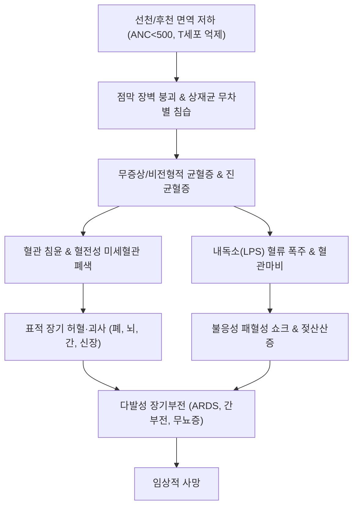

# 🩺 [[방어력이 손상된 사람들의 감염]] (Infections in Immunocompromised Hosts / 免疫低下者 感染, ICD-10: D84.9 / KCD: D84.9)

> **핵심 3줄 요약 (Key Summary)**:
> - 📍 **병소 부위 & 병태생리**: 악성종양, 항암화학요법, 조혈모세포/고형장기 이식, 면역억제제 투여 및 선천/후천성 면역결핍증으로 인한 숙주 방어벽(호중구 결핍, T세포/세포성 면역 결핍, B세포/체액성 면역 결핍, [[비장]] 적출, [[보체계]] 결핍) 파탄과 정상 상재균 및 기회감염균의 무차별적 조직 침습·혈류 파종.
> - 🚩 **전형적 임상 양상 & 3대 징후**: 국소 염증 반응(농 형성, 발적, 종창) 결여의 역설, 발열 단독 발현([[발열성 호중구감소증]]), 기회감염 병원체(침습성 진균, CMV, 폐포자충)에 의한 급격한 폐침윤 및 전신 패혈성 허탈.
> - 🛠️ **핵심 감별 & 한·양방 치료 전략**: 종양열 및 이식편대숙주병([[이식편대숙주병|GvHD]])과의 감별, 1시간 이내 항-녹농균 광범위 베타락탐계 항생제 즉시 투여, 바이오마커(Galactomannan, 1,3-β-D-glucan) 기반 조기 항진균제 및 표적 항바이러스제 처치, 한의학적 [[허로]](虛勞)·[[기음양허]](氣陰兩虛)·[[정허사연]](正虛邪戀) 변증 기반 [[보중익기탕]], [[인삼양영탕]], [[옥병풍산]], [[신기환]] 및 비침습적 온열·면역지지 치료.
> - <font color="#fa7e7e">⚠️ **응급 의뢰 레드플래그**: [[발열성 호중구감소증]](ANC < 500/μL + 체온 ≥ 38.3℃), 비장 적출 환자의 돌발 발열 및 전격성 패혈증([[비장적출후 패혈증|OPSI]]), 급성 저산소혈증성 호흡부전(PCP 의심), 비부비동/구개부 흑색 괴사성 가피(모균증 [[무코르|Mucorales]] 의심).</font>

---

## 📌 목차
1. [질환 개요 & 병태생리 (Disease Overview)](#1-질환-개요--병태생리-disease-overview)
2. [병태생리 메커니즘 & 대사·장기부전 악순환 네트워크](#2-병태생리-메커니즘--대사장기부전-악순환-네트워크)
3. [임상 증상 & 환자 소견 (Clinical Presentation)](#3-임상-증상--환자-소견-clinical-presentation)
4. [감별 진단 매트릭스 (Differential Diagnosis)](#4-감별-진단-매트릭스-differential-diagnosis)
5. [한의 통합 치료 프로토콜 (침·약침·한약)](#5-한의-통합-치료-프로토콜-침약침한약)
6. [양방 치료 & 병용·의뢰 기준 (Conventional Treatment & Referral)](#6-양방-치료--병용의뢰-기준-conventional-treatment--referral)
7. [식이·생활습관 & 자가관리 티칭 가이드](#7-식이생활습관--자가관리-티칭-가이드)
8. [💡 진료실 핵심 필기 & 임상 노하우](#8--진료실-핵심-필기--임상-노하우)
9. [출처 및 학술 참고 문헌 (References)](#9-출처-및-학술-참고-문헌-references)

---

## 1. 질환 개요 & 병태생리 (Disease Overview)

* **질환 정의 및 임상적 중요성**:
  * **면역저하자(Immunocompromised Host)**란 인체의 해부학적 물리적 장벽, 선천면역계(포식세포, 보체) 또는 적응면역계(T림프구, B림프구/항체)의 선천적·후천적 결함으로 인해 정상인에게는 질병을 일으키지 않는 저독성 미생물(기회감염 병원체)이나 정상 상재균총에 의해서도 생명을 위협하는 중증 침습성 감염이 발생하는 환자군을 총칭한다.
  * 현대 의학에서 조혈모세포이식(HSCT), 고형장기이식(SOT), 강력한 세포독성 항암화학요법(Chemotherapy), 분자표적치료제 및 면역억제제(코르티코스테로이드, Calcineurin inhibitors, 항-TNF 제제, B세포 제거 항체)의 사용이 보편화됨에 따라 면역저하자 감염의 유병률과 임상적 복잡성이 폭발적으로 증가하고 있다.

* **면역결핍 5대 결손 축(Immune Defect Axes) 및 취약 병원체**:
  1. **호중구 결핍 (Neutropenia, ANC < 500/μL)**:
     - 원인: 급성 백혈병, 조혈모세포이식 컨디셔닝, 세포독성 항암제 투여, 재생불량성 빈혈.
     - 취약 병원체:
       - 세균: [[녹농균|Pseudomonas aeruginosa]], [[대장균|Escherichia coli]], [[폐렴간균|Klebsiella pneumoniae]], 엔테로박터 등 그람음성 장내세균, [[황색포도구균|Staphylococcus aureus]], 표피포도구균(Staphylococcus epidermidis).
       - 진균: [[칸디다|Candida albicans / Candida glabrata / Candida auris]], [[아스페르길루스|Aspergillus fumigatus]], [[푸사리움|Fusarium spp.]], 모균([[무코르|Mucorales / Rhizopus]]).
  2. **세포성 면역 결핍 (Cell-Mediated Immunity / T-cell Defect)**:
     - 원인: 고용량 코르티코스테로이드 장기 투여, 장기이식 면역억제제(Cyclosporine, Tacrolimus, Mycophenolate), 인간면역결핍바이러스([[에이즈|HIV/AIDS]]), T세포 림프종.
     - 취약 병원체:
       - 세포내 기생 세균: [[결핵|Mycobacterium tuberculosis]], 비결핵항산균(NTM), [[리스테리아|Listeria monocytogenes]], 노카르디아(Nocardia spp.), 레지오넬라.
       - 바이러스: [[거대세포바이러스|CMV]], [[수두대상포진바이러스|VZV]], [[단순포진바이러스|HSV]], 엡스타인-바 바이러스(EBV), BK 바이러스, JC 바이러스.
       - 진균: [[폐포자충|Pneumocystis jirovecii (PCP/PJP)]], [[크립토코쿠스|Cryptococcus neoformans]], 히스토플라스마(Histoplasma capsulatum).
       - 원충: [[톡소포자충|Toxoplasma gondii]], 크립토스포리디움(Cryptosporidium).
  3. **체액성 면역 결핍 (Humoral Immunity / B-cell & Antibody Defect)**:
     - 원인: 다발골수종(Multiple Myeloma), 만성림프구성백혈병(CLL), X-연관 무감마글로불린혈증(XLA), 항-CD20 단클론항체([[리툭시맙|Rituximab]]) 치료.
     - 취약 병원체:
       - 협막(피막) 보유 세균(Encapsulated bacteria): [[폐렴구균|Streptococcus pneumoniae]], [[인플루엔자균|Haemophilus influenzae type b]], [[수막구균|Neisseria meningitidis]].
       - 장관 바이러스 및 기생충: 엔테로바이러스(Enterovirus, 만성 수막뇌염 유발), 지아르디아(Giardia lamblia).
  4. **무비증 및 비장 기능 저하 (Asplenia & Hyposplenism)**:
     - 원인: 외상 또는 혈액질환으로 인한 외과적 비장 적출술(Splenectomy), 겸상적혈구빈혈증(기능적 무비증).
     - 취약 병원체:
       - 옵소닌화 세균 탐식 기능 결여로 인한 **전격성 비장적출 후 패혈증([[비장적출후 패혈증|OPSI: Overwhelming Post-Splenectomy Infection]])**: S. pneumoniae, N. meningitidis, H. influenzae, 개 물림 후 [[카프노사이토파가|Capnocytophaga canimorsus]], 바베시아(Babesia microti).
  5. **보체계 결핍 (Complement Deficiencies)**:
     - 원인: 선천성 보체 결손, 후천성 항-C5 항체(Eculizumab) 투여 환자.
     - 취약 병원체: 말단 보체(C5-C9, MAC) 결손 시 침습성 **[[수막구균|Neisseria meningitidis]]** 감염 위험 수천 배 증가; C3 결손 시 화농성 세균 반복 감염.

* **관련 장기 및 조직 파폐**:
  * **조혈계 및 림프망내계**: 골수 저형성(Bone marrow aplasia), 비장 세망내피계 제거, 림프절 위축.
  * **상피 및 점막 장벽**: 항암제 유발성 전신 점막염(Oral & Gut Mucositis) -> 장내 세균총의 혈류 유입 관문 형성.
  * **이물 삽입 부위**: 중심정맥관(Chemo-port, PICC, Hickman catheter), 요로 카테터, 기관삽관 튜브.

---

## 2. 병태생리 메커니즘 & 대사·장기부전 악순환 네트워크

```
[면역저하자 병태생리 악순환 및 기회감염 침습 네트워크]

 +-------------------------------------------------------------------------+
 |             숙주 방어벽의 붕괴 (면역저하의 5대 주요 기저 결함)          |
 |  [호중구 고갈]      [T세포 면역 억제]    [B세포/항체 결손]   [비장 결여]|
 +--------+-------------------+-------------------+-------------------+----+
          |                   |                   |                   |
          v                   v                   v                   v
 +-----------------+ +-----------------+ +-----------------+ +-------------+
 | 점막염(Mucositis)| | 잠복 바이러스  | | 협막세균 옵소닌 | | 세망내피계  |
 | & 세균/진균 침윤| | 재활성화(CMV,   | | 화 및 식균 부전 | | 여과 상실   |
 | (녹농균, 칸디다)| | VZV, EBV, JC)   | | (폐렴구균 등)   | | (OPSI 유발) |
 +--------+--------+ +--------+--------+ +--------+--------+ +------+------+
          |                   |                   |                 |
          +-------------------+---------+---------+-----------------+
                                        |
                                        v
 +-------------------------------------------------------------------------+
 |               침습성 병원체의 조직 파괴 및 혈관 침습 (Angioinvasion)     |
 |  - 호중구 부재로 '농(Pus) 형성' 및 '국소 염증 차단벽' 형성 실패         |
 |  - 아스페르길루스/모균: 혈관벽 침투 -> 혈전 형성 -> 광범위 조직 경색·괴사|
 |  - 세포내 증식균(Listeria, Mycobacteria): 파종성 다발성 육아종 형성 실패|
 +--------------------------------------+----------------------------------+
                                        |
                                        v
 +-------------------------------------------------------------------------+
 |                      비전형적 전신 패혈성 허탈                          |
 |  - 염증 국소화 실패로 병원체 및 내독소(LPS)의 무제한적 혈류 파종       |
 |  - 보상성 항염증 반응(CARS)과 염증성 마비가 공존하는 '면역 마비'       |
 |  - 급격한 패혈성 쇼크, 저산소성 호흡부전(ARDS), 젖산산증, 다발장기부전  |
 +-------------------------------------------------------------------------+
```

### 1) 분자·세포 수준 기전 (Molecular Pathomechanisms)

* **호중구 결핍과 염증 반응 결여의 역설 (Paradox of Aflammation)**:
  * 정상 상태에서 감염이 발생하면 [[호중구]]가 주화성(Chemotaxis)에 의해 혈관 외로 유출되어 활성산소종(ROS), 수초과산화효소(MPO), 호중구 세포외 덫(NETs)을 방출하고 화농성 삼출물(농, Pus)을 형성하여 병원체를 국소에 격리한다.
  * 그러나 절대호중구수(ANC)가 500/μL 미만으로 고갈되면, 대규모 세균 침습이 일어나도 포식과 화학물질 분비가 원천적으로 불가능하다. 국소 발적, 부종, 열감, 농 형성이 거의 나타나지 않아 겉보기에 병변이 경미해 보이지만, 실제로는 병원체가 아무런 저항 없이 혈관 내로 직행하여 폭발적인 균혈증(Bacteremia)과 패혈성 쇼크를 유발한다.

* **점막염(Mucositis)과 장내 미생물 전위(Bacterial Translocation)**:
  * 세포독성 항암제는 빠르게 증식하는 위장관 점막 상피세포를 파괴하여 궤양과 점막염을 유발한다.
  * 장관 상피 치밀연접(Tight junctions)이 해체되면 정상적으로 장관 내강에 머물던 상재균([[녹농균]], [[대장균]], [[폐렴간균]], Enterococcus faecium, [[칸디다]])이 고유층과 점막하 모세혈관으로 무단 침입(Translocation)하여 중심정맥관 감염 없이도 자발적인 내인성 혈류 감염을 일으킨다.

* **침습성 진균의 혈관 침윤성(Angioinvasiveness) 병리**:
  * **[[아스페르길루스]](Aspergillus fumigatus)** 및 **모균([[무코르|Mucorales]])**: 분생자(Conidia)가 폐포에 도달하면 대식세포와 호중구가 결손된 틈을 타 균사(Hyphae)로 발아한다. 진균 균사는 혈관벽의 탄력막을 뚫고 내피세포 내부로 침범(Angioinvasion)한다.
  * 혈관 내피 손상은 국소 혈소판 응집과 피브린 혈전 형성을 유도하여 혈관 폐색을 일으키며, 이로 인해 지배 하부 조직의 **광범위한 출혈성 경색(Hemorrhagic infarction) 및 응고 괴사**가 일어난다. 이는 흉부 CT상 결절 주위 출혈을 반영하는 **Halo sign**으로 나타난다.

* **최근 다제내성(MDR) 그람음성균 내성 분자 기전 (Sun Y, et al., 2026)**:
  * 면역저하자에게 빈발하는 녹농균, Acinetobacter baumannii, 장내세균목은 반복적인 광범위 항생제 노출 하에 기질확장 베타락타마아제(ESBL), 카바페네마아제(KPC, NDM, VIM, OXA-48), 외막 단백질(Porin OprD) 소실, 및 다제 약물 유출 펌프(Efflux pumps: MexAB-OprM)의 과발현을 동시 획득한다.
  * 이는 기존의 피페라실린/타조박탐뿐 아니라 카바페넴계까지 무력화시켜, 신규 복합제(Ceftazidime/avibactam, Ceftolozane/tazobactam, Cefiderocol)가 필수적인 치명적 난치성 감염을 유발한다.

* **소아 및 면역저하자 침습성 푸사리움 감염증의 병리 (Abgaou A, et al., 2026)**:
  * [[푸사리움]](Fusarium spp.)은 주로 토양 사상균이나, 호중구 결핍 환자 및 조혈모세포이식 수혜자에서 아스페르길루스와 유사하게 기도 점막 및 피부 장벽을 뚫고 침습한다.
  * 아스페르길루스와 달리 푸사리움은 체내에서 분생포자(Adventitious conidia)를 형성하여 혈류를 타고 순환할 수 있으므로, **혈액 배양 양성률이 50% 이상으로 높고 파종성 전신 피부 전이 병변(중심부 괴사성 가피를 동반한 홍반성 결절)**을 특징적으로 형성하며 치명률이 70%를 상회한다.

### 2) 대사 이상 및 다발성 장기부전 악순환 네트워크



* **악순환 1: 국소 통제 불능과 급속한 혈류 파종**: 면역 정상인에서는 농양(Abscess) 벽으로 병원체를 국소 격리하지만, 면역저하자에서는 격리벽이 형성되지 않아 수 시간 만에 전신 파종성 균혈증으로 진행한다.
* **악순환 2: 중복 기회감염의 연쇄 폭포(Co-infection Cascade)**: CMV 재활성화는 숙주의 T세포 및 골수 전구세포 증식을 더욱 억제하는 '면역억제성 바이러스'로 작용하여, 연이어 아스페르길루스증, 폐포자충 폐렴(PCP), 세균성 패혈증이 중첩 발병하는 치명적 도미노 현상을 유발한다.
* **악순환 3: 약물 상호작용 및 장기 독성의 덫**: 침습성 진균 치료를 위해 필수적인 Azole계 항진균제(Voriconazole, Posaconazole)는 간의 CYP3A4 효소를 강력하게 억제하여, 면역저하자가 복용 중인 면역억제제(Tacrolimus, Cyclosporine)의 혈중 농도를 수 배 이상 급증시켜 치명적인 신독성 및 뇌병증을 초래한다.

---

## 3. 임상 증상 & 환자 소견 (Clinical Presentation)

### 1) 주소증 및 임상적 특이성 (Clinical Features)
* **발열 단독 발현 ([[발열성 호중구감소증|Febrile Neutropenia, FN]])**:
  * 호중구가 고갈된 환자에서 감염의 유일한 객관적 징후는 종종 **발열(Fever)**뿐이다.
  * 기침, 가래, 배뇨통 등의 전형적 국소화 증상이 완전히 결여되어 있어 환자는 "단지 기운이 없고 38도 이상의 열이 난다"고만 호소하지만, 24~48시간 이내에 전격성 패혈성 쇼크로 급격히 악화될 수 있다.
* **염증 결여로 인한 장기별 비전형적 발현**:
  * **호흡기계**: 심각한 세균성/진균성 폐렴이 진행 중임에도 객담 배출이 없으며, 청진상 수포음(Crackle)이 들리지 않고 단순 흉부 X-ray상 음영이 나타나지 않다가 호중구가 회복되는 시점에 갑자기 거대한 침윤이 나타난다.
  * **중추신경계**: 크립토코쿠스 또는 리스테리아 뇌수막염이 발생해도 경부 강직(Neck stiffness)이나 Kernig 징후가 나타나지 않고, 경미한 기면(Lethargy), 성격 변화, 두통만 호소.
  * **비뇨기계**: 심한 신우신염 환자여도 소변에 백혈구(농뇨, Pyuria)가 전혀 검출되지 않음.
  * **피부 연조직**: 발적이나 열감 없이 경미한 피부 변색이나 압통만 관찰되다가, 수 시간 내에 중심부가 흑색으로 괴사하는 **괴저성 농포([[괴저성 농포|Ecthyma gangrenosum]])**(녹농균 패혈증의 특징적 피부 궤양 병변)로 진행.

### 2) 객관적 소견 및 진단 검사의학 (Signs, Labs & Biomarkers)
* **절대호중구수(Absolute Neutrophil Count, ANC)의 정확한 산정**:
  $$\text{ANC} (/ \mu\text{L}) = \text{WBC 수치} (/ \mu\text{L}) \times \frac{\text{Seg 호중구}(\%) + \text{Band 호중구}(\%)}{100}$$
  * **발열성 호중구감소증(Febrile Neutropenia, FN) 진단 기준 (IDSA 가이드라인)**:
    1. **발열 기준**: 1회 구강 체온 ≥ 38.3℃ (101°F) 또는 1시간 이상 지속되는 체온 ≥ 38.0℃ (100.4°F).
    2. **호중구 기준**: 현재 ANC < 500/μL 이거나, 현재는 500 이상이지만 향후 48시간 이내에 500/μL 미만으로 감소할 것으로 예측되는 경우.
* **침습성 진균 감염(IFI) 혈청 바이오마커**:
  * **혈청 갈락토만난 항원 (Serum Galactomannan Antigen Test)**:
    - 아스페르길루스(Aspergillus) 세포벽 다당류 검출.
    - 광학밀도 지수(Optical Density Index, ODI) cut-off ≥ 0.5 (혈청) 또는 ≥ 1.0 (기관지폐포세척액 BAL). 침습성 폐 아스페르길루스증의 조기 진단에 필수.
  * **혈청 1,3-베타-D-글루칸 (1,3-β-D-Glucan, BDG)**:
    - 칸디다, 아스페르길루스, 푸사리움, 폐포자충(PCP)을 포함한 광범위 진균의 세포벽 성분.
    - 양성 기준: > 60~80 pg/mL.
    - ⚠️ **감별 주의**: 모균증([[무코르|Mucorales]]) 및 크립토코쿠스는 BDG를 생성하지 않으므로 검사상 음성으로 나타남.
* **분자유전학적 정량 검사**:
  * **CMV Real-time Quantitative PCR**: 고형장기이식 및 골수이식 환자에서 혈장 CMV DNA 카피 수 추적(선제적 항바이러스 치료 기준 설정).
  * **Pneumocystis jirovecii PCR & Diff-Quik/Grocott's Methenamine Silver (GMS) 염색**: 객담 또는 BAL액에서 영양체 및 포낭 확인.
* **영상진단학적 특징 (HRCT)**:
  * **Halo Sign (달무리 징후)**: 폐 결절 주위를 둘러싼 간유리 음영(Ground-glass opacity)으로, 진균의 혈관 침윤에 의한 국소 출혈 반영(아스페르길루스증 초기 7~10일에 특징적).
  * **Air-crescent Sign (공기 초승달 징후)**: 호중구 수치가 회복되면서 괴사된 폐 조직이 수축하여 발생하는 공동 형성 소견(회복기 징후).
  * **Reverse Halo Sign (역달무리 징후 / Atoll sign)**: 중심부는 간유리 음영이고 외곽이 원형의 경화로 둘러싸인 병변으로, 모균증([[무코르|Mucorales]])의 강력한 시사 소견.

### 3) 위험도 계층화: MASCC 위험 지수 (MASCC Risk Index)

| MASCC 위험 점수 산정 항목 | 가중치 점수 |
| :--- | :---: |
| 감염 증상의 중증도: 무증상 또는 경미한 증상 | 5점 |
| 감염 증상의 중증도: 중등도 증상 | 3점 |
| 저혈압 부재 (수축기 혈압 > 90 mmHg) | 5점 |
| 만성 폐쇄성 폐질환(COPD) 부재 | 4점 |
| 고형암 환자 또는 혈액암 환자 중 이전 진균 감염력 없음 | 4점 |
| 탈수 증상 부재 (수액 요법 불필요) | 3점 |
| 발열 발생 당시 외래 환자 상태 | 3점 |
| 연령 < 60세 | 2점 |
| **최고 합산 점수** | **26점** |

* **판정 및 진료 방침**:
  * **고위험군 (MASCC 점수 < 21점)**: 심각한 합병증 및 사망 위험이 높음 -> **즉시 입원 및 정맥주사 광범위 항-녹농균 항생제 투여 필수**.
  * **저위험군 (MASCC 점수 ≥ 21점)**: 혈역학적으로 안정적이고 장기 기능 부전이 없는 경우 -> 엄격한 추적 관찰 하에 경구 항생제(Ciprofloxacin + Amoxicillin/clavulanate) 외래 치료 고려 가능.

---

## 4. 감별 진단 매트릭스 (Differential Diagnosis)

| 감별 질환 | 주요 임상 양상 | 감별 핵심 포인트 (검사·수치) | 치료 및 대처 방향 |
| :--- | :--- | :--- | :--- |
| **[[방어력이 손상된 사람들의 감염]] (기회감염/패혈증)** | 급성 발열(≥38.3℃), 국소 염증 결여, 급격한 악화, 오한 | **ANC < 500/μL**, 배양 양성, Galactomannan/BDG 양성, Procalcitonin 급증 | **[초응급]** 1시간 내 항-녹농균 항생제(피페라실린/타조박탐, 세페핌) IV |
| **[[종양열]](Tumor / Neoplastic Fever)** | 림프종, 백혈병, 고형암 진행 시 발열, 전신 상태 비교적 양호 | 감염 징후 없음, 배양 음성, **Naproxen test 양성**(나프록센 투여 시 신속 해열) | 기저 악성종양 항암치료, NSAIDs 대증 치료 |
| **이식편대숙주병 ([[이식편대숙주병|GvHD]])** | 동종 골수이식 후 반구진성 발진(손바닥/발바닥), 황달, 다량의 수양성 설사 | 발열 동반 가능, **간기능 이상(Total Bilirubin 급증)**, 대변 배양 음성, 조직 생검 확인 | 전신 코르티코스테로이드, 면역억제제 증량 |
| **약물 유발성 폐렴 (Drug-induced Pneumonitis)** | 항암제(Bleomycin, Methotrexate, 면역관문억제제) 투여 후 마른기침, 호흡곤란 | 흉부 CT상 미만성 간질성 음영, 감염원(PCR, 배양) 음성, **BAL상 림프구성 폐포염** | 원인 항암제 즉시 중단, 고용량 스테로이드 펄스 요법 |
| **혈구탐식성 림프조직구증 ([[혈구탐식성 림프조직구증|HLH / MAS]])** | 지속적인 초고열, 비장종대, 범혈구감소증, 신경학적 이상 | **Serum Ferritin 극단적 상승(> 3,000~10,000 ng/mL)**, 고중성지방혈증, 골수 내 혈구포식세포 | Etoposide, Dexamethasone, 면역글로불린(IVIG) |
| **카테터 관련 혈전정맥염 (Catheter Thrombophlebitis)** | 중심정맥관 삽입 부위 동통, 경결, 해당 상지 부종 및 측부순환 발달 | 카테터 주위 초음파상 혈전 확인, 혈액 배양 양성(포도구균, 칸디다 흔함) | 카테터 즉시 발거, 전신 항응고 요법 및 표적 항균제 투여 |

> 🚩 **면역저하자 초응급 레드플래그 (Emergency Red Flags)**:
> 1. **발열성 호중구감소증(Febrile Neutropenia)**: 1초라도 지체하지 말고 1시간 이내에 혈액배양 후 정맥 항생제 투여.
> 2. **비장 적출 환자의 발열**: 즉시 전격성 패혈증([[비장적출후 패혈증|OPSI]])으로 간주하고 비축된 응급 항생제 복용 및 응급실 이송.
> 3. **안면 통증, 비출혈, 구개부(입천장) 흑색 가피**: 치명적인 비부비동-뇌 모균증([[무코르|Rhinocerebral mucormycosis]])의 징후 -> 즉시 이비인후과 비강 내시경 및 응급 광범위 괴사조직 절제술.
> 4. **호중구감소 환자의 복통 및 장폐색 소견**: 맹장염 형태의 호중구감소성 소장결장염(Neutropenic Enterocolitis / Typhlitis) 의심 -> 천공 및 패혈성 쇼크 위험.

---

## 5. 한의 통합 치료 프로토콜 (침·약침·한약)

* **한의학적 질병관 및 변증 원칙**:
  * 면역저하자 감염은 한의학에서 **[[허로]](虛勞)**, **극허(極虛)**, **[[정허사연]](正虛邪戀)**, **독사내함(毒邪內陷)**의 범주로 파악한다.
  * 환자의 원기(元氣)와 골수 조혈 기능, 비신(脾腎)의 장부 정기가 고갈된 상태에서 사기(邪氣)가 침범하였으므로, 일반적인 외감병의 공하(攻下)나 과도한 청열사화(淸熱瀉火) 약재를 남용하면 오히려 정기를 더욱 손상시켜 허탈(脫證)에 이르게 된다.
  * 따라서 **'부정거사(扶正祛邪 - 정기를 북돋아 사기를 몰아냄)'**와 **'배토생금(培土生金 - 비위를 보강하여 폐와 면역계를 회복시킴)'**을 대원칙으로 삼는다.

### 1) 변증 분류 및 대표 한약 방제

| 변증 유형 | 병리 기전 및 주요 임상 징후 | 치법 (Treatment Principle) | 대표 한약 처방 |
| :--- | :--- | :--- | :--- |
| **정허사연 (正虛邪戀)**<br>(감염 지속/장기 미열) | 항암 후 정기가 극도로 쇠약하여 사기가 체류. 지속적인 미열 또는 오후 조열, 도한(盜汗), 기단(숨참), 권태핍력, 설담태백, 맥세약 | **익기부정 (益氣扶正)**<br>청열투사 (淸熱透邪) | **[[보중익기탕]] (補中益氣湯)**<br>[[청호별갑탕]] (靑蒿鱉甲湯) 가감 |
| **기음양허 (氣陰兩虛)**<br>(조혈 억제/구강 점막염) | 방사선·면역억제 후 진액과 기운 고갈. 골증조열, 구갈인건, 마른기침, 구내 궤양 및 점막염, 대변건결, 설홍소태 또는 경면설, 맥세삭 | **익기양음 (益氣養陰)**<br>생진청열 (生津淸熱) | **[[인삼양영탕]] (人參養榮湯)**<br>[[생맥산]] (生脈散) 합 [[자음강화탕]] |
| **표허부고 (表虛不固)**<br>(반복성 호흡기 감염) | 폐기(肺氣) 허약으로 위표(衛表)가 열려 외사 침입 빈발. 수시로 자한(自汗) 출현, 외풍(찬바람)에 극도로 취약, 빈번한 감기, 설담 맥부약 | **익기고표 (益氣固表)**<br>지한어풍 (止汗禦風) | **[[옥병풍산]] (玉屛風散)**<br>(황기, 백출, 방풍) |
| **비신양허 (脾腎陽虛)**<br>(만성 쇠약/골수 부전) | 신양(腎陽) 허손으로 골수 조혈 부전 및 선천 면역 결핍. 외한지냉(손발 차가움), 면색창백, 완복냉통, 오경설(새벽 설사), 부종, 설담반 맥침지 | **온보비신 (溫補脾腎)**<br>익수건골 (益髓健骨) | **[[신기환]] (腎氣丸 / 八味地黃丸)**<br>[[우귀음]] (右歸飲) |
| **어독내저 (瘀毒內阻)**<br>(미세혈전/괴사성 감염) | 독소가 혈분에 침범하여 미세혈류 정체. 피부 자반, 괴사성 궤양, 피부 발진, 설질자암(紫暗) 또는 어반(瘀斑), 맥삽(脈澁) | **활혈화어 (活血化瘀)**<br>해독통락 (解毒通絡) | **[[도홍사물탕]] (桃紅四物湯)** 합<br>[[황련해독탕]] (黃連解毒湯) 극소량 |

### 2) 침구 치료 프로토콜 (Acupuncture & Moxibustion)
* **면역 증강 및 골수 조혈 촉진 배혈**:
  * **[[족삼리(ST36)]] & [[비수(BL20)]]**: 후천지본인 비위의 운화 기능을 극대화하여 과립구 및 림프구 생성 촉진.
  * **[[신수(BL23)]] & [[관원(CV4)]] & [[기해(CV6)]]**: 선천지본인 원기를 북돋우고 신정(腎精)을 길러 골수의 조혈 능력을 강화.
  * **[[대추(GV14)]]**: 면역 반응 총괄 및 외인성 병원체 방어막(위기) 강화.
* ⚠️ **면역저하자 침구 안전 관리 절대 원칙 (Safety Precautions)**:
  1. **호중구 감소증(ANC < 500/μL) 환자**: 침습적 호침 자침 부위가 새로운 세균 침입 관문이나 농양 형성 부위가 될 수 있으므로, **침습적 침 치료를 엄격히 유예**하거나 무통 레이저 침(Laser Acupuncture) 및 지압 치료로 대체한다.
  2. **혈소판 감소증(Platelet < 50,000/μL) 환자**: 자침 후 혈종(Hematoma) 형성 및 지혈 장애 위험이 있으므로 자침을 피하고, 절대 사혈침(점자출혈)이나 습부항(혈락요법)을 시행하지 않는다.
  3. **뜸(쑥뜸) 시술 수칙**: 직접구(有痕灸)는 피부 화상 및 궤양성 이차 감염을 유발하므로 **절대 금기**이다. 쑥 연기가 면역저하자의 폐를 자극하지 않도록 무연 뜸이나 온열 간접구, 적외선 온열 요법만을 원위 취혈 부위에 안전하게 적용한다.

### 3) 약침 치료 프로토콜 (Pharmacopuncture)
* **자하거(Placenta) 약침 & 녹용 약침 (회복기/만성 면역결핍증)**:
  * 다양한 조혈 및 성장인자(EGF, FGF)와 면역글로불린 펩타이드를 함유하여 세포독성 항암 치료 후 골수 억제 완화, 백혈구 및 NK세포 활성도 회복 촉진.
  * 시술 부위: [[족삼리(ST36)]], [[신수(BL23)]], [[비수(BL20)]]. 혈위당 0.1~0.2 cc 주입. (반드시 무균 제제 및 알코올/베타딘 2중 소독 후 시술).

---

## 6. 양방 치료 & 병용·의뢰 기준 (Conventional Treatment & Referral)

### 1) 발열성 호중구감소증(Febrile Neutropenia) 1시간 응급 치료 알고리즘

```
[발열성 호중구감소증(FN) 응급 치료 표준 프로토콜]
 발열 발생 인지 (체온 ≥ 38.3℃ 또는 38.0℃ 1시간 지속 + ANC < 500/μL)
       |
       v
 [골든아워 1시간 이내 신속 조치]
 1) 즉시 2쌍 이상의 혈액 배양(말초 및 모든 중심정맥관 루멘) 채취
 2) 흉부 X-ray, 전혈구(CBC), 전해질, 신기능, 간기능, 젖산 검사
       |
       v
 [단일 광범위 정맥용 항-녹농균 베타락탐계 항생제 즉각 정주]
  선택 1: Piperacillin/tazobactam (피페라실린/타조박탐 4.5g q6h IV)
  선택 2: Cefepime (세페핌 2g q8h IV)
  선택 3: Meropenem (메로페넴 1g q8h IV - 카바페넴계, 패혈성 쇼크 시 선호)
       |
       v
 [초기 반코마이신(Vancomycin) 병용 투여 여부 결정 기준]
  - 혈역학적 불안정(패혈성 쇼크, 저혈압)
  - 카테터 관련 혈류 감염 의심 (삽입부 발적, 압통)
  - 피부 및 연조직 감염 징후
  - 이전 MRSA 집락 형성 또는 과거 감염력
  - 흉부 X-ray상 폐렴 소견 확인
       |
       v
 [치료 반응 평가 (48~72시간 후)]
  - 해열 및 안정화: 호중구 수치 회복(ANC ≥ 500) 시까지 유지
  - 4~7일간 지속 발열: 경험적 항진균제(Voriconazole, Caspofungin, L-AmB) 즉각 추가
```

### 2) 침습성 진균 감염(Invasive Fungal Infections)의 정밀 약물 치료
* **침습성 아스페르길루스증 (Invasive Aspergillosis)**:
  * **1차 표준 치료**: **[[보리코나졸|Voriconazole]]** (부하용량 6 mg/kg q12h IV 1일차 -> 유지용량 4 mg/kg q12h IV/PO) 또는 **Isavuconazole**.
  * 치료 기간: 최소 6~12주 이상 (영상 소견 완전 소실 및 면역 회복 시까지).
* **침습성 모균증 (Mucormycosis / Zygomycosis)**:
  * **Liposomal Amphotericin B (암포테리신 B 지질복합체)** 고용량(5~10 mg/kg/day IV) 투여.
  * **외과적 광범위 괴사조직 절제술(Surgical Debridement)** 병행 필수(혈관 폐색으로 인해 약물 침투가 불가능하므로 수술적 제거 없이는 100% 치명).
* **침습성 푸사리움 감염증 (Invasive Fusarium Infections) (Abgaou A, et al., 2026)**:
  * Voriconazole 단독 또는 Liposomal Amphotericin B와의 병용 투여.
  * 호중구 수치의 회복(G-CSF 투여 또는 항암제 휴약)이 환자 생존율을 결정하는 절대적 인자.
* **폐포자충 폐렴 (PCP / PJP)**:
  * **Trimethoprim-sulfamethoxazole (TMP-SMX, 박트림)**: TMP 기준 15~20 mg/kg/day를 3~4회 분할 정맥 투여 (21일간).
  * 중등도~중증(실내공기 동맥혈 PaO2 < 70 mmHg 또는 A-a DO2 ≥ 35 mmHg) 시 **프레드니손(Prednisone)** 조기 병용(폐포 내 염증 반응 억제).

### 3) 예방적 항균 요법 (Antimicrobial Prophylaxis)
* **항균제 예방**: 지속 기간이 7일 이상으로 예상되는 고위험 호중구감소증 환자에게 경구 플루오로퀴놀론(Levofloxacin 또는 Ciprofloxacin) 투여.
* **항진균제 예방**: 급성골수성백혈병(AML) 관해유도요법 및 이식편대숙주병 환자에게 Posaconazole 또는 Voriconazole 경구 예방 투여.
* **PCP 예방**: 동종 조혈모세포이식 환자, 고형장기이식 환자, 고용량 스테로이드 복용 환자에게 TMP-SMX 1일 1정 또는 주 3회 투여.
* **항바이러스 예방**: 혈청 양성 환자에서 항암 치료 중 Acyclovir 경구 예방 투여(HSV/VZV 재활성화 차단).

### 4) 무비증(비장 적출) 환자의 감염 예방 관리
* **예방 백신 접종**: 비장 적출 예정 2주 전(응급 적출 시 수술 후 2주 후) 반드시 접종.
  - 폐렴구균: 단백결합백신(PCV20 또는 PCV15) 접종 8주 후 다당질백신(PPSV23) 접종.
  - 수막구균: 4가 단백결합백신(MenACWY) 2회 접종 및 B군 수막구균 백신(MenB).
  - 헤모필루스: Hib 백신 1회 접종.
* **비상 상비 항생제 휴대 티칭**: 발열(≥38.0℃) 또는 오한 발생 즉시 복용할 수 있는 경구 항생제(Amoxicillin/clavulanate 875/125mg 또는 Levofloxacin 500mg)를 상시 처방받아 소지하도록 지도하고, 복용 즉시 응급실로 이동하도록 교육.

---

## 7. 식이·생활습관 & 자가관리 티칭 가이드

* **호중구감소증 청결 식단 (Neutropenic Diet Guidelines)**:
  * **날음식 절대 금기**: 익히지 않은 생선회, 생굴, 육회, 덜 익힌 달걀, 날채소(샐러드, 쌈채소), 껍질을 벗기지 않는 과일(딸기, 포도, 토마토 등)의 섭취를 엄격히 금지.
  * **철저한 가열 조리**: 모든 육류, 생선, 채소는 100℃ 이상에서 속까지 완전히 익혀 섭취(중심 온도 75℃ 이상 유지).
  * **식수 위생**: 정수기 물이나 약수터 물을 마시지 말고, 완전히 끓여서 식힌 물 또는 공인된 멸균 생수(개봉 후 즉시 음용, 24시간 경과 시 폐기)를 섭취.
  * **발효 식품 제한**: 곰팡이 숙성 치즈(블루치즈, 브리치즈 등), 비살균 유제품, 날된장 섭취 금지. 조리된 찌개 형태의 된장은 허용.

* **환경 관리 및 기회 병원체 노출 차단 (Environmental Protections)**:
  * **원예 및 흙 만지기 절대 금지**: 화초 분갈이, 텃밭 가꾸기, 낙엽 청소 등 토양과 접촉하는 행위는 치명적인 [[아스페르길루스]] 및 [[무코르]] 포자 흡입의 주요 원인이므로 금기.
  * **애완동물 관리**: 고양이 모래 배설물 청소([[톡소포자충]]), 조류 배설물([[크립토코쿠스]]) 접촉 차단. 애완동물과의 뽀뽀나 피부 핥김 금지.
  * **외출 시 수칙**: 병원 방문이나 외출 시 반드시 밀착형 KF94 또는 N95 마스크 착용, 공공장소 및 공사 현장(먼지 속 진균 포자 다량 부유) 방문 회피.
  * **실내 환경**: 고위험 이식 환자는 HEPA 필터 공기정화기가 구비된 양압 격리실 환경 유지. 가습기 내부의 진균 오염 위험으로 초음파 가습기 사용 금지.

* **구강 및 피부 위생 자가관리**:
  * **구강 관리**: 식후 30분 이내 및 취침 전 부드러운 미세모 칫솔로 부드럽게 칫솔질(잇몸 출혈 유발 주의). 치실 사용 금지. 0.12% 클로르헥시딘(헥사메딘) 구강 청결제로 1일 3~4회 가글.
  * **피부 및 손 위생**: 매일 미온수로 가볍게 샤워하되 거친 때밀이 타월 사용 금지. 배변 후 비데 수압을 높이지 말고 부드러운 물티슈 사용(치질 및 항문 균열 방지).

* **환자 및 보호자 교육 스크립트**:
  * *"면역력이 떨어져 있는 상태에서는 몸이 균과 싸울 수 있는 백혈구가 부족하기 때문에, 염증이 생겨도 붓거나 고름이 생기지 않고 오직 '열' 하나로만 나타납니다. 체온이 38도에 도달하면 감기약이나 해열제를 혼자 드시면서 기다리지 마시고, 1분 1초를 다투어 즉시 항암 치료를 받는 병원의 응급실로 가셔야 합니다. 이것은 생명을 지키는 가장 중요한 수칙입니다."*

---

## 8. 💡 진료실 핵심 필기 & 임상 노하우

* **'염증 징후 결여의 역설'을 항상 상기하라**:
  * 일반적인 외과 질환(충수염, 담낭염, 연조직염) 환자는 환부가 붉게 부어오르고 극심한 국소 압통과 농을 보이지만, 호중구가 없는 환자는 충수가 터져 복막염이 되어도 복벽 긴장도가 전혀 없고 통증도 둔하게 나타날 수 있다.
  * "환자가 아프지 않다고 하니 괜찮겠지"라는 판단은 치명적이다. 호중구감소 환자가 호소하는 경미한 불편감이라도 전신 CT를 통한 정밀 평가가 요구된다.

* **비장 적출 환자의 개 물림(Dog Bite)은 치명적 응급**:
  * 과거 비장 적출술을 받은 환자가 반려견이나 유기견에게 살짝 긁히거나 물린 후 내원했을 때, 국소 상처가 경미해 보여도 **[[카프노사이토파가]](Capnocytophaga canimorsus)** 감염에 의해 24~48시간 내에 전격성 자반병, 파종성 혈관내 응고([[파종성 혈관내 응고|DIC]]), 사지 괴사 및 패혈성 쇼크로 급사할 수 있다.
  * 상처 즉시 세척 후 증상 발현 전이라도 즉시 광범위 항생제(Amoxicillin/clavulanate) 예방 투여 및 상급병원 의뢰가 필수적이다.

* **항암 환자의 한의 치료 시 안전한 접근법**:
  * 호중구가 바닥을 치는 최저점(Nadir, 보통 항암제 투여 후 7~14일째) 시기에는 침습적인 침 치료나 뜸 치료를 일체 배제한다.
  * 이 시기에는 구강 점막염 완화를 위한 황련·감초 전탕액 가글, 또는 기력 저하 완화를 위한 안전성이 입증된 탕약([[보중익기탕]], [[인삼양영탕]])을 선별 투여하되, 투약 전후로 반드시 혈액 검사(CBC, LFT, BUN/Cr) 수치를 추적 관찰하여 안전성을 확보한다.

* **침습성 진균 감염의 미세 징후 포착 팁**:
  * 호중구감소증 환자가 항생제를 3일 이상 맞고 있는데도 열이 떨어지지 않고, 안면 부비동 부위의 미세한 뻐근함, 비폐색, 또는 마른기침을 호소한다면 단순 감기나 비염으로 넘기지 말고 즉시 흉부/부비동 CT와 Galactomannan 항원 검사를 의뢰해야 한다.

---

## 9. 출처 및 학술 참고 문헌 (References)

1. **MSD 매뉴얼 전문가용** — 방어력이 손상된 사람들의 감염 (Infections in Immunocompromised Hosts). [링크](https://www.msdmanuals.com/professional)

2. **질병관리청 국가건강정보포털** — 면역결핍증 및 기회감염 예방 관리. [링크](https://health.kdca.go.kr)

3. **Freifeld AG, et al. (2011)**. *Clinical practice guideline for the use of antimicrobial agents in neutropenic patients with cancer: 2010 update by the infectious diseases society of america*. **Clin Infect Dis**, 52(4):e56-93. [가이드라인 링크](https://www.idsociety.org/practice-guideline/febrile-neutropenia/)

4. **Sun Y, et al. (2026)**. *Newer antibiotics for drug-resistant Gram-negative infections in immunocompromised hosts: from pivotal trials to high-risk practice*. **Front Cell Infect Microbiol**, 16:1947603. [PMID 42751173](https://pubmed.ncbi.nlm.nih.gov/42751173/) (PMID: 42751173)
   - **[연구 요약]**: 면역저하자에서 치명적인 다제내성(MDR) 그람음성 간균(카바페넴 내성 장내세균 및 녹농균) 감염에 대응하기 위한 신규 항생제(Ceftazidime/avibactam, Ceftolozane/tazobactam, Cefiderocol 등)의 핵심 임상시험 결과와 고위험군 진료 현장에서의 실제 적용 가이드라인을 집약함.

5. **Abgaou A, et al. (2026)**. *Invasive Fusarium Infections in Immunocompromised Children: A 10-year Multicenter Retrospective Study and Literature Review*. **Pediatr Infect Dis J**, 45(3):180-188. [PMID 42625264](https://pubmed.ncbi.nlm.nih.gov/42625264/) (PMID: 42625264)
   - **[연구 요약]**: 면역저하 환아에서 발생하는 침습성 푸사리움 감염증(Invasive Fusarium Infections)의 역학, 혈액 배양 양성 및 파종성 피부 병변의 임상적 특성, 항진균제(Voriconazole 및 Amphotericin B)의 감수성 및 치료 예후를 분석하여 조기 진단 및 집중 치료 전략을 제시함.

---

## 관련 노트

- [[감염]]
- [[패혈증]]
- [[발열]]
- [[보중익기탕]]
- [[인삼양영탕]]
- [[옥병풍산]]
- [[신기환]]
- [[녹농균]]
- [[아스페르길루스]]
