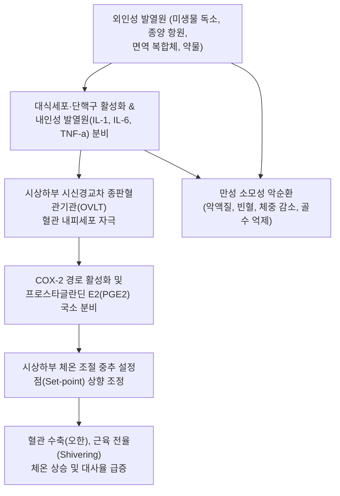
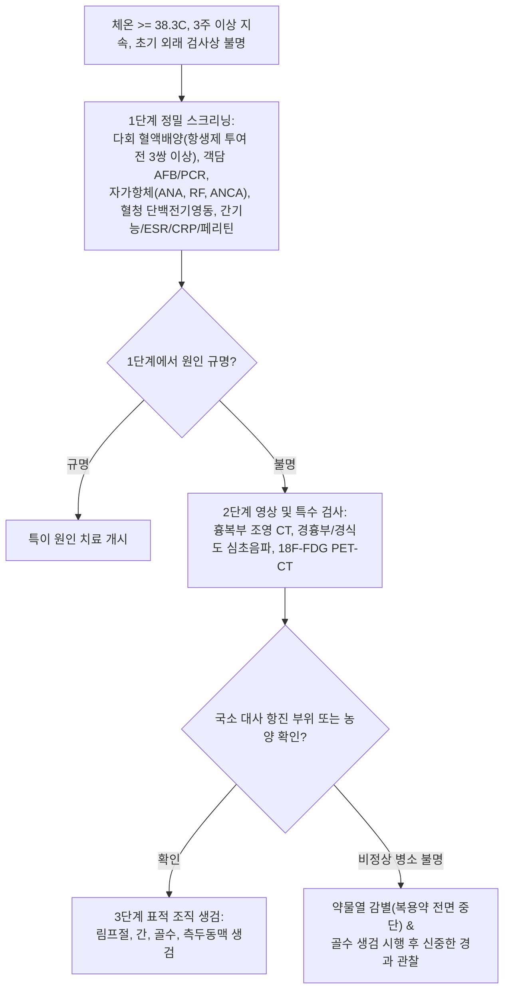

# 🩺 불명열

> **핵심 3줄 요약 (Key Summary)**:
> - 📍 병소 부위 & 해부·병태생리: 체온 $38.3^\circ\text{C}$ 이상의 발열이 3주 이상 지속되며 최소 1주일간의 철저한 입원 또는 3회 이상의 외래 검사에도 원인이 밝혀지지 않는 질환군으로, 감염 질환, 비감염성 염증 질환(자가면역/혈관염), 악성 종양, 약물열 등이 주원인.
> - 🚩 전형적 임상 양상: 원인 미상의 반복적인 고열 또는 미열, 오한, 식은땀, 만성 [[피로]], 진행성 체중 감소, 관절통, 피진, 간비대 및 [[비장 비대]].
> - 🛠️ 핵심 검사 & 치료 전략: 3단계 체계적 진단(기본 혈액/생화학, 다회 혈액 배양, 자가항체 스크리닝, 전신 CT, 18F-FDG PET-CT, 골수 및 림프절/측두동맥 생검); 원인 규명 전 무분별한 경험적 항생제/스테로이드 남용 금기, 원인 질환별 표적 치료.
> - ⚠️ 응급 의뢰 레드플래그: 혈역학적 쇼크 징후(패혈성 쇼크), 혈구탐식성 림프조직구증(HLH: 페리틴 > 3,000 ng/mL, 급격한 범혈구감소), 수막자극징후, 감염성 심내막염에 의한 색전증 및 심부전.

---

## 📌 목차
1. [질환 개요 & 해부학적 병태생리](#1-질환-개요--해부학적-병태생리)
2. [병태생리 메커니즘 & 생체역학적 악순환 네트워크](#2-병태생리-메커니즘--생체역학적-악순환-네트워크)
3. [임상 증상 & 이학적 검사(Physical Exam) 알고리즘](#3-임상-증상--이학적-검사physical-exam-알고리즘)
4. [감별 진단 매트릭스 (Differential Diagnosis)](#4-감별-진단-매트릭스--differential-diagnosis)
5. [한의 통합 치료 프로토콜 (침·약침·추나·한약)](#5-한의-통합-치료-프로토콜--침약침추나한약)
6. [양방 치료 & 병용·의뢰 기준 (Conventional Treatment & Referral)](#6-양방-치료--병용의뢰-기준-conventional-treatment--referral)
7. [재활 운동 & 생활습관 티칭 가이드](#7-재활-운동--생활습관-티칭-가이드)
8. [💡 사용자 진료실 핵심 필기 & 임상 노하우 (Melt-In 잔여 심화 집약)](#8--사용자-진료실-핵심-필기--임상-노하우--melt-in-잔여-심화-집약)
9. [출처 및 학술 참고 문헌 (References)](#9-출처-및-학술-참고-문헌--references)

---

## 1. 질환 개요 & 해부학적 병태생리

**불명열(Fever of Unknown Origin, FUO)**은 현대 임상의학에서 가장 정밀한 감별 진단이 요구되는 대표적 복합 증후군이다. 고전적 정의(Petersdorf & Beeson, 1961)는 ① 체온 $38.3^\circ\text{C}(101^\circ\text{F})$ 이상의 발열이 수차례 확인되고, ② 발열 기간이 3주 이상 지속되며, ③ 1주일간의 집중적인 입원 검사에도 확진되지 않는 경우로 규정되었다. 현대 진료 지침(Durack & Street 수정 분류)에서는 이를 **고전적 FUO**, **병원내 FUO(Nosocomial)**, **호중구감소성 FUO**, **HIV 연관 FUO**의 4개 범주로 세분화하며, 최소 3일간의 입원 또는 3회의 외래 정밀 조사에도 불명인 경우로 정의한다.

불명열의 원인 질환은 지리학적 역학, 연령, 의료 발전 수준에 따라 변화하지만 대략 4대 범주로 집약된다:
1. **감염 질환 ($20\sim 40\%$)**: 결핵(특히 파종성 폐외결핵), 농양(간농양, 복강내 농양), 감염성 심내막염, 거대세포바이러스(CMV), EBV, 브루셀라증, 기생충 감염(내장형 리슈마니아증).
2. **비감염성 염증성 질환 ($20\sim 30\%$)**: 성인형 스틸병(Adult-onset Still's disease), 전신성 홍반성 루푸스(SLE), 거대세포동맥염(측두동맥염), 다발성 결절성 동맥염, 류마티스 관절염.
3. **악성 종양 ($15\sim 25\%$)**: 림프종(호지킨/비호지킨, 혈관내 대세포 림프종), 백혈병, 신세포암, 간세포암, 대장암.
4. **기타 질환 ($10\sim 15\%$)**: 약물열(Drug fever), 아급성 갑상선염, 혈종, 인위열(Factitious fever) 및 약 $10\sim 20\%$의 끝내 규명되지 않는 양호한 자연 경과의 미상열.

---

## 2. 병태생리 메커니즘 & 생체역학적 악순환 네트워크

체온 상승은 시상하부 전시각부(Preoptic area)의 체온 조절 중추가 내인성 발열성 사이토카인(IL-1$\beta$, IL-6, TNF-$\alpha$, IFN-$\gamma$)에 의해 자극받아 PGE2 합성을 촉진함으로써 설정점(Set-point)을 올리는 면역반응이다. 불명열에서는 이러한 면역 자극원이 통상적인 급성 감염처럼 자가 제한되지 않고, 잠복된 감염소, 지속적인 자가항체 생성, 종양세포의 지속적 자가분비(Autocrine) 사이토카인 방출, 또는 약물성 과민 반응에 의해 수주에서 수개월간 쉬지 않고 지속된다. 장기화된 전신 염증은 체내 철분을 세망내피계에 격리시켜 만성 질환 빈혈(ACD)을 유발하고, 이화작용 항진으로 근육 소실과 체중 감소를 동반하는 소모성 상태로 악화된다.

---

## 3. 임상 증상 & 이학적 검사(Physical Exam) 알고리즘

### 체계적 이학적 검진 체크리스트 (잠재적 진단 단서 PDCs)
- **두경부**: 측두동맥 압통/비후(거대세포동맥염), 안저 검사상 Roth 반점(심내막염), 결막 점상출혈, 갑상선 압통(아급성 갑상선염), 림프절 비대([[림프절염]]).
- **흉복부**: 새로운 심잡음(심내막염), 간종대 및 비장 종대([[비장 비대]]), 심와부 및 우하복부 심부 압통(잠복 농양).
- **피부 및 손발톱**: 연어살색 일과성 반구진(성인형 스틸병), 전신 나비모양 홍반(루푸스), Osler 결절 및 Janeway 병변(심내막염), 손발톱밑 선상 출혈(Splinter hemorrhage).
- **골격계 및 척추**: 척추 극돌기 타진통(척추골수염/척추염), 관절 종창 및 열감.

### 3단계 진단 알고리즘

---

## 4. 감별 진단 매트릭스 (Differential Diagnosis)

| 원인 범주 | 대표 질환군 | 특징적 임상 단서 (PDCs) | 핵심 진단 검사 | 치료 접근법 |
| :--- | :--- | :--- | :--- | :--- |
| **감염성 질환** | 파종성 [[결핵]], 복강내 농양, 심내막염 | 심잡음, 야간 발한, 체중 감소, 간비장비대 | 다회 혈액 배양, 심초음파, 결핵균 PCR, 복부 CT | 원인 병원체 표적 항생제/항결핵제 투여 |
| **비감염성 자가면역** | 성인형 스틸병, 루푸스, 거대세포동맥염 | 관절통, 고열 시 일과성 연어색 발진, 두통 | 고페리틴혈증($>1,000$), ANA/ANCA, 측두동맥 생검 | 코르티코스테로이드, 면역억제제 |
| **악성 신생물** | 혈관내 림프종, 신세포암, 호지킨 림프종 | 림프절 비대, 유두부종 없는 신경 증상, 악액질 | FDG PET-CT, 골수 생검, 림프절 절제 생검 | 항암화학요법, 표적치료, 외과적 절제 |
| **약물열 (Drug fever)** | 항생제, 항경련제, 심혈관제제, 알로푸리놀 | 발열에 비해 서맥(상대적 서맥), 호산구 증가 | 의심 약물 중단 후 $48\sim 72$시간 내 해열 | 의심 약물 전면 중단 및 대체제 사용 |
| **인위열 (Factitious fever)** | 뮌하우젠 증후군, 의료계 종사자 호발 | 고열 시 오한/빈맥 없음, 체온계 조작, 피부 차가움 | 간호사 직접 감시하 체온 측정, 소변 체온 확인 | 정신건강의학과적 지지 상담 |

---

## 5. 한의 통합 치료 프로토콜 (침·약침·추나·한약)

> ⚠️ 불명열은 잠복된 패혈증, 파종성 결핵, 악성 림프종, 급성 심내막염 등 치명적 중증 질환이 배후에 있을 수 있으므로, 원인 규명을 위한 양방 정밀 검사가 최우선이다. 원인 규명 전 해열제나 항생제 남용은 진단을 흐리므로 금기이다. 한의 치료는 양방 전수 정밀 검사상 기질적 패혈증이나 악성 종양이 배제된 후 잔여 만성 기능성 미상열, 만성 허열(虛熱), 기혈 손상 및 면역 불균형을 다스리는 변증 지지요법으로 시행한다.

### 1) 한약 처방 (원인 감제 후 기능성 미상열 변증 치료)
- **기허발열증 (氣虛發熱證 - 오전에는 정상이거나 미열이나 피로·활동 후 오후에 $38^\circ\text{C}$ 전후 발열, 자한, 무력감)**:
  - 처방: [[보중익기탕]] 가감 ([[황기]], [[인삼]], [[백출]], [[감초]], [[당귀]], 진피, 승마, 시호).
  - 학술 근거: '감온제열(甘溫除熱)'의 대표 처방으로, 황기·인삼 다당체가 시상하부 만성 염증 신호를 조절하고 세포성 에너지 대사를 회복시켜 피로성 고열을 정상화함.
- **음허발열 및 골증조열증 (陰虛發熱 骨蒸潮熱證 - 오후 및 야간 발열, 손발바닥 번열, 도한, 수척, 설홍소태)**:
  - 처방: [[자음강화탕]] 또는 지골피산 가감 ([[청호]], [[별갑]], [[생지황]], [[지모]], [[목단피]], 지골피, 은시호, 진교).
  - 약리 기전: 별갑의 면역 과활성 진정 및 청호의 해열 작용, 생지황-지모의 혈관 확장성 허열 제어.
- **소양상화 및 울열증 (少陽相火 鬱熱證 - 한열왕래, 구고, 인건, 흉협고만, 식욕부진)**:
  - 처방: [[소시호탕]] 가감 ([[시호]], [[황금]], [[인삼]], [[반하]], 생강, 대조, [[감초]]).
  - 작용: 간담 화열을 끄고 전염증성 사이토카인(IL-6, TNF-$\alpha$)의 과도한 분비를 억제.

### 2) 침구 치료
- **혈위**: 곡지(LI11), 대추(GV14), 합곡(LI4), 족삼리(ST36), 태충(LR3), 삼음교(SP6), 풍지(GB20).
- **시술 지침**: 고열 시 대추 혈위에 점자출혈(사혈)하거나 곡지·합곡을 사법(Sedative method)으로 자침하여 중추 열증을 가라앉힘. 기허열 환자는 족삼리와 비수에 보법 자침 시행.

---

## 6. 양방 치료 & 병용·의뢰 기준 (Conventional Treatment & Referral)

### 양방 표준 치료 원칙
1. **경험적 치료의 유보 원칙 (가장 중요)**:
   - 환자가 패혈성 쇼크나 호중구감소증이 아닌 한, 진단이 나오기 전에 **경험적 항생제나 고용량 스테로이드를 맹목적으로 투여해서는 안 됨**. (배양 검사 위음성 초래 및 림프종/결핵의 진단 지연 유발).
2. **약물열 배제 테스트 (De-challenge)**:
   - 환자가 복용 중인 모든 비필수 약물(항생제, 소염진통제, 고혈압약, 한약, 건강기능식품 등)을 최소 72시간 동안 전면 중단하여 해열 여부 확인.
3. **표적 생검 및 확진 후 질환별 치료**:
   - 감염 확진 시 감수성 항생제/항진균제 투여.
   - 성인형 스틸병/루푸스 등 류마티스 질환 확진 시 고용량 스테로이드 및 생물학적 제제(IL-1 억제제 아나킨라, IL-6 억제제 토실리주맙).
   - 림프종 확진 시 종양내과 항암 복합화학요법.

### 긴급 응급 의뢰 레드플래그
- **혈구탐식성 림프조직구증(HLH)**: 혈청 페리틴 $> 3,000\text{ ng/mL}$, 급격한 범혈구감소, 섬유소원 급감, 중증 황달.
- 패혈성 쇼크: 수축기 혈압 $< 90\text{ mmHg}$, 젖산(Lactate) $> 2\text{ mmol/L}$, 의식 저하.
- 감염성 심내막염 의심: 새로운 심장 잡음과 함께 뇌색전증, 신장경색 발생.
- 급격한 경부 강직 및 두통(중추신경계 감염).

---

## 7. 재활 운동 & 생활습관 티칭 가이드

- **체온 일지 작성 티칭**: 매일 오전 6시, 정오, 오후 6시, 취침 전 동일한 체온계로 체온을 측정하여 열 패턴(지속열, 이장열, 간헐열, 주기열)을 상세히 기록하도록 지도함.
- **약물 복용력의 철저한 기록**: 최근 3개월간 복용한 모든 처방약, 일반의약품, 피부 연고, 안약, 건강보조식품 목록을 작성하여 의료진에게 제출하도록 안내.
- **수분 섭취 및 탈수 예방**: 만성 발열로 인한 불감성 수분 손실을 보충하기 위해 매일 $2\text{ L}$ 이상의 전해질 수분을 충분히 섭취함.
- **고단백·고칼로리 식이**: 장기간의 고열로 인한 체단백 분해와 소모성 체중 감소를 방어하기 위해 부드러운 고단백 영양식을 섭취함.

---

## 8. 💡 사용자 진료실 핵심 필기 & 임상 노하우 (Melt-In 잔여 심화 집약)

> 💡 **임상 핵심 진주 (Clinical Pearls)**:
> - **'상대적 서맥(Relative bradycardia)'의 감별 가치**: 체온이 $1^\circ\text{C}$ 상승할 때 맥박은 통상 $10\text{회/분}$ 정도 증가해야 한다. 만약 체온이 $39^\circ\text{C}$인데 맥박수가 70~80회로 느리다면(Faget's sign / 상대적 서맥), 장티푸스, 레지오넬라증, 브루셀라증, 임파종, 또는 약물열을 강력히 의심해야 한다.
> - **감염내과 의사의 첫 조치: "모든 약을 끊어라"**: 불명열로 대학병원에 입원한 환자의 $10\sim 15\%$는 복용 중이던 항생제나 혈압약, 진통제에 의한 '약물열'이다. 의심 약물을 끊고 3일 뒤 거짓말처럼 열이 떨어지는 경우가 비일비재하므로 약물 유발성 발열을 절대 간과하지 말아야 한다.
> - **혈청 페리틴 수치의 극단성**: 일반적인 염증에서도 페리틴은 올라가지만, 페리틴 수치가 $1,000\sim 10,000\text{ ng/mL}$ 이상으로 치솟아 있다면 성인형 스틸병(Still's disease)이나 혈구탐식성 림프조직구증(HLH)을 거의 확정적으로 시사한다.
> - **FDG PET-CT의 혁신적 역할**: 과거에는 불명열 환자의 배를 열어보는 시험적 개복술(Exploratory laparotomy)까지 했으나, 현대에는 전신 18F-FDG PET-CT 한 번으로 숨겨진 대동맥염, 심부 농양, 혈관내 림프종의 미세 병소를 찾아내어 정확한 표적 생검 부위를 결정할 수 있다.

---

## 9. 출처 및 학술 참고 문헌 (References)

- Abdouh I, et al. (2026). Pyrexia as the primary paradox: celiac disease masked as fever of unknown origin. *Oxf Med Case Reports*. PMID: 42830980.

- Lang X, et al. (2026). Diagnostic Predictive Model for Distinguishing Intravascular Large B-Cell Lymphoma Among Patients with Fever of Unknown Origin. *Diagnostics (Basel)*. PMID: 42739198.

- Kostadinov K, et al. (2026). Selection bias and inferential validity in fever of unknown origin studies. Comment on: Poposki et al. Visceral leishmaniasis as a leading cause of fever of unknown origin in immunocompetent adults. *Folia Med (Plovdiv)*. PMID: 42677792.
