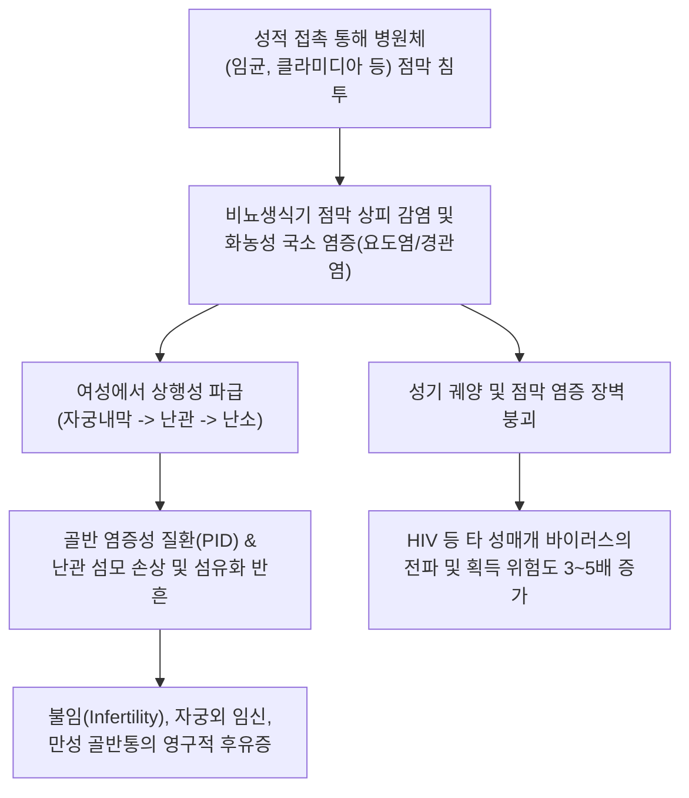
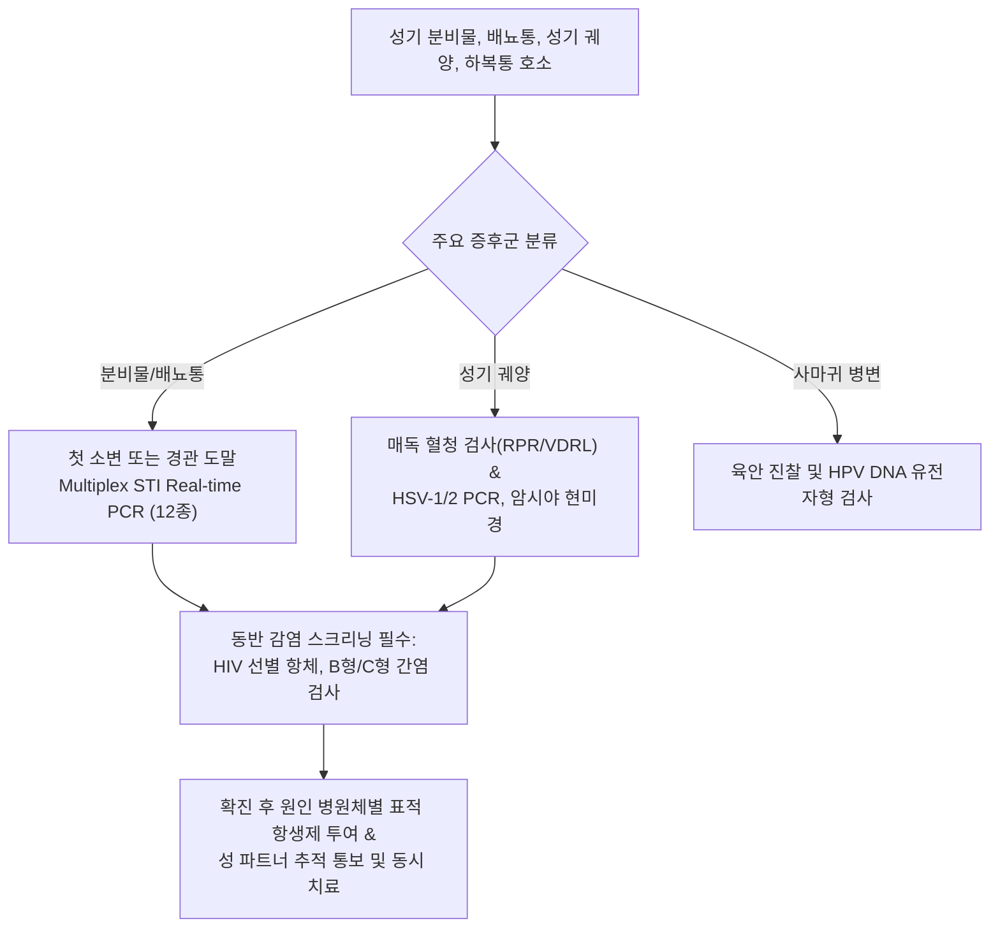

# 🩺 성매개감염병

> **핵심 3줄 요약 (Key Summary)**:
> - 📍 병소 부위 & 해부·병태생리: 성적 접촉을 통해 전파되는 병원체(세균, 바이러스, 원충)에 의해 요도, 자궁경부, 질, 외음부 점막 및 인후두·직장 상피에 발생하는 감염 질환군(클라미디아, 임질, 매독, 첨규콘딜롬, 음부포진 등).
> - 🚩 전형적 임상 양상: 배뇨통, 요도 분비물(화농성 또는 점액성), 질 분비물 증가, 성기 부위 궤양 또는 사마귀 병변, 하복부 통증; 여성의 상당수에서 무증상 보균.
> - 🛠️ 핵심 검사 & 치료 전략: 소변 또는 자궁경부/요도 도말 다중 중합효소연쇄반응(Multiplex STI PCR), 매독 혈청 선별 검사(RPR/VDRL 및 FTA-ABS/TPPA), 질 분비물 습식 도말; 병원체별 표준 항생제(세프트리악손, 독시사이클린, 벤자틴 페니실린 등) 및 **성 파트너 동시 검사 및 치료**.
> - ⚠️ 응급 의뢰 레드플래그: 급성 골반 염증성 질환(PID)에 따른 난관난소농양 및 범발성 복막염, 신경매독(급격한 시력 저하, 섬망, 뇌신경 마비), 파종성 임균 감염(DGI: 관절염-피부염 증후군).

---

## 📌 목차
1. [질환 개요 & 해부학적 병태생리](#1-질환-개요--해부학적-병태생리)
2. [병태생리 메커니즘 & 생체역학적 악순환 네트워크](#2-병태생리-메커니즘--생체역학적-악순환-네트워크)
3. [임상 증상 & 이학적 검사(Physical Exam) 알고리즘](#3-임상-증상--이학적-검사physical-exam-알고리즘)
4. [감별 진단 매트릭스 (Differential Diagnosis)](#4-감별-진단-매트릭스--differential-diagnosis)
5. [한의 통합 치료 프로토콜 (침·약침·추나·한약)](#5-한의-통합-치료-프로토콜--침약침추나한약)
6. [양방 치료 & 병용·의뢰 기준 (Conventional Treatment & Referral)](#6-양방-치료--병용의뢰-기준-conventional-treatment--referral)
7. [재활 운동 & 생활습관 티칭 가이드](#7-재활-운동--생활습관-티칭-가이드)
8. [💡 사용자 진료실 핵심 필기 & 임상 노하우 (Melt-In 잔여 심화 집약)](#8--사용자-진료실-핵심-필기--임상-노하우--melt-in-잔여-심화-집약)
9. [출처 및 학술 참고 문헌 (References)](#9-출처-및-학술-참고-문헌--references)

---

## 1. 질환 개요 & 해부학적 병태생리

**성매개감염병(Sexually Transmitted Infections, STIs)**은 성행위(질내 성교, 구강 성교, 항문 성교)를 주된 매개로 하여 전파되는 감염성 질환을 총칭한다. 과거 성병(Venereal Diseases)으로 불렸으나 무증상 감염의 중요성이 부각되면서 STI로 표준화되었다. 전 세계적으로 매일 100만 건 이상의 새로운 감염이 발생하며, 공중보건학적으로 중요한 주요 8대 병원체는 완치 가능한 4대 세균/원충 질환인 **클라미디아(*Chlamydia trachomatis*)**, **임질(*Neisseria gonorrhoeae*)**, **매독(*Treponema pallidum*)**, **트리코모나스증(*Trichomonas vaginalis*)**과 완치가 불가능하나 조절 가능한 4대 바이러스 질환인 **인체면역결핍바이러스(HIV)**, **단순포진바이러스 2형(HSV-2)**, **인유두종바이러스(HPV)**, **B형 간염 바이러스(HBV)**이다.

병원체는 요도, 질, 자궁경관, 직장, 구강 점막의 원주상피 또는 중층편평상피에 침투하여 국소 염증을 유발한다. 남성에서는 요도 상피의 호중구 침윤으로 [[요도염]]과 부고환염을 일으킨다. 여성에서는 자궁경관염(Cervicitis)으로 시작하여 상행성 전파(Ascending infection)를 통해 자궁내막, 난관, 난소 및 골반강으로 파급되어 **[[골반 염증성 질환]](Pelvic Inflammatory Disease, PID)**을 유발한다. 난관 상피 섬모의 괴사와 섬유화는 난관 폐색을 초래하여 자궁외 임신과 영구적 불임의 주원인이 된다.

---

## 2. 병태생리 메커니즘 & 생체역학적 악순환 네트워크

점막 상피에 유착된 병원체는 세포내 침입 및 독소 분비로 상피세포 파괴와 궤양을 형성한다. 매독균(*T. pallidum*)에 의한 경성하감이나 HSV-2에 의한 수포성 궤양은 표피 방어벽을 붕괴시키고 랑게르한스 세포와 CD4+ T세포를 국소로 끌어들여 HIV 바이러스의 유입과 감염 위험을 수배 이상 급증시키는 상호 촉진적 악순환을 유발한다. 또한 무증상 상태에서도 병원체 배출이 지속되므로 파트너 간의 지속적인 재감염(Ping-pong infection)이 형성된다.

---

## 3. 임상 증상 & 이학적 검사(Physical Exam) 알고리즘

### 주요 증후군별 임상 증상
- **요도염/자궁경관염 증후군**:
  - 남성: 배뇨 시 요도 작열통, 다량의 황백색 농성 요도 분비물(임균성) 또는 맑은 점액성 분비물 및 요도 가려움(비임균성/클라미디아).
  - 여성: 질 분비물(대하) 증가, 성교통, 부정 출혈, 배뇨통. 여성의 $70\sim 80\%$에서 자각 증상이 없는 무증상 잠복.
- **성기 궤양 증후군 (Genital ulcer)**:
  - 통증 없는 단일 굳은 궤양(경성하감, 무통성 림프절염): 제1기 매독.
  - 무리지어 발생하는 심한 통증의 다발성 수포 및 얕은 궤양: 음부포진(HSV).
- **성기 사마귀 증후군**:
  - 외음부, 항문 주위 닭볏 또는 양배추 모양의 무통성 융기 병변: [[첨규콘딜롬]](HPV 6, 11형).
- **골반 염증성 질환 (PID)**:
  - 하복부 통증, 자궁경부 거상통(Chandelier sign), 부속기 압통, $38.3^\circ\text{C}$ 이상의 [[발열]].

### 진단 알고리즘

---

## 4. 감별 진단 매트릭스 (Differential Diagnosis)

| 감별 질환 | 주요 원인체 | 분비물 및 궤양 특성 | 진단적 핵심 검사 | 1차 표준 치료 |
| :--- | :--- | :--- | :--- | :--- |
| **임균성 요도염** | *Neisseria gonorrhoeae* | 다량의 짙은 황색 화농성 분비물, 심한 배뇨통 | Gram 염색상 세포내 그람음성 쌍구균, PCR | 세프트리악손 $500\text{ mg}$ IM 1회 |
| **비임균성 요도염** | *C. trachomatis*, *M. genitalium* | 소량의 맑거나 백색 점액 분비물, 요도 소양증 | Multiplex STI PCR 양성 | 독시사이클린 $100\text{ mg}$ bid 7일 |
| **제1기 매독 (경성하감)** | *Treponema pallidum* | 단일 무통성 기저부 단단한 궤양, 림프절 비대 | RPR/VDRL 선별 후 FTA-ABS/TPPA 확진 | 벤자틴 페니실린 G 240만단위 IM 1회 |
| **생식기 헤르페스** | HSV 2형 (또는 1형) | 극심한 통증을 동반한 다발성 수포 및 궤양 | HSV PCR 또는 Tzanck 도말 검사 | 아시클로버 또는 발라시클로버 경구 |
| **트리코모나스 질염** | *Trichomonas vaginalis* | 거품 섞인 악취 나는 황록색 질 분비물, 딸기양 경부 | 질 분비물 생리식염수 습식 도말(운동성 편모충) | 메트로니다졸 $2\text{ g}$ 단회 또는 7일 요법 |

---

## 5. 한의 통합 치료 프로토콜 (침·약침·추나·한약)

> ⚠️ 성매개감염병은 전염성 미생물 감염 질환으로, 조기에 정확한 항생제/항바이러스제를 투여하여 병원체를 완전 박멸하는 것이 제1원칙이다. 한의 치료는 항생제 치료 후에도 지속되는 만성 골반통, 비세균성 잔여 요도 불편감, 만성 질 분비물 이상, 면역 저하에 따른 헤르페스·곤지름의 잦은 재발을 억제하는 면역 조절 및 체질 개선 지지요법으로 활용한다.

### 1) 한약 처방 (아급성·만성 후유증 지지요법)
- **하초습열증 (下焦濕熱證 - 급만성 요도염/질염 후 잔여 배뇨통, 작열감, 황색 대하, 설태 황니)**:
  - 처방: [[용담사간탕]] 또는 [[팔정산]] 가감 ([[용담초]], [[황금]], [[치자]], [[목통]], 차전자, [[생지황]], [[당귀]], 활석, [[대황]]).
  - 약리 기전: 황금-치자의 전염증성 사이토카인 억제 및 항균 보조 작용, 차전자-목통의 요로 이뇨 소종 및 점막 충혈 진정.
- **기허습저증 (氣虛濕沮證 - 만성 골반염 후유증, 하복부 은은한 통증, 피로 시 악화되는 백대하)**:
  - 처방: 완대탕 합 [[삼령백출산]] 가감 ([[백출]], [[산약]], [[인삼]], 백작약, 차전자, 시호, 진피, 형개수, [[복령]]).
  - 학술 근거: 장관 및 비뇨생식기 점막 상피 장벽 회복 및 국소 분비형 sIgA 분비 촉진.
- **신음부족 및 허화상염증 (腎陰不足 虛火上炎證 - 헤르페스 음부포진의 잦은 재발, 요슬산연, 수족심열)**:
  - 처방: 지백지황환 가감 ([[숙지황]], [[산약]], [[산수유]], [[복령]], [[목단피]], [[지모]], [[황백]]).
  - 작용: 세포성 Th1 면역 감시 기능 증강을 통한 바이러스 재활성화 억제.

### 2) 외용 한약 세정 요법
- **청열해독 지양세제 (외음부 소양 및 궤양)**:
  - 구성: [[고삼]] $30\text{ g}$, [[황백]] $20\text{ g}$, [[금은화]] $20\text{ g}$, 백선피 $15\text{ g}$, 사상자 $15\text{ g}$.
  - 방법: 전탕액을 미온수로 식혀 1일 1회 외음부 세정 또는 좌욕 시행. 2차 세균 감염 차단 및 상피화 촉진.

---

## 6. 양방 치료 & 병용·의뢰 기준 (Conventional Treatment & Referral)

### 양방 표준 치료 가이드라인 (CDC/질병관리청 STI 지침)
1. **임균 감염증**: 세프트리악손(Ceftriaxone) $500\text{ mg}$ 근육주사 1회 (클라미디아 동반 배제 불가 시 독시사이클린 병용).
2. **클라미디아 감염증**: 독시사이클린(Doxycycline) $100\text{ mg}$ 1일 2회, 7일간 경구 투여. (임산부는 아지트로마이신 $1\text{ g}$ 단회).
3. **매독**:
   - 1기, 2기, 조기 잠복 매독: 벤자틴 페니실린 G(Benzathine penicillin G) 240만 단위 근육주사 1회.
   - 후기 잠복 매독: 주 1회씩 3주간 총 3회 근육주사.
4. **성 파트너 관리의 절대 원칙 (Expedited Partner Therapy, EPT)**:
   - 환자의 최근 60일 이내 모든 성 파트너에게 통보하여 증상 유무와 무관하게 동일한 검사와 치료를 동시에 시행해야 함.

### 긴급 응급 의뢰 레드플래그
- 여성에서 하복부 반발통, $38.5^\circ\text{C}$ 이상의 고열, 난관난소농양 파열 의심 징후(급성 복막염).
- 매독 환자의 급격한 시력 저하, 청력 소실, 두통, 수막뇌염 징후(신경매독).
- 파종성 임균 감염(DGI): 무릎, 손목 등의 급성 화농성 관절염 및 피부 농포성 혈관염.

---

## 7. 재활 운동 & 생활습관 티칭 가이드

- **치료 기간 성관계 절대 금지**: 치료 시작 후 본인과 파트너 모두 약물 복용을 완전히 완료하고 증상이 소실될 때까지(최소 7일간) 모든 형태의 성접촉을 전면 중단함.
- **콘돔 사용의 일상화**: 라텍스 콘돔을 성교 시작부터 끝까지 올바르게 사용하면 대부분의 체액 매개 성매개감염병(임질, 클라미디아, HIV 등) 전파를 $90\%$ 이상 차단할 수 있음을 교육함.
- **치료 후 완치 판정 검사 (Test of Cure, TOC)**: 임질이나 클라미디아 치료 종료 3~4주 후 반드시 추적 PCR 검사를 시행하여 병원체 음전을 확인하고, 3개월 후 재감염 스크리닝을 받도록 지도함.
- **HPV 예방접종 권장**: 만 9~45세 남녀 모두에게 9가 HPV 백신(가다실 9) 접종을 적극 권고하여 첨규콘딜롬 및 자궁경부암, 항문암을 선제적으로 예방함.

---

## 8. 💡 사용자 진료실 핵심 필기 & 임상 노하우 (Melt-In 잔여 심화 집약)

> 💡 **임상 핵심 진주 (Clinical Pearls)**:
> - **'여성의 무증상성'을 절대 간과하지 말라**: 남성은 임질이나 요도염에 걸리면 심한 통증과 고름으로 즉시 병원을 찾지만, 여성은 클라미디아나 임질에 걸려도 $70\%$ 이상이 아무런 증상을 느끼지 못한다. 따라서 남성 환자가 요도염으로 확진되면 배우자나 여자친구도 무조건 산부인과 검진을 받도록 강하게 티칭해야 한다.
> - **임질과 클라미디아의 샴쌍둥이 법칙**: 임질에 걸린 환자의 약 $30\sim 50\%$는 클라미디아에 동시 감염되어 있다. 세프트리악손으로 임질만 치료하고 클라미디아 치료제(독시사이클린)를 투여하지 않으면 수일 뒤 맑은 분비물이 다시 나오는 비임균성 요도염으로 고통받게 된다.
> - **STI 진단 시 HIV/매독 검사는 세트 메뉴**: 한 가지 성매개감염병에 걸렸다는 것은 안전하지 않은 성접촉이 있었다는 명백한 증거이다. 클라미디아나 곤지름 환자가 오면 반드시 혈청 매독(RPR)과 HIV 항체 검사를 세트로 스크리닝해야 숨은 중증 감염을 놓치지 않는다.
> - **항생제 복용 완료 전의 '괜찮아졌어요'의 위험성**: 독시사이클린을 2~3일만 먹어도 배뇨통이 씻은 듯이 사라져 약 복용을 임의 중단하는 환자가 많다. 이는 만성 부고환염과 마이코플라스마의 마크로라이드계 항생제 내성을 유발하는 지름길이므로, 7일 치 약을 단 한 알도 빼놓지 않고 완복하도록 엄격히 복약 지도해야 한다.

---

## 9. 출처 및 학술 참고 문헌 (References)

- Gaspar RS, et al. (2026). Exploring Barriers, Facilitators, and Strategies for the Etiological Management of Sexually Transmitted Infections in Brazil: A Qualitative Study Using the Consolidated Framework for Implementation Research (CFIR). *Sex Transm Dis*. PMID: 42949026.

- Vivanet D, et al. (2026). Sexually Transmitted Infections in the Third Age: Rising Risk Among over 65-Year-Old Persons in Southern Sardinia. *J Clin Med*. PMID: 42941381.

- Medina-Marino A, et al. (2026). Antenatal Screening for Sexually Transmitted Infections to Reduce Preterm Birth or Low Birthweight (Philani Ndiphile Study): A Randomized 3-Group Trial. *Clin Infect Dis*. PMID: 42937326.
