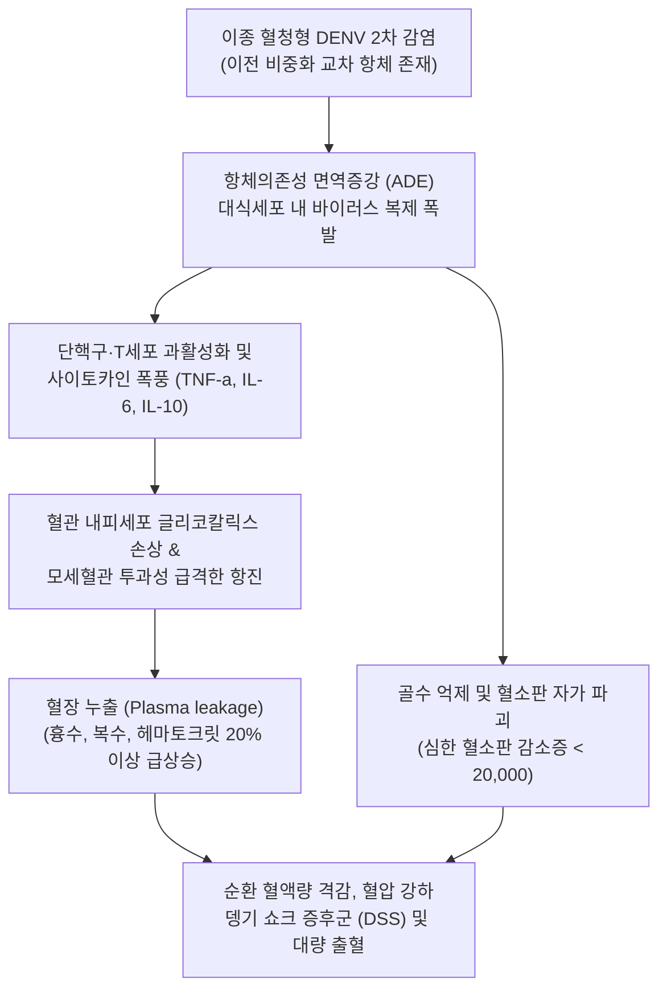
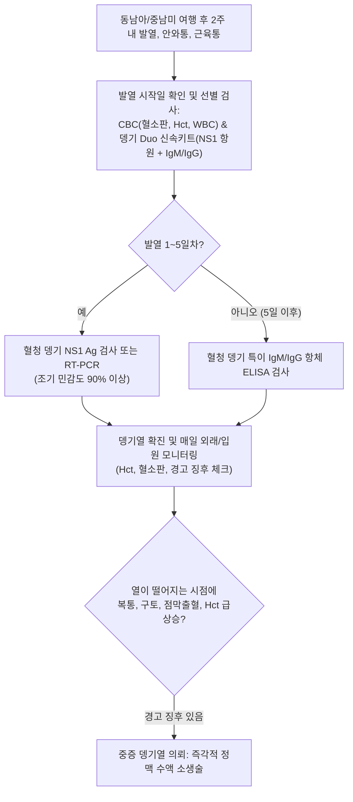

# 🩺 뎅기열

> **핵심 3줄 요약 (Key Summary)**:
> - 📍 병소 부위 & 해부·병태생리: 숲모기(*Aedes aegypti*, *Aedes albopictus*) 흡혈을 통해 매개되는 뎅기 바이러스(DENV 1~4형) 감염으로, 대식세포와 수지상세포에 감염되어 전신 혈관 내피세포 기능 부전, 모세혈관 누출(Plasma leakage) 및 혈소판 파괴 유발.
> - 🚩 전형적 임상 양상: $39\sim 40^\circ\text{C}$의 급격한 고열, 안구 후방 통증(안와통), '뼈가 부서지는 듯한' 극심한 근육통/관절통(Breakbone fever), 홍역양 홍반 피진, 백혈구 및 혈소판 급감.
> - 🛠️ 핵심 검사 & 치료 전략: 혈액 뎅기 NS1 항원 신속 검사(발열 1~5일), DENV RT-PCR, 뎅기 IgM/IgG ELISA, 헤마토크릿(Hct) 및 혈소판 연속 모니터링; 특이 항바이러스제 없음, 세심한 정맥 수액 요법(등장성 정질액) 중심 대증 치료.
> - ⚠️ 응급 의뢰 레드플래그: 해열기(발열 3~7일째)에 나타나는 중증 뎅기 경고 징후(심한 복통, 지속적 구토, 점막 출혈, 흉수/복수, Hct 20% 이상 급상승, 혈소판 < 100,000/μL, 뎅기 쇼크 증후군).

---

## 📌 목차
1. [질환 개요 & 해부학적 병태생리](#1-질환-개요--해부학적-병태생리)
2. [병태생리 메커니즘 & 생체역학적 악순환 네트워크](#2-병태생리-메커니즘--생체역학적-악순환-네트워크)
3. [임상 증상 & 이학적 검사(Physical Exam) 알고리즘](#3-임상-증상--이학적-검사physical-exam-알고리즘)
4. [감별 진단 매트릭스 (Differential Diagnosis)](#4-감별-진단-매트릭스--differential-diagnosis)
5. [한의 통합 치료 프로토콜 (침·약침·추나·한약)](#5-한의-통합-치료-프로토콜--침약침추나한약)
6. [양방 치료 & 병용·의뢰 기준 (Conventional Treatment & Referral)](#6-양방-치료--병용의뢰-기준-conventional-treatment--referral)
7. [재활 운동 & 생활습관 티칭 가이드](#7-재활-운동--생활습관-티칭-가이드)
8. [💡 사용자 진료실 핵심 필기 & 임상 노하우 (Melt-In 잔여 심화 집약)](#8--사용자-진료실-핵심-필기--임상-노하우--melt-in-잔여-심화-집약)
9. [출처 및 학술 참고 문헌 (References)](#9-출처-및-학술-참고-문헌--references)

---

## 1. 질환 개요 & 해부학적 병태생리

**뎅기열(Dengue Fever)**은 플라비바이러스과(Flaviviridae) 플라비바이러스속에 속하는 뎅기 바이러스(Dengue virus, DENV) 감염에 의해 발생하는 급성 열성 모기 매개 질환이다. 혈청형은 DENV-1, DENV-2, DENV-3, DENV-4의 4가지가 존재한다. 주로 열대 및 아열대 지역(동남아시아, 서태평양, 중남미, 아프리카)에 널리 유행하며, 최근 지구 온난화와 국제 여행 증가로 인해 환자 수가 폭발적으로 증가하고 있다. 국내에서는 매년 동남아(베트남, 필리핀, 태국 등) 여행 후 유입되는 대표적인 제3급 법정 감염병이다. 주 매개체는 이집트숲모기(*Aedes aegypti*)와 흰줄숲모기(*Aedes albopictus*)이다.

모기가 흡혈할 때 피부로 주입된 바이러스는 피부의 랑게르한스 세포 및 단핵구, 대식세포를 일차 표적으로 삼아 증식한다. 림프계를 거쳐 전신 혈류로 파종된 바이러스는 골수 거핵세포를 억제하여 혈소판 생성을 저하시키고, 혈소판에 직접 결합하거나 자가항체 생성을 유도하여 말초 혈소판 파괴를 가속화한다. 특정 혈청형에 감염된 후 다른 혈청형에 이차 감염될 때 발생하는 **항체의존성 면역증강(Antibody-Dependent Enhancement, ADE)** 현상은 바이러스 복제를 기하급수적으로 폭증시키고 광범위한 모세혈관 투과성 항진을 초래하여 중증 뎅기(뎅기출혈열/뎅기쇼크증후군)로 진행시키는 핵심 병태생리적 기전이다.

---

## 2. 병태생리 메커니즘 & 생체역학적 악순환 네트워크

초기 일차 감염에서는 중화항체가 형성되어 평생 면역이 획득되지만, 다른 아형의 바이러스에 감염되면 과거 형성된 아형간 교차반응 비중화 항체가 바이러스와 결합하여 대식세포의 Fc 수용체를 통해 바이러스의 세포 내 침투를 오히려 촉진(ADE 현상)한다. 이로 인해 대식세포가 일시에 파괴되면서 다량의 전염증성 사이토카인이 쏟아져 나와 혈관 내피세포 장벽(Endothelial glycocalyx)을 허물어뜨린다. 혈관 내 단백질과 혈장이 흉강과 복강으로 급격히 누출(Plasma leakage)되면서 유효 순환 혈류량이 고갈되어 헤마토크릿(Hct)이 치솟고, 뎅기 쇼크 증후군(Dengue Shock Syndrome, DSS)과 다발성 장기 부전의 치명적 악순환에 빠진다.

---

## 3. 임상 증상 & 이학적 검사(Physical Exam) 알고리즘

### 질환의 3단계 임상 경과
- **1. 발열기 (Febrile phase, $2\sim 7$일)**:
  - $39\sim 40^\circ\text{C}$의 돌발성 고열, 얼굴 홍조, 결막 충혈.
  - 심한 두통, 특히 안구를 움직일 때 악화되는 안와 후방 통증(Retro-orbital pain).
  - 뼈가 부러지는 듯한 전신 근육통 및 관절통(Breakbone fever).
  - 발열 $3\sim 4$일째 나타나는 소양성 홍반성 발진(붉은 바다에 뜬 하얀 섬 소견: Islands of white in a sea of red).
- **2. 위험기 / 임계기 (Critical phase, 발열이 소실되는 $3\sim 7$일째, $24\sim 48$시간 지속)**:
  - **열이 떨어지면서 환자가 회복되는 것이 아니라 오히려 쇼크로 빠지는 가장 위험한 시기**.
  - **경고 징후 (Warning signs)**: 극심한 복통, 지속적인 구토(3회/일 이상), 점막 출혈(비출혈, 잇몸 출혈, 토혈), 기면 및 안절부절못함, 간비대($>2\text{ cm}$), 흉수/복수 축적, Hct 급상승과 동반된 혈소판 급감.
  - 쇼크 발현: 맥압(Pulse pressure) $\le 20\text{ mmHg}$, 차갑고 축축한 사지, 빈맥, 저혈압.
- **3. 회복기 (Convalescent phase, $48\sim 72$시간 후)**:
  - 누출된 혈장이 혈관 내로 재흡수되며 전신 상태 급속 호전, 식욕 회복, 지연성 가려움증 동반 반구진.

### 진단 알고리즘

---

## 4. 감별 진단 매트릭스 (Differential Diagnosis)

| 감별 질환 | 매개체 및 병원체 | 주증상 및 통증 양상 | 백혈구/혈소판/Hct | 진단적 핵심 포인트 |
| :--- | :--- | :--- | :--- | :--- |
| **뎅기열 (Dengue)** | *Aedes* 모기, Flavivirus | 고열, 심한 안와통, 뼈마디 근육통, 홍반, 혈장 누출 | WBC 급감, Plt 급감, **Hct 급상승** | NS1 항원 양성, 해열기에 쇼크 위험(임계기) |
| **치쿤구니야열 (Chikungunya)** | *Aedes* 모기, Alphavirus | 고열, 손목·발목의 극심하고 쇠약해지는 관절염 | 혈소판 정상 또는 경도 감소, Hct 정상 | 관절 종창 및 수개월 지속되는 만성 관절통 |
| **지카바이러스 감염증** | *Aedes* 모기, Flavivirus | 미열, 전신 반구진성 발진, 무통성 결막염 | 대개 혈액 수치 경미한 변화 | 발진이 주증상, 길랭-바레 증후군, 선천성 소두증 |
| **열대열 [[말라리아]]** | *Anopheles* 모기, *P. falciparum* | 주기적 오한전율 고열, 심한 두통, 황달, 비장비대 | 혈소판 감소, 빈혈, **Hct 저하(용혈)** | 혈액 도말상 적혈구 내 링 폼 관찰 |
| **렙토스피라증** | 설치류 소변 오염 담수, 세균 | 고열, 결막하 출혈, 종아리 극심한 근육통 | 호중구 증가, 혈소판 감소, 황달, 신부전 | 결막 충혈(분비물 없음), 비복근 압통, 미세응집검사 |

---

## 5. 한의 통합 치료 프로토콜 (침·약침·추나·한약)

> ⚠️ 뎅기열의 급성기, 특히 해열 전후의 임계기(Critical phase)에는 혈장 누출로 인한 저혈량성 쇼크와 대량 출혈 위험이 있으므로, 엄격한 입원 정맥 수액 치료가 최우선이다. **아스피린, 이부프로펜 등 NSAIDs는 혈소판 기능을 억제하고 위장관 출혈을 유발하므로 절대 금기**이다. 한의 치료는 급성기 고열 시의 온병학적 열독 완화 보조, 및 회복기 환자의 골수 조혈 회복, 극심한 만성 관절·근육통 및 뎅기 후 증후군(Post-dengue fatigue) 관리에 적용한다.

### 1) 한약 처방 (변증별 지지요법)
- **온병 온독발반증 (溫病 溫毒發斑證 - 급성기 고열, 심한 안와통, 두통, 전신 근육통, 발진)**:
  - 처방: [[백호탕]] 합 [[청심연자음]] 가감 ([[석고]], [[지모]], [[인삼]], [[감초]], 연자육, 황금, 맥문동, 차전자).
  - 약리 기전: 석고의 고용량 해열 진통 작용, 지모의 혈관 내피 보호 및 염증성 사이토카인 억제.
- **기음양허 및 어열상저증 (氣陰兩虛 瘀熱相沮證 - 회복기 극심한 만성 피로, 식욕부진, 미열 잔여)**:
  - 처방: [[생맥산]] 합 [[보중익기탕]] 가감 ([[인삼]], [[맥문동]], [[오미자]], [[황기]], [[백출]], [[당귀]], 진피, 승마, 시호).
  - 학술 근거: 인삼 사포닌의 모세혈관 투과성 안정화 및 조혈 기능 보조, 기력 회복 촉진.
- **풍습열비증 (風濕熱痺證 - 회복기 손발 관절의 지속적인 쑤심과 뻣뻣함)**:
  - 처방: [[갈근탕]] 합 대방풍탕 가감 ([[갈근]], [[마황]], [[백작약]], [[감초]], [[방풍]], [[황기]], 우슬, 두충).
  - 작용: 관절 주변 연부조직 염증 진정 및 혈류 개선.

### 2) 침구 치료
- **혈위**: 곡지(LI11), 합곡(LI4), 족삼리(ST36), 태충(LR3), 풍지(GB20), 양릉천(GB34).
- **시술 지침**: 혈소판 감소기($<50,000/\mu\text{L}$)에는 출혈 및 혈종 형성 위험으로 자침을 엄격히 유보함. 회복기 혈소판이 $100,000/\mu\text{L}$ 이상으로 정상화된 후 잔여 근육통 완화를 위해 원격 혈위 위주로 얕게 시술함.

---

## 6. 양방 치료 & 병용·의뢰 기준 (Conventional Treatment & Referral)

### 양방 표준 치료 프로토콜 (WHO 가이드라인)
1. **수액 요법 (가장 중요한 유일한 생명선)**:
   - 특이 항바이러스제가 없으므로 적절한 수액 공급이 치료의 성패를 결정함.
   - 경구 수액: 경증 환자는 경구 수액염(ORS), 과일 주스 등으로 탈수 예방.
   - **정맥 수액(IV Fluids)**: 임계기 혈장 누출 시 **등장성 결정질액(0.9% 생리식염수 또는 하트만액)**을 투여하며, Hct 수치와 소변 배출량($0.5\sim 1\text{ mL/kg/h}$)에 따라 시간당 수액 속도를 세밀히 조절함. (과도한 수액 투여 시 회복기 폐부종 유발 주의).
2. **해열 진통제 선택**:
   - **오직 아세트아미노펜(Acetaminophen, Paracetamol)만 허용** ($1\text{회 } 500\sim 1000\text{ mg}$, 일일 최대 $3\text{ g}$).
   - **절대 금기**: 아스피린, 이부프로펜, 덱시부프로펜, 나프록센 등 모든 NSAIDs 제제(위장관 출혈 및 Reye 증후군 유발).

### 긴급 응급 의뢰 레드플래그
- **뎅기 쇼크 증후군 (DSS)**: 수축기 혈압 강하, 맥압 $\le 20\text{ mmHg}$, 차갑고 축축한 피부, 모세혈관 재충혈 시간 $>2$초.
- Hct가 기저치 대비 $20\%$ 이상 급격히 상승하면서 혈소판이 급감하는 경우.
- 심한 지속성 복통 및 멈추지 않는 구토.
- 대량의 위장관 출혈(토혈, 흑색변) 및 비출혈, 육안적 혈뇨.

---

## 7. 재활 운동 & 생활습관 티칭 가이드

- **진통제 자가 복용 엄격 주의**: 발열과 통증이 심하다고 집에 있는 감기약이나 소염진통제(NSAIDs)를 임의로 복용하면 치명적인 위장관 출혈이 터질 수 있으므로, 반드시 타이레놀(아세트아미노펜) 단일 제제만 복용하도록 환자에게 강력히 경고함.
- **모기 물림 차단 (2차 전파 방지)**: 환자가 발열기에 모기에 물리면 그 모기가 가족이나 이웃에게 바이러스를 전파하므로, 발열기 동안 모기장을 치고 실내에 머물도록 함.
- **수분 섭취 모니터링**: 맹물만 많이 마시면 저나트륨혈증이 올 수 있으므로, 이온음료나 전해질 분말을 탄 미온수를 소량씩 자주 마시도록 지도함.
- **임계기 절대 안정**: 열이 떨어지는 날부터 48시간 동안은 절대 무리하게 움직이지 말고 침상 안정을 취하며 소변량과 어지럼증을 면밀히 관찰함.

---

## 8. 💡 사용자 진료실 핵심 필기 & 임상 노하우 (Melt-In 잔여 심화 집약)

> 💡 **임상 핵심 진주 (Clinical Pearls)**:
> - **'열이 떨어질 때 환자가 죽는다' (임계기의 역설)**: 대부분의 감염병은 열이 내리면 병이 낫는 징조이지만, 뎅기열은 완전히 정반대이다. 열이 펄펄 끓는 발열기에는 고통스럽지만 죽지 않는다. 진짜 위험한 순간은 발열 4~5일째에 열이 $37^\circ\text{C}$대로 뚝 떨어지는 바로 그날부터 48시간 동안이며, 이때 혈장 누출 쇼크가 터진다. 환자에게 "열이 떨어질 때 배가 아프거나 어지러우면 지체 없이 응급실로 가야 한다"고 교육해야 한다.
> - **'헤마토크릿(Hct)'이 혈소판보다 중요하다**: 많은 임상의가 혈소판 수치만 쳐다보지만, 사망을 예측하는 가장 정확한 지표는 헤마토크릿(Hct)이다. 혈관에서 물이 빠져나가 혈액이 농축되면 Hct가 $45\sim 50\%$ 이상으로 치솟는다. Hct가 급상승하면 혈압이 떨어지기 직전이라는 경고 신호이다.
> - **안와 후방 통증(Retro-orbital pain)의 특이성**: "눈알 뒤쪽이 빠질 것처럼 아파서 눈을 좌우로 굴릴 수가 없다"는 호소는 뎅기열 환자의 전형적인 병태생리학적 징후이다.
> - **아스피린/NSAIDs 절대 금기의 원칙**: 동남아 여행 후 열과 몸살로 내원한 환자에게 무심코 소염진통제 주사를 놓거나 NSAIDs를 처방하는 것은 환자에게 혈소판 기능 마비와 치명적 위장관 출혈을 선물하는 것과 같다. 뎅기열 배제 전에는 오직 아세트아미노펜만 써야 한다.

---

## 9. 출처 및 학술 참고 문헌 (References)

- Huang YH, et al. (2026). Clinical and laboratory features associated with dengue in central Taiwan during the 2023 outbreak. *J Formos Med Assoc*. PMID: 42966719.

- Damfo SA, et al. (2026). Molecular Characterization of a Saudi Arabian DENV-3 Isolate and Identification of Potential Inhibitors Targeting Dengue Virus Proteins. *Virus Res*. PMID: 42966602.

- Castro-Meneses AO, et al. (2026). Circulating Zika and dengue IgA-NS1 marks early postnatal exposure without significant association with congenital Zika syndrome-related microcephaly. *J Infect Dis*. PMID: 42965304.
