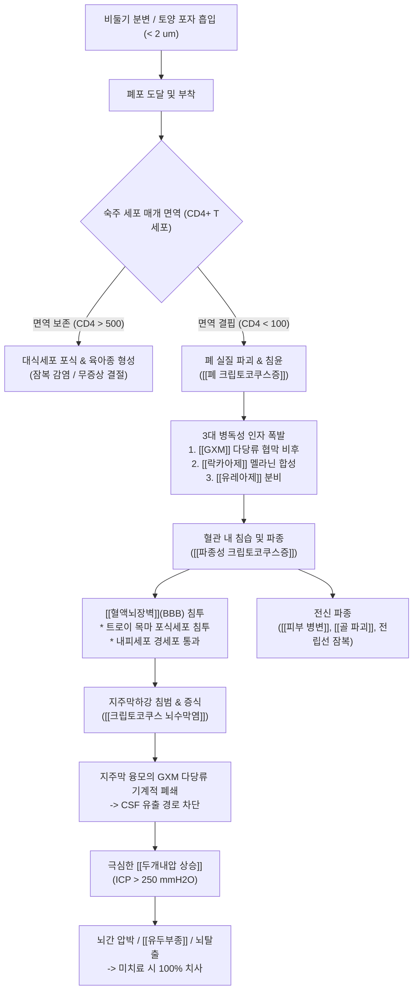

# 🩺 [[효모균증]] (Cryptococcosis / 酵母菌症, ICD-10 B45 / KCD-8 B45)

> **핵심 3줄 요약 (Key Summary)**:
> - 📍 **병소 부위 & 병태생리**: [[Cryptococcus neoformans]] 및 [[Cryptococcus gattii]] 진균 포자의 호흡기 흡입으로 시작되는 치명적 [[기회감염]] 질환이다. 두꺼운 글루쿠로노자일로만난([[GXM]]) 다당류 협막(Capsule)과 멜라닌을 통해 숙주 면역을 회피하며, 혈류를 타고 [[혈액뇌장벽]](BBB)을 통과하여 [[중추신경계]](뇌막 및 뇌실질)에 호발 침범한다.
> - 🚩 **전형적 임상 양상 & 3대 징후**: ① 아급성으로 악화되는 극심한 두통 및 발열, ② 의식 혼탁·기면·성격 변화, ③ 극심한 [[두개내압 상승]](개방압 > 200~250 mmH2O)에 따른 오심·구토, [[유두부종]], 제6뇌신경 마비. 면역저하자([[HIV/AIDS]], 장기이식, 고용량 스테로이드 복용자)에서는 폐 침윤([[폐 크립토코쿠스증]])과 전신 파종이 동반된다.
> - 🛠️ **핵심 감별 & 한·양방 치료 전략**: [[요추천자]] 뇌척수액([[CSF]]) [[인도 잉크 염색]](협막 후광 관찰)과 크립토코쿠스 항원 검사([[CrAg]] LFA, 민감도 > 98%)로 확진한다. 양방 치료는 3단계([[암포테리신 B]] + [[플루시토신]] 유도기 2주 → [[플루코나졸]] 공고기 8주 → 플루코나졸 유지기 최소 1년) 표준 항진균 요법 및 연속적 감압 요추천자가 생존의 절대 원칙이다. 한의 치료는 아급성기·회복기 신경학적 후유증 관리 및 면역 회복을 위해 [[청영탕]], [[안궁우황환]], [[지백지황탕]] 등 온병(溫病) 영혈분(營血分) 청열해독·자음보신 치법을 통합 적용한다.
> - <font color="#fa7e7e">⚠️ **응급 의뢰 레드플래그**: 급격한 의식 저하, 뇌탈출(Herniation) 전구 증상(동공 부동, 쿠싱 삼징후: 서맥·고혈압·불규칙 호흡), CSF 개방압 > 350 mmH2O, 항레트로바이러스 치료([[ART]]) 개시 후 모순적 악화를 보이는 면역재구성 염증증후군([[IRIS]]). 발견 즉시 감염내과 및 신경과 중환자실로 응급 전원의뢰해야 한다.</font>

---

## 📌 목차
1. [질환 개요 & 병태생리 (Disease Overview)](#1-질환-개요--병태생리-disease-overview)
2. [병태생리 메커니즘 & 대사·장기부전 악순환 네트워크](#2-병태생리-메커니즘--대사장기부전-악순환-네트워크)
3. [임상 증상 & 환자 소견 (Clinical Presentation)](#3-임상-증상--환자-소견-clinical-presentation)
4. [감별 진단 매트릭스 (Differential Diagnosis)](#4-감별-진단-매트릭스-differential-diagnosis)
5. [한의 통합 치료 프로토콜 (침·약침·한약)](#5-한의-통합-치료-프로토콜-침약침한약)
6. [양방 치료 & 병용·의뢰 기준 (Conventional Treatment & Referral)](#6-양방-치료--병용의뢰-기준-conventional-treatment--referral)
7. [식이·생활습관 & 자가관리 티칭 가이드](#7-식이생활습관--자가관리-티칭-가이드)
8. [💡 진료실 핵심 필기 & 임상 노하우](#8--진료실-핵심-필기--임상-노하우)
9. [출처 및 학술 참고 문헌 (References)](#9-출처-및-학술-참고-문헌-references)

---

## 1. 질환 개요 & 병태생리 (Disease Overview)

* **질환 정의 및 분류**:
  * **효모균증(Cryptococcosis, 크립토코쿠스증)**은 캡슐화된 효모 진균인 *Cryptococcus* 속에 의해 발생하는 중증 진균 감염증이다.
  * 주로 전 세계적으로 분포하는 [[Cryptococcus neoformans]](주로 혈청형 A, D)와 주로 열대·아열대 및 유칼립투스 수목 지대에서 발견되는 *Cryptococcus gattii*(혈청형 B, C)의 두 주요 병원체에 의해 발병한다.
  * **임상 분류 (ICD-10 B45)**:
    * B45.0 **[[폐 크립토코쿠스증]] (Pulmonary cryptococcosis)**: 원발성 흡입 감염으로 폐실질에 무증상 결절, 침윤, 경화, 공동 또는 급성 호흡곤란증후군 유발.
    * B45.1 **[[뇌 크립토코쿠스증]] (Cerebral cryptococcosis / Cryptococcal meningitis)**: 혈행성 파종을 통해 지주막하강과 뇌실질을 침범하여 아급성 수막뇌염 유발. 미치료 시 치사율 100%.
    * B45.2 **[[피부 크립토코쿠스증]] (Cutaneous cryptococcosis)**: 파종성 감염의 주요 외표 징후로 전염성 연속종 유사 구진, 궤양, 봉와직염 양상.
    * B45.3 **[[골 크립토코쿠스증]] (Osseous cryptococcosis)**: 척추, 두개골, 장골 등에 용해성 골병변(Osteolytic lesion) 형성.
    * B45.7 **[[파종성 크립토코쿠스증]] (Disseminated cryptococcosis)**: 혈류를 통해 2개 이상의 비인접 장기(혈액, 림프절, 신장, 비장, 전립선 등)로 퍼진 전신 패혈증 상태.
  * **역학 및 취약군**:
    * *C. neoformans* 감염의 대다수는 [[면역결핍]] 환자에서 발생한다: [[HIV/AIDS]] 환자(특히 [[CD4+ T세포]] 수 < 100/uL), [[장기이식]] 후 면역억제제(타크로리무스, 사이클로스포린) 복용자, 혈액종양([[백혈병]], [[림프종]]), [[간경변]], 전신홍반루푸스([[SLE]]), 고용량 [[글루코코르티코이드]] 장기 투여자.
    * 반면 *C. gattii*는 세포 매개 면역이 정상인 숙주에서도 원발성 폐감염 및 대형 크립토코코마(Cryptococcoma)를 동반한 중추신경계 감염을 빈번히 유발한다.

* **관련 장기 및 조직**:
  * **원발 침입 장기**: [[폐]](폐포 상피세포 및 폐실질). 건조 분변이나 흙먼지 속 1~2 um 크기의 무협막 포자 또는 미세 효모가 흡입되어 폐포에 안착.
  * **친화 표적 장기**: [[중추신경계]](지주막, 연질막, 맥락총, 기저핵, Virchow-Robin 혈관주위공간). 뇌척수액의 높은 영양분(글루코스, 아미노산, 이노시톨)과 도파민 성분이 진균 증식을 가속화함.
  * **전신 전파 장기**: [[피부]], [[골격계]], [[전립선]](약물 침투가 낮아 치료 후 진균이 잠재 잔류하는 저장소 역할), [[신장]].

---

## 2. 병태생리 메커니즘 & 대사·장기부전 악순환 네트워크

```text
+-------------------------------------------------------------------------------+
|               효모균증 (Cryptococcosis) 병태생리 침습 & 전파 네트워크              |
+-------------------------------------------------------------------------------+
 [환경원인: 비둘기 분변 / 부식 토양]
        |
        v (건조 탈수된 담자포자 / 효모균체 흡입: 직경 < 2 um)
 [폐포(Alveoli) 도달]
        |
        +---> [면역 정상 숙주: 폐포 대식세포 포식, Th1 면역 반응 (IFN-gamma, TNF-alpha)]
        |       |---> 육아종(Granuloma) 형성 -> 잠복 감염 (Latent infection) / 무증상 결절
        |
        +---> [면역 저하 숙주: CD4+ T세포 결핍 (HIV/AIDS < 100/uL), 면역억제제 복용]
                |
                v [병독성 인자 발현 및 협막 비후]
                * 글루쿠로노자일로만난([[GXM]]) 협막(Capsule) 비후 (20-30 um): 포식작용 억제, 보체 소진
                * [[락카아제]](Laccase) 활성 -> [[멜라닌]](Melanin) 합성: 숙주 활성산소종(ROS) 무력화
                * 만니톨 및 [[유레아제]](Urease) 분비: 삼투압 스트레스 극복 및 혈관 내피 부착 촉진
                |
                v [폐 실질 침습 및 혈관 침습]
                폐포 침윤, 기침, 흉통, 괴사성 결절 -> 혈류 유입 (Fungemia)
                |
                v [혈행성 파종 (Hematogenous Dissemination)]
                혈중 다량의 유리 GXM 항원 분비 -> 면역 감시 마비 -> 전신 순환
                |
                v [혈액뇌장벽([[BBB]]) 통과 3대 기전]
                1. 트로이 목마 기전: 감염된 [[대식세포]] 및 단핵구 내부에 숨어 통과
                2. 경세포 통과 (Transcytosis): 뇌 미세혈관 내피세포에 직접 결합 후 세포 내포 통과
                3. 세포주위 통과 (Paracellular): 균체 분비 효소에 의한 밀착연접(Tight junction) 파괴
                |
                v [중추신경계(CNS) 증식: 신경친화성(Neurotropism)]
                CSF 내 풍부한 도파민을 기질로 멜라닌화 -> 세포벽 강화 및 폭발적 증식
                |
                +---> [크립토코쿠스 뇌수막염 & 뇌염]
                |       * 지주막하강(Subarachnoid space) 내 대량의 점액성 GXM 다당류 축적
                |       * 지주막 융모(Arachnoid villi) 폐쇄 -> 뇌척수액 재흡수 차단
                |       * 극심한 [[두개내압 상승]](ICP > 200~250 mmH2O)
                |       * Virchow-Robin 혈관주위공간 팽창 ("Soap-bubble" 가성낭종 형성)
                |       * 뇌신경(CN II, VI, VII, VIII) 견인 압박, [[유두부종]], 시력 상실, 뇌탈출
                |
                +---> [전신 다발성 파종]
                        * 피부 병변: 전염성 연속종 유사 구진, 괴사성 궤양
                        * 골·관절: 용해성 골수염, 관절염
                        * 비뇨기: [[전립선]] 내 지속 감염소 형성 (치료 중단 시 재발 원인)
+-------------------------------------------------------------------------------+
```



### 1) 분자·세포 수준 기전: 3대 핵심 병독성 인자
* **글루쿠로노자일로만난([[GXM]]) 다당류 협막**:
  * 균체 부피의 90% 이상을 차지하는 거대 다당류 협막은 세포벽 외측에 형성된다.
  * 숙주 조직 내에서 협막 두께가 20~30 um까지 급격히 비대해져 호중구 및 대식세포의 물리적 포식작용(Phagocytosis)을 차단한다.
  * 순환계로 대량 방출된 수용성 GXM 항원은 보체 성분(C3b)을 고갈시키고, 백혈구 주화성을 억제하며, T세포 증식을 억제하고 수지상세포의 면역 신호 전달을 교란한다.
* **[[락카아제]](Laccase) 효소와 멜라닌(Melanin) 생합성**:
  * *Cryptococcus*는 숙주 조직의 디페놀 화합물(L-DOPA, 에피네프린, 노르에피네프린 등 카테콜아민)을 기질로 락카아제 효소를 작동시켜 세포벽에 멜라닌 색소를 축적한다.
  * 멜라닌화된 세포벽은 숙주 면역세포가 방출하는 활성산소종([[ROS]])과 활성질소종(RNS)을 강력하게 소거하며, 양방 항진균제([[암포테리신 B]])에 대한 저항성을 부여한다.
  * 중추신경계의 흑질 및 뇌척수액에 풍부한 신경전달물질(도파민)은 크립토코쿠스가 뇌실질에 강력한 신경친화성(Neurotropism)을 갖게 되는 핵심 생화학적 유인 요인이다.
* **[[유레아제]](Urease) 및 만니톨(Mannitol) 분비**:
  * 유레아제는 혈관 내피세포의 형태학적 변화를 유도하여 미세혈관 포착 및 혈액뇌장벽 통과를 촉진한다.
  * 고농도의 만니톨 분비는 숙주 세포외 환경의 삼투압을 교란하여 숙주 신경세포와 면역세포의 부종 및 세포자멸사를 유발한다.

### 2) 장기·계통 수준 결과: 혈액뇌장벽 통과 및 뇌수막염 발생 기전
* **BBB 통과 3대 경로**:
  1. **트로이 목마 기전 (Trojan Horse)**: 폐포 대식세포 및 순환 단핵구 내부로 침투한 뒤 세포 사멸을 피하고(Vomocytosis 또는 식세포 탈출 기전), 면역세포를 운반체로 삼아 뇌 미세혈관 내피를 통과.
  2. **경세포 통과 (Transcytosis)**: 진균 표면 단백질이 뇌 모세혈관 내피세포 표면 수용체(CD44 등)에 결합하여 세포 내 유입된 후 반대편 기저막으로 방출.
  3. **세포주위 통과 (Paracellular crossing)**: 진균 분비 효소에 의해 내피세포 간 밀착연접 단백질이 분해되어 세포 간극을 통과.
* **극심한 [[두개내압 상승]](ICP Elevation)의 메커니즘**:
  * 일반적인 세균성 뇌수막염과 달리 호중구 침윤에 의한 고름 형성이 적음에도 불구하고 ICP가 300~500 mmH2O 이상으로 극단적으로 상승한다.
  * 이는 탈락된 거대 GXM 다당류 협막 분자와 무수한 효모 진균체 덩어리가 지주막 융모(Arachnoid villi)의 체망(Cribriform plate) 구조를 물리적으로 틀어막아, 뇌척수액의 시상정맥동 재흡수 경로가 완전히 차단되기 때문이다(연통성 수두증 양상).
  * Virchow-Robin 공간을 따라 균체가 증식하여 기저핵 부위에 직경 수 밀리미터 크기의 젤라틴양 점액 낭종(Soap-bubble lesion)을 형성한다.

### 3) 위험인자와 진행 단계
* **진행 단계**:
  * **1단계 (폐포 흡입기)**: 기침, 미열 또는 무증상 결절 형성. 면역 정상 숙주는 Th1 세포 면역에 의해 격리.
  * **2단계 (혈행성 파종기)**: CD4 T세포 결핍 또는 면역억제 시 균체 폭발 증식, 림프절 및 혈관 침습, 균혈증(Fungemia).
  * **3단계 (중추신경계 침범기)**: 아급성 뇌수막염 발현, 2~4주에 걸쳐 두통, 미열, 기면 서서히 심화.
  * **4단계 (뇌압 상승 및 다발성 파종기)**: 시력 상실, 동안신경/외전신경 마비, 의식 혼탁, 뇌탈출, 피부 괴사, 패혈성 쇼크로 사망.

---

## 3. 임상 증상 & 환자 소견 (Clinical Presentation)

### 1) 주소증 및 임상 증상
* **[[크립토코쿠스 뇌수막염]]의 전형 증상 (전체 환자의 70~85%)**:
  * **아급성 두통(Headache)**: 가장 흔한 초기 주소증(80% 이상). 수일에서 수주에 걸쳐 은밀하게 진행되며, 진통제에 반응하지 않고 아침이나 누운 자세에서 심해지는 두개내압 상승성 두통.
  * **발열 및 전신 쇠약**: 37.5~38.5℃ 내외의 미열 또는 중등도 발열. 면역이 극도로 저하된 AIDS 환자에서는 발열이 미약하거나 없을 수 있음.
  * **정신상태 및 인지 변화**: 무기력(Lethargy), 성격 변화, 기억력 감퇴, 착란, 점진적인 의식 혼탁 및 기면(Stupor).
  * **뇌신경 마비 및 시각 증상**: 두개내압 항진에 따른 제6뇌신경(외전신경) 마비로 인한 복시(Diplopia), 제2뇌신경(시신경) 침범 및 유두부종에 의한 시야 결손 및 급격한 실명(Blindness).
  * **수막자극징후(Meningismus)**: 경부강직(Neck stiffness), Kernig 징후, Brudzinski 징후가 나타날 수 있으나, 심한 면역저하자에서는 염증 세포 침윤이 적어 수막자극징후가 30~40%에서 관찰되지 않을 수 있으므로 배제 기준으로 삼아선 안 됨.
* **[[폐 크립토코쿠스증]]의 증상**:
  * 기침, 객담, 둔탁한 흉막성 흉통, 경미한 호흡곤란, 미열.
  * 30% 환자는 흉부 X선 검사상 단발성 또는 다발성 결절(Nodule)이나 경화 소견으로 우연히 발견되는 무증상 형태.
  * 면역저하자에서는 광범위한 양측성 간질성 침윤, 공동(Cavitation) 형성, 급성 호흡곤란증후군([[ARDS]])으로 급격히 악화 가능.
* **피부 및 전신 파종 증상**:
  * 안면, 경부, 체간에 발생하는 중심 배꼽 모양의 구진(Molluscum contagiosum 유사 병변), 농포, 피하 결절, 비치유성 만성 궤양.

### 2) 객관적 소견 (Signs & Labs)
* **신체 진찰 소견**:
  * 안저 검사: 양측성 [[유두부종]](Papilledema), 망막 정맥 확장, 망막 출혈.
  * 신경학적 진찰: 외전신경 마비(측방 주시 불능), 바빈스키 징후 양성, 운동 실조.
* **[[요추천자]](Lumbar Puncture) 뇌척수액 소견**:
  * **개방압(Opening Pressure)**: > 200~250 mmH2O (환자의 60~70% 이상에서 300~500 mmH2O를 초과함).
  * **백혈구 수**: 림프구 우세성 증가(일반적으로 20~500 /uL, 면역저하자는 정상 백혈구 수치를 보일 수도 있음).
  * **단백질**: 중등도 상승 (100~500 mg/dL).
  * **포도당**: 현저한 저하 (CSF/혈청 포도당 비 < 0.4).
* **특이 진단 검사**:
  * **[[인도 잉크 염색]](India Ink Preparation)**: 진균체 주위로 먹물이 침투하지 못해 투명한 원형의 두꺼운 협막 후광(Clear halo)이 관찰됨 (민감도: HIV 환자 75~85%, 비HIV 환자 50%).
  * **크립토코쿠스 항원 검사([[CrAg]] LFA / EIA)**: 혈청 및 CSF 검체에서 GXM 항원을 신속 검출. 민감도 및 특이도 98~100%에 달하는 표준 선별 확진 검사.
  * **진균 배양(Fungal Culture)**: Sabouraud 포도당 한천 배지에서 유백색 점액성(Mucoid) 집락 형성. Birdseed agar(나이저 종자 배지)에서 멜라닌 생성에 의한 갈색~흑색 집락 확인.
* **영상 의학 검사**:
  * **Brain MRI / CT**:
    * 기저핵 및 시상 부위의 Virchow-Robin 공간 확장(직경 1~3 mm의 다발성 낭종 소견, 일명 **"비누거품(Soap-Bubble)" 병변**).
    * 연질막 조영증강(Leptomeningeal enhancement).
    * 뇌실 확장(수두증, Hydrocephalus).
    * 크립토코코마(Cryptococcoma, 육아종성 종괴).
  * **Chest CT**: 폐 결절(비석회화성), 흉막하 경화, 림프절 비대, 흉막 삼출.

### 3) 병기 및 중증도 판정
* **위중도 지표 (Poor Prognostic Factors)**:
  * 초진 시 CSF 개방압 > 250 mmH2O.
  * 의식 상태 변화 (GCS < 13 또는 기면/혼수).
  * 뇌척수액 백혈구 수 < 20 /uL (숙주 염증 반응 결핍 반영).
  * CSF CrAg 역가 > 1:1024 이상.
  * 혈액 배양 양성 (진균혈증, Fungemia).

---

## 4. 감별 진단 매트릭스 (Differential Diagnosis)

| 감별 질환 | 호발 숙주 및 주소증 차이 | 뇌척수액(CSF) 및 검사실 감별 포인트 | 핵심 감별 검사 & 영상 소견 |
| :--- | :--- | :--- | :--- |
| **[[효모균증]]<br/>(Cryptococcosis, 본 질환)** | 면역저하자 호발(HIV, 장기이식). 아급성 두통, 미열, 극심한 뇌압 상승, 시야 흐림 | 개방압 현저 상승(>250 mmH2O), 림프구 우세, 당 저하, 단백 상승 | **[[CrAg]] 항원 양성(>98%)**, **[[인도 잉크 염색]] 양성**, MRI상 기저핵 **Soap-bubble 낭종** |
| **[[결핵성 뇌수막염]]<br/>(Tuberculous meningitis)** | 기저 결핵력, 고령, 면역저하자. 아급성~만성 두통, 야간 도한, 뇌신경 마비(CN III, VI, VII) | 개방압 상승, 림프구 우세, 극심한 단백 상승(>100~500 mg/dL), 극심한 당 저하 | **CSF AFB 염색 & TB-PCR 양성**, ADA(아데노신 탈아미노효소) > 10 IU/L, MRI 기저조(Basal cistern) 현저 증강 |
| **[[세균성 뇌수막염]]<br/>(Bacterial meningitis)** | 급성(수시간~수일 내) 발병, 고열(>39℃), 극심한 경부강직, 자반성 발진 | 개방압 상승, **호중구(PMN) 우세(>1000/uL)**, 당 고갈(<0.3), 단백 고도 상승 | **CSF 그람 염색 및 세균 배양 양성**, 프로칼시토닌 및 CRP 급상승 |
| **[[바이러스성 뇌염]]<br/>(Herpes simplex virus 등)** | 급성 두통, 고열, 경련 발작(Seizure), 섬망, 실어증, 이상 행동 | 개방압 정상~경도 상승, 림프구 우세, 단백 경도 상승, **당 농도 정상** | **CSF HSV PCR 양성**, Brain MRI상 **측두엽(Temporal lobe) 및 변연계 부종·출혈** |
| **중추신경계 [[톡소플라스마증]]<br/>(Toxoplasma encephalitis)** | AIDS 환자(CD4 < 100/uL)에서 호발. 국소 신경학적 결손(반신마비, 실조증), 경련 | 요추천자 위험(종괴 효과로 인한 뇌탈출 우려). 혈청 IgG 톡소플라스마 양성 | Brain MRI상 기저핵/피질하 부위의 **다발성 고리조영증강 병변(Ring-enhancing lesions)** |
| **원발성 중추신경계 [[림프종]]<br/>(Primary CNS Lymphoma)** | AIDS 및 면역억제 환자. 서서히 진행하는 신경인지 저하, 국소 신경 증상 | CSF 세포진 검사(Cytology)상 악성 림프구, EBV PCR 양성 가능 | MRI상 뇌실주위 단발성/소수성 균일 결절성 조영증강 종괴, 부종 동반 |
| **특발성 두개내압 항진증<br/>(Pseudotumor cerebri)** | 가임기 비만 여성 호발. 두통, 박동성 이명, 시야 결손, 유두부종 | 개방압 현저 상승(>250 mmH2O) 외에 **CSF 성분(세포, 당, 단백) 완전 정상** | MRI/MRV상 빈 안장(Empty sella), 시신경초 확장, 정맥동 협착, 감염 징후 없음 |

> 🚩 **레드플래그 감별 핵심**: 면역저하자에서 아급성 두통과 미열이 동반될 경우, 뇌 전산화단층촬영(Brain CT)으로 종괴 효과(Mass effect)에 의한 뇌탈출 위험을 즉시 배제한 후, **지체 없이 요추천자를 시행하여 CrAg 검사와 결핵균 검사를 동시에 진행**해야 한다.

---

## 5. 한의 통합 치료 프로토콜 (침·약침·한약)

> ⚠️ **한의 치료 안전 및 한계 고지**:
> 크립토코쿠스 뇌수막염의 급성기는 치사율이 100%에 달하는 초응급 감염 질환이므로, **유도기(2주) 및 공고기(8주)의 표준 양방 항진균제 병용 치료가 절대적인 필수 생존 요건**이다.
> 한의 치료는 급성 항진균 요법 중 발생하는 뇌부종·고열 제어 보조, 항진균제 유발 간·신장 독성 경감, 회복기 및 유지기 단계에서의 잔여 신경 마비·인지 장애 재활, 그리고 세포 매개 면역 회복을 위한 보완적 다학제 치료로 적용한다.

### 1) 한의 변증 분류 체계
* **온독발경(溫毒發痙) / 열입영혈(熱入營血)형 (급성 뇌수막염·고열기)**:
  * 주증: 고열, 극심한 박동성 두통, 경항강직, 번조, 섬망, 구갈, 혀는 심홍색(강설 絳舌), 맥은 삭(數) 혹은 활삭(滑數).
  * 치법: 청영투열(淸營透熱), 청열해독(淸熱解毒), 개규안신(開竅安神).
* **담화요심(痰火擾心) / 풍담조락(風痰阻絡)형 (두개내압 항진·신경마비기)**:
  * 주증: 두통, 분출성 구토, 복시(안구운동 장애), 안면마비, 의식 몽롱, 설태 황니(黃膩), 맥 활삭(滑數) 또는 현삭(弦數).
  * 치법: 청열화담(淸熱化痰), 평간식풍(平肝熄風), 통락개규(通絡開竅).
* **기음양허(氣陰兩虛) / 간신음허(肝腎陰虛)형 (아급성·회복기·유지기)**:
  * 주증: 미열, 도한(식은땀), 지속성 둔통, 극심한 피로감, 현기증, 시력 저하, 이명, 요슬산연, 설홍소태(舌紅少苔), 맥 세삭(細數) 또는 침세(沈細).
  * 치법: 익기양음(益氣養陰), 자보간신(滋補肝腎), 건비익폐(健脾益肺).

### 2) 침구 치료 (Acupuncture)
* **주요 배혈 원칙**:
  * **두통 및 두개내압 감압 배혈**: [[백회]](GV20), [[풍지]](GB20), [[솔곡]](GB8), [[태양]](EX-HN5), [[인당]](EX-HN3).
    * 풍지는 후두하근막을 통과하여 뇌저 순환을 개선하고 정맥 울혈을 완화하기 위해 0.8~1.0촌 직자 또는 비첨 방향 사자.
  * **청열해독 및 성뇌개규 배혈**: [[대추]](GV14), [[합곡]](LI4), [[태충]](LR3 - 사관혈), [[곡지]](LI11), [[수구]](GV26), [[십선혈]](EX-UE11).
    * 고열 및 의식 혼탁 시 대추혈 및 십선혈 삼릉침 점자출혈(점자 사혈법)을 통해 급성기 두개 열독을 배출.
  * **비위 보익 및 면역 증강 배혈 (회복기)**: [[족삼리]](ST36), [[삼음교]](SP6), [[중완]](CV12), [[관원]](CV4), [[폐수]](BL13), [[신수]](BL23).
* **침 치료 세팅**:
  * 급성기·열증기: 호침 사법(瀉法), 유침 15~20분, 과도한 강자극 지양.
  * 회복기 신경마비: 제6뇌신경 마비(안구 내전) 시 [[찬죽]](BL2), [[동자료]](GB1), [[승읍]](ST1), [[태양]] 혈에 저주파 전침(2 Hz, 환자 내약성 범위 내 약자극) 적용.

### 3) 약침 치료 (Pharmacopuncture)
* **적용 제제 및 부위**:
  * **[[황련해독탕 약침]]**: 두개내 염증열 완화 및 뇌수막 자극 경감을 위해 풍지, 견정, 대추 부위에 회당 0.1~0.2 mL씩 총 1.0 mL 분할 주입.
  * **[[신바로 약침]] / [[자하거 약침]] (회복기)**: 만성 염증성 신경 손상 억제 및 신경 영양 공급을 위해 족삼리, 신수, 관원 혈에 0.5~1.0 mL 시술.
* **주의사항**:
  * 중증 혈소판 감소증, 패혈증 쇼크, 경부 국소 봉와직염 병변 부위에는 약침 시술을 금기함.

### 4) 한약 치료 (Herbal Medicine)
* **변증별 대표 처방**:
  * **열입영혈·온독발경 (급성 염증기)**:
    * **[[청영탕]](淸營湯)** 가미: [[서각]](또는 수우각), [[현삼]], [[맥문동]], [[생지황]], [[죽엽]], [[단삼]], [[황련]], [[금은화]], [[연교]]. (혈열을 맑히고 뇌수막의 화독을 배출).
    * 구급 처방: 고열 섬망 시 **[[안궁우황환]](安宮牛黃丸)** 또는 **[[자설단]](紫雪丹)** 1환 복용 (성뇌개규).
  * **담화요심·두통구토 (뇌압 상승기)**:
    * **[[죽력달담환]](竹瀝達痰丸)** 또는 황련온담탕(黃連溫膽湯) 가미 [[석창포]], [[원지]], [[천궁]], [[조구등]]: 뇌실질 울혈 및 점액 담탁을 배출하고 두개내압을 완화.
  * **기음양허·간신부족 (회복기 및 유지기 항진균 보조)**:
    * **[[지백지황탕]](知柏地黃湯)** 또는 **[[생맥산]](生脈散)** 합 **[[육미지황탕]](六味地黃湯)**: [[숙지황]], [[산수유]], [[산약]], [[지모]], [[황백]], [[인삼]](또는 당삼), [[맥문동]], [[오미자]].
    * 암포테리신 B로 인한 신세뇨관 손상(신독성) 및 전해질 소모를 방지하고, 플루코나졸 장기 복용에 따른 간세포 손상을 방어함.
* **약리 연구 기반 한약재**:
  * [[황금]](바이칼린), [[황련]](베르베린), [[대황]](에모딘): 시험관 내 연구에서 *C. neoformans*에 대한 직접적 항진균 활성 및 바이오필름 형성 억제 확인.
  * [[단삼]](살비아놀산 B): 미세혈관 내피세포 보호 및 혈액뇌장벽 투과성 정상화 기전 보고.

---

## 6. 양방 치료 & 병용·의뢰 기준 (Conventional Treatment & Referral)

### 1) 약물 치료: 뇌수막염 3단계 표준 항진균 요법 (IDSA & WHO & EACS 가이드라인)
* **1단계: 유도 요법 (Induction Therapy, 최소 2주간)**:
  * **표준 1차 요법 (Preferred)**:
    * **[[리포좀 암포테리신 B]](Liposomal Amphotericin B, AmB-L)** 3~4 mg/kg/일 정맥 투여 + **[[플루시토신]](Flucytosine, 5-FC)** 100 mg/kg/일을 4회 분할 경구 투여.
    * 리포좀 제형은 기존 Deoxycholate 제형 대비 신독성이 현저히 적음. 5-FC의 병용은 CSF 내 진균 살균 속도(EFS)를 가속화하고 사망률을 유의하게 낮춤.
  * **대체 요법 (AMBITION-cm 임상 근거 권고 요법)**:
    * **고용량 단회 AmB-L (10 mg/kg 1일차 1회 정맥 주사)** + 14일간 경구 5-FC (100 mg/kg/일) + 경구 [[플루코나졸]](Fluconazole 1200 mg/일).
    * 신독성 발생률이 낮고 투약이 간편하여 자원 제한 국가뿐 아니라 유럽 가이드라인에서도 표준 대체로 채택됨 (Ambrosioni et al., 2026).
  * **2주 차 평가**: 2주 치료 종료 시점에 반드시 요추천자를 재시행하여 CSF 진균 배양 음전을 확인. 양성 지속 시 배양 음전 시까지 유도 요법 연장.
* **2단계: 공고 요법 (Consolidation Therapy, 최소 8주간)**:
  * **플루코나졸(Fluconazole)** 400~800 mg/일 경구 투여 (신장 기능에 따라 용량 조절).
  * CSF 진균 배양이 음전되고 임상 증상이 완전히 호전된 후 개시.
* **3단계: 유지 요법 (Maintenance / Secondary Prophylaxis, 최소 1년 이상)**:
  * **플루코나졸(Fluconazole)** 200 mg/일 경구 투여.
  * 중단 기준: 최소 1년간 유지 치료 완료 후, 항레트로바이러스 치료([[ART]])를 지속하여 6개월 이상 CD4+ T세포 수가 > 100~200 /uL로 유지되고 바이러스 혈증이 억제된 경우에만 중단 고려.

### 2) 비약물적 치료: 두개내압(ICP)의 공격적 물리 감압 관리
* **연속적 치료적 요추천자 (Serial Therapeutic Lumbar Puncture)**:
  * **초기 개방압 > 250 mmH2O인 모든 환자**는 뇌압이 정상화될 때까지(개방압 < 200 mmH2O 또는 초기 압력의 50% 이하) **매일 또는 격일로 요추천자를 반복 시행하여 CSF를 20~30 mL씩 배액**해야 함.
  * 이것이 크립토코쿠스 뇌수막염 환자의 초기 사망률을 낮추는 가장 결정적인 중재임.
* **임시 요추 배액관(Lumbar Drain) 및 뇌실복강단락술([[VP Shunt]])**:
  * 반복적 요추천자에도 불구하고 개방압이 300 mmH2O 이상 지속되거나 시력 손상, 혼수가 진행하는 경우 신경외과적 단락술을 긴급 시행.
* **금기 약물 (Avoidance)**:
  * 만니톨(Mannitol) 및 덱사메타손(Dexamethasone) 등 [[글루코코르티코이드]]는 유도기 동안 뇌압 강하 목적으로 정규 투여해서는 안 됨. (대규모 무작위 대조군 연구에서 스테로이드 병용 투여군이 감염 지속 및 사망률 증가를 보임).

### 3) 항레트로바이러스 요법([[ART]]) 개시 타이밍과 면역재구성 염증증후군([[IRIS]])
* **ART 개시 지연 원칙**:
  * HIV 관련 크립토코쿠스 뇌수막염 환자에서 ART를 너무 일찍 시작하면 치명적인 CNS-IRIS가 유발됨.
  * 따라서 항진균 유도 요법 시작 후 **최소 2~6주간 ART 개시를 연기**해야 함 (EACS 가이드라인, Ambrosioni et al., 2026).
* **기이성 IRIS (Paradoxical IRIS)**:
  * 적절한 항진균 치료로 균이 억제된 상태에서 면역 회복에 의해 뇌수막염 증상이 격렬하게 재발하는 상태. 이때는 항진균제를 유지하면서 단기간의 경구 프레드니손(0.5~1.0 mg/kg/일) 투여를 조심스럽게 고려.

### 4) 한의 병용 판단 및 상호작용
* **병용 주의 및 모니터링**:
  * **플루코나졸 + 한약**: 플루코나졸은 CYP2C9, CYP2C19, CYP3A4 억제제이므로, 간대사 효소에 영향을 주는 한약재와 병용 시 정기적 간기능 검사(LFT) 필수.
  * **암포테리신 B + 한약**: 암포테리신 B 투여 중에는 저칼륨혈증, 저마그네슘혈증, 혈청 크레아티닌 상승이 흔히 발생하므로 이뇨 작용이 강한 한약재의 남용을 피하고, 신기능 보호 한약(지백지황탕 등)을 투여할 때도 혈중 전해질을 철저히 추적해야 함.

### 5) 양방·전문과 응급 전원의뢰 기준 (Referral Criteria)
* **즉각적 감염내과/응급실 전원 기준**:
  1. 원인 불명의 아급성 두통과 미열을 호소하는 면역저하자(HIV 양성, 장기이식, 항암치료 환자).
  2. 두개내압 항진 징후(사출성 구토, 복시, 유두부종, 시야 흐림).
  3. 의식 변화, 경련, 뇌신경 마비 발생 시.
  4. 흉부 영상에서 단발성/다발성 결절이 발견된 면역저하자의 정밀 진균 검사 의뢰 (Chinese Thoracic Society, 2025).

---

## 7. 식이·생활습관 & 자가관리 티칭 가이드

* **환경 감염원 노출 차단**:
  * **비둘기 및 조류 분변 접촉 엄금**: 공원, 비둘기 사육장, 오래된 건물 다락방, 철거 현장, 동굴 탐험 등 건조 조류 분변 먼지가 날리는 장소 방문을 전면 금지.
  * **원예 및 토양 작업 주의**: 면역저하자는 정원 가꾸기, 화분갈이, 흙 파기 작업 시 반드시 N95 이상의 방진 마스크와 두꺼운 장갑을 착용해야 함.
* **식이 및 영양 관리**:
  * **항진균 치료기 간·신장 보호식**: 고단백, 저염, 충분한 수분 섭취(하루 1.5~2.0 L, 단 심부전·신부전 배제 시). 암포테리신 B 유발 전해질 소모를 보충하기 위해 바나나, 토마토, 시금치 등 칼륨과 마그네슘이 풍부한 식품 섭취.
  * **면역 증강 영양소**: 비타민 D, 아연, 오메가-3 지방산 섭취를 통해 기회감염 취약성 보완.
  * **금주 및 간독성 물질 배제**: 플루코나졸 장기 복용 중 알코올 섭취는 간부전을 초래하므로 절대 금주.
* **환자 및 보호자 교육 스크립트**:
  * *"크립토코쿠스는 곰팡이 포자가 먼지를 타고 폐로 들어와 생기는 병입니다. 특히 뇌로 넘어가면 뇌압이 매우 높아져 두통과 구토가 발생합니다. 초기 치료가 끝난 후에도 곰팡이가 전립선이나 신경계에 숨어 있다가 재발할 수 있으므로, 의사 지시 없이 먹는 약(플루코나졸)을 하루라도 거르거나 임의로 끊어서는 절대 안 됩니다. 머리가 다시 아프거나 사물이 두 개로 보이면 즉시 응급실로 오셔야 합니다."*
* **정기 추적 검사 프로토콜**:
  * 치료 완료 후 1년간 매월: 간기능, 신기능, 전해질, CBC 검사.
  * 필요 시(증상 재발 시): 즉시 요추천자 시행 (CrAg 검사는 완치 후에도 수개월~수년간 양성으로 남을 수 있으므로, **재발의 판정은 뇌척수액 '진균 배양' 양성 여부**로 결정함).

---

## 8. 💡 진료실 핵심 필기 & 임상 노하우

* **실전 문진 체크리스트 (기회감염 뇌수막염 5대 핵심 질문)**:
  1. *"최근 2~4주 사이에 진통제를 먹어도 가라앉지 않는 두통이 서서히 심해졌습니까?"* (아급성 진행성 두통 확인)
  2. *"누워 있거나 아침에 일어날 때 머리가 터질 듯이 아프고 토할 것 같습니까?"* (두개내압 항진성 두통)
  3. *"눈앞이 흐려지거나, 사물이 둘로 겹쳐 보이거나, 시야의 한쪽이 안 보입니까?"* (제6뇌신경 마비 및 유두부종)
  4. *"과거에 HIV 감염, 장기이식, 콩팥병, 간경변, 류마티스 질환으로 스테로이드나 면역억제제를 복용한 적이 있습니까?"* (면역저하 위험인자 확인)
  5. *"최근 비둘기가 많은 공원이나 오래된 먼지, 흙먼지를 심하게 들이마신 적이 있습니까?"* (환경 노출력)

* **진료실 임상 감별 직관 팁 & 함정 피하기**:
  * **수막자극징후가 없다고 뇌수막염을 배제하지 마라**: HIV 환자나 면역억제제 투여 환자는 백혈구 침윤 반응이 미약하여 경부강직(Neck stiffness)이 30% 이상에서 나타나지 않는다. 단지 "피곤하고 머리가 지끈거린다"는 주소증만으로 내원할 수 있다.
  * **혈청 CrAg 검사의 강력한 임상 파워**: 외래에서 크립토코쿠스 뇌수막염이 의심될 때 요추천자를 즉시 하기 어려운 1차 진료실 환경이라면, 신속 혈청 CrAg 검사(LFA)를 의뢰하라. 혈청 CrAg 양성은 중추신경계 침범 가능성이 매우 높음을 의미한다.
  * **완치 판정에 CrAg 역가를 쓰지 마라**: 죽은 진균의 GXM 협막 항원은 대식세포에 의해 처리되는 속도가 매우 느려 임상적으로 완치된 후에도 수년간 혈청 및 CSF에서 양성으로 검출된다. 치료 반응 평가는 CSF 진균 배양 음전과 증상 호전으로만 평가한다.
  * **두개내압 조절이 항진균제만큼 중요하다**: 암포테리신 B를 아무리 잘 써도 뇌압을 낮춰주지 않으면 환자는 뇌탈출이나 뇌간 허혈로 수일 내 사망한다. 매일의 요추천자 감압은 선택이 아닌 필수 생존 술기이다.

---

## 9. 출처 및 학술 참고 문헌 (References)

1. **Chinese Thoracic Society, et al. (2025)**. [Clinical practice guidelines for the diagnosis and management of invasive pulmonary fungal diseases (2025 Edition)]. *Zhonghua Jie He He Hu Xi Za Zhi*. [PMID: 41362140](https://pubmed.ncbi.nlm.nih.gov/41362140/)

2. **Ambrosioni J, et al. (2026)**. Major revision version 13.0 of the European AIDS Clinical Society guidelines 2025. *HIV Med*. [PMID: 41088922](https://pubmed.ncbi.nlm.nih.gov/41088922/)

3. **Perfect JR, et al. (2010)**. Clinical practice guidelines for the management of cryptococcal disease: 2010 update by the Infectious Diseases Society of America. *Clin Infect Dis*. [PMID: 20047480](https://pubmed.ncbi.nlm.nih.gov/20047480/)

4. **Jarvis JN, et al. (2022)**. Single-Dose Liposomal Amphotericin B Treatment for Cryptococcal Meningitis. *N Engl J Med*. [PMID: 35320642](https://pubmed.ncbi.nlm.nih.gov/35320642/)

5. **MSD Manual Professional Edition (2025)**. Cryptococcosis - Infectious Diseases. [MSD Manual Professional](https://www.msdmanuals.com/professional/infectious-diseases/fungi/cryptococcosis)
