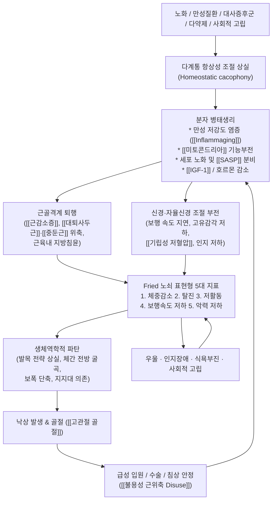

# 🩺 [[Frailty]] (Frailty / Frailty syndrome / 老衰·虛弱, ICD-10 R54 / KCD-8 R54)

> **핵심 3줄 요약 (Key Summary)**:
> - 📍 **병소 부위 & 해부·병태생리**: 단일 장기의 장애가 아닌 **다계통(골격근·신경·내분비·면역·대사) 생리적 예비능(Physiological reserve)의 전반적 감퇴와 항상성 붕괴 증후군**이다. [[골격근]]([[근감소증]]과 중복), [[시상하부-뇌하수체-부신축]](HPA), 만성 저강도 염증(Inflammaging), 세포 노화([[SASP]]), 에너지 대사 조절계가 동시에 파탄에 이르며, Fried & Cohen(2021)은 이를 "항상성 교향곡(homeostatic symphony)에서 불협화음(cacophony)으로의 이행"으로 개념화했다.
> - 🚩 **전형적 임상 양상 & 3대 징후**: Fried 5대 신체적 노쇠 표현형 중 ① 의도하지 않은 **체중 감소**(1년간 4.5kg 또는 5% 이상), ② **극심한 탈진(exhaustion)**, ③ **저활동**, ④ **보행 속도 저하**(<0.8 m/s), ⑤ **악력 저하**(하위 20%) 중 3개 이상 충족 시 노쇠(Frailty), 1~2개 시 전노쇠(Pre-frailty)로 진단한다. 여기에 낙상·인지저하·우울·사회적 고립이 중첩되며 **낙상 및 골절 위험이 급증**한다.
> - 🛠️ **핵심 감별 & 한·양방 다각적 치료 전략**: [[악력계]] 측정, [[보행속도 검사]](4 m), [[TUG 검사]], [[의자 일어서기 검사]], 포괄적 노인평가([[CGA]])로 기능 저하를 정량화한다. 양방에서는 Beers Criteria 및 STOPP/START v3 기반 **다제약물 복용(Polypharmacy) 감량(Deprescribing)**, 점진적 다구성 운동(Vivifrail / FrOST 프로토콜: 저항+균형+유산소), 고단백(1.2~1.5 g/kg/일) 영양 중재를 시행한다. 한의 치료는 허로(虛勞)·비신양허(脾腎兩虛)·기혈부족(氣血不足) 변증에 입각하여 [[보중익기탕]], [[팔진탕]], [[공진단]], [[경옥고]], [[십전대보탕]] 등 보익제 계열 한약과 [[족삼리]]·[[기해]]·[[관원]]·[[신수]] 중심 온구, 전침, 약침을 결합한 다영역 복합 중재를 적용한다.
> - <font color="#fa7e7e">⚠️ **응급 의뢰 레드플래그 & 악화 요인**: 급격한 체중 감소(악성종양·결핵·갑상선기능항진증 감별), 반복적인 낙상(경추·고관절 골절 및 만성 경막하출혈 위험), 급성 섬망 및 의식 변화, 급성 감염증(요로감염·폐렴), 기립성 저혈압, 다약제 부작용. 특히 와상 및 급성 침상 안정(Disuse)은 근감소증 악순환을 기하급수적으로 가속화하므로 즉시 기능적 이동 훈련을 개입해야 한다.</font>

---

## 📌 목차
1. [질환 개요 & 해부학적 병태생리](#1-질환-개요--해부학적-병태생리)
2. [병태생리 메커니즘 & 생체역학적 악순환 네트워크](#2-병태생리-메커니즘--생체역학적-악순환-네트워크)
3. [임상 증상 & 이학적 검사(Physical Exam) 알고리즘](#3-임상-증상--이학적-검사physical-exam-알고리즘)
4. [감별 진단 매트릭스 (Differential Diagnosis)](#4-감별-진단-매트릭스-differential-diagnosis)
5. [한의 통합 치료 프로토콜 (침·약침·추나·한약)](#5-한의-통합-치료-프로토콜-침약침추나한약)
6. [양방 치료 & 병용·의뢰 기준 (Conventional Treatment & Referral)](#6-양방-치료--병용의뢰-기준-conventional-treatment--referral)
7. [재활 운동 & 생활습관 티칭 가이드](#7-재활-운동--생활습관-티칭-가이드)
8. [💡 사용자 진료실 핵심 필기 & 임상 노하우 (Melt-In 잔여 심화 집약)](#8--사용자-진료실-핵심-필기--임상-노하우-melt-in-잔여-심화-집약)
9. [출처 및 학술 참고 문헌 (References)](#9-출처-및-학술-참고-문헌-references)

---

## 1. 질환 개요 & 해부학적 병태생리

* **질환 정의 및 분류**:
  * **노쇠(Frailty)**는 단순한 "나이 듦(Aging)"이나 주관적 "허약감"이 아니라, **생물학적 노화와 다양한 만성 질환의 누적으로 인해 스트레스(감염·수술·낙상·약물 변경·환경 변화 등)에 대한 다기관 생리적 예비능(Physiological reserve)이 저하되어 급격한 기능 상실·장애·입원·조기 사망 위험이 비례적으로 급증하는 임상 증후군**이다.
  * Cohen & Benyaminov(2023)는 노쇠를 **신체적·심리적·사회적 차원이 유기적으로 얽힌 다차원적 생물심리사회적 증후군(a multidimensional biopsychosocial syndrome)**으로 규정한다. 따라서 악력 하나, 보행속도 하나만 보는 단편적 접근은 진단적 민감도를 놓치기 쉬우며, **기능·인지·정서·사회적 지지·영양·다약제 복용 상태를 포괄적으로 평가**해야 한다.
  * **노쇠의 2대 대표 진단 모델**:
    1. **표현형 모델 (Phenotypic Model / CHS Criteria)**:
       * Fried & Tangen(2001)의 Cardiovascular Health Study 기반 신체적 노쇠 표현형으로, 임상 및 역학 연구의 세계적 표준으로 가장 널리 활용된다.
       | 구성 요소 | 평가 기준 및 측정 방법 | 임상적 의미 |
       | :--- | :--- | :--- |
       | ① 비의도적 체중 감소 | 지난 1년간 **의도치 않은 체중 감소 4.5 kg(10 lb) 또는 5% 이상** | 영양결핍, 악액질, 잠재 악성종양, 갑상선 질환 감별 필요 |
       | ② 탈진 (Exhaustion) | CES-D 우울척도 문항 중 "모든 일이 힘들었다", "기운이 나지 않았다" 주 3일 이상 | 우울증, 심부전, 빈혈, 만성 염증 감별 필요 |
       | ③ 저활동 (Low Activity) | 주당 신체활동 에너지 소모량 하위 20% (남성 < 383 kcal/주, 여성 < 270 kcal/주) | 근감소증 및 일상생활 비사용(Disuse)의 직접 원인 |
       | ④ 보행 속도 저하 | 4 m(또는 15 ft) 일상 보행 속도 < 0.8 m/s (또는 신장·성별 하위 20%) | 운동기능, 낙상 위험, 생존 예후의 가장 강력한 독립적 지표 |
       | ⑤ 악력 저하 (Weakness) | [[악력계]] 측정치 하위 20% (성별 및 BMI 분위별 컷오프 적용) | 전신 근력, 근육의 질(Quality), 영양 상태의 대리 지표 |
       | **종합 판정** | **3개 이상 충족 = 노쇠 (Frailty)<br/>1~2개 충족 = 전노쇠 (Pre-frailty)<br/>0개 = 정상/건강 (Robust)** | 전노쇠 단계가 가역적 회복이 가능한 최적의 골든타임(Window) |
    2. **누적 결손 모델 (Cumulative Deficit Model / Frailty Index)**:
       * Rockwood 등이 제안한 모델로, 증상·징후·질병·검사실 이상·기능 장애 등 30~70개 항목 중 개인이 보유한 결손의 비율(결손 항목 수 / 전체 항목 수)로 노쇠 지수(Frailty Index, FI)를 연속 변수(0.0~1.0)로 산출.
       * FI > 0.25 시 노쇠로 판정하며, 급성기 임상 현장에서는 이를 간소화한 **임상 노쇠 척도([[CFS]], Clinical Frailty Scale 1~9등급)**가 널리 쓰인다.
  * **호발군 및 역학**:
    * 고령(특히 75세 이상, 85세 이상 초고령층의 25~30% 이상), 여성, 만성 복합질환(Multimorbidity) 보유자, 다제약물 복용자(5종 이상 약물), 독거 노인 및 사회적 고립군.
  * **임상 실용 분류**:
    * **신체적 노쇠 (Physical frailty)**: 근골격계 및 신경생리학적 기능 저하 중심.
    * **인지적 노쇠 (Cognitive frailty)**: 신체적 노쇠와 함께 가역적/비가역적 인지기능 저하(CDR 0.5 수준의 경도인지장애)가 동반된 상태.
    * **이차성 노쇠 (Secondary frailty)**: [[류마티스관절염]], [[퇴행성 관절염]] 등 만성 염증성·퇴행성 관절질환, 만성 신장병, 심부전, 만성폐쇄성폐질환([[COPD]]), 뇌졸중 등 **기저 질환의 만성 염증과 기능 장애에 의해 가속화된 노쇠**(Salaffi & Farah, 2020).
    * **대사성 노쇠 (Metabolic frailty)**: [[대사증후군]](복부비만, 인슐린 저항성, 고혈압, 이상지질혈증)의 중증도가 높을수록 노쇠 진행 위험이 유의하게 증가함(Zeng & Li, 2024).

* **관련 해부학적 구조물 (다계통 병소)**:
  * **골격 및 관절 계통**: [[고관절]], [[대퇴골]] 경부, [[요추]], [[슬관절]] — 골밀도 저하([[골다공증]])와 연골 퇴행([[퇴행성 관절염]])이 겹치면 낙상 1회로 고관절 골절 및 척추 압박골절이 발생하여 장기 와상과 사망으로 직결됨.
  * **근육 및 근막 계통**: [[대퇴사두근]], [[둔근]](특히 보행 균형의 핵심인 [[중둔근]]), [[척추기립근]], [[장요근]], [[전경골근]], [[비복근]] — 노화성 [[근감소증]](Sarcopenia)에 의한 근육량 감소, 제2형 속근 섬유의 선택적 위축, 근육 내 지방 침윤(Myosteatosis)이 노쇠의 핵심 신체적 실행기(Executor)로 작동함. 특히 **하지 근력과 기립·착석 동작(의자 일어서기)** 능력이 낙상 내성의 결정적 변수임.
  * **신경 및 혈관 계통**: [[중추신경계]](보행 제어, 전두엽 실행기능, 운동 피질), [[말초신경]](고유감각 수용기), [[전정계]], 시각계 — 고유감각 저하 + 신경전도 속도 지연 + 주의분배 능력 저하는 "균형 잡히다 넘어지는" 전형적 낙상 기전을 초래함(Taguchi & Menezes, 2022). 자율신경계 조절 저하는 **기립성 저혈압**과 식후 저혈압을 유발해 뇌관류 저하 및 실신을 촉진함.
  * **내분비·면역·대사 계통**: [[시상하부]]-[[뇌하수체]]-[[부신축]](HPA axis), 성장호르몬-[[IGF-1]] 축, 성호르몬 축(테스토스테론, DHEA-S)의 감퇴, 골격근 인슐린 감수성 저하, 만성 저강도 전신 염증(Inflammaging: IL-6, TNF-alpha 상승)이 노쇠의 생물학적 기반을 형성함(Fried & Cohen, 2021).

---

## 2. 병태생리 메커니즘 & 생체역학적 악순환 네트워크

```text
+-------------------------------------------------------------------------------+
|                    노쇠 (Frailty) 다계통 붕괴 및 악순환 네트워크                   |
+-------------------------------------------------------------------------------+
 [원인 인자: 생물학적 노화 / 유전 / 만성질환 / 대사증후군 / 다약제 / 사회적 고립]
                                |
                                v
               [분자 및 세포 수준의 항상성 붕괴]
        +------------------------------------------------+
        | * 만성 저강도 전신 염증(Inflammaging: IL-6, TNF-a) |
        | * 미토콘드리아 호흡 사슬 장애 및 활성산소종([[ROS]]) |
        | * 세포 노화 및 노화 관련 분비 표현형([[SASP]])     |
        | * 내분비 감퇴: DHEA-S, 테스토스테론, [[IGF-1]] 감소 |
        +------------------------------------------------+
                                |
                                v
        +-----------------------+-----------------------+
        |                                               |
        v [신경·내분비·대사계 조절 실패]                   v [근골격계 퇴행: [[근감소증]]]
 * [[시상하부-뇌하수체-부신축]](HPA) 교란        * 제2형 속근 섬유 위축 및 소실
 * 자율신경계 조절 저하 (기립성 저혈압)          * 근육내 지방 침윤(Myosteatosis)
 * 인지 기능 저하, 뇌 위축, 우울증              * 미토콘드리아 밀도 및 ATP 생성 저하
 * 고유수용성 감각(Proprioception) 저하          * 단백질 합성 둔화 및 분해 촉진
        |                                               |
        +-----------------------+-----------------------+
                                |
                                v
               [Fried 신체적 노쇠 표현형 (5대 지표)]
    1. 비의도적 체중 감소 (지난 1년간 4.5kg 또는 5% 이상)
    2. 극심한 탈진감 (주 3일 이상 무기력 호소, CES-D)
    3. 근력 저하 ([[악력계]] 측정치 하위 20%)
    4. 보행 속도 저하 (4m 보행 속도 < 0.8 m/s)
    5. 신체 활동량 급감 (주당 에너지 소모량 하위 20%)
        * 3개 이상 = 노쇠(Frail) / 1~2개 = 전노쇠(Pre-frail)
                                |
                                v
                   [생체역학적 기능 파탄 & 낙상 연쇄]
 * 하지 근력 약화([[대퇴사두근]], [[중둔근]]) -> 보폭 단축, 유각기 연장
 * 발목 균형 전략 상실 -> 고관절 전략 후퇴 -> 작은 외란에 전도
                                |
                                v
     [임상적 악결과: 낙상 -> 골절([[고관절 골절]]) -> 급성 입원/수술]
                                |
                                v
    [침상 안정 및 불용(Disuse) -> 근육량 급속 소실 -> 와상/장애 -> 조기 사망]
                                |
           +--------------------+--------------------+
           | (자가 악순환 증폭: 식욕 부진, 섬망, 사회적 고립) |
           +-----------------------------------------+
+-------------------------------------------------------------------------------+
```



### 1) 분자·생리학적 조절 상실 기전: "교향곡에서 불협화음으로"
* Fried & Cohen(2021)은 노쇠를 개별 장기 한두 곳의 질병이 아니라, **에너지 대사·염증·스트레스 반응·신경내분비 축이 서로 맞물려 조율되던 생리학적 "항상성 교향곡(Homeostatic Symphony)"이 다계통 불협화음(Cacophony)으로 붕괴된 상태**로 정의한다.
  * **만성 저강도 전신 염증(Inflammaging)**: 노화 세포의 축적으로 인한 노화 관련 분비 표현형([[SASP]]) 방출, 인터루킨-6(IL-6), 종양괴사인자-알파(TNF-alpha), C-반응성 단백(CRP)의 지속적 경도 상승. 이는 골격근의 단백질 합성 신호(Akt/mTOR)를 억제하고 유비퀴틴-프로테아좀 경로를 활성화하여 근위축을 촉진한다.
  * **미토콘드리아 기능부전**: 전자전달계 복합체 활성 감소, 미토콘드리아 DNA 돌연변이 축적, 활성산소종([[ROS]]) 과다 생성으로 인해 ATP 생성이 저하되고 세포자멸사가 유도된다. 이는 환자가 호소하는 주관적 '극심한 피로/탈진'의 세포학적 실체이다.
  * **내분비계 둔화**: 성장호르몬/[[IGF-1]] 축 감소(Somatopause), DHEA-S 및 테스토스테론 감소(Adrenopause/Andropause)는 아나볼릭(동화) 자극을 결핍시켜 제2형 속근 섬유의 선택적 소실을 야기한다. 코르티솔의 일중 리듬 평탄화 및 HPA축 과활성은 이화작용(Catabolism)을 증폭시킨다.
* **대사증후군과의 상호작용 (Metabolic Axis)**:
  * Zeng & Li(2024)는 종단 코호트 연구에서 대사증후군 중증도(복부비만, 이상지질혈증, 고혈당 등)가 노쇠 진행 위험을 유의하게 가속함을 보고하였다. 내장 지방에서 분비되는 염증성 아디포카인과 인슐린 저항성은 골격근 내 지방 침윤(Myosteatosis)을 유발하여 근육의 수축력과 대사적 질을 동시에 파괴한다.
* **만성 염증성 질환과 이차성 노쇠**:
  * 류마티스관절염이나 중증 골관절염 환자에서는 전신 활막 염증, 만성 통증, 스테로이드 투여가 노쇠의 발현을 10년 이상 앞당긴다(Salaffi & Farah, 2020).

### 2) 생체역학적 연쇄 반응 (Kinetic Chain Breakdown)
* **하지 근력 저하와 기립·보행 전략의 퇴행**:
  * 하지의 주동근인 [[대퇴사두근]]과 골반 외전근인 [[중둔근]]의 약화는 기립 시 체간을 앞으로 과도하게 숙이게 만들고, 보행 시 유각기(Swing phase)를 단축시키며 양발 지지 시간(Double support time)을 증가시킨다.
* **자세 균형 전략(Postural Balance Strategy)의 단계적 후퇴**:
  1. **발목 전략 (Ankle Strategy)**: 건강한 성인이 미세한 흔들림을 족관절 전후 족저굴곡근/배굴근으로 조절하는 1차 방어선. 노쇠 환자에서는 전경골근과 비복근의 반응 지연으로 조기 상실됨.
  2. **고관절 전략 (Hip Strategy)**: 발목 전략 상실 후 고관절과 체간을 굴곡/신전하여 무게중심을 잡으려는 2차 보상 전략.
  3. **디딤발 전략 (Stepping Strategy) 및 지지물 의존 전략**: 외란 발생 시 즉각적으로 발을 내딛지 못하고 방향 전환 시 발을 끌며(Pivot turn), 지팡이나 가구, 난간을 잡지 않으면 넘어지는 중증 균형 장애로 후퇴함.
* **골-근-신경 삼각 악순환 (Fracture-Disuse Spiral)**:
  * 보행 중 작은 턱이나 어지럼에 의해 낙상 발생 → 골다공증성 [[고관절 골절]] 또는 척추 골절 → 응급 수술 및 장기 침상 안정(Bed rest) → **불용성(Disuse) 급성 근감소증 급발(노인은 3일 침상 안정만으로 하지 근육량의 10% 이상 소실 가능)** → 기립 불능 및 와상(Bedridden) → 흡인성 폐렴, 욕창, 요로감염, 색전증으로 6개월~1년 내 조기 사망.

---

## 3. 임상 증상 & 이학적 검사(Physical Exam) 알고리즘

### 1) 주소증 및 임상 증상
* **체중 및 영양 관련 증상**:
  * 식욕 부진(Anorexia of aging), "옷이나 틀니가 헐렁해졌다", "음식을 씹거나 삼키기 힘들어 국물만 넘긴다"(연하곤란 및 치아 소실), 조기 포만감.
* **탈진 및 전신 활력 저하**:
  * "하루 종일 기운이 하나도 없다", "예전에는 쉽게 하던 장보기나 방 청소를 손도 못 대겠다", 침대에 누워 있는 시간의 급격한 증가. 환자는 이를 질병이 아닌 '늙어서 그런 것'으로 체념(Normalize)하는 경향이 큼.
* **운동 기능 및 보행 장애**:
  * 걸음걸이가 눈에 띄게 느려짐, 횡단보도 신호등이 바뀌기 전에 건너지 못함, 계단을 오를 때 난간을 양손으로 잡아야 함, 의자나 방바닥에서 일어날 때 무릎이나 팔걸이를 짚지 않으면 일어서지 못함.
* **낙상 및 근접 낙상(Near-fall)**:
  * 지난 1년간 1회 이상의 낙상력, 화장실 가다가 휘청거림, 발이 턱에 걸려 넘어질 뻔한 경험(환자는 넘어질 뻔한 것을 낙상으로 자진 보고하지 않으므로 적극 문진 필수, Taguchi & Menezes, 2022).
* **인지·정서 및 자율신경계 증상**:
  * 의욕 저하, 우울감, 건망증, 공간지남력 저하. 자리에서 일어날 때 눈앞이 캄캄해지는 어지럼([[기립성 저혈압]]), 식사 후 졸림과 현훈(식후 저혈압), 야간 빈뇨.
* **다약제 관련 부작용**:
  * 낮 동안의 과도한 졸림, 멍함, 변비, 입마름, 배뇨 곤란 (항콜린성 약물 및 진정제 복용 후 호발).

### 2) 필수 이학적 검사법 (Physical Examination Protocol)
* **[[악력계]](Handgrip Dynamometer) 측정**:
  * 노쇠 표현형의 핵심 정량 검사. 의자에 바르게 앉아 팔꿈치를 90도로 굴곡한 상태에서 좌우 교대로 2~3회 측정하여 최대값을 기록. 성별 및 BMI에 따른 컷오프(통상 한국 노인 기준 남성 < 28 kg, 여성 < 18 kg) 적용.
* **[[보행속도 검사]](Gait Speed Test, 4 m)**:
  * 평상시 걸음 속도로 4미터를 걷는 시간을 초시계로 측정 (가속 및 감속 구간 1미터씩 제외).
  * **보행 속도 < 0.8 m/s (4초 이상 소요)** 시 명백한 노쇠 표현형 및 낙상 고위험군으로 판정.
* **[[TUG 검사]](Timed Up and Go Test)**:
  * 팔걸이가 있는 표준 의자에 앉은 상태에서 일어나 3 m를 걸어간 뒤 돌아와 다시 앉는 시간 측정.
  * **> 12~14초 소요 시 낙상 고위험군**. 수치뿐 아니라 일어설 때 손 짚기, 보폭 비대칭, 회전 시 휘청거림 등 질적 양상을 반드시 관찰 기록함.
* **[[의자 일어서기 검사]](5-Times Sit-to-Stand Test, 5STS)**:
  * 양팔을 가슴에 교차하여 얹은 채 의자에서 완전히 일어섰다 앉기를 5회 연속 수행하는 시간 측정.
  * **> 12~15초 소요 시 하지 근력 및 균형 능력 저하**. 팔을 쓰지 않고는 1회도 일어서지 못하는 경우 중증 신체 장애로 간주.
* **[[버그 균형 척도]](Berg Balance Scale, BBS) / 간이 신체기능 검사([[SPPB]])**:
  * SPPB(Short Physical Performance Battery): 균형 검사(나란히, 반일렬, 일렬 서기 10초) + 보행속도 + 5회 의자 일어서기를 각각 0~4점으로 평가하여 총 12점 만점 중 **≤ 9점 시 노쇠 및 신체 기능 저하**로 확진.
* **자율신경 및 활력징후 검사**:
  * **[[기립성 저혈압 측정]]**: 5분간 누운 상태에서 혈압·맥박 측정 후, 기립 1분 및 3분에 재측정. 수축기 혈압 20 mmHg 이상 또는 이완기 혈압 10 mmHg 이상 강하 시 양성.
* **인지 및 우울 선별 검사**:
  * [[MMSE-DS]] / [[MoCA]](몬트리올 인지평가), [[노인우울척도(GDS-K)]].
* **약물 검토 (Comprehensive Medication Review)**:
  * 환자가 복용 중인 모든 처방약, 일반의약품, 건강기능식품 목록 작성. 항콜린성 부담 척도(Anticholinergic Burden Scale) 계산.

---

## 4. 감별 진단 매트릭스 (Differential Diagnosis)

| 감별 질환 | 호발 병소 및 주요 병인 | 주소증 및 임상 양상 차이점 | 특이적 검사 및 감별 포인트 |
| :--- | :--- | :--- | :--- |
| **[[Frailty]]<br/>(본 질환)** | 다계통(신경·근육·내분비·면역) 예비능 붕괴 | 스트레스 후 회복 불능, 다계통적 기능 저하, 5대 표현형 중 3개 이상 | 악력 저하 + 보행 속도 저하(<0.8m/s) + SPPB ≤ 9점 + 다약제 |
| **[[정상 노화]]<br/>(Normal Aging)** | 생리적 연령 증가 | 기능 감퇴가 매우 완만하며, 스트레스 후 정상 회복 가능 | 표현형 0개(Robust), 일상생활(ADL/IADL) 완전 자립, 보행 정상 |
| **[[근감소증]]<br/>(Sarcopenia)** | 골격근 단일 계통 | 근육량 및 근력 저하가 핵심이나 인지·사회적 영역은 보존 가능 | BIA/DEXA상 사지 골격근량(ASMI) 기준치 미달, 악력 저하 |
| **[[갑상선기능저하증]]** | 내분비계 (갑상선 호르몬 결핍) | 체중 증가, 극심한 추위 탐, 변비, 서맥, 피부 건조, 안면 부종 | **혈청 TSH 상승, Free T4 저하**, 심부건반사 이완기 지연 |
| **노년기 [[우울장애]]<br/>(Late-life Depression)** | 중추 신경계 (신경전달물질 교란) | 주관적 의욕 상실과 탈진이 극심하나, 검사 독려 시 수행력 유지 | **GDS-K 점수 상승**, 항우울제 투여 시 기능 극적 회복 |
| **만성 [[심부전]] / [[COPD]]** | 심폐 순환 계통 | 노작성 호흡곤란, 기좌호흡, 하지 함요부종, 만성 기침 | **NT-proBNP 상승**, 심초음파상 EF 저하, 폐기능검사 FEV1/FVC 저하 |
| **만성 [[신장 질환]](CKD)** | 비뇨기계 (사구체 여과율 저하) | 요독증 증상, 오심, 식욕부진, 피부 소양감, 창백(빈혈) | **혈청 크레아티닌 상승, eGFR < 60 mL/min**, 단백뇨 동반 |
| **잠재 [[악성종양]]<br/>(Occult Malignancy)** | 소화기, 폐, 조혈계 등 | 급격한 체중 감소(수개월 내 10% 이상), 야간 발열, 식은땀 | 잠혈 반응 양성, 영상의학적 종괴, 종양 표지자 상승 |
| **[[약물 유발성 노쇠]]<br/>(Polypharmacy)** | 의원성 (다약제 상호작용) | 특정 약물(수면제, 혈압약, 전립선약) 추가 직후 급격한 악화 | Beers Criteria 부적절 약물 확인, **약물 감량 시 증상 호전** |
| **급성 [[섬망]](Delirium)** | 중추신경계 (급성 뇌기능 부전) | **수시간~수일 내 급격한 발병**, 주의력 결핍, 각성도 변동 | CAM(Confusion Assessment Method) 양성, 감염/전해질 응급 원인 |

> 🚩 **진료실 레드플래그 원칙**: 노인 환자가 "갑자기 기운이 빠지고 못 걷는다"며 내원한 경우, 만성 노쇠가 아니라 **폐렴·요로감염 등 무열성 패혈증, 급성 심근경색, 숨은 고관절 골절, 만성 경막하출혈, 뇌졸중, 급성 전해질 이상(저나트륨혈증) 등 급성 질환을 최우선 감별 배제**해야 한다.

---

## 5. 한의 통합 치료 프로토콜 (침·약침·추나·한약)

### 1) 한의 변증 분류 체계
* **기혈양허(氣血兩虛)형**:
  * 주증: 만성 피로, 전신 권태, 안색 창백, 어지럼, 보행 무력, 식욕 부진, 자한(自汗), 설담태백(舌淡苔白), 맥 세약(細弱).
  * 치법: 익기양혈(益氣養血), 배원고본(培元固本).
* **비신양허(脾腎陽虛)형**:
  * 주증: 수족 냉감, 요슬산연(허리와 무릎 시림 및 통증), 오경설사(새벽 설사) 또는 변당, 야간 빈뇨, 부종, 설담반(舌淡胖) 치흔, 맥 침지무력(沈遲無力).
  * 치법: 온보비신(溫補脾腎), 온양화기(溫陽化氣).
* **간신음허(肝腎陰虛)형**:
  * 주증: 조열(潮熱), 도한(식은땀), 수족심열, 현훈, 이명, 근육 경련, 관절 건조감, 불면, 설홍소태(舌紅少苔), 맥 세삭(細數).
  * 치법: 자보간신(滋補肝腎), 강근장골(强筋壯骨).
* **기허혈어(氣虛血瘀)형**:
  * 주증: 지체 마목(손발 저림), 보행 시 둔통 및 파행, 피부 건조 및 청자색 정맥 울혈, 혀의 어반(瘀斑), 맥 떫음(삽 澁).
  * 치법: 보기활혈(補氣活血), 거어통락(祛瘀通絡).

### 2) 침구 치료 (Acupuncture)
* **기본 배혈 (보기보신 배혈군)**:
  * **전신 기혈 보익**: [[족삼리]](ST36), [[삼음교]](SP6), [[기해]](CV6), [[관원]](CV4), [[중완]](CV12).
  * **신정(腎精) 보충 및 척추 기립근 강화**: [[신수]](BL23), [[명문]](GV4), [[대장수]](BL25), [[태계]](KI3).
  * **신경 인지 및 균형 조절**: [[백회]](GV20), [[사신총]](EX-HN1), [[풍지]](GB20), [[인당]](EX-HN3).
* **하지 근력 및 보행 기능 촉진 배혈**:
  * 대퇴사두근 및 슬관절 안정: [[양구]](ST34), [[혈해]](SP10), [[독비]](ST35), [[내슬안]](EX-LE4).
  * 중둔근 및 고관절 안정: [[환도]](GB30), [[거료]](GB29).
  * 족관절 배굴 및 균형: [[양릉천]](GB34 - 근회), [[현종]](GB39 - 수회), [[조해]](KI6), [[신맥]](BL62).
* **전침(Electroacupuncture) 치료 프로토콜**:
  * 하지 위축 근육(대퇴사두근 및 전경골근 부위: 족삼리-양릉천, 혈해-양구)에 **저주파(2~4 Hz) 연속파** 적용.
  * 저주파 전침은 근섬유의 단백질 합성 경로(Akt/mTOR)를 자극하고 미세혈류를 개선하여 근위축 억제 효과를 나타냄.
  * 노인 환자는 감각이 저하되어 있으므로 전류 강도는 환자의 구두 반응에만 의존하지 말고, **안전한 가시적 미세 근수축이 관찰되는 역치 수준**으로 조절함 (세션당 15~20분, 주 2~3회).
* **온구(Moxibustion) 및 온침 요법**:
  * 비신양허 환자의 관원, 기해, 신수, 명문 혈에 간접구(신기구, 온구기) 적용하여 심부 체온 및 복강 장기 혈류 개선.
  * ⚠️ 주의: 당뇨병성 말초신경병증이나 인지저하 노인은 감각 둔화로 화상 위험이 매우 높으므로 직접구는 절대 금기하며 수시로 피부 온도를 확인해야 함.

### 3) 약침 치료 (Pharmacopuncture)
* **주요 적용 제제**:
  * **[[자하거 약침]](Hominis Placenta)**: 보신익정(補腎益精), 보기양혈의 대표 약침. 신수, 기해, 관원, 족삼리 혈에 부위당 0.2~0.5 mL씩 총 1.0~2.0 mL 피내 또는 근막 상층 주입. 면역 증강, 만성 피로 개선, 골밀도 유지에 기여.
  * **[[녹용 약침]]**: 온원양(溫元陽), 강근골. 하지 무력증 및 고관절 주위 혈위(환도, 양릉천)에 시술.
  * **[[신바로 약침]] / 소염약침**: 만성 퇴행성 관절통으로 활동량이 저하된 부위(슬관절, 요추 후관절 주위)에 국소 시술하여 통증-비활동-노쇠의 악순환을 차단.
* **약침 안전 수칙**:
  * 항응고제(와파린, DOAC)나 항혈소판제를 복용 중인 고령 환자는 시술 후 지혈 시간을 충분히(3~5분 이상 압박) 확보하고 미세 혈종 발생을 감시함.

### 4) 추나 요법 (Chuna Manipulation)
* **적용 목적**: 노쇠를 가속화하는 근골격계 생체역학적 부정렬(흉추 후만, 골반 전방/후방 경사, 고관절 굴곡구축) 교정 및 관절 가동성 회복.
* **기법 선택**:
  * **골다공증이 동반된 고령 환자에서는 고속저진폭(HVLA) 정골 교정 기법을 전면 금지**함 (갈비뼈 및 척추 압박골절 위험).
  * **저속저진폭 관절가동추나 및 근막이완기법(JS 수기치료)** 적용:
    * 흉추 신전 가동을 통한 흉곽 용적 확장 및 호흡 기능 보조.
    * 장요근 및 대퇴직근 연부조직 이완을 통한 고관절 신전 가동역 확보 (보폭 증대 효과).
    * 족관절 가동술을 통한 배굴(Dorsiflexion) 가동성 증진 (보행 시 발끌림 및 턱 걸림 방지).

### 5) 한약 치료 (Herbal Medicine)
* **변증별 대표 방제**:
  * **기혈양허·허로 (체중감소·극심한 피로)**:
    * **[[십전대보탕]](十全大補湯)** 또는 **[[팔진탕]](八珍湯)**: [[인삼]], [[백출]], [[복령]], [[감초]], [[숙지황]], [[당귀]], [[천궁]], [[작약]], [[황기]], [[육계]]. 전신 아나볼릭 상태 촉진 및 조혈 기능 개선.
    * **[[공진단]](拱辰丹)**: [[녹용]], [[당귀]], [[산수유]], [[사향]](또는 침향). 중추 피로 개선, 신경 보호, 활력 증진.
    * **[[경옥고]](瓊玉膏)**: [[생지황]], [[인삼]], [[백복령]], [[봉밀]]. 기음(氣陰)을 동시에 보하고 폐·비장 기능 강화.
  * **비기허·식욕부진·소화불량**:
    * **[[보중익기탕]](補中益氣湯)**: [[황기]], [[인삼]], [[백출]], [[감초]], [[당귀]], [[진피]], [[승마]], [[시호]]. 비위 기운을 끌어올려 소화 흡수율을 높이고 기저 근력을 증진.
    * **[[삼령백출산]](蔘苓白朮散)**: 비허 변당 및 만성 흡수장애 노인 환자에 적용.
  * **비신양허·냉증·하지무력**:
    * **[[팔미지황환]](八味地黃丸)** 또는 **[[제생신기환]](濟生腎氣丸)**, **[[우귀음]](右歸飮)**: 하초 원양을 북돋워 골격근 및 방광 기능 보존.
  * **간신음허·근육위축·체중감소**:
    * **[[육미지황환]](六味地黃丸)** 또는 **[[좌귀음]](左歸飮)**.
  * **기허혈어·보행장애**:
    * **[[보양환오탕]](補陽還五湯)**: 황기 대용량(60~120g)에 활혈통락약을 배합하여 미세 순환 장애 및 신경병증성 기능 장애 개선.

---

## 6. 양방 치료 & 병용·의뢰 기준 (Conventional Treatment & Referral)

### 1) 약물 치료 및 복약 적정화(Deprescribing)
* **다제약물 복용(Polypharmacy) 감량의 절대성**:
  * 5개 이상의 만성 약물을 복용하는 다제약물 복용은 그 자체로 노쇠의 강력한 독립적 위험인자이다. 약물 상호작용과 약물 유발성 낙상 위험을 줄이기 위해 매 진료 시 복약 적정화(Deprescribing)를 수행해야 한다.
  * **2023 AGS Beers Criteria 및 STOPP/START v3 가이드라인 적용**:
    * **최우선 중단/감량 대상 약물 (STOPP)**:
      1. **항콜린성 약물**: 1세대 항히스타민제, 삼환계 항우울제(TCA), 요실금 치료제(옥시부티닌 등) — 섬망, 인지 저하, 변비, 구갈, 낙상 유발.
      2. **진정수면제 및 벤조디아제핀**: 졸피뎀, 디아제팜, 로라제팜 등 — 주간 졸림, 운동 실조, 낙상 및 대퇴골 골절 위험 급증.
      3. **장기 PPI(프로톤펌프억제제)**: 8주 이상 불필요한 장기 투여 시 칼슘·마그네슘·비타민 B12 흡수 저해, 골절 위험 증가, 장내 미생물 불균형 유발.
      4. **과도한 항고혈압제**: 기립 시 수축기 혈압 < 110~120 mmHg로 과도 강하시키는 약물 용량 감량.
* **표준 보충 및 대사 조절 약제**:
  * **비타민 D 보충**: 혈청 25-hydroxyvitamin D [25(OH)D] 수치가 < 30 ng/mL인 경우, **콜레칼시페롤(Vitamin D3) 800~2000 IU/일** 경구 투여. 근력 개선, 동요(Sway) 감소, 낙상 빈도 감소 효과 입증.
  * **골다공증 예방 및 치료**: T-score ≤ -2.5 또는 골감소증 + 낙상 고위험군에서 비스포스포네이트(알렌드로네이트, 졸레드론산), 데노수맙, 골형성촉진제(테리파라타이드) 적극 투여.
  * **당뇨병 약제 관리**: 노쇠 환자에서는 엄격한 혈당 조절(HbA1c < 7.0%)이 치명적인 저혈당성 혼수 및 낙상을 유발하므로, **목표 HbA1c를 7.5~8.5% 수준으로 완화 설정**. SGLT2 억제제는 탈수, 체중 감소, 근감소증 가속화 위험을 면밀히 감시해야 함.

### 2) 다학제적 비약물 치료: 운동 및 영양 중재
* **점진적 다구성 운동 프로그램 (Multicomponent Exercise)**:
  * 단순 걷기 운동만으로는 노쇠를 호전시킬 수 없으며, **저항 훈련 + 균형 훈련 + 유산소 훈련 + 보행 훈련이 결합된 다구성 프로그램**이 유일하게 기능적 노쇠를 역전시키는 표준 치료이다 (Zhang et al., 2026, PMID: 42881675).
  * **Vivifrail 맞춤형 프로토콜**: 환자의 신체 기능 평가(SPPB 점수 및 낙상 위험)에 따라 4가지 레벨(A: 장애형, B: 허약형, C: 전노쇠형, D: 건강형)로 분류하여 맞춤 운동 처방.
  * **FrOST (Franconian Osteopenia and Sarcopenia Trial) 프로토콜**: 대퇴사두근 및 둔근 강화를 위한 탄성 밴드 및 체중 부하 점진 저항 운동.
* **영양 중재 (Nutritional Support)**:
  * **단백질 섭취량**: **1.2~1.5 g/kg/일** 권장 (건강한 성인 권장량 0.8 g/kg 대비 증량). 만성 신부전(eGFR < 30) 환자를 제외하고는 충분한 단백질 섭취 필수.
  * 매 끼니 단백질 25~30g(류신 2.5~3g 이상 함유)을 균등 분배 섭취하여 근육 단백질 합성 역치(Leucine trigger)를 자극.
  * 급성기 중환자 및 입원 환자에서 노쇠와 영양 위험 평가의 동시 평가는 사망률 예측 및 회복의 핵심 지표임 (Alves de Araújo et al., 2026, PMID: 42875270).

### 3) 수술 및 시술 전 위험 평가: 포괄적 노인평가([[CGA]])
* **수술 전 노쇠 스크리닝**:
  * 노인 환자의 정형외과, 복부, 심혈관 수술 전 **임상 노쇠 척도([[CFS]])** 평가 필수.
  * CFS ≥ 5점(경도 노쇠 이상) 환자는 수술 후 30일 사망률, 중환자실 재입원율, 수술 후 섬망 발생률이 유의하게 높음.
  * 수술 전 단기 집중 재활(Prehabilitation: 영양 보충 + 호흡 훈련 + 경도 저항 운동)을 통해 수술 합병증 최소화.

### 4) 한의 병용 판단 및 상호작용 관리
* **병용 주의 및 금기 사항**:
  * **항응고제(와파린, DOAC) 복용 노인**: 활혈거어 계열 한약재([[당귀]], [[단삼]], [[홍화]], [[천궁]])의 대량 병용 시 출혈 및 피하 혈종 위험 증가 가능. 처방 시 용량을 조절하고 정기적인 INR 또는 출혈 징후 모니터링.
  * **신기능 저하 노인**: 노화에 따라 사구체 여과율이 생리적으로 저하되어 있으므로, 신배설 의존성 한약재 투여 시 환자의 혈청 크레아티닌 및 eGFR을 확인하고 용량을 50~70% 수준으로 감량 시작.
  * **감초(甘草)의 가성 알도스테론증**: 고혈압약을 복용 중인 노쇠 환자에서 고용량 감초 장기 투여 시 저칼륨혈증, 체액 저류, 혈압 상승이 유발될 수 있으므로 처방 구성 시 감초 용량 엄격 제한.
  * **급성기 보익제 중단 원칙**: 급성 폐렴, 요로감염, 원인 불명의 고열, 급성 섬망 발생 시에는 모든 보익성 한약 투여를 즉시 중단하고 양방 응급 감염 치료를 우선함 ("급성 감염기에는 사기(邪氣)를 몰아내는 것이 우선이며, 보약을 쓰면 사기를 돕는다").

### 5) 양방·전문과 응급 전원의뢰 기준 (Referral Criteria)
* **응급실(ER) 즉시 전원 기준**:
  1. 갑작스러운 의식 혼탁, 각성도 저하, 환각을 동반한 **급성 섬망(Delirium)**.
  2. 낙상 후 고관절 부위 심한 서혜부 통증, 하지 외회전 및 단축 소견 ([[고관절 골절]] 의심).
  3. 최근 낙상 이력이 있는 환자에서 서서히 진행하는 두통, 편마비, 언어 장애, 인지 저하 (**만성 경막하출혈** 의심).
  4. 수축기 혈압 < 90 mmHg, 체온 > 38.3℃ 또는 저체온(< 35.5℃), 빈맥, 호흡수 > 24회/분 (패혈성 쇼크 전구 증상).
* **전문과 외래 정밀 의뢰 기준**:
  1. 6개월 내 의도치 않은 체중 감소가 체중의 5% 이상인 경우 (내과: 잠재 악성종양, 결핵, 만성 흡수장애 정밀 검사).
  2. 기립 시 수축기 혈압 20 mmHg 이상 강하 및 실신 병력 (심장내과: 자율신경계 이상, 부정맥 감별).
  3. 지난 6개월 내 2회 이상 낙상 경험 (신경과/재활의학과: 파킨슨증후군, 정상압수두증, 보행신경병증 정밀 평가).

---

## 7. 재활 운동 & 생활습관 티칭 가이드

* **점진적 하지 근력 강화 운동 (Resistance Training)**:
  * **의자 일어서기 훈련 (Chair Rise)**:
    * 가장 안전하고 강력한 하지 근력 강화 운동. 팔걸이가 있는 단단한 의자에서 시작하여 양손을 교차해 가슴에 대고 일어섰다 천천히 앉기. 8~10회 반복, 1일 2~3세트.
  * **벽 스쿼트 (Wall Squat)**:
    * 벽에 등을 기대고 무릎을 30~45도 가량 살짝 구부려 5~10초간 버티기. 대퇴사두근 등척성 수축 유도.
  * **중둔근 강화를 위한 서서 다리 옆으로 들기 (Side Hip Abduction)**:
    * 튼튼한 싱크대나 난간을 잡고 서서 한쪽 다리를 옆으로 30도 가량 들어 올리고 2초간 멈춘 후 내리기. 보행 시 좌우 흔들림 방지.
  * **비복근 강화 까치발 들기 (Calf Raise)**:
    * 난간을 잡고 양발 뒤꿈치를 천천히 들어 올렸다 내리기 10~15회. 발목 추진력 및 정맥 혈류 순환 개선.
* **정적·동적 균형 및 낙상 예방 훈련 (Balance Training)**:
  * **발모아 서기 → 반일렬 서기(Semi-tandem) → 일렬 서기(Tandem stand)**:
    * 반드시 곁에 벽이나 지지대가 있는 안전한 환경에서 단계별로 10초~30초간 균형 유지.
  * **체중 좌우·전후 이동 훈련 (Weight Shifting)**:
    * 제자리에서 양발을 어깨너비로 벌리고 체중을 오른발에서 왼발로, 앞꿈치에서 뒤꿈치로 천천히 이동.
  * **시계 방향 스텝 (Clock Exercise)**:
    * 중앙에 서서 가상의 시계 판 위 12시, 3시, 6시, 9시 방향으로 한 발씩 내딛고 돌아오기.
* **낙상 예방을 위한 가정 환경 개선 (Home Ergonomics Checklist)**:
  * **화장실 (낙상 호발 구역 1순위)**:
    * 변기와 욕조 옆에 반드시 안전 손잡이(Grab bar) 설치.
    * 바닥에 물기 흡수용 미끄럼 방지 매트 및 타일 미끄럼 방지제 시공.
    * 야간 화장실 이동 경로에 조도 감지형 자동 센서등(Foot light) 설치.
  * **침실 및 거실**:
    * 침대 높이는 걸터앉았을 때 발바닥 전체가 바닥에 편안히 닿고 무릎 각도가 90도가 되는 높이 유지.
    * 침대 옆 손 닿는 곳에 야간 조명 스위치와 비상벨 배치.
    * 거실 바닥에 깔린 얇은 러그, 발매트, 전선, 문턱(단차) 등 걸려 넘어질 수 있는 장애물 전면 제거.
  * **신발 및 복장 티칭**:
    * 실내에서 미끄러운 양말이나 바닥이 닳은 슬리퍼 착용 절대 금지.
    * 뒤꿈치를 감싸주고 바닥에 고무 마찰력이 있는 실내화 착용.
    * 바지 기장이 바닥에 끌려 밟히지 않도록 복장 점검.

---

## 8. 💡 사용자 진료실 핵심 필기 & 임상 노하우 (Melt-In 잔여 심화 집약)

* **상부 섹션에 미처 다 담지 못한 고유 원문 필기**:
  * **"노쇠는 진단명이 아니라 '취약성의 정도'다."** 차트에 "노쇠"라고 한 줄 적으면 끝나는 게 아니라, **어떤 영역이 얼마나 취약한지**를 기록해야 다음 방문에서 변화를 볼 수 있다. 그래서 본 노트는 표현형(신체) + 인지·정서 + 사회·환경 + 복약까지 **4축 기록**을 권한다.
  * **노쇠의 가장 흔한 착시**: "검사는 정상인데 환자는 쇠약하다." 노쇠는 **검사실 수치로 확진되지 않는다.** 혈액검사 정상 = 노쇠 아님, 이 아니다. 반대로 "검사 이상이 있으니 노쇠"도 아니다. **기능(function)이 진단의 핵심 언어**다.
  * **Reverse cascade 개념**: 노쇠는 나선형으로 나빠지지만, 반대로 **작은 개입 하나가 연쇄적으로 좋아지는 구간**이 있다. 예: 야간뇨 조정 → 수면 개선 → 주간 활동량 증가 → 악력·보행 개선 → 낙상 공포 감소 → 외출 재개. **가장 끊기 쉬운 고리 하나를 찾는 것이 진료의 승부처**다.
  * **환자·보호자 언어 차이**: 환자는 "기운 없다"고 하고, 보호자는 "자꾸 넘어진다"고 한다. 두 진술이 다르면 **둘 다 진실**이며, 각각 다른 축(주관적 탈진 / 객관적 기능)을 말하고 있다.
  * **노쇠와 [[근감소증]]의 관계 정리**: 근감소증은 노쇠의 **필요조건이 아니라 주요 실행 기전**이다. 근감소증 없는 노쇠도 있고, 근감소증이 있어도 노쇠 기준을 충족하지 않는 경우가 있다. 임상에서는 두 개념을 **겹치는 벤다이어그램**으로 이해하고 각각 평가한다.

* **진료실 실전 감별 & 치료 노하우**:
  * **1. 실전 문진 체크리스트 (5분 스크리닝 5문항)** — 외래에서 순서대로 물으면 된다.
    1. **"지난 1년 사이, 특별히 다이어트를 하지 않았는데 체중이 줄었습니까?"** (비의도적 체중 감소 — 악성종양·결핵·갑상선항진 감별 트리거)
    2. **"계단 한 층을 오르거나, 버스 한 정거장 걷는 게 예전보다 힘들어졌습니까?"** (보행·활동 저하 확인)
    3. **"지난 1년 동안 넘어진 적이 있습니까? 넘어질 뻔한 적은요?"** (낙상력 — near-fall을 반드시 별도로 묻는다. 환자는 '넘어질 뻔함'을 낙상으로 세지 않는다.)
    4. **"요즘 하루가 어떻게 지나가는지, 아침에 일어나서 저녁까지 해보면 기운이 남아 있습니까?"** (탈진·우울·사회적 고립 동시 스크리닝)
    5. **"지금 드시는 약(처방약·영양제·한약·파스까지)을 모두 가져오실 수 있습니까?"** (다약제 — 실제 약봉투를 눈으로 확인하는 것이 최선. 구두 확인은 누락이 많다.)
  * **2. 치료 순서 및 손맛 노하우**:
    * **자세(체위)부터 안전하게**: 노쇠 환자는 복와위(엎드린 자세) 유지가 어렵고, 엎드렸다 일어날 때 어지럼·낙상이 생긴다. **측와위 또는 반측와위를 기본**으로 하고, 복와위는 짧게. 기립 시에는 **30초 이상 앉아 안정 후** 일어서도록 안내한다.
    * **자침 순서**: ① 원위부(사지 말단: 족삼리·태계·삼음교) → ② 국소·배부(신수·명문) → ③ 복부(기해·관원·중완) → ④ 두부(백회·사신총). 이유는 **자극에 대한 반응을 관찰하기 쉽고**, 복부·두부 자침 후 자세 변경이 적어 안전하기 때문이다.
    * **자극량의 황금률**: 노인은 "약하게 오래"보다 **"약하게, 자주"**. 강한 자극은 다음 날 멍·피로·낙상으로 이어져 내원 지속률을 떨어뜨린다. 첫 방문에서 **환자가 "편안했다"고 느끼는 강도**를 기준점으로 삼고, 그 이상 올리지 않는다.
    * **전침은 '감각 확인' 후**: 피부 감각 저하(당뇨·말초신경병증) 환자에서 전침 강도를 환자에게 물어 정하게 하면 과자극이 된다. **의료진이 근수축 정도를 눈으로 확인**해 결정한다.
    * **약침 각도 팁**: 하지 근육(대퇴사두근·중둔근)은 근복 방향으로 **비교적 얕게(피하~근막 상층)**, 배수혈(신수)은 척추 극돌기에서 **1.5~2횡지 외측, 척추체를 향해 약 30~45도 내측 사면**으로. 흉추 배수혈은 **늑골·흉막 천자 위험**을 항상 염두에 두고 깊이를 제한한다.
    * **추나 적용 체위 팁**: 노쇠 환자에서는 **측와위 흉추·요추 가동**이 가장 안전하고 순응도가 좋다. 복와위 흉추 신전 추나는 **골다공증이 배제된 경우에만** 짧게, 시술대 높이를 낮춰 환자가 오르내리는 부담을 줄인다.
    * **방문 마무리 30초**: "오늘 치료 후 어지럽지는 않으신지, 화장실까지 걸어가 보시겠어요?" — 치료 직후 **실제 보행을 눈으로 확인**하는 것이 노쇠 진료의 마지막 안전장치다.
  * **3. 환자 티칭 스크립트 (그대로 읽어도 되는 문장)**:
    * **노쇠 개념 설명**: *"어르신, 이건 병 이름이라기보다 **몸의 여유분(예비력)이 줄어든 상태**예요. 젊을 때는 넘어져도 털고 일어나지만, 지금은 회복할 힘이 적어서 작은 일에도 크게 흔들릴 수 있어요. 그래서 **넘어지지 않게 환경을 바꾸는 것**과 **다리 힘을 매일 조금씩 늘리는 것**이 같이 필요합니다."*
    * **운동 설명**: *"무리하게 많이 하지 마시고, **하루 한 번 의자에서 일어났다 앉기 10번**만 해보세요. 이게 허벅지와 엉덩이 힘을 지키는 가장 좋은 약입니다. 안 되면 팔걸이를 짚어도 괜찮아요. 매일 하는 게 한 번 많이 하는 것보다 훨씬 좋습니다."*
    * **낙상 예방 설명**: *"넘어지는 건 대개 **밤에 화장실 갈 때** 생깁니다. 그래서 오늘부터 세 가지를 꼭 지켜주세요. ① 화장실 가는 길에 **작은 센서등 하나** 켜두기, ② 잠에서 깨면 **침대에 걸터앉아 30초 동안 심호흡하고** 천천히 일어나기, ③ **미끄러운 양말만 신고 방바닥 걷지 않기**."*
    * **약·영양 설명**: *"지금 드시는 약이 많으면 **어지럽고 기운 빠지는 증상이 약 때문에 생길 수도** 있습니다. 다음에 오실 때 **약봉투를 전부 가져오시면** 제가 하나씩 같이 살펴봐 드리겠습니다. 그리고 식사 때마다 고기, 생선, 두부, 달걀 중 하나는 꼭 챙겨 드셔야 근육이 빠지지 않습니다."*
    * **보호자 설명**: *"어머님(아버님)이 '게을러진 게 아니라' **몸의 회복 예비능이 줄어든 상태**입니다. 모든 걸 대신 해드리면 근육이 더 빨리 빠집니다. **스스로 할 수 있는 일(식사 숟가락 들기, 짧은 산책, 가벼운 정리)은 남겨두고 옆에서 안전하게 지켜봐 주시는 것**이 최고의 효도입니다."*
  * **_의학/04_임상 감별 직관 팁 (놓치기 쉬운 함정)**:
    * **"갑자기 쇠약해졌다"는 노쇠가 아니다.** 수일~수주 내 급격한 기능 저하는 감염(요로·폐렴), 섬망, 급성 심부전, 약물 부작용, 뇌졸중, 골절(숨은 고관절 골절)을 먼저 배제한다. **급성이면 노쇠가 아니라 응급**이다.
    * **체중 감소가 동반되면 반드시 악성종양·결핵·갑상선항진·우울증을 감별**한다. 노쇠로 단정하고 넘기면 진단 기회를 놓친다.
    * **반복 낙상 + 두통·인지 변화**면 만성 경막하출혈을 고려한다. 노인에서는 출혈량이 적어도 증상이 서서히 나타난다.
    * **악력만 정상이라고 안심하지 않는다.** 보행·균형·인지·영양 중 하나라도 무너지면 기능적 노쇠는 진행 중일 수 있다.
    * **이차성 노쇠를 항상 의심**: 류마티스관절염·골관절염 환자가 "관절은 그런데 요즘 기운이 없다"고 하면, 관절 치료와 별개로 **노쇠 스크리닝을 추가**한다. 대사증후군이 뚜렷한 중·장년 환자도 **노쇠 진행 위험군**으로 장기 추적할 가치가 있다.
    * **한방 치료 반응의 해석**: 노쇠 환자에서 "통증이 줄었다"와 "기능이 늘었다"는 다르다. 통증 척도만 보지 말고 **보행·기립·계단·외출 빈도**를 함께 기록해야 치료의 실제 가치가 보인다.

---

## 9. 출처 및 학술 참고 문헌 (References)

1. **대한노인병학회 (2024)**. 노인의학 (Geriatric Medicine), 제5판. 범문에듀케이션.

2. **Zhang Y, et al. (2026)**. Research Trends in Exercise Interventions for Functional Health in Older Adults: A Bibliometric Analysis (2000-2025). *Healthcare (Basel)*. [PMID: 42881675](https://pubmed.ncbi.nlm.nih.gov/42881675/)

3. **Alves de Araújo V, et al. (2026)**. Corrigendum to 'Association of combined frailty and nutritional risk assessment with mortality in critically ill patients' [Clinical Nutrition ESPEN 75 (2026) 105063]. *Clin Nutr ESPEN*. [PMID: 42875270](https://pubmed.ncbi.nlm.nih.gov/42875270/)

4. **Cohen CI, Benyaminov R (2023)**. Frailty: A Multidimensional Biopsychosocial Syndrome. *Med Clin North Am*. [PMID: 36402498](https://pubmed.ncbi.nlm.nih.gov/36402498/)

5. **Taguchi CK, Menezes PL (2022)**. Frailty syndrome and risks for falling in the elderly community. *Codas*. [PMID: 35946721](https://pubmed.ncbi.nlm.nih.gov/35946721/)

6. **Zeng P, Li M (2024)**. Association of metabolic syndrome severity with frailty progression among Chinese middle and old-aged adults: a longitudinal study. *Cardiovasc Diabetol*. [PMID: 39152431](https://pubmed.ncbi.nlm.nih.gov/39152431/)

7. **Fried LP, Cohen AA (2021)**. The physical frailty syndrome as a transition from homeostatic symphony to cacophony. *Nat Aging*. [PMID: 34476409](https://pubmed.ncbi.nlm.nih.gov/34476409/)

8. **Fried LP, Tangen CM (2001)**. Frailty in older adults: evidence for a phenotype. *J Gerontol A Biol Sci Med Sci*. [PMID: 11253156](https://pubmed.ncbi.nlm.nih.gov/11253156/)

9. **Salaffi F, Farah S (2020)**. Frailty syndrome in rheumatoid arthritis and symptomatic osteoarthritis: an emerging concept in rheumatology. *Acta Biomed*. [PMID: 32420963](https://pubmed.ncbi.nlm.nih.gov/32420963/)
