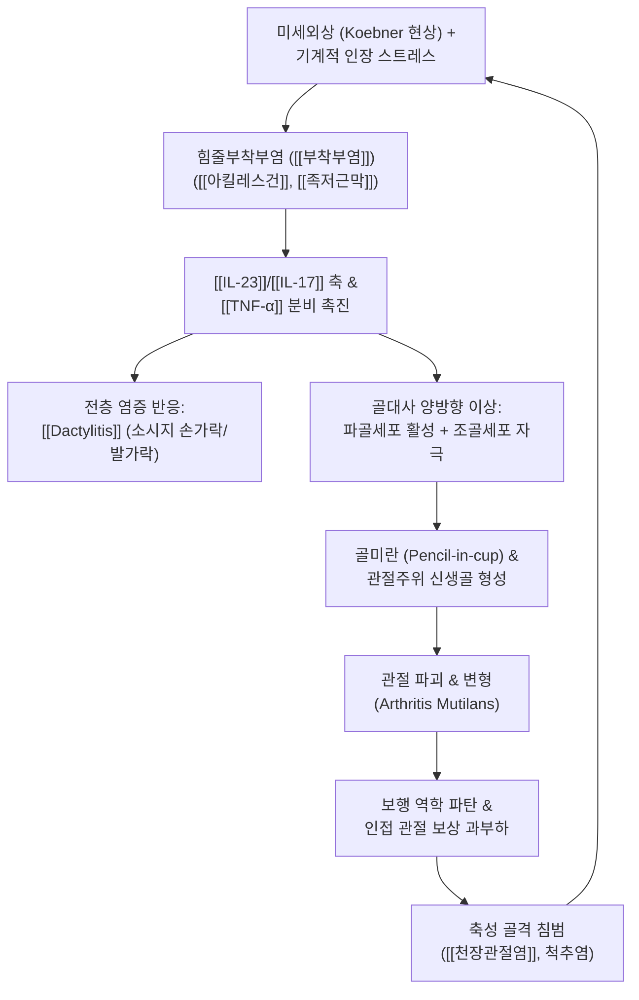

# 🩺 [[건선성 관절염]] (Psoriatic Arthritis, PsA / 乾癬性關節炎, ICD-10 L40.5, M07.0–M07.3 / KCD L40.5)

> **핵심 3줄 요약 (Key Summary)**:
> - 📍 **병소 부위 & 해부·병태생리**: 만성 판상 [[건선]] 환자의 20~30%에서 발생하는 혈청음성(Seronegative) [[척추관절염]](SpA)으로, 말초 관절(특히 [[원위지절간관절]](DIP)·[[중수지절관절]](MCP)·[[근위지절간관절]](PIP))과 **힘줄부착부(Enthesis)**([[아킬레스건]]·[[족저근막]]) 및 [[천장관절]]을 원발 표적으로 삼는다. [[HLA-B27]]/HLA-Cw6 유전 소인과 미세외상(Koebner 현상) 및 장-관절 축(Gut-Joint axis)에 의해 [[IL-23]]/[[IL-17]] 축과 [[TNF-α]] 신호가 폭주하며, **골미란(Bone erosion)과 관절주위 신생골 형성(Juxta-articular new bone formation)이 동일 관절에서 공존**하는 고유의 골대사 이상을 나타낸다.
> - 🚩 **전형적 임상 양상 & 5대 아형**: ① 비대칭성 소수관절염(최다 빈도), ② 대칭성 다발관절염(RA 유사), ③ DIP 우세형, ④ 척추염형, ⑤ 파괴성 관절염(Arthritis mutilans: 관절 용해로 인한 망원경 수지 Telescoping finger / 손가락 흔들림 Flail finger, X선상 연필-컵 Pencil-in-cup 징후). 동반 3대 소견으로 수지 전층 염증인 **[[Dactylitis]](지염, 소시지 손가락/발가락)**, 극심한 **[[부착부염]]**, 손발톱 건선 병변(조갑 함몰 Pitting, [[조갑박리]], 오일 방울 징후)이 특징적이다.
> - 🛠️ **핵심 감별 검사 & 한·양방 다각적 치료 전략**: [[CASPAR 기준]](≥3점 확진: 건선 병변, 조갑 이형성, RF 음성, 지염, 신생골), 66/68 관절 계수, LEI 부착부 지수, X-ray·초음파·MRI 평가. 양방 약물은 NSAIDs → csDMARDs([[메토트렉세이트]] MTX) → bDMARDs(TNF 억제제 아달리무맙, IL-17A 억제제 세쿠키누맙, IL-23 억제제 우스테키누맙) → tsDMARDs(JAK 억제제 토파시티닙) 단계적 운용. 한의학에서는 [[痺證]]·[[白疕]]·열독옹체(熱毒壅滯)·풍습열비(風濕熱痺)·간신음허 변증에 입각하여 [[당귀념통탕]], [[독활기생탕]], [[방기황기탕]], [[온담탕]], [[청열해독제]]·[[활혈거어제]] 가감방 및 [[봉독약침]]·침구([[양릉천]], [[곡지]], [[현종]], 아시혈)·관절 가동 [[추나요법]]을 유기적으로 병용한다.
> - <font color="#fa7e7e">⚠️ **응급 의뢰 레드플래그 & 악화 요인**: 급성 단관절의 극심한 발적·열감·고열(패혈성 관절염 감염 합병증 배제), 급격한 시력 저하 및 안구 통증(급성 전방 [[포도막염]]), 척추 불안정증 및 신경학적 결손(마미증후군/척수압박), 급속 진행성 수지 붕괴(Arthritis mutilans), 생물학적 제제/면역억제제 투여 중 기회감염·결핵 재활성화 징후. 급성 염증 활성기에는 고속교정 추나 및 강한 환부 직접 마사지 절대 금기.</font>

---

## 📌 목차
1. [질환 개요 & 해부학적 병태생리](#1-질환-개요--해부학적-병태생리)
2. [병태생리 메커니즘 & 생체역학적 악순환 네트워크](#2-병태생리-메커니즘--생체역학적-악순환-네트워크)
3. [임상 증상 & 이학적 검사(Physical Exam) 알고리즘](#3-임상-증상--이학적-검사physical-exam-알고리즘)
4. [감별 진단 매트릭스 (Differential Diagnosis)](#4-감별-진단-매트릭스-differential-diagnosis)
5. [한의 통합 치료 프로토콜 (침·약침·추나·한약)](#5-한의-통합-치료-프로토콜-침약침추나한약)
6. [양방 치료 & 병용·의뢰 기준 (Conventional Treatment & Referral)](#6-양방-치료--병용의뢰-기준-conventional-treatment--referral)
7. [재활 운동 & 생활습관 티칭 가이드](#7-재활-운동--생활습관-티칭-가이드)
8. [💡 사용자 진료실 핵심 필기 & 임상 노하우 (Melt-In 잔여 심화 집약)](#8--사용자-진료실-핵심-필기--임상-노하우-melt-in-잔여-심화-집약)
9. [출처 및 학술 참고 문헌 (References)](#9-출처-및-학술-참고-문헌-references)

---

## 1. 질환 개요 & 해부학적 병태생리

* **질환 정의 및 본질**:
  * **정의**: [[건선성 관절염]](Psoriatic Arthritis, PsA)은 피부 [[건선]](Psoriasis)을 기저 질환으로 가진 환자군에서 발생하는 만성 전신성 염증성 근골격계 질환이다. 류마티스 인자(RF) 및 항CCP항체(ACPA)가 통상 음성(Negative)으로 나타나는 **혈청음성(Seronegative) [[척추관절염]](Spondyloarthritis, SpA)**의 핵심 질환군에 속한다.
  * **역학 및 발생 빈도**: 만성 판상 건선 환자의 약 **20~30%**에서 건선성 관절염이 발병한다. 피부 건선 병변이 관절염보다 평균 5~10년 선행하여 나타나는 경우가 70~80%에 달하며, 약 10~15%에서는 관절 증상이 피부 증상보다 먼저 나타나거나 피부 병변 없이 발생하는 잠재성(Psoriasis sine psoriasis) 형태로 내원하여 진단 지연을 초래한다.
  * **호발 연령 및 성별**: 30~50대에 가장 흔히 발병하며 남녀 비는 대략 1:1로 유사하나, 말초 소수관절염 및 다발관절염은 여성에서, 척추염형은 남성에서 다소 우세하게 관찰된다.
  * **분류 체계**: ICD-10 코드는 **L40.5**(건선성 관절병증) 및 **M07.0–M07.3**(원위지간, 절단성 등 아형별 분류)에 해당하며, 국내 KCD 역시 **L40.5**로 코딩한다. 연구 및 임상 진료에서는 2006년 제정된 [[CASPAR 기준]](Classification Criteria for Psoriatic Arthritis)이 표준으로 사용된다.

* **Moll & Wright의 5대 특징적 임상 아형**:
  1. **비대칭성 소수관절염 (Asymmetric Oligoarthritis, 약 60~70% - 최다 빈도)**:
     * 4개 이하의 관절을 침범하며, 좌우 비대칭적으로 무릎, 발목, 또는 수지·족지의 DIP/PIP 관절 하나가 크게 붓고 통증을 나타냄.
  2. **대칭성 다발관절염 (Symmetric Polyarthritis, 약 15~25%)**:
     * 5개 이상의 관절을 양측 대칭적으로 침범하여 [[류마티스 관절염]](RA)과 매우 흡사한 임상 양상을 띰. 그러나 DIP 관절 침범 빈도가 높고 RF/ACPA 음성이며 피하 결절이 없는 점으로 구별됨.
  3. **원위지절간관절 우세형 (DIP Predominant, 약 5~10%)**:
     * 손가락 및 발가락의 [[원위지절간관절]](DIP)을 선택적으로 침범하며, 거의 예외 없이 인접한 손발톱의 심한 건선 조갑 병변(조갑 함몰, 조갑박리, 비후)을 동반함.
  4. **척추염형 (Spondylitis, 약 5~15%)**:
     * [[천장관절]](Sacroiliac joint)의 비대칭성 염증 및 흉·요추체의 인대골극(Syndesmophyte) 형성을 특징으로 하며, 아침 강직, 둔부 교대성 통증, 요추 운동 제한을 보임. [[강직성 척추염]]과 달리 척추 침범이 비대칭적이거나 건너뛰기(Skip lesion) 양상을 보임.
  5. **파괴성 관절염 (Arthritis Mutilans, 약 5% 미만)**:
     * 가장 중증의 파괴성 아형으로, 관절 연골과 지골의 심각한 골용해(Osteolysis)가 발생하여 지절 길이가 단축되는 망원경 수지(Telescoping finger) 및 관절 지지력 상실로 손가락이 고무인형처럼 꺾이는 흔들림 수지(Flail finger)가 유발됨. X-ray상 지골두가 흡수되고 원위 기저부가 확장되는 전형적인 **연필-컵 징후(Pencil-in-cup deformity)**가 관찰됨.

* **관련 해부학적 구조물**:
  * **골격 및 관절 복합체**:
    * **말초 관절**: 손의 [[원위지절간관절]](DIP), [[근위지절간관절]](PIP), [[중수지절관절]](MCP) 및 발의 중족지절관절(MTP), 지절간관절(IP), [[발목관절]], [[슬관절]].
    * **축성 골격**: [[천장관절]], 요추 및 흉추의 추간관절(Facet joint), 척추 인대 부착부.
  * **힘줄부착부 (Enthesis - 원발 병소)**:
    * 건(Tendon), 인대(Ligament), 관절낭(Capsule)이 골피질에 고정되는 해부학적 접합 부위.
    * 대표적 호발 부위: [[아킬레스건]] 종골 부착부, [[족저근막]] 기시부, 슬개건 부착부, 상완골 외상과(단요측수근신근 기시부), 늑연골 접합부.
  * **지절 전층 구조 (Dactylitis 침범 부위)**:
    * 지절 활막(Synovium), 굴곡건초(Flexor tendon sheath), 부착부(Enthesis), 피하 결합조직이 일체화되어 전층 염증 및 부종을 형성함.
  * **조갑 기관 (Nail Unit)**:
    * 손발톱 기질(Nail matrix), 조갑하 상피(Nail bed), 원위 지골 골막 및 DIP 신전건 부착부. 해부학적으로 신전건의 섬유가 조갑 기질 및 원위 지골 골막과 직접 연결되어 있어, 건선 조갑 병변과 DIP 관절염이 강한 연계성을 나타냄.

---

## 2. 병태생리 메커니즘 & 생체역학적 악순환 네트워크

### 1) 면역병리 분자 기전 — "부착부(Enthesis) 원발설"과 장-관절 축

* **기계적 스트레스와 미세외상 (Koebner Phenomenon in Enthesis)**:
  * PsA의 일차 병변은 활막이 아니라 기계적 부하와 전단 응력이 집중되는 **힘줄부착부(Enthesis)**에서 태동한다.
  * 걷기, 달리기, 반복적 파지 동작에 의해 아킬레스건이나 손가락 인대 부착부에 미세손상(Microdamage)이 발생하면, 국소 조직 손상 복구 과정에서 선천면역계 수용체와 수지상세포가 자극된다.
* **장-관절-피부 축 (Gut-Joint-Skin Axis)**:
  * 유전적 소인([[HLA-B27]], HLA-Cw6, IL-23R, ERAP1)을 가진 개체에서 장내 미생물총 불균형(Dysbiosis) 및 장 점막 투과성 증가가 선행한다.
  * 장관 상피에서 유래된 박테리아 항원 및 활성화된 골수계 수지상세포(Dendritic cells)가 순환계를 통해 관절 부착부 및 피부로 이동하여 염증 반응을 촉발한다.
* **IL-23 / IL-17 축과 TNF-α 신호 폭주**:
  * 부착부 주변의 수지상세포와 대식세포가 [[IL-23]](p19/p40)을 대량 분비한다.
  * IL-23 자극을 받은 **조직 상주성 γδ T세포(Tissue-resident γδ T cells), Th17 세포, 3군 선천림프구(ILC3)**가 즉각적으로 [[IL-17]](IL-17A, IL-17F)과 [[IL-22]], [[TNF-α]]를 연속 방출한다.
  * IL-17A와 TNF-α는 활막 섬유아세포(FLS) 및 혈관 내피세포를 활성화하여 신생혈관 형성(VEGF), 중성구 유주(CXCL1/8), 기질금속단백분해효소(MMP-3, MMP-9) 방출을 유도하여 활막염과 건초염을 격발한다.
* **동시성 골대사 이상 (골미란 + juxta-articular 신생골 형성의 공존)**:
  * PsA의 독특한 병리적 특징은 파골세포(Osteoclast)에 의한 골흡수(골미란)와 조골세포(Osteoblast)에 의한 신생골 증식이 한 관절에서 동시에 발생한다는 점이다.
  * **골미란 경로**: TNF-α, IL-17A, RANKL이 활막-골 경계면에서 파골세포 전구세포를 성숙 파골세포로 분화시켜 연골하골과 피질골을 파괴함.
  * **골증식 경로**: IL-22와 BMP(Bone Morphogenetic Protein), Wnt/β-catenin 신호전달 경로가 건 부착부 주변의 간엽줄기세포(MSC)를 조골세포로 분화 유도하여 관절주위 골극, 인대골극(Syndesmophyte), 부착부골극(Enthesophyte)을 증식시킴.

### 2) ASCII 병태생리 신호전달 & 병변 구조 다이어그램

```
========================================================================================
                      [건선성 관절염(PsA) 병태생리 분자 네트워크]
========================================================================================

  [유전 소인: HLA-B27, HLA-Cw6, IL-23R]  +  [환경 요인: 미세외상(Koebner), 장내균총 이상]
                             │
                             ▼
             [장 점막 투과성 증대 & 장-관절 축 면역세포 자극]
                             │
                             ▼
            [기계적 스트레스 집중 부위: 힘줄부착부 (Enthesis)]
                             │
                  (수지상세포 / 대식세포 침윤)
                             │
                             ▼
                   【 IL-23 (p19/p40) 대량 분비 】
                             │
                             ▼
           【 부착부 상주 γδ T세포 · Th17 세포 · ILC3 활성화 】
                             │
             ┌───────────────┴───────────────┐
             ▼                               ▼
    【 IL-17A / IL-17F 】               【 IL-22 / BMP / Wnt 】
             │                               │
             ├───────────────┐               │
             ▼               ▼               ▼
     [TNF-α · MMP 방출]  [RANKL 과발현]  [간엽줄기세포 자극]
             │               │               │
             ▼               ▼               ▼
       [활막염·건초염]  [파골세포 분화]  [조골세포 과형성]
             │               │               │
             ▼               ▼               ▼
     【 Dactylitis 】    【 골미란 】    【 관절주위 신생골 】
     (소시지 손발가락)  (Pencil-in-Cup) (골극·인대골극·강직)
             │               │               │
             └───────────────┼───────────────┘
                             ▼
      【 관절 파괴, 아형별 변형(Arthritis Mutilans), 축성 강직 】
========================================================================================
```

### 3) 생체역학적 악순환 네트워크 (Mermaid)



---

## 3. 임상 증상 & 이학적 검사(Physical Exam) 알고리즘

### 1) 주소증 및 4대 특징적 임상 증상
* **말초 관절통 및 조조강직**:
  * 환부 관절의 부종, 발적, 둔중한 열감 및 동통.
  * **조조강직([[조조강직]])**: 아침 기상 시 30분 이상, 활동하지 않는 휴식 후 지속되는 뻣뻣함이 뚜렷하며, 활동 시 서서히 완화되는 염증성 특징을 보임.
* **지염 (Dactylitis, Sausage Digit)**:
  * 손가락이나 발가락 1개 이상이 전체적으로 균일하게 소시지 모양으로 퉁퉁 붓는 병변(환자의 30~50%에서 발생).
  * 굴곡건초염, 부착부염, 활막염, 피하 결합조직 염증이 복합된 전층 부종으로, PsA의 고유한 임상 표지자(Hallmark) 역할을 수행함.
* **힘줄부착부염 (Enthesitis)**:
  * 종골 하부의 [[족저근막]] 기시부 통증(아침 첫 발 디딜 때 통증) 및 후방의 [[아킬레스건]] 부착부 부종·극심한 압통.
  * 상완골 외상과(테니스 엘보 유사 통증), 경골 조면, 늑연골 접합부 압통.
* **건선 조갑 병변 (Psoriatic Nail Disease)**:
  * 조갑 함몰(Pitting: 바늘로 찌른 듯한 무수한 미세 패임), [[조갑박리]](Onycholysis: 손발톱이 상피에서 들뜸), 오일 방울 징후(Oil-drop / Salmon patch: 조갑판 아래 황갈색 반점), 조갑하 각화증(Subungual hyperkeratosis).
  * 조갑 병변 환자의 80% 이상에서 DIP 관절염이 합병되므로 조갑 관찰은 조기 진단의 필수 관문임.
* **축성 증상 (Axial Symptoms)**:
  * 둔부 교대성 통증(천장관절염), 야간 수면 중 통증으로 인한 각성, 흉곽 확장 제한, 척추 가동성 저하.

### 2) 단계별 이학적 검사 및 진단 알고리즘
* **1단계: CASPAR 분류 기준 평가 (Classification Criteria for Psoriatic Arthritis)**:
  * 염증성 관절 질환(말초 관절, 척추, 또는 부착부 질환)이 입증된 환자에서 **총점 3점 이상**이면 PsA로 확진:
    1. **피부 건선 소견 (최대 2점)**: 현재 건선(2점) / 과거 건선 병력(1점) / 건선 가족력(1점).
    2. **건선 조갑 이형성 (1점)**: 조갑 함몰, 조갑박리, 조갑하 각화증.
    3. **류마티스 인자(RF) 음성 (1점)**: ELISA 또는 네펠로메트리 측정 음성.
    4. **지염 (Dactylitis, 1점)**: 현재 지염 소견 또는 류마티스내과의사가 확인한 지염 기왕력.
    5. **방사선상 관절주위 신생골 형성 (1점)**: 손/발 X-ray상 관절주위 신생골 형성(Juxta-articular new bone formation, 골극 제외).
* **2단계: 관절 및 부착부 중증도 계수 평가**:
  * **66/68 관절 계수 (Swollen/Tender Joint Count)**: 종창 관절 66개, 압통 관절 68개 검진(DIP 관절을 반드시 포함).
  * **LEI (Leeds Enthesitis Index)**: 양측 아킬레스건, 슬개골 상단/하단, 상완골 외상과 부착부 압통 채점(0~6점).
  * **MASES 및 SPARCC 부착부 지수**: 천장관절, 늑연골, 극돌기 부착부 평가.
  * **DAPSA (Disease Activity in Psoriatic Arthritis)**: 관절수, 환자 통증 VAS, 질환 전반 평가 VAS, CRP 수치를 종합한 질환 활성도 점수.
* **3단계: 척추 및 천장관절 이학적 검사**:
  * **[[Schober 검사]]**: 요추 굴곡 가동성 평가(5cm 미만 증가 시 가동성 제한).
  * **FABER 검사 (Patrick Test) & Gaenslen 검사**: 천장관절 통증 유발.
  * **흉곽 확장도 검사**: 제4늑간 수준에서 흡기-호기 둘레 차이 측정(2.5cm 미만 시 흉곽 침범).
* **4단계: 영상 및 임상병리 검사**:
  * **X-ray**: 손/발 및 골반 단순 방사선 촬영 → 골미란과 신생골 공존, 비대칭성 천장관절염, 연필-컵(Pencil-in-cup) 변형 확인.
  * **근골격계 초음파 (MSUS)**: 고해상도 파워 도플러(Power Doppler)로 건초염(Tenosynovitis), 부착부 혈류 신호 증대, 무증상 활막염 조기 탐지.
  * **혈청학적 검사**: RF 및 ACPA(음성 확인), [[ESR]]/[[CRP]](상승 가능하나 40~50%의 환자에서는 정상일 수 있으므로 정상이어도 PsA 배제 불가), [[HLA-B27]](양성 시 축성 침범 위험 증가), 혈청 요산(통풍 감별).

---

## 4. 감별 진단 매트릭스 (Differential Diagnosis)

| 감별 질환 | 호발 병소 및 원인 | 주소증 및 임상 특징 | 손발톱 / 지염 / 피부 | 방사선 및 검사실 핵심 소견 |
| :--- | :--- | :--- | :--- | :--- |
| **[[건선성 관절염]] (본 질환)** | 말초 소관절(특히 DIP), 힘줄부착부, 천장관절 | 비대칭성 소수관절염 위주, 조조강직, 부착부 동통 | **조갑 함몰/박리 빈발, [[Dactylitis]] 호발, 피부 건선** | **RF/ACPA 음성**, X-ray상 골미란 + **관절주위 신생골** 공존, Pencil-in-cup 변형 |
| **[[류마티스 관절염]] (RA)** | 대칭성 근위 소관절(MCP, PIP, 손목, MTP) | 양측 대칭성 관절염, 극심한 조조강직(>1시간), **DIP 침범 극히 드묾** | 조갑 병변 없음, Dactylitis 없음, 피하 류마티스 결절 | **RF 양성(70~80%), ACPA 양성(80~90%)**, 관절간격 대칭 협소, 변연부 순수 골미란 |
| **[[통풍]] (Gouty Arthritis)** | 제1중족지절관절(MTP), 족근관절, 슬관절 | **급격한 야간 돌발 통증**, 극심한 발적·종창·열감, 7~10일 내 완화 주기 | 조갑 병변 없음, 만성 결절통풍 시 결절 형성 | 관절액 편광현미경 검사상 **바늘모양 요산염 결정(음성 복굴절)**, 혈청 요산 상승, 펀치로 뚫은 듯한 골미란(Overhanging edge) |
| **[[퇴행성 관절염]] (골관절염, OA)** | 체중부하 관절(슬, 고관절) 및 손의 DIP, PIP | 사용 후 악화, 휴식 시 호전, **조조강직 30분 미만**, 전신 증상 부재 | **Heberden 결절(DIP), Bouchard 결절(PIP)**, 조갑 함몰 없음 | 정상 ESR/CRP, RF 음성, 비대칭성 관절간격 협소, 연골하 경화증, 골극(Osteophyte) |
| **[[강직성 척추염]] (AS)** | 천장관절, 척추 축성 골격 원발, 하지 대관절 | 양측 대칭성 천장관절염, 염증성 요통, 아침 강직, 상행성 척추 강직 | 피부/조갑 건선 없음, Dactylitis 드묾 | **HLA-B27 양성률 >90%**, X-ray상 대칭성 천장관절염, 대나무 척추(Bamboo spine), 척추 인대골극 |
| **[[반응성 관절염]] (ReA)** | 하지 대관절, 발목, 족부 부착부 | 선행 요로/위장관 감염 1~4주 후 발병, 비대칭성 관절염 | 무통성 구강궤양, 농포성 건선 유사 피진(Keratoderma blennorrhagica), 결막염 | 선행 균(클라미디아, 살모넬라 등) 검출, HLA-B27 흔함, 일과성 경과 |

---

## 5. 한의 통합 치료 프로토콜 (침·약침·추나·한약)

> ⚠️ **통합 치료 안전 수칙**:
> 1. 건선성 관절염은 진행성 관절 파괴와 영구적 장애를 유발할 수 있는 자가면역 질환이므로, 한의 단독 치료로 무리하게 양방 면역억제 치료를 중단시켜서는 안 되며 류마티스내과와의 긴밀한 협진 하에 증상 완화, 면역 안정, 기능 보존을 목표로 한다.
> 2. 생물학적 제제([[TNF-α 억제제]], [[IL-17 억제제]], [[IL-23 억제제]])나 [[JAK 억제제]] 투여 중인 환자는 면역 저하 상태이므로 철저한 멸균 침 시술과 감염 징후 모니터링이 필수적이다.
> 3. 건선 피부 판(Plaque)이 심하게 갈라지거나 삼출물이 있는 부위는 직접 자침을 피하여 2차 세균 감염 및 Koebner 현상에 의한 피부 악화를 방지한다.

* **침구 치료 (Acupuncture)**:
  * **변증별 주혈 및 원위 취혈**:
    * **풍습열비(風濕熱痺)·열독옹체(熱毒壅滯)**: [[곡지]](LI11), [[합곡]](LI4), [[음릉천]](SP9), [[혈해]](SP10), [[대추]](GV14), [[내정]](ST44) — 청열해독, 소풍설열.
    * **어혈저락(瘀血阻絡)·만성 관절 강직**: [[격수]](BL17), [[삼음교]](SP6), [[태충]](LR3), [[현종]](GB39) — 활혈통락, 거어지통.
    * **간신음허(肝腎陰虛)·기혈양허(氣血兩虛)**: [[신수]](BL23), [[간수]](BL18), [[태계]](KI3), [[족삼리]](ST36), [[관원]](CV4) — 보익간신, 익기양혈.
  * **국소 병변 취혈**:
    * **수지 DIP/PIP 관절 및 Dactylitis**: [[팔사혈]](EX-UE9), [[중저]](TE3), [[양지]](TE4), [[외관]](TE5), [[완골]](SI4) 및 병변 관절 상하의 아시혈(부종이 극심한 지절 중앙부는 피하고 건초 주변 연부조직 사입).
    * **족부 및 아킬레스건/족저근막 부착부**: [[팔풍]](EX-LE10), [[곤륜]](BL60), [[태계]](KI3), [[구허]](GB40), [[해계]](ST41), [[조해]](KI6), [[승산]](BL57).
    * **천장관절 및 축성 병변**: [[차료]](BL32), [[중료]](BL33), [[포황]](BL53), [[질변]](BL54), [[협척혈]](EX-B2).
  * **전침 및 온열 자극 운용**:
    * 만성 강직성 병변에는 2~4Hz 저주파 전침을 20분간 적용하여 내인성 오피오이드 분비 및 국소 미세혈류 순환 촉진.
    * 급성 발적 및 열감이 심한 관절에는 전침 및 직접구를 피하고 호침 자침 후 국소 쿨링(습포) 위주로 안정화 유도.

* **약침 치료 (Pharmacopuncture)**:
  * **봉독약침 (Bee Venom Pharmacopuncture)**:
    * 멜리틴(Melittin)과 아파민(Apamin) 성분을 통한 강력한 NF-κB 활성 억제, TNF-α 및 IL-17 매개 전염증 반응 차단 효과.
    * **시술 방법**: 반드시 사전 피내 알레르기 테스트(Skin prick test)를 거친 후 10,000:1 또는 20,000:1 희석 제제로 시작. 관절강 내가 아닌 관절낭 주위 연부조직, 부착부 주변 아시혈에 포인트당 0.05~0.1mL씩 주입.
  * **소염 및 재생 약침**:
    * 급성기 염증: 황련해독탕 약침, 신바로 약침, 중성어혈 약침을 건초 주변 및 관절낭 연부조직에 시술.
    * 만성 관절 파괴 및 부착부 변성: 자하거(Hominis Placenta) 약침, 녹용 약침을 시술하여 인대/건 부착부 콜라겐 합성 및 세포 재생 유도.
  * **부착부 시술 주의사항**: 아킬레스건 및 족저근막 부착부 시술 시 건 실질 내부로 고압 주입하면 건 파열 위험이 있으므로, 건 주위(Peritendinous space) 15~30도 각도로 비스듬히 연부조직에 얕게 주입.

* **추나 치료 (Chuna Manipulation)**:
  * **원칙**: 관절 파괴(골미란) 및 척추 인대골극이 존재하는 관절에 대한 **고속저진폭(HVLA) 스러스트 추력 교정은 관절 파손 및 척추 손상을 유발하므로 절대 금기**이다.
  * **적용 기법**:
    * **근막 이완 추나(JS 기법)**: 천장관절 주변의 둔근 복합체, 이상근, 장요근, 흉요근막에 대한 부드러운 가동성 이완.
    * **관절 가동화 기법 (Mobilization Grade I~II)**: 수근관절, 발목관절, 견관절, 고관절의 관절 내 유동(Joint play) 회복을 위한 부드러운 진자운동 및 신연(Distraction).
    * **경추 및 흉곽 가동성 회복**: 흉곽 확장 제한 완화를 위한 늑골-척추 관절 부드러운 호흡 연계 가동 수기.

* **변증별 한약 처방 (Herbal Medicine)**:
  * **열독옹체(熱毒壅滯)·풍습열비(風濕熱痺)형 (급성 활성기)**:
    * 임상 양상: 관절 발적, 열감, 극심한 종창, 피부 건선판 홍조 및 인설 다량 탈락, 구갈, 설홍 태황초, 맥 활삭.
    * 처방: [[당귀념통탕]](當歸拈痛湯), 청열활혈탕(淸熱活血湯), 선방활명음 가감.
    * 구성 약재: [[생지황]], [[적작약]], [[목단피]], [[금은화]], [[연교]], [[황백]], [[지모]], [[토복령]], [[백화사설초]] (소염 및 각질세포 증식 억제).
  * **풍습어저(風濕瘀阻)·담탁응체(痰濁凝滯)형 (아급성·만성 강직기)**:
    * 임상 양상: 관절 종창이 지속되며 손발가락이 굳어 굴신 곤란, 피부 건선판 비후 및 암자색 변색, 설암반 태백니.
    * 처방: [[독활기생탕]](獨活寄生湯) 합 신통축어탕(身痛逐瘀湯), [[계지작약지모탕]](桂枝芍藥知母湯), [[온담탕]] 가미.
    * 구성 약재: [[독활]], [[강활]], [[위령선]], [[방풍]], [[당귀]], [[천궁]], [[도인]], [[홍화]], [[우슬]], [[단삼]].
  * **기허습저(氣虛濕阻)·비위허약(脾胃虛弱)형 (하지 부종 및 전신 쇠약)**:
    * 임상 양상: 전신 무력감, 소화 불량, 발목 및 손목의 만성 부종, 피로 시 관절통 악화, 설담 태백.
    * 처방: [[방기황기탕]](防己黃耆湯), 삼령백출산 가미.
    * 구성 약재: [[황기]], [[방기]], [[백출]], [[복령]], [[의이인]], [[감초]].
  * **간신음허(肝腎陰虛)·골위(骨痿)형 (만성 관절 변형 및 퇴행)**:
    * 임상 양상: 병력이 오래되어 관절이 변형되고 근위축 발생, 요슬산연(허리와 무릎 시림·무력), 조열도한, 설홍 소태, 맥 세삭.
    * 처방: [[독활기생탕]](獨活寄生湯) 합 육미지황탕, 보신건골탕 가미.
    * 구성 약재: [[숙지황]], [[산수유]], [[구기자]], [[두충]], [[속단]], [[우슬]], [[구척]], [[골쇄보]].

---

## 6. 양방 치료 & 병용·의뢰 기준 (Conventional Treatment & Referral)

### 1) 표준 양방 약물 치료 단계 (EULAR / ACR 가이드라인)
* **1단계: 비스테로이드성 소염진통제 (NSAIDs)**:
  * 멜록시캄(Meloxicam 7.5~15mg/d), 나프록센(Naproxen 500~1000mg/d), 셀레콕시브(Celecoxib 200~400mg/d).
  * 경증의 말초 관절염 및 부착부염 증상 조절에 1차 적용하나, 질환의 구조적 파괴(골미란)를 방지하지는 못함. 위장관 궤양, 심혈관 위험 모니터링 필요.
* **2단계: 재래식 합성 항류마티스제 (csDMARDs)**:
  * **[[메토트렉세이트]](Methotrexate, MTX)**: 1차 선택 약물(주 7.5~25mg 경구 또는 피하주사, 엽산 매일 1mg 병용). 말초 관절염과 피부 건선에 동시 효과적이나 부착부염이나 축성 병변에는 효과가 미흡함. 간독성, 골수억제 추적(CBC, LFT 정기검사).
  * **설파살라진(Sulfasalazine)**: 1일 2~3g 분복. 말초 관절염 조절.
  * **레플루노미드(Leflunomide)**: 1일 10~20mg.
* **3단계: 생물학적 제제 (bDMARDs - 표적 치료제)**:
  * csDMARDs 치료에 불응하거나 부착부염·축성 침범이 주된 경우 조기 투여:
    * **[[TNF-α 억제제]]**: 아달리무맙(Adalimumab), 에타너셉트(Etanercept), 인플릭시맙(Infliximab), 골리무맙(Golimumab). 관절, 부착부, 척추, 피부 전반에 신속한 항염 효과. 잠복결핵 및 B형간염 재활성화 스크리닝 필수.
    * **[[IL-17 억제제]]**: 세쿠키누맙(Secukinumab), 익세키주맙(Ixekizumab). 건선 피부 병변과 말초/축성 관절염, 골미란 억제에 탁월한 효과. 진균 감염(칸디다증) 및 염증성 장질환(IBD) 악화 주의.
    * **[[IL-23 억제제]]**: 우스테키누맙(Ustekinumab - IL-12/23 억제), 구셀쿠맙(Guselkumab), 리산키주맙(Risankizumab). 피부 및 부착부염에 강력한 효과.
* **4단계: 경구 표적 합성 항류마티스제 (tsDMARDs)**:
  * **[[JAK 억제제]]**: 토파시티닙(Tofacitinib 5mg bid), 우파다시티닙(Upadacitinib 15mg qd). 경구 복용 가능 제제로 생물학적 제제 불응군에 투여. 대상포진 감염, 정맥혈전색전증(VTE) 위험 모니터링.
  * **PDE4 억제제**: 아프레밀라스트(Apremilast 30mg bid). 경증~중등도 관절염 및 피부 병변에 사용(위장관 부작용, 체중 감소 주의).
* **국소 시술 (Local Procedures)**:
  * 심한 단관절 활막염 또는 지염 발생 시 관절강 내 트리암시놀론(Triamcinolone) 국소 스테로이드 주입 고려 (연 3~4회 이하로 제한, 힘줄 실질 내 주입은 건 파열 위험으로 절대 금기).

### 2) 한·양방 병용 판단 기준 (Combination Therapy)
* **병용 권장 (Synergistic Benefit)**:
  * 양방 csDMARDs(MTX) 또는 생물학적 제제를 복용하면서 잔여 통증(VAS 4~6), 부착부 압통, 근육 경직, 만성 피로가 지속되는 환자에게 한의 침구, 비침습 추나, 보익성/청열성 한약을 병용하여 질환 활성도(DAPSA)를 낮추고 양약의 감량을 도모함.
  * MTX 복용으로 인한 비위장관 장애(오심, 구토, 식욕부진) 환자에게 건비화위(健脾和胃) 한약 병용.
* **병용 주의 및 감량 규칙**:
  * 환자가 임의로 MTX나 생물학적 제제를 중단할 경우 급격한 염증 리바운드(Rebound flare)가 발생하여 비가역적 관절 파괴로 이어질 수 있으므로, 임의 중단을 엄격히 금지시키고 류마티스내과 진료를 통해 질병 활성도가 관해(Remission)에 도달했을 때 점진적으로 감량하도록 지도함.
  * 생물학적 제제 투여 당일에는 침습적 한의 시술(약침, 심부 자침)을 피하고 주사 부위 감염 위험을 회피함.
* **절대 병용 금기**:
  * MTX 투여 환자에게 간독성이나 골수억제 위험이 있는 비표준 한약재(뇌공등 雷公藤, 황약자 黃藥子, 산두근 등) 병용 절대 금기.

### 3) 양방·전문과 의뢰 기준 (Referral Criteria)
* **즉각 응급 의뢰 (Red Flags)**:
  * 고열(38.3°C 이상)을 동반한 단일 관절의 급격한 발적, 작열통, 종창 (패혈성 관절염 감염 합병 의심 → 즉시 응급실 이송 및 관절액 천자 배양 필수).
  * 갑작스러운 안구 통증, 충혈, 눈부심, 시력 저하 (급성 전방 [[포도막염]] 합병 → 24시간 이내 안과 응급 의뢰).
  * 척추 부위 외상 후 극심한 격통 또는 하지 근력 마비, 안장 감각 소실, 대소변 실금 (마미증후군 및 척수 압박 → 척추신경외과 응급 의뢰).
  * 생물학적 제제/JAK 억제제 사용 중 지속적인 기침, 야간 발한, 체중 감소 (결핵 재활성화 의심).
* **류마티스내과 정밀 의뢰 기준**:
  * 1차 의료기관에서 건선 환자가 원인 불명의 관절통, 조조강직, 발뒤꿈치 통증, 소시지 손가락을 호소할 때 (CASPAR 평가 및 DMARD 조기 도입을 위해 지체 없이 류마티스내과 전원).
  * 방사선상 조기 골미란 소견이 발견되거나, 기존 치료에도 불구하고 관절 변형(Arthritis mutilans)이 급속히 진행하는 경우.

---

## 7. 재활 운동 & 생활습관 티칭 가이드

* **관절 가동성 유지 및 스트레칭 (Stretching)**:
  * **손가락 관절 운동**: 따뜻한 물에 손을 5~10분 담가 아침 강직을 완화한 후, 각 손가락 마디를 굴곡-신전하고 주먹을 쥐었다 펴는 '텐던 글라이딩(Tendon gliding)' 운동을 10회씩 3세트 반복.
  * **아킬레스건 및 족저근막 스트레칭**: 벽을 짚고 서서 환측 하지를 뒤로 뻗어 발뒤꿈치를 바닥에 붙인 채 종아리를 늘려줌. 단, 급성 부착부염 통증기에는 강한 과신전을 피하고 족저부 부드러운 마사지볼 롤링으로 대체.
  * **척추 및 흉곽 신전 운동**: 폼롤러를 흉추 뒤에 대고 누워 가슴을 활짝 펴는 흉추 신전 운동과 심호흡 운동을 시행하여 척추 후만 및 흉곽 확장 제한을 방지.

* **저충격 근력 강화 및 안정화 운동 (Strengthening)**:
  * **수중 운동 (Hydrotherapy)**: 온수 풀에서의 아쿠아로빅 및 수영(자유형, 배영)은 관절에 체중 부하를 주지 않으면서 전신 근력과 관절 가동 범위를 유지하는 최적의 운동임.
  * **등척성 하지 근력 강화**: 무릎 신근 강화를 위한 대퇴사두근 세팅(Q-setting: 무릎 밑에 수건을 괴고 누르기) 및 바로 누워 다리 들어올리기(SLR).
  * **파지 기능 보조 훈련**: 손가락 관절 파괴 환자에게 강한 악력기 사용은 금기이며, 부드러운 세라피 퍼티(Therapy putty)를 이용한 가벼운 쥐기 훈련 권장.

* **관절 보호 기법 및 인체공학적 생활습관 (Joint Protection & Ergonomics)**:
  * **관절 부하 분산 원칙**:
    * 물건을 들 때 작은 손가락 관절 대신 손바닥 전체와 양팔, 전완 등 큰 관절을 사용함.
    * 냄비나 무거운 프라이팬은 양손으로 손잡이를 쥐고 운반함.
    * 비틀어 짜는 동작(걸레 짜기, 꽉 닫힌 병뚜껑 열기)을 피하고 고무 오프너나 보조 기구를 활용함.
  * **족부 보호 신발 착용**:
    * 바닥이 단단하고 쿠션이 없는 슬리퍼나 플랫슈즈는 아킬레스건과 족저근막에 심각한 충격을 유발함.
    * 뒤꿈치 충격을 흡수하는 실리콘 힐컵(Heel cup)이 삽입된 기능성 운동화를 실내외에서 착용함.
  * **체중 조절 및 대사질환 관리**:
    * 비만은 전신 염증(TNF-α, IL-17)을 증폭시키고 무릎, 발목, 아킬레스건에 가해지는 기계적 하중을 급증시킴. 체중 5~10% 감량 시 질환 활성도 및 약물 반응률이 현저히 향상됨.
  * **금연 및 금주 (필수 티칭)**:
    * 흡연은 피부 건선과 건선성 관절염을 악화시키고 약물 반응을 떨어뜨리는 독립적 위험 인자임.
    * MTX 복용 환자에게 음주는 간독성을 급격히 유발하므로 금주가 절대적임.

---

## 8. 💡 사용자 진료실 핵심 필기 & 임상 노하우 (Melt-In 잔여 심화 집약)

> [!IMPORTANT]
> **🛡️ 원문 융합(Melt-In) 집약**
> 본 섹션은 기존 비오님 진료실 필기에 담겨 있던 핵심 문진 단서, 손맛 노하우, 환자 티칭 스크립트 중 상부 섹션에 담지 못한 임상적 뉘앙스를 밀도 있게 보존하여 집약한다.

* **진료실 실전 문진 5대 핵심 포인트 (내원 3분 내 스크리닝)**:
  1. **"숨은 피부 건선 찾기"**: 환자가 "피부병은 전혀 없다"고 말해도 반드시 **두피(머리밑 인설), 귀 뒤편, 배꼽 안쪽, 엉덩이 둔부 주름, 외음부**를 직접 육안으로 확인하라. 환자 자신도 단순 비듬이나 습진으로 알고 지내는 경우가 허다하다.
  2. **"손발톱은 관절염의 창(窓)"**: 손가락 통증 환자가 오면 손가락만 보지 말고 손발톱 표면의 딤플(Pitting)과 끝이 들뜨는 박리증을 먼저 확인하라. 손발톱 병변이 뚜렷할수록 DIP 관절염과 파괴성 아형 위험이 급증한다.
  3. **"수년간 족저근막염으로 치료받았다는 환자의 함정"**: 아침 첫 발 통증으로 양방 정형외과나 한의원에서 체외충격파, 봉침을 수개월 맞아도 낫지 않는 발뒤꿈치 통증 환자는 단순 퇴행성 족저근막염이 아니라 부착부염(Enthesitis)을 동반한 PsA일 확률이 매우 높다. 반드시 관절염 기왕력과 피부 건선을 문진하라.
  4. **"한 관절씩 돌아다니는 비대칭성 부종"**: "몇 달 전에는 오른쪽 무릎이 붓더니 이번에는 왼쪽 두 번째 손가락이 소시지처럼 붓는다"는 호소는 혈청음성 척추관절염의 전형적 궤적이다.
  5. **"염증 수치(ESR/CRP)가 정상이라고 안심하지 말 것"**: 류마티스 관절염과 달리 건선성 관절염 환자의 40~50%는 질환 활성기에도 ESR과 CRP가 정상 범위에 머문다. 수치가 정상이더라도 임상적 종창과 부착부 압통이 있으면 즉시 의심해야 한다.

* **시술 순서 및 손맛 노하우**:
  * **자침 시술 순서**: 사지 말단(팔사, 팔풍) → 팔다리 주관절/슬관절(곡지, 양릉천) → 척추 배수혈 순으로 접근하여 환자의 통증 민감도와 자침 훈침 위험을 최소화한다.
  * **Dactylitis 부종 손가락 자침 팁**: 손가락이 소시지처럼 퉁퉁 부어 있을 때 환부 지절 한가운데를 직자하면 극심한 통증과 염증 악화를 부른다. 지절간관절 바로 옆 연부조직을 사선으로 얕게 자침(사자 15도)하거나, 손등의 팔사혈과 중저혈에서 원격으로 기혈을 소통시키는 배농·소종 방식을 취한다.
  * **아킬레스건 약침 주입 손맛**: 바늘을 아킬레스건 실질부로 찌르면 뻑뻑한 저항감과 함께 극통이 발생하고 건 변성을 초래한다. 건 측면의 가쪽 연부조직(Kager's fat pad 방향)으로 저항 없이 부드럽게 들어가는 지점을 확인한 후, 무압력으로 0.05~0.1mL를 스며들게 주입하는 것이 핵심이다.
  * **추나 시술 시 주의점**: 천장관절 통증 환자에게 옆으로 눕혀 골반을 강하게 비트는 장골 교정 기법(Side-posture pelvic thrust)을 쓰면 관절낭 파열 및 극심한 염증 악화를 초래한다. 환자를 편안히 눕히고 고관절을 가볍게 회전시키는 완만한 관절가동술(MET)과 둔근 복합체 근막 이완만으로 충분한 감압 효과를 거둘 수 있다.

* **환자 티칭 스크립트 (진료실 소통용)**:
  * *"환자분, 지금 앓고 계신 관절염은 단순 노화로 닳아서 생기는 퇴행성 관절염이 아닙니다. 피부에 건선이 생기듯, 면역세포가 힘줄이 뼈에 붙는 자리와 관절을 적으로 오인해 공격하는 자가면역 질환입니다."*
  * *"이 병은 한 번 관절 연골과 뼈가 파괴되면 현대의학으로도 원래대로 되돌리기 어렵습니다. 따라서 치료의 목표는 단순히 아플 때 통증만 없애는 것이 아니라, 뼈가 녹아내리지 않도록 염증을 뿌리 뽑아 관절 모양과 손 기능을 지키는 것입니다."*
  * *"류마티스내과에서 처방받으신 면역 조절 약물은 임의로 끊으시면 관절이 급격히 망가질 수 있습니다. 저희 한의원에서는 관절 주변의 굳은 힘줄을 풀고 붓기를 가라앉히며, 양약 복용으로 지친 위장과 간 기능을 보충해 주는 통합 치료로 환자분의 관절을 든든하게 지켜드리겠습니다."*

---

## 9. 출처 및 학술 참고 문헌 (References)

1. China Dermatologist Association, et al. (2026). Guideline for the diagnosis and treatment of psoriasis arthropathica psoriatic arthritis in China 2026 edition. *Zhonghua Yi Xue Za Zhi*. 106(6):441-456. PMID: 42373464

   - **[연구 요약]**: 중국 피부과 협회 가이드라인. 건선성 관절염 조기 진단 알고리즘, 피부 병변과 관절 침범의 통합 관리 및 표적 치료제 권고안 제시.

2. Albrecht K, et al. (2026). Rheumatological care of older people : Annual report 2026 from the National Database of the regional Collaborative Arthritis Centers. *Z Rheumatol*. 85(1):12-25. PMID: 42461276

   - **[연구 요약]**: 독일 관절염 협력 센터 연례 보고서. 고령 관절염 환자 코호트에서 건선성 관절염의 역학적 특성, 동반질환 및 약물 치료 데이터 분석.

3. Coates LC, Helliwell PS. (2017). Psoriatic arthritis: state of the art review. *Clin Med (Lond)*. 17(1):65-70. PMID: 28148584

   - **[연구 요약]**: 건선성 관절염 종설. CASPAR 진단 기준, 부착부염 및 지염의 병태생리적 의의, 조기 질환 표적 치료 전략 총괄.

4. López-Ferrer A, Laiz A. (2022). Psoriatic arthritis. *Med Clin (Barc)*. 159(12):589-597. PMID: 35525675

   - **[연구 요약]**: 건선성 관절염 면역 분자 경로, 임상 표현형 감별 진단 및 전신 동반질환(대사증후군, 지방간)의 다학제 진료 모델 제시.

5. Umezawa Y. (2021). Psoriatic arthritis. *J Dermatol*. 48(8):1135-1144. PMID: 34060132

   - **[연구 요약]**: 피부과 영역에서 바라본 건선성 관절염 조기 발견 표지자. 손발톱 건선과 두피 병변의 원위지절간관절 침범 예측 가치 검토.

6. Ocampo DV, Gladman D. (2019). Psoriatic arthritis. From F1000Research. 8:1665. PMID: 31583079

   - **[연구 요약]**: 골미란과 신생골 형성이 동일 관절에서 병발하는 고유 병태생리 및 영상학적 조기 진단 가치 확립.


---

## 관련 노트
- 상위 분류: [[_의학/03_이론/질환/근골격계 질환/기타/00_기타_MOC|근골격계 질환 기타 MOC]]
- 관련 질환: [[건선]], [[류마티스 관절염]], [[강직성 척추염]], [[통풍]], [[퇴행성 관절염]], [[반응성 관절염]], [[골다공증]], [[골감소증]]
- 관련 구조 및 병태: [[원위지절간관절]], [[근위지절간관절]], [[중수지절관절]], [[천장관절]], [[아킬레스건]], [[족저근막]], [[Dactylitis]], [[부착부염]], [[포도막염]], [[염증성 장질환]]
- 분자 및 생화학: [[IL-23]], [[IL-17]], [[TNF-α]], [[HLA-B27]], [[조조강직]], [[메토트렉세이트]]
- 한의 치료: [[청열해독제]], [[활혈거어제]], [[거풍습제]], [[봉독약침]], [[추나요법]], [[당귀념통탕]], [[독활기생탕]], [[방기황기탕]], [[온담탕]], [[팔미지황탕]], [[양릉천]], [[곡지]], [[현종]], [[족삼리]], [[대퇴사두근]]
