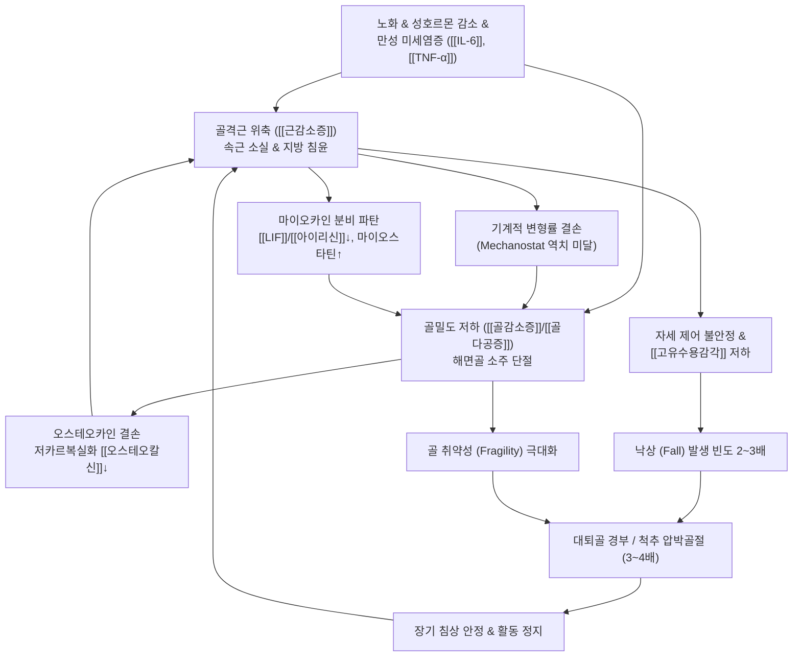

# 🩺 [[골감소성 근감소증]] (Osteosarcopenia / 骨減少性 筋減少症)

> **핵심 3줄 요약 (Key Summary)**:
> - 📍 **병소 부위 & 해부·병태생리**: 골밀도 저하([[골감소증]] 또는 [[골다공증]], DXA T-score ≤ -1.0)와 골격근량 및 근력·기능 저하([[근감소증]])가 동일 개체에서 복합 발현하는 **골-근육 단위(Bone-Muscle Unit)**의 퇴행성 증후군이다. 기계적 변형률 결손(Frost Mechanostat 이론 파탄), 마이오카인([[LIF]], [[아이리신]], 마이오스타틴)과 오스테오카인(저카르복실화 [[오스테오칼신]]) 간의 분자적 혼선(Crosstalk) 붕괴, 그리고 근육 내 지방 침윤(Myosteatosis)과 골수 지방 침윤(Bone Marrow Adiposity)에 의한 만성 미세염증([[IL-6]], [[TNF-α]])이 복합 작용하여 골과 근육의 동시성 파괴를 초래한다.
> - 🚩 **전형적 임상 양상 & 위험성**: 하지 대퇴사두근 지지력 부전, 보행 속도 저하, 계단 승강 시 난간 의존, 균형 감각 소실 및 잦은 헛디딤. 단독 골다공증 또는 단독 근감소증 환자 대비 **낙상 위험 2~3배, 취약성 골절(대퇴골 근위부·척추 압박골절) 위험 3~4배, 1년 사망률 급증**을 나타내는 대표적인 다기관 노인 쇠약(Frailty) 병태이다.
> - 🛠️ **핵심 감별 검사 & 한·양방 다각적 치료 전략**: 이중에너지 X선 흡수계측법(DXA 골밀도) + 악력계([[악력]]: 남 <28kg, 여 <18kg) + 체성분 골격근지수([[SMI]]) 동시 판정. 양방에서는 고강도 점진적 저항 운동(PRT: FrOST 프로토콜) + 유청단백(1.2~1.5 g/kg/일) 및 활성형 [[비타민 D]] 영양 처방, 비스포스포네이트·데노수맙·골형성 촉진제(테리파라타이드, 로모소주맙) 운용. 한의학에서는 [[골위]](骨痿)·[[육위]](肉痿)·비신양허(脾腎陽虛)·간신휴손(肝腎虧損) 변증에 입각하여 [[독활기생탕]], [[팔미지황탕]], [[보중익기탕]], [[삼비탕]], 보신건골탕 가감방과 [[신수]], [[명문]], [[관원]], [[양릉천]] 온침/전침 및 **척추 추력성(HVLA) 수기를 철저히 배제한 안전 가동 추나요법**을 통합 적용한다.
> - <font color="#fa7e7e">⚠️ **응급 의뢰 레드플래그 & 악화 요인**: 경미한 둔부/서혜부 충격 후 체중 부하 불가 및 외회전 단축(대퇴골 경부/전자부 골절 의심 → 24~48시간 내 응급 수술 의뢰), 흉·요추 극돌기 고타통과 동반된 급격한 하지 방사통, 감각 마비, 족하수([[족하수]]), 대소변 기능 장애(급성 압박골절 및 척수/마미 압박). 골밀도 T-score ≤ -2.0 환자에게 척추 고속교정 추나 및 복와위 흉배부 강압 절대 금기.</font>

---

## 📌 목차
1. [질환 개요 & 해부학적 병태생리](#1-질환-개요--해부학적-병태생리)
2. [병태생리 메커니즘 & 생체역학적 악순환 네트워크](#2-병태생리-메커니즘--생체역학적-악순환-네트워크)
3. [임상 증상 & 이학적 검사(Physical Exam) 알고리즘](#3-임상-증상--이학적-검사physical-exam-알고리즘)
4. [감별 진단 매트릭스 (Differential Diagnosis)](#4-감별-진단-매트릭스-differential-diagnosis)
5. [한의 통합 치료 프로토콜 (침·약침·추나·한약)](#5-한의-통합-치료-프로토콜-침약침추나한약)
6. [양방 치료 & 병용·의뢰 기준 (Conventional Treatment & Referral)](#6-양방-치료--병용의뢰-기준-conventional-treatment--referral)
7. [재활 운동 & 생활습관 티칭 가이드](#7-재활-운동--생활습관-티칭-가이드)
8. [💡 사용자 진료실 핵심 필기 & 임상 노하우 (Melt-In 잔여 심화 집약)](#8--사용자-진료실-핵심-필기--임상-노하우-melt-in-잔여-심화-집약)
9. [출처 및 학술 참고 문헌 (References)](#9-출처-및-학술-참고-문헌-references)

---

## 1. 질환 개요 & 해부학적 병태생리

* **질환의 정의 및 진단적 본질**:
  * **정의**: [[골감소성 근감소증]](Osteosarcopenia)은 골밀도의 병적 저하([[골감소증]] 또는 [[골다공증]], DXA T-score ≤ -1.0)와 골격근량의 양적 감소 및 근력·신체 기능 저하([[근감소증]], Sarcopenia)가 동일 환자에서 동시 발생하여 상호 악영향을 미치는 고위험 노인성 복합 근골격계 퇴행 증후군이다.
  * **패러다임의 전환**: 과거에는 골격계 질환(골다공증)과 근육계 질환(근감소증)을 독립적인 노화 현상으로 분리하여 치료하였으나, 최근 근골격계 연구는 골과 골격근이 기계적 부착 관계를 넘어 마이오카인(Myokine)과 오스테오카인(Osteokine)을 분비하여 상호 대사를 조절하는 **단일 기능적-내분비적 복합 단위(Bone-Muscle Unit)**라는 사실을 규명하였다.
  * **임상적 위험성과 질병 부담**:
    * 단독 골다공증 환자에 비해 낙상 발생률이 **2.5~3배** 증가함.
    * 단독 근감소증 환자에 비해 취약성 골절(대퇴골 근위부 골절, 척추 압박골절, 원위 요골 골절) 발생률이 **3~4배** 폭증함.
    * 골절 발생 후 1년 내 사망률 및 장기 요양 시설 입원율이 기하급수적으로 증가하는 치명적 쇠약(Frailty) 병태임.

* **해부학적 구조와 역학적 연결망**:
  * **골-근 부착부 (Enthesis) 및 피질골 인터페이스**:
    * 골격근은 건(Tendon)과 샤피 섬유(Sharpey's fibers)를 통해 골막(Periosteum)과 피질골(Cortical bone)에 고정됨.
    * 근육 수축 시 발생하는 기계적 인장력은 골 표면의 골소관(Canaliculi) 내 골세포(Osteocyte) 주위 유체 흐름을 유발하여 유체 전단 응력(Fluid shear stress) 신호로 변환됨. 근위축 시 이 기계적 자극이 차단됨.
  * **골소실의 해부학적 호발 부위**:
    * **척추 해면골 (Trabecular Bone)**: 흉·요추 척추체(Vertebral bodies) 내 해면골 소주(Trabeculae)의 미세구조가 단절되어 축성 하중 분산 능력이 급격히 상실됨.
    * **대퇴골 근위부 (Proximal Femur)**: 대퇴골 경부(Femoral neck) 및 전자간부(Intertrochanteric area)의 피질골 박막화 및 해면골 소실로 경미한 낙상 충격에도 분쇄 골절 발생.
  * **근감소증의 공간적·조직학적 특징**:
    * **하지 항중력 신근군 침범**: 자세 유지와 보행을 담당하는 [[대퇴사두근]](Quadriceps femoris), [[대둔근]](Gluteus maximus), 하퇴삼두근(Triceps surae)의 선택적 위축.
    * **제2형 속근 섬유(Type II Fast-Twitch Fibers) 선택적 소실**: 순발력과 낙상 회피 반사를 담당하는 Type IIa/IIx 근섬유의 현저한 위축 및 탈신경화(Denervation).
    * **근육 내 지방 침윤 (Myosteatosis)**: 근섬유 사이(Intermuscular) 및 근섬유 내(Intramuscular) 지방세포 침윤으로 근육의 단위 면적당 수축력(Muscle quality)이 급격히 저하됨.

---

## 2. 병태생리 메커니즘 & 생체역학적 악순환 네트워크

### 1) 기계역학적 결손 (Frost Mechanostat Theory의 파탄)
* Harold Frost의 골역학설(Mechanostat Hypothesis)에 따르면, 뼈는 골세포에 가해지는 기계적 변형률(Mechanical strain)을 감지하여 적응한다.
* 역학적 변형률이 역치(약 1,000~1,500 microstrain) 이상일 때 조골세포 활성화 및 골형성이 유도되고, 역치 이하일 때는 파골세포 활성화 및 골흡수가 진행된다.
* 근감소증으로 인해 근육량과 최대 수축력이 감소하면 일상 보행 및 신체 활동 시 뼈에 가해지는 기계적 부하가 역치 미만으로 급락하여, 조골세포 활성이 정지되고 파골세포에 의한 골흡수가 통제 없이 가속화된다.

### 2) 근-골 분자 생화학적 혼선 파탄 (Muscle-Bone Molecular Crosstalk)
* **마이오카인(Myokine) 신호 전달의 결핍 및 과발현**:
  * **[[LIF]](Leukemia Inhibitory Factor)**: 정상 근수축 시 분비되어 조골세포의 LIFR/STAT3 신호경로를 활성화하여 골기질 형성과 세포 생존을 돕는데, 근위축 상태에서는 분비가 급감함.
  * **[[아이리신]](Irisin)**: 운동 시 골격근 PGC-1α 자극에 의해 분비되는 호르몬으로, 조골세포의 증식과 광물화를 촉진하고 피질골 두께를 증가시킴. 골감소성 근감소증 환자에서는 순환 아이리신 농도가 바닥 수준으로 저하됨.
  * **마이오스타틴(Myostatin)**: 근육 성장을 억제하는 TGF-β 계열 단백질로, 노화 및 신체 비활동 시 과발현됨. 골모세포의 분화를 차단하고 파골세포 분화를 유도하여 근위축과 골소실을 동시에 초래함.
* **오스테오카인(Osteokine) 신호 전달 결손**:
  * **저카르복실화 [[오스테오칼신]](Undercarboxylated Osteocalcin, ucOC)**: 조골세포에서 합성되어 순환계로 방출되는 호르몬으로, 골격근의 Gprc6a 수용체에 결합하여 근세포 내 포도당 섭취, 지방산 산화, 단백질 동화 작용을 촉진함. 골 교체율 파탄 및 골량 저하 시 유효 오스테오칼신 농도가 떨어져 근육 소모가 가속됨.
* **지방 침윤의 악순환 (Lipid Infiltration & Secretome)**:
  * 골수 내 지방세포 침윤(Bone Marrow Adiposity)과 근육 내 지방 침윤(Myosteatosis)이 동시에 진행됨.
  * 지방세포에서 분비되는 전염증성 아디포카인, [[IL-6]], [[TNF-α]], 자유지방산이 국소 조직의 미토콘드리아 기능을 훼손하고 산화 스트레스를 유발하여 조골세포와 근위성세포(Satellite cells)의 분화를 억제함.
* **세포외소포체 및 마이크로RNA (Exosomal miRNAs) 전달 파탄**:
  * 근육과 뼈는 엑소좀(Exosome)을 통해 miR-21, miR-133, miR-29 등의 조절 물질을 교환함. 노화 및 비활동 상태에서 유해 exosomal miRNA 프로파일이 형성되어 Wnt/β-catenin 신호를 차단하고 골과 근육의 동시성 세포사멸을 촉진함.

### 3) ASCII 병태생리 신호전달 & 복합 손상 구조 다이어그램

```
========================================================================================
                 [골감소성 근감소증(Osteosarcopenia) 분자-역학 상호작용]
========================================================================================

  [노화 & 성호르몬 결핍] ──► [만성 전신 미세염증 (TNF-α, IL-6)] ◄── [신체 비활동 & 영양결핍]
                                     │
         ┌───────────────────────────┴───────────────────────────┐
         ▼                                                       ▼
   【 골격근계 위축 】                                     【 골격계 파탄 】
 (Type II 속근섬유 소실)                                (해면골 미세소주 단절)
         │                                                       │
         ├───────────────────────────┐                           │
         ▼                           ▼                           ▼
[기계적 수축력 저하]          [마이오카인 이상분비]             [오스테오카인 결핍]
 (변형률 < 1000 με)      ┌─► Irisin / LIF 분비 저하      ┌─► Osteocalcin 저하
         │                └─► Myostatin 과발현            │          │
         ▼                               │               │          ▼
[Mechanostat 역치 미달]                  └───────┬───────┘   [근육 포도당 대사 저하]
         │                                       │           [단백질 동화 저항성]
         ▼                                       ▼                   │
[골모세포 활성 억제] <─────────────────── [조골세포 분화 차단]        │
[파골세포 골흡수 촉진] ◄────────────────── [RANKL 경로 활성화]        ▼
         │                                               【 근감소증 악화 】
         ▼                                               (Myosteatosis 침윤)
   【 골다공증 가속 】                                           │
         │                                                       │
         └───────────────────────────┬───────────────────────────┘
                                     ▼
      ┌─────────────────────────────────────────────────────────────┐
      │  【 치명적 임상 종말점: 낙상 (2~3배) + 대퇴골/척추 골절 (3~4배) 】  │
      │   장기 침상 안정 ──► 불사용성 근골격 급속 붕괴 ──► 조기 사망    │
      └─────────────────────────────────────────────────────────────┘
========================================================================================
```

### 4) 생체역학적 악순환 네트워크 (Mermaid)



---

## 3. 임상 증상 & 이학적 검사(Physical Exam) 알고리즘

### 1) 주소증 및 신체 기능 저하 징후
* **하지 근력 부전 및 기립 장애**:
  * 의자에서 일어설 때 팔걸이나 무릎을 짚지 않고는 일어서지 못함.
  * 계단을 오를 때 난간에 전 체중을 싣고 한 계단씩 두 발을 모아 올라감.
* **보행 양상의 특징적 변화**:
  * 보행 속도가 현저히 느려지며, 보폭이 좁아지고 발끝을 들지 못해 지면을 질질 끄는 셔플링 보행(Shuffling gait)이 나타남.
* **신장 감소 및 척추 후만 변형**:
  * 청년기 최대 신장에 비해 **4cm 이상 키가 감소**했거나, 등이 앞으로 둥글게 굽는 흉추 후만증([[척추후만증]])과 함께 요배부의 만성 둔통 및 피로감을 호소함.
* **경미한 외상에 의한 돌발 골절 (Fragility Fracture)**:
  * 침대나 소파에서 미끄러져 엉덩방아를 찧거나, 헛디딤 등 단순 저에너지 충격에도 즉시 보행 불능(대퇴골 골절) 또는 숨도 못 쉴 정도의 요배부 통증(압박골절)이 유발됨.

### 2) 단계별 이학적 검사 및 진단 알고리즘
* **1단계: 설문 스크리닝 (SARC-F / SARC-CalF)**:
  * 근력(Strength), 보행 보조(Assistance in walking), 의자 일어서기(Rise from chair), 계단 오르기(Climb stairs), 낙상 횟수(Falls) + 종아리 둘레(Calf circumference, 남 <34cm, 여 <33cm).
  * **SARC-CalF 총점 ≥ 11점** 시 골감소성 근감소증 고위험군으로 즉시 정밀 검사 진행.
* **2단계: 골격근 근력 및 기능 평가**:
  * **악력 측정 ([[악력]], Handgrip Strength)**:
    * 디지털 악력계를 사용하여 팔꿈치를 90도 굴곡한 상태에서 양측 각 2회 측정 후 최대치 기록.
    * **진단 기준: 남성 < 28.0 kg, 여성 < 18.0 kg** (근력 저하 확정).
  * **5회 의자 일어서기 검사 ([[5회 의자 일어서기 검사]], 5-Times Sit-to-Stand Test)**:
    * 양팔을 가슴에 교차하고 표준 의자(높이 43~45cm)에서 완전히 일어섰다 앉기를 5회 연속 수행하는 시간 측정.
    * **기준: 12.0초 초과** 시 신체 기능 부전 판정.
  * **통상 보행 속도 (Gait Speed)**:
    * 4m 또는 6m 직선 보행 속도 측정 시 **≤ 0.8 m/s 또는 ≤ 1.0 m/s** 시 중증 신체 장애.
* **3단계: 체성분 및 골격근량 측정 (Muscle Mass Assessment)**:
  * **DXA 또는 BIA 골격근지수 ([[SMI]], Appendicular Skeletal Muscle Index)**:
    * 사지 골격근량(ASM)을 신장의 제곱으로 나눈 값 ($ASM/Height^2$).
    * **DXA 기준: 남성 < 7.0 kg/m², 여성 < 5.4 kg/m²** (아시아 근감소증 진단 기준, AWGS).
    * **BIA 기준: 남성 < 7.0 kg/m², 여성 < 5.7 kg/m²**.
* **4단계: 골밀도(BMD) 및 척추 구조 검진**:
  * **이중에너지 X선 흡수계측법 (DXA)**:
    * 요추(L1~L4) 및 대퇴골(전체 및 경부) 골밀도 측정.
    * **T-score ≤ -1.0** ([[골감소증]] 또는 [[골다공증]]) 확인.
  * **척추 극돌기 고타통 검사 (Spine Percussion Tenderness)**:
    * 흉·요추 극돌기를 주먹이나 타진기로 부드럽게 타진하여 급성 척추 압박골절 유무 확인 (고타통 양성 시 즉시 단순 방사선 촬영).
  * **벽-후두부 간격 (Wall-Occiput Distance)**:
    * 벽에 등을 대고 섰을 때 후두부가 벽에 닿지 않는 거리 측정(>0cm 시 흉추 압박골절 의심).

---

## 4. 감별 진단 매트릭스 (Differential Diagnosis)

| 감별 질환 | 병소 및 원인 | 주소증 및 기능 장애 | 골밀도(BMD) 소견 | 근육량 및 근력 소견 | 감별 핵심 진단법 |
| :--- | :--- | :--- | :--- | :--- | :--- |
| **[[골감소성 근감소증]] (본 질환)** | 골-근육 단위 복합 퇴행 | 보행 불안정, 잦은 낙상, 기립 곤란, 골절 취약 | **DXA T ≤ -1.0** (골감소/골다공증) | **악력 저하 + [[SMI]] 저하** 동시 발현 | 골-근 지표의 동시 파탄; FrOST 및 AWGS 기준 충족 |
| **단독 [[골다공증]]** | 골기질 흡수 항진 및 조골 부전 | 대개 무증상, 골절 발생 전까지 정상 보행 | **DXA T ≤ -2.5** | 근육량 및 악력, 보행 속도 **정상 보존** | 단순 골밀도 단독 저하군; 기립 및 보행 반사 정상 |
| **단독 [[근감소증]]** | 근섬유 위축 및 단백질 동화 저항 | 전신 쇠약감, 피로, 느린 보행, 파지력 저하 | **DXA T > -1.0** (골밀도 정상 범위) | **악력 저하 + [[SMI]] 저하** | 뼈 구조는 유지되나 근육 단독 소실; 골 취약성 없음 |
| **속발성 근병증 (쿠싱 / 스테로이드성)** | 외인성 글루코코르티코이드 투여 | 근위부 대퇴근육 위축, 계단 보행 불능 | 척추 해면골 급속 소실 (T ≤ -2.5) | 근위부 근력 현저 저하, 혈청 CPK 정상/경미 | 장기 스테로이드 복용력, 중심성 비만, 피부 박막화 |
| **다발성 골수종 (Multiple Myeloma)** | 악성 형질세포의 골수 침윤 | 극심한 안정 시/야간 요배부 통증, 빈혈 | 다발성 천공성 골용해(Punched-out) | 근감소 동반 가능하나 악액질 양상 | 혈청/소변 M-단백 단클론성 피크, 고칼슘혈증, 빈혈 |
| **골연화증 (Osteomalacia)** | 비타민 D 결핍에 따른 골기질 석회화 장애 | 전신 골격통, 동요 보행(Waddling gait) | 가성골절(Looser zone), 골음영 감소 | 근위부 근력 약화 동반 가능 | 저칼슘혈증, 저인산혈증, 혈청 ALP 현저한 상승 |

---

## 5. 한의 통합 치료 프로토콜 (침·약침·추나·한약)

> ⚠️ **골감소성 근감소증 환자 시술 절대 안전 수칙**:
> 1. **척추 고속교정(HVLA) 스러스트 추력 교정 절대 금기**: 골다공증이 동반된 뼈는 작은 회전력이나 압박에도 골절될 수 있으므로 분절성 순간 추력 기법은 의원성 척추 압박골절을 초래한다.
> 2. **복와위 강한 압박 금기**: 침대에 엎드린 상태(Prone)에서 시술자가 체중을 실어 흉배부를 누르면 늑골 골절 및 척추체 붕괴를 유발한다.
> 3. 고령 환자의 하지 자침 시 혈관 손상 및 혈종을 방지하기 위해 정교한 호침을 사용하고 발침 후 충분한 압박 지혈을 시행한다.

* **침구 치료 (Acupuncture)**:
  * **주요 혈위 구성**:
    * **신정(腎精) 보익 및 골회(骨會)**: [[신수]](BL23), [[대저]](BL11 - 骨會), [[명문]](GV4), [[태계]](KI3), [[현종]](GB39 - 髓會).
    * **비위(脾胃) 건운 및 근회(筋會)**: [[비수]](BL20), [[족삼리]](ST36), [[양릉천]](GB34 - 筋會), [[음릉천]](SP9), [[중완]](CV12).
    * **하지 항중력근 자극**: [[혈해]](SP10), [[복토]](ST32), [[양구]](ST34), [[승산]](BL57), [[환도]](GB30).
  * **전침 치료 (Electroacupuncture)**:
    * 대퇴사두근([[대퇴사두근]]) 및 하퇴삼두근 군에 호침 자침 후 2~4Hz 저주파 전침을 20분간 적용.
    * 전침 자극은 제2형 속근 섬유의 위축을 억제하고 근육 내 mTOR/Akt 신호 경로를 활성화하여 근단백질 동화를 유도함.
  * **온구 치료 (Moxibustion)**:
    * 비신양허(脾腎陽虛)로 인한 하지 냉감과 보행 무력 환자에게 [[관원]](CV4), [[기해]](CV6), [[신수]](BL23), [[족삼리]](ST36)에 간접 온구(신기구)를 시행하여 전신 대사 촉진 및 미세순환 개선.

* **약침 치료 (Pharmacopuncture)**:
  * **선택 제제 및 기전**:
    * **자하거 (Hominis Placenta) 약침**: 에스트로겐 유사 활성, IGF-1 촉진, 파골세포 분화 억제 및 근단백 분해 효소 차단.
    * **녹용 (Cervi Cornu Parvum) 약침**: 조골세포 증식 및 골기질 석회화 촉진, 근육 피로 물질 축적 억제.
    * **신바로 약침**: 척추 주변 무균성 신경 염증 차단 및 심부 연부조직 혈류 증대.
  * **시술 부위**: 요추 협척혈(EX-B2), 신수(BL23), 양릉천(GB34), 대퇴사두근 건 부착부 주변 연부조직에 포인트당 0.1~0.2mL씩 주 2회 시술.

* **추나 치료 (Chuna Manipulation - 부드러운 가동화 중심)**:
  * **적용 기법**:
    * **근막 이완 수기 (Myofascial Release)**: 앙와위 또는 측와위에서 단축된 [[장요근]], [[대퇴직근]], [[이상근]], 하퇴 비복근에 대한 부드러운 스트로킹 및 지속 압박 이완.
    * **근에너지 기법 (Muscle Energy Technique, MET)**: 환자의 등척성 수축력을 20~30%만 활용하여 고관절 및 슬관절 가동 범위를 점진적으로 회복.
    * **관절 가동화 수기 (Mobilization Grade I~II)**: 고관절 및 족관절의 견인(Distraction)과 진자운동을 통한 활액 분비 촉진.

* **변증별 한약 처방 (보신장골·익기고비)**:
  * **신양허쇠(腎陽虛衰)·골위(骨痿)형**:
    * 임상 양상: 허리와 무릎이 시리고 힘이 없음, 보행 시 다리가 풀림, 추위를 심하게 탐, 야간뇨 빈삭, 설담 태백, 맥 침지무력.
    * 처방: [[팔미지황탕]](八味地黃湯), 우귀음(右歸飮), 보신건골탕 가감.
    * 구성 약재: [[숙지황]], [[산약]], [[산수유]], [[포부자]], [[육계]], [[두충]], [[속단]], [[우슬]], [[보골지]], [[구척]] (조골세포 활성화 및 파골 억제).
  * **간신휴손(肝腎虧損)·기혈부족(氣血不足)형**:
    * 임상 양상: 만성 요통, 관절 가동 장애, 하지 근육 위축 현저, 어지럼증, 이명, 피로, 설담 맥 세약.
    * 처방: [[독활기생탕]](獨活寄生湯), [[삼비탕]](三痺湯).
    * 구성 약재: [[독활]], [[상기생]], [[두충]], [[우슬]], [[세신]], [[진교]], [[복령]], [[당귀]], [[백작약]], [[숙지황]], [[천궁]], [[인삼]], [[황기]].
  * **비위허약(脾胃虛弱)·육위(肉痿)형**:
    * 임상 양상: 식욕 부진, 소화 장애로 단백질 섭취 불가, 사지 마름 및 근육 소모, 만성 연변, 안색 황백.
    * 처방: [[보중익기탕]](補中益氣湯) 합 육미지황탕, 삼령백출산 가미.
    * 구성 약재: [[황기]], [[인삼]], [[백출]], [[당귀]], [[진피]], [[승마]], [[시호]], [[복령]], [[의이인]], [[사인]].

---

## 6. 양방 치료 & 병용·의뢰 기준 (Conventional Treatment & Referral)

### 1) 표준 양방 약물 치료 체계
* **골다공증 표적 치료제 (Anti-Osteoporotic Pharmacotherapy)**:
  * **골흡수 억제제 (Antiresorptive Agents)**:
    * **비스포스포네이트 (Bisphosphonate)**: 알렌드로네이트(Alendronate 70mg 주 1회), 리세드로네이트(Risedronate 35mg 주 1회), 졸레드론산(Zoledronic acid 5mg 연 1회 정주). 파골세포 세포사멸 유도. 복용 후 30분간 상체 직립 유지 필수(식도염 방지). 장기 복용 시 턱뼈 괴사(MRONJ) 및 비전형 대퇴골 골절 모니터링.
    * **RANKL 단클론항체 (Denosumab, 프롤리아)**: 6개월마다 60mg 피하주사. 강력한 골흡수 차단. 투약 중단 시 골흡수 반동(Rebound)으로 다발성 척추 골절 위험이 있으므로 치료 순응도 엄격 관리.
  * **골형성 촉진제 (Anabolic Agents)**:
    * **부갑상선호르몬 작용제 (Teriparatide, 테리본/포스테오)**: 중증 골절 고위험군에 1~2년간 매일/매주 투여하여 조골세포 활성화 촉진.
    * **스클레로스틴 억제제 (Romosozumab, 이베니티)**: 1년간 월 1회 투여. 골형성을 촉진함과 동시에 골흡수를 억제하는 이중 작용 기전.
* **근감소증 표적 약물 현황**:
  * 현재 전 세계적으로 공식 승인된 단독 근감소증 치료 화학 약물은 전무함 (선택적 안드로겐 수용체 조절제 SARM, 마이오스타틴 항체 등은 임상 연구 진행 중).
  * **비타민 D 및 영양 보충**: 활성형 [[비타민 D]](콜레칼시페롤 800~2,000 IU/일) 및 칼슘(식이 부족분 포함 800~1,000 mg/일) 보충이 필수 기초 치료임.

### 2) 한·양방 병용 판단 기준 (Combination Therapy)
* **병용 권장 (상호 보완적 시너지)**:
  * 양방의 골다공증 표적 약물(비스포스포네이트, 데노수맙) 투여 환자에게 한의 보신장골 한약과 침구 치료를 병용할 때 골밀도 상승 폭이 커지고, 골흡수 억제제로 해결되지 않는 근육량 및 보행 기능 저하를 한의 치료가 효과적으로 보완함.
  * 소화 장애로 고품질 단백질 보충제를 소화하지 못하는 고령 환자에게 건비화위(健脾和胃) 한약을 투여하여 단백질 흡수율 증대.
* **병용 주의**:
  * 비스포스포네이트 경구 복용 당일 아침에는 약물 흡수 방해를 막기 위해 한약 복용 간격을 최소 1~2시간 이상 띄움.
* **금기**:
  * 침습적 약침이나 침 치료 부위에 국소 감염이 있거나, 척추 악성 종양 전이가 의심되는 부위에 대한 기계적 침습 자극은 금기.

### 3) 양방·전문과 의뢰 기준 (Referral Criteria)
* **즉각 응급 의뢰 (Red Flags)**:
  * 가벼운 실족이나 미끄러짐 후 체중 부하가 불가능하며 환측 다리가 짧아지고 바깥쪽으로 돌아간 경우 (대퇴골 근위부 경부/전자부 골절 → 지체 없이 정형외과 응급실로 전원하여 24~48시간 내 골유합술 또는 인공관절 반치환술 시행).
  * 척추 타진 시 극심한 고타통과 함께 하지 감각 마비, 족하수([[족하수]]), 대소변 실금 발생 (척추 압박골절로 인한 신경근 및 척수/마미 압박).
* **전문과 정밀 검사 의뢰**:
  * DXA T-score ≤ -3.0 이하의 초고위험군 또는 남성 고령자에서 원인 불명의 급격한 골소실(이차성 골다공증, 다발성 골수종 의심).
  * 보존적 치료 2~3주 후에도 격심한 척추 통증이 지속되어 조기 척추성형술(Vertebroplasty/Kyphoplasty)이 필요한 경우.

---

## 7. 재활 운동 & 생활습관 티칭 가이드

* **근거 중심 고강도 점진적 저항 운동 (FrOST 프로토콜 기반)**:
  * **FrOST 무작위대조시험 (Kemmler et al. 2020, PMID 32270891)**:
    * 70세 이상 골감소성 근감소증 남성을 대상으로 12개월간 머신 기반 고강도 점진적 저항운동(HIT-RT, 1RM의 70~85%, 주 2회, 단일 세트 피로 도달 방식)을 실시한 결과, 요추 골밀도 유의한 보존, 사지 골격근량([[SMI]] +0.43 kg/m²) 증가, 레그프레스 최대 근력 향상이 입증되었으며 운동 관련 부상은 0건이었음.
  * **안전 머신 저항 운동 종목**:
    * 궤적이 고정되어 넘어질 위험이 없는 머신 기반 체중 지지 운동 권장: 시티드 레그프레스(Leg Press), 레그 익스텐션(Leg Extension), 랫 풀다운(Lat Pulldown), 시티드 로우(Seated Cable Row).
    * 프리웨이트(바벨 스쿼트, 데드리프트)는 척추체 압박 및 균형 상실 위험으로 고령 환자에게 초기 적용 금지.

* **동적 충격 및 자세 균형 훈련**:
  * **골세포 자극 수직 충격 운동**:
    * 의자 등받이를 잡고 서서 발뒤꿈치를 높이 들었다가 쿵 찍는 '힐 드롭(Heel Drops)' 운동(10회씩 3세트)을 처방하여 대퇴골 및 척추에 수직 기계적 충격 전달.
  * **신경근 제어 및 균형 회복 훈련**:
    * 벽이나 난간을 잡고 외발 서기(One-leg Stance, 좌우 30초씩), 탠덤 기립(Tandem Stance, 한 발 뒤꿈치를 다른 발 앞코에 붙이고 서기)을 매일 10분간 실시하여 [[고유수용감각]] 및 미로 반사 회복.

* **영양 처방 및 일상생활 티칭**:
  * **고품질 단백질 보충**:
    * 체중 1kg당 **1.2~1.5g**의 단백질 섭취 권장.
    * 노인성 단백질 동화 저항성(Anabolic Resistance)을 극복하기 위해 분지쇄아미노산(류신 Leucine)이 풍부한 [[유청단백]](Whey protein), 계란, 생선, 두부를 매 식사마다 25~30g씩 균등 배분하여 섭취.
  * **비타민 D 및 칼슘 식이**:
    * 비타민 D3 800~1,000 IU/일 섭취와 주 3회 15~20분 일광욕. 칼슘은 멸치, 유제품, 해조류 등 식이를 우선하되 부족 시 보충.
  * **가정 내 낙상 제로화 (Fall-Proof Home)**:
    * 욕실 및 양변기 옆 안전 손잡이 설치, 바닥 물기 제거 및 미끄럼 방지 매트 시공.
    * 야간 화장실 이동 동선에 문턱 제거 및 자동 감지 센서등 설치.
    * 헐렁하거나 굽이 미끄러운 슬리퍼 착용 금지, 실내 미끄럼 방지 양말 착용.

---

## 8. 💡 사용자 진료실 핵심 필기 & 임상 노하우 (Melt-In 잔여 심화 집약)

> [!IMPORTANT]
> **🛡️ 원문 융합(Melt-In) 집약**
> 본 섹션은 기존 진료실 필기에 담겨 있던 핵심 문진 단서, 손맛 노하우, 환자 티칭 스크립트 중 상부 섹션에 담지 못한 임상적 뉘앙스를 밀도 있게 보존하여 집약한다.

* **비오님 진료실 필수 문진 4대 체크리스트 (내원 즉시 확인)**:
  1. **"청년 시절 가장 컸을 때 키보다 지금 4cm 이상 줄어드셨습니까?"**: 환자가 자각하지 못한 사이 발생한 다발성 척추 무증상 압박골절을 즉각 선별하는 가장 강력한 단서이다.
  2. **"최근 1~2년 사이에 주저앉거나 삐끗한 뒤 허리가 끊어질 듯 아파 며칠간 누워계신 적이 있습니까?"**: 척추 압박골절 병력을 파악하여 재골절 초고위험군 여부를 가린다.
  3. **"관절염, 천식, 피부병으로 부신피질호르몬제(스테로이드)를 3개월 이상 드신 적이 있습니까?"**: 이차성 급속 골감소 및 속발성 근위축 가능성을 감별한다.
  4. **"현재 정형외과나 내과에서 6개월에 한 번 맞는 뼈주사(프롤리아)나 먹는 골다공증약을 처방받고 계십니까?"**: 양방 약물 치료 이력을 파악하여 한의 보신익기 치료와의 병용 설계를 확립한다.

* **추나 및 물리치료 안전 프로토콜 손맛 노하우**:
  * **고타통 촉진의 손맛**: 환자가 누워있을 때 척추 극돌기를 가볍게 주먹 바닥으로 통통 두드렸을 때 환자가 펄쩍 뛸 정도로 "악!" 소리를 지르는 국소 고타통(Percussion tenderness)이 있다면, 단순 요배통으로 취급하여 온열치료나 마사지를 하지 말고 즉시 단순 X-ray를 의뢰하라.
  * **체위 변경의 원칙**: 골밀도 T-score ≤ -2.0 이하 환자를 침대에서 일으켜 세울 때 환자의 손을 잡고 앞으로 잡아당기면 요추 굴곡력에 의해 압박골절이 유발될 수 있다. 반드시 환자를 옆으로 돌아눕게 한 뒤 팔꿈치와 손바닥으로 침대를 짚으며 상체를 밀어 올리도록 지도해야 한다.
  * **전침 자극 강도 세팅**: 노인 근감소증 환자에게 전침 자극을 강하게 주어 근육이 덜덜 떨리게 만들면 근섬유 미세 파열과 다음 날 극심한 근육통을 부른다. 눈으로 볼 때 근육이 가볍게 씰룩거리는 수준(최소 역치 직상)으로 부드럽게 유지하는 것이 단백 동화 신호를 활성화하는 최적점이다.

* **복약 지도 노하우 (단백질 소화와 한약 병용)**:
  * 고령 골감소성 근감소증 환자들은 위산 분비 저하와 췌장 효소 결핍으로 유청단백질이나 육류를 섭취하면 복부 팽만, 소화불량, 설사를 자주 호소하며 복용을 중단한다.
  * 이때 환자에게 억지로 단백질 보충제를 강요하지 말고, 건비화위(健脾和胃) 한약([[보중익기탕]], [[삼령백출산]])을 2~4주간 선행 투여하여 소화기 흡수력을 복구시킨 후 저용량부터 단백질 섭취를 늘려가는 단계적 접근이 필수적이다.

---

## 9. 출처 및 학술 참고 문헌 (References)

1. Polito A, et al. (2022). Osteosarcopenia: A Narrative Review on Clinical Studies. *Clin Ter*. 173(3):288-298. PMID: 35628399

   - **[연구 요약]**: 골감소성 근감소증의 역학, 진단 기준, 동반질환 및 임상 관리 전략에 관한 포괄적 내러티브 종설. 골밀도와 근육량의 동시 저하가 초래하는 낙상 및 골절 위험의 승수 효과와 다학제 통합 관리 모델 제시.

2. Zhang B, et al. (2025). Corrigendum to "Exosomal miRNAs in muscle-bone crosstalk: Mechanistic links, exercise modulation and implications for sarcopenia, osteoporosis and osteosarcopenia". *Metabolism*. PMID: 40628111

   - **[연구 요약]**: 골-근육 단위의 분자적 혼선에서 엑소좀 유래 miRNA의 기전적 역할 규명. 운동 자극에 의한 exosomal miRNA 조절과 골감소증, 근감소증, 골감소성 근감소증의 치료적 함의 분석.

3. Kemmler W, et al. (2020). Effects of High-Intensity Resistance Training on Osteopenia and Sarcopenia Parameters in Older Men with Osteosarcopenia-One-Year Results of the Randomized Controlled Franconian Osteopenia and Sarcopenia Trial (FrOST). *J Bone Miner Res*. 35(9):1634-1644. PMID: 32270891

   - **[연구 요약]**: 고령 골감소성 근감소증 남성을 대상으로 한 12개월 무작위대조시험(FrOST). 고강도 점진적 저항운동(HIT-RT)이 요추 골밀도 보존, 골격근량 증가, 근력 향상에 미치는 유효성과 운동 안전성 입증.

---

## 관련 노트
- 상위 분류: [[_의학/03_이론/질환/근골격계 질환/기타/00_기타_MOC|근골격계 질환 기타 MOC]]
- 관련 질환: [[골다공증]], [[골감소증]], [[근감소증]], [[허약]], [[척추후만증]], [[건선성 관절염]], [[퇴행성 관절염]]
- 평가 및 지표: [[골밀도]], [[골격근지수(SMI)]], [[악력]], [[SARC-CalF]], [[5회 의자 일어서기 검사]], [[Romberg Test]]
- 분자 및 생화학: [[LIF]], [[아이리신]], [[오스테오칼신]], [[골 재형성]], [[IL-6]], [[TNF-α]], [[비타민 D]], [[칼슘]], [[유청단백]]
- 한의 치료: [[골위]], [[육위]], [[독활기생탕]], [[팔미지황탕]], [[보중익기탕]], [[삼비탕]], [[추나요법]], [[신수]], [[명문]], [[관원]], [[양릉천]], [[대퇴사두근]], [[고유수용감각]]
