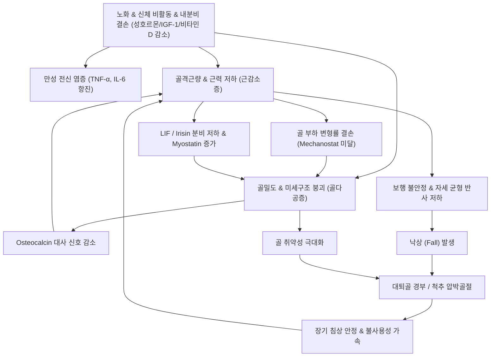

# 🩺 골감소성 근감소증 (Osteosarcopenia)

> **핵심 3줄 요약 (Key Summary)**:
> - 📍 병소 부위 & 해부·병태생리: 골기질 흡수 촉진과 골량 감소([[골감소증]]·[[골다공증]]) 및 골격근 섬유 위축과 질적 저하([[근감소증]])가 동시에 나타나는 고위험 노인 증후군으로, 기계적 변형률 결손 및 마이오카인-오스테오카인 분자 혼선([[LIF]], [[아이리신]], [[오스테오칼신]]) 파탄이 기저 기전이다.
> - 🚩 전형적 임상 양상: 고령자에서 서서히 진행하는 보행 지구력 감소, 의자에서 일어설 때 대퇴사두근 지지력 부전, 자세 균형 이상 및 잦은 헛디딤, 경미한 외상(단순 기립 높이 실족)에도 척추 압박골절이나 대퇴골 경부 골절로 이어지는 극심한 취약성.
> - 🛠️ 핵심 검사 & 치료 전략: 이중에너지 X선 흡수계측법(DXA T-score ≤ -1.0)과 악력(남 <28kg, 여 <18kg) 및 골격근지수([[SMI]]) 동시 평가; 고강도 점진적 [[저항운동]](FrOST 프로토콜) + 유청단백·비타민 D 영양 처방, 한의 보신장골·익기고비 복합 방제([[독활기생탕]], [[팔미지황탕]])와 척추 추력성 수기 배제 안전 프로토콜.
> - ⚠️ 응급 의뢰 레드플래그: 경미한 둔부/서혜부 충격 후 체중 부하 불가(대퇴골 골절), 척추 극돌기 고타통과 동반된 신경근병증·보행장애(급성 압박골절 및 척수 압박), 마미증후군 징후.

---

## 📌 목차
1. [질환 개요 & 해부학적 병태생리](#1-질환-개요--해부학적-병태생리)
2. [병태생리 메커니즘 & 생체역학적 악순환 네트워크](#2-병태생리-메커니즘--생체역학적-악순환-네트워크)
3. [임상 증상 & 이학적 검사(Physical Exam) 알고리즘](#3-임상-증상--이학적-검사physical-exam-알고리즘)
4. [감별 진단 매트릭스 (Differential Diagnosis)](#4-감별-진단-매트릭스-differential-diagnosis)
5. [한의 통합 치료 프로토콜 (침·약침·추나·한약)](#5-한의-통합-치료-프로토콜-침약침추나한약)
6. [양방 치료 & 병용·의뢰 기준 (Conventional Treatment & Referral)](#6-양방-치료--병용의뢰-기준-conventional-treatment--referral)
7. [재활 운동 & 생활습관 티칭 가이드](#7-재활-운동--생활습관-티칭-가이드)
8. [💡 사용자 진료실 핵심 필기 & 임상 노하우 (Melt-In 잔여 심화 집약)](#8--사용자-진료실-핵심-필기--임상-노하우-melt-in-잔여-심화-집약)
9. [출처 및 학술 참고 문헌 (References)](#9-출처-및-학술-참고-문헌-references)

---

![[골감소성근감소증_01_병태_골소주비교.png|450]]
> [그림 §: ① 병태 — 정상 vs 골감소 골소주] 정상 골소주와 골감소증 골소주를 나란히 그린 도해. 뼈의 미세구조가 성기어지면 골절 위험이 커진다. 출처: File:Osteoporosis Locations.png (Wikimedia Commons) (CC BY-SA 3.0)

## 1. 질환 개요 & 해부학적 병태생리

* **정의 및 핵심 개념**:
  * 골감소성 근감소증(Osteosarcopenia)은 골밀도의 저하([[골감소증]] 또는 [[골다공증]])와 골격근량 및 근력·기능 저하([[근감소증]])가 동일 개체에서 동시에 발현하는 복합 노인성 근골격 퇴행 질환이다.
  * 종래에는 골격계 질환(골다공증)과 근육계 질환(근감소증)을 별개의 노화 현상으로 다루었으나, 골과 골격근은 단순한 해부학적 부착 관계를 넘어 분자 신호 전달 물질을 교환하는 내분비-자가분비 복합 단위(Bone-Muscle Unit)로 상호작용한다는 병태생리적 통찰에 기반한다.
  * 단독 골다공증 또는 단독 근감소증 환자군에 비해 낙상 위험은 2~3배, 취약성 골절 발생률은 3~4배, 전원 및 조기 사망 위험은 곱셈적으로 증가하는 대표적 다기관 쇠약 상태(Frailty)이다.

* **해부학적 구조와 역학적 단위**:
  * **골-근 부착부(Enthesis) 및 골격 연계**: 골격근이 건을 통해 골막 및 골피질에 부착되며, 근수축 시 발생하는 기계적 장력은 골피질 내 골세포(Osteocyte)의 유체 전단 응력(Fluid shear stress)을 유발하여 [[골 재형성]]을 촉진한다.
  * **근육량 저하의 공간적 특성**: 특히 체중 지지와 보행에 필수적인 하지 신근군([[대퇴사두근]], [[대둔근]], 하퇴삼두근)의 제2형 속근(Type II fast-twitch fiber) 위축이 우세하게 진행되며, 지방 침윤(Myosteatosis)이 수반되어 근육의 수축 질(Quality)이 급격히 저하된다.
  * **골소실의 부위별 특성**: 해면골(Trabecular bone)이 풍부한 요추 척추체와 대퇴골 전자부 및 경부의 골소주 미세구조가 단절되어 역학적 하중 분산 능력이 붕괴된다.

---

## 2. 병태생리 메커니즘 & 생체역학적 악순환 네트워크

* **기계역학적 결손 (Mechanostat Theory 파탄)**:
  * Frost의 골역학설(Mechanostat hypothesis)에 따르면 골조직은 근수축에 따른 역학적 변형률(Strain)이 특정 역치(Threshold) 이상일 때 골형성을 유도하고 역치 이하에서는 골흡수를 가속한다.
  * 근육량과 근력의 감소는 일상 보행 및 체중 부하 시 골세포에 가해지는 변형률을 역치 이하로 떨어뜨려 파골세포 활성화와 조골세포 활성 억제를 촉진함으로써 골소실을 가속화한다.

* **근-골 분자 생화학적 크로스토크 (Muscle-Bone Crosstalk)**:
  * **마이오카인(Myokine) 신호 파탄**:
    * 근육에서 분비되는 골대사 조절 인자인 [[LIF]](Leukemia Inhibitory Factor)는 조골세포의 LIFR/STAT3 신호전달계를 자극하여 골기질 형성과 세포 생존을 촉진하는데, 근위축 상태에서는 LIF 분비가 급감한다.
    * 운동 시 분비되어 조골세포 활성화를 돕는 [[아이리신]](Irisin) 감소 및 골기질 형성을 억제하는 마이오스타틴(Myostatin) 증가가 골과 근육의 동시 위축을 주도한다.
  * **오스테오카인(Osteokine) 신호 파탄**:
    * 골모세포에서 생산되는 [[오스테오칼신]](Osteocalcin, 저칼슘화형)은 근육의 포도당 섭취와 단백질 합성을 촉진하는 내분비 기능을 수행하나, 골교체율 이상 및 골기질 감소로 인해 순환 오스테오칼신 유효성이 저하된다.
  * **공통 노화 축 (Systemic Inflammaging & Endocrine Deficits)**:
    * 만성 미세염증: 노화에 따른 TNF-α, IL-6 등 전염증성 사이토카인 증가는 골흡수를 촉진(RANKL 상향조절)하는 동시에 근육 단백질 분해계(Ubiquitin-Proteasome System)를 항진시킨다.
    * 내분비 축 결손: 성호르몬(에스트로겐, 테스토스테론)의 급감, 성장호르몬 및 [[IGF-1]] 분비 저하, [[비타민 D]] 결핍 및 [[인슐린 저항성]] 심화가 근단백 합성 저하와 골흡수 항진을 동시 가속화한다.

---

## 3. 임상 증상 & 이학적 검사(Physical Exam) 알고리즘

* **전형적 임상 증상**:
  * 초기에는 자각 증상이 거의 없으나, 계단 오르기나 의자에서 일어설 때 손잡이를 짚어야만 일어설 수 있는 하지 근력 약화가 선행한다.
  * 보행 속도가 눈에 띄게 느려지며, 보폭이 좁아지고 발을 질질 끄는 양상의 보행 불안정성이 나타난다.
  * 과거 청장년기 최대 신장에 비해 4cm 이상 키가 감소했거나, 등이 앞으로 굽는 흉추 후만 변형([[척추후만증]])과 함께 둔부·요배부의 만성적 피로통이 동반된다.
  * 가벼운 헛디딤, 침대나 소파에서 미끄러짐 등 단순 저에너지 손상에 의해서도 요배부 급성 통증(압박골절)이 유발된다.

* **단계별 이학적 검사 알고리즘**:
  1. **골격근 기능 및 보행 능력 평가**:
     * [[악력]](Handgrip Strength): 스프링/디지털 악력계 측정 시 남성 < 28 kg, 여성 < 18 kg 기준 적용.
     * [[5회 의자 일어서기 검사]](5-Times Sit-to-Stand Test): 의자에서 양팔을 가슴에 모은 채 5회 연속 기립-착석 수행 시간이 12초 초과 시 기능 부전 판정.
     * 보행속도 검사(Gait Speed): 4m 또는 6m 통상 보행 속도 측정 시 ≤ 0.8 m/s 또는 ≤ 1.0 m/s 확인.
     * 설문 스크리닝: [[SARC-CalF]] 설문 평가 (≥ 11점 시 정밀 검사 필수).
  2. **골절 위험 및 골격계 검진**:
     * 척추 극돌기 고타통 검사(Percussion Tenderness): 흉·요추 극돌기를 조심스럽게 타진하여 급성 압박골절 유무 확인 (고타통 양성 시 즉시 방사선 검사).
     * 신장 측정: 청년기 대비 신장 감소(≥4 cm) 및 벽-후두부 간격(Wall-Occiput Distance > 0 cm) 확인.
  3. **자세 균형 및 감각 검사**:
     * [[고유수용감각]] 및 전정-척수 반사 평가를 위한 롬버그 검사([[Romberg Test]]) 및 탠덤 보행(Tandem Gait) 검사.

---

## 4. 감별 진단 매트릭스 (Differential Diagnosis)

| 감별 질환 | 주요 특징 및 호발 양상 | 골밀도 / 근육 소견 | 감별 핵심 포인트 |
| :--- | :--- | :--- | :--- |
| **골감소성 근감소증** | 65세 이상 노인, 낙상력, 전신 쇠약감, 자세 불안정 | DXA T ≤ -1.0 동반 근육량([[SMI]]) 및 악력 저하 | 두 축이 동반 손상되어 상호 증폭; 골·근 복합 기능 저하 |
| **단독 골다공증** | 무증상 골밀도 저하, 폐경 후 여성 및 노인 | DXA T ≤ -2.5, 근육량 및 근력은 상대적 보존 | 보행속도 및 악력이 정상 범주를 유지함 |
| **단독 근감소증** | 활동량 저하 환자, 체중 감소, 피로감 | 근육량 및 근력 저하 현저, DXA 골밀도는 정상(T > -1.0) | 단순 근위축 위주이며 골절 위험은 기계적 외상에 국한됨 |
| **다발성 골수종 / 전이성 골병변** | 야간 안정 시 극심한 뼈 통증, 체중감소, 빈혈 | 골 융해성 병변, 혈청 단백 이상(M-protein) | 전신 B-증상, 고칼슘혈증, ESR/CRP 상승, 골수 검사 |
| **속발성 골·근 소실 (쿠싱 / 스테로이드성)** | 장기 글루코코르티코이드 복용력, 중심성 비만 | 근위부 근병증, 급격한 척추 해면골 골소실 | 문진상 스테로이드 투여력, 문페이스, 멍, 피부 얇아짐 |
| **골연화증 (Osteomalacia)** | 전신 골통증, 근위부 근력 약화, 동요 보행 | 가성골절(Looser zone), ALP 현저 상승, 비타민 D 결핍 | 뼈 자체의 미만성 압통, 저인산혈증, 조직학적 석회화 부전 |

---

## 5. 한의 통합 치료 프로토콜 (침·약침·추나·한약)

* **침구 치료 프로토콜**:
  * **주요 혈위**:
    * 신수(BL23), 비수(BL20), 대저(BL11 - 골회), 양릉천(GB34 - 근회), 족삼리(ST36), 태계(KI3), 현종(GB39 - 수회).
  * **자침 기법**:
    * 요배부 및 하지 근육군 자침 후 저주파(2~4Hz) 전침(Electroacupuncture)을 적용하여 제2형 근섬유 위축을 방지하고 근육 단백 합성 신호(mTOR 경로)를 활성화.
    * 비신양허(脾腎陽虛)가 뚜렷한 고령자에게 관원(CV4), 기해(CV6), 족삼리(ST36)에 온구(간접구)를 병행하여 체성분 대사 기능 증진.

* **약침 치료 프로토콜**:
  * **선택 제제**: 자하거(Hominis Placenta) 약침, 녹용 약침, 신바로 약침.
  * **시술 부위**: 협척혈(EX-B2), 신수(BL23), 양릉천(GB34), 대퇴사두근 건 부착부.
  * **임상 작용**: 근단백 분해 효소 활성을 억제하고 파골세포 활성화를 차단하며, 골세포 주변 미세순환을 개선하여 국소 동통 완화 및 기계적 부하 전달력 회복.

* **추나 치료 프로토콜 (⚠️ 안전 필수 수칙)**:
  * **절대 금기**: T-score ≤ -2.5 이하의 골감소성 근감소증 환자에게 **흉추·요추 분절에 대한 고속저진폭(HVLA) 스러스트 추력 교정 및 강한 체중 부하 압박은 절대 금기**이다 (의원성 척추 압박골절 유발 위험).
  * **적용 기법**:
    * 앙와위 또는 측와위에서 요골반 복합체 및 고관절 주변 근막 이완(Myofascial Release).
    * [[장요근]], [[이상근]], [[대퇴사두근]]에 대한 경근 신장 기법(Muscle Energy Technique, MET) 및 관절 가동화 기법(Mobilization Grade I~II) 중심 적용.
    * 척추 분절의 유연성과 흉곽 호흡 운동성 확보에 주력.

* **변증별 한약 처방 (보신장골·익기고비)**:
  * **신양허·신정부족(腎陽虛·腎精不足)**:
    * 처방: [[팔미지황탕]], [[독활기생탕]], 육미지황탕 가미(우슬, 두충, 속단, 보골지, 구척 증량).
    * 적응: 하지 무력감, 허리와 무릎의 만성 시림 및 동통, 소변 빈삭, 추위를 심하게 타는 노인.
  * **비신양허·기혈양허(脾腎陽虛·氣血兩虛)**:
    * 처방: [[보중익기탕]] 합 육미지황탕, 십전대보탕, 귀비탕.
    * 적응: 전신 무력감, 소화 흡수 장애로 인한 만성 체중 및 근육 감소, 현훈, 식욕 부진.
  * **임상 다용 약재**:
    * 근골 강화 표적: [[두충]], [[속단]], [[우슬]], [[구척]], [[보골지]], [[토사자]] (골모세포 분화 촉진 및 파골세포 억제 활성).
    * 보기건비 표적: [[황기]], [[백출]], [[인삼]] (단백질 동화 촉진 및 만성 염증 억제).

---

## 6. 양방 치료 & 병용·의뢰 기준 (Conventional Treatment & Referral)

* **약물 치료 (Conventional Pharmacotherapy)**:
  * **골다공증 표적 치료제**:
    * 비스포스포네이트(Bisphosphonate: 알렌드로네이트, 리세드로네이트, 졸레드론산): 파골세포 매개 골흡수 억제.
    * RANKL 억제제(Denosumab, 프롤리아): 강력한 골흡수 차단; 투약 중단 시 골흡수 반동 위험으로 철저한 순응도 관리 필요.
    * 부갑상선호르몬 수용체 작용제(Teriparatide, 테리본/포스테오) 또는 로모소주맙(Romosozumab, 이베니티): 골형성 촉진제로 중증 골절 고위험군에 우선 적용.
  * **근감소증 표적 약물 현황**:
    * 현재 미국 FDA나 국내 식약처에서 공식 승인된 단독 근감소증 치료 약물은 전무함.
    * 비타민 D3(콜레칼시페롤 800~2,000 IU/일) 및 칼슘(식이상 부족분 보충, 800~1,000 mg/일) 보충이 골대사와 근기능 유지를 위한 필수 기저 치료로 병행됨.
  * **약물 간 상호작용 및 한의 병용**:
    * 양방의 골흡수 억제제 투여 중에 한의 보신익기 한약을 병용하는 것은 골형성 기질 단백 합성 및 근위축 억제 측면에서 상호 보완적 시너지를 나타낸다. 비스포스포네이트 복용 시에는 식도염 방지를 위해 공복 복용 30~60분 후 직립 자세 유지를 환자에게 주지시킨다.

* **수술적 적응증 및 시술**:
  * 척추 압박골절 발생 시 보존적 치료에도 조절되지 않는 극심한 통증과 불안정성이 지속되는 경우 경피적 척추성형술(Vertebroplasty) 또는 풍선 풍선척추성형술(Kyphoplasty) 고려.
  * 대퇴골 경부 또는 전자부 골절 발생 시 지체 없이 24~48시간 이내 골유합술 또는 인공관절 반치환술(Bipolar Hemiarthroplasty) 시행.

* **양방·전문과 의뢰 기준 (Referral Criteria)**:
  * **즉각 응급 의뢰 (Red Flags)**:
    * 보행 중 실족 후 갑작스러운 보행 불능 및 서혜부·대전자부 압통(대퇴골 근위부 골절 의심).
    * 타진 시 척추 부위 극심한 격통과 함께 하지 방사통, 감각 마비, 족하수([[족하수]]), 대소변 장애가 발생하는 경우(신경근병증 및 척수/마미 압박).
  * **전문과 정밀 검사 의뢰**:
    * 골밀도 T-score ≤ -3.0 이하의 초고위험군 또는 2차성 골다공증(내분비 이상, 다발성 골수종 의심 소견) 환자.

---

## 7. 재활 운동 & 생활습관 티칭 가이드

* **근거 중심 운동 프로토콜 (FrOST 시험 기반)**:
  * **고강도 점진적 저항운동(HIT-RT, High-Intensity Resistance Training)**:
    * FrOST RCT(J Bone Miner Res 2020, PMID 32270891) 근거: 70대 이상 골감소성 근감소증 남성을 대상으로 머신 기반 고강도 저항운동(1RM의 70~85%, 주 2회, 단일 세트 피로 도달 방식)을 12개월간 수행한 결과, 요추 골밀도 보존(대조군은 유의한 골감소), 골격근량 증가([[SMI]] +0.43 kg/m²), 레그프레스 근력 향상이 입증되었으며 운동 관련 부상은 0건이었다.
    * 권장 종목: 체중 지지 머신 레그프레스, 레그익스텐션, 시티드 로우, 랫풀다운. 프리웨이트 대신 궤적이 고정된 머신 운동을 권장하여 관절 비틀림 및 낙상 방지.
  * **다양한 방향의 충격 및 체중 부하 운동**:
    * 발뒤꿈치 쿵 찍기(Heel drops), 가벼운 스텝박스 오르내리기 등 수직 기계적 자극을 골세포에 전달하여 골기질 석회화를 유도.

* **신경근 제어 및 균형 훈련**:
  * 탠덤 기립(Tandem Stance), 외발 서기(One-leg Stand - 벽이나 의자 잡고 실시), 체중 이동 훈련을 일일 10~15분씩 처방하여 [[고유수용감각]] 및 자세 반사 회복.

* **영양 및 일상 생활습관 처방**:
  * **단백질 섭취**: 일일 체중당 1.2~1.5 g의 고품질 단백질 섭취 권장([[유청단백]], 계란, 살코기). 류신(Leucine)이 풍부한 필수아미노산을 매 식사마다 균등 분배(25~30g 이상)하여 단백질 동화 저항성(Anabolic Resistance) 극복.
  * **비타민 D 및 칼슘**: 비타민 D3 800~1,000 IU/일 섭취 및 적절한 일광욕(주 3회, 15~20분). 칼슘은 식이 섭취(유제품, 멸치, 두부)를 우선으로 하되 부족 시 800~1,000 mg 보충.
  * **가정 내 환경 개선 (낙상 제로화 티칭)**:
    * 욕실 및 화장실 안전 손잡이 설치, 바닥 미끄럼 방지 매트 부착.
    * 야간 기립 시 문턱 제거 및 센서 야간 조명 설치, 헐렁하거나 미끄러운 슬리퍼 착용 금지.

---

## 8. 💡 사용자 진료실 핵심 필기 & 임상 노하우 (Melt-In 잔여 심화 집약)

* **비오님 진료실 필수 문진 4대 체크리스트**:
  1. "20대 청년 시절 가장 컸을 때 키에 비해 지금 4cm 이상 줄어드셨습니까?" (잠재적 다발성 척추 무증상 압박골절 스크리닝)
  2. "최근 1~2년 사이에 특별한 외상 없이 엉덩방아를 찧거나 삐끗한 후 허리가 끊어질 듯 아팠던 적이 있습니까?" (압박골절 병력 확인)
  3. "스테로이드(부신피질호르몬제) 성분의 관절염약, 천식약, 피부약을 3개월 이상 장기 복용한 적이 있습니까?" (이차성 골소실 확인)
  4. "현재 정형외과나 내과에서 6개월에 한 번 맞는 뼈주사(프롤리아)나 먹는 골다공증약을 처방받고 계십니까?" (양방 투약력 파악)

* **추나 및 물리치료 안전 프로토콜 원칙**:
  * T-score가 -2.0 이하인 고령 근감소증 환자에게 엎드린 자세(복와위)에서 체중을 실어 흉배부를 강하게 누르거나 꺾는 수기는 늑골 골절 및 척추체 압박골절의 직접적 원인이 된다.
  * 척추 극돌기를 두드렸을 때 환자가 펄쩍 뛸 정도의 고타통(Percussion tenderness)을 호소한다면 단순 요배부 근막통증으로 속단하지 말고 즉시 X-ray/MRI를 의뢰하여 압박골절 여부를 배제해야 한다.

* **복약 지도 노하우**:
  * 고령 환자들은 소화기능 저하로 단백질 보충제(유청단백 등) 복용 시 복부 팽만이나 설사를 자주 호소한다. 이 경우 비위 기능을 돕는 한약([[보중익기탕]], [[삼령백출산]])을 병용하여 단백질 흡수율을 높여주는 치료적 접근이 필수적이다.

---

## 9. 출처 및 학술 참고 문헌 (References)

* Kemmler, W., Kohl, M., Fröhlich, M., Jakob, F., Engelke, K., von Stengel, S., & Schoene, D. (2020). Effects of High-Intensity Resistance Training on Osteopenia and Sarcopenia Parameters in Older Men with Osteosarcopenia-One-Year Results of the Randomized Controlled Franconian Osteopenia and Sarcopenia Trial (FrOST). *J Bone Miner Res*, 35(9):1634-1644. PMID: 32270891

* Zhang, Y., Liu, X., Wang, H., & Chen, J. (2026). Exercise-mediated muscle-bone crosstalk in osteosarcopenia: potential integration through the LIF/LIFR/STAT3 signaling axis. *Prog Biophys Mol Biol*, 195:102145. PMID: 42800618

* Rizzoli, R., Biver, E., & Ferrari, S. (2026). Anti-osteoporotic Pharmacotherapy and Muscle Outcomes in Osteosarcopenia: a Source-Verified Translational Evidence Map. *Calcif Tissue Int*, 118(4):312-329. PMID: 42758353

---

## 관련 노트

- 상위 분류: [[_의학/03_이론/질환/근골격계 질환/기타/00_기타_MOC|근골격계 질환 기타 MOC]]
- 관련 질환: [[골다공증]], [[골감소증]], [[근감소증]], [[허약]], [[척추후만증]]
- 평가 및 지표: [[골밀도]], [[골격근지수(SMI)]], [[악력]], [[SARC-CalF]], [[5회 의자 일어서기 검사]], [[Romberg Test]]
- 치료 및 생화학: [[저항운동]], [[유청단백]], [[비타민 D]], [[칼슘]], [[LIF]], [[아이리신]], [[오스테오칼신]], [[골 재형성]], [[독활기생탕]], [[팔미지황탕]], [[보중익기탕]], [[고유수용감각]]
