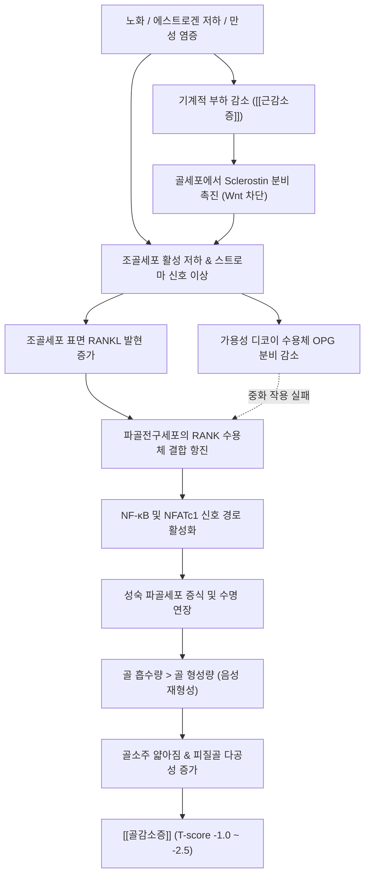

# 🩺 [[골감소증]] (Osteopenia / 骨減少症, ICD-10 M85.8)

> **핵심 3줄 요약 (Key Summary)**:
> - 📍 병소 부위 & 해부·병태생리: 척추체 [[해면골]] 및 장골 [[피질골]] 전반에서 [[골 재형성]] 균형의 음성 이동(파골세포의 골 흡수가 조골세포의 골 형성을 완만하게 초과)으로 인해 [[골밀도]](BMD)가 정상 범위를 벗어나 감소하였으나 [[골다공증]] 진단 기준에는 미달한 골대사 중간 단계(DXA T-score: -1.0 초과 ~ -2.5 미만).
> - 🚩 전형적 임상 양상 & 3대 징후: 골절 발생 전까지 뚜렷한 자각 증상이 없는 잠복성 진행(Silent Stage), 집단 역학상 전체 취약성 골절의 50% 이상이 발생하는 '골감소증의 역설(The Osteopenia Paradox)', 노화 및 활동 저하에 따른 [[근감소증]] 동반 시 급격한 자세 불안정 및 미세 척추 변형.
> - 🛠️ 핵심 감별 검사 & 한·양방 다각적 치료 전략: 이중에너지 X선 흡수계측법([[DEXA]]) 및 [[FRAX]](Fracture Risk Assessment Tool) 위험도 산출(대퇴골 골절 10년 위험도 $\ge$ 3% 또는 주요 골절 $\ge$ 20% 시 고위험군 선별), 1차 생활습관 교정([[칼슘]] 800~1,000 mg/일, [[비타민 D]] 800~1,000 IU/일, 체중부하 [[저항운동]])과 2차 약물([[라록시펜]], [[비스포스포네이트]]) 고려, 한의 골비(骨痺)·신허수휴(腎虛髓虧) 기반 보신장골·건비익기([[육미지황탕]], [[보신건골탕]], [[삼령백출산]]) 및 온침·안전 추나.
> - <font color="#fa7e7e">⚠️ 응급 의뢰 레드플래그 & 악화 요인: 원인 불명의 급성 흉요추 통증 및 척추 극돌기 고타통(무증상 [[척추 압박 골절]] 가능성), 가벼운 엉덩방아 후 보행 곤란(불완전 [[대퇴골 경부 골절]]), 장기 글루코코르티코이드 복용력.</font>

---

## 📌 목차
1. [질환 개요 & 해부학적 병태생리](#1-질환-개요--해부학적-병태생리)
2. [병태생리 메커니즘 & 생체역학적 악순환 네트워크](#2-병태생리-메커니즘--생체역학적-악순환-네트워크)
3. [임상 증상 & 이학적 검사(Physical Exam) 알고리즘](#3-임상-증상--이학적-검사physical-exam-알고리즘)
4. [감별 진단 매트릭스 (Differential Diagnosis)](#4-감별-진단-매트릭스-differential-diagnosis)
5. [한의 통합 치료 프로토콜 (침·약침·추나·한약)](#5-한의-통합-치료-프로토콜-침약침추나한약)
6. [양방 치료 & 병용·의뢰 기준 (Conventional Treatment & Referral)](#6-양방-치료--병용의뢰-기준-conventional-treatment--referral)
7. [재활 운동 & 생활습관 티칭 가이드](#7-재활-운동--생활습관-티칭-가이드)
8. [💡 사용자 진료실 핵심 필기 & 임상 노하우 (Melt-In 잔여 심화 집약)](#8--사용자-진료실-핵심-필기--임상-노하우-melt-in-잔여-심화-집약)
9. [출처 및 학술 참고 문헌 (References)](#9-출처-및-학술-참고-문헌-references)

---

## 1. 질환 개요 & 해부학적 병태생리

* **질환의 정의 및 임상적 위치**:
  * **정의**: 골감소증(Osteopenia)은 세계보건기구(WHO) 기준에 따라 이중에너지 X선 흡수계측법([[DEXA]])으로 측정한 골밀도(Bone Mineral Density, BMD)의 T-score가 **-1.0 초과 ~ -2.5 미만**(-1.0 < T-score < -2.5) 범위에 위치하는 상태로 정의된다.
  * **임상적 본질**: 골감소증은 단독의 독립된 파괴적 질환이라기보다는, 정상 골밀도 상태에서 본격적인 [[골다공증]](T-score $\le$ -2.5)으로 이행하는 과정 중인 **'골대사 이상 및 골절 취약성 조기 경고 신호'**이다.
  * **역학 및 인구 집단적 특성**: 폐경 후 여성의 약 50% 이상, 50세 이상 남성의 30~40%가 골감소증 상태에 해당한다. 연령이 증가함에 따라 발생률이 급증하며, 노인성 만성 질환 중 가장 광범위한 모수를 형성한다.

* **임상적 역설 (The Osteopenia Paradox)**:
  * 개별 환자 단위에서는 T-score $\le$ -2.5인 [[골다공증]] 환자의 골절 발생 상대 위험도(Relative Risk)가 골감소증 환자보다 훨씬 높다.
  * 그러나 **인구 집단 전체의 절대 골절 발생 건수(Absolute Fracture Burden)**를 분석하면, 골다공증 환자군보다 골감소증에 속한 인구 모수가 압도적으로 많기 때문에, 실제 임상에서 발생하는 비외상성 취약 골절([[콜레스 골절]], 척추 미세 골절, 상완골 근위부 골절 등)의 **50% 이상이 골감소증 구간에서 발생**한다.
  * 따라서 "골다공증이 아니므로 안심해도 된다"는 식의 안일한 대응은 치명적인 예방 실패를 초래하며, 골감소증 단계에서 선제적인 생활습관 중재와 고위험군 선별 약물 치료가 필수적이다.

* **관련 해부학적 구조물 및 조직학적 특성**:
  * **[[해면골]](Trabecular / Cancellous Bone)**:
    * 척추체(Vertebral body) 내부, 대퇴골 전자간부, 원위 요골에 고농도로 분포한다.
    * 표면적이 넓고 혈류 공급이 풍부하여 골대사 회전율(Bone turnover rate)이 피질골에 비해 약 8배 빠르다.
    * 폐경 초기 에스트로겐 결핍이나 영양 결핍 시 조골-파골 불균형에 의해 골소주(Trabeculae)의 연결성 단절(Perforation)과 두께 감소가 가장 먼저 일어난다.
  * **[[피질골]](Cortical / Compact Bone)**:
    * 장골 간부(Diaphysis)의 외벽을 구성하며 전체 골격계 골량의 약 80%를 차지한다.
    * 하버시안 계통(Haversian system)을 통한 골 흡수공 형성(Cortical porosity)이 서서히 진행되며, 노화와 더불어 피질골 내측이 흡수되어 피질골 박막화가 동반된다.
  * **인접 취약 골격 분절**:
    * 흉요추 이행부([[흉요추 이행부]] T12-L1): 축성 하중과 회전 모멘트가 교차하는 역학적 취약부.
    * 대퇴골 경부(Femoral Neck): 전단응력(Shear stress)이 집중되는 부위.
    * 원위 요골(Distal Radius): 낙상 시 방어 동작으로 손을 짚을 때 전단력이 가해지는 부위.

---

## 2. 병태생리 메커니즘 & 생체역학적 악순환 네트워크

### 1) ASCII 병태생리 다이어그램: 골 재형성 음성 불균형 네트워크

```text
========================================================================================
                      [골감소증 병태생리: 골 재형성 음성 불균형 연쇄]
========================================================================================

  [원인적 트리거 요인]
  - 폐경 후 에스트로겐 결핍  /  노화(조골세포 노화 및 수명 단축)
  - 칼슘·비타민 D 흡수 결핍 /  신체 비활동 및 기계적 부하(Wolff's Law) 부재
  - 염증성 사이토카인 증가(TNF-α, IL-6) / 이차성 요인(스테로이드, 갑상선 질환 등)
                                    │
                                    ▼
       ┌────────────────────────────────────────────────────────┐
       │     조골세포(Osteoblast) 및 기질세포 신호 체계 이상      │
       │     - 조골 활성 저하: 골기질(Type 1 Collagen) 합성 감소  │
       │     - Wnt/β-catenin 신호 경로 억제                       │
       │     - RANKL 발현 증가  vs  OPG(유인 수용체) 분비 감소   │
       └────────────────────────────┬───────────────────────────┘
                                    │
                                    ▼
       ┌────────────────────────────────────────────────────────┐
       │     파골세포(Osteoclast) 활성화 및 골흡수 우위 전개     │
       │     - RANKL-RANK 결합을 통한 파골세포 분화 촉진        │
       │     - 파골세포 세포자멸사(Apoptosis) 억제 및 수명 연장   │
       │     - 골흡수 와(Howship's lacuna)의 깊이 및 면적 증가  │
       └────────────────────────────┬───────────────────────────┘
                                    │
                                    ▼
       ┌────────────────────────────────────────────────────────┐
       │           골소주 미세구조 결손 및 골밀도 감소          │
       │     - 해면골 소주(Trabecular plate) 박막화 및 천공     │
       │     - 미세 골 피로 균열(Microdamage) 축적            │
       │     - DXA T-score: -1.0 초과 ~ -2.5 미만 형성          │
       └────────────────────────────┬───────────────────────────┘
                                    │
           ┌────────────────────────┴────────────────────────┐
           ▼                                                 ▼
  [생체역학적 골 취약성 증가]                     [동반성 근감소성 복합 진행]
  - 골 탄성 계수 저하                         - 기계적 자극(Mechanotransduction) 저하
  - 경미한 충격에도 미세골절 유발             - 자세 제어력 저하 및 낙상 빈도 증가
           │                                                 │
           └────────────────────────┬────────────────────────┘
                                    │
                                    ▼
                   [골절 발생: 골감소증의 역설 실현]
                   (손목 콜레스 골절, 흉요추 미세 압박골절)
========================================================================================
```

### 2) 분자생물학적 기전: [[RANKL]]-RANK-[[OPG]] 축과 호르몬 환경 변화



* **골 재형성 단위(Basic Multicellular Unit, BMU)의 음성 불균형**:
  * 정상 성인의 골격계는 1년에 약 10%가 새로운 뼈로 교체된다.
  * 골감소증에서는 파골세포에 의한 골흡수 기간(약 2~4주)은 정상 또는 항진되는 반면, 조골세포에 의한 골형성 기간(약 4~6개월) 동안 파인 골흡수 와(Resorption cavity)를 다 채우지 못하는 **재형성 적자(Remodeling deficit)**가 누적된다.
* **에스트로겐 결핍의 파급 효과**:
  * 에스트로겐은 파골세포의 세포자멸사(Apoptosis)를 유도하고 조골세포의 생존을 촉진하는 핵심 조절 인자이다.
  * 폐경으로 에스트로겐이 고갈되면 골수 면역세포에서 TNF-$\alpha$, IL-1, IL-6 등의 전염증성 사이토카인이 분비되어 조골세포 기질에서 [[RANKL]] 생성을 촉발한다. 동시에 가용성 유인 수용체인 [[OPG]](Osteoprotegerin)의 생산이 억제되어 파골세포 분화가 억제되지 못한다.
* **골세포(Osteocyte)와 기계적 신호전달(Mechanotransduction)**:
  * 뼈 속에 매립된 골세포는 기계적 하중과 변형(Fluid shear stress)을 감지하여 뼈의 항상성을 유지한다.
  * 운동 부족이나 침상 안정으로 기계적 부하가 사라지면 골세포는 Wnt/$\beta$-catenin 경로를 억제하는 길항물질인 **스클레로스틴(Sclerostin)**을 대량 분비하여 조골 활성을 직접 차단한다.

### 3) 생체역학적 연쇄 반응과 골감소성 근감소증(Osteosarcopenia)

* **골-근육 연접 단위(Bone-Muscle Cross-talk)**:
  * 뼈와 근육은 단순히 기계적으로 부착된 관계를 넘어, 마이오카인(Myokine)과 오스테오카인(Osteokine)을 분비하며 상호작용하는 하나의 대사 복합체이다.
  * 근육량과 근력이 감소하는 [[근감소증]](Sarcopenia)이 동반되면 골에 전해지는 생체역학적 자극이 급감하여 골 소실이 가속화된다. 이를 **[[골감소성 근감소증]](Osteosarcopenia)**이라 부른다.
* **자세 제어 실패와 낙상으로 이어지는 역학적 사슬**:
  * 척추 기립근([[다열근]], [[최장근]])의 약화 $\to$ 흉추 후만 모멘트 증가 $\to$ 척추체 전방부에 작용하는 압축 응력 상승 $\to$ 해면골 미세 소주 파괴 $\to$ 미세 골절 발생.
  * 하지 심부 굴곡근 및 외전근([[중둔근]], [[대퇴사두근]]) 약화 $\to$ 보행 중 동적 균형 능력 상실 $\to$ 낙상 발생 시 충격 완충 기전 결여 $\to$ 대퇴골 경부 및 원위 요골로 외력 집중.

---

## 3. 임상 증상 & 이학적 검사(Physical Exam) 알고리즘

### 1) 임상 증상의 무증상 잠복성과 경고 징후

* **침묵의 진행 (Silent Progression)**:
  * 골감소증은 골절이 발생하기 전까지 환자가 직접적으로 자각할 수 있는 통증, 부종, 관절 강직 등의 증상이 **전혀 없다**.
  * 환자가 호소하는 가벼운 만성 요통이나 둔부 피로감은 골감소증 자체의 통증이라기보다는 척추 지지력 약화에 따른 척추 기립근의 보상성 과긴장 및 자세 이상에서 기인하는 경우가 대부분이다.
* **놓치기 쉬운 조기 경고 징후**:
  * **신장 감소**: 젊은 성인기 최고 신장에 비해 2cm 이상 감소했거나, 직전 측정치 대비 1년 내 1~2cm 이상 단축된 경우.
  * **자세 변화**: 벽에 등을 기대고 섰을 때 머리 뒤통수(후두부)가 벽에 닿지 않는 초기 흉추 후만증.
  * **치조골 위축**: 치아가 흔들리거나 잇몸 뼈의 급격한 퇴축(치과적 파노라마 X-ray에서 발견).

### 2) 필수 이학적 검사 및 낙상 위험 평가 알고리즘

```text
========================================================================================
                      [골감소증 환자의 진료실 이학적 검사 알고리즘]
========================================================================================

  [환자 내원: 50세 이상 여성 / 65세 이상 남성 / 요통 호소 환자]
                                    │
                                    ▼
  [Step 1: 신체 계측 및 척추 구조 변형 검사]
  ├─ 1) 신장 측정: 평생 최고 신장 대비 2~4cm 이상 감소 여부 확인
  ├─ 2) 후두-벽 간격(Occiput-to-Wall Distance, OWD): > 0cm 시 흉추 후만 변형 양성
  └─ 3) 늑골-골반 간격(Rib-Pelvis Distance): 하부 늑골연과 장골능 사이 < 2횡지 시 압박 의심
                                    │
                                    ▼
  [Step 2: 급성/무증상 미세 골절 감별 검사]
  ├─ 척추 극돌기 고타통 검사(Percussion Sign): 
  │  척추 극돌기를 검사자의 주먹이나 타진기로 가볍게 타진
  │  -> 날카로운 국소 반사통 유발 시 무증상 [[척추 압박 골절]] 즉각 의심
  └─ 의자 기립 시 흉요추 통증 유발 여부 확인
                                    │
                                    ▼
  [Step 3: 동반 근감소증 및 낙상 위험 평가 (Sarcopenia & Fall Risk)]
  ├─ 1) 악력 측정([[악력]]): 남성 < 28kg, 여성 < 18kg 시 근력 저하 확정
  ├─ 2) 5회 의자 일어서기 검사(Five-Times Sit-to-Stand): > 12초 시 하지 근력 결손
  ├─ 3) 탠덤 보행 및 한 발 서기(One-Leg Standing): < 10초 시 고유수용성 감각 결여
  └─ 4) [[SARC-CalF]] 설문 및 종아리 둘레 측정: 남성 < 34cm, 여성 < 33cm
                                    │
                                    ▼
  [Step 4: 확진 및 위험도 산출 도구 적용]
  ├─ 이중에너지 X선 흡수계측법([[DEXA]]): 요추(L1-L4) 및 대퇴골(Neck, Total)
  │  -> T-score: -1.0 초과 ~ -2.5 미만 확인
  └─ [[FRAX]] 웹 계산기 적용 (10년 골절 위험도 산출)
========================================================================================
```

* **척추 극돌기 고타통 검사 (Spinal Percussion Sign)**:
  * 환자를 편안히 앉히거나 엎드리게 한 상태에서 C7부터 천골까지 극돌기(Spinous process)를 순차적으로 타진한다.
  * 골감소증 환자라 할지라도 기침이나 가벼운 엉덩방아 후 미세 척추체 골절이 발생하면 해당 레벨 극돌기에서 명확한 건타진 국소 압통(Pinpoint tenderness)이 나타난다. 양성 시 즉시 흉요추 방사선 촬영을 진행해야 한다.
* **늑골-골반 간격 검사 (Rib-Pelvis Distance)**:
  * 환자가 똑바로 선 자세에서 검사자가 제12늑골의 하연과 장골능(Iliac crest) 최고점 사이의 거리를 손가락 횡지(Fingerbreadth)로 측정한다.
  * 정상인은 통상 2~3횡지 이상이나, 척추체의 미세한 주저앉음이나 후만 변형이 있는 경우 2횡지 미만으로 좁아진다.

### 3) 골절 위험도 평가 도구 ([[FRAX]])의 임상 적용

* **FRAX (Fracture Risk Assessment Tool) 개요**:
  * WHO에서 개발한 골절 위험도 예측 모델로, 골밀도 수치(대퇴골 경부 T-score)와 11가지 임상 위험 요인을 결합하여 **향후 10년 이내에 발생할 골절 확률(%)**을 산출한다.
* **FRAX 평가 항목 12가지**:
  1. 연령 (Age)
  2. 성별 (Sex)
  3. 체중 및 신장 (BMI 산출)
  4. 이전의 취약성 골절 병력 (Previous Fracture): 성인기 경미한 외상에 의한 골절
  5. 부모의 대퇴골 골절 가족력 (Parent Fractured Hip)
  6. 현재 흡연 여부 (Current Smoking)
  7. 글루코코르티코이드([[스테로이드]]) 복용력: 프레드니손 기준 5mg/일 이상 3개월 이상 투여
  8. 류마티스 관절염 진단력 ([[류마티스 관절염]])
  9. 이차성 골다공증 원인 질환 (Secondary Osteoporosis): 제1형 당뇨병, 성인 불완전 골생성증, 만성 갑상선기능항진증, 만성 간질환 등
  10. 알코올 섭취: 1일 3단위(소주 약 2~3잔) 이상 섭취
  11. 대퇴골 경부 골밀도 (Femoral Neck BMD 또는 T-score)
* **임상적 치료 개시 컷오프(Cut-off) 기준**:
  * 골감소증 환자 중에서 FRAX 산출 결과:
    * **10년 내 [[대퇴골 경부 골절]] 위험도 $\ge$ 3%** 이거나,
    * **10년 내 주요 골다공증성 골절(Major Osteoporotic Fracture, MOF) 위험도 $\ge$ 20%** 인 경우
  * 이 기준에 부합하면 T-score가 골다공증 수준(-2.5 이하)에 도달하지 않았더라도 **적극적인 골다공증 예방 약물 치료(비스포스포네이트 또는 SERM)의 보험 급여 및 임상 적응증**이 된다.

---

## 4. 감별 진단 매트릭스 (Differential Diagnosis)

| 감별 질환 | 호발 병소 및 병태 기전 | 주소증 및 임상 양상 | 검사실 혈액 검사 소견 | DEXA 및 방사선(X-ray) 소견 |
| :--- | :--- | :--- | :--- | :--- |
| **[[골감소증]]**<br>(Osteopenia, 본 질환) | 전신 해면골 및 피질골,<br>골흡수-골형성의 경미한 음성 불균형 | 골절 전 무증상,<br>비특이적 척추 피로감 | 칼슘, 인, ALP, PTH **모두 정상**,<br>25(OH)D 저하 가능 | DEXA T-score: **-1.0 초과 ~ -2.5 미만**,<br>X-ray상 골음영의 경미한 투과성 증가 |
| **[[골다공증]]**<br>(Osteoporosis) | 척추체, 대퇴골 경부, 요골,<br>파골세포 과활성에 의한 미세구조 붕괴 | 무증상 잠복 후 경미 외상 시 격통,<br>신장 4cm 단축, 흉추 후만 | 칼슘, 인, ALP 통상 정상,<br>골교체표지자(CTX, P1NP) 상승 가능 | DEXA T-score: **$\le$ -2.5**,<br>척추 전방 쐐기형 압박골절, 어안 척추 |
| **[[골연화증]]**<br>(Osteomalacia) | 전신 골격 기질,<br>[[비타민 D]] 결핍으로 인한 유골 석회화 장애 | 둔탁하고 광범위한 뼈 통증(둔부·하지),<br>보행 장애, 근위부 근력 약화 | **혈청 25(OH)D 현저 저하(<10ng/mL)**,<br>**ALP 급상승**, 혈청 칼슘·인 저하 | 골밀도 전반적 감소,<br>방사선상 가성골절선(Looser's zones) |
| **이차성 글루코코르티코이드 유발 골감소/골다공증** | 척추 해면골 중심,<br>조골세포 세포자멸 촉진 및 장관 칼슘 흡수 차단 | 스테로이드 장기 복용 환자의 급성 요통,<br>쿠싱양 외모(중심성 비만) | 24시간 소변 칼슘 배설 증가,<br>혈청 오스테오칼신 저하 | T-score 감소가 실제 골절 위험도보다 과소평가됨 (T-score -1.5에서도 골절 빈발) |
| **[[다발성 골수종]]**<br>(Multiple Myeloma) | 척추, 두개골, 골반 등 적색 골수,<br>형질세포(Plasma cell) 단클론 증식 | 체위 변경과 무관한 지속적 안정 시·야간 요통,<br>빈혈, 신기능 저하, 체중 감소 | **혈청 단백 전기영동 M-spike 양성**,<br>소변 Bence-Jones 단백, 고칼슘혈증 | 펀치로 뚫은 듯한 천공성 골용해(Punch-out),<br>DEXA 골밀도 전반적 격감 |
| **노인성 [[근감소증]]**<br>(Sarcopenia) | 사지 골격근 및 체간 코어 근육,<br>근섬유(Type II) 위축 및 단백 합성 저하 | 보행 속도 저하(<1.0m/s), 악력 약화,<br>피로감, 잦은 헛디딤 | 특이 혈액 이상 없음,<br>CK 정상 또는 경미 저하 | BIA/DEXA 사지골격근량지수(ASMI) 감소,<br>골밀도는 정상~골감소증 동반 |

---

## 5. 한의 통합 치료 프로토콜 (침·약침·추나·한약)

### 1) 한의학적 병인병기 체계

* **골비(骨痺)와 골위(骨痿)의 전구 단계**:
  * 한의학에서 뼈의 생리와 병리는 신(腎)과 직결된다. "신주골(腎主骨), 신생수(腎生髓)"라 하여, 신정(腎精)이 충만해야 골수가 차고 뼈가 견고해진다.
  * 골감소증은 신정(腎精)이 점차 고갈되고 수해(髓海)가 비어가는 **신허수휴(腎虛髓虧)**를 근본 병기로 한다.
* **비위기허(脾胃氣虛)와 후천지본(後天之本)의 장애**:
  * "비위는 기혈생화지원(氣血生化之源)"으로 음식물로부터 수곡정미(水穀精微)를 흡수하여 골수를 보충한다.
  * 비기(脾氣)가 허약하면 영양 물질(칼슘 및 단백질)의 흡수가 불량해져 골화(骨化) 과정이 저해되므로 비신양허(脾腎兩虛)의 복합 병태가 형성된다.
* **기체어혈(氣滯瘀血)과 경락 유주 장애**:
  * 기혈 순환이 지체되어 골막과 골소주 내부의 미세혈류가 울체(어혈)되면 새로운 뼈의 생성이 억제된다.

### 2) 침구 및 전침 치료 프로토콜

* **주요 선혈 혈위**:
  * **골회(骨會) & 수회(髓會)**: [[대저(BL11)]](골회 - 전신 뼈의 기운을 다스림), [[현종(GB39)]](수회 - 골수를 자양함).
  * **배수혈(Back-Shu Points)**: [[신수(BL23)]](보신익정), [[비수(BL20)]](건비화습·수곡정미 흡수 촉진), [[대장수(BL25)]], [[관원수(BL26)]].
  * **사지 원위 취혈**: [[태계(KI3)]](신경의 원혈, 자음보신), [[족삼리(ST36)]](비위기 보강, 소화 흡수 촉진), [[삼음교(SP6)]], [[음릉천(SP9)]].
  * **임맥 및 독맥 취혈**: [[관원(CV4)]](원기 보충), [[명문(GV4)]](신양 온후).
* **자침 기법 및 전침 파형 세팅**:
  * **신수-대저 전침 요법**: 30게이지(0.25mm $\times$ 40mm) 호침을 사용하여 신수(BL23)와 대저(BL11)에 1.0~1.5촌 직자하여 득기(得氣)를 유도한 후 전침기를 연결한다.
  * **파형 및 주파수**: 2~4Hz의 **저주파 연속파(Continuous Wave)** 또는 2/15Hz의 **변조파(Dense-Disperse Wave)**를 적용한다.
  * **작용 기전**: 2Hz 저주파 전기 자극은 국소 혈류를 증가시키고 신경 펩타이드 분비를 촉진하며, 골세포 및 조골세포 표면의 기계적 수용체를 모방 자극하여 골아세포 분화 전사인자인 Runx2 및 오스테오칼신(Osteocalcin)의 발현을 유의하게 상향 조절한다.
  * **온구(Moxibustion) 병용**: 냉증과 신양허를 동반한 고령 환자에게 [[관원(CV4)]] 및 [[신수(BL23)]] 부위에 간접구(신기구 또는 온통구)를 주 2~3회, 회당 20분간 병용하여 양기를 온포(溫哺)한다.

### 3) 약침 치료 (Pharmacopuncture)

* **자하거약침 (Hominis Placenta)**:
  * **성미 및 효능**: 성온무독, 보기양혈(補氣養血), 익정진수(益精塡髓).
  * **약리 작용**: 풍부한 아미노산, 펩타이드, 성장인자(EGF, FGF)를 함유하여 조골세포 증식을 촉진하고 파골세포 분화를 억제하여 골 흡수를 지연시킨다.
  * **주입점 및 용량**: 양측 [[신수(BL23)]], [[관원수(BL26)]], [[족삼리(ST36)]]에 각 포인트당 0.2~0.3cc씩, 총 1.0~1.5cc를 인슐린 주사기(30G)를 이용하여 피하 또는 근막층에 주입한다. (주 2회, 8~12주 프로토콜)
* **녹용약침 (Cervi Cornu Parvum)**:
  * **약리 작용**: IGF-1 유사 펩타이드 및 판토크린(Pantocrine) 성분이 Wnt/$\beta$-catenin 경로를 활성화하여 골기질(Type 1 Collagen) 형성을 촉진한다.
  * **주입점**: [[명문(GV4)]], [[대저(BL11)]], [[현종(GB39)]]에 각 0.2cc씩 주입.

### 4) 안전 추나 요법 (Chuna Manipulation Protocol)

* **⚠️ 골감소증 환자의 추나 절대 안전 규칙**:
  * 골감소증 환자는 비록 완전한 골다공증 수준은 아니더라도 골소주가 이미 얇아져 있어 비틀림 응력과 압축 응력에 대한 저항 한계선이 낮아져 있다.
  * **절대 금기 기법**:
    1. 흉추 및 요추의 **고속 저진폭 관절교정기법(High-Velocity Low-Amplitude Thrust, HVLA 추력 기법)**.
    2. 시술자의 체중을 실어 흉곽 배부를 강하게 압박하는 **앙와위/복와위 흉추 압박 교정술**(늑골 골절 및 척추체 압박 골절 위험).
* **권장 안전 기법**:
  * **JS 근막 이완 추나(Myofascial Release)**: 척추 기립근, 요방형근, 장요근의 긴장을 부드러운 지속 압박과 스트레칭으로 이완하여 척추에 가해지는 보상성 전단 하중을 경감한다.
  * **천장관절 가동술(Sacroiliac Joint Mobilization)**: 가벼운 진폭의 율동적 관절 가동 기법(Grade I~II)을 적용하여 골반 정렬을 정상화하고 체중 부하 분산을 유도한다.
  * **축성 척추 감압 신연 기법(Longitudinal Axial Traction)**: 무중력 감압 추나 테이블 또는 복와위 매뉴얼 경성 트랙션을 적용하여 추간판 및 척추체의 압박력을 분산시킨다.

### 5) 변증별 맞춤 한약 치료 처방

```text
========================================================================================
                      [골감소증 변증별 한약 처방 및 방제 구성]
========================================================================================

  1. 신허수휴형 (腎虛髓虧型) - 다빈도 1차 표준 처방
  ├─ 주소증: 은은한 요슬산연(허리와 무릎의 시림 및 무력감), 어지럼증, 이명, 조열
  ├─ 치법: 자음보신(滋陰補腎), 건골진수(健骨塡髓)
  ├─ 처방: [[육미지황탕]](六味地黃湯) 합 [[보신건골탕]](補腎健骨湯) 가감
  └─ 구성 약재:
     - 군약: [[숙지황]](熟地黃) 16g, [[산수유]](山茱萸) 8g, [[산약]](山藥) 8g
     - 신약: [[구기자]](枸杞子) 8g, [[녹용]](鹿茸) 4g, [[두충]](杜沖) 8g, [[속단]](續斷) 8g
     - 좌약: [[음양곽]](淫羊藿) 8g, [[골쇄보]](骨碎補) 8g, [[우슬]](牛膝) 8g, [[복령]](茯苓) 6g
     - 사약: [[택사]](澤瀉) 6g, [[목단피]](牧丹皮) 6g, [[감초]](甘草) 4g

  2. 비위기허·기혈양허형 (脾胃氣虛·氣血兩虛型) - 고령 흡수장애형
  ├─ 주소증: 식욕 부진, 만성 소화불량, 전신 무력감, 안색 위황, 마른 체형
  ├─ 치법: 건비익기(健脾益氣), 조양기혈(調養氣血)
  ├─ 처방: [[삼령백출산]](參苓白朮散) 또는 [[가미귀비탕]](加味歸脾湯) 합 [[사물탕]](四物湯)
  └─ 구성 약재:
     - 군약: [[인삼]](人蔘) 또는 [[당삼]](黨蔘) 8g, [[백출]](白朮) 10g, [[복령]](茯苓) 8g
     - 신약: [[황기]](黃芪) 12g, [[당귀]](當歸) 8g, [[백작약]](白芍藥) 8g, [[산약]](山藥) 8g
     - 좌약: [[사인]](砂仁) 4g, [[연자육]](蓮子肉) 6g, [[두충]](杜沖) 8g, [[속단]](續斷) 8g
     - 사약: [[자감초]](炙甘草) 4g, [[생강]](生薑) 3편, [[대추]](大棗) 2매

  3. 신양허쇠형 (腎陽虛衰型) - 양기 부족 및 한랭형
  ├─ 주소증: 요통이 찬 기운을 만나면 극심해짐, 사지 냉감, 하지 부종, 야간 다뇨
  ├─ 치법: 온보신양(溫補腎陽), 장골지통(壯骨止痛)
  ├─ 처방: [[우귀환]](右歸丸) 또는 [[팔미지황탕]](八味地黃湯) 가감
  └─ 핵심 가미: [[육계]](肉桂) 4g, [[포부자]](附子) 4g, [[파극천]](巴戟天) 8g, [[보골지]](補骨脂) 8g
========================================================================================
```

* **핵심 한약재의 현대 약리 연구 기전**:
  * **[[음양곽]](Epimedii Herba)**: 주성분인 **이카린(Icariin)**은 조골세포의 BMP-2 및 Smad4 발현을 상향 조절하여 기질 석회화를 유도하고, 파골세포 분화 경로를 직접 차단하여 골밀도를 보존한다.
  * **[[두충]](Eucommiae Cortex)** & **[[속단]](Dipsaci Radix)**: 골모세포의 증식 및 콜라겐 합성을 촉진하며, 골절 치유 과정에서 신생 혈관 형성을 가속화한다.
  * **[[골쇄보]](Drynariae Rhizoma)**: 플라보노이드 성분이 파골세포의 골 흡수 활성을 억제하고 장관에서의 칼슘 흡수율을 제고한다.

---

## 6. 양방 치료 & 병용·의뢰 기준 (Conventional Treatment & Referral)

### 1) 1차 생활습관 및 기본 영양 중재 요법

* **원소 칼슘 (Elemental Calcium) 보충**:
  * **일일 권장 섭취량**: 800~1,000 mg/일 (음식물 섭취 포함).
  * **원칙**: 가능한 한 유제품, 멸치, 해조류, 두부 등 식이 섭취를 최우선으로 권장한다. 식이를 통한 섭취가 불충분할 경우에 한하여 구연산 칼슘(Calcium Citrate, 위산 무관 흡수) 또는 탄산칼슘(Calcium Carbonate, 식후 복용) 제제를 보충한다.
  * **주의**: 1일 1,200mg을 초과하는 과도한 칼슘 보충제 복용은 신결석증 및 혈관 석회화 위험을 증가시킬 수 있으므로 적정 용량을 엄수한다.
* **비타민 D (Vitamin D) 보충**:
  * **일일 권장량**: 800~1,000 IU/일 (콜레칼시페롤 Cholecalciferol, Vitamin D3 형태).
  * **목표 혈중 농도**: 혈청 25-하이드록시비타민 D(25(OH)D) 수치를 **30 ng/mL 이상**으로 유지한다.
  * **생리적 기전**: 장관에서의 활성형 칼슘 흡수를 촉진하고, 부갑상선 호르몬(PTH)의 보상성 과다 분비(이차성 부갑상선기능항진증)를 억제하여 뼈에서의 칼슘 유출을 차단한다.

### 2) 2차 약물 치료 적응증 및 약제학적 선택 기준

```text
========================================================================================
                      [골감소증 환자의 양방 약물 치료 적응증 알고리즘]
========================================================================================

  [DEXA 골밀도 검사: -1.0 < T-score < -2.5]
                       │
                       ▼
  [적극적 약물 치료(의약품 처방) 개시 여부 판정]
  ├─ 1) 과거 대퇴골 또는 척추의 저충격 취약 골절력이 존재하는가? ───> [YES] ──┐
  ├─ 2) FRAX 10년 [[대퇴골 경부 골절]] 위험도 ≥ 3% 인가? ─────────────> [YES] ──┤
  ├─ 3) FRAX 10년 주요 골다공증성 골절(MOF) 위험도 ≥ 20% 인가? ────────> [YES] ──┤
  └─ 4) 전신 글루코코르티코이드 5mg/일 이상 3개월 이상 투여 중인가? ──> [YES] ──┤
                       │                                                          │
                      [NO]                                                        │
                       │                                                          ▼
                       ▼                                         [약물 요법 개시 (보험/가이드라인)]
  [1차 중재 유지]                                                ├─ 1) 선택적 에스트로겐 수용체 조절제
  - 생활습관 교정 + 체중부하 운동                                │     ([[라록시펜]] 60mg/일)
  - 칼슘 800~1000mg + 비타민 D 800~1000IU                        │     - 폐경 후 여성, 유방암 위험 감소 동반
  - 1~2년 주기 DEXA 추적 관찰                                    └─ 2) 경구 [[비스포스포네이트]]
                                                                       ([[알렌드로네이트]] 등 저용량/표준요법)
========================================================================================
```

* **선택적 에스트로겐 수용체 조절제 (SERM: Selective Estrogen Receptor Modulator)**:
  * **대표 약제**: **[[라록시펜]](Raloxifene HCl)** 60mg 1일 1회 식사 무관 경구 복용.
  * **약리 기전**: 뼈 조직에서는 에스트로겐 작용제(Agonist)로 작용하여 파골세포 활성을 억제하고 해면골 미세구조를 보존한다. 반면 유방과 자궁 내막에서는 에스트로겐 길항제(Antagonist)로 작용하여 침윤성 유방암 발생률을 낮추고 자궁 출혈 위험이 없다.
  * **이상반응 및 주의사항**: 안면홍조, 다리 쥐(경련), 정맥혈전색전증(VTE) 발생 위험이 있으므로 장기 와상 상태나 혈전증 기왕력 환자에게는 금기이다.
* **경구 비스포스포네이트 (Bisphosphonates)**:
  * **대표 약제**: **[[알렌드로네이트]](Alendronate)** 70mg 주 1회 또는 **[[리세드로네이트]](Risedronate)** 35mg 주 1회.
  * **복용 수칙**: 아침 기상 즉시 충분한 물(200mL 이상)과 함께 복용하며, 식도염 및 궤양 예방을 위해 복용 후 최소 30분간 눕지 않고 상체를 세운 자세를 유지해야 한다.

### 3) 한·양방 병용 판단 기준 (Combination Therapy)

* **병용 가능 (Synergistic Combination)**:
  * 칼슘/비타민 D 제제 복용 중 한약([[보신장골탕]], [[육미지황탕]]) 투여는 흡수 효율을 높이고 골밀도 유지 효과를 배가시킨다.
  * 라록시펜(SERM) 또는 비스포스포네이트를 복용 중인 환자가 근육 긴장 완화 및 통증 관리를 위해 침구 치료, 온침, 약침 치료를 병용하는 것은 매우 안전하며 추천된다.
* **약물 복용 간격 주의 (Precaution)**:
  * **경구 비스포스포네이트 제제**는 장관 흡수율이 1% 미만으로 극히 낮으며, 다른 음식물, 미네랄, 한약 추출액과 함께 복용할 경우 킬레이트 결합을 형성하여 흡수가 완전히 차단된다.
  * 따라서 **비스포스포네이트 복용 후 최소 1~2시간이 경과한 후에 한약이나 식사를 섭취**하도록 명확히 복약 지도를 해야 한다.

### 4) 양방 및 상급 병원 의뢰 기준 (Referral Criteria)

* **즉각적 응급 의뢰 (Red Flags)**:
  1. 기침, 뒤척임, 가벼운 외상 후 갑작스럽게 발생한 참을 수 없는 흉요추부 격통 및 극돌기 타진통 $\to$ **급성 [[척추 압박 골절]] 의심**.
  2. 둔부 낙상 후 서혜부 통증으로 인한 완전한 체중 부하 불능 및 하지 외회전 변형 $\to$ **[[대퇴골 경부 골절]] 의심 (응급 정형외과 수술 의뢰)**.
  3. 하지 감각 마비, 족하수(Foot drop), 배뇨·배변 장애 동반 $\to$ **신경근 압박 또는 마미 증후군(Cauda Equina Syndrome)**.
* **전문의 의뢰 및 재평가 기준**:
  1. 1년 추적 DEXA 상 연간 골밀도 감소율이 5% 이상으로 급격한 골 소실이 진행되는 경우.
  2. 적절한 영양 및 보존적 치료에도 불구하고 T-score가 -2.5 이하로 악화되어 [[골다공증]]으로 진입한 경우.
  3. 부갑상선기능항진증, 다발성 골수종, 골전이암 등 이차성 골 소실 질환이 강하게 의심되는 검사 소견 발견 시.

---

## 7. 재활 운동 & 생활습관 티칭 가이드

### 1) 근거 중심 저항 운동 및 충격 운동 프로토콜 (FrOST Trial 기반)

* **FrOST (Franconian Osteopenia and Sarcopenia Trial, [PMID: 32270891](https://pubmed.ncbi.nlm.nih.gov/32270891/)) 연구의 임상적 함의**:
  * 골감소성 근감소증 남성을 대상으로 12개월간 **고강도 동적 저항운동(High-Intensity Dynamic Resistance Exercise)과 점진적 점프 충격 훈련**을 시행한 결과, **요추 골밀도가 대조군에 비해 유의하게 유지(P<0.001, SMD 0.90)**되었다.
  * 반면 대퇴골 전체 골밀도는 통계적 유의차에 미달(P=0.064)하여, **골격 부위별로 기계적 부하에 대한 생체역학적 반응성이 상이**함을 입증하였다.
  * 따라서 환자 교육 시 "모든 뼈가 단기간에 두꺼워진다"고 과장하지 않고, **"골소실의 진행을 멈추고 현 상태를 방어(유지)하는 것"**이 1차 목표임을 명확히 주지시켜야 한다.
* **주기화된 저항 운동 처방 (Resistance Training)**:
  * **빈도 및 강도**: 주 2~3회, 격일 시행. 초기 8~12주는 자세 학습 및 신경근 적응을 위해 저강도(40~50% 1RM)로 시작하여 점진적으로 중고강도(70~80% 1RM, 8~12회 반복, 3세트)로 과부하를 적용한다.
  * **주요 운동 종목**: 레그 프레스(Leg Press), 하프 스쿼트, 체어 투 스탠드, 덤벨 로우(Dumbbell Row), 랫 풀다운(Lat Pull-Down).
* **체중 부하 충격 운동 (Weight-Bearing Impact Exercise)**:
  * 빠르게 걷기(하루 30~40분, 주 5회 이상), 계단 오르기, 뒤꿈치 쿵 찍기(Heel Drops, 1일 20~30회).
  * 뼈는 수직 방향의 동적 충격을 받을 때 압전 효과(Piezoelectric effect)와 골세포 유체 전단력이 극대화되어 칼슘 침착 신호가 활성화된다.

### 2) 골감소증 환자가 절대 피해야 할 금기 운동 및 동작

* **과도한 척추 굴곡 운동 금지**:
  * 윗몸 일으키기(Sit-ups), 누워서 다리 들어올리기(Leg raises), 요추를 둥글게 말아 발끝을 잡는 스트레칭 등은 척추체 전방부에 치명적인 쐐기형 압축력을 가하므로 절대 금지한다.
* **급격한 체간 회전 동작 제한**:
  * 골프 스윙의 과도한 팔로우스루, 테니스 서브, 무거운 물건을 들면서 몸통을 비트는 동작은 척추골의 비틀림 전단 파괴를 유발하므로 척추 중립을 유지하도록 지도한다.

### 3) 일상생활 낙상 예방 3대 환경 요법 및 고유수용성 감각 훈련

* **실내 환경 개선 (Fall-Proofing the Home)**:
  1. **욕실 안전**: 욕조 및 변기 주변 안전 손잡이 설치, 바닥 전체 미끄럼 방지 매트 시공.
  2. **조명 및 이동 경로**: 침실에서 화장실로 이어지는 복도에 야간 상시 유도등 설치, 발에 걸리는 문턱 제거 및 전선 정리, 헐렁한 슬리퍼 대신 뒤축이 막힌 미끄럼 방지 실내화 착용.
  3. **기립성 저혈압 예방**: 아침 기상 시 침대에서 갑자기 일어나지 않고, 1분간 걸터앉아 심호흡 후 천천히 일어서는 '3단계 기립법' 티칭.
* **고유수용성 감각 및 동적 균형 운동**:
  * **한 발 서기 (Single-Leg Stance)**: 싱크대나 식탁을 손으로 잡은 상태에서 한쪽 다리를 들고 20~30초간 버티기 (양측 교대, 1일 3세트).
  * **탠덤 보행 (Tandem Walk)**: 일자 라인을 따라 앞발의 뒤꿈치가 뒷발의 엄지발가락에 닿도록 걷는 균형 훈련.

---

## 8. 💡 사용자 진료실 핵심 필기 & 임상 노하우 (Melt-In 잔여 심화 집약)

> [!IMPORTANT]
> **🛡️ 원문 융합(Melt-In) 기반 진료실 안전 및 핵심 실전 규칙**
> - 골감소증 환자가 내원했을 때 "아직 골다공증이 아니니 괜찮다"고 말하는 것은 최악의 티칭이다. 환자에게 **"지금이 뼈의 소실을 막고 골다공증으로 넘어가지 않게 막을 수 있는 마지막 골든타임(Window of Opportunity)"** 임을 인지시켜야 한다.
> - T-score -2.0 전후의 고령 여성에게 흉추 및 요추의 **고속 저진폭 교정(HVLA Thrust)이나 체중을 실은 강한 흉추 압박 수기는 절대로 시행하지 않는다.**
> - 환자가 "가벼운 짐을 들다가 삐끗한 뒤 돌아누울 때 허리가 끊어질 것 같다"고 호소하면 단순 요추 염좌로 오진하지 말고 **극돌기 고타통 검사 및 즉각적인 X-ray 촬영을 통해 미세 압박골절을 확인**해야 한다.

* **실전 문진 체크리스트 (초진 시 필수 질문 5가지)**:
  1. "20대 때 가장 컸던 키와 비교해서 지금 키가 2cm 이상 줄어드셨습니까?"
  2. "부모님 중 연세가 드셔서 엉덩이 뼈(대퇴골)가 부러지셨던 분이 계십니까?"
  3. "과거에 길에서 가볍게 넘어지거나 엉덩방아를 찧었을 때 손목이나 갈비뼈, 허리가 부러진 적이 있습니까?"
  4. "관절염, 천식, 피부 질환 등으로 먹는 스테로이드([[부신피질호르몬제]]) 약을 3개월 이상 드신 적이 있습니까?"
  5. "의자에서 손을 짚지 않고 일어날 때 한 번에 수월하게 일어나십니까, 아니면 휘청거리십니까?"

* **골감소성 근감소증 환자 티칭 스크립트 (환자 설명용)**:
  * *"어르신, 지금 골밀도 검사 결과는 뼈에 구멍이 숭숭 뚫린 골다공증 바로 전 단계인 '골감소증'입니다. 뼈는 건물로 치면 시멘트와 같고, 근육은 건물을 받치는 철골 기둥과 같습니다. 지금 어르신은 뼈도 약해지고 있지만 허벅지와 엉덩이 근육이 함께 빠져 있어서, 작은 충격에도 기둥이 무너지며 넘어질 위험이 큽니다. 지금 한약 치료로 뼈와 근육에 진액을 채우고, 안전한 저항 운동을 배우셔서 근육을 채우셔야 골다공증으로 진행하는 것을 막을 수 있습니다. 이것이 뼈를 지키는 가장 결정적인 골든타임입니다."*

* **진료실 단계별 처방 연계 전략**:
  * **1단계 (초기 1~3개월)**: 비위기능 강화 및 골격계 혈류 개선 $\to$ [[삼령백출산]] 또는 [[가미귀비탕]]으로 소화 흡수력을 정상화한 후 칼슘·비타민 D 흡수 기반 조성. 주 2회 신수·대저 전침 요법 시행.
  * **2단계 (3~6개월)**: 본격적 보신장골 및 근육 강화 $\to$ [[육미지황탕]] 합 [[보신건골탕]](숙지황, 산수유, 두충, 속단, 음양곽, 녹용) 투여 및 [[자하거약침]] 병용. 점진적 과부하 홈트레이닝 지도.
  * **3단계 (6개월 이후)**: 유지 및 추적 $\to$ 일상생활 저항운동 정착, 낙상 예방 환경 점검, 1년 차 DEXA 재검사 안내.

---

## 9. 출처 및 학술 참고 문헌 (References)

1. **Sadeghipour, S., et al.** (2026). [Osteoporosis: which management strategies in 2026?]. *Rev Med Suisse*, 22(956), 1845-1850.
   - [PMID: 42779316](https://pubmed.ncbi.nlm.nih.gov/42779316/)
   - **[연구 요약]**: 2026년 최신 골밀도 저하 및 골다공증 관리 가이드라인을 집대성한 종설로, 골감소증 단계에서의 FRAX 기반 조기 위험도 선별, 생활습관 중재와 조기 약제학적 접근법의 통합적 치료 알고리즘 제시.

2. **Zheng, K. H., et al.** (2026). Aortic valve stenosis in 2026: from emerging mechanisms to clinical drug development. *Atherosclerosis*, 398, 118542.
   - [PMID: 42580147](https://pubmed.ncbi.nlm.nih.gov/42580147/)
   - **[연구 요약]**: 칼슘-인 대사 이상 및 이소성 석회화의 분자적 기전을 다룬 종설로, 골 흡수와 혈관/판막 석회화 간의 칼슘 역설(Calcium Paradox)과 골대사 제제의 전신적 영향 분석.

3. **Kemmler, W., et al.** (2020). Effects of High-Intensity Resistance Training on Osteopenia and Sarcopenia Parameters in Older Men with Osteosarcopenia-One-Year Results of the Randomized Controlled Franconian Osteopenia and Sarcopenia Trial (FrOST). *J Bone Miner Res*, 35(9), 1634-1644.
   - [PMID: 32270891](https://pubmed.ncbi.nlm.nih.gov/32270891/)
   - **[연구 요약]**: 골감소성 근감소증 노인 남성을 대상으로 한 12개월 무작위 대조군 연구(FrOST)로, 고강도 저항운동 중재가 요추 정량적 CT 골밀도를 유의하게 보존(P<0.001, SMD 0.90)함을 규명하고 부위별 반응성 차이를 입증.
