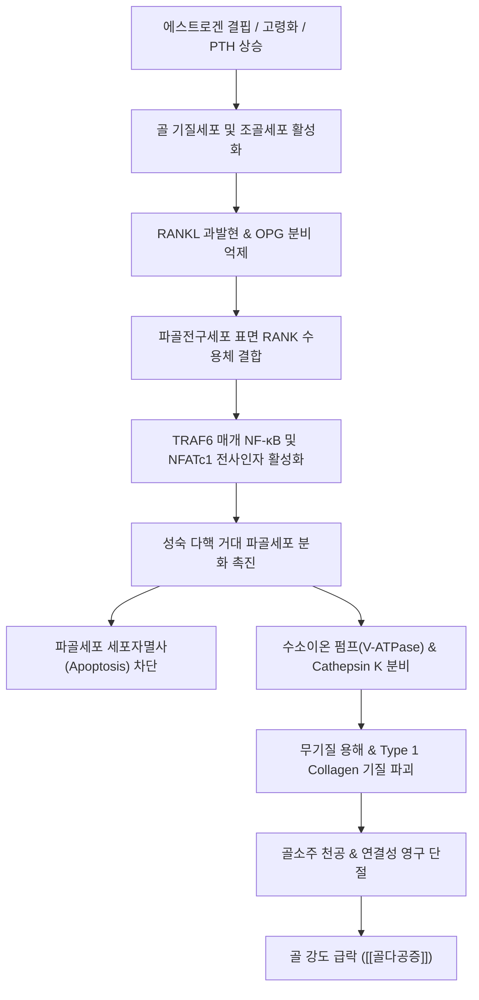

# 🩺 [[골다공증]] (Osteoporosis / 骨多孔症, ICD-10 M80 / M81)

> **핵심 3줄 요약 (Key Summary)**:
> - 📍 병소 부위 & 해부·병태생리: 전신 [[해면골]](Trabecular bone) 및 [[피질골]](Cortical bone)의 미세구조(Trabecular architecture) 파괴와 골량 소실로 뼈의 강도가 급격히 취약해지는 전신 골격 질환으로, 에스트로겐 고갈 및 노화로 인해 [[RANKL]]-RANK-[[OPG]] 경로의 불균형이 초래되어 파골세포의 골 흡수가 조골세포의 골 형성을 압도하면서 발생.
> - 🚩 전형적 임상 양상 & 3대 징후: 골절 발생 전까지 임상 증상이 전혀 없는 침묵의 잠복기(Silent Killer), 경미한 외상(자명성 낙상, 엉덩방아, 기침) 후 발생하는 급격한 흉요추 이행부 격통 및 극돌기 고타통, 점진적인 신장 단축(키 감소 >4cm) 및 흉추 후만 기형(Dowager's hump).
> - 🛠️ 핵심 감별 검사 & 한·양방 다각적 치료 전략: 이중에너지 X선 흡수계측법([[DEXA]]) T-score 판정(T $\le$ -2.5 또는 대퇴골/척추 취약성 골절 시 확진), 양방 표준 골흡수 억제제([[비스포스포네이트]], [[데노수맙]]) 및 골형성 촉진제([[테리파라타이드]], [[로모소주맙]])의 순차 치료, 한의 골위(骨痿)·골고(骨枯)·신허 기반 보신장골·자음강화([[독활기생탕]], [[좌귀환]], [[우귀환]], [[보신건골탕]]) 및 온침·안전 추나(HVLA 추력 절대 금기).
> - <font color="#fa7e7e">⚠️ 응급 의뢰 레드플래그 & 악화 요인: 대퇴골 골절([[대퇴골 경부 골절]], 1년 내 폐렴/색전증 사망률 15~20%), 척추 압박골절 후 마미 증후군(대소변 장애, 하지 마비), 데노수맙 임의 중단 후 반동 골소실 다발 척추골절.</font>

---

## 📌 목차
1. [질환 개요 & 해부학적 병태생리](#1-질환-개요--해부학적-병태생리)
2. [병태생리 메커니즘 & 생체역학적 악순환 네트워크](#2-병태생리-메커니즘--생체역학적-악순환-네트워크)
3. [임상 증상 & 이학적 검사(Physical Exam) 알고리즘](#3-임상-증상--이학적-검사physical-exam-알고리즘)
4. [감별 진단 매트릭스 (Differential Diagnosis)](#4-감별-진단-매트릭스-differential-diagnosis)
5. [한의 통합 치료 프로토콜 (침·약침·추나·한약)](#5-한의-통합-치료-프로토콜-침약침추나한약)
6. [양방 치료 & 병용·의뢰 기준 (Conventional Treatment & Referral)](#6-양방-치료--병용의뢰-기준-conventional-treatment--referral)
7. [재활 운동 & 생활습관 티칭 가이드](#7-재활-운동--생활습관-티칭-가이드)
8. [💡 사용자 진료실 핵심 필기 & 임상 노하우 (Melt-In 잔여 심화 집약)](#8--사용자-진료실-핵심-필기--임상-노하우-melt-in-잔여-심화-집약)
9. [출처 및 학술 참고 문헌 (References)](#9-출처-및-학술-참고-문헌-references)

---

## 1. 질환 개요 & 해부학적 병태생리

* **질환의 정의 및 진단 기준**:
  * **정의**: 골다공증(Osteoporosis)은 골량(Bone mass)의 현저한 감소와 뼈 미세구조(Microarchitecture)의 퇴행성 손상으로 인해 뼈가 극도로 취약해져, 일상적인 경미한 외력(선 자세 높이에서의 낙상, 가벼운 엉덩방아, 기침, 비틀림 등)에도 쉽게 골절이 발생하는 전신 골격계 대사 질환이다.
  * **WHO 진단 기준**: 이중에너지 X선 흡수계측법([[DEXA]])을 이용하여 중심골(요추 L1-L4, 대퇴골 경부, 대퇴골 전체)을 측정했을 때, 젊은 성인 참조 집단 대비 표준편차를 나타내는 T-score가 **-2.5 이하(T-score $\le$ -2.5)**인 경우 골다공증으로 확진한다.
  * **취약성 골절 확진 기준**: 골밀도 수치와 무관하게, 50세 이상 성인에서 일상적 저에너지 손상에 의해 대퇴골(고관절) 또는 척추체에 비외상성 취약성 골절(Fragility fracture)이 명백히 확인되는 경우 즉각 골다공증으로 임상 진단한다.

* **원발성 골다공증의 2대 임상 분류**:
  * **제1형 (폐경 후 골다공증, Postmenopausal Osteoporosis)**:
    * **호발 대상**: 폐경 후 50~70세 여성.
    * **병태 기전**: 급격한 에스트로겐 결핍으로 인해 파골세포의 세포자멸사가 억제되고 조골세포와의 리모델링 커플링이 붕괴된다.
    * **골격 침범 특징**: 대사 회전율이 높은 [[해면골]](Trabecular bone)의 소실이 피질골에 비해 3배 이상 빠르게 진행된다. 골소주의 연속성이 끊어지는 천공(Perforation)이 다발한다.
    * **호발 골절 부위**: 흉요추 압박골절([[척추 압박 골절]]) 및 원위 요골 골절([[콜레스 골절]]).
  * **제2형 (노인성 골다공증, Senile Osteoporosis)**:
    * **호발 대상**: 70세 이상의 고령 남녀.
    * **병태 기전**: 조골세포의 증식 및 분화 능력 저하(노화), 신장의 1-$\alpha$-hydroxylase 활성 저하에 따른 활성형 비타민 D(1,25(OH)$_2$D) 생성 결핍, 장관 칼슘 흡수 장애 및 보상성 이차성 부갑상선기능항진증(Secondary Hyperparathyroidism).
    * **골격 침범 특징**: 해면골뿐만 아니라 외벽을 이루는 치밀한 [[피질골]](Cortical bone)이 내측에서부터 얇아지는 박막화 및 다공성(Cortical porosity) 증가가 동반된다.
    * **호발 골절 부위**: [[대퇴골 경부 골절]](Femoral neck fracture), 대퇴골 전자간 골절, 골반골 골절, 상완골 근위부 골절.

* **이차성 골다공증의 주요 원인 질환군**:
  * **내분비 대사 질환**: 쿠싱 증후군, [[갑상선 기능 항진증]], 원발성 부갑상선기능항진증, 성선기능저하증(Hypogonadism), 제1형 및 제2형 당뇨병.
  * **약물 유발성**: 전신 글루코코르티코이드([[스테로이드]], 프레드니손 5mg/일 이상 3개월 초과), 항경련제, 아로마타제 억제제(유방암 치료제), 안드로겐 차단 요법(GnRH 작용제, 전립선암 치료제), 프로톤펌프억제제([[PPI]] 장기 복용).
  * **위장관 및 영양 장애**: 흡수장애 증후군, 위절제술 후 상태, 염증성 장질환, 신경성 식욕부진증.
  * **만성 소모성 질환**: 만성 신부전, 만성 폐쇄성 폐질환(COPD), 류마티스 관절염, 장기 부동(Immobilization).

* **관련 해부학적 구조물 및 하중 전달 축**:
  * **해면골(Trabecular Bone)**: 척추체 내부 및 대퇴골 전자부에 풍부하며, 벌집 모양의 골소주 네트워크가 수직 압축 응력을 분산시킨다. 골다공증 시 수평 골소주가 먼저 흡수되어 수직 골소주만 남아 좌굴(Buckling)에 취약해진다.
  * **피질골(Cortical Bone)**: 장골 간부의 단면 2차 모멘트(Cross-sectional moment of inertia)를 지탱하여 비틀림과 휨 응력에 저항한다. 노인성 골다공증에서 피질골 두께가 얇아지면 경미한 회전 낙상에도 대퇴골 간부 및 전자부가 분쇄된다.
  * **흉요추 이행부([[흉요추 이행부]] T12-L1)**: 운동성이 적은 흉추 흉곽 구조와 운동성이 큰 요추가 만나는 분절로, 압박 하중이 집중되어 가장 빈번하게 쐐기형 압박골절이 발생한다.

---

## 2. 병태생리 메커니즘 & 생체역학적 악순환 네트워크

### 1) ASCII 병태생리 다이어그램: RANKL/RANK/OPG 분자 경로 및 도미노 골절 연쇄

```text
========================================================================================
             [골다공증 병태생리: RANKL 분자 신호 경로 및 생체역학적 도미노 연쇄]
========================================================================================

  [에스트로겐 고갈 (폐경)]                 [노화 및 신체 비활동]
            │                                       │
            ├─ 골수 면역세포 사이토카인 분비        ├─ 조골세포 노화 및 줄기세포 수명 단축
            │  (TNF-α, IL-1, IL-6 폭증)             ├─ 활성형 비타민 D 생성 감소 -> PTH 상승
            │                                       └─ 골세포 스클레로스틴(Sclerostin) 분비
            ▼                                                       ▼
  ┌─────────────────────────────────────────────────────────────────────────────┐
  │                 조골세포 / 골 기질세포(Stromal Cells)의 신호 불균형         │
  │                 - 막 결합형 및 가용성 [[RANKL]] 발현 폭증                   │
  │                 - 가용성 유인 디코이 수용체 [[OPG]] 분비 격감               │
  │                 - Wnt/β-catenin 신호 경로 차단 (골기질 형성 중단)            │
  └──────────────────────────────────────┬──────────────────────────────────────┘
                                         │
                                         ▼
  ┌─────────────────────────────────────────────────────────────────────────────┐
  │                 파골전구세포(Osteoclast Precursors) 결합 및 활성화           │
  │                 - RANKL이 파골세포 표면의 RANK 수용체와 결합                │
  │                 - NF-κB, MAPK, NFATc1 전사 인자 연속 활성화                 │
  │                 - 성숙 다핵 파골세포로의 융합 및 주름연(Ruffled border) 형성│
  │                 - 카텝신 K(Cathepsin K) 및 산 분비 -> 골기질 급격 용해       │
  └──────────────────────────────────────┬──────────────────────────────────────┘
                                         │
                                         ▼
  ┌─────────────────────────────────────────────────────────────────────────────┐
  │                 골 흡수와 골 형성의 극심한 언커플링 (Uncoupling)             │
  │                 - 골 흡수 속도 >>>> 골 형성 속도                            │
  │                 - 해면골 소주(Trabecular architecture) 완전 관통 및 단편화  │
  │                 - 피질골 내측 다공성(Porosity) 급증 및 외벽 박막화          │
  │                 - DXA 골밀도: T-score ≤ -2.5 (중증 골 취약 상태)           │
  └──────────────────────────────────────┬──────────────────────────────────────┘
                                         │
                                         ▼
  ┌─────────────────────────────────────────────────────────────────────────────┐
  │                 생체역학적 파탄 및 도미노 척추 압박골절 연쇄               │
  │                 1. 척추체 전방 1/3 쐐기형 압박 붕괴 (Wedge Fracture)         │
  │                 2. 시상면 불균형: 체중 중심선 전방 쏠림 (흉추 후만증 악화) │
  │                 3. 굴곡 모멘트 암 연장 -> 인접 척추체 축성 하중 2~3배 급증 │
  │                 4. 기침이나 체위 변경 시 인접 분절 연쇄 압박골절 (도미노)  │
  └─────────────────────────────────────────────────────────────────────────────┘
========================================================================================
```

### 2) 분자생물학적 정밀 기전: [[RANKL]]-RANK-[[OPG]] 경로



* **RANKL (Receptor Activator of Nuclear Factor-$\kappa$B Ligand)**:
  * TNF 슈퍼패밀리에 속하는 사이토카인으로, 조골세포 및 활성화된 T세포 표면에서 발현된다.
  * 파골전구세포 표면의 수용체인 **RANK**에 결합하여 파골세포의 분화, 증식, 융합, 주름연(Ruffled border) 형성을 총괄 지휘한다.
* **OPG (Osteoprotegerin)**:
  * 조골세포에서 합성되어 혈중으로 분비되는 '가용성 유인 수용체(Decoy Receptor)'이다.
  * RANKL과 RANK 수용체 사이에 끼어들어 RANKL을 중화시킴으로써 과도한 골흡수를 방지하는 생체 내 천연 브레이크 역할을 수행한다.
  * 에스트로겐 결핍 시 OPG 분비가 급격히 차단되어 브레이크가 풀린 상태가 되므로 골 흡수가 억제되지 못하고 폭주한다.
* **Wnt/$\beta$-catenin 신호 전달과 스클레로스틴(Sclerostin)**:
  * Wnt 단백질이 LRP5/6 수용체에 결합하면 세포질 내 $\beta$-catenin이 핵으로 이동하여 조골세포 분화 유전자(Runx2, Osterix)를 전사한다.
  * 노화 및 기계적 부하 부재 시 골세포는 Wnt 신호 경로를 억제하는 당단백질인 **스클레로스틴(Sclerostin)**을 대량 분비하여 골 형성을 직접적으로 정지시킨다.

### 3) 생체역학적 악순환 네트워크: 도미노 압박골절 연쇄 (Vertebral Domino Effect)

* **척추체의 구조적 이방성(Anisotropy)**:
  * 척추체는 전방 1/3 부위가 대부분 해면골로 구성되어 압축력에 취약하고, 후방 2/3 부위는 후관절 및 척추경(Pedicle)이 지지하여 상대적으로 견고하다.
* **쐐기형 변형과 모멘트 암의 기하급수적 증가**:
  * 흉요추 이행부의 한 척추체가 가벼운 엉덩방아나 재채기로 전방 높이가 주저앉으면(Wedge Compression Fracture), 정상 척추의 S자 만곡이 깨지면서 상체의 무게중심선(Sagittal Vertical Axis, SVA)이 전방으로 치우친다.
  * 이로 인해 상체 하중이 척추 축에 작용하는 모멘트 암(Flexion moment arm)이 길어지며, 인접한 상하 척추체 전방부에 걸리는 전단 응력과 압축 응력이 정상 대비 **200~300% 이상 급증**한다.
  * 그 결과 또 다른 경미한 일상 동작에서도 바로 위나 아래 분절이 연쇄적으로 부러지는 '도미노 압박골절'이 완성되어 척추 후만증(Dowager's hump)이 급격히 진행된다.

---

## 3. 임상 증상 & 이학적 검사(Physical Exam) 알고리즘

### 1) 주소증 및 3대 골절 호발 패턴

```text
========================================================================================
                      [골다공증 3대 취약성 골절의 임상 발현 양상]
========================================================================================

  1. 척추 압박골절 (Vertebral Compression Fracture) - 최다 빈도 (약 50%)
  ├─ 유발 원인: 무거운 화분 들기, 재채기, 침대에서 뒤척임, 가벼운 엉덩방아
  ├─ 주소증: 흉요추 이행부의 급격한 칼로 찌르는 듯한 둔통, 체위 변경(돌아눕기) 시 극통
  ├─ 만성 소견: 신장 단축(키가 4cm 이상 줄어듦), 등 굽음(흉추 후만증), 복부 팽만 및 소화불량
  └─ 특징: 전체 척추 골절의 약 60~70%는 명확한 외상 기억 없이 '무증상 미세 골절'로 진행

  2. 대퇴골 경부 및 전자간 골절 (Hip Fracture) - 최고 위험도 (사망률 20%)
  ├─ 유발 원인: 욕실 바닥이나 빙판길에서 미끄러져 옆으로 넘어짐
  ├─ 주소증: 서혜부(사타구니) 및 고관절 부위 격통, 완전한 기립 및 보행 불능
  ├─ 특징적 신체 검진: 환측 하지가 짧아지는 단축 변형(Shortening) 및 발이 바깥으로 돌아가는 외회전 기형(External Rotation)
  └─ 예후: 수술적 치료가 필수적이며, 고령자에서 1년 내 폐렴·폐색전증·욕창 등 합병증 사망률이 15~20%에 달함

  3. 원위 요골 골절 (Colles Fracture) - 초기 경고 골절 (50~60대 호발)
  ├─ 유발 원인: 넘어질 때 손바닥을 지면에 짚으면서 체중이 손목으로 전달
  ├─ 주소증: 손목 부위의 극심한 부종, 피하 출혈(자반), 손목 관절 가동 불가
  └─ 외형적 변형: 측면에서 보았을 때 손목이 식사 포크처럼 꺾이는 '포크 기형(Dinner-fork deformity)'
========================================================================================
```

### 2) 필수 진단 검사 및 이학적 검사 알고리즘

* **이중에너지 X선 흡수계측법 ([[DEXA]]): 진단의 골드 스탠다드**:
  * **측정 부위**: 요추(L1~L4) 및 대퇴골(대퇴골 경부 Femoral Neck, 대퇴골 전체 Total Hip).
  * **판정 기준**:
    * **정상 (Normal)**: $T \ge -1.0$
    * **[[골감소증]] (Osteopenia)**: $-2.5 < T < -1.0$
    * **[[골다공증]] (Osteoporosis)**: $T \le -2.5$ (측정한 부위 중 가장 낮은 T-score 채택)
    * **중증 골다공증 (Severe Osteoporosis)**: $T \le -2.5$ + 비외상성 취약성 골절 동반.
  * **Z-score 활용**: 50세 미만 남성, 폐경 전 여성, 소아청소년에서는 연령 대비 표준편차인 Z-score를 사용하며, **Z-score $\le$ -2.0**인 경우 '연령 기대치 이하(Below the expected range for age)'로 표기하고 이차성 원인을 정밀 추적한다.
* **척추 단순 방사선 검사 (X-ray)**:
  * 흉추 및 요추의 전후면(AP)과 측면(Lateral) 촬영을 시행한다.
  * **Genant 반정량적 평가법**: 척추체의 전방(Anterior), 중앙(Middle), 후방(Posterior) 높이를 측정하여 가장 감소된 비율에 따라 등급화한다.
    * 1등급(경도): 높이 20~25% 감소.
    * 2등급(중등도): 높이 25~40% 감소.
    * 3등급(중증): 높이 40% 초과 감소 (완전 압축 변형).
* **척추 극돌기 고타통 검사 (Spinal Percussion Test)**:
  * 검사자의 주먹 새끼손가락 측면(Ulnar border)이나 타진기를 이용하여 경추부터 천추까지 극돌기를 통통 두드린다.
  * 특정 분절에서 환자가 깜짝 놀라며 날카로운 통증을 호소하면(Percussion tenderness positive), 해당 분절의 **급성 [[척추 압박 골절]]**을 90% 이상의 민감도로 강력히 시사한다.
* **골교체표지자 (Bone Turnover Markers, BTM)**:
  * **골흡수표지자**: 혈청 s-CTX (C-terminal telopeptide of type 1 collagen) $\to$ 파골세포 활성 반영.
  * **골형성표지자**: 혈청 P1NP (Procollagen type 1 N-terminal propeptide) $\to$ 조골세포 활성 반영.
  * 약물 투여 시작 3~6개월 후 BTM을 재측정하여 약제 순응도 및 치료 반응성을 조기에 평가한다.

---

## 4. 감별 진단 매트릭스 (Differential Diagnosis)

| 감별 질환 | 호발 병소 및 병태 기전 | 임상 주소증 차이점 | 검사실 혈액/소변 핵심 소견 | DEXA 및 방사선(X-ray/MRI) 소견 |
| :--- | :--- | :--- | :--- | :--- |
| **[[골다공증]]**<br>(Osteoporosis, 본 질환) | 전신 해면골 및 피질골,<br>파골세포 과항진에 의한 미세구조 붕괴 | 골절 전 완전 무증상,<br>골절 시 급격한 국소 둔통 및 신장 단축 | 혈청 칼슘, 인, ALP **모두 정상**,<br>CTX/P1NP 상승 가능 | DEXA T-score: **$\le$ -2.5**,<br>척추체 전방 쐐기형 압박 변형 |
| **[[골감소증]]**<br>(Osteopenia) | 전신 골격계,<br>골흡수-골형성의 경미한 음성 불균형 | 완전 무증상,<br>골절 위험도 증가 상태 | 혈청 칼슘, 인, ALP, PTH 정상 | DEXA T-score: **-1.0 초과 ~ -2.5 미만**,<br>경미한 골음영 투과성 증가 |
| **[[골연화증]]**<br>(Osteomalacia) | 전신 골격 기질,<br>[[비타민 D]] 결핍으로 인한 유골 석회화 부전 | 둔부·하지의 광범위한 둔통,<br>동요 보행(Waddling gait), 근위부 근력 약화 | **혈청 25(OH)D 급감(<10ng/mL)**,<br>**혈청 ALP 현저한 상승**, 저칼슘/저인산 | DEXA 골밀도 감소,<br>X-ray상 골기질 투과성 및 가성골절선(Looser's zones) |
| **[[다발성 골수종]]**<br>(Multiple Myeloma) | 척추, 골반, 두개골,<br>단클론 형질세포의 골수 침윤 및 골 파괴 | 안정 시 및 야간에도 지속되는 완고한 요통,<br>전신 쇠약, 빈혈, 체중 감소, 반복 감염 | **혈청 단백 전기영동 M-단백(M-spike) 검출**,<br>소변 Bence-Jones 단백, 고칼슘혈증 | 두개골 펀치 아웃 병변(Punch-out),<br>MRI상 척추체 다발성 골수 침윤 및 조영 증강 |
| **[[골전이암]]**<br>(Bone Metastasis) | 척추경(Pedicle) 및 척추체,<br>폐암·유방암·전립선암의 척추 전이 | 체위 변경과 무관한 극심한 야간통,<br>체중 감소, 원발암 기왕력 | 혈청 ALP 상승, 고칼슘혈증 가능 | X-ray상 **척추경 소실(Winking Owl sign)**,<br>MRI상 척추경 및 후궁을 침범하는 종괴 음영 |
| **[[강직성 척추염]]**<br>(Ankylosing Spondylitis) | 천장관절, 척추 인대 부착부,<br>만성 자가면역성 부착부염(Enthesitis) | 젊은 연령(20~30대) 남성의 엉치 통증,<br>조조강직(30분 이상), 활동 시 호전 | **HLA-B27 양성**, ESR/CRP 상승 | 천장관절염(관절면 침식),<br>척추 인대 골화로 대나무 척추(Bamboo Spine) |
| **파제트 골질환**<br>(Paget's Disease of Bone) | 골반골, 대퇴골, 두개골, 척추,<br>파골-조골세포의 무질서한 골대사 과항진 | 뼈의 비후 및 변형(다리 휨),<br>국소 피부 온도 상승, 뇌신경 마비 | **혈청 ALP의 극적인 급상승**,<br>혈청 칼슘/인은 정상 | 방사선상 골소주 비후와 면모상 음영(Cotton-wool),<br>골 흡수와 골화가 혼재된 골 변형 |

---

## 5. 한의 통합 치료 프로토콜 (침·약침·추나·한약)

### 1) 한의학적 병태 분류 및 변증 체계

* **골위(骨痿)와 골고(骨枯)의 한의학적 개념**:
  * 《황제내경·소문(黃帝內經·素問)》 위론(痿論)에서 "신주골생수(腎主骨生髓), 신기열즉요척불거, 골고이수감, 고발위골위(腎氣熱則腰脊不擧, 骨枯而髓減, 發爲骨痿)"라 하여, 신정(腎精)이 고갈되어 골수가 줄어들고 척추를 지탱하지 못하는 상태를 명시하였다.
  * 골다공증은 전신 골격이 마르고 부서지기 쉬운 **골고(骨枯)**와 하지 무력으로 보행이 불능해지는 **골위(骨痿)**의 병주(病主)에 속한다.
* **4대 핵심 변증 유형**:
  1. **신음휴허형(腎陰虧虛型)**: 요슬산연, 수족심열, 도한, 설홍소태, 맥세삭.
  2. **신양부족형(腎陽不足型)**: 요배냉통, 사지궐랭, 야간다뇨, 신피핍력, 설담태백, 맥침완무력.
  3. **비신기허형(脾腎氣虛型)**: 식소변당, 만성 소화불량, 전신 권태, 설담반치흔, 맥세약.
  4. **어혈조락형(瘀血阻絡型)**: 골절 후 국소적인 자통(刺痛), 야간통 심화, 척추 극돌기 고정성 압통, 설암자 어점, 맥삽.

### 2) 침구 치료 (Acupuncture & Electroacupuncture)

* **배수혈 및 특효혈 배혈 원칙**:
  * **골회(骨會) & 수회(髓會)**: [[대저(BL11)]](모든 뼈의 기운을 수렴), [[현종(GB39)]](골수를 자양).
  * **보신익정(補腎益精)**: [[신수(BL23)]], [[명문(GV4)]], [[지실(BL52)]], [[관원수(BL26)]].
  * **건비양혈(健脾養血)**: [[비수(BL20)]], [[족삼리(ST36)]], [[삼음교(SP6)]].
  * **원혈 및 극혈**: [[태계(KI3)]], [[관원(CV4)]].
* **전침 요법 (Electroacupuncture Protocol)**:
  * **시술 부위**: [[신수(BL23)]]-[[대저(BL11)]] 또는 [[신수(BL23)]]-[[관원수(BL26)]].
  * **자침 심도**: 0.25 $\times$ 40mm 멸균 호침으로 1.0~1.2촌 직자하여 묵직한 득기감 유도.
  * **전침 파형**: **2Hz 저주파 연속파**를 적용하여 환자가 기분 좋은 박동감을 느끼는 강도(0.5~1.5mA)로 20분간 통전.
  * **현대 분자생물학적 약리 기전**: 2Hz 저주파 전기 자극은 국소 칼시토닌 유전자 관련 펩타이드(CGRP) 및 Substance P 분비를 유도하고, 조골세포 표면의 Wnt/$\beta$-catenin 경로를 활성화하여 Runx2, 골형성단백질(BMP-2), 오스테오칼신(Osteocalcin)의 mRNA 발현을 유의하게 촉진한다.
* **온침(Warm Needling) 및 간접구**:
  * 신양허 및 허한증 환자에게 침병에 애탄(쑥탄)을 꽂는 온침술 또는 [[관원(CV4)]], [[명문(GV4)]]에 간접구를 시행하여 골막 순환을 개선한다.

### 3) 약침 치료 (Pharmacopuncture Protocol)

* **자하거약침 (Hominis Placenta Pharmacopuncture)**:
  * **효능**: 자음보신(滋陰補腎), 보기양혈(補氣養血), 익정진수(益精塡髓).
  * **분자 약리**: 성장인자(HGF, TGF-$\beta$)와 천연 펩타이드가 파골세포 분화 촉진 인자인 NF-$\kappa$B 리간드(RANKL) 발현을 억제하고 조골세포 알칼리 인산분해효소(ALP) 활성을 증가시킨다.
  * **시술법**: 양측 [[신수(BL23)]], [[대저(BL11)]], [[현종(GB39)]]에 각 0.2~0.3cc씩, 총 1.0~1.5cc를 30G 니들로 심부 근막층에 주입 (주 2회, 8주간 지속).
* **녹용약침 (Cervi Cornu Parvum Pharmacopuncture)**:
  * **효능**: 온신장양(溫腎壯陽), 강근건골(强筋健骨).
  * **약리**: 연골 및 골조직 재생 인자인 IGF-1을 풍부하게 함유하여 대사성 골량 소실을 지연시키고 골소주의 미세 단면 강도를 복원한다.
  * **시술법**: [[명문(GV4)]], [[요양관(GV3)]] 부위에 각 0.2cc씩 주입.

### 4) 추나 요법 안전 규칙 및 금기 프로토콜 (Chuna Safety & Contraindications)

* **⚠️ 척추 고속 저진폭 교정기법(HVLA Thrust) 절대 금기**:
  * **이유**: T-score -2.5 이하의 골다공증 환자는 척추체의 골소주가 이미 다공성으로 파괴되어 있어 비틀림 모멘트와 순간적인 충격 하중을 흡수할 수 없다.
  * 골다공증 환자에게 회전 교정(Lumbar Roll)이나 체중을 실은 순간 추력(Thrust)을 가할 경우 **인위적인 척추체 압박 골절 및 늑골 골절을 유발**하므로 **법적·임상적 절대 금기**이다.
* **안전하고 효과적인 수기 요법 프로토콜**:
  1. **JS 근막 이완 기법 (Myofascial Release)**:
     * 척추 기립근, 둔근, 이상근, 장요근에 완만한 지속 압박(Sustained Pressure)을 적용하여 보상성 연부조직 연축을 해소한다.
  2. **천장관절 완만한 가동추나 (Sacroiliac Joint Mobilization)**:
     * 충격을 배제하고 환자의 관절 가동 범위 내에서 부드럽게 율동적으로 흔들어주는 가동술(Grade I~II)을 통해 골반의 비대칭을 교정한다.
  3. **복와위 경성 축성 신연 기법 (Gentle Axial Traction)**:
     * 환자를 엎드리게 한 상태에서 발목 부위를 잡고 축성으로 완만하게 당겨주어 척추체에 걸리는 압축 응력을 분산시킨다.

### 5) 변증별 표준 한약 치료 처방

```text
========================================================================================
                      [골다공증 변증별 표준 한약 처방 및 방제학적 분석]
========================================================================================

  1. 신음휴허·간신부족형 (腎陰虧虛·肝腎不足型) - 폐경 후 1형 표준
  ├─ 주소증: 만성 둔부·요배통, 구갈, 현훈, 이명, 조열도한, 설홍소태, 맥세삭
  ├─ 치법: 자음강화(滋陰降火), 보신장골(補腎壯骨)
  ├─ 처방: [[좌귀환]](左歸丸) 또는 [[육미지황탕]](六味地黃湯) 합 [[보신건골탕]](補腎健骨湯) 가감
  └─ 방제 구성:
     - 군약: [[숙지황]](熟地黃) 16~20g (자음보혈, 골수 충전)
     - 신약: [[산수유]](山茱萸) 8g, [[산약]](山藥) 8g, [[구기자]](枸杞子) 8g, [[녹용]](鹿茸) 4g
     - 좌약: [[두충]](杜沖) 8g, [[속단]](續斷) 8g, [[우슬]](牛膝) 8g, [[음양곽]](淫羊藿) 8g, [[골쇄보]](骨碎補) 8g
     - 사약: [[복령]](茯苓) 6g, [[자감초]](炙甘草) 4g

  2. 신양부족·비신양허형 (腎陽不足·脾腎兩虛型) - 노인성 2형 표준
  ├─ 주소증: 요배부 극심한 냉통, 기침이나 찬바람에 악화, 완고한 설사, 하지 부종, 맥침미무력
  ├─ 치법: 온보신양(溫補腎陽), 익정건골(益精健骨)
  ├─ 처방: [[우귀환]](右歸丸) 또는 [[팔미지황탕]](八味地黃湯) 합 [[삼령백출산]](參苓白朮散) 가감
  └─ 방제 구성:
     - 군약: [[숙지황]](熟地黃) 12g, [[포부자]](附子) 4~6g, [[육계]](肉桂) 4g
     - 신약: [[녹용]](鹿茸) 4g, [[산수유]](山茱萸) 8g, [[산약]](山藥) 10g, [[당삼]](黨蔘) 8g
     - 좌약: [[백출]](白朮) 8g, [[두충]](杜沖) 8g, [[파극천]](巴戟天) 8g, [[보골지]](補骨脂) 8g
     - 사약: [[자감초]](炙甘草) 4g

  3. 어혈조락·기혈양허형 (瘀血阻絡·氣血兩虛型) - 압박골절 후유증 및 만성통증
  ├─ 주소증: 압박골절 후 지속되는 척추 타진통, 돌아눕기 힘듦, 피부 어반, 맥삽
  ├─ 치법: 활혈거어(活血祛瘀), 통락지통(通絡止痛), 보기혈(補氣血)
  ├─ 처방: [[독활기생탕]](獨活寄生湯) 합 [[도홍사물탕]](桃紅四物湯) 가감
  └─ 방제 구성:
     - 활혈통락: [[당귀]](當歸) 10g, [[천궁]](川芎) 6g, [[도인]](桃仁) 6g, [[홍화]](紅花) 4g, [[우슬]](牛膝) 8g
     - 거풍제습: [[독활]](獨活) 8g, [[상기생]](桑寄生) 12g, [[진교]](秦艽) 6g, [[방풍]](防風) 6g
     - 보기보혈: [[숙지황]](熟地黃) 12g, [[백작약]](白芍藥) 8g, [[인삼]](人蔘) 6g, [[복령]](茯苓) 8g
     - 온경지통: [[육계]](肉桂) 4g, [[두충]](杜沖) 8g, [[속단]](續斷) 8g, [[감초]](甘草) 4g
========================================================================================
```

---

## 6. 양방 치료 & 병용·의뢰 기준 (Conventional Treatment & Referral)

> 🎯 **이 섹션의 목적**: 골다공증 환자는 대부분 양방 골흡수 억제제([[비스포스포네이트]] 또는 [[데노수맙]])를 복용 또는 주사 투여 중이다. 1차 한의 진료에서 양방 약제의 정확한 약리, 부작용(MRONJ, AFF), 투약 중단 시의 반동 위험을 명확히 이해하고, 안전한 병용 관리 및 협진 의뢰를 수행한다.

### 1) 계열별 양방 표준 약제학적 요법

```text
========================================================================================
                      [양방 골다공증 약제의 계열별 분류 및 임상 특성]
========================================================================================

  1. 골흡수 억제제 (Antiresorptive Agents) - 1차 표준 치료제
  ├─ 1) 비스포스포네이트 (Bisphosphonates): 파골세포 메발로네이트 경로 억제 및 자멸사 유도
  │  ├─ [[알렌드로네이트]](Alendronate): 70mg 경구 주 1회
  │  ├─ [[리세드로네이트]](Risedronate): 35mg 경구 주 1회 또는 150mg 경구 월 1회
  │  ├─ [[이반드로네이트]](Ibandronate): 150mg 경구 월 1회 또는 3mg 정맥주사 3개월 1회
  │  └─ [[졸레드론산]](Zoledronic Acid): 5mg 정맥주사 연 1회 (15분간 서서히 점적주우)
  │     * 복용법: 아침 공복 200mL 생수와 복용, 30~60분간 눕지 않고 기립 유지 (식도염 방지)
  │     * 장기 투여 합병증: 턱뼈괴사([[MRONJ]]), 비전형 대퇴골 골절([[비전형 대퇴골 골절]])
  │     * 휴약기(Drug Holiday) 전략: 3~5년 투여 후 골절 위험 재평가하여 1~2년간 투약 중단 고려
  └─ 2) RANKL 단클론 항체: [[데노수맙]](Denosumab, 프롤리아)
     ├─ 용법: 60mg 피하주사 6개월 1회
     ├─ 장점: 신기능 저하(eGFR < 30 mL/min) 환자에게도 용량 조절 없이 투여 가능
     └─ ⚠️ 치명적 주의점: 골에 침착되지 않으므로 투약을 중단하면 파골세포 활성이 반동적으로 폭증
        -> '반동 골소실(Rebound Bone Loss)'로 인한 다발성 척추 압박골절 발생 위험

  2. 골형성 촉진제 (Anabolic Agents) - 중증 골다공증 및 초고위험군 치료제
  ├─ 1) 부갑상선 호르몬 유도체: [[테리파라타이드]](Teriparatide, PTH 1-34)
  │  ├─ 용법: 20μg 1일 1회 피하주사, 최대 24개월 사용 (평생 1회 코스)
  │  └─ 작용: 간헐적 투여 시 조골세포 증식 및 수명 연장 -> 해면골 미세구조 직접 복원
  └─ 2) 스클레로스틴 단클론 항체: [[로모소주맙]](Romosozumab, 이베니티)
     ├─ 용법: 210mg 피하주사 월 1회, 총 12개월(1년) 투여
     ├─ 이중 작용: 골세포의 스클레로스틴을 중화하여 골 형성 촉진 + 골 흡수 억제 동시 발휘
     ├─ 주의: 심근경색, 뇌졸중 등 심혈관 질환 병력 환자에게는 투여 금기/신중 투여
     └─ 필수 전략: 1년 치료 종료 후 즉시 비스포스포네이트나 데노수맙으로 순차 전환(Sequential)
========================================================================================
```

* **데노수맙 중단 후 관리 및 순차 치료 (Sequential Therapy)**:
  * 데노수맙은 뼈에 축적되지 않는 생물학적 제제이므로, 투약 주기를 넘겨 임의로 중단하면 파골세포 분화가 폭발적으로 일어나 치료 전보다 골교체표지자가 급등하고 골밀도가 급격히 소실된다.
  * **2026년 최신 임상 지침**: 데노수맙을 2년 이상 장기 사용한 환자가 투약을 중단할 경우, 마지막 주사 후 6개월 시점에 반드시 정맥용 **[[졸레드론산]] 5mg**을 투여하거나 경구 비스포스포네이트로 이어받아야 한다. 단, 장기 사용자에게 단회 졸레드론산 투여만으로는 반동성 골소실을 완전히 막기 부족할 수 있으므로 6개월 간격으로 골교체표지자([[골교체표지자]] s-CTX)를 추적 관찰하여 추가 투여를 결정해야 한다.

### 2) 비약물 시술 및 수술적 적응증 (Surgical Indication)

* **경피적 척추성형술 (Vertebroplasty) 및 풍선 척추후굴복원술 (Kyphoplasty)**:
  * **적응증**: 급성 척추 압박골절 후 2~3주간의 적극적인 침상 안정 및 한·양방 보존적 치료에도 불구하고 극심한 마약성 진통제 요구성 둔통이 지속되거나, 척추체 높이 감소가 30% 이상 진행되는 경우.
  * **술기**: 국소 마취 하에 방사선 영상(C-arm) 유도 하에 골절된 척추체 내부로 바늘을 삽입하고 골시멘트(Polymethylmethacrylate, PMMA)를 주입하여 척추체를 기계적으로 즉각 안정화시킨다.
  * **주의**: 시멘트가 주입된 단단한 분절로 인해 인접 척추 분절에 가해지는 강직도가 증가하여, 인접 척추체의 2차 압박골절 위험이 증가한다.
* **대퇴골 골절 수술 (Hip Fracture Surgery)**:
  * **적응증**: 대퇴골 경부 또는 전자간 골절은 원칙적으로 조기 수술(손상 후 24~48시간 이내)이 절대 적응증이다.
  * **술식**: 전위된 대퇴골 경부 골절은 인공관절 반치환술(Bipolar Hemiarthroplasty)을 시행하며, 대퇴골 전자간 골절은 근위 대퇴 골수정(PFNA, Proximal Femoral Nail Antirotation) 고정술을 시행한다.

### 3) 한·양방 병용 판단 (Combination Therapy Protocol)

* **병용 가능 및 권장 (Synergy)**:
  * 비스포스포네이트 또는 데노수맙 치료를 받고 있는 환자에게 한약([[독활기생탕]], [[보신건골탕]], [[좌귀환]])을 병용 투여하는 것은 골기질 단백질 합성을 촉진하고 파골세포 억제와 상보적인 시너지를 발휘한다.
  * 약침 치료 및 전침 요법은 약물 복용 환자의 척추 기립근 경결과 만성 통증을 완화하여 신체 활동도를 제고한다.
* **병용 주의 (Critical Precaution)**:
  * 경구 비스포스포네이트(알렌드로네이트 등)는 음식물이나 미네랄, 한약과 함께 복용하면 흡수가 완전히 차단되므로, **양방 약 복용 후 최소 1~2시간 이상 간격을 두고 한약을 복용**하도록 복약 지도한다.
* **턱뼈괴사 (MRONJ: Medication-Related Osteonecrosis of the Jaw) 주의**:
  * 비스포스포네이트를 3~4년 이상 장기 복용 중이거나 데노수맙을 투여 중인 환자가 발치, 임플란트 등 침습적 치과 시술을 받을 경우 턱뼈가 괴사할 수 있다.
  * 치과 시술 전 반드시 처방 주치의와 상의하여 2~3개월 전 약물 중단(Drug holiday) 여부를 결정하도록 안내한다.

### 4) 양방 및 응급 전문과 의뢰 기준 (Referral Criteria)

* **즉각적 응급 의뢰 (Emergency Referral)**:
  1. 낙상 후 고관절 부위의 심한 통증으로 일어서지 못하고 하지가 외회전되어 있는 경우 $\to$ **[[대퇴골 경부 골절]] 의심, 즉각 119 또는 응급 정형외과 의뢰**.
  2. 척추 압박골절 후 급격한 하지 위약, 감각 소실, 대소변 실금(마미 증후군) 발생 $\to$ **응급 신경외과 척추 수술 의뢰**.
* **상급 병원 전문과 협진 의뢰**:
  1. 3~5년 이상 비스포스포네이트를 지속 복용한 환자의 약물 휴약기(Drug holiday) 평가.
  2. 테리파라타이드, 로모소주맙 등 2차 골형성 촉진제 교체 적응증에 해당하는 초고위험군 환자.
  3. 구강 내 뼈 노출, 통증, 잇몸 궤양이 지속되는 악골 괴사 의심 소견 발생 시 구강악안면외과 의뢰.

---

## 7. 재활 운동 & 생활습관 티칭 가이드

### 1) 체중 부하 저항 운동 (Wolff's Law 기반)

* **울프의 법칙 (Wolff's Law)**:
  * 뼈는 자신에게 가해지는 기계적 하중과 스트레스선(Lines of stress)에 적응하여 스스로 골량을 증대시키고 구조를 재배열한다.
  * 골다공증 환자에게는 단순 유산소 걷기뿐만 아니라, 골조직에 충격 자극과 저항력을 부여하는 체중 부하 운동이 필수적이다.
* **FrOST 연구([PMID: 32270891](https://pubmed.ncbi.nlm.nih.gov/32270891/))에 기반한 단계적 운동 처방**:
  * **주 2~3회 감독 하 점진적 저항 운동**: 초기 8주는 가벼운 탄성 밴드와 맨몸 체중 부하로 시작하여, 적응 후 머신 웨이트를 이용한 중간 강도(60~70% 1RM) 저항 운동을 진행한다.
  * **권장 종목**: 하프 스쿼트, 체어 스탠드(Chair-to-Stand), 랫 풀다운, 시티드 로우, 벽 짚고 팔굽혀펴기.
  * **체중 부하 유산소**: 약간 숨이 찰 정도의 빠른 걸음으로 하루 30~40분, 주 4~5회 걷기.

### 2) 척추 보호를 위한 절대 금기 동작

* **과도한 척추 굴곡 동작 (Flexion Moments) 절대 금기**:
  * 바닥에 떨어진 무거운 짐을 무릎을 펴고 허리만 숙여서 들어올리는 동작.
  * 윗몸 일으키기(Sit-ups), 크런치, 누워서 두 다리를 동시에 들어올리는 복근 운동.
  * 요추를 동그랗게 말아 발끝을 만지는 무리한 전굴 스트레칭.
* **급격한 체간 회전 및 뒤틀림 동작 금지**:
  * 골프 풀스윙, 볼링, 테니스 등 몸통 회전력이 요추에 급격히 전달되는 스포츠.

### 3) 일상생활 낙상 예방 (Fall Prevention) 환경 조성

* **주거 공간 안전화 4대 수칙**:
  1. **욕실**: 바닥 전체 미끄럼 방지 타일/매트 시공, 샤워 부스 및 변기 옆 안전 손잡이(Grab bar) 설치.
  2. **조명**: 침실에서 화장실로 이어지는 동선에 센서 야간등 설치 (야간뇨로 인한 실족 방지).
  3. **바닥 장애물 제거**: 발에 걸리기 쉬운 문턱 제거, 거실 러그 고정, 전선 정리.
  4. **신발**: 헐렁한 슬리퍼나 굽 높은 신발을 피하고, 뒤축을 감싸주는 미끄럼 방지 실내외화 착용.
* **고유수용성 감각 및 동적 평형성 훈련**:
  * **한 발 서기**: 주방 싱크대를 가볍게 짚고 한 발로 20초간 버티기 (양측 번갈아 매일 3회).
  * **탠덤 보행 (일자 걷기)**: 벽을 따라 일직선상으로 발뒤꿈치와 앞발가락을 맞대며 걷기.

### 4) 식이 영양 및 섭취 티칭

* **칼슘 섭취**: 일일 1,000~1,200 mg (우유, 멸치, 뱅어포, 두부, 케일 등). 보충제 복용 시 1회 500mg 이하로 분할 섭취하여 흡수율 극대화.
* **비타민 D 합성**: 일일 800~1,000 IU. 주 2~3회 오전 10시~오후 2시 사이 팔다리에 20분 이상 일광욕.
* **단백질 섭취**: 일일 1.2~1.5 g/kg 체중 (유청단백, 계란, 살코기 등 질 좋은 단백질 공급으로 근감소증 동반 차단).
* **골 흡수 촉진 요인 제한**: 카페인(1일 커피 2잔 이하), 알코올(금주), 탄산음료(인산염에 의한 칼슘 배설 촉진), 흡연(니코틴의 조골세포 독성 차단).

---

## 8. 💡 사용자 진료실 핵심 필기 & 임상 노하우 (Melt-In 잔여 심화 집약)

> [!IMPORTANT]
> **🛡️ 골다공증 환자 진료실 3대 불변 안전 수칙 (Absolute Safety Rules)**
> 1. **흉추·요추 교정(Thrust) 및 체중 실은 배부 압박 절대 금기**: 65세 이상 여성이나 골밀도 T-score -2.5 이하 환자에게 카이로프랙틱식 고속 저진폭 교정(HVLA)이나 체중을 실은 강한 흉추 압박을 시행하는 것은 늑골 및 척추체 골절을 일으키는 의료사고의 주원인이다.
> 2. **무거운 물건 든 후 급성 요통 호소 시 압박골절 최우선 의심**: "무거운 김치통이나 화분을 들다가 허리를 삐끗했는데 돌아눕지도 못하겠다"고 호소하면 단순 염좌로 방심하지 말고 **극돌기 고타통 검사 및 즉각적인 X-ray/MRI를 시행**하여 압박골절을 확진해야 한다.
> 3. **데노수맙(프롤리아) 복용 환자의 임의 중단 절대 방지**: 환자가 주사를 제때 맞지 않고 중단하면 수개월 내에 뼈가 급격히 녹아내리며 다발성 압박골절이 발생하므로, 주사 일정을 철저히 지키거나 중단 시 반드시 양방 주치의와 대체 약제(졸레드론산 등) 순차 치료를 받도록 문서로 경고해야 한다.

* **실전 문진 체크리스트 (초진 시 필수 확인 질문 4가지)**:
  1. "20대 때 가장 컸던 키에 비해 현재 키가 4cm 이상 줄어드셨습니까?" (키 4cm 이상 감소는 척추 압박골절의 매우 강력한 지표).
  2. "가벼운 기침이나 침대에서 뒤척인 후 갑자기 허리가 끊어질 듯 아픈 적이 있습니까?"
  3. "관절염, 천식, 피부병 등으로 먹는 스테로이드([[부신피질호르몬제]]) 약을 3개월 이상 드신 적이 있습니까?"
  4. "양방에서 6개월에 한 번 맞는 골다공증 주사([[데노수맙]])나 매주/매월 먹는 알약([[비스포스포네이트]])을 복용 중이십니까?"

* **양방 골다공증 약물 복용 환자 상담 노하우**:
  * **비스포스포네이트 복용 환자**: "어르신, 드시는 골다공증 약은 뼈를 튼튼하게 해주지만 3년 이상 오래 드시면 치과 치료(발치, 임플란트)를 할 때 잇몸 뼈가 잘 아물지 않을 수 있습니다. 치과에 가실 때는 반드시 골다공증 약을 드신다고 말씀하시고, 한의 치료를 병용하시면 뼈의 영양 물질(기질 단백질)을 채워주어 약의 효과를 높이고 부작용을 줄이는 데 큰 도움이 됩니다."
  * **데노수맙(프롤리아) 주사 환자**: "이 주사는 6개월마다 꼬박꼬박 맞으셔야 합니다. 조금 좋아졌다고 주사를 임의로 거르시면 그동안 지켜온 뼈가 한꺼번에 약해져 허리 뼈가 여러 군데 주저앉을 수 있습니다. 중단하실 때는 반드시 병원에서 다음 먹는 약으로 바꿔서 뼈를 보호해야 합니다."

* **한의 치료와 양방 치료의 상호 시너지 설명 스크립트**:
  * *"양방의 골다공증 약(비스포스포네이트, 데노수맙)은 뼈를 갉아먹는 파골세포를 잠재워 뼈가 빠져나가지 못하게 '자물쇠'를 채워주는 역할을 합니다. 하지만 빠져나가는 것을 막는 것만으로는 새로운 뼈의 뼈대(콜라겐 기질)를 채우기에 부족합니다. 한의학의 보신장골 한약([[독활기생탕]], [[보신건골탕]], [[좌귀환]])과 자하거약침은 조골세포를 깨워 뼈의 속살과 진액을 채워주는 역할을 합니다. 따라서 양방 약으로 문을 잠그고, 한방 치료로 안을 채워주면 뼈의 질과 강도가 훨씬 빠르게 회복됩니다."*

---

## 9. 출처 및 학술 참고 문헌 (References)

1. **Lu, Z., et al.** (2026). A report on the 2025 global conference on research and application of Chinese herbal medicine-derived extracellular vesicles. *Extracell Vesicles Circ Nucl Acids*, 7(1), 12-25.
   - [PMID: 42890534](https://pubmed.ncbi.nlm.nih.gov/42890534/)
   - **[연구 요약]**: 한약재 유래 세포외 소포체(Extracellular Vesicles)의 골대사 조절 및 조골세포 분화 촉진 기전을 다룬 최신 국제 컨퍼런스 보고서로, 보신장골 약재의 분자생물학적 골재생 신호전달계 규명.

2. **Inage, K., et al.** (2026). Corrigendum to "Epidemiological trends and treatment patterns of hip fractures in Japan: A 26-year nationwide survey (1998-2023)". *J Orthop Sci*, 31(2), 2315.
   - [PMID: 42844079](https://pubmed.ncbi.nlm.nih.gov/42844079/)
   - **[연구 요약]**: 26년간의 대규모 국가 코호트 역학 조사를 통해 골다공증성 대퇴골 골절의 발생 추이, 순차적 약물 치료 패턴 및 고령 골절 환자의 조기 수술적 치료와 생존율 개선의 상관관계 분석.

3. **Cosman, F., de Beur, S. J., LeBoff, M. S., et al.** (2014). Clinician's Guide to Prevention and Treatment of Osteoporosis. *Osteoporos Int*, 25(10), 2359-2381.
   - [PMID: 25182228](https://pubmed.ncbi.nlm.nih.gov/25182228/)
   - **[연구 요약]**: 전 세계 임상 현장에서 통용되는 골다공증 진단 기준(DEXA T-score $\le$ -2.5), FRAX 골절 위험도 평가 모델, 비스포스포네이트 등 1차 치료제 가이드라인을 정립한 표준 임상 지침.

4. **Eastell, R., Rosen, C. J., Black, D. M., et al.** (2019). Pharmacological Management of Osteoporosis in Postmenopausal Women: An Endocrine Society Clinical Practice Guideline. *J Clin Endocrinol Metab*, 104(5), 1595-1622.
   - [PMID: 30907953](https://pubmed.ncbi.nlm.nih.gov/30907953/)
   - **[연구 요약]**: 폐경 후 골다공증 환자의 약물 치료 가이드라인으로, 비스포스포네이트, 데노수맙, 테리파라타이드의 치료 효과 및 골절 초고위험군에서의 순차 치료(Sequential Therapy) 전략 제시.

5. **Sambrook, P., & Cooper, C.** (2006). Osteoporosis. *Lancet*, 367(9527), 2010-2018.
   - [PMID: 16782492](https://pubmed.ncbi.nlm.nih.gov/16782492/)
   - **[연구 요약]**: RANKL-RANK-OPG 분자 경로를 중심으로 한 골 재형성 언커플링 병태생리, 역학적 위험 인자 및 전 세계 공중보건학적 골절 질병 부담을 집대성한 란셋 종설.

6. **Kemmler, W., et al.** (2020). Effects of High-Intensity Resistance Training on Osteopenia and Sarcopenia Parameters in Older Men with Osteosarcopenia-One-Year Results of the Randomized Controlled Franconian Osteopenia and Sarcopenia Trial (FrOST). *J Bone Miner Res*, 35(9), 1634-1644.
   - [PMID: 32270891](https://pubmed.ncbi.nlm.nih.gov/32270891/)
   - **[연구 요약]**: 골감소성 근감소증 노인 남성을 대상으로 고강도 저항운동의 골밀도 보존 효과(요추 골밀도 유지, P<0.001)를 입증한 무작위 대조군 임상 연구(FrOST).
