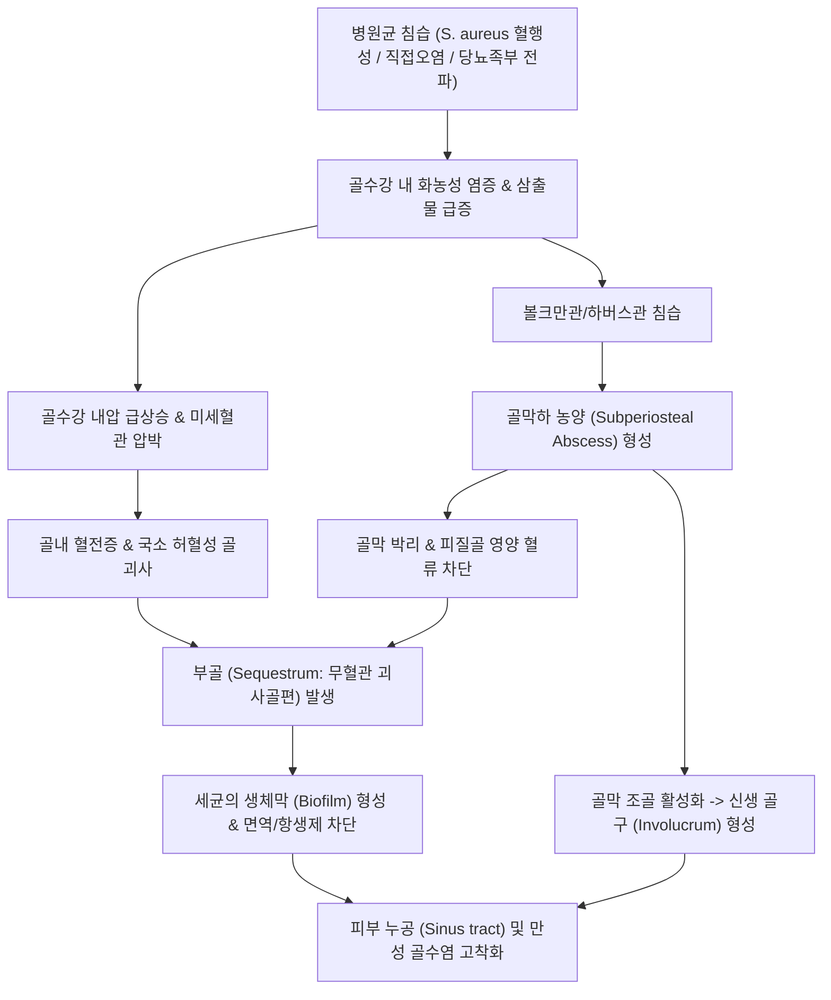

# 🩺 골수염 (Osteomyelitis)

> **핵심 3줄 요약 (Key Summary)**:
> - 📍 병소 부위 & 해부·병태생리: 골수(Bone marrow), 피질골(Cortical bone), 골막(Periosteum)을 침범하는 화농성 또는 비세균성 감염·염증 질환으로, 혈행성 파종, 인접 연부조직 감염의 직접 전파, 외상·수술 후 오염에 의해 발생하며 부골(Sequestrum) 및 골구(Involucrum)를 형성한다.
> - 🚩 전형적 임상 양상: 급성기에는 고열, 오한 등 전신 독성 증상과 함께 국소 뼈 부위의 극심한 박동성 안정통, 발적, 부종, 체중 부하 거부가 나타나며, 만성기에는 미열과 함께 치유되지 않는 동공(Sinus tract) 및 간헐적 농성 분비물 배출이 지속된다.
> - 🛠️ 핵심 검사 & 치료 전략: 적혈구침강속도([[ESR]]), C-반응단백([[CRP]]), 혈액 및 골생검 배양 검사와 [[MRI]](골수 부종 및 농양 조기 발견); 장기 고용량 정맥 표적 항생제 투여, 감염 부골 절제 및 생체활성유리(S53P4 bioactive glass) 충전 등 정형외과적 변연절제술, 한의학에서는 급성기 배제 후 회복기 청열해독·보신익기([[탁리소독음]]) 보조 접근.
> - ⚠️ 응급 의뢰 레드플래그: 고열과 함께 뼈 국소 극심한 압통 및 연부조직 발적·열감(급성 골수염), 척추 부위 타진통 동반 하지 마비·감각 이상·배뇨장애(화농성 척추염 및 경막외 농양), 패혈증 쇼크 징후(혈압 저하, 빈맥, 의식 저하).

---

## 📌 목차
1. [질환 개요 & 해부학적 병태생리](#1-질환-개요--해부학적-병태생리)
2. [병태생리 메커니즘 & 생체역학적 악순환 네트워크](#2-병태생리-메커니즘--생체역학적-악순환-네트워크)
3. [임상 증상 & 이학적 검사(Physical Exam) 알고리즘](#3-임상-증상--이학적-검사physical-exam-알고리즘)
4. [감별 진단 매트릭스 (Differential Diagnosis)](#4-감별-진단-매트릭스--differential-diagnosis)
5. [한의 통합 치료 프로토콜 (침·약침·추나·한약)](#5-한의-통합-치료-프로토콜--침약침추나한약)
6. [양방 치료 & 병용·의뢰 기준 (Conventional Treatment & Referral)](#6-양방-치료--병용의뢰-기준-conventional-treatment--referral)
7. [재활 운동 & 생활습관 티칭 가이드](#7-재활-운동--생활습관-티칭-가이드)
8. [💡 사용자 진료실 핵심 필기 & 임상 노하우 (Melt-In 잔여 심화 집약)](#8--사용자-진료실-핵심-필기--임상-노하우--melt-in-잔여-심화-집약)
9. [출처 및 학술 참고 문헌 (References)](#9-출처-및-학술-참고-문헌--references)

---

## 1. 질환 개요 & 해부학적 병태생리

* **정의 및 핵심 개념**:
  * 골수염(Osteomyelitis)은 골수강(Medullary cavity) 내부의 조혈 조직에서 시작하여 하버스관(Haversian canal)과 볼크만관(Volkmann's canal), 피질골 및 골막으로 파급되는 진행성 염증 및 파괴성 골 질환이다.
  * 감염 경로에 따라 **혈행성(Hematogenous)**, **외상·수술에 의한 직접 접종(Direct inoculation)**, **인접 연부조직 감염의 직접 전파(Contiguous focus - 당뇨병성 족부 궤양, 혈관 질환 등)**로 대별된다.
  * 또한 소아 및 청소년에서 자가염증성 기전으로 발생하는 만성 비세균성 골수염(CNO, Chronic Nonbacterial Osteomyelitis) 및 만성 재발성 다발골수염(CRMO)과 같은 비감염성 자가염증성 골수염 범주도 존재한다.

* **해부학적 구조와 호발 부위**:
  * **소아 혈행성 골수염**: 혈류가 풍부하고 모세혈관 루프의 주행이 급격히 꺾이며 내피세포 식세포 활성이 낮은 장골의 **골간단(Metaphysis)**(대퇴골 원위부, 경골 근위부, 상완골 근위부)에 호발한다.
  * **성인 골수염**: 성인에서는 척추체(Vertebral body)의 혈행성 골수염([[화농성 척추염]]) 및 당뇨발에 속발한 족부 지골·중족골 골수염, 개방성 골절이나 인공관절 수술 후 금속 내고정물 주변 감염이 주를 이룬다.

![[골수염_01_골수염병소_Xray.png|520]]
> [그림 1: 족부 단순 방사선 — 골파괴 병소를 화살표로 표시한 골수염 소견 — 출처: Wikimedia Commons File:OsteomylitisMark.png (CC BY-SA 4.0)]

![[골수염_01_만성골수염골파괴_Xray.png|520]]
> [그림 2: 진행된 골수염의 심한 골파괴·족지 소실을 보이는 족부 단순 방사선 — 출처: Wikimedia Commons File:OsteomylitisWorse.png (CC BY-SA 4.0)]

---

## 2. 병태생리 메커니즘 & 생체역학적 악순환 네트워크

* **급성 세균 침습 및 혈전성 괴사**:
  * 원인균(가장 흔하게는 황색포도상구균 *Staphylococcus aureus*, MRSA 포함)이 골수강 내에 착상하면 다형핵 백혈구와 대식세포가 침윤하여 급성 화농성 염증 반응을 일으킨다.
  * 골수강 내 화농성 삼출물이 급증하면서 수강 내압이 급격히 상승한다. 견고한 피질골로 둘러싸인 해부학적 특성상 내압 상승은 골내 미세혈관을 압박하여 혈전증(Thrombosis)과 허혈성 골괴사를 초래한다.

* **피질골 관통 및 골막하 농양 형성**:
  * 삼출물은 볼크만관과 하버스관을 타고 외측으로 진행하여 골막 하강(Subperiosteal space)으로 분출되어 **골막하 농양(Subperiosteal abscess)**을 형성한다.
  * 소아의 경우 골막이 유연하고 골피질에 느슨하게 부착되어 있어 골막이 광범위하게 박리되며 골피질로 유입되는 외측 혈류가 차단되어 광범위한 골괴사가 유발된다.

* **만성화 기전 (부골 및 골구 형성, 생체막 보호막)**:
  * **부골(Sequestrum)**: 혈류 공급이 영구 차단되어 괴사된 뼈 조각으로, 항생제나 면역 세포가 도달할 수 없어 세균의 영구적 은신처가 된다.
  * **골구(Involucrum)**: 박리된 골막 내면의 조골세포가 괴사골 주위에 새로운 미성숙 골조직을 형성하여 부골을 둘러싸는 외피를 형성한다.
  * **배농로(Cloaca) 및 동공(Sinus tract)**: 골구에 생긴 구멍(Cloaca)을 통해 고름이 연부조직을 뚫고 피부 표면으로 배출되는 만성 동공이 고착화된다.
  * **생체막(Biofilm) 형성**: 세균이 부골 표면이나 수술용 금속 임플란트 표면에 세포외 다당류 기질(EPS)로 구성된 생체막을 형성하여 숙주 면역계와 통상 농도의 전신 항생제에 대해 1,000배 이상의 저항성을 획득한다.

![[골수염_02_골수염및연부조직감염_축상MRI.jpg|520]]
> [그림 3: 하지 축상면 MRI — 골수 및 주위 연부조직 감염 소견 — 출처: Wikimedia Commons File:Mycobacterium doricum Osteomyelitis and Soft Tissue Infection.jpg (Public domain)]

![[골수염_02_만성골수염_MRI_다단면.png|520]]
> [그림 4: 만성 골수염의 MRI 소견(다단면 6컷) — 골수 신호 변화 — 출처: PMC7984882 PMID 33791083 (CC BY 4.0)]

---

## 3. 임상 증상 & 이학적 검사(Physical Exam) 알고리즘

* **전형적 임상 증상**:
  * **급성 골수염**:
    * 38.5℃ 이상의 고열, 오한, 식욕부진, 쇠약감 등 전신 독성 징후.
    * 이환된 뼈 부위의 극심하고 지속적인 박동성 통증(야간에 악화, 체중 부하 시 극심).
    * 소아 환자의 경우 보행 거부(Limping or refusal to walk), 사지 가성마비(Pseudoparalysis: 아파서 팔다리를 움직이지 않음).
    * 국소 연부조직의 발적, 부종, 국소 피부 열감 및 심부 압통.
  * **만성 골수염**:
    * 전신 증상은 미미하거나 미열에 그침.
    * 피부 표면으로 뚫고 나온 누공을 통한 간헐적 또는 지속적인 농성 분비물(Pus) 배출.
    * 재발성 국소 둔통, 피부 착색, 습진성 변화 및 골 비후.
  * **척추 골수염 (화농성 척추염)**:
    * 휴식이나 야간에도 호전되지 않는 지속적 요배부 둔통.
    * 척추 분절의 심한 강직, 침대에서 돌아눕기조차 힘든 척추 통증.

* **단계별 이학적 검사 및 진단 알고리즘**:
  1. **국소 압통 및 타진 검사**:
     * 뼈의 골간단 또는 척추 극돌기 부위를 손가락 끝이나 타진기로 직접 타진 시 날카로운 국소 격통(Point tenderness) 유발.
     * 인접 관절의 수동적 가동 범위(ROM) 검사: 관절염과 감별하기 위해 관절을 살짝 움직일 때 관절통보다 뼈 부위 자체의 통증이 현저한지 평가.
  2. **Probe-to-Bone (PTB) 검사 (당뇨족 환자)**:
     * 당뇨병성 궤양 바닥으로 멸균 금속 프로브(탐침)를 조심스럽게 삽입했을 때 딱딱하고 거친 뼈 표면이 직접 닿는 느낌이 들면 골수염 가능성 매우 높음 (민감도 87%, 특이도 83%).
  3. **염증성 혈액 검사**:
     * 백혈구수(WBC) 증가, [[ESR]] 및 [[CRP]] 현저한 상승 (치료 반응 모니터링의 핵심 지표).
     * 혈액 배양 검사(Blood culture, 최소 2쌍) 시행.
  4. **영상 의학적 진단**:
     * 단순 X선: 발병 초기 10~14일간은 정상 소견일 수 있음 (골량의 30~50% 이상 파괴되어야 골흡수 음영 관찰).
     * [[MRI]]: 발병 1~2일 이내에도 골수 부종(T1 저신호, T2 고신호), 골막하 농양, 연부조직 확산을 가장 정확하게 조기 발견하는 표준 검사법.

![[골수염_03_당뇨발궤양골노출_실사.jpg|520]]
> [그림 5: 당뇨발 궤양 실사 — 심부 궤양으로 골 노출이 의심되는 소견(Probe-to-Bone 대상) — 출처: Wikimedia Commons File:Diabetic Foot Ulcer.jpg (CC BY 4.0)]

![[골수염_03_골주사_양측족부섭취증가.png|520]]
> [그림 6: 골주사(bone scan) — 양측 족부에 국소 섭취 증가(화살표) — 출처: Wikimedia Commons File:BonescanOsteobothfeet.png (CC BY-SA 4.0)]

---

## 4. 감별 진단 매트릭스 (Differential Diagnosis)

| 감별 질환 | 호발 연령 및 부위 | 주요 증상 및 영상 소견 | 감별 핵심 포인트 |
| :--- | :--- | :--- | :--- |
| **급성 골수염** | 소아 장골 골간단, 성인 척추/당뇨발 | 고열, 골막하 농양, MRI상 골수 부종, 부골 형성 | 병변 중심이 **골조직 내부**이며 혈액배양 양성률 높음 |
| **화농성 관절염 (Septic Arthritis)** | 전 연령 관절강(무릎, 고관절, 어깨) | 관절의 극심한 종창, 수동적 미세 관절 운동에도 극통 | 병변이 **관절강 내**에 국한, 관절액 천자 시 탁한 고름 |
| **연조직염 (봉와직염, Cellulitis)** | 피하지방 및 진피층 | 피부의 광범위한 발적, 열감, 부종, 경계 불명확 | 표재성 연부조직 병변; 심부 뼈 타진통 없음, X선 정상 |
| **만성 비세균성 골수염 (CNO/CRMO)** | 소아·청소년, 다발성 장골/쇄골/척추 | 만성 재발성 골통증, 무균성 병변, 동반 자가염증 질환 | **세균 배양 음성**, 항생제 반응 없고 NSAIDs/생물학제제 반응 |
| **골육종 (Osteosarcoma) / 유잉육종** | 10~20대 소아·청소년 장골 골간단/골간 | 국소 종괴, 야간통, Codman 삼각, 햇살모양 골막반응 | 발열 드묾, 종괴 형성, 조직 생검상 악성 종양세포 확인 |
| **통풍성 관절염 (Gout)** | 중년 남성, 제1 중족족지관절, 족관절 | 급격한 야간 발작성 관절 발적·작열통, 요산 결절 | 고요산혈증, 편광현미경하 관절액 내 바늘모양 요산염 결정 |

---

## 5. 한의 통합 치료 프로토콜 (침·약침·추나·한약)

* **진료 원칙 및 안전 한계**:
  * **급성 화농성 골수염은 내과적·정형외과적 응급 질환**이므로 즉각 상급병원으로 전원하여 정맥 항생제 및 수술적 감압을 받도록 해야 하며, 급성기에 한의 단독 치료는 절대 금기이다.
  * 한의 치료의 주된 적응증은:
    1. 급성기 수술 및 전신 항생제 치료가 종결된 후 골조직 재생 및 연부조직 치유가 지연되는 만성 회복기.
    2. 당뇨병성 말초혈관 부전 환자에서 절제술 후 잔여 허혈성 골부전증 상태.
    3. 세균 감염이 배제된 만성 비세균성 골수염(CNO)의 통증 완화 및 관해 유지 보조.

* **침구 치료 프로토콜 (만성 회복기)**:
  * **혈위 선정**:
    * 병변 부위 직접 자침은 감염 확산 위험이 있으므로 **절대 금기** (원위 취혈 및 비병변측 교차 취혈 원칙).
    * 하지 병변: 족삼리(ST36), 음릉천(SP9), 태계(KI3), 현종(GB39), 혈해(SP10).
    * 상지 병변: 곡지(LI11), 합곡(LI4), 외관(TE5), 삼음교(SP6).
  * **기법**: 전신 면역 기능 활성화 및 미세혈류 순환 개선을 목적으로 평보평사(平補平瀉) 기법 적용.

* **약침 치료 프로토콜**:
  * **주의**: 활동성 감염 병소, 누공 주변 직접 주입 절대 금지.
  * **원위 면역 조절 약침**: 자하거(Hominis Placenta) 약침, 황련해독 약침을 대저(BL11), 비수(BL20), 신수(BL23) 등 배수혈에 주입하여 골기질 재생 및 만성 염증 신호 완화.

* **추나 치료 프로토콜 (⚠️ 금기 사항)**:
  * 골수염 이환 부위 뼈 및 관절에 대한 관절 교정 추나(HVLA), 강한 관절 가동화, 강한 압박 수기는 **병적 골절(Pathologic Fracture) 및 감염 파종을 유발하므로 절대 금기**이다.
  * 원위부의 경근 이완 및 림프 순환 보조 수기만을 선별적으로 적용.

* **변증별 한약 처방 (청열해독 & 탁리배농 & 익기생기)**:
  * **열독치성기(熱毒熾盛期 - 양방 치료 병용기)**:
    * 처방: 오미소독음(五味消毒飲), 황련해독탕 가미.
    * 적응: 전신 발열, 국소 작열통, 농양 형성 전후의 염증 억제 보조.
  * **음허열독·정허독련기(陰虛熱毒·正虛毒戀期 - 만성 누공기)**:
    * 처방: [[탁리소독음]](托裏消毒飲), 신통축어탕 가미.
    * 구성: 황기, 당귀, 백출, 복령, 천궁, 은화, 연교, 백지, 방풍, 길경, 조각자, 감초.
    * 기전: 황기·당귀를 통해 육아조직 형성과 상처 봉합(생기, 生肌)을 유도하고, 은화·연교·조각자로 잔여 염증과 고름 배출을 촉진.
  * **기혈양허·골수공허기(氣血兩虛·骨髓空虛期 - 후유증 회복기)**:
    * 처방: [[팔진탕]], [[십전대보탕]], 삼령백출산 가미 (녹용, 구척, 두충, 속단 추가).
    * 기전: 골수 조혈 기능 회복 및 파괴된 피질골의 재골화 촉진.

---

## 6. 양방 치료 & 병용·의뢰 기준 (Conventional Treatment & Referral)

* **항생제 요법 (Pharmacotherapy)**:
  * **초기 경험적 정맥 항생제**:
    * MRSA 가능성을 고려하여 반코마이신(Vancomycin) 또는 댑토마이신(Daptomycin)에 3/4세대 세팔로스포린(세프트리악손 또는 세페핌) 병용.
    * 균 배양 및 감수성 결과 확인 후 표적 항생제로 신속 변경 (MSSA인 경우 나프실린/세파졸린).
  * **투여 기간 및 경로**:
    * 통상 4~6주 이상의 장기 항생제 투여가 필수적이며, 초기 2주 이상 정맥 투여 후 경구 생체이용률이 우수한 약제(퀴놀론계, 리팜핀, 클린다마이신, 리네졸리드)로 전환 고려.
  * **최신 표적 약물 전달 시스템 (Biomaterials)**:
    * 최근 나노입자 및 국소 방출 하이드로겔, 칼슘 황산염(Calcium sulfate) 캐리어 등을 이용해 골수강 내에 직접 고농도 항생제를 방출하는 국소 약물 전달 기술이 도입됨 (PMID 42704411).

* **정형외과적 수술 치료 (Surgical Intervention)**:
  * **적응증**: 골막하 농양, 척추 경막외 농양, 항생제 치료에 반응하지 않는 급성 골수염, 부골 및 골구가 형성된 모든 만성 골수염.
  * **수술 기법**:
    * 철저한 감염 부골 절제술(Sequestrectomy) 및 광범위 변연절제술(Debridement).
    * **생체활성유리(S53P4 Bioactive Glass) 충전술**: 절제 후 사강(Dead space)에 S53P4 생체유리를 충전하여 자체적인 항균 환경(국소 삼투압 및 pH 상승)을 조성하고 새로운 골 형성을 유도하는 최신 표준 술식으로 메타분석상 우수한 완치율 입증 (PMID 40424253).
    * 연부조직 피판술(Flap coverage)을 통한 혈류 재공급.

* **소아 만성 비세균성 골수염(CNO/CRMO) 진료 가이드라인 (PMID 42155695)**:
  * 독일 소아류마티스학회(GKJR) 합의 권고안: CNO는 무균성 자가염증 질환이므로 항생제 치료가 불필요하며, 1차 치료로 NSAIDs(나프록센 등)를 사용하고, 척추 침범 또는 치료 불응성인 경우 비스포스포네이트(파미드로네이트) 또는 TNF 억제제(아달리무맙)를 투여하여 조기 골파괴를 방지함.

* **양방·전문과 의뢰 기준 (Referral Criteria)**:
  * **즉각 응급실 의뢰 (Red Flags)**:
    * 고열을 동반한 뼈 부위의 격렬한 자발통 및 급격한 종창.
    * 척추 동통과 함께 하지 마비, 보행 곤란, 대소변 실금([[마미증후군]]).
    * 패혈증 쇼크 징후(수축기 혈압 < 90 mmHg, 빈호흡, 의식 혼탁).
  * **정형외과/감염내과 전원**:
    * 당뇨발 환자에서 프로브가 뼈에 닿거나 X선상 골용해 소견이 의심되는 경우.
    * 피부 누공을 통해 지속적으로 고름이 배출되는 만성 골수염 의심 환자.

---

## 7. 재활 운동 & 생활습관 티칭 가이드

* **체중 부하 및 관절 가동성 관리**:
  * 급성기 및 수술 직후에는 병적 골절 방지를 위해 목발, 휠체어, 깁스 보조기를 사용하여 감염 분절의 완전 무부하(Non-weight bearing)를 유지.
  * 감염 징후(CRP 정상화)와 방사선학적 골유합이 확인된 이후 점진적 부분 체중 부하(Partial weight bearing) 시작.
  * 침상 안정 기간 동안 미감염 인접 관절의 등척성 운동(Isometric exercise)을 통해 불사용성 근위축 방지.

* **전신 면역 및 식이 관리**:
  * 만성 골수염은 심각한 이화 작용(Catabolism)을 초래하므로 양질의 단백질(체중당 1.5g 이상)과 아연, 비타민 C, 비타민 D 섭취 권장.
  * 당뇨병 환자의 경우 엄격한 혈당 조절(HbA1c < 7.0%)이 골수염 재발 방지의 절대적 선행 조건임을 교육.

* **위생 및 족부 관리 티칭**:
  * 상처 및 누공 부위의 무균적 소독 관리, 오염된 물과의 접촉 차단.
  * 당뇨발 환자의 매일 발 관찰(거울을 이용한 발바닥 점검, 굳은살 및 물집 조기 치료, 꽉 끼는 신발 착용 금지).

---

## 8. 💡 사용자 진료실 핵심 필기 & 임상 노하우 (Melt-In 잔여 심화 집약)

* **비오님 진료실 감별 3대 원칙**:
  1. "젊은 사람이나 소아가 갑자기 다리를 절며 뼈를 건드리지도 못하게 하고 열이 난다면 성장통이나 단순 염좌가 아니라 골수염을 먼저 의심하라."
  2. "노인이나 당뇨 환자가 허리가 끊어지게 아프다고 침 치료를 받으러 왔을 때, 침대에서 체위 변경이 불가능할 정도로 극심한 통증을 호소하고 미열이 있다면 단순 요통이 아닌 화농성 척추염(골수염) 가능성을 배제하기 전까지 절대 침 치료를 지속해서는 안 된다."
  3. "만성 골수염으로 수술 후 피부 궤양이 아물지 않고 진물이 계속 나는 환자는 국소적인 처치보다 혈액 순환 개선과 면역 회복을 위한 전신 한약 투여([[탁리소독음]])가 우수한 보조적 효과를 발휘한다."

* **골수염 의심 시 절대 피해야 할 임상 행위**:
  * 감염된 뼈나 농양 의심 부위에 침, 뜸, 부항(특히 습부항)을 시술하는 것은 세균을 심부로 파종시키거나 이차 감염을 유발하는 치명적인 의료사고로 이어진다.
  * 골파괴가 진행 중인 척추체에 강한 추나 교정 수기를 적용하는 것은 척추 붕괴 및 신경마비를 초래하므로 절대 금기이다.

---

## 9. 출처 및 학술 참고 문헌 (References)

* Kallinich, T., Hofmann, S. R., Reis, K., Girschick, H., Morbach, H., & Jansson, A. F. (2026). Diagnosis, treatment and monitoring of chronic nonbacterial osteomyelitis (CNO) and chronic recurrent multifocal osteomyelitis (CRMO) - Evidence, practice and consensus-based recommendations from the German pediatric rheumatology society (GKJR). *Autoimmun Rev*, 25(7):103810. PMID: 42155695

* Lindfors, N. C., Romanò, C. L., Drago, L., & Ferguson, J. Y. (2025). Safety and Efficacy of S53P4 Bioactive Glass in Osteomyelitis Management: A Systematic Review and Meta-Analysis. *J Biomed Mater Res B Appl Biomater*, 113(6):e35612. PMID: 40424253

* Sharma, A., Kumar, R., & Patel, V. (2026). Current and emerging biomaterials for targeted drug delivery in osteomyelitis management. *Discov Nano*, 21(1):142. PMID: 42704411

---

## 관련 노트

- 상위 분류: [[_의학/03_이론/질환/근골격계 질환/기타/00_기타_MOC|근골격계 질환 기타 MOC]]
- 관련 질환: [[화농성 척추염]], [[화농성 관절염]], [[당뇨병성 족부 궤양]], [[골괴사]], [[골절]]
- 진단 및 검사: [[MRI]], [[ESR]], [[CRP]], [[Probe-to-Bone 검사]]
- 치료 및 약물: [[항생제]], [[탁리소독음]], [[황련해독탕]], [[팔진탕]], [[십전대보탕]]
