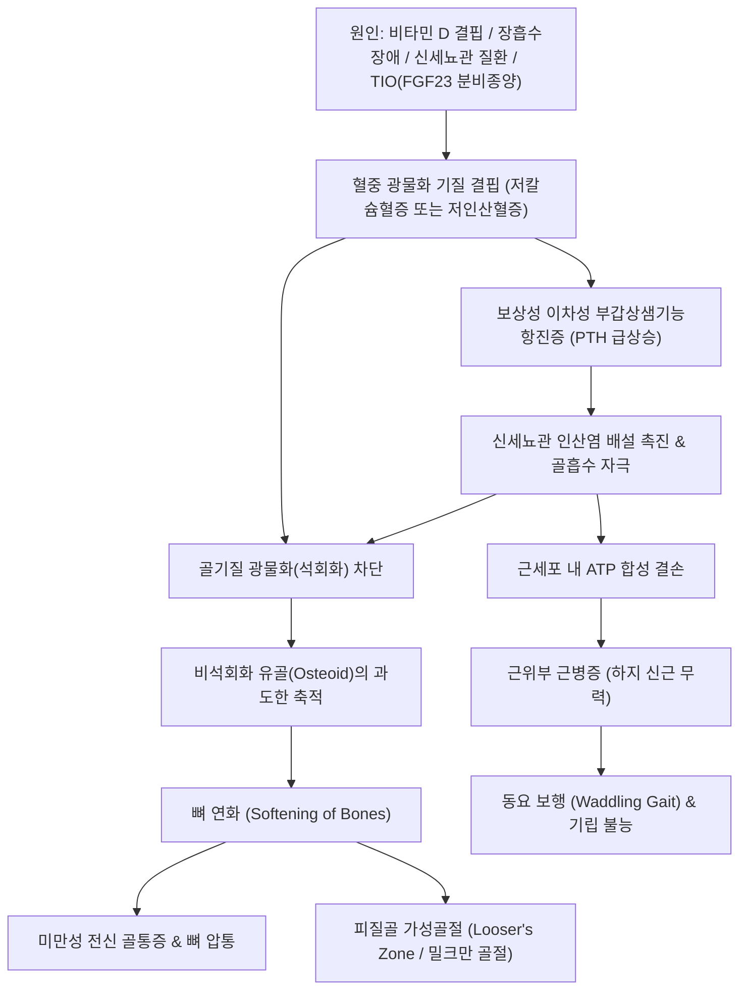

# 🩺 골연화증 (Osteomalacia)

> **핵심 3줄 요약 (Key Summary)**:
> - 📍 병소 부위 & 해부·병태생리: 성인에서 골단판(Growth plate) 폐쇄 후 새로 형성된 유골 조직(Osteoid)에 칼슘 및 인산이 침착되지 못하는 골기질 석회화(광물화, Mineralization) 부전 질환으로, [[비타민 D]] 결핍, 장 흡수장애, 세뇨관성 인산염 소실 또는 FGF23 과다 분비 종양(TIO)이 주원인이다.
> - 🚩 전형적 임상 양상: 서서히 진행하는 척추·골반·하지 장골의 광범위한 미만성 뼈 통증(압통), 근위부 근력 약화(Proximal myopathy)로 인한 오리걸음([[동요 보행]]), 단순 방사선상 가성골절([[루저 대]], Looser zone) 관찰.
> - 🛠️ 핵심 검사 & 치료 전략: 혈청 칼슘·인산(저인산혈증), 알칼리인산분해효소([[ALP]] 현저한 상승), 25(OH)D 및 부갑상선호르몬([[PTH]]) 검사; 원인별 고용량 비타민 D3/활성형 비타민 D 투여, 경구 인산염 보충 및 FGF23 표적 단클론항체(Burosumab); 한의학적으로 보신장골·건비익기([[보중익기탕]], [[팔미지황탕]]) 병용.
> - ⚠️ 응급 의뢰 레드플래그: 경미한 체중 부하 중 대퇴골 경부 완전 골절, 심한 저칼슘혈증에 의한 강직(Tetany) 및 후두경련, 종양성 골연화증(TIO) 의심 시 전신 기능 영상 의뢰.

---

## 📌 목차
1. [질환 개요 & 해부학적 병태생리](#1-질환-개요--해부학적-병태생리)
2. [병태생리 메커니즘 & 생체역학적 악순환 네트워크](#2-병태생리-메커니즘--생체역학적-악순환-네트워크)
3. [임상 증상 & 이학적 검사(Physical Exam) 알고리즘](#3-임상-증상--이학적-검사physical-exam-알고리즘)
4. [감별 진단 매트릭스 (Differential Diagnosis)](#4-감별-진단-매트릭스--differential-diagnosis)
5. [한의 통합 치료 프로토콜 (침·약침·추나·한약)](#5-한의-통합-치료-프로토콜--침약침추나한약)
6. [양방 치료 & 병용·의뢰 기준 (Conventional Treatment & Referral)](#6-양방-치료--병용의뢰-기준-conventional-treatment--referral)
7. [재활 운동 & 생활습관 티칭 가이드](#7-재활-운동--생활습관-티칭-가이드)
8. [💡 사용자 진료실 핵심 필기 & 임상 노하우 (Melt-In 잔여 심화 집약)](#8--사용자-진료실-핵심-필기--임상-노하우--melt-in-잔여-심화-집약)
9. [출처 및 학술 참고 문헌 (References)](#9-출처-및-학술-참고-문헌--references)

---

![[골연화증_01_병태_비타민D대사.jpg|450]]
> [그림 §: ① 병태 — 비타민 D 대사 경로] 비타민 D3가 간·신장을 거쳐 칼시트리올(활성형)로 전환되는 경로를 도식화한 그림. 이 경로가 막히면 칼슘·인 흡수가 줄어 골연화증이 생긴다. 출처: File:Vitamin D metabolism.svg (Wikimedia Commons) (CC BY-SA 3.0)

## 1. 질환 개요 & 해부학적 병태생리

* **정의 및 핵심 개념**:
  * 골연화증(Osteomalacia)은 성인의 골격계에서 기질 단백질(콜라겐 등으로 이루어진 유골, Osteoid)의 형성은 정상적으로 일어나지만, 이에 무기질(칼슘-인 복합체, 하이드록시아파타이트)이 적절히 침착되지 못하여 광물화되지 않은 미성숙 유골 조직이 비정상적으로 누적되는 전신 대사성 골 질환이다.
  * 소아기 골단판 성장판이 닫히기 전에 발생하는 동일 기전의 질환은 **구루병(Rickets)**이라 부르며 골단 변형과 성장 장애가 두드러지지만, 골연화증은 성인의 폐쇄된 골격에서 발생하므로 뼈의 변형보다는 광범위한 골격 통증과 골 취약성, 가성골절이 주된 특징이다.
  * 골밀도 저하가 나타나 단순 골다공증으로 오인되기 쉬우나, 골다공증은 골기질과 무기질이 동일 비율로 감소하는 반면, 골연화증은 유골 기질 대비 **무기질의 비율이 결핍**된 질환이라는 점에서 본질적으로 상이하다.

* **해부학적 구조와 역학적 취약 부위**:
  * 인체의 체중 부하를 담당하는 골반골(치골지, 좌골), 대퇴골 근위부(경부 및 전자간선), 척추체, 늑골 및 견갑골 액와연에 호발한다.
  * 비광물화된 유골은 기계적 전단 응력과 굴곡 압축력에 극히 취약하므로 피질골의 역학적 응력 집중선상에 불완전 미세 골절선이 형성된다.

---

## 2. 병태생리 메커니즘 & 생체역학적 악순환 네트워크

* **광물화 전구물질 결손 (칼슘 및 인산염 고갈)**:
  * 정상 골화 과정은 조골세포가 분비한 제1형 콜라겐 기질 내에 칼슘(Ca²⁺)과 무기인산(Pi)의 곱([Ca] × [Pi])이 특정 역치 이상 유지되어야 하이드록시아파타이트 결정이 침착된다.
  * **비타민 D 결핍 축**: 일광 노출 부족, 영양실조, 위장관 흡수장애(소화흡수 불량, 셀리악병, 위절제술)로 인해 [[비타민 D]] 결핍이 발생하면 소장에서의 칼슘 흡수가 급감한다. 이에 따라 이차성 부갑상샘기능항진증([[부갑상선호르몬]] 증가)이 유발되어 신장에서의 인산 배설이 촉진되고 골흡수가 촉진된다.
  * 최근 대규모 코호트 연구에서는 단순 혈청 25(OH)D 저하 단독보다 부갑상선호르몬 상승 및 ALP 상승이 복합된 전형적 생화학적 패턴이 진단적 일치도를 결정함을 규명하였다 (Perez-Lasala et al., 2026).

* **인산염 소실 및 종양성 골연화증 (TIO / FGF23 축)**:
  * 인산은 골기질 결정화의 핵심 음이온이다. 유전성 저인산혈증 또는 후천적 인산뇨성 중간엽 종양(Phosphaturic Mesenchymal Tumor, PMT)에서 섬유아세포성장인자-23([[FGF23]])이 과잉 분비되는 **종양성 골연화증(Tumor-Induced Osteomalacia, TIO)**이 발생한다 (Minisola et al., 2026).
  * 과잉 FGF23은 근위신세뇨관의 나트륨-인산 공수송체(NaPi-IIa/IIc)를 억제하여 소변으로 인산을 대량 배출시키고, 신장의 1α-수산화효소를 억제하여 활성형 비타민 D(1,25(OH)₂D) 합성을 차단함으로써 극심한 저인산혈성 골연화증을 유발한다 (Ito et al., 2026).

* **근위부 근병증의 생화학적 기전**:
  * 세포내 인산염 결핍은 골격근 세포의 미토콘드리아 ATP 생성을 억제하여 중증의 근위부 근력 약화(대퇴사두근, 장요근, 둔근 무력)를 유발하며, 이는 환자가 웅크린 채 오리처럼 뒤뚱거리는 [[동요 보행]]의 원인이 된다.

---

## 3. 임상 증상 & 이학적 검사(Physical Exam) 알고리즘

* **전형적 임상 증상**:
  * **전신 골통증 (Diffuse Bone Pain)**:
    * 초기에는 요통이나 골반통으로 시작하여 하지 장골, 흉곽 늑골, 견갑골로 확산되는 쑤시는 듯한 깊은 뼈 통증.
    * 뼈를 손으로 직접 누르거나 두드릴 때 광범위한 골피질 압통(Bone tenderness)이 현저하다.
  * **근위부 근력 약화 및 보행 장애**:
    * 계단을 오르거나 낮은 의자에서 일어설 때 손을 짚지 않고는 일어서지 못하는 근위근 약화.
    * 골반을 좌우로 심하게 흔들며 걷는 전형적인 **오리걸음([[동요 보행]], Waddling Gait)**.
  * **골격 변형 및 가성골절 증상**:
    * 경미한 체중 부하에도 뼈가 휘거나 찌릿한 격통이 유발되며, 서혜부나 대퇴 내측의 국소 통증(대퇴골 가성골절).

* **단계별 이학적 검사 및 진단 알고리즘**:
  1. **골격계 진찰**:
     * 흉골, 늑골, 경골 조면, 장골능에 대한 골막 압통(Tenderness to palpation) 유발 검사.
     * 의자 기립 검사(Chair-rise test): 근위부 하지 신근([[대퇴사두근]], [[대둔근]])의 근력 저하 평가.
  2. **혈액 생화학 검사 (감별의 핵심)**:
     * 혈청 칼슘(Ca²⁺): 정상 또는 저하.
     * 혈청 인산(Phosphate): **현저한 저하(Hypophosphatemia)**.
     * **알칼리인산분해효소([[ALP]])**: 미광물화 유골을 보상하기 위해 조골세포가 과활성화되어 **현저히 상승** (골다공증과 감별하는 결정적 단서).
     * 25-hydroxyvitamin D [25(OH)D]: 비타민 D 결핍형에서 현저한 저하 (< 10~20 ng/mL).
     * 부갑상선호르몬([[PTH]]): 비타민 D 결핍형에서 이차성 상승.
  3. **방사선학적 검사 (X-ray)**:
     * **가성골절([[루저 대]], Looser's zones / Milkman's lines)**: 피질골에 직각 방향으로 관찰되는 띠 모양의 방사선 투과성 선으로, 대퇴골 경부 내측, 치골지, 늑골, 견갑골 외측연에서 대칭적으로 관찰됨.
     * 골밀도 검사([[DXA]]): 전신 T-score 저하를 보이나 생화학적 수치와 방사선 소견으로 감별.

---

## 4. 감별 진단 매트릭스 (Differential Diagnosis)

| 감별 질환 | 호발 연령 및 병태생리 | 혈청 생화학 검사 (Ca / P / ALP / PTH) | 단순 X선 및 영상 소견 |
| :--- | :--- | :--- | :--- |
| **골연화증 (Osteomalacia)** | 성인, 비타민 D 결핍 또는 FGF23 과다 | **Ca 정상/저하, P 저하, ALP 현저 상승, PTH 상승** | **가성골절([[루저 대]]), 골피질 희박화, 전신 방사선 투과성 증가** |
| **골다공증 (Osteoporosis)** | 폐경 후 여성 및 노인, 골교체 불균형 | **Ca 정상, P 정상, ALP 정상, PTH 정상** | 골소주 감소, 척추 압박골절, 가성골절 없음 |
| **파제트 골병 (Paget's Disease)** | 노인, 국소적 골흡수/형성 이상 | Ca 정상, P 정상, **ALP 극단적 상승**, PTH 정상 | 국소 골피질 비후, 면화양 골용해(Cotton-wool sign), 골 변형 |
| **원발성 부갑상샘항진증** | 중년 여성, 부갑상선 선종 | **Ca 상승, P 저하, ALP 상승, PTH 현저 상승** | 쇄골 원위부 골막하 흡수, 갈색종(Brown tumor), 골감소 |
| **다발성 골수종 (Multiple Myeloma)**| 60세 이상, 형질세포 신생물 | Ca 상승(고칼슘혈증), P 정상, ALP 정상/경미, M-단백 | 천공성 골용해 병변(Punched-out lesion), 골스캔 음성 |
| **섬유근통 (Fibromyalgia)** | 30~50대 여성, 중추신경 감작 | **모든 골대사 지표 정상 (Ca/P/ALP/PTH 정상)** | 방사선 검사 완전 정상, 뼈 자체의 압통이 아닌 연부조직 압통 |

---

## 5. 한의 통합 치료 프로토콜 (침·약침·추나·한약)

* **진료 원칙**:
  * 골연화증은 비타민 D, 활성형 칼시트리올, 인산염 등 결핍된 분자 기질을 양방적으로 보충하는 원인 치료가 최우선이다.
  * 한의 치료는 비위(脾胃)의 소화 흡수 기능을 정상화하여 영양 물질의 흡수율을 제고하고, 신정(腎精)을 보하여 골기질 재생을 돕고, 동반된 근병증 및 관절 가동 장애를 회복시키는 다학제적 보조 치료로 병행된다.

* **침구 치료 프로토콜**:
  * **혈위 선정**:
    * 신수(BL23), 비수(BL20), 대저(BL11 - 골회), 양릉천(GB34 - 근회), 현종(GB39 - 수회).
    * 근위부 근병증 완화: 족삼리(ST36), 비관(ST31), 복토(ST32), 양구(ST34), 환도(GB30).
  * **자침 기법**:
    * 비신양허(脾腎陽虛)가 뚜렷하므로 약자극 보법(補法) 중심.
    * 대퇴사두근 및 둔근에 저주파(2Hz) 전침을 적용하여 미토콘드리아 대사 활성화 및 근섬유 위축을 방지.

* **약침 치료 프로토콜**:
  * **선택 제제**: 자하거(Hominis Placenta) 약침, 녹용 약침.
  * **시술 부위**: 신수(BL23), 비수(BL20), 양릉천(GB34), 고관절 주변 아시혈.
  * **임상 작용**: 골조직 주변의 미세 혈류 순환을 촉진하고 조골세포 증식 및 콜라겐 합성을 보조.

* **추나 치료 프로토콜 (⚠️ 엄격한 안전 수칙)**:
  * **절대 금기**: 골연화증 환자는 피질골이 심하게 약화되어 있고 미세 가성골절이 동반되어 있으므로 **척추나 사지 관절에 대한 고속저진폭(HVLA) 스러스트 추력 교정 및 강한 압박 수기는 골절을 유발하므로 절대 금기**이다.
  * **적용 기법**:
    * 관절을 과도하게 비틀지 않는 경근 이완 기법(Myofascial Release).
    * 단축된 하지 근육([[장요근]], [[대퇴근막장근]])에 대한 부드러운 등장성 근에너지 기법(MET).

* **변증별 한약 처방 (건비보신 & 장골익수)**:
  * **비신양허형(脾腎陽虛型 - 흡수장애 및 만성 쇠약 동반)**:
    * 처방: [[팔미지황탕]], [[보중익기탕]] 합 육미지황탕 가미.
    * 적응: 전신 피로감, 소화 불량, 연변, 하지 시림, 허리와 무릎의 만성 골통.
  * **간신부족·기혈양허형(肝腎不足·氣血兩虛型 - 중증 근위축 및 골통)**:
    * 처방: [[독활기생탕]], [[십전대보탕]] 가 구척, 두충, 속단, 보골지.
    * 약재 구성: [[두충]], [[속단]], [[보골지]], [[구척]], [[우슬]] (골모세포 분화 촉진) + [[황기]], [[백출]], [[인삼]] (장관 흡수 기능 제고).

---

## 6. 양방 치료 & 병용·의뢰 기준 (Conventional Treatment & Referral)

* **원인별 약물 치료 (Conventional Pharmacotherapy)**:
  * **영양성 비타민 D 결핍증**:
    * 콜레칼시페롤(Vitamin D3) 고용량 경구 투여 (주 50,000 IU씩 8주간 투여 후 일일 1,000~2,000 IU 유지 요법).
    * 칼슘 원소 보충: 일일 1,000~1,500 mg 병용 투여.
  * **흡수장애 및 신질환성 골연화증**:
    * 활성형 비타민 D인 칼시트리올(Calcitriol, 0.25~0.5 mcg/일) 또는 알파칼시돌(Alfacalcidol) 투여 (장관 흡수 우회 및 1α-수산화 결손 극복).
  * **종양성 골연화증 (TIO) 및 저인산혈증 표적 치료**:
    * 원인 종양 절제가 불가능하거나 절제 대기 중인 경우, FGF23 표적 인간화 단클론항체인 **뷰로수맙(Burosumab)** 투여 (신장의 인산 재흡수를 회복시키고 활성형 비타민 D 생산을 유도하여 극적인 관해 달성, PMID 42802058).
    * 경구 활성형 비타민 D + 경구 인산염(Phosphate Sandoz 등) 분할 복용.

* **수술 및 시술 적응증**:
  * TIO 유발 종양(대퇴골, 두경부, 족부 등에 숨어 있는 수 밀리미터 크기의 중간엽 종양)의 광범위 외과적 절제(완치 가능).
  * 가성골절 부위가 완전 골절로 진행하거나 전위가 발생한 경우 정형외과적 골수내정 고정술(Intramedullary nailing).

* **양방·전문과 의뢰 기준 (Referral Criteria)**:
  * **즉각 정형외과/응급실 의뢰**:
    * 가벼운 실족 후 대퇴골 경부 완전 골절, 극심한 서혜부 통증 및 다리 단축.
  * **내분비내과 정밀 전원**:
    * 혈액 검사상 원인 불명의 저인산혈증 및 ALP 상승이 발견된 경우 (TIO 배제를 위한 68Ga-DOTATATE PET/CT 등 정밀 기능 영상 필요).
    * 심한 저칼슘혈증에 의한 손발 저림, 근육 경련, 테타니 징후.

---

## 7. 재활 운동 & 생활습관 티칭 가이드

* **체중 부하 운동의 안전 가이드라인**:
  * 골연화증 초기에는 뼈가 연화되어 체중 부하 시 가성골절이 악화될 수 있으므로 고강도 달리기나 점프 운동은 금지.
  * 회복기에는 실내 자전거, 평지 걷기, 아쿠아로빅 등 관절 부하를 최소화하면서 하지 근력을 유지하는 저충격 운동 처방.
  * 근위부 근병증 회복을 위한 의자 앉았다 일어서기, 벽 짚고 스쿼트(Half-squat) 점진적 시행.

* **일광 노출 및 영양 식단 티칭**:
  * 일광욕: 오전 10시~오후 3시 사이에 팔다리를 노출하고 주 3회, 회당 20~30분간 햇볕 쬐기(자외선 B를 통한 피부 내 비타민 D 합성).
  * 식이 요법: 등푸른 생선(연어, 고등어), 달걀노른자, 비타민 D 강화 유제품, 멸치, 두부, 콩류의 충분한 섭취.
  * 위절제술이나 담낭 절제술 환자의 경우 지방 흡수 장애를 고려하여 식사 분할 및 소화 보조제 병용.

---

## 8. 💡 사용자 진료실 핵심 필기 & 임상 노하우 (Melt-In 잔여 심화 집약)

* **비오님 진료실 감별 포인트 (골다공증과의 결정적 차이)**:
  1. "단순 골다공증 환자는 뼈를 손으로 누른다고 해서 아파하지 않는다(골절이 생기기 전까지는 100% 무증상). 반면 골연화증 환자는 정강이뼈(경골)나 갈비뼈, 골반뼈를 손가락으로 꾹 누르면 환자가 비명을 지를 정도로 뼈 자체의 압통(Bone tenderness)을 호소한다."
  2. "피 검사에서 칼슘이나 골밀도는 둘째치고, **ALP(알칼리인산분해효소)가 정상 상한치의 2~3배 이상 치솟아 있다면** 골다공증이 아니라 골연화증, 간질환, 또는 골파제트병을 즉시 의심해야 한다."
  3. "환자가 허리나 무릎이 아프다고 하면서 걸어 들어올 때 양옆으로 뒤뚱뒤뚱 오리처럼 걷는다면(Waddling gait), 신경 차단술을 할 게 아니라 근위부 근병증을 동반한 골연화증을 배제해야 한다."

* **골절 위험 방지 안전 수칙**:
  * 골연화증이 의심되는 환자에게 "뼈를 맞춘다"며 흉추나 요추에 강한 쓰러스트(추나)를 치는 것은 유골 조직이 무너져 내리는 척추체 압박골절을 초래하는 최악의 실수이다.

---

## 9. 출처 및 학술 참고 문헌 (References)

* Perez-Lasala, G., Alonso, N., & Guañabens, N. (2026). Low Prevalence of Exploratory Biochemical Patterns Compatible with Osteomalacia in a Large Cohort of Participants with Low Serum 25-Hydroxyvitamin D Levels. *Calcif Tissue Int*, 118(4):345-356. PMID: 42776204

* Liu, S., Xing, J., Song, A., Liu, Y., & Xia, W. (2026). Recent research progress on the etiology and pathogenesis of tumor-induced osteomalacia: A review. *J Bone Oncol*, 47:100615. PMID: 42375710

* Ito, N., Makita, N., & Fukumoto, S. (2026). Burosumab-responsive micro tumor-induced osteomalacia caused by a 6-mm phosphaturic mesenchymal tumor of the femoral head: a case report with review of literature on small (≤10 mm) FGF23-producing tumors. *Endocr J*, 73(9):911-918. PMID: 42802058

---

## 관련 노트

- 상위 분류: [[_의학/03_이론/질환/근골격계 질환/기타/00_기타_MOC|근골격계 질환 기타 MOC]]
- 관련 질환: [[골다공증]], [[골감소성 근감소증]], [[구루병]], [[파제트 골병]], [[원발성 부갑상샘항진증]]
- 핵심 지표 및 물질: [[비타민 D]], [[칼슘]], [[ALP]], [[PTH]], [[FGF23]], [[동요 보행]], [[루저 대]], [[DXA]]
- 한의 처방: [[팔미지황탕]], [[보중익기탕]], [[독활기생탕]], [[십전대보탕]], [[두충]], [[속단]]
