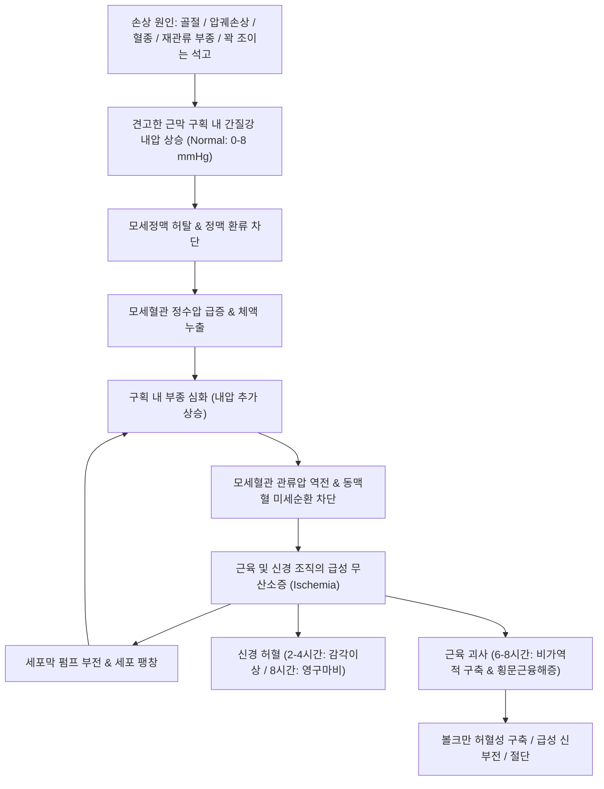

# 🩺 구획증후군 (Compartment Syndrome)

> **핵심 3줄 요약 (Key Summary)**:
> - 📍 병소 부위 & 해부·병태생리: 신장성이 없는 견고한 근막(Fascia)과 골격으로 둘러싸인 폐쇄된 해부학적 구획(Compartment) 내 압력이 병적으로 상승하여 모세혈관 관류압 이하로 떨어지며, 근육과 말초신경의 허혈성 괴사(Volkmann 허혈성 구축)를 초래하는 정형외과적 절대 응급 질환.
> - 🚩 전형적 임상 양상: 초기에는 부상 정도에 비해 극심하고 마약성 진통제에도 반응하지 않는 불균형적 동통(Pain out of proportion), 이환된 근육을 수동 신전(Passive stretch)시킬 때 유발되는 극심한 격통, 환부의 팽팽한 목판양 종창(Woody tense swelling); 후기에는 5P 징후(Pain, Pallor, Paresthesia, Paralysis, Pulselessness).
> - 🛠️ 핵심 검사 & 치료 전략: 구획 내압 측정(이완기 혈압과의 차이인 델타 압력 ΔP ≤ 30 mmHg 시 확진); 진단 즉시 모든 압박 붕대·석고 붕대 제거 및 6시간 이내 응급 전층 근막절개술(Fasciotomy) 시행; 급성기 한의 단독 치료는 절대 금기이며 수술 후 재활기 기혈순환·유착방지([[당귀수산]], 침구) 적용.
> - ⚠️ 응급 의뢰 레드플래그: 골절/좌상 후 진통제로 조절되지 않는 극심한 통증, 수동 신전통 양성, 원위부 감각 저하 및 이상감각, 구획 내 목판양 팽윤(발생 6~8시간 경과 시 비가역적 근괴사 및 횡문근융해증·급성신부전 초래하므로 즉각 119/응급실 전원).

---

## 📌 목차
1. [질환 개요 & 해부학적 병태생리](#1-질환-개요--해부학적-병태생리)
2. [병태생리 메커니즘 & 생체역학적 악순환 네트워크](#2-병태생리-메커니즘--생체역학적-악순환-네트워크)
3. [임상 증상 & 이학적 검사(Physical Exam) 알고리즘](#3-임상-증상--이학적-검사physical-exam-알고리즘)
4. [감별 진단 매트릭스 (Differential Diagnosis)](#4-감별-진단-매트릭스--differential-diagnosis)
5. [한의 통합 치료 프로토콜 (침·약침·추나·한약)](#5-한의-통합-치료-프로토콜--침약침추나한약)
6. [양방 치료 & 병용·의뢰 기준 (Conventional Treatment & Referral)](#6-양방-치료--병용의뢰-기준-conventional-treatment--referral)
7. [재활 운동 & 생활습관 티칭 가이드](#7-재활-운동--생활습관-티칭-가이드)
8. [💡 사용자 진료실 핵심 필기 & 임상 노하우 (Melt-In 잔여 심화 집약)](#8--사용자-진료실-핵심-필기--임상-노하우--melt-in-잔여-심화-집약)
9. [출처 및 학술 참고 문헌 (References)](#9-출처-및-학술-참고-문헌--references)

---

## 1. 질환 개요 & 해부학적 병태생리

* **정의 및 핵심 개념**:
  * 구획증후군(Compartment Syndrome)은 사지의 밀폐된 근막 구획 내 압력이 상승하여 미세순환계를 붕괴시키고 조직 관류(Tissue perfusion)를 저하시켜 구획 내 근육과 신경 조직의 괴사를 유발하는 질환이다.
  * 급격한 외상이나 허혈-재관류 손상 후 수 시간 내에 발생하는 **급성 구획증후군(ACS, Acute Compartment Syndrome)**과, 운동선수 등에서 반복적인 고강도 운동 중 가역적으로 발생하는 **만성 노작성 구획증후군(CECS, Chronic Exertional Compartment Syndrome)**으로 대별된다.
  * 급성 구획증후군은 치료의 골든타임(발병 6시간 이내)을 놓칠 경우 비가역적인 사지 마비, 관절 구축(볼크만 허혈성 구축, Volkmann's Ischemic Contracture), 절단 또는 횡문근융해증에 의한 급성 신부전 및 사망으로 이어지는 **정형외과적 최고 응급 질환**이다.

* **호발 해부학적 구획과 취약 구조물**:
  * **하퇴(종아리, Leg - 전체 ACS의 약 40%)**:
    1. 전방 구획(Anterior compartment): 경골 전방, 심비골신경([[심비골신경]]), 전경골근. 발목 배굴 약화(족하수) 및 제1~2 족지 간 감각 저하 유발.
    2. 측방 구획(Lateral compartment): 천비골신경([[천비골신경]]), 장·단비골근.
    3. 천부 후방 구획(Superficial posterior): 비복근, 가자미근.
    4. 심부 후방 구획(Deep posterior): 경골신경([[경골신경]]), 후경골동맥, 후경골근. 족지 굴곡근 마비 및 발바닥 감각 소실.
  * **전완(팔뚝, Forearm - 전체 ACS의 약 20%)**:
    * 장측 구획(Volar compartment): 요골·척골·골간막으로 구획됨. 정중신경([[정중신경]]), 척골신경([[척골신경]]), 수근 굴곡근군 주행 (J Hand Surg Am 2026, PMID 40853300).
  * **기타 부위**: 대퇴(Thigh), 수부(Hand - 골간근 구획), 족부(Foot - 9개 구획), 둔부(Gluteal).

![[구획증후군_01_하퇴전방근막구획_도해.png|520]]
> [그림 1: 하퇴 전방 근막구획(anterior compartment) — 경골 전방·전경골근·심비골신경이 지나는 구획을 3D로 강조한 도해 — 출처: Wikimedia Commons File:Fascial compartments of leg (anterior compartment) - anterior view.png (CC BY-SA 2.1 JP, Anatomography)]

![[구획증후군_01_하퇴심부후방근막구획_도해.png|520]]
> [그림 2: 하퇴 심부 후방 근막구획(deep posterior compartment) — 후경골근·경골신경·후경골동맥이 지나는 구획 도해 — 출처: Wikimedia Commons File:Fascial compartments of leg (deep posterior compartment) - posterior view.png (CC BY-SA 2.1 JP, Anatomography)]

---

## 2. 병태생리 메커니즘 & 생체역학적 악순환 네트워크

* **폐쇄 구획 내압 상승의 시발점**:
  * **내부 용적 증가**: 장골 골절(특히 경골 간부 골절, 요골/척골 골절), 연부조직 압궤 손상(Crush injury), 동맥 손상에 따른 혈종 형성, 혈관 재건술 후 허혈-재관류 부종, 뱀독 교상, 과도한 수액/혈액 혈관외 유출.
  * **외부 용적 제한**: 너무 꽉 조이는 석고 붕대(Cast), 부목, 압박 붕대, 심한 화상에 의한 가피(Eschar).

* **미세혈관 붕괴 및 허혈성 악순환 (Capillary-Perfusion Vicious Cycle)**:
  * 정상 구획 내압은 0~8 mmHg이다.
  * 구획 내압이 20~30 mmHg 이상으로 상승하면 저압계인 **모세정맥(Post-capillary venule)이 먼저 압박되어 폐쇄**된다.
  * 정맥 유출 차단으로 모세혈관 정수압이 급상승하며 체액이 간질강(Interstitium)으로 대량 누출되어 부종이 가속된다.
  * 간질강 압력이 소동맥 및 모세혈관 관류압(Capillary perfusion pressure)을 초과하면 국소 미세혈관 혈류가 완전 차단된다.
  * 세포성 허혈(Ischemia) → ATP 고갈 → 세포막 Na⁺/K⁺ 펌프 고장 → 세포내 부종(Cellular swelling) → 간질강 내압 추가 상승의 치명적 악순환이 완성된다.

* **신경 및 근육의 비가역적 괴사 한계 시간**:
  * **말초신경**: 허혈 2~4시간 내에 기능 이상(이상감각, 신경전도 차단), 4시간 이상 경과 시 가역성 감소, 8시간 이상 지속 시 비가역적 영구 축삭 손상.
  * **골격근**: 허혈 3~4시간부터 조직 손상 시작, **6~8시간 이상 경과 시 완전 괴사(Infarction) 및 섬유화(구축)** 진행.

![[구획증후군_02_급성종창및수포_실사.jpg|520]]
> [그림 3: 급성 구획증후군 환자의 팽팽하게 부은 전완·수부와 수포(blister) 형성 실사 — 출처: Wikimedia Commons File:Acute Compartment Syndrome with blister formation.JPG (CC BY-SA 4.0)]

---

## 3. 임상 증상 & 이학적 검사(Physical Exam) 알고리즘

* **초기 징후 (Golden Time 진단의 열쇠)**:
  1. **불균형적 통증(Pain out of proportion)**: 외상의 외관이나 단순 방사선 골절 정도에 비해 환자가 견딜 수 없을 만큼 극심한 통증을 호소하며, 모르핀 등 마약성 진통제를 투여해도 전혀 완화되지 않음.
  2. **수동 신전통(Pain on passive stretch - 가장 중요)**: 이환된 구획 내의 근육을 의사가 수동적으로 늘려줄 때(예: 하퇴 전방 구획 손상 시 족지를 수동 족저 굴곡) 찢어지는 듯한 극심한 격통 발생.
  3. **팽팽하고 단단한 종창(Tense, woody compartment)**: 환부 근육을 만졌을 때 물렁하지 않고 나무판자나 돌처럼 단단하게 부풀어 있음.

* **후기 징후 (5P Signs - 이미 비가역적 손상 진행을 시사)**:
  * **Pain (통증)**: 가장 조기 증상이지만 괴사가 완성되면 오히려 통각 상실(Numbness).
  * **Paresthesia (이상감각)**: 신경 허혈에 의한 저림 및 감각 저하(조기 경고 징후).
  * **Pallor (창백)**: 피부 창백 또는 청색증.
  * **Paralysis (마비)**: 수의적 근수축 불가(신경 및 근괴사의 후기 징후).
  * **Pulselessness (맥박 소실)**: 주동맥이 차단되는 최후기 징후. **⚠️ 주의: 맥박이 정상으로 촉지된다고 해서 구획증후군을 절대로 배제할 수 없다 (모세혈관압은 동맥압보다 훨씬 낮으므로 주동맥 맥박이 살아있어도 모세혈관 관류는 차단됨).**

* **구획 내압(Intracompartmental Pressure, ICP) 측정**:
  * 스트라이커(Stryker) 압력계나 수액 카테터를 구획 내에 직접 천자하여 측정.
  * **진단 기준 (AAOS 2025 임상 진료 가이드라인 - PMID 42749320)**:
    * 절대 구획 압력 > 30 mmHg.
    * 더욱 신뢰도 높은 기준: **델타 압력(Delta Pressure, ΔP = 이완기 혈압 - 구획 내압) ≤ 30 mmHg**.
    * 저혈압 환자는 관류압이 낮으므로 구획 압력이 25 mmHg여도 조직 허혈이 발생할 수 있어 이완기 혈압과의 차이가 결정적임.

![[구획증후군_03_구획내압측정원리_도해.jpg|520]]
> [그림 4: 구획 내압 측정 원리 도해 — 압력 변환기와 생리식염수 주입으로 구획 내압을 측정하는 방법 — 출처: Wikimedia Commons File:Compartment syndrome - updated.jpg (CC BY-SA 4.0)]

![[구획증후군_03_근육부종및괴사영상.png|520]]
> [그림 5: 급성 구획증후군의 영상 소견 — 하퇴 골격 방사선(좌)·근육 축상면 CT(우) 2컷 — 출처: PMC7927402 PMID 33653379 (CC BY 4.0)]

* **국소마취 및 진통 모니터링 주의사항**:
  * 최근 체계적 문헌고찰(Orthopedics 2026, PMID 42821790)에 따르면, 신경차단술(부위마취)이 구획증후군의 조기 통증을 은폐할 수 있으므로, 고위험 골절 환자에서는 감각/운동 모니터링을 지속해야 함을 권고.

---

## 4. 감별 진단 매트릭스 (Differential Diagnosis)

| 감별 질환 | 호발 기전 및 병태 | 수동 신전통 / 구획 긴장도 | 맥박 및 혈관 도플러 | 감별 핵심 포인트 |
| :--- | :--- | :--- | :--- | :--- |
| **급성 구획증후군 (ACS)** | 골절, 압궤손상, 타박 후 내압 급상승 | **극심한 양성, 나무판자 같은 팽윤** | **원위부 맥박 정상 촉지 가능** | **ΔP ≤ 30 mmHg, 감각이상 선행, 즉각 수술** |
| **급성 동맥 폐색증 (Arterial Occlusion)** | 색전증, 혈전증, 동맥 파열 | 수동 신전통 경미, 구획 팽윤 덜함 | **원위부 맥박 완전 소실 (Pulseless)** | 피부 극심한 냉감 및 창백, 혈관 초음파상 동맥 혈류 차단 |
| **심부정맥 혈전증 (DVT)** | 장기 부동, 과응고 상태, 수술 후 | 종창 있으나 탄력성 부종, 압통 완만 | 맥박 정상 유지 | 호만스 징후(Homan's sign), D-dimer 상승, 정맥 도플러 혈전 |
| **단순 봉와직염 / 연조직염** | 피부 상처 감염, 발적, 열감 | 뼈/근막 팽윤 없음, 표재성 압통 | 맥박 정상 | 고열, 백혈구 증가, 피부 발적 및 경계 불명확, 5P 음성 |
| **만성 노작성 구획증후군 (CECS)** | 마라토너, 군인, 운동 시 반복 발생 | 운동 중 통증, **휴식 15~30분 시 완전 소실** | 정상 맥박 | 비응급 상태, 운동 전후 구획 내압 측정으로 진단 |

---

## 5. 한의 통합 치료 프로토콜 (침·약침·추나·한약)

* **진료 원칙 및 안전 한계 (절대 원칙)**:
  * **급성 구획증후군(ACS)이 의심되는 환자에게 한의 단독 치료는 절대 금기**이다. 침 자침, 약침 주입, 뜸, 부항, 추나 수기 치료를 시도하는 것은 골든타임을 낭비하여 영구 장애나 절단을 초래하는 치명적 의료과실이다.
  * **한의 치료의 유일한 적응증**:
    1. 외과적 근막절개술 및 상처 봉합 후 비활동성 회복기 환자의 근육 섬유화 예방, 말초신경 재생 촉진, 림프 순환 개선.
    2. 수술 적응증에 도달하지 않은 비응급 상태의 경증 만성 노작성 구획증후군(CECS) 보존적 관리.

* **만성 회복기 침구 치료 프로토콜**:
  * **목적**: 절개술 후 반흔 조직 이완, 수술 부위 주변 미세순환 증진, 마비된 원위부 신경 자극.
  * **혈위**:
    * 하퇴 전방 구획: 족삼리(ST36), 상거허(ST37), 해계(ST41), 태충(LR3).
    * 하퇴 후방 구획: 승산(BL57), 승근(BL56), 위중(BL40), 태계(KI3).
  * **기법**: 저주파 전침(2~4Hz)을 마비된 근육군에 적용하여 탈신경 근위축을 방지하고 신경 재생 유도.

* **만성 회복기 한약 처방 (활혈거어 & 보기생기 & 통경락)**:
  * **수술 직후 어혈 정체 및 부종기**:
    * 처방: [[당귀수산]](當歸鬚散), 통도산(通導散) 가미.
    * 작용: 미세혈관 혈전 용해 촉진, 혈종 흡수 및 염증성 부종 완화.
  * **후유증 회복기 (근위축 및 신경 마비기)**:
    * 처방: [[보양환오탕]](補陽還五湯), [[십전대보탕]] 가미 (우슬, 모과, 속단, 강활, 방풍 증량).
    * 작용: 황기를 대량 투여하여 기운을 돋우고 말초 모세혈관 신생 및 신경 축삭 재생 촉진.

* **추나 및 수기 요법 (수술 후 안정기 한정)**:
  * 근막절개 부위가 완전히 유합된 이후에 한하여, 수술 흉터 주변 근막 유착을 풀어주는 부드러운 경근 이완술(Myofascial Release) 및 수동적 관절 가동화 운동 적용 (구축 방지).

---

## 6. 양방 치료 & 병용·의뢰 기준 (Conventional Treatment & Referral)

* **외과적 응급 치료 (Emergency Surgical Fasciotomy)**:
  * **응급 처치**:
    * 구획증후군 의심 즉시 **환부에 감겨 있는 모든 깁스, 부목, 탄력 붕대를 피부가 노출될 때까지 완전히 절단·제거**.
    * 사지를 심장보다 높이 올리지 않는다 (사지를 높이면 동맥 관류압이 더욱 떨어져 허혈이 악화되므로 **심장 높이와 수평**으로 유지).
    * 저혈압 환자에게 수액 공급을 통해 혈압 정상화.
  * **응급 근막절개술 (Emergent Fasciotomy)**:
    * 델타 압력 ΔP ≤ 30 mmHg 확인 시 또는 전형적 임상 징후 관찰 시 지체 없이 6시간 이내 수술실 직행.
    * **하퇴 2개 절개 4개 구획 감압술(Two-incision four-compartment fasciotomy)**: 전외측 절개(전방·측방 구획) + 후내측 절개(천부·심부 후방 구획)를 통해 4개 구획 근막을 전층 완전 개방.
    * 감압 후 근육의 생존능(4C: Color-색상, Consistency-탄력, Contractility-자극 시 수축, Capillary bleeding-절제면 출혈)을 평가하고 괴사 조직은 변연절제.
    * 피부는 1차 봉합하지 않고 개방 창상으로 유지하며 음압상처치료(NPWT) 적용 후 수일 뒤 지연 봉합.

![[구획증후군_06_전완근막절개술_실사.jpg|520]]
> [그림 6: 전완 근막절개술(Fasciotomy) 후 개방 창상 실사 — 감압을 위해 전층 근막을 개방한 상태 — 출처: Wikimedia Commons File:Fasciotomyforearm.jpg (CC BY-SA 4.0)]

* **양방·전문과 의뢰 기준 (Referral Criteria - 즉시 119/응급실 이송)**:
  * **🚨 골든타임 경보 레드플래그**:
    1. 외상 후 진통제에 반응하지 않는 비정상적 극심한 통증.
    2. 수동 신전통(Passive stretch pain) 양성.
    3. 구획이 나무처럼 단단하게 팽창되고 감각 저하(이상감각)가 동반된 경우.
  * 한의원 진료실에서 위 소견 중 단 하나라도 관찰되면 **지체 없이 상급병원 정형외과 응급실로 전원 조치**해야 한다.

---

## 7. 재활 운동 & 생활습관 티칭 가이드

* **수술 후 급성기 재활**:
  * 족하수([[족하수]]) 및 첨족 변형(Equinus deformity - 아킬레스건 단축)을 방지하기 위해 족관절 중립 부목(AFO) 착용.
  * 침상 안정 중 발가락 수동 굴신 운동 및 인접 관절의 부드러운 수동 관절 운동.

* **수술 후 후기 재활**:
  * 점진적 능동 관절 가동 범위(AROM) 운동 및 근력 강화 운동 (전경골근, 비골근, 하퇴삼두근).
  * 고유수용성 감각 훈련([[고유수용감각]]) 및 보행 재훈련.

* **만성 노작성 구획증후군(CECS) 티칭**:
  * 증상을 유발하는 달리기 거리와 강도를 50% 이하로 줄이고, 달리기 폼 수정(힐 스트라이크 대신 미드풋 착지 전환).
  * 발목 및 종아리 근막 폼롤러 스트레칭.

---

## 8. 💡 사용자 진료실 핵심 필기 & 임상 노하우 (Melt-In 잔여 심화 집약)

* **비오님 진료실 절대 사망/불구 방지 원칙**:
  1. "타박상이나 깁스 환자가 '약 먹어도 허벅지나 종아리가 터질 것처럼 아프다'고 할 때, 절대로 진통제 더 주고 돌려보내지 마라. 발가락을 뒤로 젖혀보아 비명을 지르면 100% 구획증후군이다. 1초도 지체 말고 119 불러서 큰 병원 정형외과로 보내라."
  2. "발등이나 발목 맥박이 잘 뛴다고 안심하는 것은 의사의 가장 치명적인 무지이다. 주동맥 맥박은 구획증후군 말기까지 살아있는 경우가 대부분이다. 맥박 유무로 판단하지 말고, **수동 신전통과 팽팽한 목판양 종창**으로 판단하라."
  3. "만약 6~8시간을 넘겨 근육이 이미 다 까맣게 괴사된 뒤에 근막절개술을 하면, 괴사된 근육에서 마이오글로빈과 칼륨이 전신으로 쏟아져 나와 신부전과 심정지로 환자가 사망할 수 있다. 구획증후군은 시간과의 싸움이다."

---

## 9. 출처 및 학술 참고 문헌 (References)

* Ruzbarsky, J. J., Sanders, D., & O'Toole, R. V. (2026). Impact of Regional Anesthesia on the Incidence and Detection of Acute Compartment Syndrome: A Systematic Review. *Orthopedics*, 49(5):281-290. PMID: 42821790

* Tang, X., Zhang, Y., & Liu, L. (2026). [Interpretation of 2025 American Academy of Orthopaedic Surgeons (AAOS) on Management of Acute Compartment Syndrome Evidence-Based Clinical Practice Guideline]. *Zhongguo Xiu Fu Chong Jian Wai Ke Za Zhi*, 40(9):1045-1052. PMID: 42749320

* Ilyas, A. M., & Miller, E. A. (2026). Acute Compartment Syndrome of the Upper Extremity. *J Hand Surg Am*, 51(1):45-56. PMID: 40853300

---

## 관련 노트

- 상위 분류: [[_의학/03_이론/질환/근골격계 질환/기타/00_기타_MOC|근골격계 질환 기타 MOC]]
- 관련 신경 및 해부: [[심비골신경]], [[천비골신경]], [[경골신경]], [[정중신경]], [[척골신경]], [[고유수용감각]], [[전경골근]], [[비복근]], [[가자미근]]
- 관련 질환: [[골절]], [[횡문근융해증]], [[급성 신부전]], [[심부정맥 혈전증]], [[족하수]], [[압궤손상]], [[볼크만 구축]]
- 치료 및 한약: [[근막절개술]], [[당귀수산]], [[보양환오탕]], [[십전대보탕]], [[통도산]]
