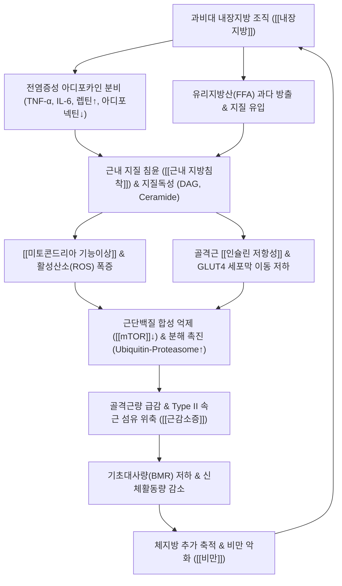

# 🩺 [[근감소성 비만]] (Sarcopenic Obesity / 肌少症性肥滿, ICD-10: E66.- + M62.84 / KCD: E66.9 + M62.84)

> **핵심 3줄 요약 (Key Summary)**:
> - 📍 병소 부위 & 해부·병태생리: 특정 단일 관절의 국소 병변이 아니라 **전신 [[골격근]]·[[지방조직]]·[[골]]을 아우르는 대사-근골격 복합 증후군**이다. 골격근량과 근력의 저하([[근감소증]])와 체지방량(특히 [[내장지방]])의 과다 축적([[비만]])이 동일 개체에서 공존하며, 과비대 지방세포의 전염증성 아디포카인 분비, [[근내 지방침착(myosteatosis)]], [[지질독성]], [[미토콘드리아 기능이상]], [[만성 저등급 염증]], [[인슐린 저항성]]이 서로를 증폭시키는 치명적인 악순환 네트워크를 형성한다.
> - 🚩 전형적 임상 양상 & 3대 징후: ① **체중은 정상이거나 증가되어 있는데 근력은 현저히 저하**되는 불균형("살은 쪘는데 힘이 하나도 없다", 의자에서 일어서기·계단 승강 곤란) ② **보행 속도 둔화와 반복적인 낙상 위험 급증**([[로코모티브 증후군]] 동반) ③ **복부 허리둘레 증가와 함께 만성 피로·식후 혼미·혈당 및 지질 대사 이상** 동반. 특히 극단적 저열량 단식 다이어트 시도 후 골격근이 30~50% 동반 소실되며 이전보다 더 쇠약해진 병력이 매우 전형적이다.
> - 🛠️ 핵심 감별 검사 & 한·양방 다각적 치료 전략: ESPEN/EASO 2022 및 한국인 기준에 따라 **선별(BMI ≥25 kg/m² 또는 허리둘레 남 ≥90cm, 여 ≥85cm + [[SARC-F]] 또는 [[악력]] 저하) $\to$ 확진([[악력]] 남 <28kg, 여 <18kg + 체지방률 BIA/DXA 남 ≥25%, 여 ≥35% 및 [[사지골격근량지수]] SMI 저하)** 단계로 진단한다. 치료의 절대 1원칙은 '단순 체중 감량'이 아닌 **적절한 열량 제한(일일 500 kcal 감량) + 고단백 식이(1.2~1.5 g/kg/일) + 점진적 [[저항운동]](주 2~3회) 및 유산소 운동 복합 처방**이다. 한의학적으로는 脾胃氣虛·濕痰阻滯·肝腎不足 변증에 기반하여 [[방기황기탕]], [[방풍통성산]], [[이진탕]], [[보중익기탕]], [[감비환]] 및 [[족삼리]]·[[비수]]·[[천추]]·[[중완]] 등 혈위의 2Hz 저주파 [[전침치료]]와 약침을 병용한다.
> - <font color="#fa7e7e">⚠️ 응급 의뢰 레드플래그 & 악화 요인: ① 원인 불명의 급격한 체중 감소(체중의 >5% 소실 시 악액질·악성종양 감별 필수) ② 반복 낙상에 따른 고관절·척추 압박골절 의심 급성 통증 ③ 하지 근력 급성 마비 또는 배뇨장애(마미증후군 의심) ④ GLP-1 수용체 작용제(세마글루타이드 등) 투여 중 운동·단백질 공급 결여로 인한 급격한 골격근 고갈. 또한 골다공증 동반 고령 환자에 대한 강한 요추 회전 교정 추나는 절대 금기이다.</font>

---

## 📌 목차
1. [질환 개요 & 해부학적 병태생리](#1-질환-개요--해부학적-병태생리)
2. [병태생리 메커니즘 & 생체역학적 악순환 네트워크](#2-병태생리-메커니즘--생체역학적-악순환-네트워크)
3. [임상 증상 & 이학적 검사(Physical Exam) 알고리즘](#3-임상-증상--이학적-검사physical-exam-알고리즘)
4. [감별 진단 매트릭스 (Differential Diagnosis)](#4-감별-진단-매트릭스-differential-diagnosis)
5. [한의 통합 치료 프로토콜 (침·약침·추나·한약)](#5-한의-통합-치료-프로토콜-침약침추나한약)
6. [양방 치료 & 병용·의뢰 기준 (Conventional Treatment & Referral)](#6-양방-치료--병용의뢰-기준-conventional-treatment--referral)
7. [재활 운동 & 생활습관 티칭 가이드](#7-재활-운동--생활습관-티칭-가이드)
8. [💡 사용자 진료실 핵심 필기 & 임상 노하우 (Melt-In 잔여 심화 집약)](#8--사용자-진료실-핵심-필기--임상-노하우-melt-in-잔여-심화-집약)
9. [출처 및 학술 참고 문헌 (References)](#9-출처-및-학술-참고-문헌-references)

---

## 1. 질환 개요 & 해부학적 병태생리

* **질환 정의 및 임상적 패러다임 전환**:
  * **정의**: 근감소성 비만(Sarcopenic Obesity)은 **골격근량(Skeletal Muscle Mass) 및 근력(Muscle Strength)의 병적 저하([[근감소증]])**와 **체지방량(특히 [[내장지방]])의 과도한 축적([[비만]])**이 동일한 인체 내에서 동시에 발생하는 복합적 대사-근골격계 질환이다.
  * **임상적 함의**: 과거에는 비만을 단순히 '체중 및 체질량지수(BMI)의 증가', 근감소증을 '고령에 따른 마른 체형의 근위축'으로 독립하여 인식하였으나, 현대 노인의학 및 대사의학에서는 두 병태가 융합될 때 **단순 비만이나 단순 근감소증 환자군보다 대사 질환, 심혈관 합병증, 신체 기능 장애, 사망률이 기하급수적으로 폭증**한다는 사실이 규명되었다 (Prado & Batsis, 2024; Wei & Nguyen, 2023).
  * **분류**:
    * **일차성(노화성)**: 노화에 따른 동화 호르몬(성호르몬, 성장호르몬) 감소, [[신경근 적응]] 저하, 운동단위 소실, 만성 염증 노화(Inflammaging)가 기저가 되는 원발성 형태.
    * **이차성(질환·생활유발성)**: 만성 신부전, [[제2형 당뇨병]], 비알코올성 지방간질환, 만성 폐쇄성 폐질환(COPD), 악성종양(특히 두경부암 방사선 치료 환자 등에서 체중과 제지방 급감의 핵심 예측 인자), 뇌졸중 후유증, 장기 침상 안정, 글루코코르티코이드 투약 등에 의해 가속화되는 형태 (Vangelov et al., 2025; Borba & Costa, 2025).

* **역학 및 인구통계학적 특성**:
  * 65세 이상 지역사회 거주 고령 인구에서 유병률이 급증하며, 연구 기준에 따라 편차가 있으나 국내외 고령 인구의 약 5~15%에서 확인된다.
  * 여성의 경우 폐경 후 에스트로겐 급감으로 체지방이 피하에서 복부 내장지방으로 재분포되고 근육 분해가 가속되어 유병률이 가파르게 상승하며, 최근 2024-2025 일본 근감소성 비만 워킹그룹(JWGSO) 합의문 연구에 따르면 지역사회 거주 여성에서 근감소성 비만은 [[로코모티브 증후군]](Locomotive Syndrome, 운동기 불안정증) 발생 위험과 통계적으로 유의하게 직결된다 (Nishida et al., 2025).
  * 남성의 경우 상대적으로 총 근육량이 많아 겉보기에는 체형 변화가 두드러지지 않는 '마른 비만(Normal-weight sarcopenic obesity)' 형태로 잠복하다가 갑작스러운 낙상 및 심혈관 사건으로 발현되는 경향이 있다.

* **관련 해부학적 구조물 및 조직 네트워크**:
  * **근육 및 근막계**: 항중력 대근군인 [[대퇴사두근]], [[둔근]](대둔근·중둔근), [[척추기립근]], [[복횡근]]의 위축이 가장 두드러진다. 특히 신속하고 강력한 수축력을 발휘하는 **제2형 속근 섬유(Type II fast-twitch glycolytic fibers)의 선택적 소실과 직경 위축**이 발생하여 지근(Type I)으로 치환된다.
  * **지방 조직계**: 피하 지방보다 대사 활성이 높은 **장간막 및 복막 후강의 [[내장지방]](Visceral Adipose Tissue, VAT)**이 과도하게 증식하며, 골격근 다발 사이(근간지방, IMAT) 및 근세포 내부(근세포내지질, IMCL)로 지방이 침투하는 **[[근내 지방침착(myosteatosis)]]**이 심화되어 근육의 질(Muscle quality)을 붕괴시킨다.
  * **골격 및 관절계**: [[대퇴골]] 경부, [[요추]]체, [[고관절]], [[슬관절]]. 비만으로 인한 과도한 기계적 체중 부하와 근감소로 인한 충격 흡수 기전 상실이 결합하여 조기 퇴행성 슬관절염 및 요추 척추증을 가속화하며, 골밀도 감소가 동반되는 [[골감소성 근감소증]](Osteosarcopenia) 형태로 진행될 경우 낙상 시 대퇴골 경부 골절의 위험이 극대화된다 (Fan & Cai, 2024).
  * **신경 및 미세순환계**: 척수 전각 알파-운동신경세포(Alpha-motor neuron)의 탈신경(Denervation), 신경-근 접합부(NMJ)의 형태학적 붕괴, 근육 내 모세혈관망 밀도 감소(Capillary rarefaction)로 인해 근육으로의 산소 및 기질 공급이 현저히 저하된다.

---

## 2. 병태생리 메커니즘 & 생체역학적 악순환 네트워크

### 1) 지방세포-골격근 상호작용의 악순환 네트워크 (Adipocyte-Muscle Crosstalk)

근감소성 비만의 본질은 지방세포와 골격근세포 사이의 병리적 상호작용이 형성하는 '자기 증폭형 폐쇄 루프(Self-amplifying closed loop)'에 있다.

```
       [과영양 / 노화 / 좌식생활 / 성호르몬 저하]
                         │
                         ▼
        ┌──────────────────────────────────┐
        │  내장지방 조직(VAT) 과비대 & 기능장애  │
        └─────────────────┬────────────────┘
                          │
          ┌───────────────┴───────────────┐
          ▼                               ▼
  [전염증성 아디포카인 과분비]     [유리지방산(FFA) 과잉 방출]
  (TNF-α, IL-6, Leptin ↑)         (체순환계 지질 과부하)
  (Adiponectin 결핍 ↓)                    │
          │                               ▼
          │                   ┌────────────────────────┐
          │                   │  골격근 세포 내 지질 유입 │
          │                   │ (Myosteatosis: IMAT·IMCL)│
          │                   └───────────┬────────────┘
          ▼                               ▼
  ┌────────────────────────────────────────────────────┐
  │  근조직 지질독성(Lipotoxicity) 유발: DAG, Ceramide 축적  │
  └─────────────────────────┬──────────────────────────┘
                            │
          ┌─────────────────┴─────────────────┐
          ▼                                   ▼
 [미토콘드리아 베타-산화 장애]         [인슐린 신호전달계 억제]
 (전자전달계 결함 & ROS 폭증)          (IRS-1 인산화 저해 & GLUT4 저하)
          │                                   │
          └─────────────────┬─────────────────┘
                            │
                            ▼
           ┌─────────────────────────────────┐
           │      근단백질 항상성의 와해       │
           │  • Akt-mTORC1 단백합성 경로 차단 │
           │  • FoxO / Ubiquitin 경로 항진   │
           │  • 마이오스타틴(Myostatin) 과분비│
           └────────────────┬────────────────┘
                            │
                            ▼
         ┌─────────────────────────────────────┐
         │     골격근량 급감 & 근섬유 위축     │
         │   (제2형 속근 섬유 선택적 사멸)     │
         └──────────────────┬──────────────────┘
                            │
        ┌───────────────────┴───────────────────┐
        ▼                                       ▼
[기초대사량(BMR) 감소]                  [신체 활동량 & 근력 저하]
(에너지 소비 총량 급감)                 (좌식생활 고착 & 보행속도 둔화)
        │                                       │
        └───────────────────┬───────────────────┘
                            │
                            ▼
              ┌───────────────────────────┐
              │  체지방 축적의 추가적 가속 │
              │   (근감소성 비만 고착화)  │
              └─────────────┬─────────────┘
                            │
                            └─────────► [루프 반복 및 대사 붕괴]
```



### 2) 분자 세포학적 발생 메커니즘

1. **아디포카인 불균형과 만성 저등급 염증**:
   * 과잉 축적된 내장지방 조직 내 대식세포(M1 마크로파지)가 활성화되어 전염증성 사이토카인(TNF-α, IL-6, IL-1β) 및 렙틴(Leptin)을 과잉 분비합니다. 반면 인슐린 감수성을 높이고 항염증 작용을 하는 아디포넥틴(Adiponectin) 분비는 급감합니다.
   * 순환계를 타고 유입된 TNF-α와 IL-6는 근육세포의 IκB 키나아제(IKK)와 JNK 경로를 활성화하여 전신성 만성 저등급 염증을 유발합니다.
2. **근조직 지질독성(Lipotoxicity)과 근내 지방침착(Myosteatosis)**:
   * 피하 지방의 저장 한계를 초과한 잉여 유리지방산이 골격근으로 유입되어 근섬유 다발 사이(IMAT)와 세포 내(IMCL)에 축적됩니다.
   * 불완전 지방산 대사 산물인 디아실글리세롤(Diacylglycerol, DAG)과 세라마이드(Ceramide)가 근형질 내에 축적되면 단백질 키나아제 C(PKC-θ)가 활성화되어 인슐린 수용체 기질(IRS-1)의 세린 잔기를 비정상적으로 인산화시켜 정상적인 인슐린 신호전달을 물리적으로 차단합니다.
3. **미토콘드리아 산화 결함 및 활성산소(ROS) 생산**:
   * 근육 내 지질 과부하는 미토콘드리아의 베타-산화(Beta-oxidation) 용량을 초과하여 전자전달계의 결함을 초래하고 다량의 활성산소종(ROS)을 방출합니다.
   * 산화 스트레스는 미토콘드리아 DNA(mtDNA) 손상과 사멸을 유도하여 ATP 생산 효율을 떨어뜨리고, 이는 환자가 일상적 신체활동에서 극심한 피로를 느끼게 만듭니다 (Axelrod & Dantas, 2023).
4. **단백 동화 저항(Anabolic Resistance)과 단백질 분해 폭풍**:
   * 인슐린 저항성과 염증 상태에서는 아미노산(특히 [[류신]]) 자극에 반응하여 단백질을 합성하는 Akt-mTORC1 경로가 둔화되는 **단백 동화 저항**이 발생합니다.
   * 동시에 FoxO 전사인자가 핵 내로 이동하여 근육 특이 유비퀴틴 리가아제인 MuRF-1 및 Atrogin-1/MAFbx 발현을 전사적으로 촉진함으로써 근원섬유 단백질(액틴, 미오신)을 무차별적으로 분해합니다.
   * 근육 성장을 억제하는 마이오카인인 [[마이오스타틴]](Myostatin)의 발현이 증가하여 위성세포의 자가 증식과 근섬유 재생이 영구적으로 차단됩니다.

### 3) 생체역학적 연쇄 반응 (Kinetic Chain) 및 임상적 위험 증폭

* **질량-출력 불일치(Mass-Power Mismatch)**:
  * 인체 역학 관점에서 체중(질량, Mass)은 증가하거나 과도하게 유지되는데, 이를 추진하고 제어해야 하는 골격근의 출력(Power)은 급감합니다.
  * [[대퇴사두근]], [[둔근]], 비복근의 상대적 근력비(Relative strength = 근력/체중)가 붕괴하여, 정상 성인에게는 무리가 없는 보행·기립·계단 오르기가 이들 환자에게는 최대 하중(Near-maximal load) 운동으로 작용합니다.
* **관절 역학 파탄과 골관절염 가속**:
  * 근육의 충격 흡수 기전(Shock absorption)이 상실됨에 따라 보행 시 지면 반발력이 감쇠 없이 무릎 슬관절과 고관절, 요추 추간판으로 직접 전달됩니다. 이는 연골 마모와 관절염을 급속도로 악화시키는 핵심 생체역학적 기전입니다.
* **로코모티브 증후군(Locomotive Syndrome) 및 낙상-골절 캐스케이드**:
  * 근력 약화와 균형 감각 상실은 보행 속도 저하, 보폭 단축, 양발 지지 시간 연장으로 이어지며, 2025년 최신 역학 연구에서 확인되듯 근감소성 비만은 운동기 불안정 상태인 로코모티브 증후군과 강력한 상관관계를 보입니다 (Nishida et al., 2025).
  * 낙상 발생 시 골다공증이 동반되어 있을 경우 대퇴골 경부 골절 및 척추 압박골절로 직결되며, 이는 수술 후 절대적 침상 안정 $\to$ 급격한 추가 근손실(1주일 침상 시 하지 근육량 1kg 이상 소실) $\to$ 영구적 와병 상태라는 치명적인 노인 노쇠 캐스케이드로 이어집니다 (Fan & Cai, 2024).

---

## 3. 임상 증상 & 이학적 검사(Physical Exam) 알고리즘

### 1) 주소증 및 기능적 표현형 (Clinical Presentation)

* **외형 및 체성분의 역설적 특징**:
  * **"살은 쪘는데 힘이 하나도 없다"**: 체중계의 숫자는 비만 범위(또는 정상 상한선)에 있으나, 만져보면 사지 근육은 물렁거리고 복부에만 단단하거나 처진 지방이 과도하게 집중되어 있습니다.
  * **숨은 마른 비만**: 겉보기에는 옷을 입었을 때 정상 체형처럼 보이나, 신체 조성을 정밀 측정하면 골격근량은 바닥이고 체지방률만 35~40%를 상회하는 고위험군이 다수 존재합니다.
* **기능적 수행 장애 (Daily Physical Impairments)**:
  * 소파나 낮은 의자, 방바닥에서 일어날 때 반드시 양손으로 무릎이나 가구를 짚어야만 일어설 수 있습니다.
  * 계단을 오를 때 난간을 잡지 않으면 다리에 힘이 풀리며(Giving-way), 버스 승하차 계단을 오르내리기 버거워 대중교통 이용을 기피합니다.
  * 횡단보도의 파란 불이 깜빡일 때 빠른 걸음으로 건너가지 못해 뒤처지며, 평지 보행 중에도 발끝이 바닥에 걸려 헛디디는 빈도가 잦아집니다.
  * 장바구니나 2L 생수병을 들어 올리기 힘들고, 잼 병뚜껑이나 페트병 뚜껑을 악력 부족으로 스스로 열지 못합니다.
* **전신 대사 및 신경학적 증상**:
  * 극심한 만성 피로와 식후 주간 졸림증(Postprandial somnolence, 인슐린 저항성에 기인).
  * 수면무호흡증(경부 지방 침착 및 상기도 근육 무력), 지방간, 대사증후군 징후.
  * 하지 저림 및 감각 이상: 요추 퇴행성 척추관 협착증이나 당뇨병성 말초신경병증이 동반된 경우 복합 신경학적 증상이 나타나므로 정확한 감별이 요구됩니다.

### 2) 표준 진단 알고리즘 (ESPEN/EASO 2022 Consensus & 한국인 기준)

유럽임상영양대사학회(ESPEN)와 유럽비만학회(EASO)의 2022 국제 가이드라인 및 한국인 체형 기준을 통합한 3단계 표준 진단 프레임워크입니다.

```
[1단계: 선별 (Screening)]
  • 체질량지수(BMI) ≥ 25.0 kg/m² (한국인 비만 기준) 또는
  • 허리둘레: 남성 ≥ 90 cm, 여성 ≥ 85 cm (복부비만 기준)
                 AND
  • 근감소증 의심 증상/설문: SARC-F ≥ 4점 또는 진료실 악력 저하 의심
                 │
                 ▼ (양성 충족 시)
[2단계: 확진 (Diagnosis) - 2가지 축 동시 충족]
  • 축 1: 골격근 근력 저하 (Muscle Strength)
    - 악력(Handgrip strength): 남성 < 28.0 kg, 여성 < 18.0 kg
    - 5회 의자 일어서기(5-STS): 소요 시간 ≥ 12.0초
                 AND
  • 축 2: 체구성 이상 (Altered Body Composition)
    - 체지방률(Fat mass %): 남성 ≥ 25.0%, 여성 ≥ 35.0%
    - 사지골격근량지수(SMI = ASM/ht²):
      * DXA 기준: 남성 < 7.0 kg/m², 여성 < 5.4 kg/m²
      * BIA 기준: 남성 < 7.0 kg/m², 여성 < 5.7 kg/m²
      (체중 보정 시: ASM/weight % 남성 < 29.9%, 여성 < 25.1%)
                 │
                 ▼ (동시 충족 시 '근감소성 비만' 확진)
[3단계: 병기 분류 (Staging)]
  • 1기 (Stage I): 상기 확진 기준 충족 + 임상적 합병증 없음
  • 2기 (Stage II): 상기 확진 기준 충족 + 1개 이상의 합병증 동반
    (심혈관질환, 제2형 당뇨병, 비알코올성 지방간질환, 퇴행성 관절염, 로코모티브 증후군, 신체 장애)
```

### 3) 필수 정량적 이학적 검사법

* **[[악력검사]] (Handgrip Strength Test)**:
  * **방법**: 스미스형 디지털 악력계를 사용하여 의자에 바르게 앉은 자세에서 팔꿈치를 90도로 굴곡하고 전완을 중립위에 둡니다. 좌우 교대로 각 2~3회 최대 노력으로 쥐게 한 후 최고값을 기록합니다.
  * **절단값**: **남성 < 28.0 kg, 여성 < 18.0 kg**. 전신 근력 및 생체 활력도를 반영하는 가장 민감한 1차 지표입니다.
* **[[의자일어서기검사]] (5-Times Sit-to-Stand Test, 5-STS)**:
  * **방법**: 높이 43~45cm의 팔걸이 없는 의자에 앉아 양팔을 가슴 앞에서 X자로 교차합니다. 검사자의 신호와 함께 완전히 일어섰다 앉는 동작을 5회 가능한 한 빠르게 반복하도록 하며 총 소요 시간을 측정합니다.
  * **절단값**: **≥ 12.0초**. 하지 대퇴사두근 및 둔근의 신경근 협응력과 기능적 파워를 평가합니다.
* **[[보행속도검사]] (4m 또는 6m Gait Speed)**:
  * **방법**: 평상시 걸음걸이 속도로 보행하도록 하여 가속 및 감속 구간을 제외한 4m 또는 6m 통과 시간을 계측합니다.
  * **절단값**: **< 1.0 m/s** (또는 중증 < 0.8 m/s). 신체 수행 능력(Physical Performance) 저하 판정의 핵심 기준입니다.
* **체성분 분석: [[생체전기저항분석]](BIA) 및 [[이중에너지 X선 흡수계측법]](DXA)**:
  * 사지골격근량(Appendicular Skeletal Muscle Mass, ASM)과 체지방량(Fat Mass), 체지방률(% Body Fat), 내장지방 단면적(VFA)을 산출합니다.
  * 반드시 신장 보정 사지골격근량지수(SMI = ASM/ht², kg/m²)와 함께 체지방률의 동시 상승 여부를 확인해야 합니다.
* **[[로코모티브 증후군]] 25문항 설문(GLFS-25) 및 2단계 기립 검사**:
  * 일상생활 운동기 장애 정도를 수치화하여 관절-신경-근육 복합 기능 이상을 평가합니다.

---

## 4. 감별 진단 매트릭스 (Differential Diagnosis)

| 감별 질환 | 병소 및 주요 원인 | 근육량 및 근력 특성 | 체지방 및 체중 특성 | 감별 핵심 진단 포인트 |
| :--- | :--- | :--- | :--- | :--- |
| **[[근감소성 비만]]**<br>(본 질환) | 전신 골격근 + 내장지방 조직,<br>노화·만성염증·단백동화저항 | **사지 근육량 현저히 감소**,<br>악력 저하(<28/<18kg), 5-STS 지연 | **체지방률 과다 증가**(남≥25, 여≥35%),<br>BMI 정상 또는 증가, 복부비만 | 악력 저하 + 체지방률 증가 + SMI 저하 동시 확인,<br>ESPEN/EASO 2단계 확진 |
| **[[단순 비만]]**<br>(Simple Obesity) | 지방조직(피하 및 내장),<br>에너지 섭취 과다 | **근육량 정상 또는 체중 지지를 위해 증가**,<br>절대 악력 정상 유지 | 체지방량 및 BMI 증가,<br>상대적 근력비만 다소 저하 | 절대 근육량(ASM) 및 악력 정상 범위,<br>신체 기능 장애 지표 정상 |
| **[[단순 근감소증]]**<br>(Simple Sarcopenia) | 골격근 단독,<br>노화, 영양부족, 비활동 | **사지 근육량 및 근력 저하**,<br>Type II 섬유 위축 | **체지방률 정상 또는 저하**,<br>체중 감소 또는 저체중(BMI <18.5) 흔함 | 마른 체형, 체지방 과잉 없음,<br>허리둘레 정상 이하 |
| **[[악액질]]**<br>(Cancer Cachexia) | 악성종양, 말기 심부전·신부전,<br>전신 소모성 염증 폭풍 | **골격근의 급격하고 비가역적인 소실**,<br>극심한 근력 저하 | **체지방과 제지방이 동시에 급격 소실**,<br>체중의 >5%가 6개월 내 불수의적 감소 | 식욕부진, CRP·ESR 등 염증 수치 극대화,<br>영양 공급만으로 체중 회복 불가 |
| **[[갑상선기능저하증]]**<br>(Hypothyroidism) | 갑상선 호르몬 결핍,<br>기초대사율 억제 | 근력 약화 및 가성 근비대(Hoffmann 증후군),<br>심건반사 이완기 지연 | 점액수종성 체중 증가(비와성 부종),<br>지방 축적보다는 수분 저류 | TSH 상승, Free T4 저하,<br>추위 민감성, 서맥, 심한 변비 |
| **[[쿠싱증후군]]**<br>(Cushing's Syndrome) | 코르티솔 과다(부신 종양 또는<br>외인성 스테로이드 남용) | **심각한 근위부 근병증(사지 근위축)**,<br>계단 오르기 및 의자 기립 불가 | **중심성 비만**(문페이스, 들소혹, 복부비만),<br>사지는 극도로 가늘어짐 | 피부 자색 선조(Striae), 피부 얇아짐, 멍,<br>24시간 소변 유리 코르티솔 상승 |
| **[[당뇨병성 근위축]]**<br>(Diabetic Amyotrophy) | 당뇨병성 요추천골신경총병증,<br>미세혈관 허혈 | 골반대 및 대퇴부의 **비대칭적 급성 근위축**,<br>대퇴사두근 건반사 소실 | 체중 감소 동반 흔함,<br>체지방 분포와 무관 | 극심한 대퇴부 신경병증성 통증 선행,<br>근전도 상 신경인성 탈신경 전위 |
| **[[척추관 협착증]]**<br>(Lumbar Stenosis) | 요추 황색인대 비대, 추간판 돌출,<br>마미 및 신경근 압박 | 신경성 간헐적 파행으로 보행 제한,<br>L4/L5 분절 근력 저하 가능 | 체성분 변화는 2차적 좌식생활 기인 | 체간 전굴 시 통증 완화, 후굴 시 악화,<br>MRI 상 척추관 단면적 협착 |
| **[[골감소성 근감소증]]**<br>(Osteosarcopenia) | 골격근 + 골조직의 동시 퇴행,<br>골-근 상호작용 붕괴 | 사지 골격근량 저하 + 근력 약화,<br>신체 균형능력 소실 | 체지방률은 다양함<br>(비만 동반 시 골감소성 근감소 비만) | DXA 상 골밀도 T-score ≤ -1.0 (골감소/골다공증)<br>+ 근감소증 동시 충족 |

---

## 5. 한의 통합 치료 프로토콜 (침·약침·추나·한약)

### 1) 치료 원칙 및 방향성
* 단순 비만 치료의 패러다임인 '사하(瀉下)·절식(節食)을 통한 급격한 체중 감량'을 근감소성 비만 환자에게 적용하면 **골격근이 치명적으로 붕괴되어 환자를 불역적 노쇠로 몰아넣게 됩니다.**
* 한의학 치료의 제1원칙은 **健脾益氣(소화흡수 기능 강화 및 근단백 동화 촉진)와 化痰祛濕(병리적 내장지방과 대사 노폐물 배출)의 상보적 결합**이며, 만성 퇴행기에는 **補腎强筋骨(골-근-신경 재생)**을 병행합니다.

### 2) 변증별 한약 처방 (Herbal Medicine)

* **脾胃氣虛型 (비위기허형)**:
  * **주치 증상**: 사지 무력, 만성 피로, 식후 복부 팽만, 식욕 부진, 연변(묽은 변), 안색 위황, 설담태백, 치흔설, 맥 침세무력.
  * **치료 처방**: **[[보중익기탕]](補中益氣湯)** 또는 **[[육군자탕]](六君子湯)** 가미.
  * **방의**: 황기·인삼·백출이 비기(脾氣)를 북돋워 음식물의 정미(아미노산 등)를 골격근으로 수송(脾主肌肉)하고, 진피·승마·시호가 청기(淸氣)를 끌어올려 단백 동화 신호를 촉진합니다.
* **濕痰阻滯型 (습담조체형)**:
  * **주치 증상**: 심한 복부 비만, 신체 침중감(몸이 천근만근 무거움), 가래, 식후 혼미, 관절 둔통, 설태 백니 또는 황니, 맥 활(滑).
  * **치료 처방**: **[[방기황기탕]](防己黃耆湯)** 또는 **[[이진탕가미방]](二陳湯加味方)**, 체격이 건실하고 변비·실열이 겸한 경우 **[[방풍통성산]](防風通聖散)**.
  * **방의**: 방기황기탕은 표허(表虛)로 살이 물렁하고 부종이 있으며 땀이 저절로 나는 '물살형 근감소성 비만'의 대표 처방으로, 황기로 기를 돋우며 방기·복령으로 체내 저류된 병리적 습담과 세포외 수분을 배출하여 부종을 내리고 근육 내 미세순환을 개선합니다.
* **肝腎不足型 (간신부족형)**:
  * **주치 증상**: 허리와 무릎의 만성 시림 및 둔통(요슬산연), 보행 불안정, 야간뇨, 하지 근위축, 어지럼증, 이명, 맥 침세삭 또는 침지.
  * **치료 처방**: **[[독활기생탕]](獨活寄生湯)** 또는 **[[육미지황탕]](六味地黃湯)** 가미.
  * **방의**: 간주근(肝主筋) 신주골(腎主骨) 이론에 따라 숙지황·산수유·우슬·두충이 근골격계와 신경-호르몬 축을 보익하여 골다공증과 근감소증의 동반 악화를 방어합니다.
* **한방 비만 처방(마황제) 사용 시의 엄격한 주의**:
  * 마황(에페드린) 기반의 [[감비환]] 등 식욕 억제제는 대사율을 높이고 교감신경을 흥분시키나, 근감소성 비만 환자에게 식욕이 전폐될 정도로 고용량을 투여하면 영양 결핍으로 인해 근육 분해가 폭발합니다.
  * 따라서 반드시 **저용량 마황 + 보혈·보익제(당귀, 황기, 백작약, 백출)를 합방한 건비감비(健脾減肥) 형태**로 처방하여 단백질 섭취를 유지시키는 것이 필수적입니다.

### 3) 침구 치료 및 2Hz 저주파 전침 프로토콜

* **핵심 취혈 혈위**:
  * **비위 기능 및 사지 근육 대사**: [[족삼리]](ST36), [[비수]](BL20), [[위수]](BL21), [[음릉천]](SP9), [[삼음교]](SP6).
  * **복부 내장지방 및 대사 분해**: [[중완]](CV12), [[천추]](ST25), [[풍륭]](ST40), [[대맥]](GB26), [[관원]](CV4).
  * **하지 항중력 대근군 강화**: [[양릉천]](GB34), [[복토]](ST32), [[양구]](ST34), [[혈해]](SP10), 대퇴직근 및 내측광근 운동점(Motor points).
* **2Hz 저주파 전침(Electroacupuncture)의 이중 분자 기전**:
  * **복부 지방분해**: 복부 천추-대맥 및 천추-중완에 자침 후 **2Hz 저주파 연속파**를 20~30분간 인가합니다. 저주파 전침은 국소 교감신경 말단을 자극하여 노르에피네프린 분비를 유도하고, 호르몬 민감성 리파아제(HSL)를 활성화하여 내장지방의 유리지방산 유리를 촉진합니다.
  * **골격근 단백합성 및 수축 유발**: 대퇴사두근 건 및 운동점에 침을 놓고 **2Hz/100Hz 혼합파(Dense-Disperse Wave)** 또는 **2Hz 연속파**를 인가하여 리드미컬한 근수축을 유발합니다. 이는 골격근 내 AMPK 활성화, GLUT4 세포막 발현 증가, 근세포 내 IGF-1 및 mTOR 신호 경로를 자극하여 저항운동과 유사한 분자생물학적 동화 신호를 유도합니다.

### 4) 약침 치료 (Pharmacopuncture)

* **복부 대사 자극**:
  * 중완, 천추, 대맥 주위 복벽 피하지방층에 산삼약침 또는 황련해독약침을 0.1~0.2cc씩 분주합니다. 복벽 초음파 유도 또는 안전 각도(피부에 대해 15~30도 경사 자입)를 유지하여 장관 천공 위험을 완벽히 차단합니다.
* **근위축 및 관절 보호 자극**:
  * 족삼리, 신수, 대퇴사두근 건 부착부에 **[[자하거약침]](인태반 추출물)** 또는 **녹용약침**을 회당 0.5~1.0cc 시술합니다. 자하거의 풍부한 아미노산, 성장인자 유사 펩타이드는 단백 동화 저항을 겪는 노인 골격근의 재생과 미토콘드리아 기능 활성화에 기여합니다.

### 5) 추나 요법 (Chuna Manipulation)

* **근막 이완 수기(Myofascial Release, JS 기법)**:
  * 장시간 좌식 및 복부 비만으로 인해 전방 경사된 골반을 교정하기 위해 구축된 [[장요근]], [[대퇴직근]], [[요방형근]]의 근막을 부드럽게 신장 이완시킵니다.
  * 약화된 [[대둔근]], [[복횡근]]의 고유수용성 감각 신경을 자극하여 체간 안정성을 재확립합니다.
* **복부 유연화 추나**:
  * 환자의 호기(숨을 내쉴 때)에 맞추어 복부 심부 근막과 장간막의 긴장을 풀어주는 완만 복부 추나를 적용하여 림프 순환과 장운동을 촉진합니다.
* **⚠️ 절대 금기 및 주의 수기**:
  * 근감소성 비만 환자는 대부분 골감소증·골다공증을 동반하고 있습니다. **요추 및 흉추에 대한 강한 회전 스러스트(HVLA 기법)는 척추체 압박골절 및 늑골 골절을 초래할 수 있으므로 절대 금기**이며, 반드시 저속 저진폭 관절가동추나 및 근막 이완 수기로만 진행해야 합니다.

---

## 6. 양방 치료 & 병용·의뢰 기준 (Conventional Treatment & Referral)

### 1) 양방 약물 치료 현황 및 임상적 쟁점

* **비만 치료 약물과 근손실 위험**:
  * **GLP-1 수용체 작용제 및 GLP-1/GIP 이중 작용제**: [[세마글루타이드]](Wegovy, Ozempic), [[터제파타이드]](Mounjaro, Zepbound).
  * **경고**: 이들 최신 항비만 약물은 강력한 체중 감량 효과(15~22%)를 보이지만, 임상 연구 데이터 분석 결과 **감량된 총 체중의 25~40%가 골격근을 포함한 제지방(Lean body mass)에서 소실**되는 치명적 부작용이 확인되었습니다.
  * 근감소성 비만 환자에게 충분한 단백질 섭취와 강력한 저항성 근력 운동 없이 GLP-1 RA만을 단독 투여하면, 비만은 일부 개선될지언정 근감소증이 극도로 악화되어 약물 중단 후 체지방만 다시 차오르는 최악의 '요요성 근감소성 비만'을 초래하게 됩니다.
* **혈당 강하제**:
  * **[[메트포르민]](Metformin)**: AMPK 활성화를 통해 간 포도당 생성을 억제하고 인슐린 감수성을 개선합니다. 단, 고령자 대상 DEMFOS RCT 연구(Villareal et al., 2024)에서 확인되었듯 생활습관 중재에 메트포르민을 추가하는 것이 신체 기능(mPPT)을 추가적으로 유의하게 개선하지 못하므로, 약물에만 의존해서는 안 됩니다.
  * **SGLT-2 억제제**(다파글리플로진, 엠파글리플로진): 요당 배출을 통해 혈당과 체중을 낮추나, 노인 환자에서 탈수, 영양소 결핍, 정상혈당 케톤산증(eDKA), 근육 단백 분해 위험을 면밀히 감시해야 합니다.
* **근감소증 표적 치료제의 부재**:
  * 현재 미국 FDA나 한국 식약처에서 근감소증 단독 치료제로 공식 승인된 전문의약품은 존재하지 않습니다.
  * 마이오스타틴 억제 항체(Bimagrumab, Trevogrumab), 선택적 안드로겐 수용체 조절제(SARM) 등이 임상 시험 단계에 있으나 부작용과 유효성 검증으로 인해 아직 상용화되지 못했습니다.

### 2) 비만대사수술 (Bariatric Surgery)의 적응과 주의

* **수술 적응증**: BMI ≥ 35 kg/m² 또는 BMI ≥ 30 kg/m²이면서 조절되지 않는 제2형 당뇨병, 심혈관 질환 등 대사 합병증이 동반된 경우 위소매절제술(Sleeve Gastrectomy) 또는 루와이 위우회술(Roux-en-Y Gastric Bypass)이 시행됩니다.
* **근감소성 비만 환자에서의 특별 위험**:
  * 수술 후 첫 6개월 동안 급격한 영양 흡수 제한과 칼로리 결손으로 인해 극심한 근손실(급성 근감소증)이 발생합니다.
  * 수술 전 근감소증이 이미 존재하는 고령 환자는 수술 후 신체 기능 상실 및 합병증 발생률이 일반 비만 환자 대비 3배 이상 높으므로, 수술 직후부터 필수 아미노산 보충과 조기 재활 운동이 의무화되어야 합니다.

### 3) 한·양방 병용 판단 기준 (Combination Therapy Matrix)

* **병용 권장 (Synergistic)**:
  * 양방 메트포르민 또는 스타틴 복용 환자에게 한방 [[보중익기탕]] 또는 [[방기황기탕]]을 병용: 인슐린 감수성 개선과 골격근 미세염증 완화에 상호 보완적 시너지 효과 발휘.
  * 고혈압·당뇨 처방을 유지하면서 한방 전침 및 약침 치료를 병행하여 말초 혈류 및 근육 포도당 섭취율 제고.
* **병용 주의 (Caution)**:
  * **GLP-1 RA 투여 환자에게 고용량 마황제(감비환) 중복 투여 금기**: 위장관 운동 저하와 식욕 억제가 중복되어 오심, 구토, 탈수, 급격한 영양 결핍성 근육 융해를 촉진할 위험이 높습니다. 마황 성분을 완전히 배제하거나 극소량으로 조절하고 비위 보익제를 중심으로 구성해야 합니다.
  * 이뇨제 복용 환자에게 강한 이수척담제(방기, 복령, 택사 고용량) 병용 시 전해질 불균형(저칼륨혈증) 및 기립성 저혈압 발생 여부를 주 1회 모니터링해야 합니다.

### 4) 응급 전원 및 전문과 의뢰 기준 (Referral Criteria)

* **응급 의뢰 (즉각 3차 병원 응급센터 이송)**:
  * **마미증후군(Cauda Equina Syndrome)**: 안장 부위(회음부) 감각 마비, 돌발성 대소변 실금 또는 배뇨 불능, 양측 하지 급성 진행성 마비.
  * **급성 골절**: 낙상 후 고관절 부위의 심한 자발통 및 외회전 기형으로 인한 체중 부하 불능, 척추 부위의 극심한 타진통.
* **전문과 의뢰 (내과·정형외과 협진)**:
  * **종양 의심 악액질**: 3~6개월 내 평소 체중의 5% 이상이 불수의적으로 급감하며 식욕 부진, 야간 발열, 림프절 비대가 동반되는 경우(혈액종양내과 의뢰).
  * **중증 조절 불량 대사 질환**: 공복 혈당 >250 mg/dL, HbA1c >10%, 중증 신기능 저하(eGFR <30 mL/min/1.73m²).

---

## 7. 재활 운동 & 생활습관 티칭 가이드

### 1) ⚠️ 단순 초저열량 식이요법의 위험성과 영양 원칙

* **초저열량 다이어트(Very-Low-Calorie Diet)의 역설적 파탄**:
  * 체중을 줄이겠다고 하루 800 kcal 이하로 굶거나 원푸드 다이어트를 시행하면 인체는 결손된 에너지를 충당하기 위해 **골격근 단백질을 당신생(Gluconeogenesis)의 기질로 분해**합니다.
  * 체중 감량 시 소실된 체중의 30~50%가 근육에서 빠져나가며, 이는 기초대사량을 영구적으로 떨어뜨립니다. 이후 필연적으로 발생하는 요요 현상에서는 **지방만 100% 재축적**되어 이전보다 근육 비율이 더 낮아진 심각한 근감소성 비만으로 악화됩니다.
* **표준 에너지 및 단백질 섭취 프로토콜**:
  * **에너지 섭취**: 극단적 절식이 아닌 **현재 유지 열량에서 일일 500 kcal 정도만 완만하게 제한**합니다. 감량 속도는 **월 1.0~1.5 kg 이내**로 완만하게 설정하여 골격근 소실을 방어합니다.
  * **충분한 단백질 공급**: 노인의 단백 동화 저항을 극복하기 위해 **체중 1kg당 1.2~1.5 g/일**의 단백질을 공급합니다 (신기능 정상 확인 전제).
  * **식사별 단백질 분산 섭취**: 한 끼에 몰아서 먹는 것보다 **매 끼니 25~30g씩 균등하게 나누어 섭취**해야 근단백 합성(MPS) 역치를 지속적으로 자극할 수 있습니다.
  * **[[류신]](Leucine) 최적화**: mTOR 경로를 직접 트리거하는 필수 아미노산인 류신을 식사당 2.5~3.0g(유청단백, 살코기, 달걀, 대두) 확보하도록 지도합니다.
  * **비타민 D 및 칼슘**: 혈청 25(OH)D 농도를 **≥ 30 ng/mL**로 유지하도록 비타민 D3 1,000~2,000 IU/일을 보충하여 근력 유지와 골밀도를 동시에 보호합니다.

### 2) 점진적 저항성 근력 운동 (Progressive Resistance Training)

근감소성 비만 치료에서 운동은 보조가 아니라 **가장 강력한 일차 치료제(First-line medicine)**입니다.

* **운동 원칙**:
  * **주 2~3회 빈도**, 최소 12주 이상 지속.
  * 대근군(하지 대퇴사두근, 둔근, 햄스트링, 척추기립근, 흉근, 광배근) 위주의 다관절 복합 운동.
  * 과부하의 원칙: 환자의 현재 체력에 맞추어 맨몸 $\to$ 탄력 밴드(TheraBand) $\to$ 가벼운 덤벨·머신으로 저항을 점진적으로 증량.
* **진료실 처방 4대 자가 운동 루틴**:
  1. **의자에서 일어서기 (Chair Squat)**:
     * 의자 끝에 걸터앉아 양팔을 가슴에 모으고, 반동을 쓰지 않고 발바닥 전체로 지면을 밀며 일어섭니다. 내려앉을 때는 3초간 버티며 천천히 앉습니다. 10회 × 3세트.
  2. **벽 밀기 푸시업 (Wall Push-Up)**:
     * 벽에서 두 발자국 떨어져 손을 벽에 대고 체간을 일직선으로 유지하며 팔굽혀펴기를 수행합니다. 10~12회 × 3세트.
  3. **탄력 밴드 시티드 로우 (Seated Cable/Band Row)**:
     * 의자에 앉아 발에 밴드를 걸고 양손으로 가슴 쪽으로 당기며 날개뼈를 모아줍니다. 등 근육과 척추 기립근 강화. 12회 × 3세트.
  4. **서서 뒤꿈치 들기 (Heel Raise)**:
     * 벽이나 식탁을 가볍게 잡고 양 발뒤꿈치를 높이 들어 올려 종아리(비복근·가자미근)를 수축한 후 2초 정지 후 천천히 내립니다. 하지 정맥순환 및 보행 추진력 강화. 15회 × 3세트.

### 3) 유산소 운동 (Aerobic Exercise)

* **목표 및 강도**:
  * 내장지방 감소와 심폐 지구력 개선을 위해 **주당 150분 이상의 중강도 유산소 운동**(최대 심박수의 50~70%, 약간 숨이 차고 땀이 배어 나오나 옆 사람과 대화는 가능한 수준).
* **관절 보호형 운동 형태**:
  * 과체중으로 인해 무릎과 허리에 가해지는 충격을 방지하기 위해 일반 아스팔트 조깅은 금지합니다.
  * **평지 빠르게 걷기(Brisk Walking)**, **등받이 고정식 실내 자전거(Recumbent Bike)**, **수중 보행 및 아쿠아로빅**을 적극 권장합니다.
  * **유산소 단독 운동의 금지**: 유산소 운동만 과도하게 수행하면 골격근 단백질 분해가 촉진될 수 있으므로, 반드시 저항성 운동 세션 직후에 유산소 운동을 배치하거나 교대일로 시행합니다.

### 4) 일상생활 환경 및 낙상 예방 에르고노믹스

* **주거 환경 안전화**:
  * 욕실 바닥 미끄럼 방지 매트 설치, 변기 및 욕조 옆 안전 손잡이 시공.
  * 침실에서 화장실로 이어지는 복도에 야간 센서등 설치, 문턱 제거, 헐렁한 슬리퍼 대신 미끄럼 방지 양말 및 맞춤 실내화 착용.
* **좌식 생활(Sedentary Behavior) 타파**:
  * 연속 착석 시간 45~60분을 초과하지 않도록 알람을 설정하고, 1시간마다 반드시 기립하여 2분간 제자리걸음 및 종아리 스트레칭을 시행하도록 교육합니다.

---

## 8. 💡 사용자 진료실 핵심 필기 & 임상 노하우 (Melt-In 잔여 심화 집약)

### 1) 진료실 실전 문진 체크리스트 (내원 5분 스크리닝)
1. **"최근 6개월~1년 사이에 체중이 어떻게 변했습니까? 다이어트를 시도한 적이 있습니까?"**
   * 의도치 않은 급격한 감소는 악액질 감별. 반면 굶어서 살을 뺀 후 다시 쪘다는 병력은 근감소성 비만의 강력한 실마리.
2. **"소파나 방바닥에서 일어날 때 손을 짚지 않고 바로 일어나실 수 있습니까?"**
   * 하지 대퇴사두근 및 둔근 위축을 잡아내는 가장 직관적인 문진.
3. **"지난 1년간 발이 걸려 넘어지거나 삐끗한 적이 몇 번이나 있습니까?"**
   * 낙상 병력은 보행 역학 붕괴 및 로코모티브 증후군의 확실한 지표.
4. **"김치통을 냉장고에서 꺼내거나 페트병 뚜껑을 딸 때 손에 힘이 잘 들어갑니까?"**
   * 상지 악력 저하의 실생활 반영도 확인.
5. **"식사하실 때 고기, 생선, 달걀, 두부 반찬을 하루에 몇 번이나 챙겨 드십니까?"**
   * 대부분의 고령 환자는 탄수화물(밥, 떡, 빵, 국수) 위주 식사로 단백질 섭취가 절대 결핍 상태임.
6. **"평소 횡단보도를 건널 때 초록불 시간이 모자라 마음이 불안하십니까?"**
   * 보행 속도 1.0 m/s 미만 저하를 파악하는 실전 질문.

### 2) 진료실 실전 임상 감별 & 손맛 노하우
* **체중계에 절대 속지 마라 (Bathroom Scale Illusion)**:
  * BMI가 23~24로 지극히 정상으로 보이는 고령 환자라도 악력계를 쥐어주면 남성 22kg, 여성 14kg에 불과한 경우가 부지기수입니다. 체중계 숫자가 정상이더라도 **허리둘레가 굵고 사지가 가늘다면 즉시 BIA 체성분 검사와 악력 검사를 루틴 시행**해야 합니다.
* **하지 저림 주소증의 선행 배제 원칙**:
  * 환자가 다리에 힘이 빠진다고 내원했을 때, 요추관 협착증에 의한 간헐적 파행이나 당뇨병성 말초신경병증의 저림이 동반되어 있는지 먼저 분리해야 합니다. 저림이 심한 급성 협착증 환자에게 무리한 하체 스쿼트를 시키면 증상이 폭발하므로, 신경학적 안정화(추나, 소염 약침)를 선행한 후 점진적 운동으로 전환합니다.
* **자침 시의 체위 및 자극 노하우**:
  * 복부 비만과 척추 퇴행이 심한 노인은 앙와위(바로 눕기)로 오래 누워 있으면 요통과 호흡 곤란을 호소합니다. 무릎 밑에 베개를 받쳐 요추 전만을 줄여주고, 복부 천추·중완 자침 시 복벽이 두껍다고 무리하게 심자하지 말고 **피하지방을 지나 복직근 근막면에 닿는 느낌(약간의 저항감)에서 멈추어 얕게 유침**하는 것이 멍과 통증을 줄이고 순응도를 극대화합니다.
  * 대퇴사두근 전침 시 통증을 유발하지 않는 **2Hz의 부드러운 가시적 근연축(Visible Muscle Twitch)**이 관찰되는 역치로 세팅해야 제2형 속근 섬유가 안전하게 재교육됩니다.
* **복부 약침의 안전 각도**:
  * 복부 약침(산삼, 황련해독 등) 주입 시 주사기를 피부면에 대해 15~30도 예각으로 눕혀 피하층에 얕게 분주해야 하며, 직자하여 복막을 뚫는 사고를 원천 방지해야 합니다.

### 3) 환자 티칭 스크립트 (진료실에서 그대로 읽어주는 멘트)
* **질환 개념 설명**:
  > "어르신, 지금 어르신의 몸은 '엔진은 소형차 엔진으로 줄어들었는데, 차체는 대형 트럭처럼 무거워진 상태'입니다. 체중계 숫자는 그대로여도 엔진(근육)에 기름기가 끼고 크기가 줄어드니 차가 언덕길(계단)을 못 올라가고 덜컹거리는 것입니다. 지금 필요한 것은 무작정 살을 빼는 게 아니라, **근육 엔진을 다시 키우면서 지방만 태워내는 것**입니다."
* **단식 다이어트 금지 설명**:
  > "밥을 굶어서 체중을 빼면, 지방보다 근육이 먼저 빠져나갑니다. 그러면 체중계 숫자는 줄어들지 몰라도 다리 힘은 더 빠져서 결국 넘어지고 뼈가 부러지게 됩니다. 굶는 다이어트는 절대 금물입니다. 밥 양은 3분의 2로 줄이시되, 고기와 달걀 같은 단백질 반찬은 매 끼니 손바닥 크기만큼 꼭꼭 씹어 드셔야 합니다."
* **운동 동기 부여**:
  > "오늘부터 집에서 하실 숙제는 딱 하나입니다. 텔레비전을 보실 때 광고가 나올 때마다 **의자에서 손 안 짚고 일어나기 10번**만 하십시오. 이것이 허벅지와 엉덩이 근육을 지켜 어르신께서 평생 남의 손 안 빌리고 내 발로 화장실을 다니실 수 있게 만드는 최고의 명약입니다."

### 4) 최신 임상 연구 통찰의 통합 (DEMFOS trial 및 심층 근거)
* **체중 감량과 골밀도의 상쇄 해리 (Trade-off)**:
  * 65~85세 비만 노인 114명을 대상으로 한 DEMFOS 무작위 대조군 시험(Villareal et al., 2024)에 따르면, 집중 생활습관 감량 중재군은 신체 기능(mPPT)이 유의하게 호전되었으나 고관절 골밀도 감소가 동반되었습니다.
  * 이는 비만 노인이 체중을 감량할 때 제지방과 골밀도가 필연적으로 깎여 나감을 입증하는 증거입니다. 따라서 체중 감량 프로그램을 진행할 때는 **칼슘·비타민 D의 의무적 병용과 고강도 저항운동**이 결합되지 않으면 골감소성 비만으로 역행할 위험이 큽니다.
* **메트포르민의 기능 개선 한계**:
  * DEMFOS 시험에서 메트포르민 추가군은 위약군 대비 신체 기능 점수 개선에서 통계적 차이를 보이지 못했습니다(+0.1점, p=0.92). 이는 대사 약물이 근육량과 신체 기능을 기적적으로 되살려주지 못하며, **근본 치료는 오직 기계적 과부하를 주는 '저항운동'과 '양질의 단백질 섭취'**뿐임을 시사합니다.

---

## 9. 출처 및 학술 참고 문헌 (References)

1. Nishida C, et al. (2025). Prevalence and association of sarcopenic obesity with locomotive syndrome based on the 2024 Consensus Statement of the Japanese Working Group on Sarcopenic Obesity in community-dwelling Japanese women. *J Phys Ther Sci*. [PMID: 41328276](https://pubmed.ncbi.nlm.nih.gov/41328276/)
   - [연구 요약]: 2024년 일본 근감소성 비만 워킹그룹(JWGSO) 합의문 기준을 적용하여 지역사회 거주 고령 여성에서 근감소성 비만의 유병률을 조사하고, 이것이 이동 운동기 불안정 상태인 로코모티브 증후군(Locomotive Syndrome)의 발생과 강력하게 연관됨을 임상적으로 규명함.

2. Vangelov B, et al. (2025). Reply to comment on 'Sarcopenic obesity in patients with head and neck cancer is predictive of critical weight loss during radiotherapy' (BJN-2-2024-1107). *Br J Nutr*. [PMID: 39702425](https://pubmed.ncbi.nlm.nih.gov/39702425/)
   - [연구 요약]: 두경부암 환자의 방사선 치료 과정에서 근감소성 비만이 임상적으로 치명적인 체중 감소 및 예후 악화를 예측하는 독립적 인자임을 논증하고, 종양 및 이차성 환경에서 체지방 과다와 제지방 결핍 공존의 위험성을 강조함.

3. Prado CM, Batsis JA. (2024). Sarcopenic obesity in older adults: a clinical overview. *Nat Rev Endocrinol*. [PMID: 38321142](https://pubmed.ncbi.nlm.nih.gov/38321142/)
   - [연구 요약]: 고령자 근감소성 비만의 최신 역학, 병태생리, 진단 프레임워크(ESPEN/EASO 합의문) 및 다학제적 관리 지침을 총망라한 랜드마크 리뷰로, 단순 체중 감량 위주의 접근이 지닌 치명적 근손실 위험을 경고하고 근육 보존 중심의 중재 필요성을 천명함.

4. Wei S, Nguyen TT. (2023). Sarcopenic obesity: epidemiology, pathophysiology, cardiovascular disease, mortality, and management. *Front Endocrinol (Lausanne)*. [PMID: 37455897](https://pubmed.ncbi.nlm.nih.gov/37455897/)
   - [연구 요약]: 근감소성 비만의 복합 분자 기전과 심혈관 질환, 대사증후군, 전인 사망률 증가와의 상관관계를 체계적으로 분석하고, 단순 비만이나 단순 근감소증 대비 예후적 악화 경로를 역학적으로 입증함.

5. Axelrod CL, Dantas WS. (2023). Sarcopenic obesity: emerging mechanisms and therapeutic potential. *Metabolism*. [PMID: 37380015](https://pubmed.ncbi.nlm.nih.gov/37380015/)
   - [연구 요약]: 골격근 내 지질 침윤(Myosteatosis), 미토콘드리아 기능 장애, 베타-산화 장애, 만성 미세염증 및 인슐린 저항성이 형성하는 분자생물학적 악순환 네트워크를 상세히 규명하고 운동 기반 치료 전략을 제시함.

6. Borba VZC, Costa TMDRL. (2025). Sarcopenic obesity: a review. *Arch Endocrinol Metab*. [PMID: 40215288](https://pubmed.ncbi.nlm.nih.gov/40215288/)
   - [연구 요약]: 근감소성 비만의 진단 기준의 변천사와 일차성·이차성 원인의 감별 진단적 접근법을 종합한 최신 리뷰로, 진료실 환경에서 배제 진단 및 다각적 신체 구성 평가의 중요성을 강조함.

7. Nishikawa H, Asai A. (2021). Metabolic Syndrome and Sarcopenia. *Nutrients*. [PMID: 34684520](https://pubmed.ncbi.nlm.nih.gov/34684520/)
   - [연구 요약]: 대사증후군과 근감소증 사이의 양방향 상호작용 기전을 다룬 리뷰로, 내장지방 기원 염증과 골격근 포도당 흡수 장애가 맞물리는 대사적 악순환의 이론적 기초를 제공함.

8. Fan S, Cai Y. (2024). Sarcopenic obesity and osteoporosis: Research progress and hot spots. *Exp Gerontol*. [PMID: 39147076](https://pubmed.ncbi.nlm.nih.gov/39147076/)
   - [연구 요약]: 근감소성 비만과 골다공증(Osteosarcopenic obesity)의 병태생리학적 핫스팟과 골-근 상호작용(Crosstalk)을 분석하고, 골절 예방을 위한 기계적 자극 및 비타민 D 영양 관리의 필수성을 강조함.

9. Villareal DT, et al. (2024). Metformin added to lifestyle intervention for physical function in older adults with obesity (DEMFOS trial): a randomised controlled trial. *Lancet Healthy Longev*. [PMID: 42532077](https://pubmed.ncbi.nlm.nih.gov/42532077/)
   - [연구 요약]: 비만 고령 환자 114명을 대상으로 한 6개월간의 무작위 대조군 시험(DEMFOS)으로, 집중 생활습관 중재 시 신체 기능(mPPT) 호전과 동반된 골밀도 감소 현상을 확인하고 메트포르민 추가의 기능적 이득 부재를 규명함.
