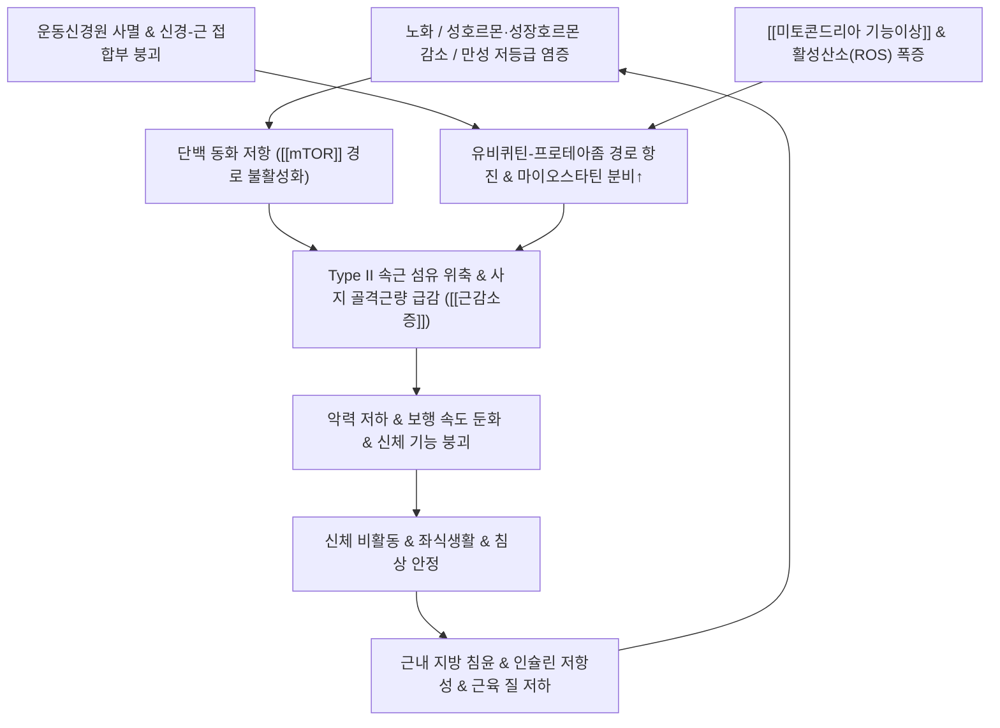

# 🩺 [[근감소증]] (Sarcopenia / 筋減少症, ICD-10 M62.84 / KCD M62.84)

> **핵심 3줄 요약 (Key Summary)**:
> - 📍 병소 부위 & 해부·병태생리: 단순한 생리적 노화 현상이 아니라, **노화, 운동단위 소실, 만성 염증 노화, [[단백 동화 저항]]으로 인해 전신 골격근의 제2형(속근) 섬유가 선택적으로 위축·소실되고 골격근량과 근력이 비가역적으로 붕괴하는 전신 대사-근골격계 질환**이다. 2016년 세계보건기구(WHO)에서 정식 질병코드(ICD-10 M62.84 / KCD M62.84)를 부여받았으며, 척수 알파-운동신경세포 사멸, [[위성세포]] 고갈, Akt-[[mTOR]] 경로 둔화 및 유비퀴틴-프로테아좀 분해 폭풍이 핵심 기전이다.
> - 🚩 전형적 임상 양상 & 3대 징후: ① **[[악력]] 저하(남성 <28.0kg, 여성 <18.0kg)** 및 상지 기능 상실(병뚜껑 열기, 무거운 물건 들기 불능) ② **하지 근력 붕괴에 따른 기립 및 보행 장애([[5회 의자 일어서기 검사]] ≥12초, 보행 속도 <1.0m/s)** ③ **반복적 낙상과 급격한 일상생활수행능력(ADL) 상실 및 만성 피로**.
> - 🛠️ 핵심 감별 검사 & 한·양방 다각적 치료 전략: 아시아 근감소증 진단 기준(AWGS 2025/2019) 및 유럽(EWGSOP2) 알고리즘에 따라 **선별([[SARC-F]] ≥4점 또는 종아리 둘레 남 <34cm, 여 <33cm) $\to$ 근력 평가(악력 및 5TSTS) $\to$ 골격근량 확진(DXA/BIA [[사지골격근량지수]] SMI) $\to$ 중증도 평가(보행속도, SPPB)** 체계로 확진한다. 치료는 FDA 승인 단독 약물이 부재하므로 **점진적 [[저항운동]](주 2~3회, 60~70% 1RM) + PROT-AGE 단백질(1.2~1.5g/kg/일) 및 [[류신]](2.5~3g/회)·[[비타민 D]] 영양 요법**이 1차 표준 치료이며, 한의학적으로 脾主肌肉·肝腎不足에 입각하여 [[보중익기탕]], [[인삼양영탕]], [[삼령백출산]], [[독활기생탕]], [[신기고]] 및 [[족삼리]]·[[비수]]·[[음릉천]] 온침과 2/100Hz 변조 [[전침치료]], [[자하거약침]]을 병용한다.
> - <font color="#fa7e7e">⚠️ 응급 의뢰 레드플래그 & 악화 요인: ① 악액질(Cachexia) 의심 급격한 비자발적 체중 감소(암·결핵 등 만성 소모성 질환) ② 근위축성 측삭경화증(ALS/루게릭병) 의심 근섬유다발수축(Fasciculation), 연하곤란, 구음장애 ③ 급성 길랑-바레 증후군이나 척수 압박에 따른 진행성 하지 마비 ④ GLP-1 비만 치료제(세마글루타이드 등) 투여 중 운동·단백질 결여로 인한 급격한 제지방 고갈. 골다공증 동반 고령 환자에게 척추 HVLA 회전 스러스트 추나는 절대 금기이다.</font>

---

## 📌 목차
1. [질환 개요 & 해부학적 병태생리](#1-질환-개요--해부학적-병태생리)
2. [병태생리 메커니즘 & 생체역학적 악순환 네트워크](#2-병태생리-메커니즘--생체역학적-악순환-네트워크)
3. [임상 증상 & 이학적 검사(Physical Exam) 알고리즘](#3-임상-증상--이학적-검사physical-exam-알고리즘)
4. [감별 진단 매트릭스 (Differential Diagnosis)](#4-감별-진단-매트릭스-differential-diagnosis)
5. [한의 통합 치료 프로토콜 (침·약침·추나·한약)](#5-한의-통합-치료-프로토콜-침약침추나한약)
6. [양방 치료 & 병용·의뢰 기준 (Conventional Treatment & Referral)](#6-양방-치료--병용의뢰-기준-conventional-treatment--referral)
7. [재활 운동 & 생활습관 티칭 가이드](#7-재활-운동--생활습관-티칭-가이드)
8. [💡 사용자 진료실 핵심 필기 & 임상 노하우 (Melt-In 잔여 심화 집약)](#8--사용자-진료실-핵심-필기--임상-노하우-melt-in-잔여-심화-집약)
9. [출처 및 학술 참고 문헌 (References)](#9-출처-및-학술-참고-문헌-references)

---

## 1. 질환 개요 & 해부학적 병태생리

* **질환 정의 및 공식 질병 분류**:
  * **정의**: 근감소증(Sarcopenia, 筋減少症)은 **골격근량(Skeletal Muscle Mass)의 점진적이고 전신적인 소실**과 함께 **근력(Muscle Strength) 및 신체 기능(Physical Performance)이 동반 저하**되는 진행성·전신성 골격근 질환이다.
  * **질병 코드 등재의 역사적 의의**: 과거 단순한 자연 노화의 한 과정으로 치부되던 근감소증은 2016년 세계보건기구(WHO)에 의해 독립적인 질병코드(ICD-10 M62.84, 한국 KCD M62.84)를 부여받음으로써 공식적인 치료 및 관리의 대상인 의학적 질병으로 확립되었다.
  * **임상적 중요성**: 근감소증은 단순한 근육 위축에 그치지 않고, 인체 최대의 포도당 소비 기관이자 에너지 저장고인 근육의 붕괴를 초래하여 인슐린 저항성, 제2형 당뇨병, 대사증후군, 심혈관 합병증, 낙상 및 골절, 와병 상태, 조기 사망률을 3배 이상 폭증시키는 핵심 위험 인자이다.

* **최신 한국인 역학 (AWGS 2025 기준 분석)**:
  * 2026년 발표된 최신 연구(Yoo et al., 2026)에서 **2024년 국민건강영양조사(KNHANES) 데이터를 기반으로 최신 아시아 근감소증 진단 기준(AWGS 2025)을 적용해 한국 성인의 근감소증 유병률을 분석**한 결과, 65세 이상 노인 인구에서 유병률이 가파르게 상승하며 고령화에 따른 국가적 보건 문제로 대두되고 있음이 실증되었다.
  * 연령이 증가함에 따라 40대 이후부터 매년 약 1%씩 근육량이 감소하며, 70대 이후에는 청년기 근육량의 40~50%까지 소실될 수 있다.
  * 또한 고지대 및 저산소 환경 등 대사적 스트레스 환경에서 순환 면역대사 지표와 골격근 강도의 밀접한 상관성이 확인되는 등, 근감소증은 면역-대사-근골격이 융합된 다중 장기 복합 증후군임이 규명되고 있다 (Liu et al., 2026).

* **관련 해부학적 구조물 및 미세 조직학적 변화**:
  * **근섬유 아형의 불균형적 위축 (Type II Fiber Atrophy)**:
    * 폭발적인 파워와 빠른 수축력을 담당하는 **제2형 속근 섬유(Type II fast-twitch glycolytic fibers)**가 노화와 단백동화 저항에 의해 선택적으로 극심하게 위축되고 사멸합니다.
    * 반면 지구력을 담당하는 제1형 지근 섬유(Type I slow-twitch oxidative fibers)는 상대적으로 보존되거나, 탈신경된 속근 섬유가 인접 지근 운동단위의 신경지배를 받아 제1형으로 형태학적 치환이 일어납니다. 이로 인해 근육의 수축 파워와 반응 속도가 현저히 둔화됩니다.
  * **위성세포(Satellite Cells)의 고갈 및 섬유화**:
    * 근초(Sarcolemma)와 기저막 사이에 존재하며 근섬유 손상 시 분열·융합하여 근육 재생을 전담하는 줄기세포인 위성세포의 절대적 수와 증식 활성도가 노화로 인해 급감하며, 손상된 근섬유 자리는 재생되지 못하고 섬유아세포와 콜라겐 침착(섬유화, Fibrosis)으로 대체됩니다.
  * **운동단위(Motor Unit)와 척수 알파-운동신경세포 사멸**:
    * 척수 전각(Anterior horn)의 대형 알파-운동신경세포가 세포자멸사(Apoptosis)로 소실됨에 따라 운동신경 하나가 지배하는 근섬유 다발의 탈신경(Denervation)이 광범위하게 발생합니다.
  * **근내 지방 침윤(Myosteatosis)**:
    * 골격근 다발 사이(IMAT)와 근세포 내부(IMCL)에 지방 방울이 침투하여 근육의 수축 질(Muscle quality)이 급격히 저하되고 기계적 탄성이 소실됩니다.
  * **호발 대근군**:
    * 중력을 이겨내고 보행과 직립 자세를 유지하는 하지 항중력근인 [[대퇴사두근]](대퇴직근, 내측광근, 외측광근), [[둔근]](대둔근, 중둔근), [[비복근]], [[가자미근]] 및 척추 안정화 근육인 [[척추기립근]]([[흉최장근]], [[요장늑근]])의 위축이 가장 빠르고 심각하게 발생합니다.

---

## 2. 병태생리 메커니즘 & 생체역학적 악순환 네트워크

### 1) 분자 세포학적 병태생리 및 신경-근 캐스케이드 (Molecular & Neuromuscular Cascade)

근감소증은 단백질 동화 저항, 이화 작용 폭증, 신경 탈신경, 미토콘드리아 붕괴가 맞물려 돌아가는 다축 분자 네트워크에 의해 구동됩니다.

```
       [노화 / 운동부족 / 영양결핍 / 만성염증]
                          │
       ┌──────────────────┴──────────────────┐
       ▼                                     ▼
 [신경학적 소실 기전]                 [분자 대사적 동화 억제 기전]
 • 척수 전각 알파-운동신경세포 사멸     • 인슐린 / IGF-1 신호전달 둔화
 • 운동단위(Motor unit) 소실          • 아미노산 저항성 (단백 동화 저항)
 • 신경-근 접합부(NMJ) 형태 붕괴      • Akt-mTORC1 경로 억제 (단백합성↓)
       │                                     │
       ├──────────────────┬──────────────────┤
       ▼                  ▼                  ▼
[Type II 속근 선택적 위축] [이화경로 과활성화]    [미토콘드리아 기능부전]
• 속근 섬유 탈신경 사멸     • FoxO 핵 전좌        • mtDNA 결실 & 전자전달계 붕괴
• 지근(Type I)으로 전환     • Ubiquitin-Proteasome • 활성산소종(ROS) 폭증
• 위성세포(Satellite) 고갈 • 마이오스타틴 분비↑   • 만성 저등급 염증(IL-6, TNF-α)
       │                  │                  │
       └──────────────────┼──────────────────┘
                          │
                          ▼
            ┌───────────────────────────┐
            │   골격근량 급감 (Muscle Atrophy) │
            │   근력 붕괴 (Dynapenia)        │
            │   근내 지방침착 (Myosteatosis)  │
            └─────────────┬─────────────┘
                          │
                          ▼
            ┌───────────────────────────┐
            │      생체역학적 기능 부전   │
            │ • 보행 속도 둔화 (<1.0 m/s) │
            │ • 의자 기립 지연 (≥12초)    │
            │ • 악력 저하 (<28/<18 kg)   │
            └─────────────┬─────────────┘
                          │
                          ▼
            ┌───────────────────────────┐
            │   신체 비활동 & 침상 안정화 │
            │   낙상 및 골절 (골다공증 동반)│
            │   대사율 저하 및 사망률 폭증 │
            └───────────────────────────┘
```



### 2) 핵심 분자 신호 전달 경로의 파탄

1. **단백 동화 저항 (Anabolic Resistance)과 Akt-mTORC1 신호 불활성화**:
   * 젊은 근육은 식후 혈중 아미노산(특히 [[류신]]) 상승과 인슐린 분비에 즉각 반응하여 PI3K-Akt 경로를 통해 mTORC1(Mechanistic Target of Rapamycin Complex 1)을 활성화하고, 하위의 p70S6K 및 4E-BP1을 인산화시켜 리보솜에서의 단백질 번역(Translation)을 개시합니다.
   * 그러나 근감소증 고령 환자의 근육에서는 인슐린 수용체 감수성 저하와 미토콘드리아 산화 결함으로 인해 아미노산이 투여되어도 mTORC1이 정상적으로 활성화되지 않는 **단백 동화 저항**이 발생합니다.
2. **단백질 분해 경로의 폭발적 항진 (Ubiquitin-Proteasome System)**:
   * 동화 신호인 Akt 활성이 떨어지면 전사인자인 FoxO(Forkhead box O)의 억제가 풀려 핵 내로 진입합니다.
   * FoxO는 근육 특이 E3 유비퀴틴 리가아제인 **MuRF-1(Muscle RING-finger protein-1)**과 **Atrogin-1(MAFbx)**의 전사를 폭발적으로 촉진하며, 이들 효소는 골격근의 수축 단백질인 마이오신 중쇄(Myosin heavy chain)와 액틴 필라멘트에 유비퀴틴 꼬리표를 붙여 26S 프로테아좀으로 보내 파쇄합니다.
3. **[[마이오스타틴]](Myostatin) 과분비와 위성세포 차단**:
   * TGF-beta 수퍼패밀리에 속하는 음성 마이오킨인 마이오스타틴이 과잉 발현되어 Activin 수용체(ActRIIB)에 결합하면, Smad2/3 경로를 통해 근비대 신호를 차단하고 위성세포의 세포주기 진행을 G1기에서 정지시켜 근육 자생력을 완전히 마비시킵니다.
4. **미토콘드리아 DNA 결실 및 세포자멸사**:
   * 수십 년간 축적된 활성산소종(ROS)에 의해 미토콘드리아 DNA(mtDNA)의 점돌연변이와 대규모 결실이 유발됩니다. 이는 시토크롬 c 산화효소(COX) 결손 근섬유를 양산하고, 시토크롬 c가 세포질로 누출되어 카스파제-3(Caspase-3) 활성화를 통한 근핵의 자멸사(Nuclear apoptosis)를 촉진합니다.

### 3) 생체역학적 연쇄 반응 (Kinetic Chain) 및 임상적 붕괴

* **보행 메커니즘 붕괴와 동적 안정성 상실**:
  * [[대퇴사두근]]과 대둔근의 근력 약화는 보행 주기 중 입각기(Stance phase)에서의 무릎 관절 굴곡 제어를 불가능하게 만듭니다. 환자는 무릎이 꺾이는 것을 막기 위해 상체를 앞으로 숙이고 무릎을 과신전(Genu recurvatum)시키는 보상 패턴을 취하게 되며, 이는 슬관절 후방 관절낭 및 십자인대에 비정상적인 견인력을 가합니다.
* **발목 전략(Ankle Strategy) 상실과 낙상 위험 폭증**:
  * 체간이 흔들릴 때 미세한 균형을 잡아주는 비복근 및 전경골근의 고유수용성 감각과 신속 수축력이 상실되어, 중심을 잃었을 때 발목으로 버티지 못하고 고관절을 크게 꺾거나 휘청거리는 고관절 전략(Hip strategy)으로 퇴행합니다. 외부 미세 섭동 시 스텝을 제때 딛지 못해 낙상 위험이 3배 이상 폭증합니다.
* **골-근 크로스토크 파탄과 골감소성 근감소증(Osteosarcopenia)**:
  * 근육의 수축력은 뼈에 가해지는 가장 강력한 기계적 자극(Mechanotransduction)입니다. 골격근량이 감소하면 골소강 내 골세포(Osteocyte)로 전달되는 기계적 신호가 결손되어 Wnt/β-catenin 신호가 꺼지고 파골세포 활성이 우세해져 [[골다공증]]이 가속화됩니다. 이로 인해 낙상 시 대퇴골 경부 골절 및 척추 압박골절로 직결됩니다 (Kemmler et al., 2020).

---

## 3. 임상 증상 & 이학적 검사(Physical Exam) 알고리즘

### 1) 주소증 및 기능적 표현형 (Clinical Presentation)

* **전형적 주소증**:
  * "조금만 걸어도 다리가 천근만근 무겁고 힘이 빠져 주저앉고 싶다."
  * "방바닥이나 낮은 의자, 변기에서 일어날 때 무릎이나 벽, 손잡이를 짚지 않으면 도저히 일어날 수가 없다."
  * "계단을 올라갈 때 다리가 후들거려 반드시 난간을 잡아야 하고, 내려올 때는 무서워서 한 칸씩 두 발을 모으며 내려온다."
  * "손에 쥐는 힘이 예전 같지 않아 잼 병뚜껑, 생수병 뚜껑을 열기 힘들고 무거운 냄비를 들다 떨어뜨린다."
  * "걸음걸이가 너무 느려져서 파란 불이 깜빡이는 횡단보도를 시간 내에 건너가지 못한다."
* **전신 쇠약 징후**:
  * 특별한 내과적 질환이 없음에도 만성적인 무기력과 탈진감 호소.
  * 종아리와 허벅지가 육안으로 확연히 가늘어지고 바지가 헐렁해짐.

### 2) AWGS 2025 / EWGSOP2 표준 진단 알고리즘 (4단계 프레임워크)

아시아인의 체격과 역학적 특성을 반영한 최신 아시아 근감소증 진단 기준(AWGS 2025/2019) 및 유럽(EWGSOP2) 합의문에 따른 표준 4단계 임상 진단 알고리즘입니다.

```
[1단계: 증례 발견 및 선별 (Case Finding & Screening)]
  • SARC-F 설문지: 총점 10점 중 ≥ 4점  또는
  • 종아리 둘레(Calf Circumference): 남성 < 34.0 cm, 여성 < 33.0 cm  또는
  • SARC-CalF 결합 점수: ≥ 11점
                 │
                 ▼ (선별 양성 시)
[2단계: 근력 평가 (Assessment of Muscle Strength)]
  • 악력(Handgrip strength): 남성 < 28.0 kg, 여성 < 18.0 kg  또는
  • 5회 의자 일어서기 검사(5-STS): 소요 시간 ≥ 12.0초
                 │
                 ├──────────────────────────────┐
                 ▼ (근력 저하 확인 시)           ▼ (근력 정상)
    ┌───────────────────────────┐         [정상 또는 추적 관찰]
    │ 근감소증 의증 (Possible)   │
    │ * 1차 의료기관 중재 즉시 개시│
    └─────────────┬─────────────┘
                  │
                  ▼
[3단계: 골격근량 확진 (Confirmation of Muscle Quantity)]
  • 사지골격근량지수 (SMI = ASM / 신장² [kg/m²])
    - DXA (이중에너지 X선): 남성 < 7.0 kg/m², 여성 < 5.4 kg/m²
    - BIA (생체전기저항):   남성 < 7.0 kg/m², 여성 < 5.7 kg/m²
                  │
                  ├──────────────────────────────┐
                  ▼ (근육량 저하 확인 시)         ▼ (근육량 정상)
    ┌───────────────────────────┐         [근감소증 배제]
    │   근감소증 확진 (Sarcopenia)│         (다이나페니아 Dynapenia 고려)
    └─────────────┬─────────────┘
                  │
                  ▼
[4단계: 중증도 평가 (Assessment of Severity)]
  • 신체 기능 평가 (Physical Performance)
    - 6m 보행 속도 검사: < 1.0 m/s
    - 간이신체기능검사 (SPPB): 총점 12점 중 ≤ 9점
    - 5회 의자 일어서기: ≥ 12.0초
                  │
                  ▼ (기능 저하 동반 시)
    ┌───────────────────────────────────┐
    │  중증 근감소증 (Severe Sarcopenia) │
    └───────────────────────────────────┘
```

### 3) 필수 정량적 기능 평가 도구 상세

* **[[악력검사]] (Handgrip Strength Test)**:
  * 상지 등척성 최대 수축력을 측정하여 전신 골격근력의 대리 지표로 활용합니다.
  * 디지털 악력계로 팔꿈치 90도 굴곡위에서 좌우 2~3회 측정 후 최대값을 채택합니다.
  * 절단값: **남성 < 28.0 kg, 여성 < 18.0 kg**.
* **[[5회 의자 일어서기 검사]] (5-Times Sit-to-Stand, 5TSTS)**:
  * 팔걸이 없는 표준 의자에서 양팔을 가슴에 교차한 채 앉았다 완전히 일어서는 동작을 5회 반복하는 시간을 초 단위로 정밀 계측합니다.
  * 절단값: **≥ 12.0초**. 하지 대퇴사두근과 둔근의 파워 및 신경근 협응력을 평가합니다.
* **6m [[보행속도검사]] (Gait Speed Test)**:
  * 평상시 걸음 속도로 6m 직선 코스를 걷게 하여 가속/감속 1m를 제외한 구간의 속도를 산출합니다.
  * 절단값: **< 1.0 m/s**. 노인의 독립 보행능력 및 사망률 예측의 강력한 독립 인자입니다.
* **[[간이신체기능검사]] (Short Physical Performance Battery, SPPB)**:
  * 1) 균형 검사(나란히 서기, 반일자 서기, 일자 서기 各 10초)
  * 2) 4m 보행 속도 검사
  * 3) 5회 의자 일어서기 검사
  * 각 4점 만점, 총 12점 중 **≤ 9점**인 경우 심각한 신체 기능 저하 및 노쇠(Frailty)로 판정합니다.
* **[[SARC-CalF]] 설문 및 신체계측**:
  * 근력(Strength), 보행 보조(Assistance in walking), 의자 기립(Rise from a chair), 계단 오르기(Climb stairs), 낙상(Falls) 5개 항목(각 0~2점, 총 10점)에 **종아리 둘레 점수(남 <34cm, 여 <33cm 시 10점 부여)**를 결합하여 총 20점 중 **≥ 11점** 시 진단적 민감도를 극대화합니다.

---

## 4. 감별 진단 매트릭스 (Differential Diagnosis)

| 감별 질환 | 주요 병태생리 | 근육량 및 근력 양상 | 감각 및 건반사 | 감별 핵심 진단 포인트 |
| :--- | :--- | :--- | :--- | :--- |
| **[[근감소증]]**<br>(본 질환) | 노화, 단백동화저항, 비활동,<br>Type II 섬유 선택적 위축 | **점진적 사지 근육량 및 근력 저하**,<br>대칭성, 원위부 악력 저하 | **감각 장애 없음**,<br>건반사 정상 또는 경미 저하 | 혈청 CK 정상, 점진적 진행,<br>AWGS/EWGSOP2 진단 기준 충족 |
| **[[악액질]]**<br>(Cachexia) | 암, 말기 신부전·심부전,<br>전신성 전염증성 사이토카인 폭풍 | **제지방과 체지방의 급격한 동시 붕괴**,<br>극심한 근육 소모 | 신경학적 결손 없음,<br>전신 쇠약 현저 | **6개월 내 체중 >5% 불수의적 급감**,<br>식욕부진, CRP/ESR 급상승, 원질환 존재 |
| **[[노쇠 증후군]]**<br>(Frailty) | 다발성 장기 생리적 예비능 상실,<br>스트레스 취약성 증대 | 근력 저하 외에 전신 탈진,<br>느린 보행, 활동량 저하 동반 | 신경학적 국소 징후 없음 | 프라이드(Fried) 5대 기준 중 3개 이상 부합<br>(체중감소, 탈진, 악력, 보행, 활동량) |
| **중증 근무력증**<br>(Myasthenia Gravis) | 신경-근 접합부 아세틸콜린 수용체<br>(AChR) 자가항체 매개 손상 | **근육량은 정상 유지**,<br>사용할수록 근력 급감(병적 피로) | 감각 정상, 건반사 정상 | **일중 변동성(오후·저녁 악화, 휴식 시 호전)**,<br>안검하수, 복시, 연하곤란, 항AChR 양성 |
| **염증성 근병증**<br>(다발근염/피부근염) | 근내막/근주막 자가면역 염증 침윤,<br>근섬유 괴사 및 재생 | **근위부 대칭성 근력 약화**<br>(팔 들어올리기, 계단 오르기 곤란) | 감각 정상, 근육 압통 동반 가능 | **혈청 CK 및 Aldolase 수천 단위 급상승**,<br>근전도 상 근병증성 전위, 피부 발진 |
| **근위축성 측삭경화증**<br>(ALS / 루게릭병) | 상위 및 하위 운동신경세포의<br>진행성 동시 변성 사멸 | 광범위하고 진행성인 비대칭 근위축,<br>상지 원위부에서 호발 | **감각 정상**, **병적 반사 양성**<br>(바빈스키 징후, 건반사 항진) | **근섬유다발수축(Fasciculation)**,<br>설근 위축, 구음장애, 근전도 광범위 탈신경 |
| **[[당뇨병성 근위축]]**<br>(Diabetic Amyotrophy) | 요추천골신경총 미세혈관 허혈,<br>신경근병성 축삭 손상 | 골반대 및 대퇴사두근의<br>**급성·아급성 비대칭 위축** | 대퇴부 극심한 신경통,<br>슬개건 반사 소실 | 심한 신경병성 통증 선행 후 급격한 위축,<br>단일 신경근 분포 초과 |
| **[[골감소성 근감소증]]**<br>(Osteosarcopenia) | 골격계와 근육계의 동시 노화 및<br>기계적 신호 결손 | 사지 골격근량 저하 + 근력 약화,<br>신체 기능 부전 | 골절 부위 국소 타진통 가능 | **DXA 상 골밀도 T-score ≤ -1.0**<br>(골감소증/골다공증)과 근감소증 동시 확진 |

---

## 5. 한의 통합 치료 프로토콜 (침·약침·추나·한약)

### 1) 한의학적 병기론 및 치료 대원칙
* 한의학에서 근감소증은 **육위(肉痿), 위증(痿證), 허로(虛勞)**의 범주에 속합니다.
* **비주기육(脾主肌肉), 비주사말(脾主四末)**: 소화흡수를 주관하는 비위(脾胃)가 허약해지면 음식물의 수곡정미(단백질 등 영양소)를 근육으로 공급하지 못해 사지 근육이 마르고 위축됩니다.
* **간주근(肝主筋), 신주골(腎主骨)**: 노화에 따라 간신(肝腎)의 정혈이 고갈되면 근막과 골격계가 영양을 공급받지 못해 근력이 붕괴하고 뼈가 약해집니다.
* 따라서 한의 통합 치료의 핵심 축은 **健脾益氣(소화흡수 개선을 통한 단백 동화 촉진) + 補益肝腎·强筋骨(신경-근-골격 자생력 회복)**입니다.

### 2) 변증별 한약 처방 (Herbal Medicine)

* **脾胃氣虛型 (비위기허형) — 소화 흡수 저하형**:
  * **주치 증상**: 사지 무력, 근육량 지속 감소, 식후 복부 팽만, 소식(소화불량), 묽은 변, 만성 피로, 설담태백, 치흔설, 맥 완약.
  * **대표 처방**: **[[보중익기탕]](補中益氣湯)**, **[[삼령백출산]](蔘苓白朮散)**, **[[육군자탕]](六君子湯)**.
  * **방의 및 기전**: 황기·인삼·백출·진피가 비위의 운화 기능을 극대화하여 섭취된 식이 단백질의 소화율과 아미노산 체내 흡수율을 제고하고, 근육 내 mTOR 동화 신호를 활성화합니다.
* **氣血兩虛型 (기혈양허형) — 전신 소모 및 쇠약형**:
  * **주치 증상**: 극심한 근위축, 안색 창백, 어지럼증, 심계항진, 불면, 피부 건조, 손발 저림, 설담, 맥 세약.
  * **대표 처방**: **[[인삼양영탕]](人參養榮湯)**, **[[십전대보탕]](十全大補湯)**, **[[팔진탕]](八珍湯)**, **[[귀비탕]](歸脾湯)**.
  * **방의**: 보기제와 보혈제를 균등 배합하고 원지·오미자·육계 등을 가미하여 골수 조혈 기능과 말초 모세혈관 순환을 촉진하고 만성 염증성 소모 상태를 복구합니다.
* **肝腎不足型 (간신부족형) — 노인성 근골격 퇴행형**:
  * **주치 증상**: 허리와 무릎의 만성 시림과 위약감(요슬산연), 보행 불안정, 하지 근위축, 골다공증 동반, 이명, 맥 침세삭.
  * **대표 처방**: **[[독활기생탕]](獨活寄生湯)**, **[[육미지황탕]](六味地黃湯)**, **[[가미대보탕]](加味大補湯)**.
  * **방의**: 숙지황·산수유·두충·우슬이 척수 신경세포와 골격계 축을 보강하여 파골세포 활성을 억제하고 신경근 연접부의 신호 보존을 돕습니다.
* **약식동원(藥食同源) 입증 처방 — [[신기고]](蔘芪膏)**:
  * 2026년 발표된 최신 무작위 대조군 이중맹검 임상시험(Li et al., 2026)에서 입증된 처방:
  * **구성**: [[황기]], [[당삼]], [[황정]], [[산약]], [[복령]], [[두충]], [[맥아]], [[맥문동]] 8종.
  * **임상 효과**: 비신허증 노인 환자에게 12주간 투여 시 위약군 대비 악력, 사지골격근량지수(SMI), 5회 의자 일어서기(5-STS) 속도를 유의하게 개선하고 혈중 만성 염증 지표(CRP)를 현저히 강하시켰습니다.

### 3) 침구 치료 및 2/100Hz 변조 전침 프로토콜

* **핵심 혈위 배혈**:
  * **전신 비위 기혈 보익**: [[족삼리]](ST36), [[비수]](BL20), [[위수]](BL21), [[음릉천]](SP9), [[삼음교]](SP6), [[중완]](CV12).
  * **간신 보익 및 척수신경 자극**: [[신수]](BL23), [[태계]](KI3), [[명문]](GV4), [[양릉천]](GB34, 筋會).
  * **하지 항중력근 국소 운동점(Motor Points)**: 대퇴직근, 내측광근, 외측광근, 전경골근, 비복근 근복.
* **2/100Hz 변조 전침(Dense-Disperse Wave Electroacupuncture)의 신경-근 활성화 기전**:
  * **전침 세팅**: 대퇴사두근 모터 포인트에 자침 후 **2Hz(저주파)와 100Hz(고주파)가 주기적으로 교대하는 변조파**를 20분간 인가합니다.
  * **분자생물학적 작용**:
    * 2Hz 자극은 근육의 리드미컬한 수축을 유도하여 골격근 내 **IGF-1 분비 촉진, AMPK 활성화, GLUT4 세포막 발현**을 유도하여 단백 동화 신호를 재가동합니다.
    * 100Hz 자극은 척수 전각 운동신경원과 신경-근 접합부(NMJ)의 아세틸콜린 유리를 자극하여 탈신경된 제2형 속근 섬유의 재신경화를 촉진하고 위성세포의 분화 증식을 자극합니다.
* **온침(溫針) 및 뜸 치료**:
  * 양기 쇠약과 하지 냉감을 호소하는 고령 환자의 족삼리, 신수, 관원에 온침 및 간접구를 병행하여 국소 혈류량 증가와 심부 체온 상승을 유도합니다.

### 4) 약침 치료 (Pharmacopuncture)

* **[[자하거약침]](인태반 추출물) — 근육 재생 및 단백 동화 촉진**:
  * 풍부한 아미노산 복합체, 펩타이드, 성장인자 유사 물질을 함유하여 간신휴손형 노인성 근위축 환자의 [[족삼리]](ST36), [[신수]](BL23), [[음릉천]](SP9) 및 대퇴사두근 건 부위에 회당 1.0~2.0cc 시술합니다. 만성 피로 개선과 악력 회복에 탁월한 임상적 반응을 보입니다.
* **신바로약침 및 녹용약침**:
  * 골-근 복합 퇴행([[골감소성 근감소증]]) 환자의 대퇴직근 건 부착부와 척추 기립근에 시술하여 염증성 사이토카인(TNF-α, IL-6)을 억제하고 골대사 및 연부조직 탄성을 복구합니다.

### 5) 추나 요법 (Chuna Manipulation)

* **근막이완추나 (Myofascial Release, JS 기법)**:
  * 장시간 좌식 및 보행 패턴 붕괴로 인해 병적으로 단축되고 섬유화된 하지 굴곡근군([[장요근]], [[대퇴직근]], [[햄스트링]], [[비복근]])을 부드럽게 이완하여 고관절 및 슬관절의 완전 신전 가동성을 회복합니다.
* **관절가동추나**:
  * 고관절, 족관절의 가동 범위를 점진적으로 넓혀 기립 및 보행 시 지면 반발력을 인지하는 고유수용성 감각 피드백을 향상시킵니다.
* **⚠️ 고령자 안전 절대 수칙**:
  * 대부분의 근감소증 환자는 골다공증을 동반하고 있습니다. **척추체에 대한 강한 고속저진폭(HVLA) 스러스트 교정은 척추 압박골절을 유발할 수 있으므로 절대 금기**이며, 반드시 부드러운 저속 저진폭 가동 및 근막 수기로만 진행합니다.

---

## 6. 양방 치료 & 병용·의뢰 기준 (Conventional Treatment & Referral)

### 1) 양방 약물 치료의 현주소와 한계
* **FDA 승인 근감소증 전용 단독 치료제의 부재**:
  * 현재 전 세계적으로 근감소증 치료만을 적응증으로 미국 FDA나 한국 식약처 승인을 획득한 전문의약품은 전무합니다.
  * 임상 시험 단계에 있는 약제들:
    * **마이오스타틴 억제 항체 (Bimagrumab, Trevogrumab)**: 근육량 증가는 유의미하게 확인되었으나, 기능적 보행 개선과의 해리 및 심혈관 부작용 등으로 3상 임상 문턱을 넘지 못하거나 연구가 지속 중입니다.
    * **선택적 안드로겐 수용체 조절제 (SARM)**: 동화 작용을 선택적으로 자극하나 간독성 및 심혈관 안전성 이슈가 남아 있습니다.
    * **남성호르몬 보충요법 (Testosterone)**: 성선기능저하증이 명확히 진단된 남성 노인에게 제한적으로 사용되나, 전립선 비대 및 암 위험, 적혈구증가증 우려로 보편적 투여가 불가능합니다.

### 2) 체중 감량 약물(GLP-1 RA)의 치명적 근손실 경고
* **위고비(세마글루타이드), 마운자로(터제파타이드)의 그림자**:
  * 최근 대중적으로 널리 처방되는 GLP-1 수용체 작용제는 탁월한 체중 감량 효과를 발휘하지만, **감량 체중의 30~40%가 골격근을 포함한 제지방에서 빠져나간다는 점**이 대규모 임상 연구들에서 일관되게 확인되었습니다.
  * 노인 및 중장년층이 충분한 단백질 섭취와 강력한 저항운동 없이 이들 약물만을 투여받아 급격히 체중을 감량할 경우, 치명적인 의인성(Iatrogenic) 근감소증 또는 근감소성 비만을 획득하게 됩니다.
  * **진료실 티칭**: 감량제 복용 환자에게는 반드시 주 2회 이상의 점진적 근력 운동과 단백질 1.2g/kg/일 이상의 섭취가 의무적 안전벨트임을 강력히 경고해야 합니다.

### 3) 한·양방 병용 판단 기준 (Combination Therapy Matrix)

* **병용 권장 (Synergistic)**:
  * 고혈압, 당뇨, 이상지질혈증 등 기저 만성질환 약물을 안정적으로 유지하면서 한방 [[보중익기탕]], [[신기고]] 및 침·전침 치료 병용. 만성 대사 질환으로 인한 단백질 분해를 억제하고 혈관 내피 기능을 개선하여 근육 관류를 증진시킵니다.
* **병용 주의 (Caution)**:
  * 글루코코르티코이드(스테로이드) 장기 복용 환자: 스테로이드 유발성 근병증이 가속되므로, 주치의와 상의하여 스테로이드 용량을 최소화하고 한방 보익제와 저항운동을 적극적으로 개입시켜야 합니다.

### 4) 응급 전원 및 전문과 의뢰 기준 (Referral Criteria)

* **즉각 의뢰 (Red Flags)**:
  * **운동신경원 질환(ALS) 의심**: 혀의 연축 및 위축, 사지 근육의 자발적 근섬유다발수축(Fasciculation), 삼킴곤란(Dysphagia), 호흡곤란이 동반되는 경우(신경과 응급 의뢰).
  * **악성종양 의심 악액질**: 원인 불명의 급격한 체중 감소(수개월 내 >5%), 식욕부진, 림프절 비대(혈액종양내과 의뢰).
  * **급성 마미증후군 및 척수병증**: 보행 장애와 함께 안장 부위 감각 소실, 배뇨·배변 장애, 양측 하지 심건반사 항진 및 바빈스키 징후(신경외과 의뢰).
  * **급성 골절**: 낙상 후 고관절 부위의 심한 통증 및 체중 부하 불능(정형외과 응급 의뢰).

---

## 7. 재활 운동 & 생활습관 티칭 가이드

### 1) 비약물 1차 표준 치료: 점진적 저항성 근력 운동 (Progressive Resistance Training, PRT)

근감소증 치료에서 운동은 단순한 건강 관리가 아니라 **손상된 근단백 합성 경로(mTOR)를 물리적으로 재가동하는 유일무이한 표준 처방**입니다.

* **운동 빈도 및 볼륨**:
  * **주 2~3회 빈도**, 격일 시행(근섬유 초회복을 위해 48시간 휴식 보장).
  * 최소 8~12주 이상 지속적으로 수행해야 신경근 적응을 넘어선 실질적 근비대가 유도됩니다.
* **운동 강도**:
  * **건강 노인**: **60~70% 1RM(1회 최대반복중량)** 강도로 8~12회 반복, 3세트.
  * **허약 및 고령 노인**: 40~50% 1RM의 낮은 저항으로 시작하여 자세 안정화 후 점진적으로 과부하를 적용.
* **수축 템포 (Tempo)**:
  * 부상 방지와 근비대 자극 극대화를 위해 **내리는 동작(신장성 수축)은 2~3초간 천천히 버티며 수행하고, 미는 동작(단축성 수축)은 1초간 폭발적으로 수행**하도록 지도합니다.
* **진료실 처방 4대 핵심 홈트레이닝 동작**:
  1. **의자에서 일어서기 (Chair Squat)**:
     * 높이 45cm 의자 끝에 앉아 양팔을 가슴에 교차하고, 반동 없이 허벅지와 엉덩이 힘으로 일어섭니다. 10회 × 3세트.
  2. **까치발 들기 (Calf Raise)**:
     * 벽이나 의자 등받이를 가볍게 짚고 양 발뒤꿈치를 최대한 높이 들어 올려 2초간 정지 후 천천히 내립니다. 보행 추진력과 발목 안정성 확보. 15회 × 3세트.
  3. **누워서 엉덩이 들기 (Glute Bridge)**:
     * 바닥에 등을 대고 누워 무릎을 세우고 발바닥으로 지면을 밀며 엉덩이를 들어 올려 일직선을 만듭니다. 둔근과 햄스트링 강화. 12회 × 3세트.
  4. **탄력 밴드 무릎 펴기 (Seated Leg Extension)**:
     * 의자에 앉아 발목에 탄력 밴드를 걸고 무릎을 앞으로 곧게 펴서 허벅지 앞쪽(대퇴사두근)을 강하게 조여줍니다. 12회 × 3세트.

### 2) 식이 단백질 및 영양 요법 (PROT-AGE 가이드라인)

* **최적 단백질 섭취량**:
  * 노인의 단백 동화 저항을 극복하기 위해 건강한 노인은 **일일 체중 1kg당 1.2~1.5 g**, 급만성 질환이나 심한 근위축이 동반된 노인은 **최대 2.0 g/kg/일** 섭취를 권장합니다 (Bauer et al., 2013).
  * 단, 만성 콩팥병(CKD Stage 3b 이상, eGFR <45 mL/min/1.73m²) 환자는 신기능 악화를 방지하기 위해 단백질 제한(0.8 g/kg/일)을 준수해야 하므로 사전 혈액검사 확인이 필수적입니다.
* **식사당 단백질 분산 섭취**:
  * 단백질을 저녁 한 끼에 몰아서 먹으면 초과분은 산화되어 배설됩니다. **매 끼니 25~30g씩 균등하게 나누어 섭취**해야 근단백 합성 역치(Muscle Protein Synthesis threshold)를 종일 유지할 수 있습니다.
* **[[류신]](Leucine) 섭취 극대화**:
  * 류신은 mTORC1을 직접 자극하는 핵심 아미노산입니다. 식사당 **2.5~3.0g의 류신**이 함유된 양질의 단백질([[유청단백질]], 계란, 살코기, 생선, 콩)을 섭취하도록 지도합니다.
* **혈청 [[비타민 D]] 농도 최적화**:
  * 혈청 25(OH)D 농도를 **≥ 30 ng/mL**로 유지해야 골격근 세포 내 비타민 D 수용체(VDR)가 활성화되어 칼슘 유입과 근섬유 단백질 합성이 촉진됩니다. 필요 시 비타민 D3 1,000~2,000 IU/일을 처방합니다.

---

## 8. 💡 사용자 진료실 핵심 필기 & 임상 노하우 (Melt-In 잔여 심화 집약)

### 1) 저항운동의 '근력 vs 근육량' 생체 반응 해리 (Meta-analysis Insight)
* 959명 대상 메타분석에 따르면, 저항운동 중재 시 **신경학적 근력(악력 SMD 0.83, 무릎 신전력 SMD 0.90)은 초기 4~8주 내에 매우 빠르고 폭발적으로 상승**하지만, **체성분상의 절대 근육량 증가(SMD 0.25~0.28)는 매우 느리게 지연성으로 나타납니다.**
* 환자가 "운동을 두 달이나 했는데 인바디 검사에서 근육량이 100g도 안 늘었어요"라며 치료를 포기하려 할 때, **"어르신, 엔진 부품(근육량)이 커지기 전에 엔진으로 통하는 전기 배선(신경근 협응력)이 먼저 뚫려서 악력과 의자 일어서기 속도가 빨라진 것입니다. 배선이 연결된 후 부품이 커지므로 지금이 가장 중요한 시점입니다"**라고 설명하여 치료 순응도를 유지시키는 것이 진료실의 핵심 상담 기술입니다.
* 생체지표 상 IGF-1(SMD 0.70), 항염증 IL-10(SMD 0.61), 폴리스타틴(SMD 0.56)이 먼저 상승하므로 운동 자체가 체내 분자 환경을 항염증·근합성 모드로 전환시켰음을 확신시켜 주어야 합니다.

### 2) 감독 운동 $\to$ 자가관리 전환 시 '디트레이닝(Detraining)' 방지 전략 (RCT 입증)
* 제2형 당뇨병 동반 근감소증 노인 62명 대상 RCT(Lin et al., 2026)의 결정적 통찰:
  * 12주간 병원에서 감독 하에 운동할 때는 악력, 5-STS, SARC-CalF가 모두 극적으로 개선되었으나, **가정 내 자가관리로 전환한 후 24주차에는 환자들의 순응도가 93.5%에서 38.7%로 폭락하며 세 기능 지표가 모두 치료 전의 나쁜 상태로 후퇴**했습니다.
  * 반면 골격근지수(SMI)는 24주차에 지연성으로 유의한 개선(β 0.20 kg/m²)을 유지했습니다.
  * **진료실 운영 불변 수칙**:
    * 환자를 치료 종결로 방치하지 말고, 퇴원 후에도 **① 4~8주 주기 정기 내원 재평가, ② 전화/카카오톡 운동 독려 모니터링, ③ 자필 운동일지 확인** 중 최소 2개를 결합한 '유지 관리 프로토콜'을 계약해야 치료 효과가 보존됩니다.

### 3) 진료실 3대 추적 루틴 수치 (Red-Line Cutoff)
1. **[[악력]]**: 남성 < 28.0 kg, 여성 < 18.0 kg
2. **[[5회 의자 일어서기 검사]](5TSTS)**: > 12.0초
3. **[[SARC-CalF]]**: ≥ 11점
* 매 내원 시마다 상기 3대 수치를 차트에 기록하고, 환자에게 그래프나 숫자로 변화를 직접 보여주는 것이 최고의 치료적 라포(Rapport)를 형성합니다.

### 4) 환자 티칭 스크립트 (진료실에서 그대로 읽어주는 문장)
* **근감소증의 위험성 설명**:
  > "어르신, 근육은 젊을 때의 '몸매'가 아니라, 나이 들어서는 목숨을 지켜주는 '생명 저금통'입니다. 뼈가 부러져 눕게 되는 것도, 당뇨가 조절 안 되는 것도 다리 근육이라는 저금통이 비었기 때문입니다. 이 저금통은 가만히 있으면 매년 1%씩 빠져나가지만, 오늘 처방해 드리는 근력 운동과 단백질 식사를 채우시면 80세, 90세에도 다시 저축할 수 있습니다."
* **단백질 섭취 교육**:
  > "밥과 나물만 드시면 근육이 다 녹아내립니다. 매 끼니 식탁에 '내 손바닥 크기'의 단백질 반찬을 올려놓으셔야 합니다. 아침에는 달걀 2개, 점심에는 생선 한 토막, 저녁에는 두부 반 모나 살코기를 꼭꼭 씹어 드십시오."

### 5) 최신 임상 시험 및 운동 의학 연구의 통합 (2026년 최신 고도화)
* **가정형 복합운동 12주 RCT의 시사점 (Xiao et al., 2024)**:
  * 마른 근감소증 노인 86명 대상 가정형 복합운동 12주 중재 시, 6분 보행거리(+57.7m, p<0.001)와 TUG(-1.22초)는 즉각 호전되었으나 악력과 체성분은 12주 시점에 비유의였습니다. 즉 단기 중재에서는 **기능과 신경 적응**이 먼저 오므로 체성분 결과에 실망하지 않도록 사전 티칭이 필요합니다.
* **골감소성 근감소증에서 1년 단위 고강도 저항운동의 근육량 증명 (Kemmler et al., 2020)**:
  * 좌식 노인 남성 대상 FrOST RCT 1년 추적 결과, 주 2회 고강도 저항운동으로 골격근량지수(SMI)와 레그프레스 근력(SMD 1.92), 요추 골밀도가 동시에 유의하게 증가했습니다. 12주의 신경 적응기를 거쳐 **1년 단위로 끌고 가면 체성분상의 절대 근육량도 반드시 증가함**을 증명하는 강력한 근거입니다.
* **약식동원 처방의 당뇨병성 근감소증 호전 (Li et al., 2026)**:
  * 신기고(황기·당삼·황정 등) 12주 투여로 악력, SMI, 5-STS의 군간 상호작용 개선과 만성 염증 억제가 확인되었으므로, 양방 당뇨 약물을 유지하면서 한방 건비보신제를 병용하는 통합 치료가 임상적으로 매우 유효합니다.
* **간헐적 단식 및 유산소 단독의 위험성 경고 (2026-10-10 통찰)**:
  * 노인 환자에게 무리한 격일단식이나 노르딕 워킹 등 유산소 단독 운동을 시키면 근육량 소실을 가속할 수 있습니다. 노인 근감소증 환자에게는 간헐적 단식 대신 야식을 배제하는 10~12시간 시간제한식이를 적용하고, 반드시 하체 중심 저항운동을 결합해야 합니다.

---

## 9. 출처 및 학술 참고 문헌 (References)

1. Yoo JI, et al. (2026). Prevalence of Sarcopenia in Korean Adults Based on the Asian Working Group for Sarcopenia 2025 Criteria: Analysis of the 2024 Korea National Health and Nutrition Examination Survey. *J Korean Med Sci*. [PMID: 42865285](https://pubmed.ncbi.nlm.nih.gov/42865285/)
   - [연구 요약]: 2024년 국민건강영양조사 전국 표본 데이터를 바탕으로 최신 아시아 진단 기준을 적용하여 한국 성인의 근감소증 유병률 및 역학적 특성을 분석하고 국가적 보건 관리 대책의 필요성을 제시함.

2. Liu X, et al. (2026). Corrigendum to Circulating immunometabolic markers associated with sarcopenia and muscle strength at high altitude: An integrated multi-omics study. *J Nutr Health Aging*. [PMID: 42843305](https://pubmed.ncbi.nlm.nih.gov/42843305/)
   - [연구 요약]: 고지대 환경 거주자 대상 다중 오믹스 통합 연구로 순환 면역대사 지표 및 사이토카인 프로파일이 골격근 악력 저하 및 발병과 연관됨을 규명함.

3. Cruz-Jentoft AJ, et al. (2019). Sarcopenia: revised European consensus on definition and diagnosis. *Age Ageing*. [PMID: 30312372](https://pubmed.ncbi.nlm.nih.gov/30312372/)
   - [연구 요약]: 유럽 노인의학회의 개정 진단 합의문으로 진단 핵심 지표를 단순 근육량에서 근력 저하 중심으로 전환하고 악력 및 신체기능 검사 기반의 임상 진단 알고리즘을 확립함.

4. Chen LK, et al. (2020). Asian Working Group for Sarcopenia: 2019 Consensus Update on Sarcopenia Diagnosis and Treatment. *J Am Med Dir Assoc*. [PMID: 32033882](https://pubmed.ncbi.nlm.nih.gov/32033882/)
   - [연구 요약]: 아시아인의 체격과 역학적 특성을 반영한 아시아 워킹그룹 진단 기준으로 악력 절단값과 의자 일어서기 및 보행속도 골격근지수 기준치를 표준화함.

5. Bauer J, et al. (2013). Evidence-based recommendations for optimal dietary protein intake in older people: a position paper from the PROT-AGE Study Group. *J Am Med Dir Assoc*. [PMID: 23867520](https://pubmed.ncbi.nlm.nih.gov/23867520/)
   - [연구 요약]: 고령자 최적 단백질 섭취 가이드라인으로 노인의 단백 동화 저항 극복을 위해 일일 체중당 단백질 섭취와 류신 섭취 필요성을 임상적으로 입증함.

6. Lin CH, et al. (2026). Sustained and attenuated effects of transitioning from supervised to self-managed resistance training in older adults with type 2 diabetes and sarcopenia: a randomized controlled trial. *Acta Diabetol*. [PMID: 42440096](https://pubmed.ncbi.nlm.nih.gov/42440096/)
   - [연구 요약]: 당뇨병 동반 근감소증 노인을 대상으로 저항운동 자가관리 전환 시 순응도 하락과 기능 지표의 조기 퇴행 현상을 규명하고 주기적 추적 모니터링의 임상적 필수성을 규명함.

7. Xiao Q, et al. (2024). Graded Progressive Home-Based Resistance Combined with Aerobic Exercise in Community-Dwelling Older Adults with Sarcopenia: A Randomized Controlled Trial. *Clin Interv Aging*. [PMID: 39355281](https://pubmed.ncbi.nlm.nih.gov/39355281/)
   - [연구 요약]: 지역사회 거주 근감소증 노인을 대상으로 12주간 가정형 점진적 복합 운동의 효과를 검증한 무작위 대조 시험으로 보행거리 및 기능 개선과 초기 신경근 적응 반응을 입증함.

8. Kemmler W, et al. (2020). Effects of High-Intensity Resistance Training on Osteopenia and Sarcopenia Parameters in Older Men with Osteosarcopenia-One-Year Results of the Randomized Controlled Franconian Osteopenia and Sarcopenia Trial (FrOST). *J Bone Miner Res*. [PMID: 32270891](https://pubmed.ncbi.nlm.nih.gov/32270891/)
   - [연구 요약]: 골감소성 근감소증 고령 남성을 대상으로 1년간 고강도 저항운동을 시행하여 1년 중재 시 골격근량지수와 레그프레스 근력 및 요추 골밀도의 유의한 동시 개선을 증명함.

9. Li X, et al. (2026). Efficacy and safety of medicine-food homology Shenqi paste in older adults with diabetic sarcopenia: A randomized, double-blind, placebo-controlled trial. *J Ethnopharmacol*. [PMID: 41763617](https://pubmed.ncbi.nlm.nih.gov/41763617/)
   - [연구 요약]: 당뇨병성 근감소증 노인을 대상으로 약식동원 신기고 투여 시 위약군 대비 악력과 골격근지수 및 염증 수치가 유의하게 개선됨을 입증한 이중맹검 무작위 대조 시험.

---

## 📎 개념 학습 보충 (2026-10-24 논문 연계)

- **전신진동운동 vs 저항운동 12주 직접 비교(2026-10-24 심층리뷰 2번)**: Sci Rep 2025;15(1):6981, [PMID 40011687](https://pubmed.ncbi.nlm.nih.gov/40011687/). AWGS-2019 기준 [[근감소증]] 65세 이상 27명(진동 14 / [[저항운동]] 13), 평균 73.6세, 주 3회×12주
- **결과**: 슬관절 신전근력은 양군 모두 증가(진동 p=0.023, 저항 p=0.002)했으나 **군간 비교에서는 저항운동이 우월**(p=0.007). 진동군은 ASMI와 [[IGF-1]]이 유의하게 증가, 저항군은 IGF-1 변화가 비유의. 양군 공통으로 체중·BMI·체지방률·성장호르몬·폴리스타틴이 감소하고 CK가 상승했으며, 염증지표([[IL-6]]·hs-CRP·TNF-α)는 변화가 없었다. 이상반응 0건, 참석률 95.8%·93.2%
- **처방 위치**: 근력이 1차 목표면 [[저항운동]]이 우선이고, [[전신진동운동]]은 '관절 부하를 줄이면서 근량·균형을 지키는 대안'으로 둔다. 12 Hz 저주파 프로토콜은 근력 이득이 제한적이었다
- **판정 규칙**: AWGS-2019 진단과 [[SARC-CalF]] 선별을 루틴에 넣고, 3개월마다 [[악력]]·[[5회 의자 일어서기 검사]]·보행속도·ASMI로 추적한다
- **한계**: 표본 27명·12주 단기. 염증지표가 움직이지 않은 점은 WBVT를 항염 중재로 설명하면 안 된다는 뜻이다
- 관련: [[전신진동운동]] · [[저항운동]] · [[IGF-1]] · [[사지골격근량지수(ASMI)|ASMI]] · [[2026-10-24_대사노인질환_심층리뷰]] 2번
