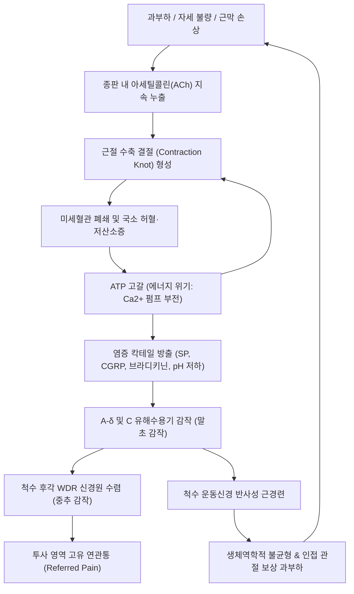

# 🩺 [[근막통증증후군]] (Myofascial Pain Syndrome / 筋膜痛症症候群, ICD-10 M79.1 / KCD M79.1)

> **핵심 3줄 요약 (Key Summary)**:
> - 📍 병소 부위 & 해부·병태생리: 골격근과 이를 둘러싼 근막 내 단단한 띠(Taut band) 내에 위치하는 과민한 압통점인 통증유발점(Myofascial Trigger Point, MTrP)과 국소 수축 결절(Contraction knot). Simons의 통합 가설(ACh 지속 누출 → 근절 과수축 → 모세혈관 압박 및 국소 허혈 → ATP 고갈 에너지 위기 → 산증 및 유해 통증 칵테일 방출).
> - 🚩 전형적 임상 양상 & 3대 징후: 압박 시 원격 부위로 투사되는 특징적 [[연관통]](Referred pain), 튕김 촉진 또는 자침 시 유발되는 [[국소연축반응]](Local Twitch Response, LTR), 관절 가동범위 제한 및 주관적 근력 저하(진성 신경학적 마비나 근위축 부재).
> - 🛠️ 핵심 감별 검사 & 한·양방 다각적 치료 전략: 전신 대칭성 다발통의 [[섬유근육통]](FMS) 및 피부분절 방사통을 보이는 [[경추 추간판 탈출증]] 감별. 아시혈(TrP) 침자 및 심부 건침술(Dry Needling), 전침(2Hz 저주파 엔도르핀 방출), 작약감초·중성어혈 약침, 허혈성 압박 추나, 한약([[작약감초탕]], [[갈근탕]], [[서경탕]])과 양방 TPI(국소마취제), rPMS, 체외충격파 병용.
> - <font color="#fa7e7e">⚠️ 응급 의뢰 레드플래그 & 악화 요인: 상·하지 운동신경 마비(Myotome 결손), 견배부·흉벽 자침 시 기흉(Pneumothorax) 위험, TrP로 오인된 악성 골/연부조직 종양 또는 심부 농양 의심 시 정밀 영상 검사 및 상급병원 전원.</font>

---

## 📌 목차
1. [질환 개요 & 해부학적 병태생리](#1-질환-개요--해부학적-병태생리)
2. [병태생리 메커니즘 & 생체역학적 악순환 네트워크](#2-병태생리-메커니즘--생체역학적-악순환-네트워크)
3. [임상 증상 & 이학적 검사(Physical Exam) 알고리즘](#3-임상-증상--이학적-검사physical-exam-알고리즘)
4. [감별 진단 매트릭스 (Differential Diagnosis)](#4-감별-진단-매트릭스-differential-diagnosis)
5. [한의 통합 치료 프로토콜 (침·약침·추나·한약)](#5-한의-통합-치료-프로토콜-침약침추나한약)
6. [양방 치료 & 병용·의뢰 기준 (Conventional Treatment & Referral)](#6-양방-치료--병용의뢰-기준-conventional-treatment--referral)
7. [재활 운동 & 생활습관 티칭 가이드](#7-재활-운동--생활습관-티칭-가이드)
8. [💡 사용자 진료실 핵심 필기 & 임상 노하우 (Melt-In 잔여 심화 집약)](#8--사용자-진료실-핵심-필기--임상-노하우-melt-in-잔여-심화-집약)
9. [출처 및 학술 참고 문헌 (References)](#9-출처-및-학술-참고-문헌-references)

---

## 1. 질환 개요 & 해부학적 병태생리

* **질환 정의 및 임상적 분류**:
  * **정의**: [[근막통증증후군]](Myofascial Pain Syndrome, MPS)은 하나 이상의 골격근 및 근막 조직 내에 과민하게 자극되는 국소 결절인 통증유발점(Myofascial Trigger Point, MTrP)이 형성되어, 해당 부위의 극심한 압통뿐만 아니라 고유의 비신경분절성 [[연관통]](Referred pain), 근육 경직, 관절 가동범위 제한 및 국소 자율신경계 반응을 야기하는 흔한 만성 근골격계 질환군입니다.
  * **분류**:
    * **일차성 MPS(Primary MPS)**: 급성 근육 과부하, 반복적 미세손상, 장시간 불량한 자세 유지, 정서적 스트레스 등에 의해 기저 질환 없이 단독으로 발생하는 형태.
    * **이차성 MPS(Secondary MPS)**: [[경추 추간판 탈출증]], [[요추 추간판 탈출증]], [[회전근개 질환]], [[척추관 협착증]], 골관절염 등 기저 척추·관절 병변에 수반되어 이차적 보상 기전이나 신경근 자극으로 인해 발생하는 형태.
    * **활동성 TrP(Active TrP)**: 환자가 자극을 주지 않아도 지속적인 자발통(Spontaneous pain)을 느끼며, 압박 시 평소 겪던 익숙한 통증과 연관통을 즉각 재현하는 상태.
    * **잠재성 TrP(Latent TrP)**: 안정 시 자발통은 없으나, 촉진 시에만 국소 압통과 연관통이 유발되며 근육의 단축과 뻣뻣함, 관절 운동 제한을 유발하는 상태.

* **역학 및 인구학적 특성**:
  * 1차 의료기관 외래 및 통증 클리닉을 방문하는 만성 통증 환자의 약 30~85%에서 MPS가 주요 원인이거나 주요 악화 인자로 작용합니다.
  * 호발 연령은 신체 활동 및 직업적 근골격계 과사용이 활발한 30~50대이며, 남성에 비해 여성에서 약 1.5~2배 높은 발생률을 보입니다(특히 경견부 근육군).
  * VDT(Visual Display Terminal) 작업자, 장시간 좌식 근무자, 치과의사, 외과의사, 반복적 조립 라인 작업자 등에서 경견부 및 요배부 TrP 발생률이 현저히 높습니다.

* **관련 해부학적 구조물**:
  * **골격근 및 근절 (Sarcomere)**: 액틴(Actin)과 미오신(Myosin) 필라멘트가 상호 교차 활주하는 근수축의 최소 기능 단위입니다. TrP 부위의 조직학적 소견에서는 다수의 근절이 극한으로 수축하여 형성된 국소 수축 결절(Contraction knot)이 관찰되며, 그 바로 인접 부위의 근절들은 보상적으로 과신장(Stretched sarcomere)되어 장력을 형성합니다.
  * **단단한 띠 (Taut Band)**: 수축 결절을 포함하는 근섬유 다발들이 장축 방향으로 직렬 긴장되어 촉진 시 마치 팽팽한 바이올린 줄이나 밧줄처럼 만져지는 띠 모양의 구조물입니다.
  * **신경근접합부 (Neuromuscular Junction, NMJ) 및 운동종판(Motor Endplate)**: 운동신경 축삭 말단과 근세포막이 만나는 연접부입니다. 운동종판의 비정상적 과활성화(Motor endplate noise, EPN)가 아세틸콜린(ACh)의 자발적 누출을 유도하여 TrP 발생의 방아쇠 역할을 합니다.
  * **근막망 (Fascial System)**: 근내막(Endomysium), 근주막(Perimysium), 근외막(Epimysium) 및 이를 둘러싼 심근막(Deep fascia)은 세포외기질(ECM) 및 히알루론산(Hyaluronic acid)으로 구성되어 있습니다. TrP 부위는 히알루론산의 응집과 점탄성 저하로 인해 근막 활주(Gliding) 장애가 고착화됩니다.
  * **대표적 호발 근육군 및 표적 부위**:
    * **두경부 및 견배부**: [[승모근]](상부·중부·하부 섬유), [[견갑거근]], [[판상근]](두판상근·경판상근), [[흉쇄유돌근]](흉골지·쇄골지), [[극하근]], [[능형근]](대능형근·소능형근), [[사각근]](전·중·후사각근), [[견갑하근]].
    * **요배부 및 골반하지부**: [[요방형근]], [[척추기립근]](장늑근·최장근·극근), [[장요근]](대요근·장골근), [[둔근]](대둔근·중둔근·소둔근), [[이상근]], [[대퇴근막장근]], [[햄스트링]], [[비복근]], [[가자미근]].

---

## 2. 병태생리 메커니즘 & 생체역학적 악순환 네트워크

### 1) 병태생리 아스키(ASCII) 다이어그램

```text
[급성 과부하 / 반복적 미세손상 / 장시간 불량 자세 / 심리적 스트레스]
                          │
                          ▼
            [운동신경 종판 손상 & 비정상적 EPN]
                          │
                          ▼
         [아세틸콜린(ACh) 비정상적 지속 누출 촉진]
                          │
                          ▼
     [근세포막 수용체 결합 & 지속 탈분극 → Ca2+ 과다 유입]
                          │
                          ▼
      [액틴-미오신 지속 교차결합 → 국소 수축 결절(Contraction Knot)]
                          │
                          ▼
        [근섬유 내부 모세혈관 압박 → 국소 혈류 차단 & 저산소증]
                          │
                          ▼
┌─────────────────── [에너지 위기 (Energy Crisis)] ───────────────────┐
│ • 산소 부족으로 미토콘드리아 ATP 합성 중단                         │
│ • Ca2+-ATPase 펌프 마비 → Ca2+ 재흡수 불능                         │
│ • 근절이 이완되지 못하는 '국소 사후경직(Local Rigor Mortis)' 고착   │
└─────────────────────────────────┬───────────────────────────────────┘
                                  │
                                  ▼
      [혐기성 대사 전환 → 젖산 축적 & pH 4~5 수준의 국소 산증 발생]
                                  │
                                  ▼
[유해 화학 물질 방출 (Substance P, CGRP, Bradykinin, 5-HT, TNF-α, IL-1β)]
                                  │
                                  ▼
         [다발성 유해수용기 감작 (Peripheral Sensitization)]
                                  │
                ┌─────────────────┴─────────────────┐
                ▼                                   ▼
    [척수 후각 WDR 뉴런 자극]            [척수 반사궁(Reflex Arc) 활성화]
                │                                   │
                ▼                                   ▼
    [동일 분절 감각 신호 수렴]          [알파 운동신경 흥분 → 인접 근육 연축]
                │                                   │
                ▼                                   ▼
[원격지 고유 연관통(Referred Pain)]      [단단한 띠(Taut Band) 형성 & 악순환 고착]
```

### 2) 생체역학적 악순환 머메이드(Mermaid) 네트워크



### 3) 통합 가설 (Integrated Hypothesis) & 에너지 위기설 (Energy Crisis)의 분자 기전
* David Simons와 Janet Travell이 체계화하고 Jay Shah의 생체 내 미세투석(Microdialysis) 분석을 통해 입증된 MPS의 표준 병태생리 모델입니다.
* **아세틸콜린 지속 누출**: 기계적 긴장이나 대사적 과부하로 손상된 운동신경 축삭 말단에서 아세틸콜린(ACh)이 비정상적으로 소포체 단위로 지속 유출되어 근세포막의 니코틴성 수용체와 결합합니다.
* **칼슘 이온 축적 및 지속 수축**: 근세포막의 탈분극이 이어지며 근형질세망(Sarcoplasmic Reticulum, SR)으로부터 $\text{Ca}^{2+}$ 이온이 세포질로 과다 방출됩니다. 칼슘이 트로포닌 C와 결합하여 액틴-미오신 활주가 멈추지 않고 지속되어 현미경적 수축 결절(Contraction knot)을 형성합니다.
* **에너지 위기 (Energy Crisis)**: 근절이 극한으로 단축되면 근육 내 미세 모세혈관을 기계적으로 압박하여 혈류 공급이 차단됩니다(국소 허혈 및 조직 저산소증). 저산소증으로 인해 미토콘드리아의 유산소 호흡이 중단되어 ATP 생성이 급감합니다. ATP가 고갈되면 칼슘을 다시 근형질세망으로 퍼 올리는 능동 수송 펌프($\text{Ca}^{2+}\text{-ATPase}$)가 작동을 멈추어, 근수축이 풀리지 않는 '국소적 사후경직(Local rigor mortis)' 상태가 완성됩니다.
* **생화학적 염증 칵테일 (Algogenic Cocktail)**: 허혈 조직 내에서 혐기성 해당과정이 진행되어 젖산이 축적되고 조직 pH가 4.0~5.0 수준으로 급격히 산성화됩니다. 동시에 손상된 조직에서 브라디키닌(Bradykinin), P물질(Substance P), 칼시토닌 유전자 관련 펩타이드(CGRP), 세로토닌(5-HT), 히스타민, 프로스타글란딘, TNF-$\alpha$, IL-1$\beta$ 등의 유해 물질이 고농도로 방출됩니다.

### 4) 연관통 (Referred Pain) 및 중추 감작화 (Central Sensitization)
* **척수 후각 수렴-투사설 (Convergence-Projection Theory)**:
  * TrP 부위에서 발생한 지속적인 C섬유 및 A-$\delta$ 섬유의 유해 구심성 자극이 척수 후각의 광역 역치 뉴런(Wide Dynamic Range, WDR neuron)으로 입력됩니다.
  * 이때 동일한 척수 분절로 들어오는 피부, 다른 근육 또는 내장의 감각 신경 섬유와 시냅스를 공유(수렴)하게 됩니다.
  * 대뇌 피질은 유해 자극의 기원을 TrP 부위가 아니라, 동일 신경 분절이 지배하는 보다 친숙한 체표 투사 영역(연관통 영역)으로 잘못 해석합니다.
* **중추 감작(Central Sensitization)의 형성**:
  * TrP로부터 척수로 유입되는 지속적인 유해 자극은 척수 후각 뉴런의 시냅스 전도 효율을 비가역적으로 증강시킵니다(Wind-up 현상 및 장기 강화 LTP).
  * 이로 인해 침묵 상태이던 인접 시냅스가 개방되고 수용야(Receptive field)가 확장되어, TrP와 무관한 가벼운 촉각 자극에도 통증을 느끼는 이질통(Allodynia)과 통각과민(Hyperalgesia)이 초래됩니다.

### 5) 생체역학적 연쇄 반응 (Kinetic Chain)과 보상 불균형
* 근육 내에 TrP가 형성되면 해당 근육의 유효 수축 길이가 단축되고 탄성이 소실됩니다.
* 주동근의 기능 저하를 보상하기 위해 협동근(Synergist)이 과부하를 받게 되며, 상반신경지배(Reciprocal inhibition)에 의해 길항근(Antagonist)은 반사적으로 억제되어 약화됩니다.
* 예: [[상부승모근]] 및 [[견갑거근]] 단축 TrP $\rightarrow$ [[견갑배신경]] 및 [[부신경]] 자극 $\rightarrow$ [[전거근]] 및 [[하부승모근]] 약화 $\rightarrow$ 얀다(Janda)의 상지 교차 증후군(Upper Crossed Syndrome) 유발 $\rightarrow$ 경추 전방 전위(거북목) 및 흉추 후만 악화.

---

## 3. 임상 증상 & 이학적 검사(Physical Exam) 알고리즘

### 1) 주소증 및 3대 핵심 징후
* **국소 압통 및 특징적 연관통 (Referred Pain Pattern)**:
  * 통증유발점을 손가락 끝으로 압박하거나 허혈성 자극을 가할 때, 병소 자체의 통증과 함께 고유의 피부분절 경계를 벗어나는 연관통 영역으로 통증이 투사됩니다.
  * 통증 양상은 대개 뻐근하고 둔하며 깊은 쑤심(Dull, aching, deep pressure)으로 나타나며, 신경근병증의 날카롭고 전기가 통하는 듯한 방사통(Sharp, shooting, electric)과 명확히 구분됩니다.
* **단단한 띠 (Taut Band)**:
  * 골격근 섬유 주행 방향을 가로질러 손가락으로 튕기듯 촉진(Snapping palpation)할 때 만져지는 단단한 밧줄 같은 띠입니다.
* **국소연축반응 (Local Twitch Response, LTR)**:
  * Taut band 내의 민감한 결절을 가로질러 빠르게 튕기거나(Snapping), 건침 또는 호침 바늘로 TrP 중심부를 정확히 관통할 때 근섬유 다발이 순간적으로 불수의적으로 펄떡거리며 튕겨 오르는 수축 현상입니다.
* **점프 징후 (Jump Sign)**:
  * TrP를 압박했을 때 환자가 극심한 통증으로 인해 비명을 지르거나 몸을 움찔하며 회피하는 극적인 신체 반응입니다.
* **자율신경계 반응 (Autonomic Phenomena)**:
  * 활동성 TrP는 혈관 수축으로 인한 국소 피부 창백 및 피부 온도 저하, 발한 이상, 기모 반응(소름), 유루, 결막 충혈, 과도한 비점막 분비, 현훈, 이명 등을 유발할 수 있습니다.

### 2) 필수 진단 기준 (Simons Diagnostic Criteria)

| 분류 | 세부 평가 항목 | 임상적 확인 방법 및 진단적 가치 |
| :--- | :--- | :--- |
| **대기준 (Major)**<br>*(모두 만족 필수)* | **1. 촉진 가능한 단단한 띠** | 골격근 주행 방향을 따라 밧줄처럼 팽팽하게 긴장된 Taut band 촉진 |
| | **2. 극심한 국소 압통 결절** | 단단한 띠 내부에서 가장 민감하게 압통이 집약된 국소 결절 확인 |
| | **3. 환자 고유 통증의 재현** | 결절 압박 시 평소 환자가 고통받던 임상 증상과 동일한 통증 발현 |
| | **4. 관절 가동범위(ROM) 제한** | 환부 근육의 완전 수동 신장 시 통증 및 팽팽한 장력에 의한 가동 제한 |
| **소기준 (Minor)**<br>*(확진 보조 항목)* | **1. 국소연축반응 (LTR)** | 튕김 촉진(Snapping) 또는 자침 시 근섬유의 순간적 불수의적 수축 |
| | **2. 특징적 연관통 유발** | 압통 결절을 5초 이상 지속 압박 시 해당 근육 고유의 투사 영역으로 방사 |
| | **3. 침 자입 또는 주사 시 통증 소실** | 바늘 관통이나 국소마취제 주입으로 LTR 유발 후 압통과 결절 즉각 소실 |

### 3) 주요 근육별 연관통 지도 & 특이 촉진법

| 이환 근육 | 통증유발점(TrP) 위치 | 고유 연관통(Referred Pain) 투사 경로 | 임상적 오인 질환 |
| :--- | :--- | :--- | :--- |
| **[[승모근]] (상부)** | 쇄골 외측 1/3 상연 후방 능선 | 동측 경외측부 → 유양돌기 → 측두부 및 관자놀이 ('물음표(?)' 패턴) | [[긴장성 두통]], 편두통 |
| **[[흉쇄유돌근]]** | 흉골지 및 쇄골지 근복부 | 안와 상부, 전두부, 이개 후부, 턱밑, 정수리, 현훈·이명 수반 | 편두통, 삼차신경통, 메니에르 |
| **[[견갑거근]]** | 경추 1~4 횡돌기 부착부 및 견갑골 상각 | 목덜미 기저부, 견갑골 내측연, 어깨 후면, 고개 회전 제한(Stiff neck) | 경추 후관절 증후군, 낙침 |
| **[[극하근]]** | 견갑골 견갑극 하와 중앙부 | 전면 삼각근 부위, 상완 외측, 전완 요측, 손가락 1~2지 방사 | [[회전근개 질환]], [[경추 추간판 탈출증]] |
| **[[요방형근]]** | 제12늑골 및 요추 횡돌기-장골능 사이 | 천장관절, 둔부 심부, 서혜부, 대퇴 전자부 통증 | 요추 디스크, 천장관절염 |
| **[[이상근]]** | 천골 외측연과 대퇴 대전자 중간 지점 | 둔부 전체, 좌골신경 주행을 따라 대퇴 후면 및 하퇴 방사통 | [[이상근 증후군]], 좌골신경통 |
| **[[중둔근]]** | 장골능 하방 둔부 외측 근육부 | 천골 부위, 둔부 외측, 대퇴 후외측 (보행 시 체중 부하 시 악화) | 전자부 점액낭염, 요추 방사통 |

---

## 4. 감별 진단 매트릭스 (Differential Diagnosis)

| 감별 질환 | 호발 병소 및 병태생리 | 통증 양상 및 연관통 특성 | 주요 이학적 소견 및 검사실 차이점 |
| :--- | :--- | :--- | :--- |
| **[[근막통증증후군]]**<br>(본 질환, MPS) | 국소 골격근 내 MTrP<br>(에너지 위기, 수축 결절) | 국소적 또는 비대칭적 분절성 통증,<br>특정 연관통 지도 투사 | **Taut band 및 LTR 존재**, Simons 기준 충족,<br>ESR/CRP 정상, 신경학적 결손 없음 |
| **[[섬유근육통]]**<br>(Fibromyalgia, FMS) | 중추신경계 감작화<br>(통증 하행 억제계 기능 실패) | 전신 광범위 대칭성 만성 통증<br>(신체 4개 사분면 + 체간 침범) | **Taut band 부재**, 전신 18개 압통점 중 11개 이상,<br>만성 피로, 수면 장애, WPI/SSS 척도 충족 |
| **[[경추 추간판 탈출증]]**<br>/ 요추 디스크 | 추간판 탈출에 의한<br>척수 신경근(Root) 기계적 압박 | 피부분절(Dermatome)을 따르는<br>날카로운 방사통, 저림, 작열감 | **[[스펄링 검사]](Spurling) 또는 [[SLR 검사]] 양성**,<br>근육분절 위약, 감각 저하, DTR 저하, MRI 확진 |
| **[[회전근개 질환]]**<br>(건염 / 부분 파열) | 극상근·극하근 건의<br>퇴행성 파열 및 염증 | 견관절 능동 외전·거상 시 통증,<br>야간통으로 환측으로 눕기 곤란 | **[[Drop Arm 검사]], Neer/Hawkins 검사 양성**,<br>초음파 및 MRI 상 건의 파열·비후 확인 |
| **[[다발성 근육통]]**<br>(PMR, M35.3) | 견관절대·골반대 주위<br>활액막염 및 점액낭염 | 50세 이상, 양측 견대·골반대 대칭통,<br>**45분 이상의 극심한 조조강직** | **ESR 및 CRP 현저한 상승**, RF/ACPA 음성,<br>**저용량 경구 스테로이드에 수일 내 극적 반응** |
| **[[다발근염]] / 피부근염** | 자가면역성 골격근 침윤<br>및 근섬유 괴사 | 대칭성 근위부 근력 약화가 주 증상,<br>통증은 상대적으로 경미 | **혈청 근효소(CK, Aldolase) 고도 상승**,<br>근전도 다상성 전위, 근생검 림프구 침윤 |
| **악성 골/연부조직 종양**<br>*(Red Flag)* | 뼈 또는 연부조직 악성 신생물,<br>전이성 병소 | 휴식 시에도 악화되는 야간통,<br>진통제에 불응하는 지속 통증 | 체중 감소, 발열, X-ray/MRI 상 골 파괴 소견,<br>촉진 시 고정된 단단한 종괴 관찰 |

---

## 5. 한의 통합 치료 프로토콜 (침·약침·추나·한약)

### 1) 침구 치료 (Acupuncture & Dry Needling)
한의학의 **아시혈(阿是穴)** 개념은 현대 서양의학의 **통증유발점(MTrP)** 및 **건침술(Dry Needling)**과 90% 이상 일치하며, 물리적으로 근절의 병적 수축을 차단하는 가장 탁월한 1차 중재입니다:
* **심부 침습 자침술 (Trigger Point Inactivation)**:
  * 핀치 파지(Pincer palpation) 또는 평면 촉진으로 Taut band를 손가락 사이에 단단히 고정합니다.
  * 호침(0.25~0.30mm, 40~60mm)을 수직 또는 Taut band 방향으로 신속하게 자입합니다.
  * 바늘 끝이 수축 결절을 정확히 관통할 때 순간적인 **국소연축반응(LTR)**이 나타나며, 이는 비정상적인 종판 잡음(EPN) 전위를 즉시 소실시키고 과다 축적된 $\text{Ca}^{2+}$을 세포외로 분산시키는 지표입니다.
  * 바늘을 살짝 후퇴시킨 뒤 각도를 미세하게 변경하여 재진입하는 부채꼴 자침(Fanning technique / Pistoning)을 3~5회 시행하여 결절 내 잔여 수축을 완전히 해소합니다.
* **전침 치료 (Electroacupuncture, EA)**:
  * **저주파 자극 (2 Hz)**: 척수 후각 및 뇌간 수준에서 엔도르핀(Endorphin) 및 엔케팔린(Enkephalin) 분비를 유도하여 하행성 통증 억제계를 활성화하고, 리드미컬한 근육 펌핑을 통해 허혈 부위의 정체된 젖산과 염증 칵테일을 신속히 배출시킵니다.
  * **고주파 자극 (100 Hz)**: 굵은 A-$\beta$ 감각 섬유를 집중 자극하여 척수 관문(Gate control)을 닫음으로써 급성 연관통을 즉시 차단합니다.
  * 임상 프로토콜: 2/100 Hz 혼합파(Dense-Disperse mode)를 15~20분간 유침하여 진통과 근이완을 동시 달성합니다.
* **화침(火針) 및 온침(溫針) 치료**:
  * 만성화되어 섬유화된 TrP 및 건-골 부착부 유착 부위에 온열 자극을 가해 국소 모세혈관을 급격히 확장시키고 콜라겐 교차결합을 연화시킵니다.

### 2) 약침 치료 (Pharmacopuncture)
* **작약감초 약침**: 백작약의 파에오니플로린(Paeoniflorin)과 감초의 글리시리진(Glycyrrhizin) 성분이 근육 세포막의 칼슘 통로를 직접 억제하여 세포 내 칼슘 유입을 차단, 즉각적인 진경 및 골격근 이완 작용을 발휘합니다.
* **중성어혈 약침**: 산두근, 제치, 유향, 몰약 등으로 구성되어 TrP 주변의 산성화된 미세 환경을 알칼리화하고, Substance P와 CGRP 등의 통증 유발 펩타이드를 신속히 불활성화합니다.
* **봉독 약침 (Sweet Bee Venom)**: 멜리틴(Melittin)과 아파민(Apamin) 성분이 강력한 항염증 및 신경 탈감작 작용을 유도합니다. (시술 전 피내 알레르기 스킨테스트 필수, 0.05~0.1cc 미량 분주).
* **자하거 약침**: 만성 허혈 및 영양 결핍으로 위축된 근막과 근섬유의 단백질 합성을 촉진하고 조직 재생을 유도합니다.

### 3) 추나 치료 및 근막 이완 수기 (Chuna & Myofascial Release)
* **허혈성 압박술 (Ischemic Compression)**:
  * TrP 결절 부위를 무지(엄지손가락) 또는 주두(팔꿈치)를 이용하여 환자가 통증을 견딜 수 있는 한계(NRS 6~7점)까지 30~90초간 지속적으로 균일하게 압박합니다.
  * 압박을 서서히 해제할 때 발생하는 **반동성 충혈(Reactive hyperemia)**을 통해 허혈 조직으로 산소와 영양분이 일시에 공급되도록 유도합니다.
* **스트레칭과 분사 (Spray and Stretch)**:
  * 환부 근육을 수동적으로 통증이 없는 한계까지 점진적으로 신전시키면서, 에틸클로라이드 등 냉각 스프레이를 TrP에서 연관통 투사 방향으로 평행하게 분사합니다.
  * 냉각 자극이 척수 반사궁의 피부 감각 수용기를 마비시켜 신전 반사(Stretch reflex)를 억제함으로써 안전하게 최대 근육 길이를 회복시킵니다.
* **근에너지 기법 (MET, Muscle Energy Technique)**:
  * 등척성 수축 후 이완(Post-Isometric Relaxation, PIR) 및 상호 억제(Reciprocal Inhibition, RI)를 적용하여 환자 스스로의 약한 근수축(20~30% 근력)을 유도한 뒤 호흡과 함께 이완시킵니다.
* **관절 교정 추나 (HVLA)**:
  * 지속적인 근막 TrP 긴장으로 인해 부정렬이 발생한 인접 경추(C1-C4), 상부 흉추(T1-T4) 및 제1늑골의 관절 기능 부전을 가동·교정합니다.

### 4) 한약 치료 (Herbal Medicine)
한의학적으로 MPS는 풍한습(風寒濕) 삼사(三邪)가 인체 방위력이 약해진 틈을 타 침범한 **근비(筋痺)**, 근맥이 영양을 잃은 **혈허근급(血虛筋急)**, 또는 기혈 순환 장애로 인한 **기체어혈(氣滯瘀血)** 범주에 속합니다:
* **급성기 / 풍한습사 및 급성 연축 (담 결림, 급성 근육통)**:
  * **[[갈근탕]] (葛根湯)**: 갈근(葛根)의 푸에라린 성분이 두경부 및 승모근의 미세혈관을 확장하고 경항부 근육 경직을 신속히 해소.
  * **[[작약감초탕]] (芍藥甘草湯)**: 근육 경련과 급성 통증의 명방으로, 골격근 세포의 $\text{Ca}^{2+}$ 유입 차단을 통한 천연 근이완제 역할.
* **만성기 / 어혈조락 (오래된 결절, 찌르는 듯한 고정성 통증)**:
  * **[[서경탕]] (舒經湯) / 서경활혈탕**: 상지 및 견비통에서 경락을 소통시키고 근육 심부의 어혈과 담음을 제거.
  * **[[신통축어탕]] (身痛逐瘀湯)**: 전신 근육 및 관절의 난치성 어혈을 제거하고 미세순환을 정상화.
* **허약성 재발형 / 기혈양허 및 간신부족 (만성 피로, 근력 저하 수반)**:
  * **[[독활기생탕]] (獨活寄生湯)**: 만성 요배부 및 골반 하지 TrP 환자에서 간신을 보하고 풍습을 거두어 근골을 강화.
  * **[[황기계지오물탕]] (黃芪桂枝五物湯)**: 혈비(血痺)로 인해 피부 감각이 둔하고 근육이 뻣뻣한 만성 허약 환자의 혈행을 개선.

---

## 6. 양방 치료 & 병용·의뢰 기준 (Conventional Treatment & Referral)

### 1) 약물 치료 (Medication)
* **비스테로이드성 소염진통제 (NSAIDs)**:
  * 나프록센(Naproxen 250~500mg bid), 아세클로페낙(Aceclofenac 100mg bid), 세레콕시브(Celecoxib 200mg qd/bid).
  * 국소 염증 매개물질(PGs)을 억제하여 통증 역치를 높이나, 근절의 기계적 수축 결절(Contraction knot) 자체를 물리적으로 이완시키는 효과는 제한적입니다. 위장관계 출혈 및 심혈관 위험을 고려해 단기(2~4주) 투여가 원칙입니다.
* **골격근이완제 (Skeletal Muscle Relaxants)**:
  * 에페리손(Eperisone HCl 50mg tid): 척수 반사 억제 및 혈관 확장 작용으로 중추성 진정 부작용이 비교적 적어 1차 선택제로 다용됩니다.
  * 티자니딘(Tizanidine 1~2mg tid): 중추성 $\alpha_2$-아드레날린 수용체 효능제로 근긴장도를 신속히 낮추나 졸림, 저혈압, 구갈에 주의합니다.
  * 시클로벤자프린(Cyclobenzaprine 5~10mg tid): 만성 경직 및 야간 통증 환자에서 단기간 사용됩니다.
* **중추 감작 조절제 (신경병증성 통증 약물)**:
  * 만성화되어 중추 감작이 동반된 난치성 환자에게 가바펜티노이드(Pregabalin 75~150mg bid, Gabapentin) 또는 SNRI(Duloxetine 30~60mg qd), 삼환계 항우울제(Amitriptyline 10~25mg hs)를 소량 병용하여 하행성 억제계를 강화합니다.

### 2) 비약물 침습 시술 (Procedures)
* **통증유발점 주사 (Trigger Point Injection, TPI)**:
  * 0.5%~1% 리도카인(Lidocaine) 또는 0.25% 부피바카인(Bupivacaine) 1~2mL를 Taut band 내 수축 결절에 다방향으로 주입합니다.
  * 작용 기전: 국소마취제에 의한 구심성 유해 신호 차단과 함께, 주사 바늘의 물리적 자입에 의한 수축 결절 파괴(Mechanical needling effect)가 동시에 작용합니다.
  * 주의: 스테로이드(코르티코스테로이드)의 잦은 국소 주입은 근섬유 괴사, 국소 지방 위축, 건 파열을 초래하므로 단순 MPS에서는 원칙적으로 금기입니다.
* **반복 말초자기자극술 (rPMS, Repetitive Peripheral Magnetic Stimulation)**:
  * 강력한 펄스형 자기장을 병소 근육에 조사하여 비침습적으로 심부 운동신경을 자극함으로써, 근육 수축과 이완을 반복 유도시켜 혈류를 개선하고 통증 전도를 차단합니다 (Yang et al., 2026).
* **생체 재생 주사 요법 (Regenerative Injections)**:
  * 최근 만성 난치성 MPS 및 건초염 동반 환자에서 자가 혈소판 풍부 혈장(PRP) 및 폴리디옥시리보뉴클레오티드(PDRN) 주사가 만성 조직 저산소증 개선 및 결합조직 리모델링 목적으로 활발히 연구되고 있습니다 (Chang et al., 2026).
* **체외충격파 치료 (ESWT)**:
  * 방사형(Radial) 충격파로 표층 근막 띠를 이완시키고, 초점형(Focused) 충격파로 심부 TrP의 자유신경말단을 탈감작시키며 신생혈관 형성을 촉진합니다.

### 3) 수술 및 침습적 중재 적응증 (Surgical Indication)
* 근막통증증후군은 본질적으로 비수술적 보존 치료 질환입니다.
* 단, TrP에 의한 극심한 근막 단축으로 인접 말초신경이 기계적으로 포착되어 비가역적 신경학적 결손(근위축, 족하수, 수근하수)이 발생하고 3~6개월 이상의 적극적 한·양방 보존 치료에 불응하는 경우(예: 중증 [[흉곽출구증후군]], 난치성 [[이상근 증후군]])에 한하여 근막 절개술이나 신경 감압술을 신중히 고려합니다.

### 4) 한·양방 병용 치료 가이드라인 (Combination Strategy)
* **병용 권장 (시너지 효과)**:
  * 양방의 진단적 TPI 또는 경구 근이완제 복용 중 한의 침구(건침) 및 전침(2Hz), 작약감초 약침을 병용하면 통증 완화 기간이 유의하게 연장되고 약물 감량 속도가 가속화됩니다.
  * 양방 NSAIDs 투여 시 발생할 수 있는 위점막 손상을 한약 병용(보비위제 가미)으로 방어하면서 소염 효과를 극대화할 수 있습니다.
* **병용 주의 및 감량 요령**:
  * 양방 근이완제(에페리손, 티자니딘)와 한약([[작약감초탕]]) 병용 시 과도한 근이완으로 인한 나른함이나 기립성 저혈압이 나타날 수 있으므로 환자 반응을 보며 단계적 감량을 지도합니다.
  * TPI 당일에는 주사 부위 감염 위험을 방지하기 위해 해당 포인트에 대한 직접적인 침·부항 시술은 피하고, 인접 원위 취혈 위주로 치료합니다.

### 5) 양방·전문과 의뢰 기준 (Referral Criteria)
* **즉각적 응급 의뢰 (Red Flags)**:
  * 명확한 운동신경 마비 소견(Myotome 결손: 족하수 Foot drop, 손가락 신전 마비 등)이 동반된 경우 $\rightarrow$ 신경외과/정형외과 즉시 전원.
  * 견배부 자침 후 호흡 곤란, 흉통, 청색증, 마른기침 등 기흉(Pneumothorax) 의심 증상 발현 시 $\rightarrow$ 응급실 의뢰 및 흉부 X-ray 촬영.
  * 국소 발열, 발적, 전신 오한과 함께 백혈구(WBC) 증가 등 심부 근육 농양(Infection) 징후 의심 시 $\rightarrow$ 감염내과/정형외과 의뢰.
* **전문과 정밀 검사 의뢰**:
  * 4~6주간의 보존적 치료에도 호전이 전혀 없거나 야간 통증이 지속 악화되어 악성 종양, 결핵성 척추염 등이 의심될 때 $\rightarrow$ 류마티스내과/척추센터 정밀 영상(MRI) 의뢰.

---

## 7. 재활 운동 & 생활습관 티칭 가이드

* **자가 근막 이완 (Self-Myofascial Release, SMR)**:
  * **마사지 볼(라크로스 공) 활용**: 견갑골 내측([[능형근]]), 둔부 외측([[중둔근]], [[이상근]]) 부위에 공을 대고 벽이나 바닥에 기대어 체중을 천천히 싣습니다. 결절이 만져지는 지점에서 30~60초간 머물며 호흡을 내쉬고 지그시 가압합니다.
  * **폼롤러 활용**: 흉추 후면, 대퇴사두근, 대퇴근막장근 부위를 굴리며 뻣뻣한 근막의 점탄성을 회복시킵니다.
* **근육군별 타겟 스트레칭 (Stretching)**:
  * **상부 승모근 스트레칭**: 의자에 앉아 한 손으로 의자 모서리를 잡고, 반대 손으로 머리를 측굴(반대편 어깨 방향) 및 경미한 굴곡 상태로 20~30초간 유지(좌우 3회).
  * **견갑거근 스트레칭**: 고개를 45도 회전시킨 후 시선이 겨드랑이를 향하도록 아래로 지그시 당김.
  * **이상근 스트레칭**: 누운 상태에서 환측 다리를 꼬아 반대측 무릎 위에 올리고, 건측 허벅지를 가슴 쪽으로 당기는 '4자 스트레칭(Figure 4 stretch)'.
* **심부 안정화 근육 강화 (Strengthening)**:
  * **경추 심부굴곡근 (Deep Neck Flexors) 강화**: 턱 당기기(Chin-tuck) 운동. 후두부를 벽이나 베개에 대고 턱을 목젖 쪽으로 가볍게 당겨 5~10초간 등척성 유지.
  * **전거근 및 하부 승모근 활성화**: 월 슬라이드(Wall slides), Y-T-W 레이즈 운동을 통해 견갑골의 상방 회전 및 후인 기능을 회복.
* **작업 환경 및 인체공학적 자세 교정 (Ergonomics)**:
  * 모니터 상단 1/3을 눈높이에 맞추고, 스마트폰 사용 시 고개를 숙이지 않고 눈앞으로 들어 올립니다.
  * 운전대나 키보드를 잡을 때 어깨를 으쓱하는 거상 습관을 의식적으로 교정합니다.
  * 50분 연속 작업 후 반드시 5분간 기지개를 켜고 견갑골을 모아주는 후인 운동을 생활화합니다.

---

## 8. 💡 사용자 진료실 핵심 필기 & 임상 노하우 (Melt-In 잔여 심화 집약)

* **진료실 TrP 촉진 3초 감별 노하우**:
  * 환자가 "여기가 아파요"라며 손가락으로 가리키는 지점은 십중팔구 **연관통 영역(Referred zone)**이며 실제 원인인 TrP는 다른 곳에 숨어 있습니다.
  * 예: "관자놀이가 쑤시고 편두통이 심해요" $\rightarrow$ 측두근을 누르기 전에 반드시 **상부 [[승모근]] 앞쪽의 두터운 근육 능선(쇄골 외측 상연)**과 **[[흉쇄유돌근]] 쇄골지**를 집게손가락으로 꼬집듯 쥐어짜 보아야 합니다. 그 부위를 강하게 압박했을 때 환자가 "어! 바로 그 머리 아픈 자리가 찌릿하게 울려요!"라고 외치면 100% 근막성 두통입니다.
* **LTR(국소연축반응) 유도를 위한 자침 손맛 노하우**:
  * 호침을 천천히 밀어 넣으면 TrP 결절이 바늘 끝을 피해 미끄러져 달아납니다.
  * 반드시 왼손의 핀치 파지(Pincer grasp)로 Taut band를 바닥에 단단히 눌러 고정하고, 바늘을 결절 중심을 향해 주저 없이 신속하게 자입해야 합니다.
  * 바늘이 수축 결절을 통과하는 순간 손끝으로 전해지는 질긴 고무줄을 뚫는 듯한 저항감과 함께 근섬유가 '펄떡' 튀어 오르는 LTR을 느끼는 것이 시술 성공의 핵심입니다. LTR 확인 후 가벼운 부채꼴 피스토닝을 2~3회 가해주면 결절이 즉시 물렁물렁하게 풀립니다.
* **기흉(Pneumothorax) 절대 예방 자침 수칙**:
  * 견갑골 내측의 [[능형근]], 상부 [[승모근]] 능선부, 쇄골상와의 [[사각근]] 자침 시 **절대로 흉벽을 향해 직자(Perpendicular insertion)하지 않습니다**.
  * 반드시 늑골 주행 방향과 평행하게 비스듬히 사자(Oblique insertion)하거나, 근육을 두 손가락으로 들어 올려 흉강과 반대 방향(외측 또는 상방)으로 바늘을 통과시켜야 합니다. 마른 체형의 고령 여성 환자는 특히 주의해야 합니다.
* **환자 티칭 원포인트 스크립트**:
  * "환자분, 지금 아프신 머리나 어깨 앞쪽은 '불이 난 곳에서 피어오른 연기'에 불과합니다. 실제 불씨(통증유발점)는 목 뒤쪽과 등 근육 속에 꽁꽁 뭉쳐 있습니다. 연기만 부채질해서는 병이 낫지 않으므로, 불씨가 숨어 있는 뭉친 근육을 정확히 침으로 풀어내야 두통과 통증이 뿌리 뽑힙니다."

---

## 9. 출처 및 학술 참고 문헌 (References)

* **Simons DG (2004)**. *Review of enigmatic MTrPs as a common cause of enigmatic musculoskeletal pain and dysfunction*. **J Electromyogr Kinesiol**, 14(1), 95-107. [PMID: 14759755](https://pubmed.ncbi.nlm.nih.gov/14759755/)

  - `[연구 요약]`: 근막통증증후군의 핵심 병태생리 모델인 '통합 가설'과 '에너지 위기설'을 총괄 정리하고, 근절 내 수축 결절 및 운동종판의 비정상적 전기 활동(EPN)에 대한 전기생리학적·조직학적 근거를 확립한 대표적 종설.

* **Shah JP, Thaker N, Heimur J, Aredo JV, Sikdar S, Gerber L (2015)**. *Myofascial Trigger Points Then and Now: A Historical and Scientific Perspective*. **PM R**, 7(7), 746-761. [PMID: 25724849](https://pubmed.ncbi.nlm.nih.gov/25724849/)

  - `[연구 요약]`: 생체 내 미세투석(Microdialysis) 기술을 통해 활동성 TrP 주변에서 고농도로 축적된 생화학적 염증 인자(Substance P, CGRP, IL-1b, TNF-a) 및 산성 pH를 실시간으로 입증하여 MPS의 분자생물학적 실체를 규명한 획기적 연구.

* **Gattie E, Cleland JA, Snodgrass S (2017)**. *The Effectiveness of Trigger Point Dry Needling for Musculoskeletal Conditions by Physical Therapists: A Systematic Review and Meta-analysis*. **J Orthop Sports Phys Ther**, 47(3), 133-149. [PMID: 28158962](https://pubmed.ncbi.nlm.nih.gov/28158962/)

  - `[연구 요약]`: 근골격계 통증 환자에서 트리거포인트 건침(Dry Needling, 침 치료)의 통증 완화 및 기능 회복 효과를 대조군과 비교 검증한 대규모 체계적 문헌고찰 및 메타분석으로, 중·단기 통증 감소 효과의 임상적 유의성을 입증.

* **Yang J, Liu Y, Wang Y, Zhang X, Chen H (2026)**. *Comparison of two repetitive peripheral magnetic stimulation protocols for upper trapezius myofascial pain syndrome: A randomized trial*. **Int J Med Sci**, 23(2), 245-256. [PMID: 42848808](https://pubmed.ncbi.nlm.nih.gov/42848808/)

  - `[연구 요약]`: 상부 승모근 근막통증증후군 환자를 대상으로 두 가지 서로 다른 반복 말초자기자극술(rPMS) 프로토콜의 임상적 치료 효능을 무작위 대조 시험(RCT)을 통해 비교 평가하여, 신경근 탈감작 및 근막 이완에 대한 최적의 파라미터를 제시.

* **Chang CY, Lin MT, Wu WT, Özçakar L (2026)**. *Platelet-Rich Plasma Versus Polydeoxyribonucleotide for Myofascial Pain Syndrome and Musculoskeletal Disorders: A Narrative Review of Mechanisms, Clinical Evidence, and Translational Considerations*. **Pain Physician**, 29(1), 55-68. [PMID: 42791917](https://pubmed.ncbi.nlm.nih.gov/42791917/)

  - `[연구 요약]`: 난치성 근막통증증후군 및 만성 근골격계 질환에서 혈소판 풍부 혈장(PRP)과 폴리디옥시리보뉴클레오티드(PDRN) 생체 주사 요법의 조직 재생 메커니즘, 임상적 근거 및 임상 적용 시 고려사항을 체계적으로 고찰한 최신 종설.
