# 🩺 근막통증후군 (Myofascial Pain Syndrome, MPS)

> **핵심 3줄 요약 (Key Summary)**:
> - 📍 병소 부위 & 해부·병태생리: 골격근 섬유 및 근막 내에 존재하는 단단한 띠([[단단한 띠]], Taut band)와 극도의 민감성을 지닌 과민 압통점([[통증유발점]], Trigger Point, TrP)에서 기원하며, 아세틸콜린 과다 방출, 근절 과도 단축, 국소 미세혈관 허혈 및 대사산물 누적의 에너지 위기(Energy Crisis)와 중추신경 감작이 핵심 기전이다.
> - 🚩 전형적 임상 양상: 근육 내 국소 압통과 함께 신경 피부분절과 일치하지 않는 전형적인 원격 연관통(Referred pain), 핑거 스냅 튕김 자극 시 발생하는 국소연축반응([[국소연축반응]], Local Twitch Response, LTR), 관절 가동 범위 제한 및 자율신경계 반응(국소 발한, 입모근 수축, 혈관 운동 이상).
> - 🛠️ 핵심 검사 & 치료 전략: 숙련된 촉진(Flat/Pincer palpation)을 통한 TrP 및 점프 징후(Jump sign) 확인; 침술([[침구치료]]) 및 건침(Dry Needling - Cochrane 및 체계적 문헌고찰상 통증 강도 감소 유의 입증, PMID 32962567, 26946612), 도침 요법(Acupotomy), 스트레치 앤 스프레이(Spray and Stretch), 추나 근막이완술(MFR) 및 갈근탕·소경활혈탕 한약 치료.
> - ⚠️ 응급 의뢰 레드플래그: 단순 근막 연관통으로 오인될 수 있는 협심증/심근경색(흉근·승모근 방사통), 담낭염(우측 견갑하부 방사통), 경추/요추 신경근병증 및 척수 압박 징후, 전신성 다발성 압통을 보이는 류마티스 질환.

---

## 📌 목차
1. [질환 개요 & 해부학적 병태생리](#1-질환-개요--해부학적-병태생리)
2. [병태생리 메커니즘 & 생체역학적 악순환 네트워크](#2-병태생리-메커니즘--생체역학적-악순환-네트워크)
3. [임상 증상 & 이학적 검사(Physical Exam) 알고리즘](#3-임상-증상--이학적-검사physical-exam-알고리즘)
4. [감별 진단 매트릭스 (Differential Diagnosis)](#4-감별-진단-매트릭스--differential-diagnosis)
5. [한의 통합 치료 프로토콜 (침·약침·추나·한약)](#5-한의-통합-치료-프로토콜--침약침추나한약)
6. [양방 치료 & 병용·의뢰 기준 (Conventional Treatment & Referral)](#6-양방-치료--병용의뢰-기준-conventional-treatment--referral)
7. [재활 운동 & 생활습관 티칭 가이드](#7-재활-운동--생활습관-티칭-가이드)
8. [💡 사용자 진료실 핵심 필기 & 임상 노하우 (Melt-In 잔여 심화 집약)](#8--사용자-진료실-핵심-필기--임상-노하우--melt-in-잔여-심화-집약)
9. [출처 및 학술 참고 문헌 (References)](#9-출처-및-학술-참고-문헌--references)

---

## 1. 질환 개요 & 해부학적 병태생리

* **정의 및 핵심 개념**:
  * 근막통증후군(Myofascial Pain Syndrome, MPS)은 골격근 및 이를 둘러싼 근막에 국소적 과민점인 통증유발점([[통증유발점]], Myofascial Trigger Point, MTrP)이 형성되어, 자발통, 압통, 특징적인 원격 연관통(Referred pain), 근력 약화, 관절 가동성 제한 및 자율신경계 이상 증상을 유발하는 가장 흔한 만성 근골격계 통증 질환이다.
  * 일차 진료실을 찾는 근골격계 만성 통증 환자의 약 30~85%에서 주원인 또는 동반 요인으로 작용한다.
  * 활동성 유발점(Active TrP: 자발통과 연관통을 유발)과 잠재성 유발점(Latent TrP: 평소에는 자발통이 없으나 압박 시에만 통증과 가동 범위 제한을 유발)으로 구분된다.

* **해부학적 구조와 호발 근육군**:
  * **두경부 및 견배부**: [[상부 승모근]](Upper trapezius - 편두통·측두통 연관통), [[견갑거근]](Levator scapulae - 목 회전 제한), [[판상근]](Splenius), [[교근]](Masseter - 턱관절 장애 연관통), [[흉쇄유돌근]](SCM - 현훈, 이명, 전두통 유발).
  * **체간 및 둔배부**: [[요방형근]](Quadratus lumborum - 하부 요통 및 서혜부 연관통), [[이상근]](Piriformis - 좌골신경통 유사 증상), [[중둔근]](Gluteus medius), [[척추기립근]](Erector spinae).
  * **사지 근육군**: [[극하근]](Infraspinatus - 전방 삼각근 연관통), [[상완삼두근]], [[대퇴사두근]], [[비복근]].

![[근막통증후군_01_승모근해부구조모형.jpg]]
> [그림 1: 경견부 근막통증후군 통증유발점(TrP)이 가장 흔히 형성되는 상부·중부·하부 승모근(trapezius) 해부 모형 사진 — 출처: Wikimedia Commons (File:Trapezius Muscle Labelled.png)]

![[근막통증후군_01_견갑거근후면해부도.jpg]]
> [그림 2: 경추 회전 제한과 견갑골 상각 연관통을 유발하는 견갑거근(levator scapulae, 적색 표시) 후면 해부 도해 — 출처: Wikimedia Commons (File:Levator scapulae muscle back.png)]

---

## 2. 병태생리 메커니즘 & 생체역학적 악순환 네트워크

* **통합 가설 (Integrated Hypothesis) 및 에너지 위기 (Energy Crisis)**:
  * Simons와 Travell이 정립하고 분자생물학적으로 입증된 핵심 기전:
    1. **운동종판 이상 (Motor Endplate Dysfunction)**: 만성 과사용, 미세 손상, 지속적 근긴장으로 인해 신경근 접합부(NMJ)에서 아세틸콜린([[ACh]])이 비정상적으로 과다 방출된다.
    2. **지속적 탈분극 및 근절 단축**: 근세포막의 지속 탈분극으로 근소포체에서 칼슘(Ca²⁺)이 지속 유리되어 액틴-미오신 결합이 고착화되고, 미세 근절(Sarcomere)들이 최대 수축 상태를 유지하는 **결절(Nodule)**을 형성한다.
    3. **국소 허혈(Local Ischemia) 및 에너지 고갈**: 과도하게 수축된 근절 결절은 주변 모세혈관을 기계적으로 압박하여 혈류를 차단한다. 산소와 포도당 공급이 끊겨 ATP 생산이 고갈되며, 칼슘을 근소포체로 되돌려 보내는 펌프(SERCA)가 작동하지 못해 이완 불능의 '에너지 위기' 악순환에 빠진다.

* **염증성 화학물질 스프 (Inflammatory Biochemical Soup)**:
  * Shah 등의 미세투석(Microdialysis) 연구에 따르면 활동성 통증유발점 내부에서는 정상 조직에 비해 물질 P(Substance P), 칼시토닌유전자관련펩타이드([[CGRP]]), 브라디키닌, 세로토닌, TNF-α, IL-1β 등 통증 유발 물질과 산성 대사물(H⁺, 국소 pH < 5.0)이 고농도로 농축되어 있다.
  * 이 산성 화학물질들이 국소 유해수용체(Nociceptor)를 지속 감작(말초 감작, Peripheral sensitization)시킨다.

* **중추 감작 (Central Sensitization) 및 스트레스-근막-통증 축**:
  * 척수 후각 뉴런으로 유입되는 지속적인 C-신경섬유 통증 신호는 후각 광역동 뉴런(WDR neuron)을 과흥분시켜 척수 분절성 **중추 감작**을 유발한다. 이로 인해 인접 분절로 통증 신호가 확산되며 피부분절과 무관한 특징적 **원격 연관통(Referred pain)**이 형성된다.
  * 최근 통합 리뷰(Front Pain Res 2026, PMID 42626590)에 따르면 만성 심리적 스트레스와 교감신경계 과활성화는 근막 내 섬유아세포(Myofibroblast)의 수축을 자극하여 근막 기질의 강직도(Stiffness)를 높이고 전신 염증 매개체를 증가시키는 **스트레스-근막-통증 축(Stress-Fascia-Pain Axis)**을 형성함을 입증하였다.

```mermaid
flowchart TD
    Overuse["근육 과사용 / 급성 염좌 / 불량한 자세 / 정신적 스트레스"] --> NMJDysfunction["운동종판 이상 & 아세틸콜린(ACh) 과다 방출"]

    NMJDysfunction --> SarcoplasmicCa["근세포막 지속 탈분극 & 세포내 Ca²⁺ 지속 유리"]
    SarcoplasmicCa --> SarcomereShortening["미세 근절(Sarcomere) 지속 연축 & 결절 형성"]

    SarcomereShortening --> CapillaryCompression["국소 모세혈관 압박 & 국소 혈류 차단 (허혈)"]
    CapillaryCompression --> EnergyCrisis["ATP 고갈 (Energy Crisis) -> Ca²⁺ 재흡수 실패 -> 이완 불능 고착"]
    EnergyCrisis --> SarcomereShortening

    CapillaryCompression --> Acidosis["국소 저산소증 & 젖산 누적 (pH 저하 < 5.0)"]
    Acidosis --> ChemicalSoup["염증 분자 축적 (Substance P, CGRP, 브라디키닌, TNF-α)"]

    ChemicalSoup --> PeripheralSensitization["말초 유해수용체 지속 감작 & 압통점 활성화"]
    PeripheralSensitization --> SpinalCord["척수 후각 신경 흥분 & 분절성 중추 감작"]

    SpinalCord --> ReferredPain["원격 연관통 (Referred Pain) & 자율신경계 반응"]
    SpinalCord --> MuscleSpasm["원심성 운동신경 반사성 자극 -> 지속적 근긴장"]
    MuscleSpasm --> Overuse
```

![[근막통증후군_02_근절내액틴미오신티틴수축단백질미세구조도.jpg]]
> [그림 3: 통증유발점 단단한 소결절(taut band)에서 지속적 구축을 일으키는 근절(sarcomere) 내 액틴·미오신·티틴·트로포닌 미세구조 도해 — 출처: Wikimedia Commons (File:Cardiac sarcomere structure.png)]

![[근막통증후군_02_콜린성시냅스아세틸콜린방출및분해회로도.jpg]]
> [그림 4: Simons 통합 가설의 핵심 기전인 운동종판 콜린성 시냅스의 아세틸콜린(ACh) 방출 및 아세틸콜린에스테라아제 분해 회로 도해 — 출처: Wikimedia Commons (File:Cholinergic synapse.svg)]

---

## 3. 임상 증상 & 이학적 검사(Physical Exam) 알고리즘

* **전형적 임상 증상**:
  * 지속적인 묵직하고 뻐근한 심부 둔통(Aching, deep pain).
  * 피부분절(Dermatome) 신경 분포와 일치하지 않고 근육 고유의 해부학적 연관통 지도(Travell & Simons Trigger Point Manual)를 따르는 방사통.
  * 수면 장애, 만성 피로, 근육의 뻣뻣함 및 아침 기상 시 강직감.
  * 두통, 어지럼증, 이명(승모근, SCM TrP), 가슴 답답함(대흉근 TrP), 골반통(이상근, 장요근 TrP) 등 다양한 자율신경 및 내과 유사 증상 동반.

* **단계별 이학적 검사 알고리즘 (Travell 진단 기준)**:
  1. 단단한 띠([[단단한 띠]], Taut Band) 촉진:
     * 편평 촉진(Flat palpation) 또는 집게 촉진(Pincer palpation)을 통해 근섬유 주행 방향과 직각으로 문지를 때 바이올린 줄처럼 팽팽하게 만져지는 띠 확인.
  2. **과민 압통점(Trigger Point) 및 점프 징후(Jump Sign)**:
     * 단단한 띠 내부에서 쌀알 크기의 극심한 압통 결절 촉진. 손가락으로 2~3kg/cm² 압력으로 5초간 누를 때 환자가 깜짝 놀라며 몸을 움츠리거나 비명을 지르는 반응(점프 징후) 확인.
  3. **연관통(Referred Pain) 재현**:
     * 유발점을 지속 압박했을 때 환자가 평소 호소하던 바로 그 통증 패턴이 원격 부위로 생생하게 재현되는지 확인 (진단의 가장 결정적 기준).
  4. 국소연축반응([[국소연축반응]], Local Twitch Response, LTR):
     * 유발점을 손가락 끝으로 튕기듯 빠르게 스냅(Snapping palpation)을 주거나, 침/바늘로 정확히 찔렀을 때 단단한 띠의 근섬유가 눈에 보일 정도로 '움찔'하며 수축하는 반응.
  5. **가동 범위(ROM) 제한 및 신전 시 통증**:
     * 이환된 근육을 최대로 신전시킬 때 통증으로 인해 정상 가동 범위에 도달하지 못함.

![[근막통증후군_03_섬유근육통감별전신통증점수WPI부위도해.jpg]]
> [그림 5: 국소 근막통증후군과 감별해야 할 섬유근육통의 전신통증점수(Widespread Pain Index, WPI) 19개 평가 구역 도해 — 출처: 질병관리청 국가건강정보포털 「섬유근육통」 (cntntsSn=5826) 〈그림. 전신통증점수(Widespread Pain Index, WPI) 부위〉]

---

## 4. 감별 진단 매트릭스 (Differential Diagnosis)

| 감별 질환 | 통증 분포 및 양상 | 압통점 / 검사 소견 | 신경학적 결손 / 전신 증상 | 감별 핵심 포인트 |
| :--- | :--- | :--- | :--- | :--- |
| **근막통증후군 (MPS)** | **국소적 또는 영역성, 원격 연관통** | **단단한 띠(Taut band), MTrP 압통, 국소연축반응(LTR)** | 신경학적 결손 없음, 전신 혈액 검사 정상 | **국소 유발점 자극 시 전형적 연관통 재현, 침구/드라이니들링 즉효** |
| **섬유근통 (Fibromyalgia)** | 광범위 전신성 대칭 통증 (3개월 이상) | 전신 18개 압통점(Widespread tenderness), Taut band 없음 | 만성 피로, 수면 장애, 브레인 포그, 인지 장애 | 단단한 띠와 연관통 없음; 중추 감작 질환으로 전신 약물 요법 반응 |
| **신경근병증 (Radiculopathy)** | 날카로운 전격성 방사통, 저림 | Spurling 검사 또는 하지직거상(SLR) 양성 | **피부분절 감각 저하, 건반사 저하, 특정 근력 약화** | **신경근 압박 증거 (MRI/EMG 양성), 피부분절 일치 방사통** |
| **건병증 / 활액낭염 (Tendinopathy)** | 관절 부착부 국소 통증 | 건 부착부 뼈 압통, 저항 등척성 운동 시 통증 | 신경학적 결손 없음 | 병변이 근육 복부가 아닌 건 부착부/활액낭에 국한 |
| **다발근염 (Polymyositis)** | 대칭성 근위부 근력 약화 (통증은 경미) | 압통점 없음, 근위부 근육 위축 | **CK(크레아틴키나아제) 현저 상승**, 자가항체 양성 | 근섬유 자체의 자가면역 괴사; 근력 약화가 주증상 |

---

## 5. 한의 통합 치료 프로토콜 (침·약침·추나·한약)

* **침구 치료 프로토콜 (Acupuncture & Dry Needling)**:
  * **아시혈(阿是穴) 통증유발점 자침 기법**:
    * 한의학의 아시혈 개념은 현대 의학의 TrP와 90% 이상 완벽히 일치한다.
    * 단단한 띠를 촉지하여 유발점에 직자(Perpendicular) 후 부채꼴 형태로 진퇴(Pistoning / Fan-shaped insertion)를 반복하여 **국소연축반응(LTR)을 반드시 유발**한다. LTR이 발생하면서 과도 단축된 근절이 기계적으로 분리되고 신경근 접합부의 아세틸콜린과 P 물질이 세척 방출된다.
  * **체계적 문헌고찰 근거 (PMID 32962567, 26946612)**:
    * 메타분석 결과, TrP에 대한 건침/침술 자침은 도수치료나 가짜 침 대비 통증 강도(VAS)를 유의하게 감소시키고(SMD -1.06, P < 0.001) 관절 가동 범위를 개선함이 입증됨.
  * **전침 치료**: 이환 근육의 기시부와 종지부 혈위에 저주파(2Hz) 전침을 15~20분간 적용하여 엔도르핀 방출 및 혈류 공급 개선.

* **도침 요법 (Acupotomy - 만성 난치성 TrP 감압술)**:
  * 만성화되어 비가역적 섬유성 결절과 근막 유착이 형성된 단단한 띠에 0.5~0.75mm 소침도를 진입시켜 근섬유 주행 방향과 평행하게 미세 절개 및 박리술(Release) 시행.
  * 근막 내 구획 압력을 즉각 감압하고 신생 모세혈관 생성을 유도.

* **약침 치료 프로토콜**:
  * **제제**: 신바로 약침, 중성어혈약침, 황련해독탕 약침, 봉약침(밀봉독).
  * **시술 부위**: MTrP 중심부 및 주변 경결 부위에 0.1~0.3cc씩 분할 주입.
  * **작용 기전**: 국소 허혈성 산성 환경(Acidosis)을 중화하고, 염증성 화학물질(Substance P, CGRP) 농도를 희석시키며 강력한 진통 소염 효과 발휘.

* **추나 치료 프로토콜 (근막이완술 & MET)**:
  * **근막이완기법(Myofascial Release, MFR)**: 유발점을 엄지나 팔꿈치로 허혈성 압박(Ischemic compression, 통증 역치 수준으로 30~60초간 지속 압박 후 서서히 해제)하여 반응성 충혈(Reactive hyperemia) 유도.
  * **근에너지기법(Muscle Energy Technique, MET)**: 단축된 근육을 최대 신전 위치에 두고 환자에게 20%의 약한 등척성 저항 수축을 7~10초간 요구한 후, 수축 후 이완기(Post-isometric relaxation, PIR)를 이용하여 안전하게 근육을 최대로 늘려줌.

* **변증별 한약 처방**:
  * **기체어혈형(氣滯瘀血型 - 외상, 급성 염좌 후 발생, 야간통)**:
    * 처방: [[당귀수산]], [[소경활혈탕]], 신통축어탕.
    * 작용: 미세혈관 혈전 용해, 근육 내 어혈 제거 및 미세순환 개선.
  * **풍한습비형(風寒濕痺型 - 날씨 변화, 에어컨 바람, 추위에 악화)**:
    * 처방: [[갈근탕]], [[오적산]], [[독활기생탕]].
    * 작용: 경항부 및 요배부 근막의 한응(寒凝)을 온통(溫通)시키고 근긴장 완화.
  * **기혈양허·간신부족형(氣血兩虛 - 만성 피로, 근력 저하, 체형 부정렬 환자)**:
    * 처방: [[쌍화탕]], [[보중익기탕]] 가 작약, 감초 (작약감초탕 합방).
    * 작용: [[작약감초탕]](작약의 파에오니플로린 성분이 Ca²⁺ 억제를 통해 골격근 진경 및 이완 작용 극대화).

![[근막통증후군_05_극하근후면해부도.jpg]]
> [그림 6: 견관절 전면 및 상지 외측 연관통 치료 시 주요 아시혈·통증유발점 자침 표적이 되는 극하근(infraspinatus, 적색 표시) 후면 해부 도해 — 출처: Wikimedia Commons (File:Infraspinatus muscle back.png)]

---

## 6. 양방 치료 & 병용·의뢰 기준 (Conventional Treatment & Referral)

* **보존적 및 약물 치료**:
  * **약물 치료**: NSAIDs(소염진통제), 근이완제(에페리손, 시클로벤자프린), 2차성 불면/만성통증 시 삼환계 항우울제(아미트립틸린) 또는 둘록세틴(SNRI).
  * **통증유발점 주사(Trigger Point Injection, TPI)**:
    * 0.5% 리도카인 또는 생리식염수를 TrP에 주입 (약물 자체의 약리작용보다는 바늘의 기계적 파괴 효과가 주된 작용 기전).
  * **체외충격파 치료 (ESWT)**: 방사형 또는 집중형 충격파를 단단한 띠에 적용하여 미세 손상을 통한 혈류 개선 및 유해물질 세척.

* **한의 병용 치료 가이드**:
  * 양방 근이완제나 TPI 시술에도 재발하는 만성 TrP 환자에게 한의 침구/도침 요법과 작약감초탕, 추나 MET를 병용하면 근막 유착을 근본적으로 해소하여 재발률을 대폭 낮출 수 있다.

* **양방·전문과 의뢰 기준 (Referral Criteria)**:
  * **🚨 내과적/신경학적 응급 배제 (Red Flags)**:
    * 좌측 흉근·승모근 통증 환자에서 호흡곤란, 식은땀, 흉부 압박감이 동반되는 경우(급성 심근경색 의심).
    * 우측 견갑골 하부 통증과 함께 발열, 황달, 지방식 후 복통이 동반되는 경우(급성 담낭염 의심).
    * 경추/요추 부위 근막통 환자에서 족하수, 사지 마비, 배뇨 장애가 발생하는 경우(경추/요추 수핵탈출증 및 척수 압박).

---

## 7. 재활 운동 & 생활습관 티칭 가이드

* **스트레치 앤 스프레이 (Stretch and Spray) 자가 요법**:
  * 샤워 시 온수 찜질이나 폼롤러를 이용하여 근육을 부드럽게 이완시킨 후, 근육의 기시-종지 방향으로 천천히 스트레칭을 20~30초간 유지.

* **자세 교정 및 에르고노믹스(Ergonomics)**:
  * 모니터 높이를 눈높이에 맞추고 거북목 자세(Forward head posture) 교정 (승모근 및 견갑거근 지속 과부하 차단).
  * 장시간 앉아서 근무 시 50분마다 5분씩 일어나 기지개 켜기 및 흉곽 신전 운동.

* **자가 압박 마사지 (테니스공 / 마사지볼 활용)**:
  * 벽과 등 사이에 테니스공을 대고 통증유발점 부위를 찾아 체중을 실어 30초간 지그시 누르기(허혈성 압박). 극심한 통증이 아닌 '기분 좋은 통증' 강도로 시행.

---

## 8. 💡 사용자 진료실 핵심 필기 & 임상 노하우 (Melt-In 잔여 심화 집약)

* **비오님 진료실 1초 감별 노하우**:
  1. "목 디스크(신경근병증) 환자는 고개를 아픈 쪽으로 젖히고 누르면 팔로 찌릿한 전기가 통하지만(Spurling 양성), 승모근 근막통 환자는 고개를 반대쪽으로 돌려 근육을 팽팽하게 늘릴 때 목덜미가 찢어지게 아프다고 한다(신전통)."
  2. "침을 놓을 때 바늘 끝이 MTrP 결절을 정확히 건드리면 환자의 근육이 '툭' 하고 튀는 국소연축(LTR)이 손끝으로 전해진다. 이 LTR을 2~3회 확인하고 빼면 환자가 침대를 일어나는 순간 '어깨에 얹혀 있던 돌덩이가 사라졌다'고 감탄한다."
  3. "만성적으로 근막통이 재발하는 환자는 100% 근육 자체의 문제뿐만 아니라 골반 부정렬이나 다리 길이 차이, 턱관절 장애, 또는 만성 수면장애(비회복성 수면)를 동반하고 있다. 국소 트리거포인트만 찌르지 말고 체형과 수면을 함께 교정해야 완치된다."

---

## 9. 출처 및 학술 참고 문헌 (References)

* Navarro-Santana, M. J., Sanchez-Infante, J., Gómez-Chiguano, G. F., Cleland, J. A., Arias-Buría, J. L., & Fernández-de-Las-Peñas, C. (2021). Comparison of dry needling and trigger point manual therapy in patients with neck and upper back myofascial pain syndrome: a systematic review and meta-analysis. *J Man Manip Ther*, 29(3):144-156. PMID: 32962567

* Luan, S., Zhu, Z. M., Ruan, J. L., & Chen, X. (2026). The stress-fascia-pain axis in myofascial pain syndrome: a mechanistic integrative review and conceptual synthesis. *Front Pain Res (Lausanne)*, 7:1489210. PMID: 42626590

* Liu, L., Huang, Q. M., Liu, Q. G., Ye, G., Bo, C. X., Chen, M. R., & Li, P. (2016). Effectiveness of dry needling on reducing pain intensity in patients with myofascial pain syndrome: a Meta-analysis. *J Tradit Chin Med*, 36(2):145-152. PMID: 26946612

---

## 관련 노트

- 상위 분류: [[_의학/03_이론/질환/근골격계 질환/기타/00_기타_MOC|근골격계 질환 기타 MOC]]
- 병태생리 및 지표: [[통증유발점]], [[단단한 띠]], [[국소연축반응]], [[ACh]], [[CGRP]], [[중추 감작]], [[피부분절]]
- 관련 근육: [[상부 승모근]], [[견갑거근]], [[흉쇄유돌근]], [[교근]], [[요방형근]], [[이상근]], [[극하근]]
- 치료 및 한약: [[침구치료]], [[갈근탕]], [[당귀수산]], [[소경활혈탕]], [[작약감초탕]], [[오적산]], [[쌍화탕]]
