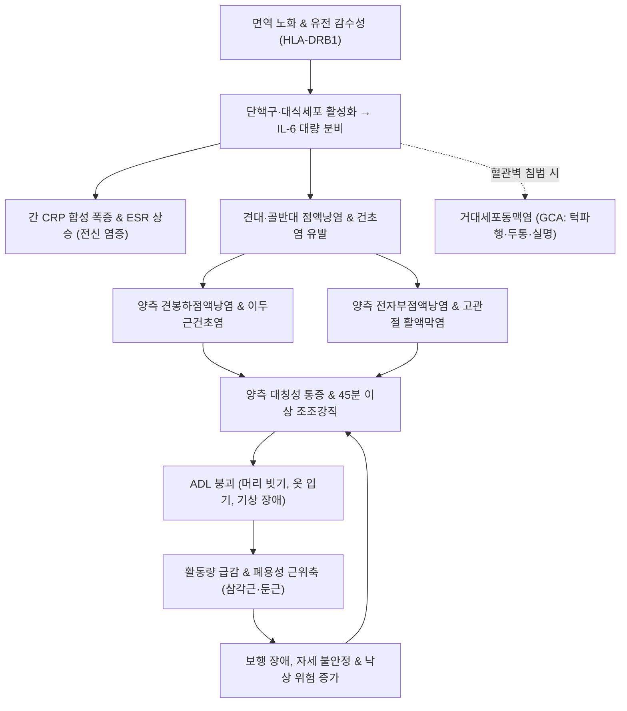

# 🩺 [[다발성 근육통]] (Polymyalgia Rheumatica / 類風濕性多發筋痛, ICD-10 M35.3 / KCD M35.3)

> **핵심 3줄 요약 (Key Summary)**:
> - 📍 병소 부위 & 해부·병태생리: 골격근 자체의 근염이 아니라, 양측 견관절대([[견관절]]·[[견갑대]])와 골반대([[고관절]]·[[전자부]]) 주위의 **관절 주위 활액막염, 점액낭염, 건초염(Extrasynovial / extracapsular inflammation)**이 핵심 병소입니다. [[견봉하점액낭]](Subdeltoid bursa), [[상완이두근 장두 건초]](Biceps tenosynovium), [[전자부 점액낭]](Trochanteric bursa) 및 극돌기간 활액낭이 호발 부위이며, 면역 노화와 인터루킨-6(IL-6) 전신 과잉 분비가 기저 메커니즘으로 작용합니다.
> - 🚩 전형적 임상 양상 & 3대 징후: ① **50세 이상** 고령층 호발 ② **양측성 견관절대 및 골반대의 대칭적 동통** ③ **45분 이상(흔히 1~2시간 이상) 지속되는 극심한 조조강직([[조조강직]])**이 3대 축입니다. 혈액 검사상 [[ESR]]·[[CRP]]의 현저한 상승과 함께, **저용량 경구 스테로이드 투여 후 48~72시간 내 70% 이상의 극적인 증상 호전**이 핵심 진단적 단서입니다.
> - 🛠️ 핵심 감별 검사 & 한·양방 다각적 치료 전략: 이학적 검사로 견관절 능동 외전 제한 및 고관절 내회전 제한을 확인하고, 초음파로 양측 견봉하점액낭염·이두근 건초염을 평가하여 2012 ACR/EULAR 잠정 분류기준을 적용합니다. 양방 표준 치료인 저용량 프레드니솔론(12.5~25mg/일) 테이퍼링 및 불응·재발 시 IL-6 억제제(사릴루맙, 토실리주맙)·MTX 병용 요법을 기본으로 하되, 한의학에서는 [[비증]](痺證)·노인비(老人痺)·간신양허(肝腎兩虛) 변증에 따라 침·온침, 자하거·홍화 약침, 한약([[독활기생탕]], [[삼비탕]], [[황기계지오물탕]])으로 관절 기능 회복과 스테로이드 감량기 반동 억제를 협진 관리합니다.
> - <font color="#fa7e7e">⚠️ 응급 의뢰 레드플래그 & 악화 요인: 환자의 15~20%에서 동반되는 [[거대세포동맥염]](Giant Cell Arteritis, GCA)에 의한 **새로운 두통, 측두동맥 압통, 턱 파행(Jaw claudication), 복시, 갑작스러운 시력 소실**은 비가역적 실명을 초래하는 **안과적·류마티스 응급**으로 즉각 고용량 스테로이드 치료 및 상급병원 전원이 필수적입니다. 급성 염증기 및 골다공증 고위험군에 대한 무리한 도수·강한 HVLA 추나는 절대 금기입니다.</font>

---

## 📌 목차
1. [질환 개요 & 해부학적 병태생리](#1-질환-개요--해부학적-병태생리)
2. [병태생리 메커니즘 & 생체역학적 악순환 네트워크](#2-병태생리-메커니즘--생체역학적-악순환-네트워크)
3. [임상 증상 & 이학적 검사(Physical Exam) 알고리즘](#3-임상-증상--이학적-검사physical-exam-알고리즘)
4. [감별 진단 매트릭스 (Differential Diagnosis)](#4-감별-진단-매트릭스-differential-diagnosis)
5. [한의 통합 치료 프로토콜 (침·약침·추나·한약)](#5-한의-통합-치료-프로토콜-침약침추나한약)
6. [양방 치료 & 병용·의뢰 기준 (Conventional Treatment & Referral)](#6-양방-치료--병용의뢰-기준-conventional-treatment--referral)
7. [재활 운동 & 생활습관 티칭 가이드](#7-재활-운동--생활습관-티칭-가이드)
8. [💡 사용자 진료실 핵심 필기 & 임상 노하우 (Melt-In 잔여 심화 집약)](#8--사용자-진료실-핵심-필기--임상-노하우-melt-in-잔여-심화-집약)
9. [출처 및 학술 참고 문헌 (References)](#9-출처-및-학술-참고-문헌-references)

---

## 1. 질환 개요 & 해부학적 병태생리

* **질환 정의 및 분류**:
  * **정의**: [[다발성 근육통]](Polymyalgia Rheumatica, PMR / 류마티스성 다발근통)은 원인 불명의 만성 전신 염증성 류마티스 질환으로, 주로 **50세 이상의 고령자**에서 발생하여 **목, 어깨대(Shoulder girdle), 골반대(Pelvic girdle)의 대칭적 통증과 45분 이상 지속되는 심한 조조강직**을 유발합니다.
  * **병태의 본질**: 병명에 '근육통(Myalgia)'이라는 단어가 포함되어 있으나, 근조직 자체의 괴사나 근염(Myositis)이 일어나는 것이 아니라, **관절 주위의 연부조직인 점액낭(Bursa), 건초(Tenosynovium) 및 관절 활액막(Synovium)에 국한된 염증(Extrasynovial / extracapsular inflammation)**이 통증과 강직의 실제 해부학적 병소입니다 (Mahmood & Nelson, 2020; Salvarani & Macchioni, 1997).
  * **분류 및 상병 코드**: ICD-10 **M35.3**, KCD **M35.3**. 류마티스열(Rheumatic fever)이나 만성 염증으로 관절 파괴를 초래하는 [[류마티스관절염]](Rheumatoid Arthritis, RA)과는 임상 경과, 유전학, 병리 및 예후가 완전히 구분되는 독립 질환입니다.

* **역학 및 인구학적 특성**:
  * **연령**: 50세 미만에서는 극히 드물며(50세 미만 환자에서 의심될 경우 반드시 타 질환 감별 필요), 발생 빈도는 60대부터 가파르게 증가하여 **70~79세에서 정점**에 달합니다 (Michet & Matteson, 2008).
  * **성별**: 여성에서 남성에 비해 **2~3배 호발**합니다.
  * **인종 및 지리적 분포**: 북유럽(스칸디나비아) 혈통 및 백인 인구 집단에서 연간 10만 명당 50~100명 수준의 높은 발생률을 보입니다. 아시아인 및 한국인에서는 상대적으로 발생률이 낮은 것으로 알려져 있으나, 국내 급격한 고령화로 인해 1차 의료기관에서의 진단 빈도가 꾸준히 증가하고 있습니다.
  * **유발 요인**: 특정 직업적 인과관계는 확인되지 않았으며, 노화에 따른 면역 체계의 변화(면역 노화)와 유전적 감수성이 복합적으로 작용합니다.

* **관련 해부학적 구조물**:
  * **골격 및 관절 복합체**:
    * 주 이환 부위: [[견관절]](Glenohumeral joint), [[견쇄관절]](Acromioclavicular joint), [[흉쇄관절]](Sternoclavicular joint), [[고관절]](Hip joint) 및 경추·요추의 극돌기간 관절(Interspinous joints).
    * 골 침식(Erosion)의 부재: 류마티스관절염(RA)과 달리, 활액막염이 존재하더라도 **관절 연골이나 연골하 골조직의 영구적 파괴(Bone erosion)는 발생하지 않는 양성 비침습적 염증**의 특징을 가집니다.
  * **주요 표적 점액낭 및 건초 (Bursae & Tenosynovium)**:
    * **[[견봉하점액낭]] (Subacromial-Subdeltoid Bursa)**: 어깨 통증 및 능동 외전 제한의 최대 원인 병소.
    * **[[상완이두근 장두 건초]] (Biceps Long Head Tenosynovium)**: 양측 견관절 전면부 압통 및 운동통을 유발.
    * **[[전자부 점액낭]] (Trochanteric Bursa)**: 대퇴 대전자 주위 압통과 보행 시 고관절 주위 통증의 근원.
    * **[[장요근 점액낭]] (Iliopsoas Bursa)** 및 좌골둔부 점액낭: 고관절 굴곡 및 내회전 시 서혜부·골반 심부 뻐근함 유발.
  * **이차적 근육 변화**:
    * 근육 자체는 염증 세포 침윤이나 괴사가 없습니다. 그러나 인접한 점액낭의 극심한 통증으로 인해 관절 운동을 기피하게 되면서(통증성 폐용), [[삼각근]], [[회전근개]] 4근, [[대둔근]], [[중둔근]], [[장요근]]에 이차적인 폐용성 위축(Disuse atrophy) 및 근력 약화가 동반됩니다.
  * **혈관 및 신경학적 연관성**:
    * 말초신경 포착이나 신경근 압박은 존재하지 않으므로, 손발 끝의 이상감각이나 신경근성 방사통은 전형적 소견이 아닙니다.
    * 단, PMR 환자의 약 15~20%에서 대혈관 및 중혈관의 육아종성 전신 혈관염인 [[거대세포동맥염]](Giant Cell Arteritis, GCA / 측두동맥염)이 병발할 수 있으며, 이 경우 [[측두동맥]], 후모양체동맥, [[안동맥]] 침범으로 인한 허혈성 시신경병증 위험이 상존합니다 (Dasgupta & Cimmino, 2012).

---

## 2. 병태생리 메커니즘 & 생체역학적 악순환 네트워크

### 1) 병태생리 아스키(ASCII) 다이어그램

```text
[노화 (50세 이상) & 면역 노화 (Immunosenescence)] + [유전 감수성 (HLA-DRB1*04 등)]
                                   │
                                   ▼
          [선천 면역계 활성화 & 수지상세포 / 대식세포 과흥분]
                                   │
                                   ▼
        [전신 염증성 사이토카인 대량 방출: 인터루킨-6 (IL-6) 폭증]
                                   │
             ┌─────────────────────┴─────────────────────┐
             ▼                                           ▼
[간세포 자극: 급성기 반응단백 합성]          [혈관내피세포 투과성 증가 & 전신 순환]
• [[ESR]] 현저한 상승 (>40~100 mm/h)                     │
• [[CRP]] 급격한 상승                                   │
• 골수 조혈 억제 → 빈혈, 혈소판 증가                   │
             └─────────────────────┬─────────────────────┘
                                   │
                                   ▼
     [견관절대 및 골반대 관절외 조직 (Extrasynovial Tissue) 집중 침착]
                                   │
             ┌─────────────────────┴─────────────────────┐
             ▼                                           ▼
[견관절 복합체 염증]                        [골반대 복합체 염증]
• [[견봉하점액낭염]] (Subdeltoid)            • [[전자부 점액낭염]] (Trochanteric)
• [[상완이두근 장두 건초염]]                • 고관절 활액막염 & 건초염
• 견관절 활액막염 & 견쇄관절염              • 극돌기간 활액낭염 (Interspinous)
             └─────────────────────┬─────────────────────┘
                                   │
                                   ▼
┌────────────────── [임상 증상 발현 & 악순환 고리] ──────────────────┐
│ • 양측 어깨·골반·목의 대칭적 둔통 및 심야 통증                     │
│ • 야간 사이토카인 축적으로 인한 >45분 이상의 극심한 [[조조강직]]    │
│ • 옷 입기, 머리 빗기, 기상 불능 등의 일상생활동작(ADL) 급격한 붕괴  │
└──────────────────────────────────┬───────────────────────────────────┘
                                   │
     ┌─────────────────────────────┴─────────────────────────────┐
     ▼                                                           ▼
[통증 회피성 폐용 (Disuse)]                                 [동반 합병증 위험]
• 어깨·둔부 근육 위축 & 탈조건화                           • [[거대세포동맥염]](GCA) 15~20%
• 보행 장애 & 낙상 위험 급증                               • 측두동맥염, 두통, 실명 위기
• 심폐 기능 저하 & 삶의 질 악화                            (즉각적 고용량 스테로이드 필요)
```

### 2) 생체역학적 악순환 머메이드(Mermaid) 네트워크



### 3) 면역병태생리학적 기전 및 인터루킨-6 (IL-6)의 핵심 역할
* **면역 노화 (Immunosenescence)**: 고령화에 따른 T세포 레퍼토리 축소와 조절 T세포(Treg)의 억제 기능 부전으로 인해, 체내 자가 항원에 대한 면역 관용이 소실되고 선천 면역계(단핵구, 대식세포, 수지상세포)가 부적절하게 지속 활성화됩니다.
* **인터루킨-6 (IL-6) 드라이브**: PMR 병태생리의 가장 결정적인 염증 매개체는 IL-6입니다. 활성화된 단핵구와 활액막 대식세포에서 대량으로 분비된 IL-6는 전신 혈류를 순환하며 간세포를 자극하여 C-반응성 단백(CRP)과 피브리노겐(Fibrinogen) 합성을 폭발적으로 증가시키고, 이는 임상 검사상 현저한 [[CRP]] 상승 및 [[ESR]] 가속화로 나타납니다.
* **야간 사이토카인 리듬과 조조강직**: 체내 코르티솔 분비는 심야에 최저점으로 떨어지는 반면, IL-6를 비롯한 전염증성 사이토카인의 분비는 새벽 2~4시경 정점에 달합니다. 밤사이 점액낭 내에 삼출액과 사이토카인이 고농도로 정체되면서, 아침에 기상했을 때 관절낭이 얼어붙은 듯 뻣뻣해지는 45분 이상의 극심한 [[조조강직]]이 발생합니다.
* **GCA(거대세포동맥염)와의 연속성**: PMR과 GCA는 별개의 질환이 아니라 공통의 염증 축(IL-6 및 대식세포 과활성화)을 공유하는 동일 스펙트럼상의 질환으로 간주됩니다 (Salvarani & Macchioni, 1997).

### 4) 생체역학적 연쇄 반응 (Kinetic Chain) 및 전신 악순환
* **상지 운동 연쇄 파탄**:
  * 양측 견봉하점액낭의 염증과 부종으로 인해 상완골두가 견봉 하부에서 원활히 활주하지 못하고 상방으로 충돌합니다.
  * 회전근개 수축 시 극심한 통증이 발생하여 환자는 어깨를 움직이지 않으려 하며, 이로 인해 [[견갑흉곽 리듬]](Scapulothoracic rhythm)이 붕괴됩니다.
  * 보상적으로 [[상부승모근]]과 [[견갑거근]]이 과도하게 긴장하여 목덜미 통증과 흉추 후만이 이차적으로 심화됩니다.
* **골반 및 보행 연쇄 파탄**:
  * 대퇴 전자부 점액낭과 고관절 활액막염으로 인해 고관절의 신전 및 내회전이 제한됩니다.
  * 보행 입각기에서 [[중둔근]]과 [[대둔근]]의 정상 수축이 억제되어 보폭이 급격히 줄어들고 트렌델렌버그(Trendelenburg) 유사 보행 패턴이 나타납니다.
* **염증과 탈조건화(Deconditioning)의 이중 타격**:
  * 환자는 아침에 침대에서 몸을 일으키지 못하고, 의자나 변기에서 일어설 때 손잡이나 타인의 부축이 없으면 자립 보행이 불가능해집니다.
  * 이러한 전신 활동량 감소는 골밀도 감소, 심폐 지구력 저하, 근감소증(Sarcopenia)을 촉진하여 낙상 및 골절의 치명적 위험을 초래합니다.

---

## 3. 임상 증상 & 이학적 검사(Physical Exam) 알고리즘

### 1) 주소증 및 핵심 임상 증상
* **통증 부위 및 대칭성**:
  * 환자의 95% 이상에서 양측 [[견관절]], 목, 상완부 및 견갑대의 둔하고 쑤시는 통증을 호소하며 발병합니다.
  * 이어 골반대(양측 서혜부, 둔부 심부, 대퇴 전면 및 외측)의 통증이 동반되어 환자는 "양 어깨와 엉덩이가 다 아파서 꼼짝도 못 하겠다"고 표현합니다. 편측성 발현은 매우 비전형적입니다.
* **45분 이상의 조조강직 (Morning Stiffness)**:
  * 아침에 일어났을 때 전신 관절과 근육이 무쇠처럼 굳어 움직이기 힘든 증상이 최소 45분 이상, 흔히 2~3시간 이상 지속됩니다. 따뜻한 물로 샤워하거나 오후가 되면 점차 완화되는 일중 변동을 보입니다.
* **일상생활동작(ADL)의 현저한 장애**:
  * 어깨를 거상하거나 회전하는 동작이 불가능하여 **혼자서 상의 옷 입기나 단추 채우기, 머리 빗기, 등 뒤로 손 뻗기**를 전혀 수행하지 못합니다.
  * 골반대 통증으로 **자동차에서 내리기, 낮은 의자나 변기에서 일어서기, 침대에서 뒤척이기**가 극히 제한됩니다.
* **전신 전구 증상 (Constitutional Symptoms)**:
  * 전신 염증 반응으로 인해 체중 감소(수주 내 수 kg 감소), 원인 불명의 미열(37.5~38℃), 전신 권태감, 피로, 우울감, 식욕 부진이 빈번히 동반됩니다.
* **진성 근력 저하(True Weakness)의 부재 (중요 감별점)**:
  * 환자는 통증으로 인해 팔을 들어 올리지 못한다고 호소하지만, 검사자가 관절을 지지한 상태에서 시행하는 도수근력검사(MMT) 시 실제 신경학적 근력은 정상적으로 보존되어 있습니다. 만약 명백한 진성 근위축이나 무통성 위약이 관찰된다면 [[다발근염]], [[피부근염]], 신경병증을 의심해야 합니다.

### 2) 필수 이학적 검사법 (Physical Examination)
* **견관절 능동 및 수동 가동범위 검사**:
  * **능동 외전 및 외회전의 심각한 제한**: 환자 스스로 팔을 옆으로 들어 올리게 하면 통증으로 인해 60~80도 이상 거상하지 못합니다.
  * **수동 가동범위의 상대적 보존**: 검사자가 환자의 팔을 잡고 천천히 들어 올릴 때, 말기 관절낭 긴장을 제외하고는 수동 ROM이 상당 부분 보존되어 유착성 관절낭염(오십견)의 전방향 완전 구축과 감별됩니다.
* **고관절 내회전 유발 검사**:
  * 환자를 앙와위로 눕히고 고관절을 90도 굴곡시킨 상태에서 내회전(Internal rotation)을 가할 때 서혜부 및 둔부에 뚜렷한 통증과 가동 제한이 유발됩니다 (2012 ACR/EULAR 기준 점수 항목).
* **점액낭 국소 압통 촉진**:
  * **견봉하점액낭 압통**: 견봉 외측 하방을 촉진할 때 명확한 압통이 확인됩니다.
  * **대퇴 전자부 압통**: 대전자(Greater trochanter) 후상방의 전자부 점액낭 부위를 압박 시 압통이 재현됩니다.
* **말초 소관절 활액막염 검진**:
  * 손가락 수근관절, 중수수지관절(MCP), 근위지절관절(PIP)의 종창(Swelling)을 진찰합니다. PMR에서는 말초 소관절의 뚜렷한 활막 비후나 관절 삼출액이 거의 관찰되지 않습니다 (관찰 시 RA 의심).
* **신경학적 선별 검사**:
  * 감각 검사, 심부건반사(DTR), 병적 반사는 모두 완전히 정상이어야 합니다.

### 3) 검사실 및 영상 평가 (Labs & Imaging)
* **혈액 염증 마커**:
  * **[[ESR]]**: 40 mm/h 이상으로 현저히 상승하며, 종종 100 mm/h를 초과합니다.
  * **[[CRP]]**: 정상 상한치의 수배에서 수십 배까지 급증하여 질환의 활성도 및 치료 반응을 모니터링하는 최적의 지표가 됩니다.
  * **정상혈색소성 정구성 빈혈**, 반응성 혈소판 증가증(Thrombocytosis) 및 간효소 중 ALP(알칼리 인산분해효소)의 경미한 상승이 동반될 수 있습니다.
* **혈청학적 면역 검사 (음성 필수)**:
  * 류마티스인자(RF) 및 항CCP항체(ACPA)는 원칙적으로 **음성**입니다.
  * 근효소인 **크레아틴 키나아제(CK)** 및 알돌라아제는 완전히 **정상 범위**를 유지해야 합니다.
* **관절 초음파 (Musculoskeletal Ultrasound) 소견**:
  * 비침습적으로 PMR의 병소를 확진하는 가장 강력한 영상 도구입니다.
  * **견관절**: 양측 견봉하-삼각근하 점액낭염(Subacromial-subdeltoid bursitis), 상완이두근 장두 건초염(Biceps tenosynovitis), 견관절 활액막염 확인.
  * **고관절**: 전자부 점액낭염(Trochanteric bursitis), 고관절 활액막염 확인 (Schmidt, 2013).

### 4) 2012 ACR/EULAR 잠정 분류기준 (Provisional Classification Criteria)

* **필수 조건 (Inclusion Criteria, 모두 만족 필수)**:
  1. 연령 **≥ 50세**
  2. **양측 견관절의 통증**
  3. 비정상적인 **ESR 및/또는 CRP 상승**

* **세부 평가 배점표**:

| 평가 항목 | 세부 기준 | 배점 |
| :--- | :--- | :---: |
| **조조강직 시간** | 아침 관절 강직이 **> 45분** 지속 | **2점** |
| **고관절 침범** | 고관절 통증 또는 고관절 가동범위(내회전 등) 제한 | **1점** |
| **혈청학적 음성** | RF(류마티스인자) 및 ACPA(항CCP항체) 모두 음성 | **2점** |
| **기타 관절 비침범** | 말초 소관절 등의 기타 관절 증상 없음 | **1점** |
| **초음파 가산점**<br>*(초음파 시행 시)* | 적어도 한쪽 견관절에 견봉하점액낭염, 이두근 건초염, 견관절 활액막염 중 하나 이상 존재<br>**AND** 적어도 한쪽 고관절에 활액막염, 전자부 점액낭염 존재 | **1점** |
| | 양측 견관절 모두에 견봉하점액낭염, 이두근 건초염, 활액막염 존재 | **1점** |

* **분류 판정 기준**:
  * **초음파 검사 미포함 시**: 총 6점 중 **≥ 4점** 충족 시 PMR로 분류.
  * **초음파 검사 포함 시**: 총 8점 중 **≥ 5점** 충족 시 PMR로 분류 (Dasgupta & Cimmino, 2012).
  * ⚠️ 주의: 이 기준은 임상 시험을 위한 분류기준(Classification criteria)이므로, 진료실에서는 타 염증성·악성 질환의 철저한 배제가 반드시 선행되어야 합니다.

---

## 4. 감별 진단 매트릭스 (Differential Diagnosis)

| 감별 질환 | 호발 연령 및 병소 | 주요 증상 및 임상적 차이점 | 결정적 검사 소견 및 감별 포인트 |
| :--- | :--- | :--- | :--- |
| **[[다발성 근육통]]**<br>(본 질환, PMR) | 50세 이상 고령층,<br>견대·골반대 점액낭·건초 | **대칭성 근위부 통증 + 45분 이상 조조강직**,<br>진성 근력 약화 없음, 극적인 전신 쇠약감 | **ESR/CRP 현저한 상승**, RF/ACPA 음성, CK 정상,<br>**저용량 스테로이드(15mg)에 48~72시간 내 극적 호전** |
| **[[거대세포동맥염]]**<br>(GCA / 측두동맥염)<br>*(안과적 응급)* | 50세 이상 고령층,<br>측두동맥 등 중·대혈관 | **새로운 두통, 두피 압통, 턱 파행(Jaw claudication)**,<br>시야 흐림, 복시, 일과성 흑암시(Amaurosis fugax) | **ESR 극도 상승(>100 mm/h)**, 측두동맥 결절/맥박 소실,<br>측두동맥 초음파(Halo sign), 생검 확진, **즉각 고용량 스테로이드** |
| **[[노인형 류마티스관절염]]**<br>(Late-Onset RA, LORA) | 60세 이상 고령층,<br>말초 소관절 활액막 | 수근관절, MCP, PIP 관절의 대칭적 종창과 열감,<br>장기 방치 시 관절 변형 진행 | **RF 및 ACPA 양성**, 방사선 검사상 골 미란(Erosion),<br>저용량 스테로이드에 불완전 반응, DMARDs 필수 |
| **[[다발근염]] / 피부근염**<br>(Polymyositis) | 40~60대 성인,<br>골격근 근섬유 자체 염증 | **통증보다 대칭성 근위부 '진성 근력 저하'가 주소증**,<br>계단 오르기나 의자에서 일어나기 불능 | **혈청 근효소(CK, Aldolase) 10~50배 폭증**,<br>근전도 검사 다상성 전위, 근생검 림프구 침윤 |
| **[[섬유근육통]]**<br>(Fibromyalgia, FMS) | 30~50대 여성 호발,<br>중추신경계 감작 | 신체 전반의 광범위 만성 통증, 수면 장애,<br>만성 피로 증후군, 인지 기능 저하 | **ESR 및 CRP 등 전신 염증 수치 완전히 정상**,<br>18개 압통점 양성, 스테로이드 치료에 전혀 반응 없음 |
| **[[근막통증증후군]]**<br>(Myofascial Pain, MPS) | 전 연령대,<br>특정 골격근 내 MTrP | 국소적 또는 비대칭적 통증, 특징적 연관통 지도,<br>조조강직이 짧거나 국소 부위에 국한 | **염증 마커(ESR/CRP) 정상**, 근육 내 Taut band 및 LTR 확인,<br>아시혈 침자, TPI 및 스트레칭으로 즉시 완화 |
| **양측 회전근개 파열 / 건염** | 50세 이상,<br>어깨 회전근개 건 | 어깨 거상 시 통증, 특정 각도 통증호(Painful arc),<br>야간통, 골반대 증상 동반 없음 | **ESR/CRP 정상**, Drop arm sign 양성, 골반 통증 부재,<br>초음파/MRI 상 건의 구조적 결손 확인 |
| **[[갑상선기능저하증]]** | 중장년 여성 호발,<br>갑상선 호르몬 결핍 | 전신 근육통, 근경련, 체중 증가, 부종,<br>추위 민감증, 서맥, 만성 피로 | **TSH 상승, Free T4 저하**, CK 경미한 상승 가능,<br>갑상선 호르몬(씬지로이드) 보충 시 호전 |
| **악성 종양 / [[다발골수종]]**<br>*(Red Flag)* | 60세 이상 고령층,<br>형질세포 또는 전이암 | 휴식 시에도 악화되는 야간 골통증, 급격한 체중 감소,<br>진통제에 반응하지 않는 고정통 | **혈청단백전기영동(SPEP) M-protein 확인**, 고칼슘혈증,<br>X-ray 상 펀치드 아웃(Punched-out) 골 병변, 빈혈 |
| **[[스타틴 유발 근병증]]** | 스타틴 복용 환자,<br>약물성 골격근 독성 | 콜레스테롤 약 복용 후 발생한 양측 하지 근육통,<br>근육 피로감 | **스타틴 복용력**, 약물 중단 시 2~4주 내 증상 호전,<br>중증 시 CK 상승 (횡문근융해증 감별) |

---

## 5. 한의 통합 치료 프로토콜 (침·약침·추나·한약)

> ⚠️ **한의 치료의 임상적 원칙**:
> 1. PMR은 **전신성 혈관·결합조직 염증 질환**으로, 양방 1차 선택제인 **저용량 경구 스테로이드에 대한 반응성이 극도로 높은 질환**입니다.
> 2. 따라서 **스테로이드 치료를 한의 단독 치료로 무리하게 대체하려 시도하는 것은 절대 금기**입니다.
> 3. 한의 통합 치료의 명확한 역할은 **① 양약 투여 중 잔여 통증 및 관절 강직 완화 ② 스테로이드 감량기(Tapering)에 빈발하는 통증 반동(Rebound) 억제 ③ 장기 스테로이드 복용에 따른 근감소증 및 골다공증 방어 ④ 관절 가동성 및 ADL 기능 조기 회복**에 있습니다.

### 1) 침구 치료 (Acupuncture & Moxibustion)
* **원위 및 배수혈 취혈 (전신 조절 및 기혈 순환)**:
  * 배수혈: [[간수(BL18)]](간주근 보익), [[신수(BL23)]](신주골 보익), [[대장수(BL25)]], [[비수(BL20)]].
  * 사진혈 및 관절 원위혈: [[곡지(LI11)]], [[합곡(LI4)]], [[외관(TE5)]], [[후계(SI3)]], [[양릉천(GB34)]](근회혈), [[족삼리(ST36)]], [[현종(GB39)]](수회혈), [[곤륜(BL60)]], [[태충(LR3)]].
* **견관절대 및 경배부 국소 취혈**:
  * [[견정(GB21)]], [[견우(LI15)]], [[견료(TE14)]], [[천종(SI11)]], [[견정(SI9)]], [[극하(EX-UE)]], [[거골(LI16)]], 대추(GV14).
* **골반대 및 둔부 국소 취혈**:
  * [[환도(GB30)]], [[질변(BL54)]], [[거료(GB29)]], [[대퇴전자부 아시혈]], [[위중(BL40)]], [[승산(BL57)]].
* **전침 치료 (Electroacupuncture)**:
  * **저주파 자극 (2~4 Hz)**: 통증 및 아침 강직 완화를 목적으로 2Hz 연속파를 15~20분간 적용합니다. 뇌간 및 척수 수준에서 $\beta$-엔도르핀 분비를 유도하고 관절 주위 혈류를 부드럽게 개선합니다.
  * 주의: 고령 환자가 다수이므로 과도한 강자극(High intensity)이나 좌위(Sitting) 자침은 피하고, 반드시 편안한 앙와위 또는 측와위에서 약전자극으로 시작합니다.
* **온침(溫針) 및 간접구 (Moxibustion)**:
  * 한습(寒濕)으로 인해 관절이 시리고 굳는 환자에게 견우, 견료, 환도 부위에 온침을 시행하거나, 하복부의 [[관원(CV4)]], [[기해(CV6)]]에 간접구를 병행하여 원기를 북돋웁니다.

### 2) 약침 치료 (Pharmacopuncture)
* **표적 부위**:
  * 초음파상 확인된 견봉하점액낭 주위 결합조직, 상완이두근 장두 건초 주행부, 대퇴 전자부 점액낭 주변 근막 부착부.
* **약침 제제 선택**:
  * **자하거 약침 (Hominis Placenta)**: 고령 환자의 허손(虛損)을 보하고 골격근 위축을 방지하며 면역 조절을 도모하는 1차 선택 약침 (포인트당 0.1~0.3cc, 총 1.0~2.0cc 분주).
  * **홍화 약침 / 중성어혈 약침**: 관절 주위 결합조직의 미세 순환 장애와 어혈성 야간통을 완화.
  * **황련해독탕 약침**: 급성기 국소 열감 및 염증 반응 완화 목적.
  * ⚠️ **봉독 약침 사용 시 주의사항**: 봉독(Bee Venom)은 강력한 항염 효과를 가지나, PMR 환자는 고령이고 면역학적 불안정 상태이므로 알레르기 반응(아나필락시스) 위험이 높습니다. 시술 전 반드시 엄격한 피내 과민 반응 테스트를 거쳐야 하며, 저농도(1:10,000~1:30,000)로 극소량부터 신중히 적용합니다.
* **약침 시술 안전 수칙**:
  * 견봉하점액낭 접근 시 견봉 외측 하방에서 피하층을 통해 얕게(Subcutaneous-fascial plane) 자입하며, 관절강 내 직접 주입은 피합니다. 대퇴 전자부는 골면 접촉 직전 연부조직층에 안전하게 주입합니다.

### 3) 추나 치료 (Chuna Manipulation)
* **급성 염증기 주의사항 (절대 금기)**:
  * 조조강직과 관절 통증이 심한 급성 활동기에는 **강한 관절 교정 추나(HVLA) 및 과도한 수동 관절 신장 수기는 엄격히 금기**입니다.
  * 고령 환자는 대다수가 골감소증 또는 골다공증을 동반하고 있으므로 무리한 흉추 압박 교정이나 늑골 교정 시 병적 골절을 유발할 수 있습니다.
* **아급성기 및 관해기 완화 수기 기법**:
  * **견갑골 가동 수기 (Scapular Mobilization)**: 측와위에서 견갑골의 상하 활주, 내외 회전을 부드럽게 유도하여 유착된 견갑흉곽 관절 가동성을 회복.
  * **경흉추 이완 및 앙와위 경추 신연**: 과긴장된 상부 승모근과 견갑거근에 대한 부드러운 근막이완(JS) 수기 적용.
  * **고관절 무통 가동 기법 (Gentle Hip Mobilization)**: 앙와위에서 고관절의 장축 견인 및 가벼운 외회전 진동 수기 적용.

### 4) 한약 치료 (Herbal Medicine)
한의학적으로 PMR은 고령으로 인해 정기가 쇠약해진 상태에서 풍한습 사기가 근골과 경락에 머물러 발생한 **노인비(老人痺)**, 간과 신이 모두 허약해진 **간신양허(肝腎兩虛)**, 기혈이 고갈되어 관절과 힘줄을 자양하지 못하는 **기혈부족(氣血不足)**으로 변증합니다:
* **간신양허 및 풍한습비 (만성 경과, 고령 허약, 하지 무력 동반)**:
  * **[[독활기생탕]] (獨活寄生湯)**: 독활, 상기생, 두충, 우슬, 세신, 진교, 복령, 육계, 방풍, 천궁, 인삼, 감초, 당귀, 작약, 건지황. 간신을 보강하고 풍한습을 몰아내며 기혈을 보양하는 PMR의 대표 기본 처방.
  * **[[삼비탕]] (三痺湯)**: 독활기생탕에서 속단과 황기를 가미하여 기혈 허약과 관절 강직이 더욱 극심한 노인 환자에게 적용.
* **기허혈체 및 마목 (피로, 상지 거상 곤란, 사지 냉감)**:
  * **[[황기계지오물탕]] (黃芪桂枝五物湯)**: 황기, 계지, 작약, 생강, 대추. 영위(營衛)를 조화롭게 하고 혈비(血痺)를 다스려 관절 주위 미세혈류를 개선하고 스테로이드 감량기 체력 저하를 방어.
* **풍한습 비통 (찬 기운에 극심한 악화, 관절 중통)**:
  * **[[강활승습탕]] (羌活勝濕湯)**: 강활, 독활, 고본, 방풍, 천궁, 만형자, 감초. 상지대 및 경배부의 무거운 통증과 오한성 강직을 신속히 발산 소통.
* **어혈 및 관절 유착형 (야간 자통, 지속성 관절통)**:
  * **[[신통축어탕]] (身痛逐瘀湯)**: 도인, 홍화, 당귀, 천궁, 몰약, 오령지, 천우슬, 향부자, 강활, 진교, 지각, 감초.
* **임상 다용 가미 본초**:
  * [[대두황권]] (발효 콩나물): 습열을 끄고 근육 경련과 저림을 완화.
  * 상지(桑枝), 위령선(威靈仙): 견관절 경락을 투달하여 어깨 통증 완화.
  * 백작약(白芍藥): 대용량(15~30g) 사용하여 근육 경련 억제 및 통증 완화.

---

## 6. 양방 치료 & 병용·의뢰 기준 (Conventional Treatment & Referral)

### 1) 약물 치료 (Medication)
* **1차 표준 치료제: 저용량 경구 글루코코르티코이드 (Systemic Glucocorticoids)**:
  * **초기 용량**: 프레드니솔론(Prednisolone) 기준 **12.5 ~ 25 mg/일** (대개 15 mg/일 단일 경구 투여로 시작).
  * **임상적 반응의 극적 특성**: 투약 시작 후 **48~72시간(늦어도 1주일) 이내에 자발통과 조조강직이 70% 이상 소실**되며, 2~4주 이내에 ESR과 CRP 수치가 정상화됩니다. 만약 적정 용량 투약 후 1주일이 지나도 증상 호전이 전혀 없다면 PMR 진단을 원점에서 재검토해야 합니다 (BSR guideline; Dejaco et al., 2026).
  * **점진적 감량 (Tapering) 프로토콜**:
    * 1단계: 초기 용량(15mg)을 2~4주간 유지하여 증상 완전 관해 및 염증 수치 정상화 확인.
    * 2단계: 10 mg/일까지는 2~4주마다 2.5 mg씩 감량 (예: 15mg $\rightarrow$ 12.5mg $\rightarrow$ 10mg).
    * 3단계: 10 mg/일 도달 후에는 재발 방지를 위해 **4~8주마다 1 mg씩 매우 서서히 감량** (예: 10mg $\rightarrow$ 9mg $\rightarrow$ 8mg ...).
    * 총 치료 기간은 대개 **1~2년**이 소요되며, 조기 중단 시 50% 이상의 환자에서 재발(Relapse)을 경험합니다.
* **스테로이드 보존제 (Steroid-Sparing Agents / DMARDs)**:
  * 빈번한 재발 환자, 스테로이드 감량이 불가능한 환자, 또는 당뇨병, 중증 골다공증, 녹내장, 심혈관 질환 등 스테로이드 부작용 고위험군에서 조기 병용합니다 (Ponte et al., 2026).
  * **메토트렉세이트 (Methotrexate, MTX)**: 경구 주 7.5~15 mg 병용 투여 (엽산 병용 필수).
  * **IL-6 수용체 길항제 (생물학적 제제)**:
    * **사릴루맙 (Sarilumab, Kevzara)**: FDA 및 가이드라인에서 공인된 PMR 표적 치료제로, 스테로이드 불응성 또는 재발성 환자에서 2주 1회 피하 주사하여 지속 관해를 유도하고 스테로이드 누적 용량을 획기적으로 줄입니다.
    * **토실리주맙 (Tocilizumab, Actemra)**: IL-6 차단제로 오프라벨 또는 임상 연구에서 우수한 효과를 입증.
* **장기 스테로이드 합병증 예방 요법 (필수 병용)**:
  * 골밀도 검사(DEXA) 기본 시행.
  * 칼슘(1,000~1,200 mg/일) 및 비타민 D(800~1,000 IU/일) 매일 복용.
  * 골감소증 또는 고위험군 환자에게 비스포스포네이트(Bisphosphonate: 알렌드로네이트 등) 병용.
  * 위장관 궤양 예방을 위한 프로톤 펌프 억제제(PPI) 병용.

### 2) 비약물 국소 시술 (Procedures)
* 전신적 스테로이드 투여로 대부분의 증상이 조절되었으나, 특정 단일 관절(예: 편측 견봉하점액낭 또는 전자부 점액낭)에만 국소 염증과 통증이 잔존하는 경우 초음파 유도하 **트리암시놀론(Triamcinolone acetonide 20~40mg) 국소 점액낭 주입술**을 제한적으로 시행할 수 있습니다.

### 3) 수술적 치료 적응증
* PMR은 관절 연골이나 골조직의 구조적 파괴가 발생하지 않는 질환이므로, 질환 자체에 대한 수술적 적응증은 없습니다.

### 4) 한·양방 병용 판단 (Combination Therapy)
* **병용 권장 (시너지 효과)**:
  * 스테로이드 치료를 유지하면서 한의 침구, 약침, 한약 치료를 병용하면 말초 관절의 강직 해소 속도가 빨라지며, 환자의 일상생활동작(ADL) 수행 능력이 현저히 개선됩니다.
  * 스테로이드 감량기(10mg 이하 구간)에 한약([[독활기생탕]], [[황기계지오물탕]])을 병용하면 부신 피질 기능 저하에 따른 전신 피로감과 통증 반동 현상(Rebound)을 완충하여 감량 성공률을 높입니다.
* **절대 금기 사항**:
  * 한의 치료를 시작한다는 이유로 환자가 복용 중이던 **경구 스테로이드를 갑자기 중단(Abrupt cessation)시키는 행위는 급성 부신 부전(Adrenal crisis) 및 PMR의 폭발적 재발, GCA 발병 위험을 초래하므로 절대 금기**입니다.

### 5) 양방·전문과 의뢰 기준 (Referral Criteria)
* **🚨 즉각적 상급병원 응급 의뢰 (Red Flags: 거대세포동맥염 GCA 병발)**:
  * 다음 증상 중 단 하나라도 발생하는 즉시 **상급병원 류마티스내과 또는 안과 응급실로 당일 즉시 전원**해야 합니다:
    1. 새롭게 발생한 지속적이고 심한 **편측 측두부 두통**.
    2. 머리를 빗거나 만질 때 극심한 **두피 압통**.
    3. 음식을 씹을 때 저작근 허혈로 인해 턱이 뻐근하고 아픈 **턱 파행(Jaw claudication)**.
    4. 시야가 흐려지거나, 물체가 둘로 보이는 **복시(Diplopia)**, 또는 일시적으로 눈앞이 캄캄해지는 **일과성 흑암시(Amaurosis fugax)**.
    5. 한쪽 눈의 급격한 **시력 저하 또는 실명**.
  * GCA는 즉시 고용량 스테로이드(프레드니솔론 40~60mg/일 또는 정맥 솔루메드롤 충격요법)를 투여하지 않으면 영구적 양안 실명을 초래합니다.
* **류마티스내과 전문과 의뢰 기준**:
  * 저용량 스테로이드(프레드니솔론 15mg/일) 투약 후 7일이 경과해도 임상 반응이 미미하거나 염증 마커(ESR/CRP)가 정상화되지 않는 경우 (진단 재평가).
  * 스테로이드 감량 시마다 증상이 반복 재발하여 면역억제제(MTX, 사릴루맙) 도입이 필요한 경우.
  * 발열, 야간 발한, 급격한 체중 감소 등 악성 종양(B-symptom) 또는 혈관염 의심 소견이 동반될 때.

---

## 7. 재활 운동 & 생활습관 티칭 가이드

* **관절 가동성 유지 스트레칭 (무통 범위 내 시행)**:
  * **코드만 진자 운동 (Codman's Pendulum Exercise)**:
    * 통증이 심한 환자에서 견관절 내압을 높이지 않고 관절액 순환을 촉진하는 1차 운동.
    * 건측 손으로 테이블을 짚고 상체를 숙인 뒤, 환측 팔을 힘을 빼고 늘어뜨려 시계 방향, 반시계 방향으로 지름 20~30cm 원을 그리며 가볍게 흔듭니다(하루 3회, 회당 2~3분).
  * **수건 및 지팡이를 이용한 수동 가동 운동 (Wand / Towel Exercise)**:
    * 막대기나 수건을 양손으로 잡고 통증이 없는 범위(NRS 3점 이하) 내에서 천천히 전방 거상 및 외회전을 유도합니다.
  * **고관절 신전 및 장요근 스트레칭**:
    * 의자에 앉은 상태에서 한쪽 다리를 뒤로 뻗어 서혜부를 부드럽게 펴주어 고관절 굴곡 구축을 방지합니다.
* **점진적 등척성 근력 강화 운동 (폐용성 위축 방지)**:
  * **회전근개 등척성 운동**: 벽을 마주 보거나 옆에 서서 통증 없는 강도로 벽을 안쪽, 바깥쪽으로 미는 등척성 수축(5초 유지, 10회 반복).
  * **둔근 브릿지 (Glute Bridge)**: 바닥에 누워 무릎을 세우고 골반을 천천히 들어 올려 둔부 근육을 강화.
  * **의자 앉았다 일어서기 (Sit-to-Stand)**: 허벅지와 둔근의 근감소를 막기 위해 손잡이를 잡고 안전하게 의자에서 일어나는 훈련을 하루 10~20회 반복.
* **저강도 유산소 및 컨디셔닝 운동**:
  * **평지 걷기**: 햇볕을 쬐며 하루 20~30분간 평지를 가볍게 걸어 비타민 D 합성을 유도하고 심폐 지구력을 유지합니다.
  * **온수 수영 및 아쿠아로빅**: 체온 유지와 부력으로 관절 부하를 최소화하면서 전신 강직을 완화시킵니다.
* **일상생활 자세 및 환경 수정 (Ergonomics)**:
  * **수면 환경**: 너무 푹신한 매트리스는 기상 시 체간 회전을 방해하므로 적당히 탄탄한 매트리스를 사용하고, 옆으로 누울 때는 무릎 사이에 베개를 끼워 골반대 긴장을 완화합니다.
  * **착의 보조 도구**: 지퍼가 달린 헐렁한 상의나 큰 단추 옷을 권장하며, 허리를 숙이지 않고 신발을 신을 수 있도록 긴 손잡이 신발주걱을 사용합니다.
  * **온열 요법**: 기상 직후 아침 강직이 극심할 때는 전기찜질기나 온수 샤워(15~20분)를 통해 체온을 먼저 올린 후 가벼운 일상 활동을 시작합니다.
  * **영양 관리**: 장기 스테로이드 복용 환자는 혈당 상승과 골다공증 위험이 높으므로 저염식, 단순당 제한, 고단백 식이, 유제품 및 녹황색 채소 섭취를 적극 권장합니다.

---

## 8. 💡 사용자 진료실 핵심 필기 & 임상 노하우 (Melt-In 잔여 심화 집약)

* **상부 섹션에 미처 다 담지 못한 고유 원문 필기**:
  * PMR은 **"이름은 근육통인데 병소는 근육이 아니다"** — 이 한 문장이 진료실 설명의 핵심입니다. 환자가 "온몸 근육이 부서질 듯 아프다"고 호소하더라도 "근육 자체에 염증이 생긴 것이 아니라, 어깨와 엉덩이 관절을 감싸는 주머니(점액낭)와 힘줄집에 물이 차고 염증이 생긴 것"이라고 환자의 언어로 번역해 주면 검사 결과와 치료 과정을 훨씬 쉽게 납득합니다.
  * **"50세 미만은 PMR이 아니다"**를 진료실 철칙으로 삼아야 합니다. 만약 40대 환자가 양측 어깨 통증과 ESR 상승으로 내원했다면 PMR을 진단하기 전에 반드시 [[류마티스관절염]], 전신 홍반성 루푸스, 성인형 스틸병, 만성 감염, 악성 종양을 먼저 배제해야 합니다.
  * PMR은 **기능 소실(ADL 붕괴)이 극심한 질환**입니다. 환자의 고통은 통증의 세기보다 "아침에 혼자 셔츠를 못 입고, 머리를 빗지 못하며, 변기에서 일어서지 못한다"는 자괴감에서 비롯됩니다. 따라서 초진 및 경과 문진 시 통증 점수뿐 아니라 구체적인 ADL 항목을 반드시 확인해야 합니다.

* **진료실 실전 감별 & 치료 노하우**:

  * **1. 실전 문진 체크리스트 (내원 5분 내 신속 확인)**:
    1. **나이**: 50세 이상인가? (50세 미만이면 타 질환 의심).
    2. **대칭성**: 좌우 어깨 및 골반이 **모두** 아픈가? (편측성이면 견관절 단독 질환 우선).
    3. **조조강직 시간**: 아침에 몸이 굳어서 움직이기 힘든 시간이 **45분을 넘는가?**
    4. **ADL 장애**: 혼자서 윗옷 입기, 머리 빗기, 침대에서 일어나기가 가능한가?
    5. **안과·혈관염 레드플래그**: "최근에 전에 없던 두통이 생겼는가? 음식을 씹을 때 턱이 아픈가? 눈앞이 침침하거나 사물이 둘로 보이는가?" $\rightarrow$ **단 하나라도 '예'가 나오면 당일 즉시 류마티스/안과 응급 의뢰**.
    6. **B-증상**: 최근 수주 사이에 이유 없는 발열, 식은땀, 수 kg 이상의 체중 감소가 있었는가?
    7. **약물력**: 고지혈증 약(스타틴)을 최근에 시작했거나 증량했는가?

  * **2. 치료 순서 및 손맛 노하우**:
    * **의뢰 우선의 원칙**: 한의원 진료실에서 PMR이 강력히 의심되는 경우, 임의로 한방 단독 치료를 고집하거나 스테로이드를 대체하려 해서는 안 됩니다. 즉시 혈액 검사(ESR, CRP, RF, ACPA, CK)를 의뢰하고 류마티스내과 확진 후 한방 협진을 시작하는 것이 환자 안전의 제1원칙입니다.
    * **자침 체위 및 순서**: 고령 환자는 자침 중 미주신경성 실신이나 기립성 저혈압 위험이 있으므로 절대 앉혀서 시술하지 말고 **앙와위(바로 누운 자세) 또는 측와위(옆으로 누운 자세)**로 편안히 눕힙니다. ① 원위 사지혈(곡지, 합곡, 양릉천, 족삼리)을 먼저 자침하여 기혈을 소통시키고 $\rightarrow$ ② 견우, 견료, 환도 등 근위부 혈자리를 취하며 $\rightarrow$ ③ 국소 아시혈은 자극량을 최소화하여 유침합니다.
    * **약침 주입 손맛 팁**: 견봉하점액낭 부위는 견봉 외측 하방에서 주사 바늘을 30도 각도로 눕혀 피하 근막층으로 얕게 진입하여 0.5cc 내외로 부드럽게 주입합니다. 대퇴 전자부는 대전자 후상방을 향해 수직에 가깝게 자입하되 골막을 강하게 찌르지 않도록 주의합니다.
    * **추나 금기 재확인**: 고령 환자 및 장기 스테로이드 복용 환자에게 흉추나 요추를 '우두둑' 꺾는 고속 교정(HVLA)을 적용하는 것은 척추 압박골절을 유발하는 의료사고의 지름길입니다. 부드러운 견갑골 가동술과 근막 완화 수기만 적용해야 합니다.

  * **3. 환자 티칭 스크립트 (진료실에서 그대로 사용하는 상담 멘트)**:
    * **질환 설명**: "어르신, 이 병은 이름은 '근육통'이지만 사실 근육이 녹거나 상한 병이 아닙니다. 어깨와 엉덩이 관절을 부드럽게 감싸주는 기름주머니(점액낭)와 힘줄집에 물이 차고 염증이 생겨서 관절이 녹슨 경첩처럼 굳어버린 상태입니다. 그래서 피검사를 해보면 염증 수치(ESR, CRP)가 아주 높게 나옵니다."
    * **스테로이드 치료 설명**: "다행히 이 병은 염증을 가라앉히는 약(스테로이드)을 드시면 며칠 안에 씻은 듯이 통증이 줄어듭니다. 하지만 통증이 없어졌다고 약을 갑자기 끊으시면 열 명 중 다섯 명 이상이 곧바로 재발합니다. 불씨가 완전히 꺼질 때까지 보통 1~2년에 걸쳐 아주 조금씩 줄여가야 합니다."
    * **한의 치료의 역할 안내**: "저희 한의원에서 해드리는 침, 약침, 한약 치료는 양약을 끊기 위한 것이 아닙니다. 염증으로 뻣뻣하게 굳은 어깨와 엉덩이 근육을 풀어드리고, 양약을 줄여나가는 과정에서 통증이 다시 올라오지 않도록 몸의 기력을 보강해 드리는 든든한 지원군 역할을 합니다."
    * **응급 상황 환자 경고 멘트**: "혹시라도 치료 중에 **갑자기 관자놀이 머리가 심하게 아프거나, 음식을 씹을 때 턱이 뻐근하게 아프거나, 눈이 침침해지고 사물이 둘로 겹쳐 보이면** 한의원에 오지 마시고 즉시 큰 병원 응급실로 가셔야 합니다. 눈으로 가는 혈관에 염증이 생겨 시력을 잃을 수 있는 매우 위험한 합병증의 신호이기 때문입니다."

* **임상 감별 직관 팁 (One-Liner)**:
  * "**양쪽 어깨 + 양쪽 엉덩이 + 아침 1시간 이상 굳음 + 피검사 염증 수치 폭증 + 50세 이상**" $\rightarrow$ 99% 다발성 근육통(PMR).
  * "**어깨가 쑤신다고 하는데 양치질할 때 팔을 들 힘 자체가 아예 없다**" $\rightarrow$ PMR이 아니라 [[다발근염]]을 의심하고 CK 검사 시행.
  * "**PMR로 진단받고 스테로이드를 썼는데 일주일이 지나도 전혀 차도가 없다**" $\rightarrow$ 오진 가능성. 암, 감염, 류마티스관절염 재평가.
  * "**PMR을 앓던 환자가 갑자기 관자놀이 두통이나 눈 침침함을 호소한다**" $\rightarrow$ 무조건 [[거대세포동맥염]](GCA), 즉각적인 안과 응급실 전원.

---

## 9. 출처 및 학술 참고 문헌 (References)

* **Mahmood SB, Nelson E (2020)**. *Polymyalgia rheumatica: An updated review*. **Cleve Clin J Med**, 87(9), 549-556. [PMID: 32868305](https://pubmed.ncbi.nlm.nih.gov/32868305/)

  - `[연구 요약]`: PMR의 임상적 최신 개관 종설로, 50세 이상 고령에서의 역학적 특성, 견관절대와 골반대 침범, 관절외 점액낭염 및 건초염이라는 핵심 병리 소견, ESR/CRP 상승의 진단적 가치, 저용량 스테로이드 반응성 및 감량 가이드라인을 종합 제시.

* **Salvarani C, Macchioni P (1997)**. *Polymyalgia rheumatica*. **Lancet**, 350(9070), 43-47. [PMID: 9217726](https://pubmed.ncbi.nlm.nih.gov/9217726/)

  - `[연구 요약]`: 류마티스성 다발근통의 고전적 기념비 종설로, 질환 개념의 정립, HLA-DRB1 연관성 및 면역학적 기전, 양측 견대·골반대 대칭성 통증과 전신 염증, 거대세포동맥염(GCA)과의 동일 질환 스펙트럼 관계를 명쾌하게 논증.

* **Cohen MD, Ginsburg WW (1990)**. *Polymyalgia rheumatica*. **Rheumatic Disease Clinics of North America**, 16(2), 325-339. [PMID: 2189154](https://pubmed.ncbi.nlm.nih.gov/2189154/)

  - `[연구 요약]`: 고령 환자에서 발생하는 근위부 근육통의 감별진단 체계를 심층적으로 다룬 논문으로, 류마티스관절염, 다발근염, 섬유근육통, 악성 종양 등과의 감별 포인트와 진단적 접근 전략을 체계화.

* **Michet CJ, Matteson EL (2008)**. *Polymyalgia rheumatica*. **BMJ**, 336(7647), 765-769. [PMID: 18390527](https://pubmed.ncbi.nlm.nih.gov/18390527/)

  - `[연구 요약]`: 영국 의학 저널(BMJ)의 임상 가이드 종설로, 70대 전후 여성 호발 역학, 전형적 조조강직 양상, 초기 프레드니솔론 치료 및 장기 테이퍼링 프로토콜, 골다공증 등 장기 스테로이드 합병증 모니터링 원칙을 상세히 기술.

* **Dasgupta B, Cimmino MA (2012)**. *2012 provisional classification criteria for polymyalgia rheumatica: a European League Against Rheumatism/American College of Rheumatology collaborative initiative*. **Ann Rheum Dis**, 71(4), 484-492. [PMID: 22388996](https://pubmed.ncbi.nlm.nih.gov/22388996/)

  - `[연구 요약]`: EULAR 및 ACR이 공동 개발한 공식 PMR 잠정 분류기준 논문. 필수 조건(≥50세, 양측 어깨 통증, ESR/CRP 상승)과 임상 배점 기준, 그리고 초음파상 견봉하점액낭염, 이두근 건초염, 전자부 점액낭염의 가산점 기준을 제정하여 진단 정확도를 비약적으로 향상.

* **Schmidt WA (2013)**. *[Polymyalgia rheumatica]*. **Z Rheumatol**, 72(8), 754-762. [PMID: 23392601](https://pubmed.ncbi.nlm.nih.gov/23392601/)

  - `[연구 요약]`: 관절 근골격계 초음파를 활용하여 PMR 환자의 견봉하점액낭염, 상완이두근 건초염, 전자부 점액낭염 등 관절외 연부조직 염증을 비침습적으로 평가하고 타 질환과 감별하는 영상학적 유용성을 총괄 정리한 연구.

* **Dejaco C et al. (2026)**. *The 2026 British Society for Rheumatology guideline for the treatment of polymyalgia rheumatica*. **Rheumatology (Oxford)**, 65(3), 889-904. [PMID: 42869454](https://pubmed.ncbi.nlm.nih.gov/42869454/)

  - `[연구 요약]`: 2026년 영국류마티스학회(BSR)의 PMR 최신 진료 가이드라인으로, 초기 글루코코르티코이드 최적 투여 용량(12.5~25mg/일), 환자 맞춤형 점진적 테이퍼링 스케줄, 재발 시 관리 전략 및 스테로이드 부작용 고위험군에서의 IL-6 억제제(사릴루맙 등) 조기 병용 권고사항을 개정 수록.

* **Ponte C et al. (2026)**. *A systematic literature review to inform the 2025 EULAR recommendations for the management of polymyalgia rheumatica and primary large vessel vasculitis: management of disease including relapse and complications*. **RMD Open**, 12(1), e003890. [PMID: 42856880](https://pubmed.ncbi.nlm.nih.gov/42856880/)

  - `[연구 요약]`: 2025 EULAR 가이드라인 개정을 위한 체계적 문헌고찰로, PMR 및 원발성 대혈관염(GCA) 환자에서 질환의 재발 패턴, 난치성 환자에 대한 생물학적 제제(IL-6 차단제) 및 합성 DMARDs의 유효성, 장기 합병증 예방 및 모니터링 전략을 집대성.
