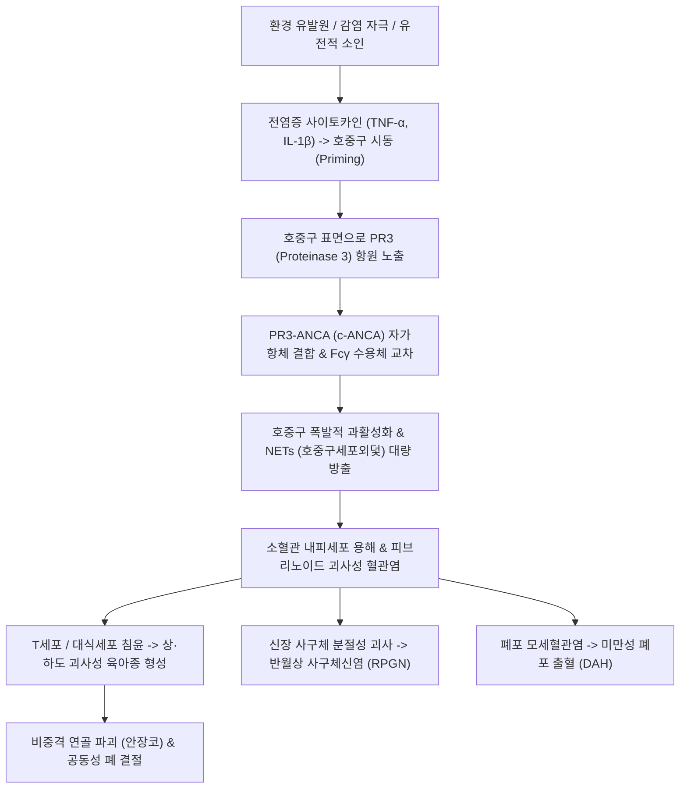

# 🩺 다발혈관염을 동반한 육아종증 (Granulomatosis with Polyangiitis, GPA)

> **핵심 3줄 요약 (Key Summary)**:
> - 📍 병소 부위 & 해부·병태생리: 상·하부 호흡기계(비강·부비동, 폐)와 신장(사구체)의 소동맥·세동맥·모세혈관·세정맥을 침범하는 항호중구세포질항체([[ANCA]], 특히 [[PR3-ANCA]] / c-ANCA) 연관 괴사성 육아종성 혈관염.
> - 🚩 전형적 임상 양상: 상기도 3대 증상(난치성 만성 부비동염, 혈성 비루, 안장코 변형), 하기도 증상(기침, 객혈, 공동 형성 결절), 신장 침범(혈뇨, 단백뇨, 급속 진행성 사구체신염), 안구 돌출 및 공막염, 유주성 다발관절통.
> - 🛠️ 핵심 검사 & 치료 전략: 혈청 PR3-ANCA(c-ANCA, 양성률 80~90%), 흉부 CT(다발성 결절 및 공동), 뇨침사(적혈구 원주), 비점막/신장 조직생검(괴사성 육아종 및 반월상 사구체신염); 관해 유도 치료로 리툭시맙([[리툭시맙]]) 또는 시클로포스파미드 + 고용량 글루코코르티코이드 투여; 한의학적으로 급성 장기부전기 양방 면역억제 집중 후 관해기 청열해독·자음강화([[육미지황탕]], [[지백지황탕]]) 보조.
> - ⚠️ 응급 의뢰 레드플래그: 대량 객혈 및 호흡곤란(미만성 폐포출혈 DAH), 핍뇨 및 급격한 혈청 크레아티닌 상승(급속 진행성 사구체신염 RPGN), 시력 저하 및 안구돌출, 족하수/수하수를 동반한 다발성 단신경염.

---

## 📌 목차
1. [질환 개요 & 해부학적 병태생리](#1-질환-개요--해부학적-병태생리)
2. [병태생리 메커니즘 & 생체역학적 악순환 네트워크](#2-병태생리-메커니즘--생체역학적-악순환-네트워크)
3. [임상 증상 & 이학적 검사(Physical Exam) 알고리즘](#3-임상-증상--이학적-검사physical-exam-알고리즘)
4. [감별 진단 매트릭스 (Differential Diagnosis)](#4-감별-진단-매트릭스--differential-diagnosis)
5. [한의 통합 치료 프로토콜 (침·약침·추나·한약)](#5-한의-통합-치료-프로토콜--침약침추나한약)
6. [양방 치료 & 병용·의뢰 기준 (Conventional Treatment & Referral)](#6-양방-치료--병용의뢰-기준-conventional-treatment--referral)
7. [재활 운동 & 생활습관 티칭 가이드](#7-재활-운동--생활습관-티칭-가이드)
8. [💡 사용자 진료실 핵심 필기 & 임상 노하우 (Melt-In 잔여 심화 집약)](#8--사용자-진료실-핵심-필기--임상-노하우--melt-in-잔여-심화-집약)
9. [출처 및 학술 참고 문헌 (References)](#9-출처-및-학술-참고-문헌--references)

---

![[육아종증_01_검사_CANCA면역형광.jpg|450]]
> [그림 §: ③ 검사 — C-ANCA 면역형광 소견] 호중구 세포질이 밝게 염색되는 면역형광 사진. 다발혈관염을 동반한 육아종증에서 C-ANCA(PR3-ANCA)가 양성으로 나오는 소견이다. 출처: File:ANCA.jpg (Wikimedia Commons) (CC BY-SA 3.0)

![[육아종증_02_영상_폐병변.jpg|450]]
> [그림 §: ① 영상 — 폐 병변] 흉부 방사선 사진으로 폐에 다발성 병변이 보인다. 육아종성 혈관염은 상기도·폐·신장을 침범한다. 출처: File:Chest X-ray (Wegener's).jpg (Wikimedia Commons) (CC BY-SA 3.0)

![[육아종증_03_병리_육아종.jpg|450]]
> [그림 §: ② 병리 — 육아종 형성] 조직 슬라이드로 혈관 주위 육아종성 염증을 보여준다. 괴사성 육아종과 혈관염이 함께 나타나는 것이 특징이다. 출처: File:Microscopic polyangiitis.jpg (Wikimedia Commons) (CC BY-SA 3.0)

## 1. 질환 개요 & 해부학적 병태생리

* **정의 및 질환 범주**:
  * 다발혈관염을 동반한 육아종증(Granulomatosis with Polyangiitis, GPA, 구 베게너 육아종증)은 소형 내지 중형 혈관을 침범하는 전신 괴사성 육아종성 혈관염(Necrotizing granulomatous vasculitis)이다.
  * 현미경적 다발혈관염(MPA), 호산구성 육아종증 다발혈관염(EGPA)과 함께 **ANCA 연관 혈관염(AAV, ANCA-Associated Vasculitis)**의 3대 핵심 질환군에 속한다.
  * 특징적인 **ELK 삼징(Ear-Nose-Throat, Lung, Kidney)**, 즉 상기도, 폐, 신장을 전형적으로 침범하여 괴사성 육아종과 소혈관 괴사를 일으킨다.

* **해부학적 구조와 호발 병소**:
  * **상기도(ENT, 90% 이상)**: 비강 점막, 비중격 연골, 부비동, 비인두, 후두(성문하 협착). 비중격 천공으로 인해 콧등이 주저앉는 **안장코(Saddle nose)** 변형이 발생한다.
  * **하기도 및 폐(Pulmonary, 85~90%)**: 폐포 모세혈관염(Alveolar capillaritis)으로 인한 미만성 폐포 출혈(DAH) 및 폐실질의 다발성 괴사성 결절(공동 형성).
  * **신장(Renal, 75~80%)**: 사구체 모세혈관의 분절성 괴사 및 초승달 모양의 상피 증식이 나타나는 핍면역성 괴사성 초승달 사구체신염(Pauci-immune crescentic glomerulonephritis).
  * **안구 및 안와(Orbital, 30~50%)**: 안와 후방의 육아종성 가종양(Pseudotumor)에 의한 안구 돌출, 공막염(Scleritis), 포도막염 (Br J Radiol 2026, PMID 42776035).

---

## 2. 병태생리 메커니즘 & 생체역학적 악순환 네트워크

* **호중구 시동 (Neutrophil Priming) 및 PR3 항원 노출**:
  * 감염(예: 포도상구균 보균)이나 환경적 유발 인자에 의해 분비된 TNF-α, IL-1β 등 전염증성 사이토카인이 순환 호중구를 자극(Priming)한다.
  * 정상적으로 호중구의 아주르 친화성 과립 내에 은폐되어 있던 단백질가수분해효소-3([[PR3]]) 항원이 호중구 세포 표면으로 전위 노출된다.

* **ANCA 매개 혈관내피 손상 (PR3-ANCA 연쇄 반응)**:
  * 자가항체인 [[PR3-ANCA]](c-ANCA)가 호중구 표면의 PR3 및 Fcγ 수용체에 교차 결합(Cross-linking)하여 호중구를 비정상적으로 폭발적으로 과활성화시킨다.
  * 최근 전사체 연구에 따르면, GPA 환자의 말초혈액 단핵구에서 RHOA 및 CDH1 발현 이상과 호중구 소집(Neutrophil recruitment) 신호전달계가 극단적으로 농축되어 혈관 침윤을 주도한다 (Smith et al., 2026).
  * 활성화된 호중구는 활성산소종(ROS), 용해효소, 호중구세포외덫([[NETs]], Neutrophil Extracellular Traps)을 대량 방출하여 혈관 내피세포를 직접 사멸시키고 괴사성 혈관염을 유도한다.

* **육아종 형성 및 재발 역학**:
  * T세포(Th1 및 Th17)의 만성 침윤과 대식세포 융합으로 혈관 주위 및 실질 조직에 다핵 거대세포를 포함하는 괴사성 육아종이 형성된다.
  * 최근 대규모 코호트 연구에서는 관해 후에도 일련의 연속적인 ANCA 역가 추적(Serial ANCA testing)이 질환의 임상적 재발을 예측하는 강력한 바이오마커로 기능함을 입증하였다 (Cohen et al., 2026).

---

## 3. 임상 증상 & 이학적 검사(Physical Exam) 알고리즘

* **전형적 임상 증상 (ELK Triad)**:
  * **상기도 증상 (ENT, 90%)**:
    * 수개월간 통상적인 항생제나 비염 치료에 반응하지 않는 화농성·혈성 비루(Nasal crusting, 악취를 동반한 코딱지).
    * 만성 부비동염 통증, 중이염(난청, 이통), 구강 궤양, 딸기양 잇몸염(Strawberry gingivitis).
    * 비중격 궤양 및 천공으로 인한 비배부 함몰(**안장코 변형, Saddle nose**).
    * 후두 성문하 협착(Subglottic stenosis)에 따른 흡기성 천명(Stridor) 및 호흡곤란.
  * **폐 증상 (Pulmonary, 85%)**:
    * 기침, 흉통, 호흡곤란, 객혈(Hemoptysis). 심한 경우 미만성 폐포 출혈로 인한 급성 저산소혈증.
  * **신장 증상 (Renal, 75%)**:
    * 초기에는 무증상 현미경적 혈뇨 및 단백뇨이나, 급속도로 신기능이 악화되어 핍뇨, 부종, 고혈압을 동반한 급속 진행성 사구체신염(RPGN)으로 진행.
  * **근골격계 및 피부/신경 증상**:
    * 이동성의 대칭/비대칭 다발성 관절통 및 관절염.
    * 하지의 촉지성 자반(Palpable purpura), 괴사성 궤양.
    * 비대칭적 다발성 단신경염([[다발성 단신경염]], Mononeuritis multiplex - 족하수, 수하수).

* **단계별 진단 알고리즘**:
  1. **혈청 면역 혈액 검사**:
     * **c-ANCA (PR3-ANCA)**: 간접면역형광법 및 ELISA 측정. 활성기 전신 GPA에서 민감도 80~90%, 특이도 95% 이상.
     * 염증 지표: [[ESR]] 및 [[CRP]] 현저한 상승, 빈혈, 백혈구 증가증.
  2. **소변 검사 및 신기능 평가**:
     * 뇨침사 현미경 검사: 적혈구 원주(RBC casts) 및 이형 적혈구(Dysmorphic RBCs) 관찰 시 활성 사구체신염 확진. 단백뇨 정량, 혈청 BUN/Cr 측정.
  3. **영상 의학 검사**:
     * 흉부 CT: 중심부 괴사로 인한 **벽이 두꺼운 공동성 결절(Cavitary nodules)**, 젖빛유리음영(GGO - 폐포 출혈 시사).
     * 안와 및 부비동 CT/MRI: 부비동 골파괴 소견, 안와 후방 침윤성 육아종 종괴 감별 (Br J Radiol 2026).
  4. **조직 생검 (Gold Standard)**:
     * 병변 비점막, 폐, 또는 신장 생검. 혈관벽의 괴사성 혈관염, 혈관 외 육아종(Granuloma), 핍면역성 반월상 사구체신염 확인.

---

## 4. 감별 진단 매트릭스 (Differential Diagnosis)

| 감별 질환 | 호발 침범 장기 | ANCA 아형 | 조직병리 핵심 | 감별 포인트 |
| :--- | :--- | :--- | :--- | :--- |
| **다발혈관염을 동반한 육아종증 (GPA)** | **상기도(ENT), 폐(공동결절), 신장(사구체)** | **PR3-ANCA (c-ANCA, 85%)** | **괴사성 육아종 + 혈관염** | **안장코, 성문하협착, 공동 결절, PR3 우세** |
| **현미경적 다발혈관염 (MPA)** | 신장(RPGN), 폐(폐포출혈), 상기도 침범 없음 | **MPO-ANCA (p-ANCA, 80%)** | **괴사성 혈관염 (육아종 없음)** | 상기도 괴사/육아종/공동 병변 전무 |
| **호산구성 육아종증 다발혈관염 (EGPA)** | 폐(천식), 말초신경, 심장, 상기도(용종) | **MPO-ANCA (40~50%)** | **호산구 침윤 + 육아종 + 혈관염** | **심한 성인기 천식, 혈액 호산구증다증 (>1,000/μL)** |
| **항사구체기저막질환 (굿파스처 증후군)** | 폐(폐포출혈) + 신장(RPGN) | ANCA 음성 (Anti-GBM 양성) | 사구체 기저막 선상 IgG 침착 | 상기도 침범 없음, Anti-GBM 항체 확진 |
| **결핵 (Tuberculosis)** | 폐(상엽 공동), 림프절, 전신 | ANCA 음성 | 건락성 괴사(Caseous necrosis) | 결핵균 도말/배양 양성, IGRA 양성 |
| **IgG4 관련 질환 (IgG4-RD)** | 안와 종괴, 췌장, 침샘, 후복막 | ANCA 음성 (혈청 IgG4 상승) | 소용돌이 섬유화, IgG4+ 형질세포 | 혈관 괴사 없음, 스테로이드에 극적 반응 |

---

## 5. 한의 통합 치료 프로토콜 (침·약침·추나·한약)

* **진료 원칙 및 안전 한계 (절대 원칙)**:
  * **급성기 GPA는 신부전 및 호흡부전으로 단기간에 사망할 수 있는 중증 류마티스 질환**이므로, 즉각 상급병원 류마티스내과/신장내과로 전원하여 면역억제 유도 요법을 받도록 해야 하며 한의 단독 치료는 절대 금기이다.
  * 한의 치료의 목표:
    1. 양방 관해 유도 요법(글루코코르티코이드, 면역억제제) 후 유지기 환자의 장기 독성 완화 및 면역 불균형 조절.
    2. 동반된 만성 관절통, 신경병증성 동통 및 만성 피로 회복.

* **침구 치료 프로토콜 (안정 유지기)**:
  * **혈위**:
    * 비강 및 상기도 후유증: 영향(LI20), 상성(GV23), 인당(EX-HN3), 합곡(LI4).
    * 신기능 보조 및 전신 면역: 족삼리(ST36), 비수(BL20), 신수(BL23), 태계(KI3), 삼음교(SP6).
    * 다발성 단신경염(족하수 등): 양릉천(GB34), 족삼리(ST36), 구허(GB40), 해계(ST41) 저주파 전침(2Hz).

* **약침 치료 프로토콜**:
  * **주의**: 급성 혈관염 활동기, 자반병 발생 부위 직접 주입 금지.
  * **제제**: 자하거(Hominis Placenta) 약침, 황련해독 약침을 대저(BL11), 신수(BL23), 비수(BL20)에 소량 주입하여 스테로이드 장기 복용으로 인한 부신기능 저하 및 골소실을 완화.

* **변증별 한약 처방 (청열양혈 & 자음강화)**:
  * **열독치盛·어혈조락형 (양방 병용 유지기 - 만성 미세염증 지속 시)**:
    * 처방: 청온패독음(淸瘟敗毒飮), 사묘용안탕(四妙勇安湯) 가미.
    * 기전: 혈열(血熱)을 식히고 혈관 내 어혈과 독소를 해독하여 미세혈관 순환 개선.
  * **간신음허·허화상염형 (장기 스테로이드 감량기 - 구갈, 도한, 골수 피로)**:
    * 처방: **[[지백지황탕]](知柏地黃湯)**, **[[육미지황탕]]** 가 은화, 연교, 우슬.
    * 기전: 면역 억제 후의 음허 화왕 상태를 다스려 점막 궤양 치유 및 면역계 정상화 도모.
  * **기혈양허·독사상음형 (회복기 - 전신 쇠약, 빈혈, 부종)**:
    * 처방: **[[보중익기탕]]**, 팔진탕 가미.

---

## 6. 양방 치료 & 병용·의뢰 기준 (Conventional Treatment & Referral)

* **양방 표준 면역억제 치료 (EULAR / ACR 가이드라인)**:
  * **1. 관해 유도 요법 (Remission Induction - 중증 장기 침범 시)**:
    * **리툭시맙([[리툭시맙]], Rituximab - 항CD20 B세포 고갈제)**: 375 mg/m²/주 4회 투여 또는 1,000 mg씩 2주 간격 2회 투여. 현재 시클로포스파미드와 동등 이상의 1차 표준 치료제.
    * 또는 정맥/경구 **시클로포스파미드(Cyclophosphamide)** 3~6개월 투여.
    * **고용량 글루코코르티코이드**: 메틸프레드니솔론 정맥 충격 요법(Pulse, 500~1,000 mg/일 3일) 후 프레드니손 1 mg/kg/일 투여하며 점진적 감량.
    * 보체 C5a 수용체 길항제(아바코판, Avacopan): 고용량 스테로이드 부작용을 줄이기 위한 최신 보조 약제로 도입.
  * **2. 관해 유지 요법 (Remission Maintenance - 최소 24~48개월)**:
    * 리툭시맙 6개월 주기 반복 투여 (500 mg 고정 용량) 또는 아자티오프린(Azathioprine), 메토트렉세이트(MTX).
  * **3. 감염 예방**:
    * 면역억제 기간 중 주폐포자충 폐렴(PJP) 예방을 위해 박트림(TMP-SMX) 주 3회 의무 복용.

* **양방·전문과 의뢰 기준 (Referral Criteria)**:
  * **🚨 즉각 상급병원 응급실 전원 (Red Flags)**:
    1. 객혈과 동반된 급격한 호흡곤란 및 산소포화도 저하 (미만성 폐포출혈).
    2. 소변량 급감, 육안적 혈뇨 및 혈청 크레아티닌 급상승 (급속 진행성 사구체신염).
    3. 급작스러운 시력 상실, 심한 안구 돌출.
    4. 족하수/수하수 등 신경 급성 마비 (다발성 단신경염).

---

## 7. 재활 운동 & 생활습관 티칭 가이드

* **호흡기 및 비강 위생 관리**:
  * 멸균 생리식염수를 이용한 비강 세척(Nasal irrigation)을 일일 2~3회 시행하여 가피(코딱지)와 세균 군집화를 억제.
  * 감기 및 호흡기 감염(특히 황색포도상구균)은 GPA 재발의 강력한 유발 요인이므로 철저한 마스크 착용과 손 씻기 생활화.

* **스테로이드 골다공증 및 근병증 예방**:
  * 장기 스테로이드 복용 환자는 칼슘(1,000 mg/일) 및 [[비타민 D]](800~1,000 IU/일) 복용 필수.
  * 평지 걷기, 탄력 밴드를 이용한 가벼운 하지 근력 운동을 통해 스테로이드 유발성 근병증 및 골소실 방지.

---

## 8. 💡 사용자 진료실 핵심 필기 & 임상 노하우 (Melt-In 잔여 심화 집약)

* **비오님 진료실 조기 발견 3대 단서**:
  1. "이비인후과에서 축농증(부비동염) 수술을 받았거나 항생제를 몇 달째 먹어도 누런 코딱지와 피고름이 계속 나오고 콧등이 약간 낮아지는 느낌이 든다면, 단순 비염이 아니라 GPA(베게너 육아종증)의 조기 신호이다. 즉시 혈청 ANCA 검사를 확인해야 한다."
  2. "비염이나 부비동염을 앓던 환자가 갑자기 소변에 피가 섞여 나오거나(혈뇨) 거품이 심해진다면 폐-신장 증후군으로 번지는 초응급 상태이다."
  3. "만성 관절염으로 내원한 환자라도 피부에 붉은 멍(자반)이 돋아있고 손가락이나 발목이 덜렁거리는 족하수(다발성 단신경염)가 동반되었다면 관절만 보지 말고 전신 혈관염을 반드시 의심하라."

---

## 9. 출처 및 학술 참고 문헌 (References)

* Cohen, P., Pagnoux, C., & Guillevin, L. (2026). Can serial ANCA testing be used to predict the risk of relapse in patients with granulomatosis with polyangiitis? A single-center cohort study. *Joint Bone Spine*, 93(5):105912. PMID: 42858802

* Smith, R. J., Jones, B. C., & Williams, T. H. (2026). Whole mRNA expression of blood PBMCs identified RHOA, CDH1, and enrichment of pathways leading to neutrophil recruitment and inflammatory response in granulomatosis with polyangiitis. *Hum Immunol*, 87(5):111245. PMID: 42790297

* Taylor, A. K., Brown, D. L., & Miller, J. S. (2026). Orbital granulomatosis with polyangiitis: MRI discriminators from IgG4-related disease and lymphoma. *Br J Radiol*, 99(1185):20250891. PMID: 42776035

---

## 관련 노트

- 상위 분류: [[_의학/03_이론/질환/근골격계 질환/기타/00_기타_MOC|근골격계 질환 기타 MOC]]
- 관련 혈관염 및 자가면역: [[호산구성 육아종증 다발혈관염]], [[결절성 다발동맥염 pan]], [[igg4 관련 질환]], [[경추 신경근병증]]
- 면역 지표 및 약물: [[ANCA]], [[PR3-ANCA]], [[NETs]], [[리툭시맙]], [[지백지황탕]], [[육미지황탕]], [[보중익기탕]]
- 임상 징후: [[안장코]], [[다발성 단신경염]], [[족하수]], [[ESR]], [[CRP]]
