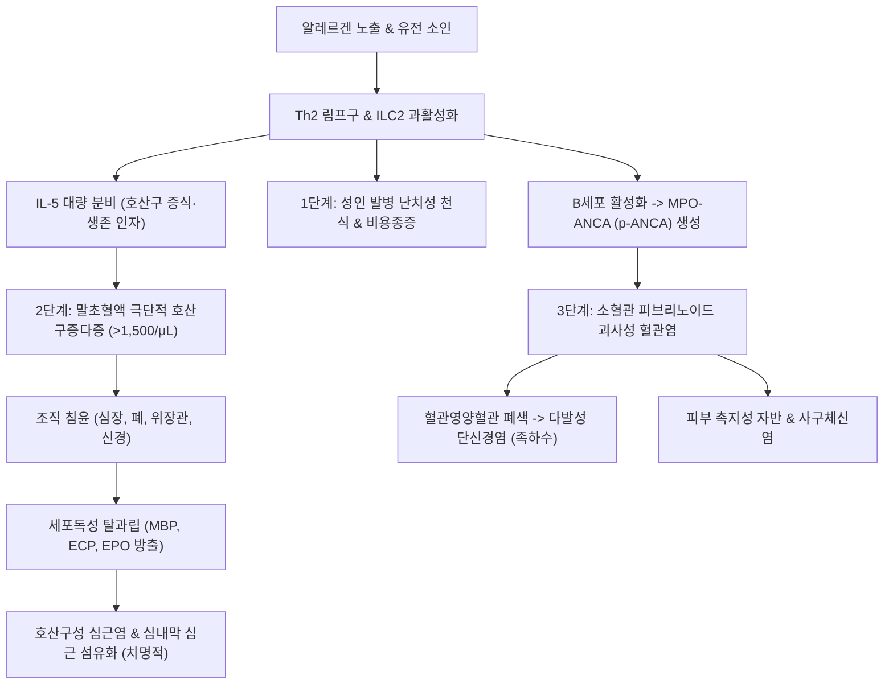

# 🩺 다발혈관염을 동반한 호산구성 육아종증 (Eosinophilic Granulomatosis with Polyangiitis, EGPA)

> **핵심 3줄 요약 (Key Summary)**:
> - 📍 병소 부위 & 해부·병태생리: 말초혈액 및 조직의 극심한 호산구 침윤, 혈관 외 괴사성 육아종, 소형·중형 혈관의 괴사성 혈관염을 특징으로 하는 ANCA 연관 혈관염 질환으로, 주로 호흡기(천식, 비용종), 말초신경, 심장, 피부, 위장관을 침범한다.
> - 🚩 전형적 임상 양상: 3단계 자연 경과(1단계: 성인 발병 난치성 천식 및 알레르기 비염/부비동염 → 2단계: 말초혈액 호산구증다증 및 폐/위장관 호산구 침윤 → 3단계: 전신 괴사성 혈관염으로 인한 다발성 단신경염, 심근염, 자반, 관절통).
> - 🛠️ 핵심 검사 & 치료 전략: 절대 호산구 수(AEC > 1,000~1,500/μL), [[MPO-ANCA]](p-ANCA, 양성률 40~50%), 흉부 영상 및 심장 MRI/심초음파, 신경근 생검; 중증 시 전신 글루코코르티코이드 + 시클로포스파미드 또는 리툭시맙, 비중증/재발성 시 IL-5 표적 생물학제제 메폴리주맙([[메폴리주맙]], Mepolizumab); 한의학적으로 한천(寒喘)·담음(痰飲)·어혈(瘀血) 변증 보조.
> - ⚠️ 응급 의뢰 레드플래그: 흉통 및 심부전 징후(호산구성 심근염/심낭염 - 주된 사망 원인), 족하수/수하수 급성 진행(다발성 단신경염), 장간막 허혈에 의한 급성 복통 및 소화관 출혈.

---

## 📌 목차
1. [질환 개요 & 해부학적 병태생리](#1-질환-개요--해부학적-병태생리)
2. [병태생리 메커니즘 & 생체역학적 악순환 네트워크](#2-병태생리-메커니즘--생체역학적-악순환-네트워크)
3. [임상 증상 & 이학적 검사(Physical Exam) 알고리즘](#3-임상-증상--이학적-검사physical-exam-알고리즘)
4. [감별 진단 매트릭스 (Differential Diagnosis)](#4-감별-진단-매트릭스--differential-diagnosis)
5. [한의 통합 치료 프로토콜 (침·약침·추나·한약)](#5-한의-통합-치료-프로토콜--침약침추나한약)
6. [양방 치료 & 병용·의뢰 기준 (Conventional Treatment & Referral)](#6-양방-치료--병용의뢰-기준-conventional-treatment--referral)
7. [재활 운동 & 생활습관 티칭 가이드](#7-재활-운동--생활습관-티칭-가이드)
8. [💡 사용자 진료실 핵심 필기 & 임상 노하우 (Melt-In 잔여 심화 집약)](#8--사용자-진료실-핵심-필기--임상-노하우--melt-in-잔여-심화-집약)
9. [출처 및 학술 참고 문헌 (References)](#9-출처-및-학술-참고-문헌--references)

---

![[호산구성육아종증_01_병리_혈관염.jpg|450]]
> [그림 §: ② 병리 — 호산구성 혈관염] 조직 슬라이드로 호산구 침윤을 동반한 혈관염 소견을 보여준다. 천식·말초혈액 호산구 증가와 함께 나타나면 이 질환을 의심한다. 출처: File:Churg-Strauss syndrome - high mag.jpg (Wikimedia Commons) (CC BY-SA 3.0)

## 1. 질환 개요 & 해부학적 병태생리

* **정의 및 핵심 개념**:
  * 다발혈관염을 동반한 호산구성 육아종증(EGPA, 구 처그-스트라우스 증후군)은 전신 소형 및 중형 혈관의 괴사성 혈관염, 혈관 외 호산구성 육아종(Eosinophilic granuloma), 조직 내 현저한 호산구 침윤을 특징으로 하는 희귀 자가면역 질환이다.
  * ANCA 연관 혈관염(AAV) 중 하나로 분류되지만, 전체 환자의 40~50%에서만 [[MPO-ANCA]](p-ANCA)가 양성으로 나타나며, ANCA 양성군과 음성군 간에 뚜렷한 임상 표현형 차이를 보인다.
  * **ANCA 양성군**: 전형적인 괴사성 사구체신염, 다발성 단신경염, 피부 자반 등 '혈관염성(Vasculitic)' 증상이 우세하다.
  * **ANCA 음성군**: 호산구 직접 침윤에 의한 심근염, 폐실질 침윤, 호산구성 장염 등 '호산구 매개성(Eosinophil-mediated)' 조직 손상이 우세하며, 특히 심장 침범이 예후를 결정한다.

* **해부학적 구조와 3단계 자연 경과**:
  * **1단계 (알레르기 전구기, Prodromal Phase)**:
    * 수년~수십 년간 지속되는 성인 발병의 심한 난치성 천식(Severe asthma), 알레르기 비염, 재발성 비강 용종(Nasal polyposis).
  * **2단계 (호산구성 침윤기, Eosinophilic Phase)**:
    * 말초혈액 내 극단적인 호산구 증가증 및 폐, 위장관, 심근으로의 호산구 침윤에 따른 유주성 폐침윤(Löffler 유사), 호산구성 위장관염.
  * **3단계 (전신 혈관염기, Vasculitic Phase)**:
    * 소동맥의 피브리노이드 괴사 및 육아종성 염증으로 인해 다발성 단신경염, 촉지성 자반, 심근경색, 사구체신염 발생.

---

## 2. 병태생리 메커니즘 & 생체역학적 악순환 네트워크

* **Th2 면역 반응 및 IL-5 과발현**:
  * 유전적 소인(HLA-DRB4 등)을 가진 개체에서 환경적 알레르겐 자극에 의해 Th2 림프구 및 제2형 선천성 림프구(ILC2)가 과활성화된다.
  * Th2 사이토카인인 **[[IL-5]](Interleukin-5)**, IL-4, IL-13이 대량 분비되며, 특히 IL-5는 골수에서 호산구의 분화, 증식, 성숙, 혈관외 유출 및 세포자멸사 억제를 주도한다.

* **호산구 탈과립 및 세포독성 조직 손상**:
  * 조직으로 침윤한 호산구가 탈과립을 일으켜 주요염기성단백질([[MBP]], Major Basic Protein), 호산구양이온단백질(ECP), 호산구페록시다아제(EPO), 호산구유래신경독소(EDN) 등 강력한 세포독성 과립 단백질을 방출한다.
  * MBP와 ECP는 혈관 내피세포막을 파괴하고 심근세포를 직접 괴사시키며 심내막 섬유화 및 벽측 혈전을 유발한다 (Cottin et al., 2026).

* **ANCA 매개 혈관염 축과 질환 활성도 모니터링**:
  * 호산구 페록시다아제 및 MPO에 반응하는 자가항체([[MPO-ANCA]])가 호중구 및 호산구를 자극하여 혈관벽 피브리노이드 괴사를 촉진한다.
  * 최근 스코핑 리뷰에서는 버밍엄 혈관염 활성도 점수(BVAS) 및 절대 호산구 수, 신생 바이오마커를 통한 정밀 질환 활성도 모니터링이 비가역적 장기 손상을 예방하는 핵심 전략임을 강조하였다 (Vaglio et al., 2026).

---

## 3. 임상 증상 & 이학적 검사(Physical Exam) 알고리즘

* **전형적 임상 증상**:
  * **호흡기계**: 성인기에 새롭게 발생하여 흡입 스테로이드에 잘 조절되지 않는 중증 천식 발작, 천명음(Wheezing), 만성 비염 및 축농증, 후각 소실.
  * **신경계 (가장 특징적, 65~75%)**:
    * 비대칭적으로 말초신경이 침범되는 **다발성 단신경염([[다발성 단신경염]], Mononeuritis multiplex)**.
    * 비골신경 마비로 인한 한쪽 발의 **족하수([[족하수]])**, 요골신경 마비로 인한 손목 처짐(수하수), 날카로운 작열통 및 감각 마비.
  * **심혈관계 (가장 치명적, 15~30%)**:
    * 심근염, 심낭염, 심부전, 부정맥. EGPA 환자의 전체 사망 원인 중 약 50%를 차지.
  * **피부 및 소화기계**:
    * 하지의 촉지성 자반(Palpable purpura), 피하 결절, 허혈성 복통, 설사, 장출혈.

* **단계별 진단 알고리즘 (ACR/EULAR 2022 EGPA 분류 기준)**:
  1. **혈액 검사**:
     * **절대 호산구 수(AEC)**: 백혈구 감별계산상 **호산구 비율 > 10%** 또는 **AEC > 1,000~1,500/μL**.
     * **혈청 MPO-ANCA (p-ANCA)**: 약 40~50%에서 양성.
     * 혈청 총 IgE 현저한 상승 (> 1,000 IU/mL).
  2. **영상 및 심장 기능 평가**:
     * 흉부 CT: 유주성 반상 젖빛유리음영(GGO) 또는 폐경화 소견.
     * 심전도, 트로포닌 I/T, 심장 초음파, 조영 심장 MRI(심근염 및 심내막 지연 조영 증강 확인 필수).
  3. **신경전도 검사(NCS/EMG)**:
     * 다발성 단신경염 패턴의 축삭 손상 확인.
  4. **조직 생검**:
     * 피부 결절, 비점막, 또는 비복신경/근육 생검. 혈관벽의 괴사성 혈관염 및 혈관외 호산구 침윤/육아종 확인.

---

## 4. 감별 진단 매트릭스 (Differential Diagnosis)

| 감별 질환 | 호산구 수치 / 천식 동반 여부 | ANCA 아형 | 침범 특징 및 조직 소견 | 감별 포인트 |
| :--- | :--- | :--- | :--- | :--- |
| **호산구성 육아종증 다발혈관염 (EGPA)** | **극심한 호산구증가 (>1,500/μL), 천식 필수** | **MPO-ANCA (40~50%)** | **호산구 침윤 + 육아종 + 혈관염** | **성인 천식 선행, 다발성 단신경염, 심근염, IL-5 표적 반응** |
| **특발성 호산구증다증후군 (HES)** | 극심한 호산구증가, 천식 흔치 않음 | ANCA 음성 (100%) | 혈관염이나 육아종 소견 없음 | FIP1L1-PDGFRA 유전자 변이, 혈관염 징후 결여 |
| **다발혈관염을 동반한 육아종증 (GPA)** | 호산구 정상 또는 경미, 천식 없음 | **PR3-ANCA (c-ANCA, 85%)** | 괴사성 육아종, 부비동 골파괴, 안장코 | 천식 없음, PR3 양성, 상·하도 괴사 결절 및 신장 침범 우세 |
| **현미경적 다발혈관염 (MPA)** | 호산구 정상, 천식 없음 | **MPO-ANCA (80%)** | 육아종 없는 단순 괴사성 혈관염 | 폐포출혈 + RPGN 중심, 천식 및 호산구 증가 없음 |
| **알레르기 기관지폐 아스페르길루스증 (ABPA)** | 호산구 상승, 천식 동반 | ANCA 음성 | 중심성 기관지확장증, 아스페르길루스 특이 IgE | 아스페르길루스 피부단자 양성, 전신 혈관염 증상 전무 |

---

## 5. 한의 통합 치료 프로토콜 (침·약침·추나·한약)

* **진료 원칙 및 안전 한계 (절대 원칙)**:
  * **활동성 EGPA(심근염, 급성 단신경염, 호흡부전)는 생명을 위협하는 류마티스 응급 질환**이므로 상급병원 류마티스/호흡기내과로 즉각 전원하여 고용량 스테로이드 및 표적치료제를 투여받아야 하며 한의 단독 치료는 절대 금기이다.
  * 한의 치료의 목표:
    1. 관해 유지기 환자의 잔여 호흡기 천식 증상 및 알레르기 비염 완화.
    2. 다발성 단신경염으로 인한 족하수, 수하수 환자의 말초신경 재생 및 근위축 방지.
    3. 스테로이드 감량기 부작용(근병증, 골소실, 면역저하) 보조 관리.

* **침구 치료 프로토콜 (다발성 단신경염 신경재생)**:
  * **혈위**:
    * 비골신경 마비(족하수): 양릉천(GB34), 족삼리(ST36), 구허(GB40), 해계(ST41), 조구(ST38).
    * 요골신경 마비(수하수): 곡지(LI11), 수삼리(LI10), 외관(TE5), 양계(LI5).
  * **기법**: 마비된 신경 경로를 따라 저주파 전침(2~4Hz)을 20분간 적용하여 신경 축삭의 발아(Axonal sprouting) 및 탈신경성 근위축 방지.

* **변증별 한약 처방 (온폐화담 & 활혈통락)**:
  * **한천·담음조폐형 (천식 잔여 증상 및 비염기)**:
    * 처방: **[[소청룡탕]]**, 마황부자세신탕 가미.
    * 작용: 폐의 한음(寒飲)을 흩어버리고 기관지 평활근 경련을 완화.
  * **어혈저락·기혈양허형 (단신경염 마비 및 전신 쇠약기)**:
    * 처방: **[[보양환오탕]](補陽還五湯)**, [[독활기생탕]] 가미 (우슬, 모과, 지룡, 강활 증량).
    * 작용: 황기로 기운을 북돋우고 지룡·당귀로 미세 혈류를 개선하여 신경영양혈관 허혈 극복.
  * **비폐기허·간신부족형 (스테로이드 감량 후 유지기)**:
    * 처방: **[[보중익기탕]]**, 육미지황탕 가미.

---

## 6. 양방 치료 & 병용·의뢰 기준 (Conventional Treatment & Referral)

* **양방 표준 치료 (ACR/EULAR 2022 및 최신 리뷰 - PMID 42552373, 42167620)**:
  * **1. 관해 유도 요법 (Remission Induction)**:
    * **중증 (Five-Factor Score ≥ 1: 심근염, 신부전, 위장관 천공/출혈 등)**:
      * 고용량 글루코코르티코이드(펄스 요법 포함) + **정맥 시클로포스파미드(CYC)** 또는 **리툭시맙([[리툭시맙]])**.
    * **비중증 (Five-Factor Score = 0: 천식, 비부비동염, 경미한 피부/신경 침범)**:
      * 경구 글루코코르티코이드 + **IL-5 표적 인간화 단클론항체 메폴리주맙([[메폴리주맙]], Mepolizumab, 300 mg 피하주사/4주 간격)**.
      * 메폴리주맙은 최근 실사용 데이터(RWE) 스코핑 리뷰상 스테로이드 용량을 극적으로 줄이고 높은 관해율을 입증함 (Autoimmun Rev 2026, PMID 42167620).
  * **2. 관해 유지 요법 (Remission Maintenance)**:
    * 메폴리주맙 지속 투여 또는 아자티오프린(AZA), 메토트렉세이트(MTX).

* **양방·전문과 의뢰 기준 (Referral Criteria)**:
  * **🚨 즉시 3차 상급병원 응급실 전원 (Red Flags)**:
    1. 호흡곤란, 흉통, 심계항진 (호산구성 심근염 의심 - EGPA의 최고 사망 원인).
    2. 갑작스러운 발목 또는 손목의 마비·감각 소실 (다발성 단신경염 급성 악화).
    3. 심한 복통, 토혈, 혈변 (허혈성 장간막 혈관염).

---

## 7. 재활 운동 & 생활습관 티칭 가이드

* **족하수 보조기 및 신경 재활**:
  * 비골신경 마비로 인한 족하수 환자는 보행 시 발가락이 끌려 넘어지는 2차 낙상을 방지하기 위해 발목관절보조기(AFO) 착용 필수.
  * 발목 수동 신전 및 저항성 밴드 운동을 통해 아킬레스건 단축 방지.

* **천식 및 환경 알레르겐 관리**:
  * 급격한 온도 변화 및 찬 공기 노출 회피 (외출 시 마스크 착용).
  * 금연 필수 및 집먼지진드기, 곰팡이 등 환경 알레르겐 철저 차단.

---

## 8. 💡 사용자 진료실 핵심 필기 & 임상 노하우 (Melt-In 잔여 심화 집약)

* **비오님 진료실 감별 3대 원칙**:
  1. "성인이 되어 처음으로 심한 천식이 생겼다는 환자가, 감기약이나 천식 흡입제를 써도 안 듣고 손발이 저리거나 발목이 덜렁거린다고 하면(족하수), 100명 중 99명은 단순 천식이 아니라 EGPA(처그-스트라우스)이다."
  2. "피 검사에서 백혈구 중 **호산구(Eosinophil)가 10% 이상이거나 1,500/μL을 넘어가면** 단순 알레르기 비염 수준이 아니다. 즉시 심장 효소와 신경전도 검사를 의뢰해야 심장마비를 막을 수 있다."
  3. "EGPA 환자에게 가슴 답답함이나 숨찬 증상은 천식 발작일 수도 있지만 심근염일 가능성이 더 위험하다. 청진기로 천명음만 듣지 말고 심전도와 심장초음파를 반드시 확인해야 한다."

---

## 9. 출처 및 학술 참고 문헌 (References)

* Cottin, V., Bel, E., & Bottero, P. (2026). Advances in the treatment of eosinophilic granulomatosis with polyangiitis. *Nat Rev Rheumatol*, 22(9):512-526. PMID: 42552373

* Bettiol, A., Urban, M. L., & Emmi, G. (2026). Mepolizumab for eosinophilic granulomatosis with polyangiitis (EGPA): A scoping review of effectiveness and safety data derived from real-world evidence. *Autoimmun Rev*, 25(8):103822. PMID: 42167620

* Vaglio, A., Moiseev, S., & Terrier, B. (2026). Monitoring disease activity in eosinophilic granulomatosis with polyangiitis: a scoping review. *Clin Exp Rheumatol*, 44(9):1890-1901. PMID: 42752306

---

## 관련 노트

- 상위 분류: [[_의학/03_이론/질환/근골격계 질환/기타/00_기타_MOC|근골격계 질환 기타 MOC]]
- 관련 혈관염 및 질환: [[다발혈관염을 동반한 육아종증]], [[결절성 다발동맥염 pan]], [[천식]], [[알레르기 비염]]
- 면역 지표 및 약물: [[ANCA]], [[MPO-ANCA]], [[IL-5]], [[MBP]], [[메폴리주맙]], [[리툭시맙]], [[소청룡탕]], [[보양환오탕]]
- 임상 징후: [[다발성 단신경염]], [[족하수]], [[심근염]]
