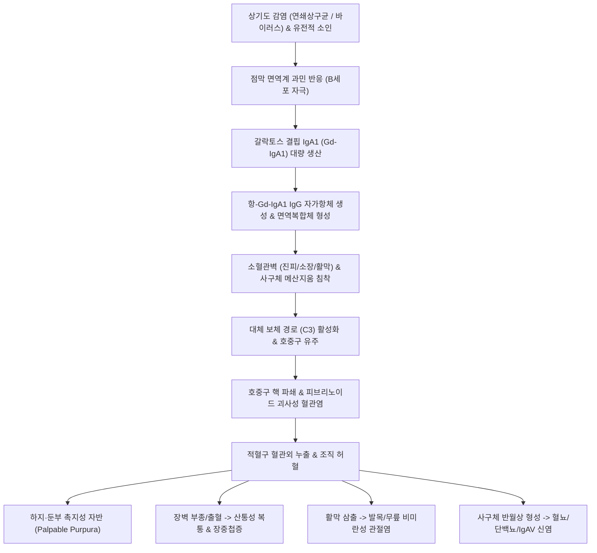

# 🩺 면역글로불린 A 관련 혈관염 (IgA Vasculitis, IgAV)

> **핵심 3줄 요약 (Key Summary)**:
> - 📍 병소 부위 & 해부·병태생리: 갈락토스 결핍 [[IgA1]](Gd-IgA1) 면역복합체가 피부, 위장관, 신장 사구체, 관절 활막의 소혈관(모세혈관·세동맥·세정맥) 벽에 침착되어 유발되는 백혈구파쇄성 혈관염(Leukocytoclastic vasculitis).
> - 🚩 전형적 임상 양상: 혈소판 감소 없이 하지 및 둔부에 대칭적으로 돋아나는 **촉지성 자반(Palpable purpura)**, 산통성 복통 및 소화관 출혈, 무릎·발목의 일과성 비미란성 관절염/관절통, 현미경적 혈뇨 및 단백뇨(IgA 신병증 유사 신염).
> - 🛠️ 핵심 검사 & 치료 전략: 혈소판 수 정상 확인, 뇨검사(단백뇨/혈뇨 추적), 피부/신장 생검(혈관벽/메산지움 내 IgA 우세 면역 침착); 소아는 대부분 자연 치유되나 성인형은 신부전 위험 높아 주의; 중증 복통/신염 시 전신 코르티코스테로이드, 성인 난치성 신염 시 면역억제제(자율신경 조절 및 EULAR/성인 가이드라인); 한의학적으로 풍열상락(風熱傷絡)·혈열망행(血熱妄行) 청열양혈지혈([[서각지황탕]], [[소경활혈탕]]) 보조.
> - ⚠️ 응급 의뢰 레드플래그: 극심한 복통과 혈변/담즙성 구토(소아 장중첩증, 장천공), 핍뇨 및 급속 진행성 사구체신염(RPGN), 성인에서 신증후군 범위의 단백뇨(신부전 영구화 위험).

---

## 📌 목차
1. [질환 개요 & 해부학적 병태생리](#1-질환-개요--해부학적-병태생리)
2. [병태생리 메커니즘 & 생체역학적 악순환 네트워크](#2-병태생리-메커니즘--생체역학적-악순환-네트워크)
3. [임상 증상 & 이학적 검사(Physical Exam) 알고리즘](#3-임상-증상--이학적-검사physical-exam-알고리즘)
4. [감별 진단 매트릭스 (Differential Diagnosis)](#4-감별-진단-매트릭스--differential-diagnosis)
5. [한의 통합 치료 프로토콜 (침·약침·추나·한약)](#5-한의-통합-치료-프로토콜--침약침추나한약)
6. [양방 치료 & 병용·의뢰 기준 (Conventional Treatment & Referral)](#6-양방-치료--병용의뢰-기준-conventional-treatment--referral)
7. [재활 운동 & 생활습관 티칭 가이드](#7-재활-운동--생활습관-티칭-가이드)
8. [💡 사용자 진료실 핵심 필기 & 임상 노하우 (Melt-In 잔여 심화 집약)](#8--사용자-진료실-핵심-필기--임상-노하우--melt-in-잔여-심화-집약)
9. [출처 및 학술 참고 문헌 (References)](#9-출처-및-학술-참고-문헌--references)

---

![[IgA혈관염_01_병리_IgA침착.jpg|450]]
> [그림 §: ② 병리 — IgA 침착 소견] 면역조직화학 슬라이드로 사구체에 IgA가 침착된 소견. IgA 혈관염(헤노흐-쇤라인 자반증)의 진단 근거다. 출처: File:IgA nephropathy (1).jpg (Wikimedia Commons) (CC BY-SA 3.0)

![[IgA혈관염_02_임상_하지자반.jpg|450]]
> [그림 §: ① 임상 — 하지 자반] 다리에 자반성 발진이 퍼진 실제 사진. IgA 혈관염의 전형적 피부 소견으로, 촉지성 자반이 특징이다. 출처: File:Henoch-schonlein-purpura.jpg (Wikimedia Commons) (CC BY-SA 3.0)

## 1. 질환 개요 & 해부학적 병태생리

* **정의 및 핵심 개념**:
  * 면역글로불린 A 관련 혈관염(IgA Vasculitis, IgAV, 구 쇤라인-헤노흐 자반증 Henoch-Schönlein Purpura / HSP)은 소혈관에 IgA1 우세 면역복합체가 침착되어 발생하는 전신성 괴사성 소혈관염이다.
  * 소아에서 가장 흔하게 발생하는 원발성 혈관염(발생률 10만 명당 10~20명, 호발 연령 3~10세)이며, 성인에서도 드물지만 발생할 수 있다.
  * 성인 발병 IgAV는 소아에 비해 장기 침범(특히 신장 및 소화관)이 훨씬 중증이며 만성 신부전으로의 진행률이 현저히 높다 (Maritati et al., 2026).

* **호발 해부학적 구조와 4대 침범 장기**:
  * **피부(Cutaneous, 100%)**: 중력의 영향을 받는 하지(발목, 하퇴, 대퇴 후면) 및 둔부의 진피 상부 모세혈관 및 세정맥 침범.
  * **관절(Articular, 60~80%)**: 체중 부하 관절인 족관절(발목), 주관절, 슬관절(무릎)의 활막 미세순환 침범 (관절 파괴나 영구 기형은 남기지 않음).
  * **위장관(Gastrointestinal, 50~75%)**: 소장(회장) 및 대장 점막하 소혈관의 부종 및 출혈 (점막하 혈종 및 장벽 허혈).
  * **신장(Renal, 40~50%)**: 사구체 간질(Mesangium)에 IgA1 침착으로 인한 메산지움 증식성 사구체신염 (조직학적으로 [[IgA 신병증]]과 구별 불가).

---

## 2. 병태생리 메커니즘 & 생체역학적 악순환 네트워크

* **선행 감염 및 갈락토스 결핍 IgA1 (Gd-IgA1) 생성**:
  * 상기도 감염(A군 연쇄상구균, 바이러스) 또는 위장관 감염이 점막 면역계를 자극한다 (Rigante et al., 2026).
  * 점막 B세포에서 힌지 부위 O-글리칸(O-glycan)의 갈락토오스 부착이 결손된 **갈락토스 결핍 IgA1(Galactose-deficient IgA1, Gd-IgA1)**이 과다 생산된다.

* **면역복합체 형성 및 소혈관 침착**:
  * 비정상적인 Gd-IgA1 분자를 자가항원으로 인식하는 자가항체(항-Gd-IgA1 IgG 또는 IgA)가 결합하여 거대 순환 면역복합체(Circulating Immune Complexes)를 형성한다.
  * 크기가 큰 Gd-IgA1 면역복합체는 간의 아시알로당단백질 수용체를 통한 제거를 우회하여 전신의 모세혈관 및 사구체 메산지움에 침착된다.

* **보체계 활성화 및 백혈구파쇄성 혈관염 (Leukocytoclastic Vasculitis)**:
  * 침착된 IgA 복합체는 대체 보체 경로(Alternative pathway) 및 렉틴 경로를 활성화하여 C3a, C5a를 생성한다.
  * 호중구가 대량 유입되어 혈관 내피세포를 공격하며, 호중구 핵이 붕괴되어 파편(백혈구파쇄 현상, Leukocytoclasia)을 남긴다.
  * 혈관벽의 피브리노이드 괴사(Fibrinoid necrosis)와 내피 손상으로 적혈구가 혈관 밖으로 누출되어 촉지성 자반과 점막하 출혈이 발생한다.

---

## 3. 임상 증상 & 이학적 검사(Physical Exam) 알고리즘

* **전형적 임상 증상 (4대 핵심 징후)**:
  1. **촉지성 자반 (Palpable Purpura, 필수 증상)**:
     * 중력의 영향을 받는 발등, 하퇴, 대퇴 후면, 둔부에 대칭적으로 발생하는 붉은색~자주색 발진.
     * 일반 점상출혈과 달리 손가락 끝으로 만졌을 때 오돌토돌하게 융기되어 만져짐(촉지성). 누르면 색이 사라지지 않음(비탈색성).
  2. **관절통 및 관절염 (60~80%)**:
     * 발목과 무릎 관절의 급성 동통, 부종, 운동 제한.
     * 비대칭적 또는 대칭적이며, 류마티스 관절염과 달리 관절 연골 손상이나 영구 기형을 남기지 않고 일과성으로 소실됨.
  3. **위장관 증상 (50~75%)**:
     * 배꼽 주위의 쥐어짜는 듯한 산통성 복통(Colicky pain), 오심, 구토.
     * 대변 잠혈 양성, 혈변, 흑색변. 소아에서는 장벽 부종으로 인한 **장중첩증(Intussusception)** 합병 주의.
  4. **신장 침범 (IgA Vasculitis Nephritis, 40~50%)**:
     * 자반 발생 수일~수주 후 현미경적 혈뇨(Microscopic hematuria), 단백뇨, 드물게 급속 진행성 사구체신염.

* **단계별 진단 알고리즘 (EULAR/PRINTO/PRES 2010 분류 기준)**:
  * **필수 기준**: 촉지성 자반(하퇴 우세, 혈소판 감소증 없음) + 다음 중 최소 1개 이상:
    1. 복통 (미만성, 급성 산통).
    2. 조직 생검 (피부 백혈구파쇄성 혈관염 또는 신장 사구체 메산지움 내 IgA 우세 면역 침착).
    3. 관절염 또는 관절통 (급성 발병).
    4. 신장 침범 (단백뇨 > 0.3g/24hr 또는 뇨침사 적혈구 > 5/HPF 또는 적혈구 원주).
  * **필수 감별 검사**:
    * 전혈구 검사(CBC): **혈소판 수(Platelet count)가 정상 또는 증가**되어 있어야 함 (혈소판감소성 자반증 ITP 배제 필수).
    * 응고 검사(PT/aPTT): 정상.
    * 뇨검사(Urinalysis): 혈뇨 및 단백뇨 여부를 발병 후 최소 6개월간 주기적 추적.

---

## 4. 감별 진단 매트릭스 (Differential Diagnosis)

| 감별 질환 | 호발 연령 및 피부 소견 | 혈소판 수치 / 응고계 | 복통 / 신장 침범 | 감별 핵심 포인트 |
| :--- | :--- | :--- | :--- | :--- |
| **면역글로불린 A 혈관염 (IgAV)** | **소아 및 성인, 하지 촉지성 자반** | **혈소판 정상, 응고계 정상** | **산통성 복통, 관절통, IgA 신염** | **혈소판 정상인 촉지성 자반, 면역형광상 IgA 침착** |
| **면역혈소판감소증 (ITP)** | 소아/성인, 편평한 점상출혈 및 반상출혈 | **혈소판 급감 (<20,000~50,000/μL)** | 복통 없음, 신장 침범 없음 | **자반이 만져지지 않음(Non-palpable), 혈소판 현저 저하** |
| **혈전미세혈관병증 (TTP/HUS)** | 전 연령, 자반 및 창백 | 혈소판 감소 + 파쇄적혈구 | 신부전 흔함, 신경학적 이상/설사 | 미세혈관병성 용혈성 빈혈(MAHA), 파쇄적혈구 관찰 |
| **저보체혈성 두드러기성 혈관염** | 성인, 두드러기양 팽진 (24시간 이상 지속) | 혈소판 정상, **보체(C3/C4) 저하** | 관절통 동반 | 병변이 24시간 이상 지속되며 색소침착 남김, 저보체혈증 |
| **수막구균혈증 (Meningococcemia)** | 소아·청소년, 급속 진행하는 전신 자반 | 혈소판 감소, 파종성혈관내응고(DIC) | 고열, 패혈성 쇼크, 뇌수막염 | 급격한 활력징후 붕괴, 혈액배양 양성 |

---

## 5. 한의 통합 치료 프로토콜 (침·약침·추나·한약)

* **진료 원칙**:
  * 한의학에서 IgAV는 **포도역(葡萄疫)**, **자전풍(紫癜風)**, **혈증(血證)**의 범주에 속한다. 외감열사(外感熱邪)가 혈분(血分)으로 침범하여 혈열망행(血熱妄行)하거나, 비기허약(脾氣虛弱)으로 통혈(統血)하지 못하여 혈액이 락맥 밖으로 넘쳐 피부와 장부에 자반과 출혈을 일으키는 병기이다.
  * 소아의 경증 자반과 관절통에는 한의 치료가 우수한 회복 효과를 발휘하나, 심한 복통(장중첩증 의심)이나 급성 신염 시에는 양방 응급 감별을 병행해야 한다.

* **침구 치료 프로토콜**:
  * **혈위**:
    * 청열양혈(淸熱凉血): 곡지(LI11), 합곡(LI4), 혈해(SP10), 삼음교(SP6).
    * 관절통 완화: 양릉천(GB34), 족삼리(ST36), 곤륜(BL60), 해계(ST41).
    * 비위 기능 회복 및 복통 완화: 중완(CV12), 족삼리(ST36), 내관(PC6).
  * **기법**: 피부 자반 부위 직접 자침은 절대 금기이며, 원위 혈위에 약자극 평보평사(平補平瀉) 적용.

* **약침 치료 프로토콜**:
  * **주의**: 피부 자반이 돋아 있는 부위, 부종 관절 주변 직접 주입 금지.
  * **원위 면역 조절 약침**: 황련해독 약침을 대추(GV14), 비수(BL20)에 소량 주입하여 열독을 배출.

* **변증별 한약 처방 (청열양혈 & 건비통혈)**:
  * **풍열상락·혈열망행형 (風熱傷絡·血熱妄行型 - 급성기 발진, 번열, 관절통)**:
    * 처방: **[[서각지황탕]](犀角地黃湯)** (우각, 건지황, 적작약, 목단피) 합 은교산(銀翹散) 또는 **[[소경활혈탕]]** 가미.
    * 작용: 혈분의 열을 식히고(청열양혈) 모세혈관 투과성을 억제하여 자반 출혈을 차단.
  * **습열비조·독어호결형 (濕熱痺阻型 - 심한 복통, 관절종통 동반)**:
    * 처방: 사묘용안탕(四妙勇安湯), 가미영선제통음(加味靈仙除痛飲).
    * 작용: 장관 및 관절 활막의 습열 어혈 제거.
  * **기불통혈·비신양허형 (氣不統血型 - 만성 재발성 자반, 단백뇨/혈뇨 지속)**:
    * 처방: **[[귀비탕]](歸脾湯)**, 보중익기탕 합 도홍사물탕 가미.
    * 약재 구성: [[황기]], [[백출]], [[당귀]], [[아교]], [[산조인]], [[지유]], [[측백엽]].

---

## 6. 양방 치료 & 병용·의뢰 기준 (Conventional Treatment & Referral)

* **보존적 치료 및 약물 요법 (Nat Rev Rheumatol 2026 성인 가이드라인)**:
  * **경증 소아 (단순 자반 및 경미한 관절통)**:
    * 안정(Bed rest) 및 충분한 수분 공급, 통증 조절을 위한 아세트아미노펜(Paracetamol).
    * 비스테로이드성 소염진통제(NSAIDs): 관절통에 효과적이나 신기능 저하나 위장관 출혈이 있는 경우 투여 주의.
  * **중등도~중증 (심한 산통성 복통, 중증 관절염)**:
    * 경구 코르티코스테로이드: 프레드니솔론(Prednisolone) 1~2 mg/kg/일 (최대 60 mg/일) 1~2주 투여 후 점진적 감량. 장벽 부종과 복통을 신속히 완화시킴 (단, 신염 발생 예방 효과는 입증되지 않음).
  * **중증 신염 (IgAV Nephritis - 단백뇨 지속 또는 반월상 사구체신염)**:
    * 고용량 메틸프레드니솔론 정맥 펄스 요법 + 면역억제제(마이코페놀레이트 모페틸 MMF, 아자티오프린 AZA, 또는 정맥 시클로포스파미드 CYC).
    * 레닌-안지오텐신계 억제제(ACEi/ARB): 사구체내압을 낮추어 단백뇨 조절 (Audemard-Verger et al., 2026).

* **양방·전문과 의뢰 기준 (Referral Criteria)**:
  * **🚨 즉각 소아청소년과/응급실 의뢰 (Red Flags)**:
    1. 소아 환자에서 다리를 배 쪽으로 끌어당기며 자지러지게 우는 주기적 극심한 복통, 담즙성 구토, 딸기잼 양상의 점액 혈변 (장중첩증 의심 - 즉각 초음파 및 공기 정복술 필요).
    2. 소변량 감소, 육안적 혈뇨, 전신 부종(신부전 의심).
    3. 성인 환자에서 새롭게 발견된 촉지성 자반 (성인형 혈관염 정밀 감별 필수).

---

## 7. 재활 운동 & 생활습관 티칭 가이드

* **체중 부하 제한 및 침상 안정**:
  * 급성기 자반이 돋아날 때는 기립이나 보행 등 중력 부하가 하지 모세혈관 정수압을 높여 자반을 폭발적으로 악화시키므로 침상 안정이 필수적이다.
  * 다리를 심장보다 약간 높게 거상(Elevation)하여 하지 정맥 환류를 돕는다.

* **식이 요법 티칭**:
  * 복통이나 위장관 침범이 있는 경우 부드러운 유동식(죽) 섭취.
  * 자극적이거나 매운 음식, 알레르기 유발 식품(갑각류, 인공첨가물) 섭취 금지.

* **장기 뇨검사 추적 관찰**:
  * 피부 자반이 깨끗이 소실된 후에도 **최소 6개월간 매달 소변 검사(스틱 뇨검사 및 단백뇨 측정)**를 반드시 시행해야 한다 (신장 합병증은 피부 증상 소실 수주~수개월 후 뒤늦게 나타날 수 있음).

---

## 8. 💡 사용자 진료실 핵심 필기 & 임상 노하우 (Melt-In 잔여 심화 집약)

* **비오님 진료실 1초 진단 노하우**:
  1. "아이 다리에 붉은 반점이 돋았을 때, 손가락으로 문질러보아 오돌토돌하게 만져지는 촉지성 자반(Palpable purpura)이라면 단순 알레르기 두드러기가 아니라 혈관염(IgAV)이다. 혈소판 검사를 내서 정상이면 백혈구파쇄성 혈관염으로 확진한다."
  2. "자반이 있는 아이가 갑자기 배를 잡고 뒹굴며 보채면, 장중첩증의 응급 신호이다. 진료실에서 지체하지 말고 당장 대학병원 응급실로 보내 초음파를 보게 해야 장 괴사를 막는다."
  3. "자반이 다 사라졌다고 치료를 끝내면 안 된다. 부모에게 '6개월 동안 매달 소변검사를 꼭 해야 신장을 지킬 수 있다'고 엄중히 티칭해야 한다."

---

## 9. 출처 및 학술 참고 문헌 (References)

* Maritati, F., Canzian, A., & Vaglio, A. (2026). Evidence-based guidelines for the diagnosis and management of adult-onset IgA vasculitis. *Nat Rev Rheumatol*, 22(10):589-604. PMID: 42625065

* Rigante, D., Castellazzi, L., & Esposito, S. (2026). Infectious triggers in IgA vasculitis in children: current evidence, causal attribution and immunopathogenic mechanisms. *Rheumatol Int*, 46(9):1645-1658. PMID: 42799772

* Audemard-Verger, A., Pillebout, E., & Terrier, B. (2026). Update on IgA nephropathy: implications for treatment in IgA vasculitis: a guide for rheumatologists. *Curr Opin Rheumatol*, 38(5):412-421. PMID: 42281333

---

## 관련 노트

- 상위 분류: [[_의학/03_이론/질환/근골격계 질환/기타/00_기타_MOC|근골격계 질환 기타 MOC]]
- 관련 혈관염 및 신질환: [[다발혈관염을 동반한 육아종증]], [[결절성 다발동맥염 pan]], [[IgA 신병증]], [[장중첩증]]
- 면역 분자 및 약물: [[IgA1]], [[C3]], [[서각지황탕]], [[소경활혈탕]], [[귀비탕]], [[보중익기탕]]
- 임상 소견: [[촉지성 자반]], [[혈뇨]], [[단백뇨]]
