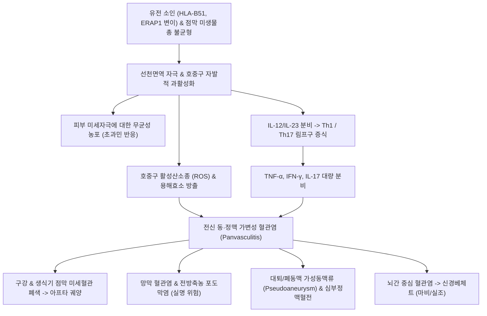

# 🩺 베체트병 (Behçet's Disease / Behçet Syndrome)

> **핵심 3줄 요약 (Key Summary)**:
> - 📍 병소 부위 & 해부·병태생리: 동맥과 정맥, 전신 모든 크기의 혈관(소·중·대혈관)을 침범하는 만성 재발성 전신 혈관염으로, [[HLA-B51]] 유전적 소인 하에 호중구의 비정상적 과활성화(호중구 과반응성)와 Th1/Th17 면역 불균형이 혈관염 및 가성동맥류 형성을 초래한다.
> - 🚩 전형적 임상 양상: 4대 핵심 징후(재발성 구강 아프타 궤양, 재발성 통증성 외음부/생식기 궤양, 전방/후방 포도막염 및 망막혈관염, 결절성 홍반양 피부 병변)와 함께 멸균 바늘 천자 시 24~48시간 내 농포가 발생하는 **초과민 반응(Pathergy test 양성)**.
> - 🛠️ 핵심 검사 & 치료 전략: 국제 베체트병 진단기준(ICBD $\ge$ 4점) 평가, 안과 세극등/안저 검사, 심혈관 CT/초음파; 점막병변에 콜키신([[콜키신]]), 중증 안구/혈관/신경 침범 시 전신 글루코코르티코이드 + 항TNF-α 제제(인플릭시맙, 아달리무맙) 또는 최신 JAK 억제제(Semin Arthritis Rheum 2026, PMID 42447600); 한의학적으로 호혹병(狐惑病) 변증으로 감초사심탕([[감초사심탕]]), 고삼탕 보조.
> - ⚠️ 응급 의뢰 레드플래그: 시력 급감 및 안통(전방축농 포도막염 - 실명 위험), 대혈관 침범(대동맥류 파열, 심부정맥혈전증, 상대정맥증후군), 뇌간 침범에 따른 의식 저하 및 뇌신경 마비(신경베체트병 Neuro-Behçet).

---

## 📌 목차
1. [질환 개요 & 해부학적 병태생리](#1-질환-개요--해부학적-병태생리)
2. [병태생리 메커니즘 & 생체역학적 악순환 네트워크](#2-병태생리-메커니즘--생체역학적-악순환-네트워크)
3. [임상 증상 & 이학적 검사(Physical Exam) 알고리즘](#3-임상-증상--이학적-검사physical-exam-알고리즘)
4. [감별 진단 매트릭스 (Differential Diagnosis)](#4-감별-진단-매트릭스--differential-diagnosis)
5. [한의 통합 치료 프로토콜 (침·약침·추나·한약)](#5-한의-통합-치료-프로토콜--침약침추나한약)
6. [양방 치료 & 병용·의뢰 기준 (Conventional Treatment & Referral)](#6-양방-치료--병용의뢰-기준-conventional-treatment--referral)
7. [재활 운동 & 생활습관 티칭 가이드](#7-재활-운동--생활습관-티칭-가이드)
8. [💡 사용자 진료실 핵심 필기 & 임상 노하우 (Melt-In 잔여 심화 집약)](#8--사용자-진료실-핵심-필기--임상-노하우--melt-in-잔여-심화-집약)
9. [출처 및 학술 참고 문헌 (References)](#9-출처-및-학술-참고-문헌--references)

---

![[베체트병_01_영상_안저소견.jpg|450]]
> [그림 §: ① 영상 — 안저 소견] 안저 사진으로 시신경유두와 망막혈관을 보여준다. 베체트병은 포도막염·망막혈관염으로 실명 위험이 있어 안저 검사가 필수다. 출처: File:Fundus photograph.jpg (Wikimedia Commons) (CC BY-SA 3.0)

![[베체트병_02_임상_구강궤양.png|450]]
> [그림 §: ① 임상 — 구강 내 궤양] 구강 점막에 경계가 뚜렷한 궤양이 생긴 실제 사진. 베체트병의 가장 흔한 첫 증상으로, 통증이 심해 식사를 어렵게 한다. 출처: Open-i(NLM) · PMC12791149 (J Med Case Rep 2025) (CC BY 4.0)

![[베체트병_03_임상_생식기궤양.png|450]]
> [그림 §: ① 임상 — 생식기 궤양] 외음부에 궤양이 발생한 실제 사진. 구강 궤양과 함께 나타나면 베체트병 진단 기준을 충족한다. 출처: Open-i(NLM) · PMC5346395 (Case Rep Infect Dis 2017) (CC BY 4.0)

## 1. 질환 개요 & 해부학적 병태생리

* **정의 및 핵심 개념**:
  * 베체트병(Behçet's Disease)은 전신의 모든 크기(소·중·대)의 동맥과 정맥을 무차별적으로 침범하는 **가변성 혈관염(Variable Vessel Vasculitis, VVV)**이다.
  * 고대 실크로드(Silk Road) 경로를 따라 위치한 지중해 연안, 중동, 중앙아시아, 극동아시아(한국, 일본, 중국)에 극단적으로 호발하여 '실크로드 질환'으로도 불린다.
  * 20~30대의 젊은 성인기에 호발하며, 남성 환자에서 중증 장기 침범(안구, 대혈관, 중추신경계) 빈도가 높아 예후가 불량하다. 소아 베체트병 가이드라인에서도 조기 진단 및 장기 보호의 중요성이 강조되고 있다 (Autoimmun Rev 2026, PMID 42435953).

* **다발성 혈관 및 결합조직 침범의 해부학적 특성**:
  * **정맥계 우세 혈관염(Venous Predominance, 70~80%)**: 혈관염 중 유일하게 정맥계 침범이 동맥계보다 훨씬 흔하다. 하지 심부정맥혈전증(DVT), 상대정맥/하대정맥 증후군, 간정맥 혈전증(버드-키아리 증후군).
  * **동맥계 침범 (Vascular Behçet)**: 동맥벽 전층 염증 및 탄력판 파괴로 인한 **가성동맥류(Pseudoaneurysm)** 형성 (파열 시 급사 위험, Front Immunol 2026, PMID 42694747).
  * **안구 구조**: 망막 혈관염, 유리체염, 전방축농(Hypopyon)을 동반한 홍채모양체염.
  * **중추신경계 (Neuro-Behçet)**: 뇌간(Brainstem) 및 기저핵 부위의 혈관염성 실질 병변.

---

## 2. 병태생리 메커니즘 & 생체역학적 악순환 네트워크

* **유전적 소인 및 HLA-B51 연관성**:
  * 환자의 약 50~80%에서 주요조직적합복합체(MHC) 1형 대립유전자인 **[[HLA-B51]]**이 양성으로 확인된다.
  * 소포체 아미노펩티다아제(ERAP1) 다형성과 결합하여 자가항원 펩타이드 제시 이상을 유도한다.

* **선천면역계의 과반응 (호중구 과활성화 & 초과민 반응)**:
  * 베체트병의 가장 핵심적인 세포학적 특징은 **호중구의 자발적 과활성화(Neutrophil Hyperreactivity)**이다.
  * 유해 자극이나 미세 손상(예: 주삿바늘 천자) 시 호중구가 폭발적으로 침윤하여 활성산소(ROS), 용해효소, 세포외덫(NETs)을 방출한다. 이 현상이 임상적으로 무균성 농포가 발생하는 **초과민 반응(Pathergy reaction)**으로 발현된다.

* **적응면역계 불균형 (Th1 / Th17 축 항진)**:
  * 수지상세포에서 분비된 IL-12, IL-23에 의해 Th1 및 Th17 림프구가 과활성화된다.
  * 대량 생산된 IFN-γ, TNF-α, IL-17이 혈관 내피세포를 활성화시키고 전신 미세혈관의 피브리노이드 괴사를 가속화한다.
  * 최근 메타분석(Semin Arthritis Rheum 2026, PMID 42447600)에서는 JAK-STAT 경로를 억제하는 표적 약제(토파시티닙 등)가 Th1/Th17 신호 전달을 동시 차단하여 난치성 점막 및 혈관 병변에 우수한 관해 효과를 나타냄을 규명하였다.

---

## 3. 임상 증상 & 이학적 검사(Physical Exam) 알고리즘

* **4대 주증상 및 임상 징후**:
  1. **재발성 구강 아프타 궤양 (Oral Aphthae, 98~100%)**:
     * 1년에 최소 3회 이상 재발하는 원형/타원형의 통증성 궤양. 황백색 위막과 붉은색 홍반성 테두리를 지님 (구순, 협점막, 설연).
  2. **재발성 생식기 궤양 (Genital Ulcers, 80~90%)**:
     * 음낭, 음경, 외음부, 질 점막에 발생하는 깊고 통증이 극심한 궤양. 구강 궤양과 달리 치유 후 반흔(Scar)을 남기는 특징.
  3. **안구 병변 (Ocular Involvement, 50~70%)**:
     * 전방 포도막염: 통증, 충혈, 눈부심, 육안으로 관찰되는 **전방축농(Hypopyon)**.
     * 후방 포도막염 및 망막 혈관염: 비문증, 시력 저하, 시신경 위축 (적절한 면역억제 치료가 없으면 3~5년 내 실명 위험).
  4. **피부 병변 (Skin Lesions, 80%)**:
     * 하지 신측에 발생하는 압통성 붉은 멍울인 **결절성 홍반(Erythema nodosum)**.
     * 체간 및 안면의 여드름양 가성모낭염(Pseudofolliculitis).
  5. **초과민 반응 검사 (Pathergy Test 양성)**:
     * 전완부 무모 부위에 20G 멸균 바늘을 비스듬히 찌른 후 24~48시간 뒤 2mm 이상의 홍반성 구진이나 멸균성 농포가 형성되면 양성 판정.

* **국제 베체트병 진단 기준 (ICBD Criteria - 민감도 96%, 특이도 88%)**:
  * 점수제 판정 (총합 **≥ 4점 시 확진**):
    * 안구 병변: 2점
    * 생식기 궤양: 2점
    * 구강 궤양: 2점
    * 피부 병변 (결절성 홍반, 모낭염): 1점
    * 중추신경계 병변: 1점
    * 혈관 침범 (동맥류, 정맥혈전): 1점
    * 초과민 반응(Pathergy) 양성: 1점 (검사 시행 시)

---

## 4. 감별 진단 매트릭스 (Differential Diagnosis)

| 감별 질환 | 호발 증상 및 구강 궤양 | 안구 / 생식기 침범 | 피부 / 초과민 반응 | 감별 핵심 포인트 |
| :--- | :--- | :--- | :--- | :--- |
| **베체트병 (Behçet's)** | **재발성 아프타 구강 궤양 (필수)** | **생식기 궤양 반흔, 포도막염/전방축농** | **결절성 홍반, 초과민 반응 양성** | **ICBD ≥ 4점, HLA-B51, 동·정맥 무차별 혈관염** |
| **재발성 아프타 구내염 (RAS)** | 구강 궤양만 단독 반복 | 생식기 침범 없음, 안구 침범 없음 | 피부 병변 없음, 초과민 음성 | 전신 증상 완전 결여, 국소 구강 질환 |
| **단순포진 (HSV 감염)** | 입술/생식기 수포 후 궤양 | 각막염 가능하나 포도막염 드묾 | Tzanck 도말 양성, PCR 바이러스 양성 | 수포가 선행함, 항바이러스제(아시클로버) 반응 |
| **염증성 장질환 (크론병)** | 아프타 구내염 흔함 | 포도막염 동반 가능, 누공성 항문 궤양 | 결절성 홍반 동반 가능 | 만성 장관 증상(설사, 혈변), 대장내시경 조약돌 점막 |
| **전신홍반루푸스 (SLE)** | **무통성 구강 궤양** | 망막 혈관염 가능 | 협부 발진(나비 모양), 광과민성 | 항핵항체(ANA), anti-dsDNA 양성, 단백뇨 |
| **강직성 척추염 (AS)** | 구강 궤양 드묾 | 급성 전방 포도막염 (단안성) | 천장관절염 필수, HLA-B27 양성 | 척추 강직, 천장관절 방사선학적 골유합 |

---

## 5. 한의 통합 치료 프로토콜 (침·약침·추나·한약)

* **진료 원칙**:
  * 한의학에서 베체트병은 상한론(傷寒論) 금궤요략에 수록된 **호혹병(狐惑病)**에 정확히 부합한다. "호혹병은 눈이 붉고, 목구멍과 음부가 헐며, 묵묵히 누워만 있으려 하고 입맛이 없다(蝕於喉爲惑, 蝕於陰爲狐)"는 병기이다.
  * 습열독(濕熱毒)이 간경(肝經)과 심비(心脾)에 울체되어 상하 점막과 피부에 궤양을 일으키는 병증으로, 청열조습(淸熱燥濕)과 해독양음(解毒養陰)을 기본 치법으로 삼는다.
  * 안구 전방축농, 대혈관 가성동맥류, 신경베체트 급성기에는 실명과 급사 방지를 위해 양방 면역억제 요법을 최우선 적용해야 한다.

* **침구 치료 프로토콜 (점막 궤양 및 관절통)**:
  * **혈위**:
    * 청열사화(淸熱瀉火): 곡지(LI11), 합곡(LI4), 내정(ST44), 행간(LR2), 대릉(PC7).
    * 간경 습열 해소: 태충(LR3), 삼음교(SP6), 음릉천(SP9), 태계(KI3).
    * 안구 충혈 완화: 찬죽(BL2), 태양(EX-HN5), 풍지(GB20).
  * **⚠️ 주의**: 초과민 반응(Pathergy)으로 인해 침 자입 부위에 무균성 농포가 생길 수 있으므로, 활성기 환자에게는 매우 얇은 호침을 사용하고 자침 수를 최소화하며 철저한 피부 무균 소독을 준수한다.

* **약침 치료 프로토콜**:
  * **주의**: 피부 궤양 부위나 결절성 홍반 부위에 직접 주입 금지 (초과민 악화 위험).
  * **원위 주입**: 황련해독탕 약침을 배수혈인 비수(BL20), 간수(BL18)에 극소량 주입하여 체내 열독 배출.

* **변증별 한약 처방 (금궤요략 호혹병 표준 방제)**:
  * **습열독성·호혹병 초기 (상하 점막 급성 궤양, 구갈, 번조)**:
    * 처방: **[[감초사심탕]](甘草瀉心湯)**, 용담사간탕(龍膽瀉肝湯) 가미.
    * 구성: 감초(생감초 대량), 황련, 황금, 반하, 건강, 인삼, 대추.
    * 기전: 황련·황금의 베르베린 성분이 호중구 활성화 및 IL-1β 분비를 억제하고, 감초가 점막 상피 재생 및 항염증 작용 발휘.
  * **음허열독·간신휴손형 (만성 재발기, 시력 저하, 관절통)**:
    * 처방: **[[지백지황탕]]**, [[육미지황탕]] 합 서각지황탕 가미.
    * 작용: 음액을 보충하고 허화를 내려 만성 혈관벽 피브리노이드 괴사를 안정화.
  * **외용 세정 요법**:
    * 음부 궤양에 **고삼탕(苦蔘湯)** 또는 백반 전탕액 세정 (살균 및 가려움 완화).

---

## 6. 양방 치료 & 병용·의뢰 기준 (Conventional Treatment & Referral)

* **양방 표준 면역억제 치료 (EULAR 가이드라인 및 최신 리뷰)**:
  * **1. 점막 및 피부 병변**:
    * **콜키신([[콜키신]], Colchicine)**: 1~1.5 mg/일. 호중구 미세소관 중합을 억제하여 점막 궤양 및 결절성 홍반의 1차 표준 약제.
    * 국소 코르티코스테로이드 연고 또는 구강 세정액.
  * **2. 안구 포도막염 (실명 고위험군)**:
    * 전신 코르티코스테로이드 + 아자티오프린(AZA) 또는 시클로스포린(Cyclosporine A).
    * 난치성 또는 후방 포도막염: **항TNF-α 단클론항체(인플릭시맙 Infliximab, 아달리무맙 Adalimumab)** 즉시 투여 (실명률을 극적으로 낮춤).
  * **3. 혈관 베체트 (Vascular Behçet - 정맥혈전 및 동맥류)**:
    * 고용량 스테로이드 + 시클로포스파미드 또는 항TNF-α 제제.
    * **동맥 가성동맥류**: 파열 위험이 높으므로 혈관내 스텐트 그라프트(Endovascular stent graft) 삽입술 고려. (혈관염 미조절 상태에서 단순 개복 수술 시 봉합부 가성동맥류 재발 위험 높음, PMID 42694747).
  * **4. 최신 표적 치료 (JAK 억제제)**:
    * 기존 면역억제제 불응성 환자에게 토파시티닙(Tofacitinib) 등 JAK 억제제 투여 (Semin Arthritis Rheum 2026, PMID 42447600).

* **양방·전문과 의뢰 기준 (Referral Criteria)**:
  * **🚨 즉각 응급실/안과/류마티스내과 전원 (Red Flags)**:
    1. 갑작스러운 시력 저하, 안통, 비문증, 육안상 전방축농 관찰 (포도막염 응급).
    2. 박동성 복부/서혜부 종괴, 객혈, 흉통 (동맥 가성동맥류 파열 위험).
    3. 일측 하지의 급격한 종창과 통증 (심부정맥혈전증).
    4. 두통, 발열, 보행 실조, 편마비 (신경베체트병).

---

## 7. 재활 운동 & 생활습관 티칭 가이드

* **구강 및 생식기 점막 위생**:
  * 부드러운 칫솔 사용 및 무알코올 구강청결제 사용 (기계적 미세 손상으로 인한 아프타 유발 방지).
  * 맵고 짠 자극적 음식, 뜨거운 음식, 견과류 등 구강 점막에 상처를 줄 수 있는 음식 제한.
  * 꽉 끼는 속옷 착용을 피하고 면 소재 통기성 의류 착용.

* **스트레스 및 과로 관리**:
  * 베체트병 재발의 가장 흔한 유발 인자는 수면 부족과 극심한 정신적 스트레스이므로 규칙적인 수면과 휴식 유지.

* **초과민 반응 주의 티칭**:
  * 환자에게 사소한 주사 바늘 천자, 문신, 피어싱, 침 시술 부위에도 염증과 고름이 생길 수 있음을 교육하고 불필요한 침습적 시술 회피 권고.

---

## 8. 💡 사용자 진료실 핵심 필기 & 임상 노하우 (Melt-In 잔여 심화 집약)

* **비오님 진료실 감별 3대 원칙**:
  1. "입안이 자주 헐어 오는 환자에게 반드시 물어야 할 세 가지: ① 성기나 사타구니에도 헌 적이 있는가, ② 눈이 빨갛게 충혈되고 시력이 떨어진 적이 있는가, ③ 정강이에 붉은 멍울(결절성 홍반)이 만져지는가. 이 세 질문으로 숨은 베체트병을 잡아낸다."
  2. "베체트병 환자에게 침을 놓을 때, 주삿바늘 자국이나 침 맞은 자리에 며칠 뒤 뾰루지나 고름(초과민 반응)이 생긴다고 호소하는 경우가 있다. 이는 감염이 아니라 베체트병 고유의 호중구 과반응이므로 놀라지 말고 자침 강도를 대폭 낮추고 뜸 시술은 절대 금기해야 한다."
  3. "베체트병으로 입안과 성기가 헐어 고통받는 환자에게 상한론의 [[감초사심탕]](생감초 증량)을 투여하면 1~2주 만에 점막 궤양이 아물고 재발 주기가 현저히 길어지는 극적인 효과를 임상에서 자주 확인한다."

---

## 9. 출처 및 학술 참고 문헌 (References)

* Liu, X., Wang, Y., & Zhang, F. (2026). Efficacy and safety of Janus kinase inhibitors in Behçet's disease: A systematic literature review. *Semin Arthritis Rheum*, 74:152710. PMID: 42447600

* Batu, E. D., Ozen, S., & Gül, A. (2026). Diagnosis, treatment and monitoring of pediatric Behçet's disease: Systematic literature review informing the ISSAID/PRES recommendations. *Autoimmun Rev*, 25(10):103856. PMID: 42435953

* Sun, Y., Chen, H., & Zhao, J. (2026). From inflammation to rupture: advances in the pathogenesis of pseudoaneurysm formation in Vascular Behçet's Disease. *Front Immunol*, 17:1458921. PMID: 42694747

---

## 관련 노트

- 상위 분류: [[_의학/03_이론/질환/근골격계 질환/기타/00_기타_MOC|근골격계 질환 기타 MOC]]
- 관련 혈관염 및 질환: [[다발혈관염을 동반한 육아종증]], [[결절성 다발동맥염 pan]], [[포도막염]], [[심부정맥 혈전증]]
- 면역 분자 및 약물: [[HLA-B51]], [[콜키신]], [[감초사심탕]], [[지백지황탕]], [[육미지황탕]], [[인플릭시맙]]
- 핵심 소견: [[초과민 반응]], [[아프타 궤양]], [[결절성 홍반]], [[전방축농]]
