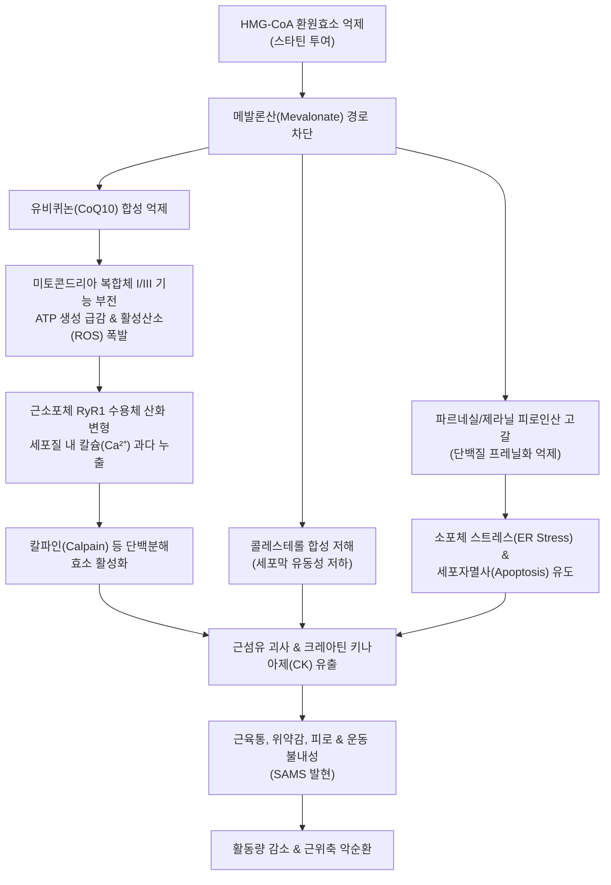

# 🩺 스타틴 유발 근병증 (Statin-Induced Myopathy / SAMS)

> **핵심 3줄 요약 (Key Summary)**:
> - 📍 **병소 부위 & 해부·병태생리**: [[스타틴]] 복용으로 메발론산 경로가 차단되어 [[코엔자임 Q10]](유비퀴논) 결핍 및 미토콘드리아 호흡 사슬 장애, 소포체 칼슘 누출, 단백질 프레닐화 억제가 초래되어 양측 대퇴근·둔근 등 근위부 골격근 세포의 미토콘드리아 손상 및 괴사가 유발된다.
> - 🚩 **전형적 임상 양상**: 약물 투여 시작 또는 증량 수 주~수 개월 내에 대칭적인 근위부 하지(대퇴사두근, 둔근)와 어깨대의 묵직한 근육통, 경련, 무력감, 피로가 나타나며 가벼운 일상 활동에서도 근피로가 급격히 증가한다.
> - 🛠️ **핵심 검사 & 치료 전략**: 혈청 [[크레아틴 키나아제]](CK) 수치 측정 및 SAMS 임상 점수표 적용. 스타틴 일시 중단(Washout 2~4주) 후 증상 소실 여부 판정, 비스타틴 약제([[에제티미브]], PCSK9 억제제) 또는 저용량 격일 요법 전환. 한의학적으로 비주사말(脾主四末)·간주근(肝主筋) 관점에서 기혈양허 및 어혈을 다스리는 [[작약감초탕]], [[보중익기탕]] 가감과 하지 혈위 침구·자하거 약침을 복합 적용한다.
> - ⚠️ **응급 의뢰 레드플래그**: 혈청 CK 정상 상한치 10배 초과 상승, 콜라색(적갈색) 소변(마이오글로빈뇨), 급격한 핍뇨 및 급성 신손상, 진행성 전신 사지 위약 발생 시 즉시 응급실 이송(횡문근융해증 또는 자가면역성 괴사성 근병증 IMNM 의심).

---

## 📌 목차
1. [질환 개요 & 해부학적 병태생리](#1-질환-개요--해부학적-병태생리)
2. [병태생리 메커니즘 & 생체역학적 악순환 네트워크](#2-병태생리-메커니즘--생체역학적-악순환-네트워크)
3. [임상 증상 & 이학적 검사(Physical Exam) 알고리즘](#3-임상-증상--이학적-검사physical-exam-알고리즘)
4. [감별 진단 매트릭스 (Differential Diagnosis)](#4-감별-진단-매트릭스-differential-diagnosis)
5. [한의 통합 치료 프로토콜 (침·약침·추나·한약)](#5-한의-통합-치료-프로토콜-침약침추나한약)
6. [양방 치료 & 병용·의뢰 기준 (Conventional Treatment & Referral)](#6-양방-치료--병용의뢰-기준-conventional-treatment--referral)
7. [재활 운동 & 생활습관 티칭 가이드](#7-재활-운동--생활습관-티칭-가이드)
8. [💡 사용자 진료실 핵심 필기 & 임상 노하우 (Melt-In 잔여 심화 집약)](#8--사용자-진료실-핵심-필기--임상-노하우-melt-in-잔여-심화-집약)
9. [출처 및 학술 참고 문헌 (References)](#9-출처-및-학술-참고-문헌-references)

---

## 1. 질환 개요 & 해부학적 병태생리

* **질환 정의**:
  * 스타틴 유발 근병증(Statin-Induced Myopathy)은 [[이상지질혈증]] 치료 및 심혈관 질환 2차 예방의 핵심 약제인 3-hydroxy-3-methylglutaryl-coenzyme A (HMG-CoA) 환원효소 억제제([[아토르바스타틴]], [[로수바스타틴]], [[심바스타틴]] 등) 복용으로 인해 유발되는 모든 골격근 관련 부작용 스펙트럼(Statin-Associated Muscle Symptoms, SAMS)을 총칭한다.
  * 임상적 스펙트럼은 CK 상승이 없는 단순 근육통(Myalgia, 발생률 5~10%), CK 상승을 동반한 근염(Myositis), 생명을 위협하는 중증 [[횡문근융해증]](Rhabdomyolysis, 발생률 0.001%), 그리고 스타틴 중단 후에도 지속되는 자가면역 기전의 면역매개 괴사성 근병증(Immune-Mediated Necrotizing Myopathy, IMNM, anti-HMGCR 항체 양성)으로 분류된다.

* **표적 해부 구조 및 조직학적 특성**:
  * **주요 호발 부위**: 대근육군에 해당하는 근위부 골격근, 특히 하지의 [[대퇴사두근]], [[둔근]], [[비복근]] 및 상지의 [[삼각근]]에 호발한다.
  * **조직학적 소견**: 골격근 세포 내 미토콘드리아 팽창, 능선(cristae) 파괴, 공포 형성(vacuolation) 및 괴사(necrosis)가 나타나며, 일반적인 염증성 근염과 달리 림프구 등 염증세포의 침윤은 상대적으로 드물다(IMNM의 경우 대식세포 침윤과 근섬유 괴사/재생 소견 우세).

---

## 2. 병태생리 메커니즘 & 생체역학적 악순환 네트워크

* **메발론산 경로 차단과 CoQ10 결핍**:
  * 스타틴은 콜레스테롤 생합성의 율속단계인 HMG-CoA 환원효소를 억제하면서, 그 하류 중간산물인 이소펜테닐 피로인산(IPP)과 파르네실 피로인산(FPP) 합성을 함께 차단한다.
  * FPP 고갈로 인해 미토콘드리아 전자전달계의 핵심 전자 운반체인 [[코엔자임 Q10]](CoQ10, 유비퀴논)의 생합성이 억제되어 ATP 생산이 급격히 저하되고 활성산소종(ROS)이 과다 생성된다.

* **칼슘 항상성 붕괴 및 단백분해 활성화**:
  * 산화 스트레스는 골격근 근소포체막의 리아노딘 수용체(RyR1)를 산화시켜 지속적인 칼슘 누출(Ca²⁺ leak)을 유발한다.
  * 세포질 내 유리 칼슘 농도의 비정상적 증가는 칼슘 의존성 중성 프로테아제인 칼파인(Calpain) 및 카스파아제(Caspase)를 활성화하여 액틴·마이오신 등 수축 단백질을 분해하고 근세포 괴사를 초래한다.

* **자가면역 기전 (Anti-HMGCR IMNM)**:
  * 일부 유전적 소인(HLA-DRB1*11:01 등)을 가진 환자에서는 스타틴 노출로 HMG-CoA 환원효소 단백질 발현이 상향 조절되면서 이를 외래 항원으로 인식하는 자가항체(anti-HMGCR antibody)가 생성되어, 약물을 중단한 후에도 진행성 근괴사가 지속된다.

---

## 3. 임상 증상 & 이학적 검사(Physical Exam) 알고리즘

* **주요 임상 증상**:
  1. **대칭성 근육통 (Symmetric Myalgia)**: "허벅지가 무겁고 쑤신다", "종아리에 쥐가 자주 난다", "어깨가 뻐근하다" 등 둔하고 쑤시는 양상.
  2. **근위약 및 운동 불내성 (Weakness & Exercise Intolerance)**: 계단 오르기나 의자에서 일어날 때 힘이 빠짐, 이전과 동일한 운동 강도에서 극심한 피로 발생.
  3. **발현 시점**: 스타틴 투여 시작 또는 증량 후 수 주 이내(중앙값 4~8주)에 가장 흔히 발생하나, 수 년간 복용 후 다른 약물 병용 시 발생하기도 함.

* **이학적 검사 및 알고리즘**:
  * **도수근력검사 (MMT)**: 장요근, 대퇴사두근, 삼각근 등 근위부 근력 평가 (대부분의 단순 근육통에서는 MMT 정상이나, 근염/IMNM에서는 Grade 4 이하로 저하).
  * **Gowers 징후 검사**: 바닥에서 일어날 때 허벅지를 손으로 짚고 일어나는지 관찰.
  * **SAMS 임상 점수표 (Statin-Associated Muscle Symptoms Clinical Index, SAMS-CI)**:
    * 증상의 양상(대칭성 대퇴/둔근 통증: 3점, 종아리 통증: 2점, 비특이적: 1점)
    * 발현 시기(투여 4주 이내: 3점, 4~12주: 2점, 12주 이후: 1점)
    * 약물 중단 시 개선 여부(2주 내 개선: 2점, 2~4주: 1점)
    * 재투약 시 재발 여부(재투약 시 4주 내 재발: 3점)
    * 총점 9~11점: 매우 높음(Probable SAMS), 7~8점: 가능성 있음, 6점 이하: 가능성 낮음.

---

## 4. 감별 진단 매트릭스 (Differential Diagnosis)

| 질환명 | 주 호발 부위 및 양상 | 혈청 CK 수치 | 특징적 감별 포인트 |
| :--- | :--- | :--- | :--- |
| **스타틴 유발 근병증 (SAMS)** | 양측 대칭성 대퇴·둔근·어깨대 근육통, 피로 | 정상 ~ 경도 상승 (< 5× ULN) | 스타틴 투약 시점과 연관, 약물 중단 시 2~4주 내 증상 호전 |
| **[[횡문근융해증]] (Rhabdomyolysis)** | 극심한 전신 근육통, 급격한 위약, 갈색뇨 | 현저한 급상승 (> 10~40× ULN, 보통 > 10,000) | 적갈색 마이오글로빈뇨, 핍뇨, 급성 신손상 위험, 즉각 응급 의뢰 |
| **면역매개 괴사성 근병증 (IMNM)** | 진행성 대칭성 근위부 근위약, 근위축 | 매우 높음 (10~100× ULN) | 스타틴 중단 후에도 악화 지속, Anti-HMGCR 자가항체 양성 |
| **[[류마티스 다발근통]] (PMR)** | 어깨대 및 골반대의 심한 조조강직과 통증 | 정상 | 50세 이상 호발, ESR/CRP 현저히 상승, 저용량 스테로이드에 극적 반응 |
| **[[섬유근육통]] (Fibromyalgia)** | 신체 축 및 사지 전반의 광범위 만성 통증 | 정상 | 수면장애, 인지저하 동반, 다발성 압통점, 약물 복용력과 무관 |
| **[[갑상선기능저하증]] 유발 근병증** | 근위부 근력 저하, 근경련, 체중 증가 | 경도~중등도 상승 | TSH 상승, Free T4 저하, 추위 불내성, 건반사 이완기 지연 |

---

## 5. 한의 통합 치료 프로토콜 (침·약침·추나·한약)

* **변증 분류**:
  1. **기혈양허·비신부족 (氣血兩虛·脾腎不足)**: 비주사말(脾主四末) 기능 저하로 사지 근육에 영양 공급이 안 되고 미토콘드리아 기화(氣化) 작용이 저하된 상태. 사지 권태, 보행 무력, 면색 창백, 설담태백, 맥세약.
  2. **기체어혈·혈맥어저 (氣滯瘀血·血脈瘀阻)**: 미세혈관 순환 저하 및 근육 내 대사산물 축적으로 찌르는 듯한 통증, 야간통 심화, 설자암, 맥삽.
  3. **한습비저 (寒濕痺阻)**: 근육이 무겁고 시리며 날씨가 흐리면 악화되는 양상.

* **침구 치료 프로토콜**:
  * **주요 혈위**:
    * 하지 근위부: [[족삼리]](ST36), [[양릉천]](GB34, 근회), [[위중]](BL40), [[승산]](BL57), [[혈해]](SP10), [[음릉천]](SP9).
    * 골반·요둔부: [[신수]](BL23), [[비수]](BL20), [[환도]](GB30), [[대장수]](BL25).
  * **자침 기법**: 양릉천과 족삼리에 2~4Hz 저주파 전침을 15분간 적용하여 근육 혈류량을 증가시키고 미토콘드리아 생합성 촉진(PGC-1α 발현 유도).

* **약침 치료**:
  * **자하거(Hominis Placenta) 약침**: 비신양허형 만성 근위약에 족삼리, 비수, 신수에 각 0.2~0.5cc 주입. 세포 재생 및 항산화 효과 도모.
  * **중성어혈 약침 또는 황련해독탕 약침**: 근육통 및 압통이 심한 대퇴사두근 압통점(Asi points)에 0.1~0.2cc씩 산자하여 국소 미세순환 개선.

* **한약 처방 프로토콜**:
  * **[[작약감초탕]](芍藥甘草湯)**: 백작약 16~24g, 감초 8~12g. 작약의 Paeoniflorin 성분이 근육 이완과 세포 내 칼슘 과부하를 안정시키고 급성 근육 경련과 통증을 신속히 완화.
  * **[[보중익기탕]](補中益氣湯) 또는 [[사군자탕]](四君子湯) 가미**: 기허성 전신 무력감과 피로감이 뚜렷한 경우 황기, 인삼, 백출 등을 활용하여 미토콘드리아 대사 기능 회복 지원.
  * **[[보양환오탕]](補陽還五湯) 가감**: 어혈이 동반된 사지 위약증에 황기를 군약으로 하고 당귀미, 천궁, 적작약, 도인, 홍화를 가미하여 미세혈관 관류 개선.

---

## 6. 양방 치료 & 병용·의뢰 기준 (Conventional Treatment & Referral)

* **약물 치료 및 조정 전략 (Conventional Management)**:
  * **단계적 대처 알고리즘 (Epelde, 2026; Cha & Hong, 2025)**:
    1. **SAMS 의심 시 즉시 조치**: 스타틴 투여를 2~4주간 일시 중단(Drug Holiday / Washout)하고 기저 CK 측정.
    2. **증상 소실 확인 후 전략**:
       * 동일 스타틴을 최저 용량으로 감량하여 재투여.
       * 다른 계열의 스타틴으로 교체: 지용성 스타틴([[아토르바스타틴]], [[심바스타틴]])에서 친수성 스타틴([[로수바스타틴]], [[프라바스타틴]])으로 변경(근육 투과성이 낮음).
       * 간헐적/격일 투여(예: 로수바스타틴 5mg 주 2~3회).
    3. **비스타틴 지질저하제 전환**:
       * [[에제티미브]](Ezetimibe 10mg): 소장 콜레스테롤 흡수 억제제로 단독 또는 초저용량 스타틴과 병용.
       * PCSK9 억제제(Evolocumab, Alirocumab): 근병증 위험 없이 강력한 LDL-C 강하 효과를 제공하는 피하주사제(Aebi et al., 2025).
       * 벰페도산(Bempedoic Acid): 간에서만 활성화되는 전구약물로 근육 부작용이 거의 없음.

* **한의 병용 판단 및 상호작용**:
  * 환자가 심혈관 질환 고위험군(관상동맥 스텐트 삽입 등)인 경우 자의로 스타틴을 전면 중단하면 급성 심근경색 재발 위험이 있으므로, 처방의와 상의 없이 임의 중단하지 않도록 지도한다.
  * 한의 치료(작약감초탕, 침구)는 스타틴 복용을 유지하거나 감량 재투여하는 과정에서 근육통 역치를 높이고 순응도를 유지시키는 데 안전하게 병용될 수 있다.

* **양방·전문과 의뢰 기준 (Referral Criteria)**:
  * **🚨 즉각 응급실 의뢰 (Red Flags)**:
    1. 소변 색깔이 흑갈색, 콜라색으로 변하며 소변량이 급감하는 경우.
    2. 혈청 CK 수치가 정상치의 10배 이상 상승하고 극심한 근통·발열·구역이 동반된 경우.
  * **류마티스내과 의뢰**:
    * 스타틴을 6주 이상 완전히 중단했음에도 불구하고 근위약과 CK 상승이 지속되거나 악화되는 경우(Anti-HMGCR IMNM 정밀 항체 검사 및 근조직 생검 필요).

---

## 7. 재활 운동 & 생활습관 티칭 가이드

* **운동 강도 조절**:
  * 급성기 근육통이 심할 때는 과도한 원심성(eccentric) 수축 운동(내리막길 달리기, 무거운 스쿼트)을 엄격히 제한한다(스타틴 복용 근육은 기계적 손상에 취약함).
  * 통증이 안정되면 걷기, 고정식 자전거, 수영 등 저충격 유산소 운동부터 서서히 재개한다.

* **식이 및 영양 보충**:
  * **코엔자임 Q10(CoQ10) 보충**: 하루 100~200mg 섭취는 메발론산 경로 차단에 따른 조직 내 유비퀴논 결핍 보충에 임상적 보조 효과를 기대할 수 있다.
  * **비타민 D 점검**: 비타민 D 결핍(< 20 ng/mL)은 SAMS의 주요 위험 인자이므로 결핍 시 보충한다.
  * **CYP3A4 억제 물질 금지**: 자몽(Grapefruit) 주스, 특정 항진균제(이트라코나졸), 마크로라이드계 항생제는 스타틴의 혈중 농도를 급격히 상승시켜 근독성을 증폭시키므로 섭취를 금한다.

---

## 8. 💡 사용자 진료실 핵심 필기 & 임상 노하우 (Melt-In 잔여 심화 집약)

* **진료실 임상 팁**:
  * 60~70대 고혈압·당뇨 환자가 "최근 몇 달 전부터 허벅지가 천근만근 무겁고 계단 오르기가 너무 힘들다"고 호소하면 요추 질환이나 무릎 관절염만 보지 말고 **반드시 복용 약물 목록에서 스타틴 여부를 확인**해야 한다.
  * "노세(老衰)인가 보다" 하고 방치하다가 삶의 질이 떨어지는 환자가 많다. 처방 내과의에게 의뢰서를 작성하여 스타틴 변경 또는 용량 조정을 권유하고, 한의원에서는 비위 기능 보강과 작약감초탕을 투여하면 2~3주 내에 드라마틱하게 보행 능력이 회복된다.
  * 만약 약물을 끊었는데도 2달 넘게 양측 팔다리에 힘이 안 들어가고 머리를 빗거나 숟가락 들기가 힘들다면 지체 없이 대학병원 류마티스내과로 의뢰하여 항-HMGCR 항체 검사를 받게 해야 한다.

---

## 9. 출처 및 학술 참고 문헌 (References)

* Epelde F. (2026). Statin-Associated Muscle Symptoms and Myotoxicity: A Clinically Oriented Narrative Review with a Practical Prevention, Evaluation, and Management Algorithm. *Medicina (Kaunas)*. 62(6):1042. PMID: 42356146

* Cha JJ, Hong SJ. (2025). Diagnosis and Management of Statin-Associated Muscle Symptoms. *Korean Circ J*. 55(11):957-968. PMID: 41044735

* Aebi PS, Villoz F, Bührer J, et al. (2025). Safety outcomes of statin vs non-statin lipid-lowering interventions in patients with prior statin-associated muscle symptoms: A systematic review and meta-analysis. *PLoS One*. 20(12):e0338575. PMID: 41379822

---

## 관련 노트

- [[이상지질혈증]]
- [[횡문근융해증]]
- [[코엔자임 Q10]]
- [[크레아틴 키나아제]]
- [[작약감초탕]]
- [[보중익기탕]]
- [[대퇴사두근]]
