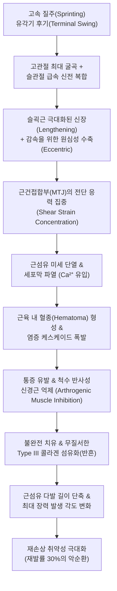

# 🩺 슬건 손상 (Hamstring Injury / Hamstring Strain)

> **핵심 3줄 요약 (Key Summary)**:
> - 📍 **병소 부위 & 해부·병태생리**: 고속 질주(sprinting)의 유각기 후기(late swing phase) 또는 과도한 스트레칭 중 [[슬괵근]](대퇴이두근 장두, 반건양근, 반막양근)이 극한의 원심성(eccentric) 수축 부하를 받을 때 근건접합부(Myotendinous junction, MTJ) 또는 좌골결절 부착부 건 섬유가 파열되는 급성 스포츠 손상이다.
> - 🚩 **전형적 임상 양상**: 달리기나 발차기 중 허벅지 뒤쪽에서 "뚝" 하는 파열음과 함께 쥐어짜는 듯한 극심한 통증이 발생하며, 보행 시 다리를 절뚝이고 수일 내에 무릎 뒤쪽으로 퍼지는 광범위한 피하 반상출혈(멍)과 부종이 동반된다.
> - 🛠️ **핵심 검사 & 치료 전략**: Askling H-test, 복와위 저항성 슬관절 굴곡 검사, 국소 압통 및 근육 함몰(defect) 촉진, 초음파/MRI를 통한 BAMIC 손상 등급 분류. 급성기 POLICE 요법 후 아급성기부터 [[위중]], [[은문]], [[승부]] 혈위 심부 전침 및 [[자하거]]·[[신바로]] 약침, [[당귀수산]] 등 어혈 치료를 시행하고, 노르딕 햄스트링 컬(NHC) 기반 편심성 재활을 적용한다.
> - ⚠️ **응급 의뢰 레드플래그**: 좌골결절(Ischial tuberosity) 부착부에서 2개 이상의 건이 완전 파열(Avulsion)되거나 2cm 이상 후퇴(retraction)된 경우, 심한 좌골신경 마비(족하수, 하지 감각 소실)가 동반된 경우 즉시 정형외과 응급 수술 의뢰.

---

## 📌 목차
1. [질환 개요 & 해부학적 병태생리](#1-질환-개요--해부학적-병태생리)
2. [병태생리 메커니즘 & 생체역학적 악순환 네트워크](#2-병태생리-메커니즘--생체역학적-악순환-네트워크)
3. [임상 증상 & 이학적 검사(Physical Exam) 알고리즘](#3-임상-증상--이학적-검사physical-exam-알고리즘)
4. [감별 진단 매트릭스 (Differential Diagnosis)](#4-감별-진단-매트릭스-differential-diagnosis)
5. [한의 통합 치료 프로토콜 (침·약침·추나·한약)](#5-한의-통합-치료-프로토콜-침약침추나한약)
6. [양방 치료 & 병용·의뢰 기준 (Conventional Treatment & Referral)](#6-양방-치료--병용의뢰-기준-conventional-treatment--referral)
7. [재활 운동 & 생활습관 티칭 가이드](#7-재활-운동--생활습관-티칭-가이드)
8. [💡 사용자 진료실 핵심 필기 & 임상 노하우 (Melt-In 잔여 심화 집약)](#8--사용자-진료실-핵심-필기--임상-노하우-melt-in-잔여-심화-집약)
9. [출처 및 학술 참고 문헌 (References)](#9-출처-및-학술-참고-문헌-references)

---

![[슬건손상_01_임상_근손상자반.jpg|450]]
> [그림 §: ① 임상 — 햄스트링 손상 자반] 허벅지 뒤쪽에 광범위한 자반(멍)이 생긴 실제 사진. 슬건(햄스트링) 파열 시 나타나는 전형적 소견이다. 출처: File:2010-10-02 pulled hamstring.jpg (Wikimedia Commons) (CC BY-SA 3.0)

## 1. 질환 개요 & 해부학적 병태생리

* **질환 정의**:
  * 슬건 손상(Hamstring Strain Injury, HSI)은 대퇴 후면에 위치하는 3개의 이관절성(biarticular) 근육군인 [[대퇴이두근]](Biceps femoris), [[반건양근]](Semitendinosus), [[반막양근]](Semimembranosus)의 근육-건 복합체(Musculotendinous unit)에 가해지는 과도한 신장력 및 원심성 수축력에 의해 발생하는 파열 손상이다.
  * 육상, 축구, 미식축구, 야구 등 고속 전력질주(sprinting)와 급격한 가속/감속을 요하는 스포츠에서 가장 빈발하는 단일 근육 손상(재발률 12~33%)이다.

* **표적 해부 구조 및 손상 분류**:
  * **해부학적 취약점**:
    * 세 근육은 모두 골반의 [[좌골결절]](Ischial tuberosity)에서 기시하여 고관절을 신전시키고 슬관절을 굴곡시키는 이관절 근육(대퇴이두근 단두 제외)으로, 생체역학적으로 높은 기계적 긴장에 노출된다.
    * 전체 슬건 손상의 80% 이상이 [[대퇴이두근]] 장두(BFLH)의 근위부 근건접합부(Myotendinous junction, MTJ)에서 발생한다(반막양근은 과도한 고관절 굴곡 스트레칭 손상 시 빈발).
  * **영국 체육의학회(BAMIC) 분류 체계**:
    * **Grade 0**: 근육통(DOMS) 또는 신경근성 통증 (구조적 파열 없음).
    * **Grade 1**: 미세 근섬유 파열 (부종 관찰, 구조 보존).
    * **Grade 2**: 중등도 부분 파열 (근육 다발 파열 및 결손).
    * **Grade 3**: 광범위 부분 파열 또는 아완전 파열.
    * **Grade 4**: 완전 파열(Full-thickness tear 또는 견열 골절).
    * *위치 세분화*: a(근막/근주막), b(근복/MTJ), c(건내/중심건 손상 — 예후 불량).

---

## 2. 병태생리 메커니즘 & 생체역학적 악순환 네트워크

* **원심성 수축 부하와 역학적 파열**:
  * 질주 시 다리가 앞으로 뻗어나가는 유각기 후기(Terminal swing phase)에서 슬괵근은 대퇴 사두근의 신전 토크를 감속시키고 발이 지면에 닿기 전 다리를 뒤로 당기기 위해 강력한 원심성 수축을 수행한다.
  * 이때 근절(Sarcomere)이 최적 길이 이상으로 과신전되면서 Z-disc 파열과 세포막(Sarcolemma) 손상이 유발되어 세포 내 칼슘 유입 및 자가용해 과정이 시작된다.

* **골반 부정렬 및 코어 기능 부전의 영향**:
  * 골반의 과도한 전방 경사(Anterior pelvic tilt)는 좌골결절을 상후방으로 이동시켜 슬괵근의 기저 긴장도를 비정상적으로 증가시킨다.
  * [[대둔근]]의 활성화 지연은 고관절 신전 시 슬괵근에 과도한 보상성 부하를 전가하여 손상 위험을 배가시킨다(Baroni et al., 2026; Kellis et al., 2026).

---

## 3. 임상 증상 & 이학적 검사(Physical Exam) 알고리즘

* **주요 임상 증상**:
  1. **급격한 통증과 파열감**: 전력 질주, 점프, 킥 동작 중 허벅지 뒤쪽에서 날카로운 칼로 찌르는 듯한 통증과 함께 "툭" 또는 "뚝" 소리가 남.
  2. **체중 부하 장애 및 파행(Limping)**: 손상 직후 무릎을 굽힌 채 걷거나 통증으로 체중을 싣지 못함.
  3. **지연성 반상출혈**: 손상 24~48시간 후 중력에 의해 슬와부(오금) 및 종아리 상부로 피하 출혈(멍)이 넓게 퍼짐.

* **이학적 검사 알고리즘**:
  * **국소 촉진 검사 (Palpation)**:
    * 복와위에서 좌골결절부터 슬와부까지 주행 경로를 따라 촉진.
    * 압통의 위치(근위부 vs 원위부) 및 파열 부위의 근육 함몰(palpable gap) 확인. 좌골결절에 가까울수록 회복 기간이 길어짐.
  * **복와위 저항성 슬관절 굴곡 검사 (Resisted Knee Flexion Test)**:
    * 슬관절 15도 및 90도 굴곡 상태에서 검사자의 저항에 대항하여 굴곡력 측정. 15도(신장 상태)에서 통증이 더 심하면 원심성 손상 확인.
  * **Askling H-test (Active Hamstring Flexibility Test)**:
    * 앙와위에서 환자 스스로 통증이 없는 한도 내에서 슬관절을 신전한 채 고관절을 최대한 빠르게 들어 올리게 하여 통증과 불안정감 평가 (복귀 결정의 핵심 지표).
  * **Puranen-Orava Test**:
    * 환자가 서서 의자나 침대에 환측 다리를 올리고 체간을 전방 굴곡시킬 때 슬괵근에 날카로운 견인통이 재현되는지 확인.

---

## 4. 감별 진단 매트릭스 (Differential Diagnosis)

| 질환명 | 주 통증 부위 | 이학적/영상 검사 소견 | 감별 포인트 |
| :--- | :--- | :--- | :--- |
| **슬건 급성 손상 (Hamstring Strain)** | 대퇴 후면 근복 또는 MTJ 부위 | 촉진 시 명확한 압통, 저항 굴곡 시 통증, 초음파상 근섬유 단열 | 급성 외상력(달리기 등), 멍 동반, 신경학적 이상 없음 |
| **[[근위 햄스트링 건병증]] (PHT)** | 좌골결절 부착부 국한 | 단단한 의자 착석 시 압통, 슬관절 굴곡 저항 검사는 대개 음성 | 만성적 과사용, 찌르는 통증보다 둔통, 달리기보다 착석 시 통증 |
| **[[요추 추간판 탈출증]] (HNP L5/S1)** | 둔부~대퇴 후면~종아리 방사통 | [[SLR Test]](직거상 검사) 양성, 슬개건/아킬레스건 반사 저하 | 요통 동반 가능, 저림 및 이상감각, 기침/재채기 시 악화 |
| **[[이상근 증후군]] (Piriformis Syn.)** | 둔부 중앙 통증 및 대퇴 후면 방사통 | FAIR test 양성, 이상근 압통 | 대퇴 근육 자체의 저항 검사는 정상, 둔부 깊은 압통 |
| **좌골결절 견열 골절 (Avulsion Fx)** | 좌골결절 부위 극심한 통증 | 골반 단순 방사선(X-ray)상 골편 전위 관찰 | 청소년 운동선수(골단판 미유합) 호발, 뼈 부착부 결손 |

---

## 5. 한의 통합 치료 프로토콜 (침·약침·추나·한약)

* **변증 분류**:
  1. **기체어혈형 (氣滯瘀血型 - 손상 급성기 1~7일)**: 경락이 손상되고 혈맥이 파열되어 어혈이 정체됨. 찌르는 듯한 통증, 부종, 피하 반상출혈, 거안(拒按), 설어반, 맥현삽.
  2. **근맥실양·기혈양허형 (筋脈失養·氣血兩虛型 - 아급성/만성기)**: 근육 조직의 반흔화 및 순환 저하로 근맥이 영양을 받지 못함. 뻐근한 둔통, 무력감, 운동 시 당김, 설담, 맥세약.

* **침구 치료 프로토콜**:
  * **주요 혈위**:
    * 족태양방광경: [[승부]](BL36, 좌골결절 하연), [[은문]](BL37, 대퇴 후면 중앙), [[부극]](BL38), [[위양]](BL39), [[위중]](BL40).
    * 국소 아시혈(Ash Point): 파열 부위 주변 및 근막 긴장점.
  * **시술 방법**:
    * 급성기(1~3일): 파열된 근육 부위를 직접 강자극하지 않고, 원위부 혈위([[곤륜]], [[후계]]) 및 가벼운 혈위 자침으로 진통 유도.
    * 아급성기(4일 이후): 은문-승부, 은문-위중 간에 2Hz 저주파 전침을 15분간 적용하여 근육 미세 펌핑 작용을 통한 혈종 흡수 및 콜라겐 정렬 촉진.

* **약침 치료**:
  * **신바로(Shinbaro) 또는 황련해독탕 약침 (급성기)**: 손상 주변 연부조직에 0.5~1.0cc 주입하여 국소 염증성 부종 완화.
  * **자하거(Hominis Placenta) 약침 (회복기)**: 손상된 MTJ 부위 및 좌골결절 부착부에 0.5~1.0cc 심부 주입하여 근섬유 재생 촉진 및 반흔 유착 방지.

* **한약 처방 프로토콜**:
  * **손상 초기(1~2주)**: **[[당귀수산]](當歸鬚散)** 또는 **[[활혈거어탕]](活血祛瘀湯)**
    * 당귀미, 도인, 홍화, 소목 등으로 파열된 근육 내 혈종을 신속히 흡수시키고 미세순환을 정상화.
  * **회복 및 재활기(3주 이후)**: **[[독활기생탕]](獨活寄生湯)** 또는 **[[보혈안신탕]](補血安神湯) 가미방**
    * 속단, 두충, 우슬, 구척 등을 가미하여 간신(肝腎)을 보하고 근골(筋骨)을 강건하게 하여 재파열 예방.

* **추나 치료 (Chuna Manipulation)**:
  * 골반 변위 교정: 동측 장골의 전하방 변위(Anterior-inferior innominate rotation)를 교정하여 슬괵근에 걸리는 기계적 장력을 정상화.
  * 근막이완기법(Myofascial Release): 3주 이후 대퇴이두근과 반막양근 사이의 근간 중격(Intermuscular septum) 유착을 부드럽게 이완.

---

## 6. 양방 치료 & 병용·의뢰 기준 (Conventional Treatment & Referral)

* **보존적 치료 프로토콜 (Conservative Management)**:
  * **POLICE 요법 (급성기 48~72시간)**:
    * Protection(보호/목발), Optimal Loading(최적 부하), Ice(냉찜질 15분), Compression(압박 붕대), Elevation(거상).
  * **NSAIDs 투여의 주의점**:
    * 손상 초기 48시간 이내 고용량 NSAIDs의 장기 사용은 근위성세포(Satellite cell) 증식과 근육 재생 과정을 억제할 수 있으므로 극심한 통증 시 단기(3~5일)에 한해 사용 권고.
  * **초음파 유도하 PRP(자가 혈소판 풍부 혈장) 주사**:
    * 중심건(central tendon) 손상 또는 고등급 부분 파열에서 치유 기간 단축을 위해 고려되나 근거 수준은 상이함.

* **수술적 치료 적응증 (Surgical Indication)**:
  * **절대적 적응증**:
    1. 좌골결절 기시부에서 2개 이상 건의 완전 박리 파열(Avulsion) 및 2cm 이상의 후퇴.
    2. 보존적 치료에 실패하고 만성적 좌골신경 압박 증상이 지속되는 심한 반흔 구축.

* **양방·전문과 의뢰 기준 (Referral Criteria)**:
  * **🚨 즉각 정형외과 의뢰 (Red Flags)**:
    1. 둔부 하연에서 주먹 크기 이상의 거대한 혈종과 함께 근육의 명확한 단절 틈새(Gap)가 촉진되는 경우.
    2. 족부의 족저굴곡/배굴 근력 저하(Foot drop) 또는 발바닥 감각 마비 등 좌골신경 손상 징후가 동반된 경우.
    3. 청소년 운동선수에서 단순 방사선상 좌골결절 견열 골절이 의심되는 경우.

---

## 7. 재활 운동 & 생활습관 티칭 가이드

* **단계별 재활 로드맵 (SONAFE-Brazil CPG, Baroni et al., 2026)**:
  * **1단계 (급성기, 1~5일)**: 통증 없는 범위 내 능동적 관절 가동 운동, 둔근 등척성 수축, 골반 안정화 운동.
  * **2단계 (아급성 회복기, 1~3주)**: 
    * 통증 없는 범위에서 점진적 저항 운동 시작.
    * 브릿지(Bridge), 짐볼 햄스트링 컬, 슬괵근 등장성 운동.
  * **3단계 (편심성 근력 강화기, 3주 이후)**:
    * **노르딕 햄스트링 컬 (Nordic Hamstring Curl, NHC)**: 무릎을 꿇고 발목을 고정한 상태에서 체간을 앞으로 천천히 기울이며 슬괵근의 원심성 제동력을 기르는 핵심 운동 (손상 예방 및 재발 방지 근거 최상).
    * **Askling L-Protocol**:
      1. Extender: 앙와위에서 고관절 90도 굴곡 후 슬관절을 능동적으로 펴는 신장 운동.
      2. Diver: 한 발로 서서 체간을 앞으로 숙이고 반대쪽 다리를 뒤로 뻗는 밸런스 운동.
      3. Glider: 한쪽 발을 뒤로 미끄러뜨리며 원심성 부하를 주는 슬라이딩 운동.

* **스포츠 복귀 (Return to Play, RTP) 판정 기준**:
  1. 촉진 시 통증 완전 소실.
  2. 도수근력검사 및 등속성 근력 검사상 건측 대비 90% 이상 근력 회복.
  3. Askling H-test 시 통증이나 두려움(kinesiophobia) 없이 전속력 수행 가능.

---

## 8. 💡 사용자 진료실 핵심 필기 & 임상 노하우 (Melt-In 잔여 심화 집약)

* **진료실 임상 팁**:
  * 슬건 손상 환자가 내원했을 때 통증 부위가 좌골결절에 가까운지, 허벅지 중간(근복)인지 반드시 짚어보아야 한다. **좌골결절에 가까운 근위부 건 손상일수록 회복 기간이 2~3배 길어지며**, 선수 복귀까지 최소 8~12주 이상 소요된다.
  * 초기에 통증이 가라앉았다고 조기 질주를 허용하면 십중팔구 2~3주 내에 더 큰 파열로 재발한다. "통증이 사라진 것이 다 나은 것이 아니며, 근육 섬유의 원심성 장력이 완전히 복원되어야 한다"는 점을 환자에게 강력히 티칭해야 한다.
  * 치료 시 허벅지 뒤쪽만 보지 말고 골반 전방 경사와 요추 전만을 반드시 평가하라. 장요근이 단축되어 골반이 앞으로 기울어져 있으면 슬괵근은 가만히 있어도 팽팽하게 당겨진 상태가 되므로 재파열의 온상이 된다. 장요근 이완 추나와 대둔근 강화가 병행되어야 근본 치유가 된다.

---

## 9. 출처 및 학술 참고 문헌 (References)

* Baroni BM, Ribeiro de Oliveira R, Pereira ALA, et al. (2026). Rehabilitation of Athletes With Hamstring Strain Injury: SONAFE-Brazil Clinical Practice Guideline. *J Orthop Sports Phys Ther*. 56(10):627-641. PMID: 42823642

* Hulm S, Lin YC, Maniar N, et al. (2026). Impact of Prior Hamstring Strain Injury on Muscle Morphology and Sprinting Biomechanics in Collegiate American Football Athletes. *Scand J Med Sci Sports*. 36(6):e70317. PMID: 42261806

* Kellis E, Giakas G, Baltzopoulos V. (2026). Continuous and discrete electromyographic analysis of trunk and hip extensor musculature during the Biering-Sørensen test in athletes with a history of hamstring strain injury. *J Electromyogr Kinesiol*. 89:103178. PMID: 42208112

---

## 관련 노트

- [[슬괵근]]
- [[대퇴사두근]]
- [[대둔근]]
- [[근위 햄스트링 건병증]]
- [[좌골신경통]]
- [[요추 추간판 탈출증]]
- [[당귀수산]]
- [[독활기생탕]]
